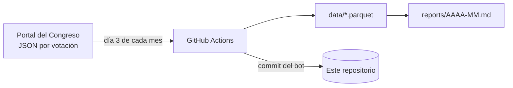

# votaciones-congreso

Análisis automático y mensual de **cómo votan los grupos parlamentarios y los diputados en el Pleno del Congreso de los Diputados**, a partir del [portal de datos abiertos del Congreso](https://www.congreso.es/es/opendata/votaciones).

Cada mes, GitHub Actions descarga las votaciones del mes anterior, las guarda en `data/` y publica en [reports/](reports/) **un resumen para cualquier ciudadano**: las votaciones más importantes con su hemiciclo, explicadas sin tecnicismos y diciendo quién votó qué. Además publica **un análisis detallado** con:

- qué se votó y qué salió aprobado o rechazado, por tipo de asunto;
- la posición de cada grupo en cada votación;
- un **mapa de diputados** según cómo votan y un mapa de calor de **afinidad entre grupos**;
- con qué **mayorías** se aprobó cada cosa y qué votaciones **perdió el Gobierno**;
- cohesión interna y qué grupos fueron **decisivos**;
- el **hemiciclo** de las votaciones más ajustadas;
- diputados que votaron distinto de su grupo y los que más veces no votaron.



## Uso rápido

En local se usa el entorno único de `~/proyectos` (ver [docs/HANDOFF.md](docs/HANDOFF.md)):

```bash
make check                                   # lint + tests (sin red)
make sondear                                 # 1 petición: ¿responde el portal?
../.venv/bin/python -m src.votaciones actualizar --dia 2026-09-30   # probar con un día
../.venv/bin/python -m src.votaciones mensual                       # lo mismo que hace Actions
../.venv/bin/python -m src.votaciones historico --desde 2023-09     # carga inicial (~1 h)
```

## Límites

- Solo **Pleno y Diputación Permanente**: el portal no publica votaciones de comisión.
- Se analiza por **grupo parlamentario**, no por partido. El Grupo Mixto mezcla partidos.
- El portal **no publica el resultado oficial**: se calcula con la mayoría que exige cada votación (simple, 176 o 210).
- El Congreso publica con **semanas de retraso**. Los días aún sin datos se señalan en el informe y se rellenan en corridas posteriores.
- Las votaciones secretas (suplicatorios) y las públicas por llamamiento (investiduras, leyes orgánicas) no tienen voto individual en los datos abiertos: solo totales.

Detalle en [docs/DOCUMENTO_FUNCIONAL.md](docs/DOCUMENTO_FUNCIONAL.md).

## Documentación

| Documento | Para qué |
|---|---|
| [docs/HANDOFF.md](docs/HANDOFF.md) | Estado actual y cómo seguir |
| [docs/DOCUMENTO_FUNCIONAL.md](docs/DOCUMENTO_FUNCIONAL.md) | Qué hace, definiciones de cada métrica y límites |
| [docs/ARCHITECTURE.md](docs/ARCHITECTURE.md) | Módulos, datos y funcionamiento del portal |
| [docs/DESIGN.md](docs/DESIGN.md) | Diseño del informe y criterios de redacción |
| [docs/DECISIONS.md](docs/DECISIONS.md) | Decisiones tomadas y abiertas |
| [docs/BACKLOG.md](docs/BACKLOG.md) | Qué falta |
| [docs/CHANGELOG.md](docs/CHANGELOG.md) | Cambios |
| [AGENTS.md](AGENTS.md) | Instrucciones para agentes de IA |

Los datos proceden del Congreso de los Diputados (congreso.es). Este proyecto no tiene relación con la institución.
