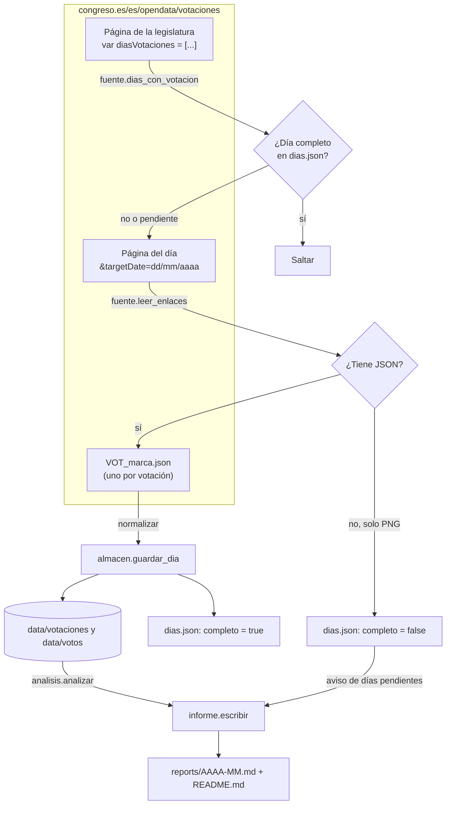
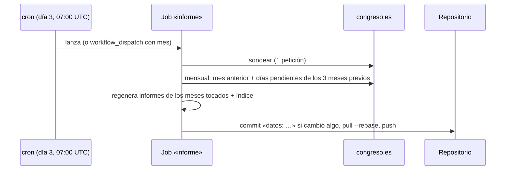

# Arquitectura

## Estructura

```
votaciones-congreso/
├── src/votaciones/
│   ├── config.py       rutas, URLs, constantes de método, etiquetas de grupo
│   ├── fuente.py       portal del Congreso: calendario, enlaces del día, descarga (única con red)
│   ├── normalizar.py   JSON de una votación -> fila de votación + filas de votos
│   ├── almacen.py      parquet mensual, sustitución por día, manifiesto dias.json
│   ├── analisis.py     posiciones, cohesión, decisivos, afinidad, disidencias, ausencias
│   ├── informe.py      Markdown del mes e índice
│   └── cli.py          órdenes sondear / actualizar / informe / mensual / historico
├── tests/              sin red; JSON sintético con la forma real del portal
├── data/               lo escribe el bot (en git)
│   ├── votaciones/AAAA-MM.parquet
│   ├── votos/AAAA-MM.parquet
│   └── dias.json
├── reports/            lo escribe el bot (en git): AAAA-MM.md y README.md
├── .github/workflows/  mensual.yml (cron) y tests.yml (push/PR)
└── docs/
```

## Flujo



## El portal (comprobado el 2026-11-10)

No hay API: es una página Liferay con un calendario.

| Qué | Cómo |
|---|---|
| Días con votación | `GET /es/opendata/votaciones` → en el JavaScript, `var diasVotaciones = [20230919, …]`. Con `?p_p_id=votaciones&p_p_lifecycle=0&p_p_state=normal&p_p_mode=view&targetLegislatura=XV`, los de esa legislatura |
| Legislatura actual | `var idCurrentLegislatura = 15` en la misma página |
| Votaciones de un día | La misma URL con `&targetDate=30/09/2026`. Enlaza `/webpublica/opendata/votaciones/Leg15/Sesion202/20260930/Votacion001/VOT_20260930153547.json` (y `.xml`, `.png`, `.pdf`) |
| Un ZIP por sesión | `…/Sesion202/20260930/VOT_….zip`, con JSON, XML, PDF y PNG de todas (~4 MB). **No se usa** (D-01) |
| Diputados | `/es/opendata/diputados` → `DiputadosActivos__<marca>.json` con `FORMACIONELECTORAL`. **Incompleto** el 2026-11-10: 137 de 350 |

Las marcas de tiempo de los nombres no son predecibles: siempre hay que leer la página del día.

**Retraso de publicación.** El 10-11-2026 el calendario marcaba el 02-10-2026 como día con votaciones, pero solo había PNG. El JSON del 30-09 sí estaba.

**Volumen.** La XV tenía 147 días con votación hasta el 02-10-2026 y unas 20–30 votaciones por día. La carga completa son unas 3.900 peticiones (~1 h con la pausa de 1 s). En parquet, los votos de un día ocupan ~17 KB.

## Esquema de datos

**`data/votaciones/AAAA-MM.parquet`**: una fila por votación.

| Columna | Tipo | Nota |
|---|---|---|
| `votacion_id` | str | `L15-S202-V001` |
| `legislatura`, `sesion`, `numero` | int | |
| `fecha` | date | La de la carpeta del portal |
| `titulo` | str | Tipo de asunto: «Proposiciones no de Ley», «Mociones consecuencia de interpelaciones urgentes»… |
| `titulo_subgrupo`, `texto_subgrupo` | str | P. ej. «Votación separada por puntos.» / «Punto 1.» |
| `texto_expediente` | str | El asunto en sí |
| `asentimiento` | bool | |
| `presentes`, `a_favor`, `en_contra`, `abstenciones`, `no_votan` | int | Totales oficiales. Cuadran con la suma de votos individuales (comprobado con 20 votaciones) |
| `conjuntas` | int | Nº de votaciones conjuntas que trae el JSON |
| `url` | str | JSON de origen |

**`data/votos/AAAA-MM.parquet`**: una fila por diputado y votación nominal: `votacion_id`, `fecha`, `asiento`, `diputado` («Apellidos, Nombre»), `grupo` (código: `GP`, `GS`, `GVOX`, `GSUMAR`, `GMx`, `GJxCAT`, `GR`, `GEH Bildu`, `GV (EAJ-PNV)`) y `voto` («Sí», «No», «Abstención», «No vota»).

**`data/dias.json`**: `{"2026-09-30": {"legislatura": 15, "votaciones": 21, "sin_json": 0, "completo": true, "comprobado": "…"}}`.

## GitHub Actions



- `permissions: contents: write` para el commit con `GITHUB_TOKEN`.
- `concurrency` evita dos corridas a la vez.
- El paso `sondear` falla con código 2 si el portal no responde o cambia de formato. GitHub avisa por correo al dueño del repo cuando falla un workflow programado.
- GitHub desactiva los workflows programados de un repo **público** tras 60 días sin actividad. El commit mensual del bot cuenta como actividad, salvo que haya meses sin cambios seguidos.
