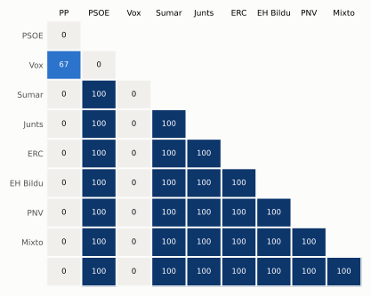

# Análisis detallado: septiembre de 2023

[← Volver al resumen del mes](2023-09.md)

_Generado automáticamente el 2026-11-11 con datos abiertos del [Congreso de los Diputados](https://www.congreso.es/es/opendata/votaciones). Solo plenos y Diputación Permanente. Método y límites en [docs/DOCUMENTO_FUNCIONAL.md](../docs/DOCUMENTO_FUNCIONAL.md)._

## Resumen

- **8 votaciones** en 4 días de pleno (sesiones 2, 3, 5 y 6).
- **4 aprobadas** y **4 rechazadas**; de ellas, 2 públicas por llamamiento.
- 1 votación se decidió por 5 votos o menos.
- Los grupos que más veces votaron con el resultado final: **PSOE, Sumar, Junts, ERC, EH Bildu, PNV, Mixto y ** (100 % de las votaciones nominales).
- Los grupos del Gobierno (PSOE y Sumar) votaron lo mismo en 6 de 6 votaciones nominales y no perdieron ninguna de ellas.
- 4 votos individuales se apartaron de la posición de su grupo (4 diputados).

## Cómo votó cada grupo

| Grupo | Diputados | Cohesión | Votó con el resultado | Decisivo | Posición Sí | Posición No | Posición Abst. |
| --- | ---: | ---: | ---: | ---: | ---: | ---: | ---: |
| PP | 137 | 100 % | 0 % | 0 | 1 | 3 | 2 |
| PSOE | 121 | 100 % | 100 % | 4 | 4 | 2 | 0 |
| Vox | 33 | 100 % | 0 % | 0 | 2 | 4 | 0 |
| Sumar | 31 | 99 % | 100 % | 4 | 4 | 2 | 0 |
| Junts | 7 | 100 % | 100 % | 2 | 4 | 2 | 0 |
| ERC | 7 | 100 % | 100 % | 2 | 4 | 2 | 0 |
| EH Bildu | 6 | 100 % | 100 % | 1 | 4 | 2 | 0 |
| PNV | 5 | 100 % | 100 % | 1 | 4 | 2 | 0 |
| Mixto | 3 | 50 % | 100 % | 0 | 4 | 2 | 0 |
|  | 1 | 100 % | 100 % | 0 | 2 | 0 | 0 |

*Cohesión*: índice de acuerdo interno (100 % = todo el grupo votó igual). *Votó con el resultado*: el grupo votó Sí y salió aprobada, o No y salió rechazada. *Decisivo*: votaciones cuyo resultado habría cambiado si el grupo se hubiera abstenido en bloque. El Grupo Mixto reúne partidos distintos: su posición es la de su mayoría.

## Afinidad entre grupos

<picture>
  <source media="(prefers-color-scheme: dark)" srcset="img/2023-09/afinidad-oscuro.svg">
  
</picture>

Porcentaje de votaciones nominales en que los dos grupos tomaron la misma posición. Los grupos están ordenados según el mapa de diputados.

Ver la tabla

|  | PP | PSOE | Vox | Sumar | Junts | ERC | EH Bildu | PNV | Mixto |  |
| --- | :---: | :---: | :---: | :---: | :---: | :---: | :---: | :---: | :---: | :---: |
| PP | 100 % | 0 % | 67 % | 0 % | 0 % | 0 % | 0 % | 0 % | 0 % | 0 % |
| PSOE | 0 % | 100 % | 0 % | 100 % | 100 % | 100 % | 100 % | 100 % | 100 % | 100 % |
| Vox | 67 % | 0 % | 100 % | 0 % | 0 % | 0 % | 0 % | 0 % | 0 % | 0 % |
| Sumar | 0 % | 100 % | 0 % | 100 % | 100 % | 100 % | 100 % | 100 % | 100 % | 100 % |
| Junts | 0 % | 100 % | 0 % | 100 % | 100 % | 100 % | 100 % | 100 % | 100 % | 100 % |
| ERC | 0 % | 100 % | 0 % | 100 % | 100 % | 100 % | 100 % | 100 % | 100 % | 100 % |
| EH Bildu | 0 % | 100 % | 0 % | 100 % | 100 % | 100 % | 100 % | 100 % | 100 % | 100 % |
| PNV | 0 % | 100 % | 0 % | 100 % | 100 % | 100 % | 100 % | 100 % | 100 % | 100 % |
| Mixto | 0 % | 100 % | 0 % | 100 % | 100 % | 100 % | 100 % | 100 % | 100 % | 100 % |
|  | 0 % | 100 % | 0 % | 100 % | 100 % | 100 % | 100 % | 100 % | 100 % | 100 % |

## Quién sacó adelante las votaciones

| Grupos que votaron Sí | Votaciones | Escaños |
| --- | ---: | ---: |
| PSOE + Sumar + Junts + ERC + EH Bildu + PNV + Mixto + | 2 | 181 |
| PSOE + Sumar + Junts + ERC + EH Bildu + PNV + Mixto | 2 | 180 |

De 4 votaciones nominales aprobadas. La posición de cada grupo es la de la mayoría de sus diputados.

## Votaciones que perdieron los grupos del Gobierno

PSOE y Sumar no perdieron ninguna votación en la que votaran lo mismo.

## Votaciones más ajustadas

| Fecha | Asunto | Resultado | Sí | No | Abst. |
| --- | --- | :---: | ---: | ---: | ---: |
| 21 de septiembre | Proposición de reforma del Reglamento del Congreso de los Diputados. *(Votación de conjunto. Votación de conjunto de la Proposició…)* | Aprobada (necesita 176) | 180 | 170 | 0 |
| 27 de septiembre | Propuesta de don Alberto Núñez Feijóo como candidato a la Presidencia del Gobierno. (Pública por llamamiento) | Rechazada (necesita 176) (por llamamiento) | 172 | 178 | 0 |
| 29 de septiembre | Propuesta don Alberto Núñez Feijóo como candidato a la Presidencia del Gobierno. (Pública por llamamiento) | Rechazada (necesita 176) (por llamamiento) | 172 | 177 | 0 |
| 19 de septiembre | Proposición de los Grupos Parlamentarios Socialista, Plurinacional SUMAR, Republicano, Euskal Herria Bildu, Mixto y Vasco (EAJ-PNV), de reforma del Reglamento… | Aprobada | 176 | 169 | 2 |
| 19 de septiembre | Acuerdo de tramitación directa y en lectura única de la Proposición de reforma del Reglamento del Congreso de los Diputados. | Aprobada | 179 | 171 | 0 |
| 21 de septiembre | Proposición de reforma del Reglamento del Congreso de los Diputados. *(Enmiendas al articulado del Grupo Parlamentario Popular en…)* | Rechazada | 170 | 179 | 0 |

Votaciones decididas por 10 votos o menos (o a esa distancia de la mayoría que exigían). Las públicas por llamamiento no tienen hemiciclo: el voto de cada diputado solo consta en el Diario de Sesiones.

## Qué se votó, por tipo de asunto

| Tipo de asunto | Votaciones | Aprobadas | No aprobadas |
| --- | ---: | ---: | ---: |
| Leyes: dictamen y votación final | 5 | 3 | 2 |
| Investidura | 2 | 0 | 2 |
| Leyes: toma en consideración | 1 | 1 | 0 |

Las proposiciones no de ley y las mociones expresan la posición del Congreso pero no obligan al Gobierno. Las leyes pasan por varias votaciones (toma en consideración, totalidad, dictamen, Senado), así que una misma ley puede aparecer varias veces.

## Votos distintos de su grupo

| Diputado | Grupo | Votos distintos de su grupo |
| --- | --- | ---: |
| Castilla Álvarez, María Carmen | PSOE | 1 |
| Cofiño Fernández, Rafael | Sumar | 1 |
| Poblador Pacheco, María Araceli | PSOE | 1 |
| Quintana Carballo, Rosa | PP | 1 |

Un voto aislado puede ser un error al pulsar, no una decisión política: el Congreso no publica las correcciones. Se excluye el Grupo Mixto.

## Diputados que más veces no votaron

| Diputado | Grupo | No votó | % de votaciones |
| --- | --- | ---: | ---: |
| Argota Castro, Trinidad Carmen | PSOE | 1 | 17 % |
| Macías Gata, Alfonso Carlos | PP | 1 | 17 % |
| Melgarejo Moreno, Joaquín | PP | 1 | 17 % |
| Quintana Carballo, Rosa | PP | 1 | 17 % |

«No vota» incluye ausencias justificadas (baja, maternidad o paternidad) y escaños vacantes; el portal no las distingue.

## Todas las votaciones

Posición de cada grupo: la opción que votó la mayoría de sus diputados (*Div.*: empate dentro del grupo). El número enlaza al JSON oficial o, en las votaciones por llamamiento, al Diario de Sesiones.

### 19 de septiembre (sesión 2)

| Nº | Asunto | Resultado | Sí | No | Abst. | PP | PSOE | Vox | Sumar | Junts | ERC | EH Bildu | PNV | Mixto |  | Decisivos |
| ---: | --- | --- | ---: | ---: | ---: | :---: | :---: | :---: | :---: | :---: | :---: | :---: | :---: | :---: | :---: | --- |
| [1](https://www.congreso.es/webpublica/opendata/votaciones/Leg15/Sesion002/20230919/Votacion001/VOT_20230919152005.json) | Proposición de los Grupos Parlamentarios Socialista, Plurinacional SUMAR, Republicano, Euskal Herria Bildu, Mixto y Vasco (EAJ-PNV), de reforma del Reglamento… | Aprobada | 176 | 169 | 2 | No | Sí | No | Sí | Sí | Sí | Sí | Sí | Sí | Sí | Junts, ERC, PSOE, Sumar |
| [2](https://www.congreso.es/webpublica/opendata/votaciones/Leg15/Sesion002/20230919/Votacion002/VOT_20230919152013.json) | Acuerdo de tramitación directa y en lectura única de la Proposición de reforma del Reglamento del Congreso de los Diputados. | Aprobada | 179 | 171 | 0 | No | Sí | No | Sí | Sí | Sí | Sí | Sí | Sí | Sí | PSOE, Sumar |

### 21 de septiembre (sesión 3)

| Nº | Asunto | Resultado | Sí | No | Abst. | PP | PSOE | Vox | Sumar | Junts | ERC | EH Bildu | PNV | Mixto |  | Decisivos |
| ---: | --- | --- | ---: | ---: | ---: | :---: | :---: | :---: | :---: | :---: | :---: | :---: | :---: | :---: | :---: | --- |
| [1](https://www.congreso.es/webpublica/opendata/votaciones/Leg15/Sesion003/20230921/Votacion001/VOT_20230921120048.json) | Proposición de reforma del Reglamento del Congreso de los Diputados. *(Enmienda a la totalidad de texto alternativo. Enmienda a la…)* | Rechazada | 33 | 179 | 138 | Abst. | No | Sí | No | No | No | No | No | No | nan |  |
| [2](https://www.congreso.es/webpublica/opendata/votaciones/Leg15/Sesion003/20230921/Votacion002/VOT_20230921120052.json) | Proposición de reforma del Reglamento del Congreso de los Diputados. *(Enmienda al articulado del Grupo Parlamentario Vasco (EAJ-P…)* | Aprobada | 178 | 33 | 139 | Abst. | Sí | No | Sí | Sí | Sí | Sí | Sí | Sí | nan |  |
| [3](https://www.congreso.es/webpublica/opendata/votaciones/Leg15/Sesion003/20230921/Votacion003/VOT_20230921120056.json) | Proposición de reforma del Reglamento del Congreso de los Diputados. *(Enmiendas al articulado del Grupo Parlamentario Popular en…)* | Rechazada | 170 | 179 | 0 | Sí | No | Sí | No | No | No | No | No | No | nan | PSOE, Sumar |
| [4](https://www.congreso.es/webpublica/opendata/votaciones/Leg15/Sesion003/20230921/Votacion004/VOT_20230921120100.json) | Proposición de reforma del Reglamento del Congreso de los Diputados. *(Votación de conjunto. Votación de conjunto de la Proposició…)* | Aprobada (necesita 176) | 180 | 170 | 0 | No | Sí | No | Sí | Sí | Sí | Sí | Sí | Sí | nan | EH Bildu, Junts, ERC, PSOE, Sumar, PNV |

### 27 de septiembre (sesión 5)

| Nº | Asunto | Resultado | Sí | No | Abst. | PP | PSOE | Vox | Sumar | Junts | ERC | EH Bildu | PNV | Mixto |  | Decisivos |
| ---: | --- | --- | ---: | ---: | ---: | :---: | :---: | :---: | :---: | :---: | :---: | :---: | :---: | :---: | :---: | --- |
| [1](https://www.congreso.es/public_oficiales/L15/CONG/DS/PL/DSCD-15-PL-5.PDF?#page=41) | Propuesta de don Alberto Núñez Feijóo como candidato a la Presidencia del Gobierno. (Pública por llamamiento) | Rechazada (necesita 176) (por llamamiento) | 172 | 178 | 0 |  |  |  |  |  |  |  |  |  |  |  |

### 29 de septiembre (sesión 6)

| Nº | Asunto | Resultado | Sí | No | Abst. | PP | PSOE | Vox | Sumar | Junts | ERC | EH Bildu | PNV | Mixto |  | Decisivos |
| ---: | --- | --- | ---: | ---: | ---: | :---: | :---: | :---: | :---: | :---: | :---: | :---: | :---: | :---: | :---: | --- |
| [1](https://www.congreso.es/public_oficiales/L15/CONG/DS/PL/DSCD-15-PL-6.PDF?#page=17) | Propuesta don Alberto Núñez Feijóo como candidato a la Presidencia del Gobierno. (Pública por llamamiento) | Rechazada (necesita 176) (por llamamiento) | 172 | 177 | 0 |  |  |  |  |  |  |  |  |  |  |  |
