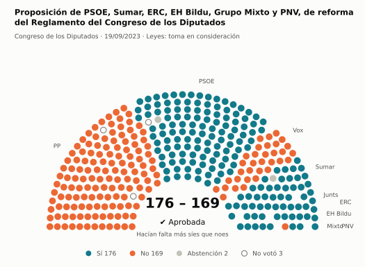
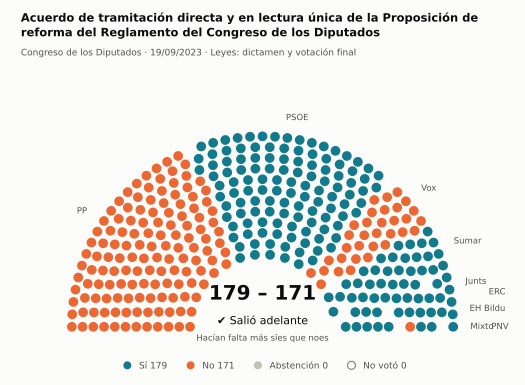
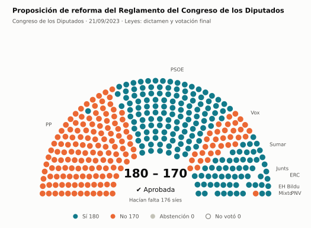
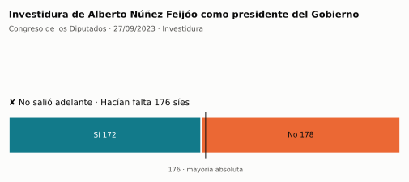
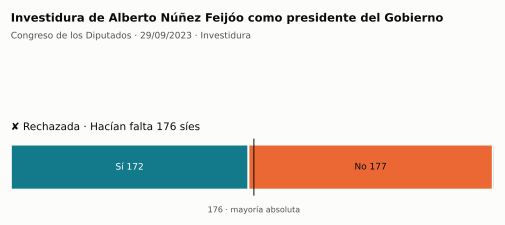
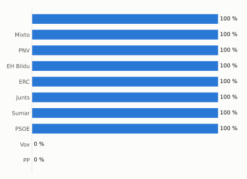
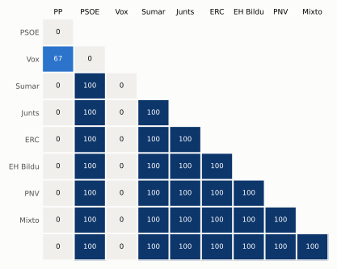

# Qué votó el Congreso en septiembre de 2023

Las votaciones del Pleno del Congreso de los Diputados, explicadas sin tecnicismos. Datos oficiales del [Congreso](https://www.congreso.es/es/opendata/votaciones); este resumen se actualiza solo cada mes (última vez: 10/11/2026).

## En pocas palabras

- El Congreso votó **8 veces** en 4 días de pleno. **4 propuestas salieron adelante** y 4 no.
- 8 votaciones fueron sobre leyes, decretos o presupuestos.
- El Gobierno (PSOE y Sumar) no perdió ninguna de las 6 votaciones en las que sus grupos votaron lo mismo.
- La votación más reñida se decidió superó los 176 síes por 4 votos: Proposición de reforma del Reglamento del Congreso de los Diputados.
- Los diputados casi siempre votan lo mismo que su grupo: en todo el mes solo hubo 4 votos distintos (sin contar el Grupo Mixto).

## Las votaciones más importantes del mes

Elegidas por su importancia: pesan más las leyes y los decretos que las peticiones al Gobierno, y suben las que se decidieron por pocos votos o las que perdió el Gobierno. Cada punto del dibujo es un diputado, colocado con su grupo, y el color es lo que votó.

### 1. Proposición de PSOE, Sumar, ERC, EH Bildu, Grupo Mixto y PNV, de reforma del Reglamento del Congreso de los Diputados

**19 de septiembre · Leyes: toma en consideración.** Primer paso de una ley propuesta por un grupo o una comunidad autónoma: el Congreso decide si empieza a tramitarla.

<picture>
  <source media="(prefers-color-scheme: dark)" srcset="img/2023-09/votacion-L15-S002-V001-oscuro.svg">
  
</picture>

**✔ Salió adelante** por 7 votos: 176 a favor, 169 en contra y 2 abstenciones.

- **A favor:** PSOE (118 de 119), Sumar (30 de 31), Junts, ERC, EH Bildu, PNV y 
- **En contra:** PP y Vox
- **Repartidos:** Grupo Mixto (Sí 2, No 1)

[Datos oficiales](https://www.congreso.es/webpublica/opendata/votaciones/Leg15/Sesion002/20230919/Votacion001/VOT_20230919152005.json)

### 2. Acuerdo de tramitación directa y en lectura única de la Proposición de reforma del Reglamento del Congreso de los Diputados

**19 de septiembre · Leyes: dictamen y votación final.** Votación del texto de una ley después de trabajarla en comisión.

<picture>
  <source media="(prefers-color-scheme: dark)" srcset="img/2023-09/votacion-L15-S002-V002-oscuro.svg">
  
</picture>

**✔ Salió adelante** por 8 votos: 179 a favor, 171 en contra y ninguna abstención.

- **A favor:** PSOE, Sumar, Junts, ERC, EH Bildu, PNV y 
- **En contra:** PP y Vox
- **Repartidos:** Grupo Mixto (Sí 2, No 1)

[Datos oficiales](https://www.congreso.es/webpublica/opendata/votaciones/Leg15/Sesion002/20230919/Votacion002/VOT_20230919152013.json)

### 3. Proposición de reforma del Reglamento del Congreso de los Diputados

**21 de septiembre · Leyes: dictamen y votación final.** Votación del texto de una ley después de trabajarla en comisión.

<picture>
  <source media="(prefers-color-scheme: dark)" srcset="img/2023-09/votacion-L15-S003-V004-oscuro.svg">
  
</picture>

**✔ Salió adelante** superó los 176 síes por 4 votos: 180 a favor, 170 en contra y ninguna abstención.

- **A favor:** PSOE, Sumar, Junts, ERC, EH Bildu y PNV
- **En contra:** PP (136 de 137) y Vox
- **Repartidos:** Grupo Mixto (Sí 2, No 1)

Este asunto tuvo 4 votaciones este mes; aquí se muestra la más disputada. [Datos oficiales](https://www.congreso.es/webpublica/opendata/votaciones/Leg15/Sesion003/20230921/Votacion004/VOT_20230921120100.json)

### 4. Investidura de Alberto Núñez Feijóo como presidente del Gobierno

**27 de septiembre · Investidura.** Votación para elegir presidente del Gobierno. En la primera votación hacen falta 176 votos a favor; en la segunda, más síes que noes.

<picture>
  <source media="(prefers-color-scheme: dark)" srcset="img/2023-09/votacion-L15-S005-V001-oscuro.svg">
  
</picture>

**✘ No salió adelante** le faltaron 4 votos para los 176: 172 a favor, 178 en contra y ninguna abstención.

Fue una votación por llamamiento: cada diputado dijo su voto en voz alta. El voto de cada uno está en el [Diario de Sesiones](https://www.congreso.es/public_oficiales/L15/CONG/DS/PL/DSCD-15-PL-5.PDF?#page=41).

### 5. Investidura de Alberto Núñez Feijóo como presidente del Gobierno

**29 de septiembre · Investidura.** Votación para elegir presidente del Gobierno. En la primera votación hacen falta 176 votos a favor; en la segunda, más síes que noes.

<picture>
  <source media="(prefers-color-scheme: dark)" srcset="img/2023-09/votacion-L15-S006-V001-oscuro.svg">
  
</picture>

**✘ No salió adelante** le faltaron 4 votos para los 176: 172 a favor, 177 en contra y ninguna abstención.

Fue una votación por llamamiento: cada diputado dijo su voto en voz alta. El voto de cada uno está en el [Diario de Sesiones](https://www.congreso.es/public_oficiales/L15/CONG/DS/PL/DSCD-15-PL-6.PDF?#page=17).

## ¿Qué grupos votaron más veces lo que finalmente salió?

<picture>
  <source media="(prefers-color-scheme: dark)" srcset="img/2023-09/ganadora-oscuro.svg">
  
</picture>

Porcentaje de votaciones en que el grupo votó Sí y salió adelante, o votó No y no salió. Abstenerse no cuenta como acertar.

## ¿Quién vota con quién?

<picture>
  <source media="(prefers-color-scheme: dark)" srcset="img/2023-09/afinidad-oscuro.svg">
  
</picture>

Cada casilla dice en qué porcentaje de las votaciones dos grupos votaron lo mismo: 100 es que siempre coincidieron y 0 que nunca.

## ¿Qué tipo de cosas se votaron?

| Tipo | Votaciones | Salieron adelante | Qué es |
| --- | ---: | ---: | --- |
| Leyes: dictamen y votación final | 5 | 3 | Votación del texto de una ley después de trabajarla en comisión. |
| Investidura | 2 | 0 | Votación para elegir presidente del Gobierno. En la primera votación hacen falta 176 votos a favor; en la segunda, más síes que noes. |
| Leyes: toma en consideración | 1 | 1 | Primer paso de una ley propuesta por un grupo o una comunidad autónoma: el Congreso decide si empieza a tramitarla. |

## Palabras que conviene saber

- **Pleno**: La reunión de los 350 diputados, donde se vota.
- **Grupo parlamentario**: Los diputados de un partido o coalición. Los partidos pequeños van juntos en el Grupo Mixto, aunque no piensen igual.
- **Abstención**: El diputado vota, pero ni a favor ni en contra.
- **No votó**: El diputado no votó: no estaba, estaba de baja o el escaño estaba vacío.
- **Mayoría simple**: Salen adelante las votaciones con más síes que noes. Es lo normal.
- **Mayoría absoluta**: 176 votos a favor, la mitad más uno de 350. La piden las leyes orgánicas (derechos fundamentales, sistema electoral…) y la primera votación de investidura.
- **Votación por llamamiento**: Cada diputado dice su voto en voz alta. Se usa en las investiduras y otras votaciones importantes.

---

**¿Quieres más detalle?** El [análisis detallado](2023-09-detalle.md) tiene la cohesión de cada grupo, un mapa de los diputados según cómo votan, qué diputados votaron distinto de su grupo, las ausencias y la lista completa de votaciones.

_Los resultados están calculados a partir de los votos: el Congreso no publica si cada votación salió adelante. Este proyecto no tiene relación con el Congreso. Método en [docs/DOCUMENTO_FUNCIONAL.md](../docs/DOCUMENTO_FUNCIONAL.md)._
