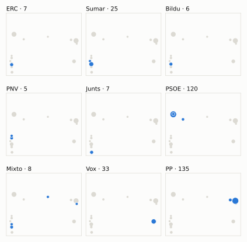
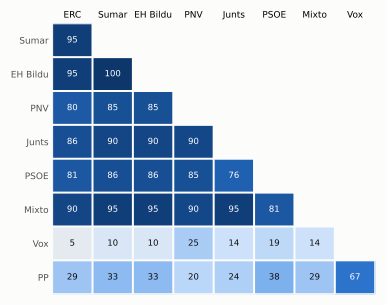
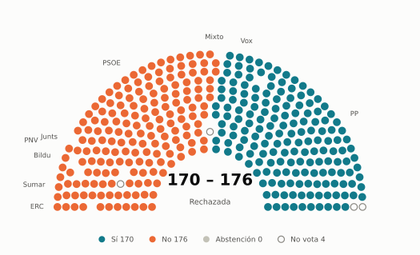

# Votaciones del Congreso: diciembre de 2023

_Generado automáticamente el 2026-11-10 con datos abiertos del [Congreso de los Diputados](https://www.congreso.es/es/opendata/votaciones). Solo plenos y Diputación Permanente. Método y límites en [docs/DOCUMENTO_FUNCIONAL.md](../docs/DOCUMENTO_FUNCIONAL.md)._

## Resumen

- **22 votaciones** en 2 días de pleno (sesiones 11 y 13).
- **14 aprobadas** y **8 rechazadas**; de ellas, 1 pública por llamamiento.
- 0 votaciones se decidieron por 5 votos o menos.
- El grupo que más veces votó con el resultado final: **PSOE** (95 % de las votaciones nominales).
- Los grupos del Gobierno (PSOE y Sumar) votaron lo mismo en 18 de 21 votaciones nominales y no perdieron ninguna de ellas.
- 9 votos individuales se apartaron de la posición de su grupo (9 diputados).

## Cómo votó cada grupo

| Grupo | Diputados | Cohesión | Votó con el resultado | Decisivo | Posición Sí | Posición No | Posición Abst. |
| --- | ---: | ---: | ---: | ---: | ---: | ---: | ---: |
| PP | 137 | 100 % | 43 % | 0 | 15 | 6 | 0 |
| PSOE | 121 | 100 % | 95 % | 12 | 12 | 8 | 1 |
| Vox | 33 | 100 % | 14 % | 0 | 10 | 5 | 6 |
| Sumar | 26 | 100 % | 90 % | 11 | 11 | 10 | 0 |
| Mixto | 8 | 74 % | 86 % | 0 | 10 | 10 | 1 |
| Junts | 7 | 100 % | 81 % | 6 | 9 | 11 | 1 |
| ERC | 7 | 100 % | 86 % | 6 | 10 | 10 | 1 |
| Bildu | 6 | 100 % | 90 % | 0 | 11 | 10 | 0 |
| PNV | 5 | 100 % | 80 % | 0 | 8 | 9 | 3 |

*Cohesión*: índice de acuerdo interno (100 % = todo el grupo votó igual). *Votó con el resultado*: el grupo votó Sí y salió aprobada, o No y salió rechazada. *Decisivo*: votaciones cuyo resultado habría cambiado si el grupo se hubiera abstenido en bloque. El Grupo Mixto reúne partidos distintos: su posición es la de su mayoría.

## Mapa de diputados

<picture>
  <source media="(prefers-color-scheme: dark)" srcset="img/2023-12/mapa-oscuro.svg">
  
</picture>

Cada punto es un diputado; dos diputados están cerca si votaron parecido. Un punto más grande reúne a varios que votaron exactamente igual. En cada panel, el grupo en azul y el resto del Congreso en gris.

*Cómo se calcula*: componentes principales de los votos (Sí, No, abstención) en 21 votaciones con algún desacuerdo. El eje horizontal recoge el 86 % de la variación y el vertical el 7 %. Los ejes no tienen nombre ni sentido político propio; por convención, el PP queda a la derecha. No se sitúa a 6 diputados que votó en menos de la mitad.

## Afinidad entre grupos

<picture>
  <source media="(prefers-color-scheme: dark)" srcset="img/2023-12/afinidad-oscuro.svg">
  
</picture>

Porcentaje de votaciones nominales en que los dos grupos tomaron la misma posición. Los grupos están ordenados según el mapa de diputados.

Ver la tabla

|  | PP | PSOE | Vox | Sumar | Mixto | Junts | ERC | Bildu | PNV |
| --- | :---: | :---: | :---: | :---: | :---: | :---: | :---: | :---: | :---: |
| PP | 100 % | 38 % | 67 % | 33 % | 29 % | 24 % | 29 % | 33 % | 20 % |
| PSOE | 38 % | 100 % | 19 % | 86 % | 81 % | 76 % | 81 % | 86 % | 85 % |
| Vox | 67 % | 19 % | 100 % | 10 % | 14 % | 14 % | 5 % | 10 % | 25 % |
| Sumar | 33 % | 86 % | 10 % | 100 % | 95 % | 90 % | 95 % | 100 % | 85 % |
| Mixto | 29 % | 81 % | 14 % | 95 % | 100 % | 95 % | 90 % | 95 % | 90 % |
| Junts | 24 % | 76 % | 14 % | 90 % | 95 % | 100 % | 86 % | 90 % | 90 % |
| ERC | 29 % | 81 % | 5 % | 95 % | 90 % | 86 % | 100 % | 95 % | 80 % |
| Bildu | 33 % | 86 % | 10 % | 100 % | 95 % | 90 % | 95 % | 100 % | 85 % |
| PNV | 20 % | 85 % | 25 % | 85 % | 90 % | 90 % | 80 % | 85 % | 100 % |

## Quién sacó adelante las votaciones

| Grupos que votaron Sí | Votaciones | Escaños |
| --- | ---: | ---: |
| PSOE + Sumar + Mixto + Junts + ERC + Bildu + PNV | 5 | 180 |
| PP + PSOE | 1 | 258 |
| PP + PSOE + Vox + Sumar + Mixto + Junts + Bildu + PNV | 1 | 343 |
| PP + PSOE + Sumar + ERC + Bildu | 1 | 297 |
| PP + PSOE + Sumar + Mixto + ERC + Bildu | 1 | 305 |
| PP + Sumar + Mixto + Junts + ERC + Bildu | 1 | 191 |
| PP + PSOE + Vox | 1 | 291 |
| Todos los grupos | 1 | 350 |

De 13 votaciones nominales aprobadas. Otras 1 salieron con combinaciones que se dieron menos veces. La posición de cada grupo es la de la mayoría de sus diputados.

## Votaciones que perdieron los grupos del Gobierno

PSOE y Sumar no perdieron ninguna votación en la que votaran lo mismo.
Además, PSOE y Sumar votaron distinto entre sí en 3 votaciones.

## Votaciones más ajustadas

**19 de diciembre** · Moción consecuencia de interpelación urgente del Grupo Parlamentario Popular en el Congreso, sobre las gestiones, actuaciones y encomiendas del Ministro de la… *(Votación separada por puntos Punto 1.)*

<picture>
  <source media="(prefers-color-scheme: dark)" srcset="img/2023-12/hemiciclo-L15-S013-V007-oscuro.svg">
  
</picture>

**19 de diciembre** · Moción consecuencia de interpelación urgente del Grupo Parlamentario Popular en el Congreso, sobre las gestiones, actuaciones y encomiendas del Ministro de la… *(Votación separada por puntos Punto 3.)*

<picture>
  <source media="(prefers-color-scheme: dark)" srcset="img/2023-12/hemiciclo-L15-S013-V009-oscuro.svg">
  
</picture>

**19 de diciembre** · Moción consecuencia de interpelación urgente del Grupo Parlamentario Popular en el Congreso, sobre las gestiones, actuaciones y encomiendas del Ministro de la… *(Votación separada por puntos Punto 4.)*

<picture>
  <source media="(prefers-color-scheme: dark)" srcset="img/2023-12/hemiciclo-L15-S013-V010-oscuro.svg">
  
</picture>

**19 de diciembre** · Moción consecuencia de interpelación urgente del Grupo Parlamentario Popular en el Congreso, sobre las gestiones, actuaciones y encomiendas del Ministro de la… *(Votación separada por puntos Punto 6.)*

<picture>
  <source media="(prefers-color-scheme: dark)" srcset="img/2023-12/hemiciclo-L15-S013-V012-oscuro.svg">
  
</picture>

Cada punto es un escaño, agrupado por grupo parlamentario; el color es su voto.

| Fecha | Asunto | Resultado | Sí | No | Abst. |
| --- | --- | :---: | ---: | ---: | ---: |
| 12 de diciembre | Proposición de Ley del Grupo Parlamentario Socialista, Orgánica de amnistía para la normalización institucional, política y social en Cataluña. (Pública por ll… | Aprobada (por llamamiento) | 178 | 172 | 0 |
| 19 de diciembre | Moción consecuencia de interpelación urgente del Grupo Parlamentario Popular en el Congreso, sobre las gestiones, actuaciones y encomiendas del Ministro de la… *(Votación separada por puntos Punto 1.)* | Rechazada | 170 | 176 | 0 |
| 19 de diciembre | Moción consecuencia de interpelación urgente del Grupo Parlamentario Popular en el Congreso, sobre las gestiones, actuaciones y encomiendas del Ministro de la… *(Votación separada por puntos Punto 3.)* | Rechazada | 170 | 176 | 0 |
| 19 de diciembre | Moción consecuencia de interpelación urgente del Grupo Parlamentario Popular en el Congreso, sobre las gestiones, actuaciones y encomiendas del Ministro de la… *(Votación separada por puntos Punto 4.)* | Rechazada | 170 | 176 | 0 |
| 19 de diciembre | Moción consecuencia de interpelación urgente del Grupo Parlamentario Popular en el Congreso, sobre las gestiones, actuaciones y encomiendas del Ministro de la… *(Votación separada por puntos Punto 6.)* | Rechazada | 170 | 176 | 0 |
| 12 de diciembre | Solicitud de los Grupos Parlamentarios Junts per Catalunya y Vasco (EAJ-PNV), de creación de una Comisión de Investigación sobre la denominada "Operación Catal… | Aprobada | 178 | 171 | 1 |
| 12 de diciembre | Solicitud de los Grupos Parlamentarios Junts per Catalunya y Vasco (EAJ-PNV), de creación de una Comisión de Investigación sobre el derecho a saber la verdad y… | Aprobada | 178 | 171 | 1 |
| 12 de diciembre | Solicitud de los Grupos Parlamentarios Republicano, Euskal Herria Bildu y Mixto, de creación de una Comisión de Investigación sobre el espionaje e intromisión… | Aprobada | 179 | 171 | 0 |
| 19 de diciembre | Proposición de Ley del Grupo Parlamentario Plurinacional SUMAR, Orgánica de reforma de la Ley Orgánica 10/1995, de 23 de noviembre, del Código Penal para la pr… | Aprobada | 177 | 169 | 0 |
| 19 de diciembre | Proposición de Ley del Grupo Parlamentario Republicano, para garantizar el derecho a la autonomía de la voluntad de los y las deportistas. | Aprobada | 177 | 169 | 0 |

Votaciones decididas por 10 votos o menos (o a esa distancia de la mayoría que exigían). Las públicas por llamamiento no tienen hemiciclo: el voto de cada diputado solo consta en el Diario de Sesiones.

## Qué se votó, por tipo de asunto

| Tipo de asunto | Votaciones | Aprobadas | No aprobadas |
| --- | ---: | ---: | ---: |
| Mociones | 8 | 2 | 6 |
| Organización de la Cámara | 6 | 6 | 0 |
| Leyes: toma en consideración | 4 | 3 | 1 |
| Proposiciones no de ley | 4 | 3 | 1 |

Las proposiciones no de ley y las mociones expresan la posición del Congreso pero no obligan al Gobierno. Las leyes pasan por varias votaciones (toma en consideración, totalidad, dictamen, Senado), así que una misma ley puede aparecer varias veces.

## Votos distintos de su grupo

| Diputado | Grupo | Votos distintos de su grupo |
| --- | --- | ---: |
| Aceves Galindo, José Luis | PSOE | 1 |
| Cantalapiedra Álvarez, María de las Mercedes | PP | 1 |
| Delgado Arce, Celso Luis | PP | 1 |
| Gil de Reboleño Lastortres, Esther | Sumar | 1 |
| Redondo Cárdenas, Gonzalo | PSOE | 1 |
| Rivera de la Cruz, Marta María | PP | 1 |
| Sahuquillo García, Luis Carlos | PSOE | 1 |
| Sánchez Díaz, María Carmen | PSOE | 1 |
| Teniente Sánchez, Cristina | PP | 1 |

Un voto aislado puede ser un error al pulsar, no una decisión política: el Congreso no publica las correcciones. Se excluye el Grupo Mixto.

## Diputados que más veces no votaron

| Diputado | Grupo | No votó | % de votaciones |
| --- | --- | ---: | ---: |
| Díaz Pérez, Yolanda | Sumar | 14 | 67 % |
| Núñez Feijóo, Alberto | PP | 14 | 67 % |
| Sánchez Pérez-Castejón, Pedro | PSOE | 14 | 67 % |
| Sánchez Sierra, María del Mar | PP | 14 | 67 % |
| Legarda Uriarte, Mikel | PNV | 2 | 10 % |
| Agirretxea Urresti, Joseba Andoni | PNV | 1 | 5 % |
| Esteban Bravo, Aitor | PNV | 1 | 5 % |
| Sagastizabal Unzetabarrenetxea, Idoia | PNV | 1 | 5 % |
| Vaquero Montero, Maribel | PNV | 1 | 5 % |

«No vota» incluye ausencias justificadas (baja, maternidad o paternidad) y escaños vacantes; el portal no las distingue.

## Todas las votaciones

Posición de cada grupo: la opción que votó la mayoría de sus diputados (*Div.*: empate dentro del grupo). El número enlaza al JSON oficial o, en las votaciones por llamamiento, al Diario de Sesiones.

### 12 de diciembre (sesión 11)

| Nº | Asunto | Resultado | Sí | No | Abst. | PP | PSOE | Vox | Sumar | Mixto | Junts | ERC | Bildu | PNV | Decisivos |
| ---: | --- | --- | ---: | ---: | ---: | :---: | :---: | :---: | :---: | :---: | :---: | :---: | :---: | :---: | --- |
| [1](https://www.congreso.es/public_oficiales/L15/CONG/DS/PL/DSCD-15-PL-12.PDF?#page=95) | Proposición de Ley del Grupo Parlamentario Socialista, Orgánica de amnistía para la normalización institucional, política y social en Cataluña. (Pública por ll… | Aprobada (por llamamiento) | 178 | 172 | 0 |  |  |  |  |  |  |  |  |  |  |
| [2](https://www.congreso.es/webpublica/opendata/votaciones/Leg15/Sesion011/20231212/Votacion002/VOT_20231212230023.json) | Proposición de Ley del Grupo Parlamentario VOX, Orgánica para la modificación de la Ley Orgánica 10/1995, de 23 de noviembre, del Código Penal, en materia de d… | Rechazada | 33 | 316 | 1 | No | No | Sí | No | No | No | No | No | No |  |
| [3](https://www.congreso.es/webpublica/opendata/votaciones/Leg15/Sesion011/20231212/Votacion003/VOT_20231212230031.json) | Proposición no de Ley del Grupo Parlamentario Popular en el Congreso, sobre la ampliación norte del Puerto de Valencia. Se vota en los términos resultantes de… | Aprobada | 260 | 52 | 38 | Sí | Sí | Abst. | No | No | No | No | No | Abst. |  |
| [4](https://www.congreso.es/webpublica/opendata/votaciones/Leg15/Sesion011/20231212/Votacion004/VOT_20231212230035.json) | Proposición no de Ley del Grupo Parlamentario VOX, para impedir que miembros del Gobierno o cualquier autoridad o funcionario, colaboren, negocien o pacten con… | Rechazada | 167 | 182 | 1 | Sí | No | Sí | No | No | No | No | No | No | PSOE, Sumar |
| [5](https://www.congreso.es/webpublica/opendata/votaciones/Leg15/Sesion011/20231212/Votacion005/VOT_20231212230037.json) | Dación de Cuentas de la Diputación Permanente del Congreso de los Diputados de la XIV Legislatura a la Cámara de la XV. | Aprobada | 343 | 0 | 7 | Sí | Sí | Sí | Sí | Sí | Sí | Abst. | Sí | Sí |  |
| [6](https://www.congreso.es/webpublica/opendata/votaciones/Leg15/Sesion011/20231212/Votacion006/VOT_20231212230040.json) | Solicitud de los Grupos Parlamentarios Junts per Catalunya y Vasco (EAJ-PNV), de creación de una Comisión de Investigación sobre la denominada "Operación Catal… | Aprobada | 178 | 171 | 1 | No | Sí | No | Sí | Sí | Sí | Sí | Sí | Sí | Junts, ERC, PSOE, Sumar |
| [7](https://www.congreso.es/webpublica/opendata/votaciones/Leg15/Sesion011/20231212/Votacion007/VOT_20231212230042.json) | Solicitud de los Grupos Parlamentarios Junts per Catalunya y Vasco (EAJ-PNV), de creación de una Comisión de Investigación sobre el derecho a saber la verdad y… | Aprobada | 178 | 171 | 1 | No | Sí | No | Sí | Sí | Sí | Sí | Sí | Sí | Junts, ERC, PSOE, Sumar |
| [8](https://www.congreso.es/webpublica/opendata/votaciones/Leg15/Sesion011/20231212/Votacion008/VOT_20231212230045.json) | Solicitud de los Grupos Parlamentarios Republicano, Euskal Herria Bildu y Mixto, de creación de una Comisión de Investigación sobre el espionaje e intromisión… | Aprobada | 179 | 171 | 0 | No | Sí | No | Sí | Sí | Sí | Sí | Sí | Sí | PSOE, Sumar |

### 19 de diciembre (sesión 13)

| Nº | Asunto | Resultado | Sí | No | Abst. | PP | PSOE | Vox | Sumar | Mixto | Junts | ERC | Bildu | PNV | Decisivos |
| ---: | --- | --- | ---: | ---: | ---: | :---: | :---: | :---: | :---: | :---: | :---: | :---: | :---: | :---: | --- |
| [1](https://www.congreso.es/webpublica/opendata/votaciones/Leg15/Sesion013/20231219/Votacion001/VOT_20231219233101.json) | Proposición de Ley del Grupo Parlamentario Plurinacional SUMAR, Orgánica de reforma de la Ley Orgánica 10/1995, de 23 de noviembre, del Código Penal para la pr… | Aprobada | 177 | 169 | 0 | No | Sí | No | Sí | Sí | Sí | Sí | Sí | Sí | PSOE, Sumar |
| [2](https://www.congreso.es/webpublica/opendata/votaciones/Leg15/Sesion013/20231219/Votacion002/VOT_20231219233106.json) | Proposición de Ley del Grupo Parlamentario Republicano, para garantizar el derecho a la autonomía de la voluntad de los y las deportistas. | Aprobada | 177 | 169 | 0 | No | Sí | No | Sí | Sí | Sí | Sí | Sí | Sí | PSOE, Sumar |
| [3](https://www.congreso.es/webpublica/opendata/votaciones/Leg15/Sesion013/20231219/Votacion003/VOT_20231219233110.json) | Proposición no de Ley del Grupo Parlamentario Socialista, sobre un Pacto de Estado por la Salud Mental. Se vota en los términos de la enmienda transaccional pr… | Aprobada | 296 | 0 | 49 | Sí | Sí | Abst. | Sí | Abst. | Abst. | Sí | Sí | Abst. |  |
| [4](https://www.congreso.es/webpublica/opendata/votaciones/Leg15/Sesion013/20231219/Votacion004/VOT_20231219233113.json) | Proposición no de Ley del Grupo Parlamentario Plurinacional SUMAR, sobre la reapertura de la línea ferroviaria internacional Pau-Canfranc-Zaragoza. Se vota en… | Aprobada | 301 | 7 | 33 | Sí | Sí | Abst. | Sí | Sí | No | Sí | Sí | — |  |
| [5](https://www.congreso.es/webpublica/opendata/votaciones/Leg15/Sesion013/20231219/Votacion005/VOT_20231219233116.json) | Moción consecuencia de interpelación urgente del Grupo Parlamentario Mixto (Sr. Rego Candamil), relativa a la aplicación de coeficientes reductores para la jub… | Aprobada | 187 | 1 | 158 | Sí | Abst. | Abst. | Sí | Sí | Sí | Sí | Sí | Abst. |  |
| [6](https://www.congreso.es/webpublica/opendata/votaciones/Leg15/Sesion013/20231219/Votacion006/VOT_20231219233117.json) | Moción consecuencia de interpelación urgente del Grupo Parlamentario VOX, sobre las medidas que va a llevar a cabo el Gobierno para garantizar nuestra soberaní… | Rechazada | 169 | 177 | 0 | Sí | No | Sí | No | No | No | No | No | No | PSOE, Sumar |
| [7](https://www.congreso.es/webpublica/opendata/votaciones/Leg15/Sesion013/20231219/Votacion007/VOT_20231219233119.json) | Moción consecuencia de interpelación urgente del Grupo Parlamentario Popular en el Congreso, sobre las gestiones, actuaciones y encomiendas del Ministro de la… *(Votación separada por puntos Punto 1.)* | Rechazada | 170 | 176 | 0 | Sí | No | Sí | No | No | No | No | No | No | Junts, ERC, PSOE, Sumar |
| [8](https://www.congreso.es/webpublica/opendata/votaciones/Leg15/Sesion013/20231219/Votacion008/VOT_20231219233121.json) | Moción consecuencia de interpelación urgente del Grupo Parlamentario Popular en el Congreso, sobre las gestiones, actuaciones y encomiendas del Ministro de la… *(Votación separada por puntos Punto 2.)* | Aprobada | 290 | 56 | 0 | Sí | Sí | Sí | No | No | No | No | No | No |  |
| [9](https://www.congreso.es/webpublica/opendata/votaciones/Leg15/Sesion013/20231219/Votacion009/VOT_20231219233123.json) | Moción consecuencia de interpelación urgente del Grupo Parlamentario Popular en el Congreso, sobre las gestiones, actuaciones y encomiendas del Ministro de la… *(Votación separada por puntos Punto 3.)* | Rechazada | 170 | 176 | 0 | Sí | No | Sí | No | No | No | No | No | No | Junts, ERC, PSOE, Sumar |
| [10](https://www.congreso.es/webpublica/opendata/votaciones/Leg15/Sesion013/20231219/Votacion010/VOT_20231219233125.json) | Moción consecuencia de interpelación urgente del Grupo Parlamentario Popular en el Congreso, sobre las gestiones, actuaciones y encomiendas del Ministro de la… *(Votación separada por puntos Punto 4.)* | Rechazada | 170 | 176 | 0 | Sí | No | Sí | No | No | No | No | No | No | Junts, ERC, PSOE, Sumar |
| [11](https://www.congreso.es/webpublica/opendata/votaciones/Leg15/Sesion013/20231219/Votacion011/VOT_20231219233127.json) | Moción consecuencia de interpelación urgente del Grupo Parlamentario Popular en el Congreso, sobre las gestiones, actuaciones y encomiendas del Ministro de la… *(Votación separada por puntos Punto 5.)* | Rechazada | 137 | 176 | 33 | Sí | No | Abst. | No | No | No | No | No | No | PSOE |
| [12](https://www.congreso.es/webpublica/opendata/votaciones/Leg15/Sesion013/20231219/Votacion012/VOT_20231219233129.json) | Moción consecuencia de interpelación urgente del Grupo Parlamentario Popular en el Congreso, sobre las gestiones, actuaciones y encomiendas del Ministro de la… *(Votación separada por puntos Punto 6.)* | Rechazada | 170 | 176 | 0 | Sí | No | Sí | No | No | No | No | No | No | Junts, ERC, PSOE, Sumar |
| [13](https://www.congreso.es/webpublica/opendata/votaciones/Leg15/Sesion013/20231219/Votacion013/VOT_20231219233131.json) | Dictamen de la Comisión del Estatuto de los Diputados sobre declaración de actividades de Excmos. Sres. Diputados. | Aprobada | 341 | 2 | 3 | Sí | Sí | Sí | Sí | Sí | Sí | Sí | Sí | Sí |  |
| [14](https://www.congreso.es/webpublica/opendata/votaciones/Leg15/Sesion013/20231219/Votacion014/VOT_20231219233133.json) | Solicitud de los Grupos Parlamentarios Popular en el Congreso, Socialista y Plurinacional SUMAR, de creación de una Comisión Mixta sobre Insularidad. | Aprobada | 313 | 0 | 33 | Sí | Sí | Abst. | Sí | Sí | Sí | Sí | Sí | Sí |  |
