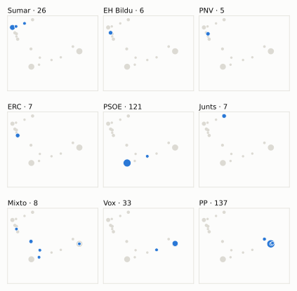
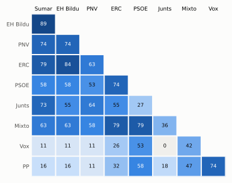

# Análisis detallado: enero de 2024

[← Volver al resumen del mes](2024-01.md)

_Generado automáticamente el 2026-11-10 con datos abiertos del [Congreso de los Diputados](https://www.congreso.es/es/opendata/votaciones). Solo plenos y Diputación Permanente. Método y límites en [docs/DOCUMENTO_FUNCIONAL.md](../docs/DOCUMENTO_FUNCIONAL.md)._

## Resumen

- **25 votaciones** en 4 días de pleno (sesiones 15, 16, 17 y 18).
- **10 aprobadas** y **12 rechazadas**, más 3 empates que obligaron a repetir; de ellas, 6 públicas por llamamiento.
- 5 votaciones se decidieron por 5 votos o menos.
- Los grupos que más veces votaron con el resultado final: **PP y PSOE** (79 % de las votaciones nominales).
- Los grupos del Gobierno (PSOE y Sumar) votaron lo mismo en 11 de 19 votaciones nominales y perdieron una de ellas.
- 1 voto individual se apartó de la posición de su grupo (1 diputado).

## Cómo votó cada grupo

| Grupo | Diputados | Cohesión | Votó con el resultado | Decisivo | Posición Sí | Posición No | Posición Abst. |
| --- | ---: | ---: | ---: | ---: | ---: | ---: | ---: |
| PP | 137 | 100 % | 79 % | 4 | 2 | 15 | 2 |
| PSOE | 121 | 100 % | 79 % | 2 | 10 | 9 | 0 |
| Vox | 33 | 100 % | 74 % | 4 | 3 | 15 | 1 |
| Sumar | 27 | 100 % | 37 % | 2 | 16 | 1 | 2 |
| Junts | 7 | 100 % | 27 % | 1 | 10 | 0 | 1 |
| Mixto | 7 | 79 % | 68 % | 2 | 11 | 7 | 1 |
| ERC | 7 | 100 % | 53 % | 2 | 14 | 4 | 1 |
| EH Bildu | 6 | 100 % | 37 % | 2 | 14 | 1 | 4 |
| PNV | 5 | 100 % | 32 % | 2 | 13 | 1 | 5 |

*Cohesión*: índice de acuerdo interno (100 % = todo el grupo votó igual). *Votó con el resultado*: el grupo votó Sí y salió aprobada, o No y salió rechazada. *Decisivo*: votaciones cuyo resultado habría cambiado si el grupo se hubiera abstenido en bloque. El Grupo Mixto reúne partidos distintos: su posición es la de su mayoría.

## Mapa de diputados

<picture>
  <source media="(prefers-color-scheme: dark)" srcset="img/2024-01/mapa-oscuro.svg">
  
</picture>

Cada punto es un diputado; dos diputados están cerca si votaron parecido. Un punto más grande reúne a varios que votaron exactamente igual. En cada panel, el grupo en azul y el resto del Congreso en gris.

*Cómo se calcula*: componentes principales de los votos (Sí, No, abstención) en 19 votaciones con algún desacuerdo. El eje horizontal recoge el 66 % de la variación y el vertical el 22 %. Los ejes no tienen nombre ni sentido político propio; por convención, el PP queda a la derecha. No se sitúa a 5 diputados que votó en menos de la mitad.

## Afinidad entre grupos

<picture>
  <source media="(prefers-color-scheme: dark)" srcset="img/2024-01/afinidad-oscuro.svg">
  
</picture>

Porcentaje de votaciones nominales en que los dos grupos tomaron la misma posición. Los grupos están ordenados según el mapa de diputados.

Ver la tabla

|  | PP | PSOE | Vox | Sumar | Junts | Mixto | ERC | EH Bildu | PNV |
| --- | :---: | :---: | :---: | :---: | :---: | :---: | :---: | :---: | :---: |
| PP | 100 % | 58 % | 74 % | 16 % | 18 % | 47 % | 32 % | 16 % | 11 % |
| PSOE | 58 % | 100 % | 53 % | 58 % | 27 % | 79 % | 74 % | 58 % | 53 % |
| Vox | 74 % | 53 % | 100 % | 11 % | 0 % | 42 % | 26 % | 11 % | 11 % |
| Sumar | 16 % | 58 % | 11 % | 100 % | 73 % | 63 % | 79 % | 89 % | 74 % |
| Junts | 18 % | 27 % | 0 % | 73 % | 100 % | 36 % | 55 % | 55 % | 64 % |
| Mixto | 47 % | 79 % | 42 % | 63 % | 36 % | 100 % | 79 % | 63 % | 58 % |
| ERC | 32 % | 74 % | 26 % | 79 % | 55 % | 79 % | 100 % | 84 % | 63 % |
| EH Bildu | 16 % | 58 % | 11 % | 89 % | 55 % | 63 % | 84 % | 100 % | 74 % |
| PNV | 11 % | 53 % | 11 % | 74 % | 64 % | 58 % | 63 % | 74 % | 100 % |

## Quién sacó adelante las votaciones

| Grupos que votaron Sí | Votaciones | Escaños |
| --- | ---: | ---: |
| PSOE + Vox + Sumar + Mixto + ERC + EH Bildu + PNV | 2 | 206 |
| PSOE + Sumar + Mixto + ERC + EH Bildu + PNV | 1 | 173 |
| PP + PSOE + Sumar + Junts + Mixto + ERC + EH Bildu + PNV | 1 | 317 |
| PP + PSOE + Sumar + Junts + Mixto + ERC + EH Bildu | 1 | 312 |
| PSOE + Sumar + Junts + Mixto + ERC + EH Bildu + PNV | 1 | 180 |

De 6 votaciones nominales aprobadas. La posición de cada grupo es la de la mayoría de sus diputados.

## Votaciones que perdieron los grupos del Gobierno

| Fecha | Asunto | Tipo | PSOE y Sumar votaron | Resultado | Sí | No |
| --- | --- | --- | :---: | --- | ---: | ---: |
| 10 de enero | Real Decreto-ley 7/2023, de 19 de diciembre, por el que se adoptan medidas urgentes, para completar la transposición de la Directiva (UE) 2019/1158, del Parlam… | Decretos-ley (convalidación) | Sí | Rechazada | 167 | 176 |

Además, PSOE y Sumar votaron distinto entre sí en 8 votaciones.

## Votaciones más ajustadas

| Fecha | Asunto | Resultado | Sí | No | Abst. |
| --- | --- | :---: | ---: | ---: | ---: |
| 10 de enero | Real Decreto-ley 8/2023, de 27 de diciembre, por el que se adoptan medidas para afrontar las consecuencias económicas y sociales derivadas de los conflictos en… | Empate (se repite) | 171 | 171 | 0 |
| 10 de enero | Acuerdo del Gobierno por el que se fijan los objetivos de estabilidad presupuestaria y de deuda pública para el conjunto de Administraciones Públicas y de cada… | Empate (se repite) | 171 | 171 | 0 |
| 10 de enero | Acuerdo del Gobierno por el que se remite a las Cortes Generales el Plan de Reequilibrio previsto en la Ley Orgánica 2/2012, de 27 de abril, de Estabilidad Pre… | Empate (se repite) | 171 | 171 | 0 |
| 10 de enero | Real Decreto-ley 6/2023, de 19 de diciembre, por el que se aprueban medidas urgentes para la ejecución del Plan de Recuperación, Transformación y Resiliencia e… | Aprobada | 172 | 171 | 0 |
| 10 de enero | Real Decreto-ley 8/2023, de 27 de diciembre, por el que se adoptan medidas para afrontar las consecuencias económicas y sociales derivadas de los conflictos en… | Aprobada (por llamamiento) | 172 | 171 | 7 |
| 30 de enero | Proposición de Ley Orgánica de amnistía para la normalización institucional, política y social en Cataluña. *(Votación del dictamen.)* | Aprobada | 177 | 172 | 0 |
| 30 de enero | Proposición de Ley Orgánica de amnistía para la normalización institucional, política y social en Cataluña *(Votación de conjunto (pública por llamamiento) Votación de…)* | Rechazada (necesita 176) (por llamamiento) | 171 | 179 | 0 |
| 10 de enero | Proposición de Ley Orgánica de amnistía para la normalización institucional, política y social en Cataluña *(Enmiendas a la totalidad de texto alternativo Enmienda a la…)* | Rechazada (por llamamiento) | 171 | 178 | 0 |
| 10 de enero | Acuerdo del Gobierno por el que se fijan los objetivos de estabilidad presupuestaria y de deuda pública para el conjunto de Administraciones Públicas y de cada… | Aprobada (por llamamiento) | 179 | 171 | 0 |
| 10 de enero | Acuerdo del Gobierno por el que se remite a las Cortes Generales el Plan de Reequilibrio previsto en la Ley Orgánica 2/2012, de 27 de abril, de Estabilidad Pre… | Aprobada (por llamamiento) | 179 | 171 | 0 |

Votaciones decididas por 10 votos o menos (o a esa distancia de la mayoría que exigían). Las públicas por llamamiento no tienen hemiciclo: el voto de cada diputado solo consta en el Diario de Sesiones.

## Qué se votó, por tipo de asunto

| Tipo de asunto | Votaciones | Aprobadas | No aprobadas |
| --- | ---: | ---: | ---: |
| Leyes: dictamen y votación final | 12 | 3 | 9 |
| Decretos-ley (convalidación) | 6 | 4 | 2 |
| Presupuestos y estabilidad | 4 | 2 | 2 |
| Enmiendas a la totalidad | 2 | 0 | 2 |
| Leyes: toma en consideración | 1 | 1 | 0 |

Las proposiciones no de ley y las mociones expresan la posición del Congreso pero no obligan al Gobierno. Las leyes pasan por varias votaciones (toma en consideración, totalidad, dictamen, Senado), así que una misma ley puede aparecer varias veces.

## Votos distintos de su grupo

| Diputado | Grupo | Votos distintos de su grupo |
| --- | --- | ---: |
| Belda Pérez-Pedrero, Enrique | PP | 1 |

Un voto aislado puede ser un error al pulsar, no una decisión política: el Congreso no publica las correcciones. Se excluye el Grupo Mixto.

## Diputados que más veces no votaron

| Diputado | Grupo | No votó | % de votaciones |
| --- | --- | ---: | ---: |
| Calvo Gómez, Pilar | Junts | 8 | 42 % |
| Cervera Pinart, Josep Maria | Junts | 8 | 42 % |
| Cruset Domènech, Josep Maria | Junts | 8 | 42 % |
| Gavin i Valls, Isidre | Junts | 8 | 42 % |
| Madrenas i Mir, Marta | Junts | 8 | 42 % |
| Nogueras i Camero, Míriam | Junts | 8 | 42 % |
| Pujol Bonell, Eduard | Junts | 8 | 42 % |
| Pisarello Prados, Gerardo | Sumar | 5 | 26 % |
| Hispán Iglesias de Ussel, Pablo | PP | 2 | 11 % |
| Valido García, Cristina | Mixto | 2 | 11 % |
| Lois González, Marta | Sumar | 1 | 5 % |

«No vota» incluye ausencias justificadas (baja, maternidad o paternidad) y escaños vacantes; el portal no las distingue.

## Todas las votaciones

Posición de cada grupo: la opción que votó la mayoría de sus diputados (*Div.*: empate dentro del grupo). El número enlaza al JSON oficial o, en las votaciones por llamamiento, al Diario de Sesiones.

### 10 de enero (sesión 15)

| Nº | Asunto | Resultado | Sí | No | Abst. | PP | PSOE | Vox | Sumar | Junts | Mixto | ERC | EH Bildu | PNV | Decisivos |
| ---: | --- | --- | ---: | ---: | ---: | :---: | :---: | :---: | :---: | :---: | :---: | :---: | :---: | :---: | --- |
| [1](https://www.congreso.es/webpublica/opendata/votaciones/Leg15/Sesion015/20240110/Votacion001/VOT_20240111114809.json) | Real Decreto-ley 6/2023, de 19 de diciembre, por el que se aprueban medidas urgentes para la ejecución del Plan de Recuperación, Transformación y Resiliencia e… | Aprobada | 172 | 171 | 0 | No | Sí | No | Sí | — | Sí | Sí | Sí | Sí | EH Bildu, Mixto, ERC, PSOE, Sumar, PNV |
| [2](https://www.congreso.es/webpublica/opendata/votaciones/Leg15/Sesion015/20240110/Votacion002/VOT_20240111114812.json) | Tramitación como proyecto de ley por el procedimiento de urgencia del Real Decreto-ley 6/2023, de 19 de diciembre, por el que se aprueban medidas urgentes para… | Aprobada | 205 | 0 | 138 | Abst. | Sí | Sí | Sí | — | Sí | Sí | Sí | Sí |  |
| [3](https://www.congreso.es/webpublica/opendata/votaciones/Leg15/Sesion015/20240110/Votacion003/VOT_20240111114814.json) | Real Decreto-ley 7/2023, de 19 de diciembre, por el que se adoptan medidas urgentes, para completar la transposición de la Directiva (UE) 2019/1158, del Parlam… | Rechazada | 167 | 176 | 0 | No | Sí | No | Sí | — | No | Sí | Sí | Sí | PP, Vox |
| [4](https://www.congreso.es/webpublica/opendata/votaciones/Leg15/Sesion015/20240110/Votacion004/VOT_20240111114815.json) | Real Decreto-ley 8/2023, de 27 de diciembre, por el que se adoptan medidas para afrontar las consecuencias económicas y sociales derivadas de los conflictos en… | Empate (se repite) | 171 | 171 | 0 | No | Sí | No | Sí | — | Sí | Sí | Sí | Sí | PP, Vox |
| [5](https://www.congreso.es/webpublica/opendata/votaciones/Leg15/Sesion015/20240110/Votacion005/VOT_20240111114817.json) | Acuerdo del Gobierno por el que se fijan los objetivos de estabilidad presupuestaria y de deuda pública para el conjunto de Administraciones Públicas y de cada… | Empate (se repite) | 171 | 171 | 0 | No | Sí | No | Sí | — | Sí | Sí | Sí | Sí | PP, Vox |
| [6](https://www.congreso.es/webpublica/opendata/votaciones/Leg15/Sesion015/20240110/Votacion006/VOT_20240111114818.json) | Acuerdo del Gobierno por el que se remite a las Cortes Generales el Plan de Reequilibrio previsto en la Ley Orgánica 2/2012, de 27 de abril, de Estabilidad Pre… | Empate (se repite) | 171 | 171 | 0 | No | Sí | No | Sí | — | Sí | Sí | Sí | Sí | PP, Vox |
| [7](https://www.congreso.es/webpublica/opendata/votaciones/Leg15/Sesion015/20240110/Votacion007/VOT_20240111114820.json) | Proposición de Ley Orgánica de amnistía para la normalización institucional, política y social en Cataluña. *(Enmiendas a la totalidad de texto alternativo. Enmienda a l…)* | Rechazada | 33 | 309 | 0 | No | No | Sí | No | — | No | No | No | No |  |
| [8](https://www.congreso.es/public_oficiales/L15/CONG/DS/PL/DSCD-15-PL-16.PDF?#page=112) | Proposición de Ley Orgánica de amnistía para la normalización institucional, política y social en Cataluña *(Enmiendas a la totalidad de texto alternativo Enmienda a la…)* | Rechazada (por llamamiento) | 171 | 178 | 0 |  |  |  |  |  |  |  |  |  |  |
| [9](https://www.congreso.es/public_oficiales/L15/CONG/DS/PL/DSCD-15-PL-16.PDF?#page=120) | Real Decreto-ley 8/2023, de 27 de diciembre, por el que se adoptan medidas para afrontar las consecuencias económicas y sociales derivadas de los conflictos en… | Aprobada (por llamamiento) | 172 | 171 | 7 |  |  |  |  |  |  |  |  |  |  |
| [10](https://www.congreso.es/webpublica/opendata/votaciones/Leg15/Sesion015/20240110/Votacion010/VOT_20240111114822.json) | Tramitación como proyecto de ley por el procedimiento de urgencia del Real Decreto-ley 8/2023, de 27 de diciembre, por el que se adoptan medidas para afrontar… | Aprobada | 204 | 1 | 137 | Abst. | Sí | Sí | Sí | — | Sí | Sí | Sí | Sí |  |
| [11](https://www.congreso.es/public_oficiales/L15/CONG/DS/PL/DSCD-15-PL-16.PDF?#page=128) | Acuerdo del Gobierno por el que se fijan los objetivos de estabilidad presupuestaria y de deuda pública para el conjunto de Administraciones Públicas y de cada… | Aprobada (por llamamiento) | 179 | 171 | 0 |  |  |  |  |  |  |  |  |  |  |
| [12](https://www.congreso.es/public_oficiales/L15/CONG/DS/PL/DSCD-15-PL-16.PDF?#page=135) | Acuerdo del Gobierno por el que se remite a las Cortes Generales el Plan de Reequilibrio previsto en la Ley Orgánica 2/2012, de 27 de abril, de Estabilidad Pre… | Aprobada (por llamamiento) | 179 | 171 | 0 |  |  |  |  |  |  |  |  |  |  |

### 16 de enero (sesión 16)

| Nº | Asunto | Resultado | Sí | No | Abst. | PP | PSOE | Vox | Sumar | Junts | Mixto | ERC | EH Bildu | PNV | Decisivos |
| ---: | --- | --- | ---: | ---: | ---: | :---: | :---: | :---: | :---: | :---: | :---: | :---: | :---: | :---: | --- |
| [1](https://www.congreso.es/webpublica/opendata/votaciones/Leg15/Sesion016/20240116/Votacion001/VOT_20240116165744.json) | Proposición de los Grupos Parlamentarios Popular en el Congreso y Socialista, de Reforma del artículo 49 de la Constitución Española. | Aprobada | 315 | 0 | 33 | Sí | Sí | Abst. | Sí | Sí | Sí | Sí | Sí | Sí |  |
| [2](https://www.congreso.es/webpublica/opendata/votaciones/Leg15/Sesion016/20240116/Votacion002/VOT_20240116165746.json) | Acuerdo de tramitación directa y en lectura única de la Proposición de Reforma del artículo 49 de la Constitución Española. | Aprobada | 310 | 33 | 5 | Sí | Sí | No | Sí | Sí | Sí | Sí | Sí | Abst. |  |

### 18 de enero (sesión 17)

| Nº | Asunto | Resultado | Sí | No | Abst. | PP | PSOE | Vox | Sumar | Junts | Mixto | ERC | EH Bildu | PNV | Decisivos |
| ---: | --- | --- | ---: | ---: | ---: | :---: | :---: | :---: | :---: | :---: | :---: | :---: | :---: | :---: | --- |
| [1](https://www.congreso.es/public_oficiales/L15/CONG/DS/PL/DSCD-15-PL-18.PDF?#page=20) | Votación de conjunto de la Proposición de Reforma del artículo 49 de la Constitución Española, por tramitarse en lectura única y tratarse de una Proposición de… | Aprobada (necesita 210) (por llamamiento) | 312 | 32 | 0 |  |  |  |  |  |  |  |  |  |  |

### 30 de enero (sesión 18)

| Nº | Asunto | Resultado | Sí | No | Abst. | PP | PSOE | Vox | Sumar | Junts | Mixto | ERC | EH Bildu | PNV | Decisivos |
| ---: | --- | --- | ---: | ---: | ---: | :---: | :---: | :---: | :---: | :---: | :---: | :---: | :---: | :---: | --- |
| [1](https://www.congreso.es/webpublica/opendata/votaciones/Leg15/Sesion018/20240130/Votacion001/VOT_20240130183851.json) | Proposición de Ley Orgánica de amnistía para la normalización institucional, política y social en Cataluña. *(Enmiendas presentadas por el Grupo Parlamentario Junts per…)* | Rechazada | 7 | 305 | 38 | No | No | No | Abst. | Sí | No | No | Abst. | Abst. |  |
| [2](https://www.congreso.es/webpublica/opendata/votaciones/Leg15/Sesion018/20240130/Votacion002/VOT_20240130183854.json) | Proposición de Ley Orgánica de amnistía para la normalización institucional, política y social en Cataluña. *(Enmiendas presentadas por el Grupo Parlamentario Junts per…)* | Rechazada | 34 | 304 | 12 | No | No | No | Sí | Sí | No | No | Abst. | Abst. |  |
| [3](https://www.congreso.es/webpublica/opendata/votaciones/Leg15/Sesion018/20240130/Votacion003/VOT_20240130183856.json) | Proposición de Ley Orgánica de amnistía para la normalización institucional, política y social en Cataluña. *(Enmiendas presentadas por el Grupo Parlamentario Junts per…)* | Rechazada | 48 | 293 | 9 | No | No | No | Sí | Sí | Abst. | Sí | Sí | Abst. |  |
| [4](https://www.congreso.es/webpublica/opendata/votaciones/Leg15/Sesion018/20240130/Votacion004/VOT_20240130183857.json) | Proposición de Ley Orgánica de amnistía para la normalización institucional, política y social en Cataluña. *(Enmiendas presentadas por los Grupos Parlamentarios Junts p…)* | Rechazada | 12 | 305 | 33 | No | No | No | Abst. | Sí | No | No | Abst. | Sí |  |
| [5](https://www.congreso.es/webpublica/opendata/votaciones/Leg15/Sesion018/20240130/Votacion005/VOT_20240130183859.json) | Proposición de Ley Orgánica de amnistía para la normalización institucional, política y social en Cataluña. *(Enmiendas presentadas por los Grupos Parlamentarios Junts p…)* | Rechazada | 39 | 297 | 14 | No | No | No | Sí | Sí | No | Abst. | Abst. | Sí |  |
| [6](https://www.congreso.es/webpublica/opendata/votaciones/Leg15/Sesion018/20240130/Votacion006/VOT_20240130183901.json) | Proposición de Ley Orgánica de amnistía para la normalización institucional, política y social en Cataluña. *(Enmiendas presentadas por los Grupos Parlamentarios Junts p…)* | Rechazada | 53 | 297 | 0 | No | No | No | Sí | Sí | No | Sí | Sí | Sí |  |
| [7](https://www.congreso.es/webpublica/opendata/votaciones/Leg15/Sesion018/20240130/Votacion007/VOT_20240130183903.json) | Proposición de Ley Orgánica de amnistía para la normalización institucional, política y social en Cataluña. *(Enmiendas presentadas por el Grupo Parlamentario Republican…)* | Rechazada | 45 | 293 | 12 | No | No | No | Sí | Abst. | Sí | Sí | Sí | Abst. |  |
| [8](https://www.congreso.es/webpublica/opendata/votaciones/Leg15/Sesion018/20240130/Votacion008/VOT_20240130183905.json) | Proposición de Ley Orgánica de amnistía para la normalización institucional, política y social en Cataluña. *(Enmiendas presentadas por los Grupos Parlamentarios Republi…)* | Rechazada | 57 | 293 | 0 | No | No | No | Sí | Sí | Sí | Sí | Sí | Sí |  |
| [9](https://www.congreso.es/webpublica/opendata/votaciones/Leg15/Sesion018/20240130/Votacion009/VOT_20240130183906.json) | Proposición de Ley Orgánica de amnistía para la normalización institucional, política y social en Cataluña. *(Votación del dictamen.)* | Aprobada | 177 | 172 | 0 | No | Sí | No | Sí | Sí | Sí | Sí | Sí | Sí | EH Bildu, Junts, Mixto, ERC, PSOE, Sumar, PNV |
| [10](https://www.congreso.es/public_oficiales/L15/CONG/DS/PL/DSCD-15-PL-20.PDF?#page=22) | Proposición de Ley Orgánica de amnistía para la normalización institucional, política y social en Cataluña *(Votación de conjunto (pública por llamamiento) Votación de…)* | Rechazada (necesita 176) (por llamamiento) | 171 | 179 | 0 |  |  |  |  |  |  |  |  |  |  |
