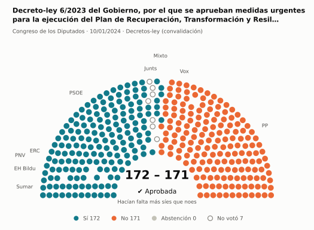
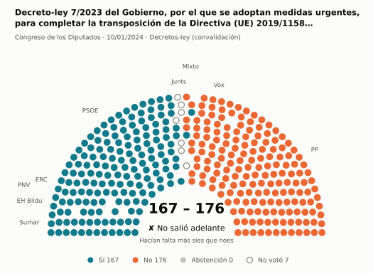
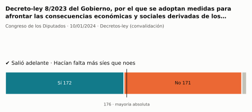
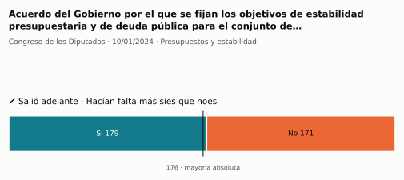
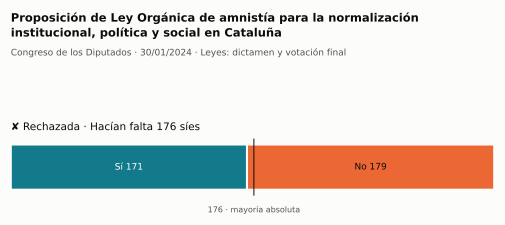
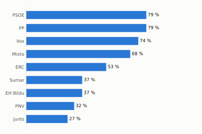
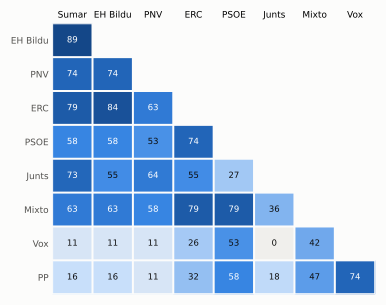

# Qué votó el Congreso en enero de 2024

Las votaciones del Pleno del Congreso de los Diputados, explicadas sin tecnicismos. Datos oficiales del [Congreso](https://www.congreso.es/es/opendata/votaciones); este resumen se actualiza solo cada mes (última vez: 10/11/2026).

## En pocas palabras

- El Congreso votó **25 veces** en 4 días de pleno. **10 propuestas salieron adelante** y 12 no; hubo además 3 empates, que se repiten.
- 25 votaciones fueron sobre leyes, decretos o presupuestos.
- El Gobierno (PSOE y Sumar) perdió **1** de las 11 votaciones en las que sus grupos votaron lo mismo.
- La votación más reñida se decidió por 1 voto: Decreto-ley 6/2023 del Gobierno, por el que se aprueban medidas urgentes para la ejecución del Plan de Recuperación, Tr….
- Los diputados casi siempre votan lo mismo que su grupo: en todo el mes solo hubo 1 voto distinto (sin contar el Grupo Mixto).

## Las votaciones más importantes del mes

Elegidas por su importancia: pesan más las leyes y los decretos que las peticiones al Gobierno, y suben las que se decidieron por pocos votos o las que perdió el Gobierno. Cada punto del dibujo es un diputado, colocado con su grupo, y el color es lo que votó.

### 1. Decreto-ley 6/2023 del Gobierno, por el que se aprueban medidas urgentes para la ejecución del Plan de Recuperación, Transformación y Resiliencia en…

**10 de enero · Decretos-ley (convalidación).** El Gobierno aprobó esta norma por urgencia. Ya está en vigor, pero el Congreso tiene 30 días para confirmarla o tumbarla.

<picture>
  <source media="(prefers-color-scheme: dark)" srcset="img/2024-01/votacion-L15-S015-V001-oscuro.svg">
  
</picture>

**✔ Salió adelante** por 1 voto: 172 a favor, 171 en contra y ninguna abstención.

- **A favor:** PSOE, Sumar, ERC, EH Bildu y PNV
- **En contra:** PP y Vox
- **Repartidos:** Grupo Mixto (Sí 7, No 1)

[Datos oficiales](https://www.congreso.es/webpublica/opendata/votaciones/Leg15/Sesion015/20240110/Votacion001/VOT_20240111114809.json)

### 2. Decreto-ley 7/2023 del Gobierno, por el que se adoptan medidas urgentes, para completar la transposición de la Directiva (UE) 2019/1158, del Parlamen…

**10 de enero · Decretos-ley (convalidación).** El Gobierno aprobó esta norma por urgencia. Ya está en vigor, pero el Congreso tiene 30 días para confirmarla o tumbarla.

<picture>
  <source media="(prefers-color-scheme: dark)" srcset="img/2024-01/votacion-L15-S015-V003-oscuro.svg">
  
</picture>

**✘ No salió adelante** por 9 votos: 167 a favor, 176 en contra y ninguna abstención.

- **A favor:** PSOE, Sumar, ERC, EH Bildu y PNV
- **En contra:** PP y Vox
- **Repartidos:** Grupo Mixto (Sí 2, No 6)

[Datos oficiales](https://www.congreso.es/webpublica/opendata/votaciones/Leg15/Sesion015/20240110/Votacion003/VOT_20240111114814.json)

### 3. Decreto-ley 8/2023 del Gobierno, por el que se adoptan medidas para afrontar las consecuencias económicas y sociales derivadas de los conflictos en U…

**10 de enero · Decretos-ley (convalidación).** El Gobierno aprobó esta norma por urgencia. Ya está en vigor, pero el Congreso tiene 30 días para confirmarla o tumbarla.

<picture>
  <source media="(prefers-color-scheme: dark)" srcset="img/2024-01/votacion-L15-S015-V009-oscuro.svg">
  
</picture>

**✔ Salió adelante** por 1 voto: 172 a favor, 171 en contra y 7 abstenciones.

Fue una votación por llamamiento: cada diputado dijo su voto en voz alta. El voto de cada uno está en el [Diario de Sesiones](https://www.congreso.es/public_oficiales/L15/CONG/DS/PL/DSCD-15-PL-16.PDF?#page=120).

### 4. Acuerdo del Gobierno por el que se fijan los objetivos de estabilidad presupuestaria y de deuda pública para el conjunto de Administraciones Públicas…

**10 de enero · Presupuestos y estabilidad.** Cuentas públicas: límites de déficit y deuda o cuentas del Estado.

<picture>
  <source media="(prefers-color-scheme: dark)" srcset="img/2024-01/votacion-L15-S015-V011-oscuro.svg">
  
</picture>

**✔ Salió adelante** por 8 votos: 179 a favor, 171 en contra y ninguna abstención.

Fue una votación por llamamiento: cada diputado dijo su voto en voz alta. El voto de cada uno está en el [Diario de Sesiones](https://www.congreso.es/public_oficiales/L15/CONG/DS/PL/DSCD-15-PL-16.PDF?#page=128).

### 5. Proposición de Ley Orgánica de amnistía para la normalización institucional, política y social en Cataluña

**30 de enero · Leyes: dictamen y votación final.** Votación del texto de una ley después de trabajarla en comisión.

<picture>
  <source media="(prefers-color-scheme: dark)" srcset="img/2024-01/votacion-L15-S018-V010-oscuro.svg">
  
</picture>

**✘ No salió adelante** le faltaron 5 votos para los 176: 171 a favor, 179 en contra y ninguna abstención.

Fue una votación por llamamiento: cada diputado dijo su voto en voz alta. El voto de cada uno está en el [Diario de Sesiones](https://www.congreso.es/public_oficiales/L15/CONG/DS/PL/DSCD-15-PL-20.PDF?#page=22).

Este asunto tuvo 12 votaciones este mes; aquí se muestra la más disputada.

## ¿Qué grupos votaron más veces lo que finalmente salió?

<picture>
  <source media="(prefers-color-scheme: dark)" srcset="img/2024-01/ganadora-oscuro.svg">
  
</picture>

Porcentaje de votaciones en que el grupo votó Sí y salió adelante, o votó No y no salió. Abstenerse no cuenta como acertar.

## ¿Quién vota con quién?

<picture>
  <source media="(prefers-color-scheme: dark)" srcset="img/2024-01/afinidad-oscuro.svg">
  
</picture>

Cada casilla dice en qué porcentaje de las votaciones dos grupos votaron lo mismo: 100 es que siempre coincidieron y 0 que nunca.

## ¿Qué tipo de cosas se votaron?

| Tipo | Votaciones | Salieron adelante | Qué es |
| --- | ---: | ---: | --- |
| Leyes: dictamen y votación final | 12 | 3 | Votación del texto de una ley después de trabajarla en comisión. |
| Decretos-ley (convalidación) | 6 | 4 | El Gobierno aprobó esta norma por urgencia. Ya está en vigor, pero el Congreso tiene 30 días para confirmarla o tumbarla. |
| Presupuestos y estabilidad | 4 | 2 | Cuentas públicas: límites de déficit y deuda o cuentas del Estado. |
| Enmiendas a la totalidad | 2 | 0 | Un grupo intenta devolver la ley a quien la propuso o sustituirla por otra. Si no sale adelante, la ley sigue su camino. |
| Leyes: toma en consideración | 1 | 1 | Primer paso de una ley propuesta por un grupo o una comunidad autónoma: el Congreso decide si empieza a tramitarla. |

## Palabras que conviene saber

- **Pleno**: La reunión de los 350 diputados, donde se vota.
- **Grupo parlamentario**: Los diputados de un partido o coalición. Los partidos pequeños van juntos en el Grupo Mixto, aunque no piensen igual.
- **Abstención**: El diputado vota, pero ni a favor ni en contra.
- **No votó**: El diputado no votó: no estaba, estaba de baja o el escaño estaba vacío.
- **Mayoría simple**: Salen adelante las votaciones con más síes que noes. Es lo normal.
- **Mayoría absoluta**: 176 votos a favor, la mitad más uno de 350. La piden las leyes orgánicas (derechos fundamentales, sistema electoral…) y la primera votación de investidura.
- **Votación por llamamiento**: Cada diputado dice su voto en voz alta. Se usa en las investiduras y otras votaciones importantes.

---

**¿Quieres más detalle?** El [análisis detallado](2024-01-detalle.md) tiene la cohesión de cada grupo, un mapa de los diputados según cómo votan, qué diputados votaron distinto de su grupo, las ausencias y la lista completa de votaciones.

_Los resultados están calculados a partir de los votos: el Congreso no publica si cada votación salió adelante. Este proyecto no tiene relación con el Congreso. Método en [docs/DOCUMENTO_FUNCIONAL.md](../docs/DOCUMENTO_FUNCIONAL.md)._
