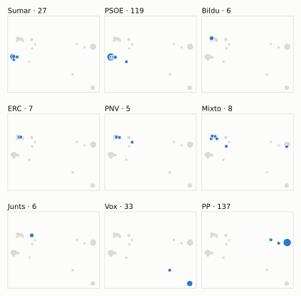
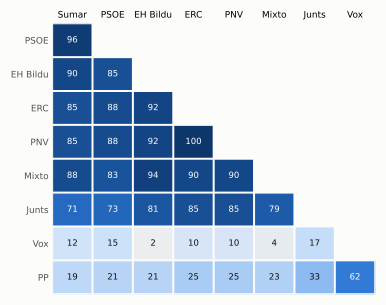

# Análisis detallado: febrero de 2024

[← Volver al resumen del mes](2024-02.md)

_Generado automáticamente el 2026-11-11 con datos abiertos del [Congreso de los Diputados](https://www.congreso.es/es/opendata/votaciones). Solo plenos y Diputación Permanente. Método y límites en [docs/DOCUMENTO_FUNCIONAL.md](../docs/DOCUMENTO_FUNCIONAL.md)._

## Resumen

- **48 votaciones** en 5 días de pleno (sesiones 19, 21, 23, 24 y 26).
- **14 aprobadas** y **34 rechazadas**.
- 9 votaciones se decidieron por 5 votos o menos.
- El grupo que más veces votó con el resultado final: **PSOE** (85 % de las votaciones nominales).
- Los grupos del Gobierno (PSOE y Sumar) votaron lo mismo en 45 de 48 votaciones nominales y perdieron 5 de ellas.
- 8 votos individuales se apartaron de la posición de su grupo (7 diputados).

## Cómo votó cada grupo

| Grupo | Diputados | Cohesión | Votó con el resultado | Decisivo | Posición Sí | Posición No | Posición Abst. |
| --- | ---: | ---: | ---: | ---: | ---: | ---: | ---: |
| PP | 137 | 100 % | 35 % | 5 | 27 | 14 | 7 |
| PSOE | 120 | 100 % | 85 % | 24 | 16 | 30 | 2 |
| Vox | 33 | 100 % | 29 % | 8 | 26 | 17 | 5 |
| Sumar | 27 | 100 % | 83 % | 22 | 18 | 29 | 1 |
| Mixto | 8 | 79 % | 75 % | 9 | 22 | 25 | 1 |
| Junts | 7 | 100 % | 81 % | 11 | 13 | 30 | 5 |
| ERC | 7 | 100 % | 77 % | 17 | 19 | 27 | 2 |
| EH Bildu | 6 | 100 % | 73 % | 9 | 21 | 25 | 2 |
| PNV | 5 | 100 % | 77 % | 4 | 19 | 27 | 2 |

*Cohesión*: índice de acuerdo interno (100 % = todo el grupo votó igual). *Votó con el resultado*: el grupo votó Sí y salió aprobada, o No y salió rechazada. *Decisivo*: votaciones cuyo resultado habría cambiado si el grupo se hubiera abstenido en bloque. El Grupo Mixto reúne partidos distintos: su posición es la de su mayoría.

## Mapa de diputados

<picture>
  <source media="(prefers-color-scheme: dark)" srcset="img/2024-02/mapa-oscuro.svg">
  
</picture>

Cada punto es un diputado; dos diputados están cerca si votaron parecido. Un punto más grande reúne a varios que votaron exactamente igual. En cada panel, el grupo en azul y el resto del Congreso en gris.

*Cómo se calcula*: componentes principales de los votos (Sí, No, abstención) en 47 votaciones con algún desacuerdo. El eje horizontal recoge el 86 % de la variación y el vertical el 9 %. Los ejes no tienen nombre ni sentido político propio; por convención, el PP queda a la derecha. No se sitúa a 3 diputados que votó en menos de la mitad.

## Afinidad entre grupos

<picture>
  <source media="(prefers-color-scheme: dark)" srcset="img/2024-02/afinidad-oscuro.svg">
  
</picture>

Porcentaje de votaciones nominales en que los dos grupos tomaron la misma posición. Los grupos están ordenados según el mapa de diputados.

Ver la tabla

|  | PP | PSOE | Vox | Sumar | Mixto | Junts | ERC | EH Bildu | PNV |
| --- | :---: | :---: | :---: | :---: | :---: | :---: | :---: | :---: | :---: |
| PP | 100 % | 21 % | 62 % | 19 % | 23 % | 33 % | 25 % | 21 % | 25 % |
| PSOE | 21 % | 100 % | 15 % | 96 % | 83 % | 73 % | 88 % | 85 % | 88 % |
| Vox | 62 % | 15 % | 100 % | 12 % | 4 % | 17 % | 10 % | 2 % | 10 % |
| Sumar | 19 % | 96 % | 12 % | 100 % | 88 % | 71 % | 85 % | 90 % | 85 % |
| Mixto | 23 % | 83 % | 4 % | 88 % | 100 % | 79 % | 90 % | 94 % | 90 % |
| Junts | 33 % | 73 % | 17 % | 71 % | 79 % | 100 % | 85 % | 81 % | 85 % |
| ERC | 25 % | 88 % | 10 % | 85 % | 90 % | 85 % | 100 % | 92 % | 100 % |
| EH Bildu | 21 % | 85 % | 2 % | 90 % | 94 % | 81 % | 92 % | 100 % | 92 % |
| PNV | 25 % | 88 % | 10 % | 85 % | 90 % | 85 % | 100 % | 92 % | 100 % |

## Quién sacó adelante las votaciones

| Grupos que votaron Sí | Votaciones | Escaños |
| --- | ---: | ---: |
| PSOE + Sumar + Mixto + Junts + ERC + EH Bildu + PNV | 5 | 180 |
| PP + PSOE + Sumar + Mixto + Junts + ERC + EH Bildu + PNV | 3 | 317 |
| PP + Vox | 2 | 170 |
| PP + PSOE + Sumar + Mixto + EH Bildu | 1 | 298 |
| PSOE + Sumar + Mixto + ERC + EH Bildu + PNV | 1 | 173 |
| PP + PSOE + Vox + Sumar + Mixto + ERC + PNV | 1 | 337 |
| Todos los grupos | 1 | 350 |

De 14 votaciones nominales aprobadas. La posición de cada grupo es la de la mayoría de sus diputados.

## Votaciones que perdieron los grupos del Gobierno

| Fecha | Asunto | Tipo | PSOE y Sumar votaron | Resultado | Sí | No |
| --- | --- | --- | :---: | --- | ---: | ---: |
| 29 de febrero | Proposición no de Ley del Grupo Parlamentario Mixto (Sra. Belarra), relativa a las medidas a adoptar por el Gobierno de España ante la ofensiva de Israel en Ga… *(Votación separada por puntos Punto 2.)* | Proposiciones no de ley | Sí | Rechazada | 166 | 176 |
| 29 de febrero | Proposición no de Ley del Grupo Parlamentario Mixto (Sra. Belarra), relativa a las medidas a adoptar por el Gobierno de España ante la ofensiva de Israel en Ga… *(Votación separada por puntos Punto 4.)* | Proposiciones no de ley | Sí | Rechazada | 170 | 177 |
| 29 de febrero | Proposición no de Ley del Grupo Parlamentario Mixto (Sra. Belarra), relativa a las medidas a adoptar por el Gobierno de España ante la ofensiva de Israel en Ga… *(Votación separada por puntos Punto 5.)* | Proposiciones no de ley | Sí | Rechazada | 169 | 178 |
| 29 de febrero | Proposición no de Ley del Grupo Parlamentario Mixto (Sra. Belarra), relativa a las medidas a adoptar por el Gobierno de España ante la ofensiva de Israel en Ga… *(Votación separada por puntos Punto 7.)* | Proposiciones no de ley | Sí | Rechazada | 170 | 177 |
| 29 de febrero | Moción consecuencia de interpelación urgente del Grupo Parlamentario Popular en el Congreso, relativa a la escasez de medios para hacer frente al narcotráfico… | Mociones | No | Aprobada | 171 | 165 |

Además, PSOE y Sumar votaron distinto entre sí en 2 votaciones.

## Votaciones más ajustadas

| Fecha | Asunto | Resultado | Sí | No | Abst. |
| --- | --- | :---: | ---: | ---: | ---: |
| 6 de febrero | Del Grupo Parlamentario Republicano, en relación con el despliegue y desarrollo de la Ley 20/2022, de 19 de octubre, de Memoria Democrática. Se vota en los tér… | Aprobada | 174 | 170 | 0 |
| 22 de febrero | Moción consecuencia de interpelación urgente del Grupo Parlamentario VOX, sobre las medidas que va a impulsar el Gobierno para salvaguardar los intereses del c… *(Votación separada por puntos Punto 3.)* | Rechazada | 170 | 174 | 0 |
| 29 de febrero | Moción consecuencia de interpelación urgente del Grupo Parlamentario Mixto (Sr. Catalán), sobre las medidas que va a adoptar el Ministro del Interior para acab… | Rechazada | 171 | 175 | 1 |
| 29 de febrero | Moción consecuencia de interpelación urgente del Grupo Parlamentario VOX, sobre las actuaciones que va a llevar a cabo el Ministerio de la Presidencia, Justici… | Rechazada | 171 | 175 | 0 |
| 6 de febrero | Del Grupo Parlamentario Popular en el Congreso, Orgánica sobre crímenes de ETA sin resolver y sus víctimas para el cumplimiento del informe de 21 de abril de 2… | Rechazada | 170 | 175 | 0 |
| 22 de febrero | Moción consecuencia de interpelación urgente del Grupo Parlamentario VOX, sobre las medidas que va a impulsar el Gobierno para salvaguardar los intereses del c… *(Votación separada por puntos Punto 8.)* | Rechazada | 169 | 174 | 0 |
| 22 de febrero | Moción consecuencia de interpelación urgente del Grupo Parlamentario VOX, sobre las medidas que va a impulsar el Gobierno para salvaguardar los intereses del c… *(Votación separada por puntos Punto 12.)* | Rechazada | 169 | 174 | 0 |
| 29 de febrero | Acuerdo del Gobierno por el que se fijan los objetivos de estabilidad presupuestaria y de deuda pública para el conjunto de Administraciones Públicas y de cada… | Aprobada | 176 | 171 | 0 |
| 29 de febrero | Acuerdo del Gobierno por el que se remite a las Cortes Generales el Plan de Reequilibrio previsto en la Ley Orgánica 2/2012, de 27 de abril, de Estabilidad Pre… | Aprobada | 176 | 171 | 0 |
| 22 de febrero | Proposición no de Ley del Grupo Parlamentario VOX, para la defensa de los transportistas y agricultores españoles ante los ataques sufridos en la frontera con… | Rechazada | 169 | 175 | 0 |

Votaciones decididas por 10 votos o menos (o a esa distancia de la mayoría que exigían). Las públicas por llamamiento no tienen hemiciclo: el voto de cada diputado solo consta en el Diario de Sesiones.

## Qué se votó, por tipo de asunto

| Tipo de asunto | Votaciones | Aprobadas | No aprobadas |
| --- | ---: | ---: | ---: |
| Mociones | 21 | 3 | 18 |
| Proposiciones no de ley | 15 | 4 | 11 |
| Leyes: toma en consideración | 6 | 3 | 3 |
| Enmiendas a la totalidad | 3 | 1 | 2 |
| Presupuestos y estabilidad | 2 | 2 | 0 |
| Leyes: dictamen y votación final | 1 | 1 | 0 |

Las proposiciones no de ley y las mociones expresan la posición del Congreso pero no obligan al Gobierno. Las leyes pasan por varias votaciones (toma en consideración, totalidad, dictamen, Senado), así que una misma ley puede aparecer varias veces.

## Votos distintos de su grupo

| Diputado | Grupo | Votos distintos de su grupo |
| --- | --- | ---: |
| Santos Maraver, Agustín | Sumar | 2 |
| Aizcorbe Torra, Juan José | Vox | 1 |
| Armengol Socias, Francina | PSOE | 1 |
| Cantera de Castro, Zaida | PSOE | 1 |
| Hernando Fraile, Rafael Antonio | PP | 1 |
| Redondo Cárdenas, Gonzalo | PSOE | 1 |
| Sánchez Díaz, María Carmen | PSOE | 1 |

Un voto aislado puede ser un error al pulsar, no una decisión política: el Congreso no publica las correcciones. Se excluye el Grupo Mixto.

## Diputados que más veces no votaron

| Diputado | Grupo | No votó | % de votaciones |
| --- | --- | ---: | ---: |
| Sánchez Pérez-Castejón, Pedro | PSOE | 48 | 100 % |
| Nogueras i Camero, Míriam | Junts | 44 | 92 % |
| Ábalos Meco, José Luis | Mixto | 21 | 100 % |
| Varela Pazos, Marta | PP | 20 | 42 % |
| Abascal Conde, Santiago | Vox | 18 | 38 % |
| Legarda Uriarte, Mikel | PNV | 18 | 38 % |
| Rodríguez Gómez de Celis, Alfonso | PSOE | 18 | 38 % |
| Núñez Feijóo, Alberto | PP | 11 | 23 % |
| Díaz Pérez, Yolanda | Sumar | 7 | 15 % |
| Gómez Besteiro, José Ramón | PSOE | 7 | 15 % |
| Santana Perera, Noemí | Mixto | 4 | 8 % |
| Montero Cuadrado, María Jesús | PSOE | 2 | 4 % |
| Narbona Ruiz, Cristina | PSOE | 2 | 4 % |
| Sánchez Sierra, María del Mar | PP | 2 | 4 % |
| Vaquero Montero, Maribel | PNV | 2 | 4 % |

«No vota» incluye ausencias justificadas (baja, maternidad o paternidad) y escaños vacantes; el portal no las distingue.

## Todas las votaciones

Posición de cada grupo: la opción que votó la mayoría de sus diputados (*Div.*: empate dentro del grupo). El número enlaza al JSON oficial o, en las votaciones por llamamiento, al Diario de Sesiones.

### 6 de febrero (sesión 19)

| Nº | Asunto | Resultado | Sí | No | Abst. | PP | PSOE | Vox | Sumar | Mixto | Junts | ERC | EH Bildu | PNV | Decisivos |
| ---: | --- | --- | ---: | ---: | ---: | :---: | :---: | :---: | :---: | :---: | :---: | :---: | :---: | :---: | --- |
| [1](https://www.congreso.es/webpublica/opendata/votaciones/Leg15/Sesion019/20240206/Votacion001/VOT_20240206213120.json) | Del Parlamento de Cataluña, de garantía del servicio de cajero automático en los municipios en riesgo de exclusión financiera y de garantía del acceso a los se… | Aprobada | 310 | 0 | 33 | Sí | Sí | Abst. | Sí | Sí | Sí | Sí | Sí | Sí |  |
| [2](https://www.congreso.es/webpublica/opendata/votaciones/Leg15/Sesion019/20240206/Votacion002/VOT_20240206213122.json) | Del Grupo Parlamentario Popular en el Congreso, Orgánica sobre crímenes de ETA sin resolver y sus víctimas para el cumplimiento del informe de 21 de abril de 2… | Rechazada | 170 | 175 | 0 | Sí | No | Sí | No | No | No | No | No | No | EH Bildu, Junts, Mixto, ERC, PSOE, Sumar |
| [3](https://www.congreso.es/webpublica/opendata/votaciones/Leg15/Sesion019/20240206/Votacion003/VOT_20240206213124.json) | Del Grupo Parlamentario Popular en el Congreso, relativa a las actuaciones que el Gobierno debe tomar en relación con las infraestructuras y el transporte en l… | Aprobada | 171 | 3 | 169 | Sí | Abst. | Sí | Abst. | No | Abst. | Abst. | Abst. | Abst. |  |
| [4](https://www.congreso.es/webpublica/opendata/votaciones/Leg15/Sesion019/20240206/Votacion004/VOT_20240206213125.json) | Del Grupo Parlamentario Socialista, para el apoyo a la cadena de valor del sector del automóvil y despliegue del vehículo eléctrico y conectado de Galicia. Se… | Aprobada | 292 | 1 | 51 | Sí | Sí | Abst. | Sí | Sí | Abst. | Abst. | Sí | Abst. |  |
| [5](https://www.congreso.es/webpublica/opendata/votaciones/Leg15/Sesion019/20240206/Votacion005/VOT_20240206213127.json) | Del Grupo Parlamentario Republicano, en relación con el despliegue y desarrollo de la Ley 20/2022, de 19 de octubre, de Memoria Democrática. Se vota en los tér… | Aprobada | 174 | 170 | 0 | No | Sí | No | Sí | Sí | Sí | Sí | Sí | Sí | EH Bildu, Junts, Mixto, ERC, PSOE, Sumar, PNV |
| [6](https://www.congreso.es/webpublica/opendata/votaciones/Leg15/Sesion019/20240206/Votacion006/VOT_20240206213128.json) | Del Grupo Parlamentario VOX, sobre la planificación y asistencia sanitaria que va a desarrollar la Ministra de Sanidad para asegurar el derecho a la protección… | Rechazada | 33 | 174 | 137 | Abst. | No | Sí | No | No | No | No | No | No |  |
| [7](https://www.congreso.es/webpublica/opendata/votaciones/Leg15/Sesion019/20240206/Votacion007/VOT_20240206213130.json) | Del Grupo Parlamentario Popular en el Congreso, sobre las medidas que piensa adoptar el Gobierno para cumplir la Ley Orgánica 2/2012, de 27 de abril, de Estabi… | Rechazada | 137 | 174 | 33 | Sí | No | Abst. | No | No | No | No | No | No | PSOE |

### 20 de febrero (sesión 21)

| Nº | Asunto | Resultado | Sí | No | Abst. | PP | PSOE | Vox | Sumar | Mixto | Junts | ERC | EH Bildu | PNV | Decisivos |
| ---: | --- | --- | ---: | ---: | ---: | :---: | :---: | :---: | :---: | :---: | :---: | :---: | :---: | :---: | --- |
| [1](https://www.congreso.es/webpublica/opendata/votaciones/Leg15/Sesion021/20240220/Votacion001/VOT_20240220203628.json) | Proposición de Ley del Grupo Parlamentario VOX, Orgánica para garantizar la unidad de España. | Rechazada | 33 | 313 | 0 | No | No | Sí | No | No | No | No | No | No |  |
| [2](https://www.congreso.es/webpublica/opendata/votaciones/Leg15/Sesion021/20240220/Votacion002/VOT_20240220203631.json) | Proposición de Ley del Grupo Parlamentario Plurinacional SUMAR, Orgánica de reforma de la Ley Orgánica 6/1985, de 1 de julio, del Poder Judicial, para la prote… | Aprobada | 178 | 168 | 0 | No | Sí | No | Sí | Sí | Sí | Sí | Sí | Sí | PSOE, Sumar |

### 22 de febrero (sesión 23)

| Nº | Asunto | Resultado | Sí | No | Abst. | PP | PSOE | Vox | Sumar | Mixto | Junts | ERC | EH Bildu | PNV | Decisivos |
| ---: | --- | --- | ---: | ---: | ---: | :---: | :---: | :---: | :---: | :---: | :---: | :---: | :---: | :---: | --- |
| [1](https://www.congreso.es/webpublica/opendata/votaciones/Leg15/Sesion023/20240222/Votacion001/VOT_20240222110730.json) | Proposición no de Ley del Grupo Parlamentario VOX, para la defensa de los transportistas y agricultores españoles ante los ataques sufridos en la frontera con… | Rechazada | 169 | 175 | 0 | Sí | No | Sí | No | No | No | No | No | No | ERC, PSOE, Sumar |
| [2](https://www.congreso.es/webpublica/opendata/votaciones/Leg15/Sesion023/20240222/Votacion002/VOT_20240222110733.json) | Proposición no de Ley del Grupo Parlamentario SUMAR, relativa a la reducción de la jornada máxima legal de trabajo ordinario. | Aprobada | 169 | 33 | 142 | Abst. | Sí | No | Sí | Sí | Abst. | Sí | Sí | Sí |  |
| [3](https://www.congreso.es/webpublica/opendata/votaciones/Leg15/Sesion023/20240222/Votacion003/VOT_20240222110735.json) | Moción consecuencia de interpelación urgente del Grupo Parlamentario VOX, sobre las medidas que va a impulsar el Gobierno para salvaguardar los intereses del c… *(Votación separada por puntos Punto 1.)* | Rechazada | 32 | 174 | 137 | Abst. | No | Sí | No | No | No | No | No | No |  |
| [4](https://www.congreso.es/webpublica/opendata/votaciones/Leg15/Sesion023/20240222/Votacion004/VOT_20240222110738.json) | Moción consecuencia de interpelación urgente del Grupo Parlamentario VOX, sobre las medidas que va a impulsar el Gobierno para salvaguardar los intereses del c… *(Votación separada por puntos Punto 2.)* | Rechazada | 169 | 175 | 0 | Sí | No | Sí | No | No | No | No | No | No | ERC, PSOE, Sumar |
| [5](https://www.congreso.es/webpublica/opendata/votaciones/Leg15/Sesion023/20240222/Votacion005/VOT_20240222110741.json) | Moción consecuencia de interpelación urgente del Grupo Parlamentario VOX, sobre las medidas que va a impulsar el Gobierno para salvaguardar los intereses del c… *(Votación separada por puntos Punto 3.)* | Rechazada | 170 | 174 | 0 | Sí | No | Sí | No | No | No | No | No | No | EH Bildu, Junts, Mixto, ERC, PSOE, Sumar |
| [6](https://www.congreso.es/webpublica/opendata/votaciones/Leg15/Sesion023/20240222/Votacion006/VOT_20240222110743.json) | Moción consecuencia de interpelación urgente del Grupo Parlamentario VOX, sobre las medidas que va a impulsar el Gobierno para salvaguardar los intereses del c… *(Votación separada por puntos Punto 4.)* | Rechazada | 32 | 175 | 137 | Abst. | No | Sí | No | No | No | No | No | No |  |
| [7](https://www.congreso.es/webpublica/opendata/votaciones/Leg15/Sesion023/20240222/Votacion007/VOT_20240222110745.json) | Moción consecuencia de interpelación urgente del Grupo Parlamentario VOX, sobre las medidas que va a impulsar el Gobierno para salvaguardar los intereses del c… *(Votación separada por puntos Punto 5.)* | Rechazada | 32 | 175 | 137 | Abst. | No | Sí | No | No | No | No | No | No |  |
| [8](https://www.congreso.es/webpublica/opendata/votaciones/Leg15/Sesion023/20240222/Votacion008/VOT_20240222110748.json) | Moción consecuencia de interpelación urgente del Grupo Parlamentario VOX, sobre las medidas que va a impulsar el Gobierno para salvaguardar los intereses del c… *(Votación separada por puntos Punto 6.)* | Rechazada | 32 | 174 | 137 | Abst. | No | Sí | No | No | No | No | No | No |  |
| [9](https://www.congreso.es/webpublica/opendata/votaciones/Leg15/Sesion023/20240222/Votacion009/VOT_20240222110749.json) | Moción consecuencia de interpelación urgente del Grupo Parlamentario VOX, sobre las medidas que va a impulsar el Gobierno para salvaguardar los intereses del c… *(Votación separada por puntos Punto 7.)* | Rechazada | 168 | 175 | 0 | Sí | No | Sí | No | No | No | No | No | No | PSOE, Sumar |
| [10](https://www.congreso.es/webpublica/opendata/votaciones/Leg15/Sesion023/20240222/Votacion010/VOT_20240222110752.json) | Moción consecuencia de interpelación urgente del Grupo Parlamentario VOX, sobre las medidas que va a impulsar el Gobierno para salvaguardar los intereses del c… *(Votación separada por puntos Punto 8.)* | Rechazada | 169 | 174 | 0 | Sí | No | Sí | No | No | No | No | No | No | EH Bildu, Junts, Mixto, ERC, PSOE, Sumar |
| [11](https://www.congreso.es/webpublica/opendata/votaciones/Leg15/Sesion023/20240222/Votacion011/VOT_20240222110754.json) | Moción consecuencia de interpelación urgente del Grupo Parlamentario VOX, sobre las medidas que va a impulsar el Gobierno para salvaguardar los intereses del c… *(Votación separada por puntos Punto 9.)* | Rechazada | 169 | 175 | 0 | Sí | No | Sí | No | No | No | No | No | No | ERC, PSOE, Sumar |
| [12](https://www.congreso.es/webpublica/opendata/votaciones/Leg15/Sesion023/20240222/Votacion012/VOT_20240222110757.json) | Moción consecuencia de interpelación urgente del Grupo Parlamentario VOX, sobre las medidas que va a impulsar el Gobierno para salvaguardar los intereses del c… *(Votación separada por puntos Punto 10.)* | Rechazada | 32 | 174 | 137 | Abst. | No | Sí | No | No | No | No | No | No |  |
| [13](https://www.congreso.es/webpublica/opendata/votaciones/Leg15/Sesion023/20240222/Votacion013/VOT_20240222110758.json) | Moción consecuencia de interpelación urgente del Grupo Parlamentario VOX, sobre las medidas que va a impulsar el Gobierno para salvaguardar los intereses del c… *(Votación separada por puntos Punto 11.)* | Rechazada | 169 | 175 | 0 | Sí | No | Sí | No | No | No | No | No | No | ERC, PSOE, Sumar |
| [14](https://www.congreso.es/webpublica/opendata/votaciones/Leg15/Sesion023/20240222/Votacion014/VOT_20240222110801.json) | Moción consecuencia de interpelación urgente del Grupo Parlamentario VOX, sobre las medidas que va a impulsar el Gobierno para salvaguardar los intereses del c… *(Votación separada por puntos Punto 12.)* | Rechazada | 169 | 174 | 0 | Sí | No | Sí | No | No | No | No | No | No | EH Bildu, Junts, Mixto, ERC, PSOE, Sumar |
| [15](https://www.congreso.es/webpublica/opendata/votaciones/Leg15/Sesion023/20240222/Votacion015/VOT_20240222110803.json) | Moción consecuencia de interpelación urgente del Grupo Parlamentario VOX, sobre las medidas que va a impulsar el Gobierno para salvaguardar los intereses del c… *(Votación separada por puntos Punto 13.)* | Rechazada | 169 | 175 | 0 | Sí | No | Sí | No | No | No | No | No | No | ERC, PSOE, Sumar |
| [16](https://www.congreso.es/webpublica/opendata/votaciones/Leg15/Sesion023/20240222/Votacion016/VOT_20240222110805.json) | Moción consecuencia de interpelación urgente del Grupo Parlamentario Popular en el Congreso, sobre cómo piensa el Gobierno hacer compatible la continuidad de s… | Rechazada | 169 | 175 | 0 | Sí | No | Sí | No | No | No | No | No | No | ERC, PSOE, Sumar |
| [17](https://www.congreso.es/webpublica/opendata/votaciones/Leg15/Sesion023/20240222/Votacion017/VOT_20240222110807.json) | Votación de la enmienda a la totalidad de devolución al Proyecto de Ley Orgánica de representación paritaria y presencia equilibrada de mujeres y hombres, pres… | Rechazada | 32 | 310 | 0 | No | No | Sí | No | No | No | No | No | No |  |
| [18](https://www.congreso.es/webpublica/opendata/votaciones/Leg15/Sesion023/20240222/Votacion018/VOT_20240222110809.json) | Votación de la solicitud de avocación por el Pleno de la Cámara de la deliberación y votación final del Proyecto de Ley por la que se regulan las enseñanzas ar… | Aprobada | 332 | 0 | 12 | Sí | Sí | Sí | Sí | Sí | Abst. | Sí | Abst. | Sí |  |

### 27 de febrero (sesión 24)

| Nº | Asunto | Resultado | Sí | No | Abst. | PP | PSOE | Vox | Sumar | Mixto | Junts | ERC | EH Bildu | PNV | Decisivos |
| ---: | --- | --- | ---: | ---: | ---: | :---: | :---: | :---: | :---: | :---: | :---: | :---: | :---: | :---: | --- |
| [1](https://www.congreso.es/webpublica/opendata/votaciones/Leg15/Sesion024/20240227/Votacion001/VOT_20240227205807.json) | Proposición de Ley del Grupo Parlamentario Vasco (EAJ-PNV), de reforma de la Ley 9/1968, de 5 de abril, sobre secretos oficiales. | Aprobada | 176 | 169 | 0 | No | Sí | No | Sí | Sí | Sí | Sí | Sí | Sí | Junts, ERC, PSOE, Sumar |
| [2](https://www.congreso.es/webpublica/opendata/votaciones/Leg15/Sesion024/20240227/Votacion002/VOT_20240227205808.json) | Proposición de Ley del Grupo Parlamentario VOX, Orgánica por la que se modifica la Ley Orgánica 6/1985, de 1 de julio, del Poder Judicial, para la reforma del… | Rechazada | 170 | 176 | 0 | Sí | No | Sí | No | No | No | No | No | No | Junts, ERC, PSOE, Sumar |

### 29 de febrero (sesión 26)

| Nº | Asunto | Resultado | Sí | No | Abst. | PP | PSOE | Vox | Sumar | Mixto | Junts | ERC | EH Bildu | PNV | Decisivos |
| ---: | --- | --- | ---: | ---: | ---: | :---: | :---: | :---: | :---: | :---: | :---: | :---: | :---: | :---: | --- |
| [1](https://www.congreso.es/webpublica/opendata/votaciones/Leg15/Sesion026/20240229/Votacion001/VOT_20240229115034.json) | Proposición no de Ley del Grupo Parlamentario Vasco (EAJ-PNV), relativa a impulsar proyectos de transformación económica y social de nivel regional. *(Votación separada por puntos Punto 1.)* | Rechazada | 168 | 179 | 0 | Sí | No | No | No | Sí | Sí | Sí | Sí | Sí | PSOE, Sumar, Vox |
| [2](https://www.congreso.es/webpublica/opendata/votaciones/Leg15/Sesion026/20240229/Votacion002/VOT_20240229115036.json) | Proposición no de Ley del Grupo Parlamentario Vasco (EAJ-PNV), relativa a impulsar proyectos de transformación económica y social de nivel regional. *(Votación separada por puntos Punto 2.)* | Rechazada | 167 | 179 | 0 | Sí | No | No | No | Sí | Sí | Sí | Sí | Sí | PSOE, Sumar, Vox |
| [3](https://www.congreso.es/webpublica/opendata/votaciones/Leg15/Sesion026/20240229/Votacion003/VOT_20240229115038.json) | Proposición no de Ley del Grupo Parlamentario Vasco (EAJ-PNV), relativa a impulsar proyectos de transformación económica y social de nivel regional. *(Votación separada por puntos Punto 3.)* | Rechazada | 29 | 318 | 0 | No | No | No | No | Sí | Sí | Sí | Sí | Sí |  |
| [4](https://www.congreso.es/webpublica/opendata/votaciones/Leg15/Sesion026/20240229/Votacion004/VOT_20240229115040.json) | Proposición no de Ley del Grupo Parlamentario Vasco (EAJ-PNV), relativa a impulsar proyectos de transformación económica y social de nivel regional. *(Votación separada por puntos Punto 4.)* | Rechazada | 168 | 179 | 0 | Sí | No | No | No | Sí | Sí | Sí | Sí | Sí | PSOE, Sumar, Vox |
| [5](https://www.congreso.es/webpublica/opendata/votaciones/Leg15/Sesion026/20240229/Votacion005/VOT_20240229115042.json) | Proposición no de Ley del Grupo Parlamentario Mixto (Sra. Belarra), relativa a las medidas a adoptar por el Gobierno de España ante la ofensiva de Israel en Ga… *(Votación separada por puntos Punto 1.)* | Rechazada | 37 | 310 | 0 | No | No | No | Sí | Sí | No | No | Sí | No |  |
| [6](https://www.congreso.es/webpublica/opendata/votaciones/Leg15/Sesion026/20240229/Votacion006/VOT_20240229115043.json) | Proposición no de Ley del Grupo Parlamentario Mixto (Sra. Belarra), relativa a las medidas a adoptar por el Gobierno de España ante la ofensiva de Israel en Ga… *(Votación separada por puntos Punto 2.)* | Rechazada | 166 | 176 | 0 | No | Sí | No | Sí | Sí | No | Sí | Sí | Sí | PP, Vox |
| [7](https://www.congreso.es/webpublica/opendata/votaciones/Leg15/Sesion026/20240229/Votacion007/VOT_20240229115045.json) | Proposición no de Ley del Grupo Parlamentario Mixto (Sra. Belarra), relativa a las medidas a adoptar por el Gobierno de España ante la ofensiva de Israel en Ga… *(Votación separada por puntos Punto 3.)* | Aprobada | 312 | 33 | 1 | Sí | Sí | No | Sí | Sí | Sí | Sí | Sí | Sí |  |
| [8](https://www.congreso.es/webpublica/opendata/votaciones/Leg15/Sesion026/20240229/Votacion008/VOT_20240229115047.json) | Proposición no de Ley del Grupo Parlamentario Mixto (Sra. Belarra), relativa a las medidas a adoptar por el Gobierno de España ante la ofensiva de Israel en Ga… *(Votación separada por puntos Punto 4.)* | Rechazada | 170 | 177 | 0 | No | Sí | No | Sí | Sí | No | Sí | Sí | Sí | PP, Vox |
| [9](https://www.congreso.es/webpublica/opendata/votaciones/Leg15/Sesion026/20240229/Votacion009/VOT_20240229115048.json) | Proposición no de Ley del Grupo Parlamentario Mixto (Sra. Belarra), relativa a las medidas a adoptar por el Gobierno de España ante la ofensiva de Israel en Ga… *(Votación separada por puntos Punto 5.)* | Rechazada | 169 | 178 | 0 | No | Sí | No | Sí | Sí | No | Sí | Sí | Sí | PP, Vox |
| [10](https://www.congreso.es/webpublica/opendata/votaciones/Leg15/Sesion026/20240229/Votacion010/VOT_20240229115049.json) | Proposición no de Ley del Grupo Parlamentario Mixto (Sra. Belarra), relativa a las medidas a adoptar por el Gobierno de España ante la ofensiva de Israel en Ga… *(Votación separada por puntos Punto 6.)* | Rechazada | 38 | 189 | 120 | No | Abst. | No | Sí | Sí | No | No | Sí | No |  |
| [11](https://www.congreso.es/webpublica/opendata/votaciones/Leg15/Sesion026/20240229/Votacion011/VOT_20240229115050.json) | Proposición no de Ley del Grupo Parlamentario Mixto (Sra. Belarra), relativa a las medidas a adoptar por el Gobierno de España ante la ofensiva de Israel en Ga… *(Votación separada por puntos Punto 7.)* | Rechazada | 170 | 177 | 0 | No | Sí | No | Sí | Sí | No | Sí | Sí | Sí | PP, Vox |
| [12](https://www.congreso.es/webpublica/opendata/votaciones/Leg15/Sesion026/20240229/Votacion012/VOT_20240229115052.json) | Moción consecuencia de interpelación urgente del Grupo Parlamentario Mixto (Sr. Catalán), sobre las medidas que va a adoptar el Ministro del Interior para acab… | Rechazada | 171 | 175 | 1 | Sí | No | Sí | No | No | No | No | No | No | EH Bildu, Junts, Mixto, ERC, PSOE, Sumar, PNV |
| [13](https://www.congreso.es/webpublica/opendata/votaciones/Leg15/Sesion026/20240229/Votacion013/VOT_20240229115053.json) | Moción consecuencia de interpelación urgente del Grupo Parlamentario Junts per Catalunya, sobre la situación del Delta del Ebro. Se vota en los términos de la… | Aprobada | 314 | 0 | 33 | Sí | Sí | Abst. | Sí | Sí | Sí | Sí | Sí | Sí |  |
| [14](https://www.congreso.es/webpublica/opendata/votaciones/Leg15/Sesion026/20240229/Votacion014/VOT_20240229115055.json) | Moción consecuencia de interpelación urgente del Grupo Parlamentario Popular en el Congreso, relativa a la escasez de medios para hacer frente al narcotráfico… | Aprobada | 171 | 165 | 11 | Sí | No | Sí | No | Abst. | Abst. | No | No | No | PP, Vox |
| [15](https://www.congreso.es/webpublica/opendata/votaciones/Leg15/Sesion026/20240229/Votacion015/VOT_20240229115056.json) | Moción consecuencia de interpelación urgente del Grupo Parlamentario VOX, sobre las actuaciones que va a llevar a cabo el Ministerio de la Presidencia, Justici… | Rechazada | 171 | 175 | 0 | Sí | No | Sí | No | No | No | No | No | No | EH Bildu, Junts, Mixto, ERC, PSOE, Sumar |
| [16](https://www.congreso.es/webpublica/opendata/votaciones/Leg15/Sesion026/20240229/Votacion016/VOT_20240229115057.json) | Acuerdo del Gobierno por el que se fijan los objetivos de estabilidad presupuestaria y de deuda pública para el conjunto de Administraciones Públicas y de cada… | Aprobada | 176 | 171 | 0 | No | Sí | No | Sí | Sí | Sí | Sí | Sí | Sí | EH Bildu, Junts, Mixto, ERC, PSOE, Sumar, PNV |
| [17](https://www.congreso.es/webpublica/opendata/votaciones/Leg15/Sesion026/20240229/Votacion017/VOT_20240229115059.json) | Acuerdo del Gobierno por el que se remite a las Cortes Generales el Plan de Reequilibrio previsto en la Ley Orgánica 2/2012, de 27 de abril, de Estabilidad Pre… | Aprobada | 176 | 171 | 0 | No | Sí | No | Sí | Sí | Sí | Sí | Sí | Sí | EH Bildu, Junts, Mixto, ERC, PSOE, Sumar, PNV |
| [18](https://www.congreso.es/webpublica/opendata/votaciones/Leg15/Sesion026/20240229/Votacion018/VOT_20240229115100.json) | Votación de la Propuesta con consideración de enmienda a la totalidad presentada por el Grupo Parlamentario Popular en el Congreso a la Denuncia del Tratado de… | Rechazada | 137 | 176 | 34 | Sí | No | Abst. | No | No | No | No | No | No | PSOE |
| [19](https://www.congreso.es/webpublica/opendata/votaciones/Leg15/Sesion026/20240229/Votacion019/VOT_20240229115101.json) | Solicitud de avocación por el Pleno de la Cámara de la deliberación y votación final del Proyecto de Ley por la que se crea la Agencia Estatal de Salud Pública… | Aprobada | 346 | 0 | 0 | Sí | Sí | Sí | Sí | Sí | Sí | Sí | Sí | Sí |  |
