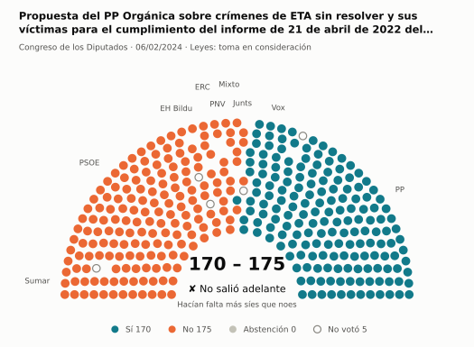
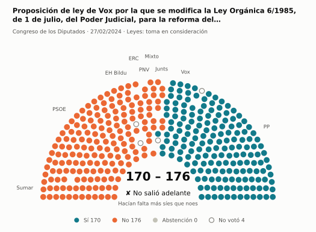
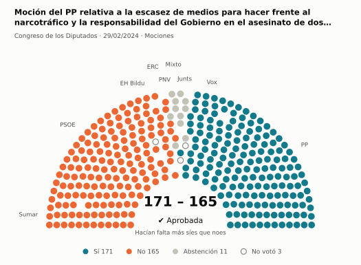
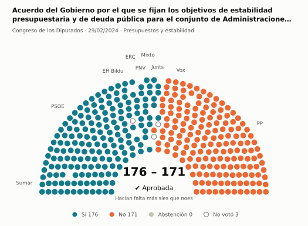
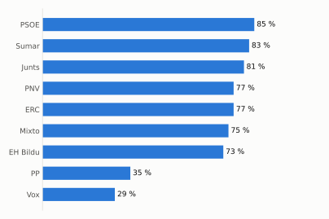
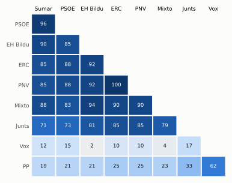

# Qué votó el Congreso en febrero de 2024

Las votaciones del Pleno del Congreso de los Diputados, explicadas sin tecnicismos. Datos oficiales del [Congreso](https://www.congreso.es/es/opendata/votaciones); este resumen se actualiza solo cada mes (última vez: 11/11/2026).

## En pocas palabras

- El Congreso votó **48 veces** en 5 días de pleno. **14 propuestas salieron adelante** y 34 no.
- 12 votaciones fueron sobre leyes, decretos o presupuestos. Otras 36 fueron peticiones al Gobierno que no le obligan (proposiciones no de ley y mociones).
- El Gobierno (PSOE y Sumar) perdió **5** de las 45 votaciones en las que sus grupos votaron lo mismo.
- La votación más reñida se decidió por 4 votos: Propuesta de ERC en relación con el despliegue y desarrollo de la Ley 20/2022, de 19 de octubre, de Memoria Democrática.
- Los diputados casi siempre votan lo mismo que su grupo: en todo el mes solo hubo 8 votos distintos (sin contar el Grupo Mixto).

## Las votaciones más importantes del mes

Elegidas por su importancia: pesan más las leyes y los decretos que las peticiones al Gobierno, y suben las que se decidieron por pocos votos o las que perdió el Gobierno. Cada punto del dibujo es un diputado, colocado con su grupo, y el color es lo que votó.

### 1. Propuesta del PP Orgánica sobre crímenes de ETA sin resolver y sus víctimas para el cumplimiento del informe de 21 de abril de 2022 del Comité de…

**6 de febrero · Leyes: toma en consideración.** Primer paso de una ley propuesta por un grupo o una comunidad autónoma: el Congreso decide si empieza a tramitarla.

<picture>
  <source media="(prefers-color-scheme: dark)" srcset="img/2024-02/votacion-L15-S019-V002-oscuro.svg">
  
</picture>

**✘ No salió adelante** por 5 votos: 170 a favor, 175 en contra y ninguna abstención.

- **A favor:** PP y Vox
- **En contra:** PSOE, Sumar, Junts, ERC, EH Bildu y PNV
- **Repartidos:** Grupo Mixto (Sí 1, No 6)

[Datos oficiales](https://www.congreso.es/webpublica/opendata/votaciones/Leg15/Sesion019/20240206/Votacion002/VOT_20240206213122.json)

### 2. Proposición de ley de Vox por la que se modifica la Ley Orgánica 6/1985, de 1 de julio, del Poder Judicial, para la reforma del procedimiento de…

**27 de febrero · Leyes: toma en consideración.** Primer paso de una ley propuesta por un grupo o una comunidad autónoma: el Congreso decide si empieza a tramitarla.

<picture>
  <source media="(prefers-color-scheme: dark)" srcset="img/2024-02/votacion-L15-S024-V002-oscuro.svg">
  
</picture>

**✘ No salió adelante** por 6 votos: 170 a favor, 176 en contra y ninguna abstención.

- **A favor:** PP y Vox
- **En contra:** PSOE, Sumar, Junts, ERC, EH Bildu y PNV
- **Repartidos:** Grupo Mixto (Sí 1, No 6)

[Datos oficiales](https://www.congreso.es/webpublica/opendata/votaciones/Leg15/Sesion024/20240227/Votacion002/VOT_20240227205808.json)

### 3. Moción del PP relativa a la escasez de medios para hacer frente al narcotráfico y la responsabilidad del Gobierno en el asesinato de dos guardias…

**29 de febrero · Mociones.** Petición al Gobierno después de pedirle explicaciones en el Pleno. Expresa la opinión del Congreso, pero no obliga.

<picture>
  <source media="(prefers-color-scheme: dark)" srcset="img/2024-02/votacion-L15-S026-V014-oscuro.svg">
  
</picture>

**✔ Salió adelante** por 6 votos: 171 a favor, 165 en contra y 11 abstenciones.

- **A favor:** PP y Vox
- **En contra:** PSOE, Sumar, ERC, EH Bildu y PNV
- **Se abstuvieron:** Junts
- **Repartidos:** Grupo Mixto (Sí 1, No 1, Abstención 5)

[Datos oficiales](https://www.congreso.es/webpublica/opendata/votaciones/Leg15/Sesion026/20240229/Votacion014/VOT_20240229115055.json)

### 4. Acuerdo del Gobierno por el que se fijan los objetivos de estabilidad presupuestaria y de deuda pública para el conjunto de Administraciones…

**29 de febrero · Presupuestos y estabilidad.** Cuentas públicas: límites de déficit y deuda o cuentas del Estado.

<picture>
  <source media="(prefers-color-scheme: dark)" srcset="img/2024-02/votacion-L15-S026-V016-oscuro.svg">
  
</picture>

**✔ Salió adelante** por 5 votos: 176 a favor, 171 en contra y ninguna abstención.

- **A favor:** PSOE, Sumar, Junts, ERC, EH Bildu y PNV
- **En contra:** PP y Vox
- **Repartidos:** Grupo Mixto (Sí 6, No 1)

[Datos oficiales](https://www.congreso.es/webpublica/opendata/votaciones/Leg15/Sesion026/20240229/Votacion016/VOT_20240229115057.json)

### 5. Acuerdo del Gobierno por el que se remite a las Cortes Generales el Plan de Reequilibrio previsto en la Ley Orgánica 2/2012, de 27 de abril, de…

**29 de febrero · Presupuestos y estabilidad.** Cuentas públicas: límites de déficit y deuda o cuentas del Estado.

<picture>
  <source media="(prefers-color-scheme: dark)" srcset="img/2024-02/votacion-L15-S026-V017-oscuro.svg">
  
</picture>

**✔ Salió adelante** por 5 votos: 176 a favor, 171 en contra y ninguna abstención.

- **A favor:** PSOE, Sumar, Junts, ERC, EH Bildu y PNV
- **En contra:** PP y Vox
- **Repartidos:** Grupo Mixto (Sí 6, No 1)

[Datos oficiales](https://www.congreso.es/webpublica/opendata/votaciones/Leg15/Sesion026/20240229/Votacion017/VOT_20240229115059.json)

## ¿Qué grupos votaron más veces lo que finalmente salió?

<picture>
  <source media="(prefers-color-scheme: dark)" srcset="img/2024-02/ganadora-oscuro.svg">
  
</picture>

Porcentaje de votaciones en que el grupo votó Sí y salió adelante, o votó No y no salió. Abstenerse no cuenta como acertar.

## ¿Quién vota con quién?

<picture>
  <source media="(prefers-color-scheme: dark)" srcset="img/2024-02/afinidad-oscuro.svg">
  
</picture>

Cada casilla dice en qué porcentaje de las votaciones dos grupos votaron lo mismo: 100 es que siempre coincidieron y 0 que nunca.

## ¿Qué tipo de cosas se votaron?

| Tipo | Votaciones | Salieron adelante | Qué es |
| --- | ---: | ---: | --- |
| Mociones | 21 | 3 | Petición al Gobierno después de pedirle explicaciones en el Pleno. Expresa la opinión del Congreso, pero no obliga. |
| Proposiciones no de ley | 15 | 4 | Petición al Gobierno para que haga algo. Expresa la opinión del Congreso, pero no obliga. |
| Leyes: toma en consideración | 6 | 3 | Primer paso de una ley propuesta por un grupo o una comunidad autónoma: el Congreso decide si empieza a tramitarla. |
| Enmiendas a la totalidad | 3 | 1 | Un grupo intenta devolver la ley a quien la propuso o sustituirla por otra. Si no sale adelante, la ley sigue su camino. |
| Presupuestos y estabilidad | 2 | 2 | Cuentas públicas: límites de déficit y deuda o cuentas del Estado. |
| Leyes: dictamen y votación final | 1 | 1 | Votación del texto de una ley después de trabajarla en comisión. |

## Palabras que conviene saber

- **Pleno**: La reunión de los 350 diputados, donde se vota.
- **Grupo parlamentario**: Los diputados de un partido o coalición. Los partidos pequeños van juntos en el Grupo Mixto, aunque no piensen igual.
- **Abstención**: El diputado vota, pero ni a favor ni en contra.
- **No votó**: El diputado no votó: no estaba, estaba de baja o el escaño estaba vacío.
- **Mayoría simple**: Salen adelante las votaciones con más síes que noes. Es lo normal.
- **Mayoría absoluta**: 176 votos a favor, la mitad más uno de 350. La piden las leyes orgánicas (derechos fundamentales, sistema electoral…) y la primera votación de investidura.
- **Votación por llamamiento**: Cada diputado dice su voto en voz alta. Se usa en las investiduras y otras votaciones importantes.

---

**¿Quieres más detalle?** El [análisis detallado](2024-02-detalle.md) tiene la cohesión de cada grupo, un mapa de los diputados según cómo votan, qué diputados votaron distinto de su grupo, las ausencias y la lista completa de votaciones.

_Los resultados están calculados a partir de los votos: el Congreso no publica si cada votación salió adelante. Este proyecto no tiene relación con el Congreso. Método en [docs/DOCUMENTO_FUNCIONAL.md](../docs/DOCUMENTO_FUNCIONAL.md)._
