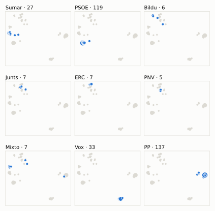
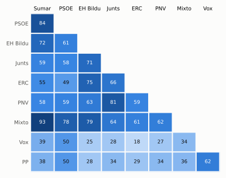

# Análisis detallado: marzo de 2024

[← Volver al resumen del mes](2024-03.md)

_Generado automáticamente el 2026-11-10 con datos abiertos del [Congreso de los Diputados](https://www.congreso.es/es/opendata/votaciones). Solo plenos y Diputación Permanente. Método y límites en [docs/DOCUMENTO_FUNCIONAL.md](../docs/DOCUMENTO_FUNCIONAL.md)._

## Resumen

- **77 votaciones** en 4 días de pleno (sesiones 27, 29, 30, 31 y 33).
- **33 aprobadas** y **44 rechazadas**; de ellas, 1 pública por llamamiento.
- 9 votaciones se decidieron por 5 votos o menos.
- El grupo que más veces votó con el resultado final: **PSOE** (89 % de las votaciones nominales).
- Los grupos del Gobierno (PSOE y Sumar) votaron lo mismo en 63 de 76 votaciones nominales y perdieron 3 de ellas.
- 35 votos individuales se apartaron de la posición de su grupo (30 diputados).

## Cómo votó cada grupo

| Grupo | Diputados | Cohesión | Votó con el resultado | Decisivo | Posición Sí | Posición No | Posición Abst. |
| --- | ---: | ---: | ---: | ---: | ---: | ---: | ---: |
| PP | 137 | 100 % | 55 % | 4 | 37 | 30 | 9 |
| PSOE | 120 | 100 % | 89 % | 26 | 29 | 42 | 5 |
| Vox | 33 | 100 % | 54 % | 4 | 24 | 37 | 15 |
| Sumar | 27 | 100 % | 82 % | 18 | 40 | 35 | 1 |
| Mixto | 8 | 67 % | 76 % | 9 | 44 | 32 | 0 |
| Junts | 7 | 100 % | 64 % | 10 | 43 | 22 | 11 |
| ERC | 7 | 98 % | 49 % | 12 | 36 | 22 | 18 |
| EH Bildu | 6 | 100 % | 59 % | 10 | 46 | 19 | 11 |
| PNV | 5 | 100 % | 64 % | 6 | 37 | 25 | 11 |

*Cohesión*: índice de acuerdo interno (100 % = todo el grupo votó igual). *Votó con el resultado*: el grupo votó Sí y salió aprobada, o No y salió rechazada. *Decisivo*: votaciones cuyo resultado habría cambiado si el grupo se hubiera abstenido en bloque. El Grupo Mixto reúne partidos distintos: su posición es la de su mayoría.

## Mapa de diputados

<picture>
  <source media="(prefers-color-scheme: dark)" srcset="img/2024-03/mapa-oscuro.svg">
  
</picture>

Cada punto es un diputado; dos diputados están cerca si votaron parecido. Un punto más grande reúne a varios que votaron exactamente igual. En cada panel, el grupo en azul y el resto del Congreso en gris.

*Cómo se calcula*: componentes principales de los votos (Sí, No, abstención) en 72 votaciones con algún desacuerdo. El eje horizontal recoge el 69 % de la variación y el vertical el 13 %. Los ejes no tienen nombre ni sentido político propio; por convención, el PP queda a la derecha. No se sitúa a 3 diputados que votó en menos de la mitad.

## Afinidad entre grupos

<picture>
  <source media="(prefers-color-scheme: dark)" srcset="img/2024-03/afinidad-oscuro.svg">
  
</picture>

Porcentaje de votaciones nominales en que los dos grupos tomaron la misma posición. Los grupos están ordenados según el mapa de diputados.

Ver la tabla

|  | PP | PSOE | Vox | Sumar | Mixto | Junts | ERC | EH Bildu | PNV |
| --- | :---: | :---: | :---: | :---: | :---: | :---: | :---: | :---: | :---: |
| PP | 100 % | 50 % | 62 % | 38 % | 36 % | 34 % | 29 % | 28 % | 34 % |
| PSOE | 50 % | 100 % | 50 % | 84 % | 78 % | 58 % | 49 % | 61 % | 59 % |
| Vox | 62 % | 50 % | 100 % | 39 % | 34 % | 28 % | 18 % | 25 % | 27 % |
| Sumar | 38 % | 84 % | 39 % | 100 % | 93 % | 59 % | 55 % | 72 % | 58 % |
| Mixto | 36 % | 78 % | 34 % | 93 % | 100 % | 64 % | 61 % | 79 % | 62 % |
| Junts | 34 % | 58 % | 28 % | 59 % | 64 % | 100 % | 66 % | 71 % | 81 % |
| ERC | 29 % | 49 % | 18 % | 55 % | 61 % | 66 % | 100 % | 75 % | 59 % |
| EH Bildu | 28 % | 61 % | 25 % | 72 % | 79 % | 71 % | 75 % | 100 % | 63 % |
| PNV | 34 % | 59 % | 27 % | 58 % | 62 % | 81 % | 59 % | 63 % | 100 % |

## Quién sacó adelante las votaciones

| Grupos que votaron Sí | Votaciones | Escaños |
| --- | ---: | ---: |
| PSOE + Sumar + Mixto + Junts + ERC + EH Bildu + PNV | 8 | 180 |
| Todos los grupos | 4 | 350 |
| PP + PSOE + Sumar + Mixto + Junts + ERC + EH Bildu + PNV | 3 | 317 |
| PP + Vox + Junts + PNV | 2 | 182 |
| PP + PSOE + Sumar + Mixto + Junts + EH Bildu + PNV | 2 | 310 |
| PP + PSOE + Vox + Sumar + Mixto + Junts + EH Bildu + PNV | 2 | 343 |
| PP + PSOE + Vox + Sumar + Mixto + Junts + ERC + EH Bildu | 2 | 345 |
| PSOE + Sumar + Mixto + Junts + ERC + EH Bildu | 1 | 175 |

De 32 votaciones nominales aprobadas. Otras 8 salieron con combinaciones que se dieron menos veces. La posición de cada grupo es la de la mayoría de sus diputados.

## Votaciones que perdieron los grupos del Gobierno

| Fecha | Asunto | Tipo | PSOE y Sumar votaron | Resultado | Sí | No |
| --- | --- | --- | :---: | --- | ---: | ---: |
| 14 de marzo | Moción consecuencia de interpelación urgente del Grupo Parlamentario Mixto (Sra. Belarra), en relación con la política general del Gobierno sobre la situación… *(Votación separada por puntos Punto 3.)* | Mociones | Sí | Rechazada | 146 | 154 |
| 14 de marzo | Moción consecuencia de interpelación urgente del Grupo Parlamentario Mixto (Sra. Belarra), en relación con la política general del Gobierno sobre la situación… *(Votación separada por puntos Punto 16.)* | Mociones | Sí | Rechazada | 162 | 176 |
| 14 de marzo | Moción consecuencia de interpelación urgente del Grupo Parlamentario Popular en el Congreso, relativa a la responsabilidad del Gobierno en los hechos que deriv… | Mociones | No | Aprobada | 171 | 160 |

Además, PSOE y Sumar votaron distinto entre sí en 12 votaciones.

## Votaciones más ajustadas

| Fecha | Asunto | Resultado | Sí | No | Abst. |
| --- | --- | :---: | ---: | ---: | ---: |
| 14 de marzo | Proyecto de Ley por la que se regulan las enseñanzas artísticas superiores y se establece la organización y equivalencias de las enseñanzas artísticas profesio… *(Enmiendas presentadas por el Grupo Parlamentario Mixto (Sr.…)* | Aprobada | 171 | 170 | 6 |
| 14 de marzo | Proposición de Ley Orgánica de amnistía para la normalización institucional, política y social en Cataluña *(Votación de conjunto (pública por llamamiento) Votación de…)* | Aprobada (necesita 176) (por llamamiento) | 178 | 172 | 0 |
| 14 de marzo | Proyecto de Ley por la que se regulan las enseñanzas artísticas superiores y se establece la organización y equivalencias de las enseñanzas artísticas profesio… *(Enmiendas presentadas por el Grupo Parlamentario Popular en…)* | Rechazada | 172 | 175 | 1 |
| 14 de marzo | Moción consecuencia de interpelación urgente del Grupo Parlamentario VOX, sobre las políticas que va a desarrollar el Ministro de Cultura para defender el lega… | Rechazada | 170 | 173 | 0 |
| 14 de marzo | Proyecto de Ley por la que se regulan las enseñanzas artísticas superiores y se establece la organización y equivalencias de las enseñanzas artísticas profesio… *(Enmiendas presentadas por el Grupo Parlamentario VOX Enmien…)* | Rechazada | 171 | 175 | 1 |
| 21 de marzo | Moción consecuencia de interpelación urgente del Grupo Parlamentario Popular en el Congreso, sobre las medidas que va a adoptar el Ministerio de Política Terri… | Rechazada | 169 | 173 | 1 |
| 12 de marzo | Proposición de Ley de la Asamblea de Madrid, de modificación de la Ley Orgánica 6/1985, de 1 de julio, del Poder Judicial, y de la Ley 38/1988, de 28 de diciem… | Rechazada | 169 | 174 | 1 |
| 14 de marzo | Proyecto de Ley por la que se regulan las enseñanzas artísticas superiores y se establece la organización y equivalencias de las enseñanzas artísticas profesio… *(Enmiendas presentadas por el Grupo Parlamentario Junts per…)* | Aprobada | 175 | 170 | 2 |
| 19 de marzo | Proposición de los Grupos Parlamentarios Socialista y Plurinacional SUMAR, de reforma del Reglamento del Congreso de los Diputados. | Aprobada | 174 | 169 | 0 |
| 21 de marzo | Moción consecuencia de interpelación urgente del Grupo Parlamentario VOX, sobre las medidas que el Ministerio de Hacienda aplicará para perseguir el fraude y l… *(Votación separada por puntos Punto 3)* | Rechazada | 169 | 174 | 0 |

Votaciones decididas por 10 votos o menos (o a esa distancia de la mayoría que exigían). Las públicas por llamamiento no tienen hemiciclo: el voto de cada diputado solo consta en el Diario de Sesiones.

## Qué se votó, por tipo de asunto

| Tipo de asunto | Votaciones | Aprobadas | No aprobadas |
| --- | ---: | ---: | ---: |
| Leyes: dictamen y votación final | 37 | 11 | 26 |
| Mociones | 24 | 7 | 17 |
| Tratados internacionales | 5 | 5 | 0 |
| Proposiciones no de ley | 4 | 4 | 0 |
| Leyes: toma en consideración | 4 | 3 | 1 |
| Organización de la Cámara | 3 | 3 | 0 |

Las proposiciones no de ley y las mociones expresan la posición del Congreso pero no obligan al Gobierno. Las leyes pasan por varias votaciones (toma en consideración, totalidad, dictamen, Senado), así que una misma ley puede aparecer varias veces.

## Votos distintos de su grupo

| Diputado | Grupo | Votos distintos de su grupo |
| --- | --- | ---: |
| Chamorro Delmo, Ricardo | Vox | 3 |
| Vidal Matas, Vicenç | Sumar | 3 |
| González Pons, Esteban | PP | 2 |
| Aragonés Mendiguchía, Carlos | PP | 1 |
| Bassa Coll, Montserrat | ERC | 1 |
| Cantera de Castro, Zaida | PSOE | 1 |
| Casares Hontañón, Pedro | PSOE | 1 |
| De la Rosa Baena, Olvido | PSOE | 1 |
| Díaz Pérez, Yolanda | Sumar | 1 |
| Esteban Bravo, Aitor | PNV | 1 |
| Fernández Benéitez, Andrea | PSOE | 1 |
| Flores Juberías, Carlos | Vox | 1 |
| Jalloul Muro, Hana | PSOE | 1 |
| Jordà i Roura, Teresa | ERC | 1 |
| Lastra Fernández, Adriana | PSOE | 1 |

Un voto aislado puede ser un error al pulsar, no una decisión política: el Congreso no publica las correcciones. Se excluye el Grupo Mixto.

## Diputados que más veces no votaron

| Diputado | Grupo | No votó | % de votaciones |
| --- | --- | ---: | ---: |
| Sánchez Pérez-Castejón, Pedro | PSOE | 75 | 99 % |
| Ábalos Meco, José Luis | Mixto | 53 | 70 % |
| Díaz Pérez, Yolanda | Sumar | 23 | 30 % |
| Pozueta Fernández, Isabel | EH Bildu | 23 | 30 % |
| Bravo Baena, Juan | PP | 22 | 29 % |
| Santana Aguilera, Ada | PSOE | 22 | 29 % |
| González Pons, Esteban | PP | 21 | 28 % |
| Núñez Feijóo, Alberto | PP | 21 | 28 % |
| López Tagliafico, Candela | Sumar | 19 | 25 % |
| Nogueras i Camero, Míriam | Junts | 19 | 25 % |
| Aizpurua Arzallus, Mertxe | EH Bildu | 11 | 14 % |
| Rego Candamil, Néstor | Mixto | 5 | 7 % |
| Legarda Uriarte, Mikel | PNV | 4 | 5 % |
| Sagastizabal Unzetabarrenetxea, Idoia | PNV | 4 | 5 % |
| Agirretxea Urresti, Joseba Andoni | PNV | 3 | 4 % |

«No vota» incluye ausencias justificadas (baja, maternidad o paternidad) y escaños vacantes; el portal no las distingue.

## Todas las votaciones

Posición de cada grupo: la opción que votó la mayoría de sus diputados (*Div.*: empate dentro del grupo). El número enlaza al JSON oficial o, en las votaciones por llamamiento, al Diario de Sesiones.

### 12 de marzo (sesión 27)

| Nº | Asunto | Resultado | Sí | No | Abst. | PP | PSOE | Vox | Sumar | Mixto | Junts | ERC | EH Bildu | PNV | Decisivos |
| ---: | --- | --- | ---: | ---: | ---: | :---: | :---: | :---: | :---: | :---: | :---: | :---: | :---: | :---: | --- |
| [1](https://www.congreso.es/webpublica/opendata/votaciones/Leg15/Sesion027/20240312/Votacion001/VOT_20240312204246.json) | Proposición de Ley de la Asamblea de Madrid, de modificación de la Ley Orgánica 6/1985, de 1 de julio, del Poder Judicial, y de la Ley 38/1988, de 28 de diciem… | Rechazada | 169 | 174 | 1 | Sí | No | Sí | No | No | No | No | No | No | EH Bildu, Junts, ERC, PSOE, Sumar |
| [2](https://www.congreso.es/webpublica/opendata/votaciones/Leg15/Sesion027/20240312/Votacion002/VOT_20240312204248.json) | Proposición de Ley del Grupo Parlamentario Popular en el Congreso, Orgánica para la atención integral de las necesidades de las personas afectadas por la Escle… | Aprobada | 343 | 0 | 0 | Sí | Sí | Sí | Sí | Sí | Sí | Sí | Sí | Sí |  |

### 14 de marzo (sesión 29)

| Nº | Asunto | Resultado | Sí | No | Abst. | PP | PSOE | Vox | Sumar | Mixto | Junts | ERC | EH Bildu | PNV | Decisivos |
| ---: | --- | --- | ---: | ---: | ---: | :---: | :---: | :---: | :---: | :---: | :---: | :---: | :---: | :---: | --- |
| [1](https://www.congreso.es/webpublica/opendata/votaciones/Leg15/Sesion029/20240314/Votacion001/VOT_20240314123709.json) | Proyecto de Ley por la que se regulan las enseñanzas artísticas superiores y se establece la organización y equivalencias de las enseñanzas artísticas profesio… *(Enmiendas presentadas por el Grupo Parlamentario Mixto (Sra…)* | Rechazada | 1 | 290 | 55 | No | No | Abst. | No | No | Abst. | Abst. | Abst. | No |  |
| [2](https://www.congreso.es/webpublica/opendata/votaciones/Leg15/Sesion029/20240314/Votacion002/VOT_20240314123710.json) | Proyecto de Ley por la que se regulan las enseñanzas artísticas superiores y se establece la organización y equivalencias de las enseñanzas artísticas profesio… *(Enmiendas presentadas por el Grupo Parlamentario Mixto (Sra…)* | Rechazada | 6 | 182 | 159 | Abst. | No | No | No | No | Abst. | Abst. | Abst. | Sí |  |
| [3](https://www.congreso.es/webpublica/opendata/votaciones/Leg15/Sesion029/20240314/Votacion003/VOT_20240314123711.json) | Proyecto de Ley por la que se regulan las enseñanzas artísticas superiores y se establece la organización y equivalencias de las enseñanzas artísticas profesio… *(Enmiendas presentadas por el Grupo Parlamentario Mixto (Sra…)* | Rechazada | 1 | 319 | 28 | No | No | No | No | No | Abst. | Abst. | Abst. | Abst. |  |
| [4](https://www.congreso.es/webpublica/opendata/votaciones/Leg15/Sesion029/20240314/Votacion004/VOT_20240314123712.json) | Proyecto de Ley por la que se regulan las enseñanzas artísticas superiores y se establece la organización y equivalencias de las enseñanzas artísticas profesio… *(Enmiendas presentadas por el Grupo Parlamentario Mixto (Sr.…)* | Rechazada | 13 | 321 | 14 | No | No | No | No | No | Sí | Abst. | Abst. | Sí |  |
| [5](https://www.congreso.es/webpublica/opendata/votaciones/Leg15/Sesion029/20240314/Votacion005/VOT_20240314123713.json) | Proyecto de Ley por la que se regulan las enseñanzas artísticas superiores y se establece la organización y equivalencias de las enseñanzas artísticas profesio… *(Enmiendas presentadas por el Grupo Parlamentario Mixto (Sr.…)* | Rechazada | 12 | 333 | 2 | No | No | No | No | No | Sí | No | No | Sí |  |
| [6](https://www.congreso.es/webpublica/opendata/votaciones/Leg15/Sesion029/20240314/Votacion006/VOT_20240314123714.json) | Proyecto de Ley por la que se regulan las enseñanzas artísticas superiores y se establece la organización y equivalencias de las enseñanzas artísticas profesio… *(Enmiendas presentadas por el Grupo Parlamentario Mixto (Sr.…)* | Aprobada | 171 | 170 | 6 | No | Sí | No | Sí | Sí | Sí | Sí | Sí | Abst. | EH Bildu, Junts, Mixto, ERC, PSOE, Sumar |
| [7](https://www.congreso.es/webpublica/opendata/votaciones/Leg15/Sesion029/20240314/Votacion007/VOT_20240314123715.json) | Proyecto de Ley por la que se regulan las enseñanzas artísticas superiores y se establece la organización y equivalencias de las enseñanzas artísticas profesio… *(Enmiendas presentadas por el Grupo Parlamentario Mixto (Sr.…)* | Rechazada | 21 | 320 | 6 | No | No | No | No | No | Sí | Sí | Sí | Abst. |  |
| [8](https://www.congreso.es/webpublica/opendata/votaciones/Leg15/Sesion029/20240314/Votacion008/VOT_20240314123716.json) | Proyecto de Ley por la que se regulan las enseñanzas artísticas superiores y se establece la organización y equivalencias de las enseñanzas artísticas profesio… *(Enmiendas presentadas por el Grupo Parlamentario Euskal Her…)* | Rechazada | 22 | 316 | 9 | No | No | No | No | Sí | Sí | Abst. | Sí | Sí |  |
| [9](https://www.congreso.es/webpublica/opendata/votaciones/Leg15/Sesion029/20240314/Votacion009/VOT_20240314123717.json) | Proyecto de Ley por la que se regulan las enseñanzas artísticas superiores y se establece la organización y equivalencias de las enseñanzas artísticas profesio… *(Enmiendas presentadas por el Grupo Parlamentario Euskal Her…)* | Rechazada | 30 | 316 | 1 | No | No | No | No | Sí | Sí | Sí | Sí | Sí |  |
| [10](https://www.congreso.es/webpublica/opendata/votaciones/Leg15/Sesion029/20240314/Votacion010/VOT_20240314123718.json) | Proyecto de Ley por la que se regulan las enseñanzas artísticas superiores y se establece la organización y equivalencias de las enseñanzas artísticas profesio… *(Enmiendas presentadas por el Grupo Parlamentario Junts per…)* | Rechazada | 12 | 321 | 14 | No | No | No | No | No | Sí | Abst. | Abst. | Sí |  |
| [11](https://www.congreso.es/webpublica/opendata/votaciones/Leg15/Sesion029/20240314/Votacion011/VOT_20240314123720.json) | Proyecto de Ley por la que se regulan las enseñanzas artísticas superiores y se establece la organización y equivalencias de las enseñanzas artísticas profesio… *(Enmiendas presentadas por el Grupo Parlamentario Junts per…)* | Rechazada | 19 | 322 | 7 | No | No | No | No | No | Sí | Sí | Abst. | Sí |  |
| [12](https://www.congreso.es/webpublica/opendata/votaciones/Leg15/Sesion029/20240314/Votacion012/VOT_20240314123721.json) | Proyecto de Ley por la que se regulan las enseñanzas artísticas superiores y se establece la organización y equivalencias de las enseñanzas artísticas profesio… *(Enmiendas presentadas por el Grupo Parlamentario Junts per…)* | Rechazada | 158 | 183 | 7 | Sí | No | No | No | No | Sí | Sí | Abst. | Sí | PSOE, Sumar, Vox |
| [13](https://www.congreso.es/webpublica/opendata/votaciones/Leg15/Sesion029/20240314/Votacion013/VOT_20240314123722.json) | Proyecto de Ley por la que se regulan las enseñanzas artísticas superiores y se establece la organización y equivalencias de las enseñanzas artísticas profesio… *(Enmiendas presentadas por el Grupo Parlamentario Junts per…)* | Rechazada | 150 | 197 | 1 | Sí | No | No | No | No | Sí | No | No | Sí | PSOE |
| [14](https://www.congreso.es/webpublica/opendata/votaciones/Leg15/Sesion029/20240314/Votacion014/VOT_20240314123723.json) | Proyecto de Ley por la que se regulan las enseñanzas artísticas superiores y se establece la organización y equivalencias de las enseñanzas artísticas profesio… *(Enmiendas presentadas por el Grupo Parlamentario Junts per…)* | Aprobada | 175 | 170 | 2 | No | Sí | No | Sí | Sí | Sí | Sí | Sí | Sí | EH Bildu, Junts, ERC, PSOE, Sumar, PNV |
| [15](https://www.congreso.es/webpublica/opendata/votaciones/Leg15/Sesion029/20240314/Votacion015/VOT_20240314123724.json) | Proyecto de Ley por la que se regulan las enseñanzas artísticas superiores y se establece la organización y equivalencias de las enseñanzas artísticas profesio… *(Enmiendas presentadas por el Grupo Parlamentario Junts per…)* | Rechazada | 18 | 320 | 9 | No | No | No | No | No | Sí | Abst. | Sí | Sí |  |
| [16](https://www.congreso.es/webpublica/opendata/votaciones/Leg15/Sesion029/20240314/Votacion016/VOT_20240314123725.json) | Proyecto de Ley por la que se regulan las enseñanzas artísticas superiores y se establece la organización y equivalencias de las enseñanzas artísticas profesio… *(Enmiendas presentadas por el Grupo Parlamentario Junts per…)* | Rechazada | 26 | 321 | 1 | No | No | No | No | No | Sí | Sí | Sí | Sí |  |
| [17](https://www.congreso.es/webpublica/opendata/votaciones/Leg15/Sesion029/20240314/Votacion017/VOT_20240314123726.json) | Proyecto de Ley por la que se regulan las enseñanzas artísticas superiores y se establece la organización y equivalencias de las enseñanzas artísticas profesio… *(Enmiendas presentadas por el Grupo Parlamentario Republican…)* | Rechazada | 167 | 180 | 1 | Sí | No | No | No | Sí | Sí | Sí | Sí | Sí | PSOE, Sumar, Vox |
| [18](https://www.congreso.es/webpublica/opendata/votaciones/Leg15/Sesion029/20240314/Votacion018/VOT_20240314123728.json) | Proyecto de Ley por la que se regulan las enseñanzas artísticas superiores y se establece la organización y equivalencias de las enseñanzas artísticas profesio… *(Enmiendas presentadas por el Grupo Parlamentario Republican…)* | Rechazada | 25 | 317 | 6 | No | No | No | No | Sí | Sí | Sí | Sí | Abst. |  |
| [19](https://www.congreso.es/webpublica/opendata/votaciones/Leg15/Sesion029/20240314/Votacion019/VOT_20240314123729.json) | Proyecto de Ley por la que se regulan las enseñanzas artísticas superiores y se establece la organización y equivalencias de las enseñanzas artísticas profesio… *(Enmiendas presentadas por el Grupo Parlamentario VOX Enmien…)* | Rechazada | 33 | 177 | 138 | Abst. | No | Sí | No | No | No | No | No | No |  |
| [20](https://www.congreso.es/webpublica/opendata/votaciones/Leg15/Sesion029/20240314/Votacion020/VOT_20240314123730.json) | Proyecto de Ley por la que se regulan las enseñanzas artísticas superiores y se establece la organización y equivalencias de las enseñanzas artísticas profesio… *(Enmiendas presentadas por el Grupo Parlamentario VOX Enmien…)* | Rechazada | 171 | 175 | 1 | Sí | No | Sí | No | No | No | No | No | No | EH Bildu, Junts, ERC, PSOE, Sumar, PNV |
| [21](https://www.congreso.es/webpublica/opendata/votaciones/Leg15/Sesion029/20240314/Votacion021/VOT_20240314123731.json) | Proyecto de Ley por la que se regulan las enseñanzas artísticas superiores y se establece la organización y equivalencias de las enseñanzas artísticas profesio… *(Enmiendas presentadas por el Grupo Parlamentario VOX Resto…)* | Rechazada | 33 | 312 | 1 | No | No | Sí | No | No | No | No | No | No |  |
| [22](https://www.congreso.es/webpublica/opendata/votaciones/Leg15/Sesion029/20240314/Votacion022/VOT_20240314123733.json) | Proyecto de Ley por la que se regulan las enseñanzas artísticas superiores y se establece la organización y equivalencias de las enseñanzas artísticas profesio… *(Enmiendas presentadas por el Grupo Parlamentario Popular en…)* | Rechazada | 172 | 175 | 1 | Sí | No | Sí | No | No | No | No | No | No | EH Bildu, Junts, Mixto, ERC, PSOE, Sumar, PNV |
| [23](https://www.congreso.es/webpublica/opendata/votaciones/Leg15/Sesion029/20240314/Votacion023/VOT_20240314123734.json) | Proyecto de Ley por la que se regulan las enseñanzas artísticas superiores y se establece la organización y equivalencias de las enseñanzas artísticas profesio… *(Enmiendas presentadas por el Grupo Parlamentario Popular en…)* | Rechazada | 137 | 208 | 2 | Sí | No | No | No | No | No | No | No | No | PSOE |
| [24](https://www.congreso.es/webpublica/opendata/votaciones/Leg15/Sesion029/20240314/Votacion024/VOT_20240314123735.json) | Proyecto de Ley por la que se regulan las enseñanzas artísticas superiores y se establece la organización y equivalencias de las enseñanzas artísticas profesio… *(Enmiendas presentadas por el Grupo Parlamentario Popular en…)* | Rechazada | 151 | 196 | 1 | Sí | No | No | No | No | No | Sí | Sí | No | PSOE |
| [25](https://www.congreso.es/webpublica/opendata/votaciones/Leg15/Sesion029/20240314/Votacion025/VOT_20240314123737.json) | Proyecto de Ley por la que se regulan las enseñanzas artísticas superiores y se establece la organización y equivalencias de las enseñanzas artísticas profesio… *(Enmiendas presentadas por el Grupo Parlamentario Popular en…)* | Rechazada | 150 | 193 | 2 | Sí | No | No | No | No | No | Sí | Sí | No | PSOE |
| [26](https://www.congreso.es/webpublica/opendata/votaciones/Leg15/Sesion029/20240314/Votacion026/VOT_20240314123738.json) | Proyecto de Ley por la que se regulan las enseñanzas artísticas superiores y se establece la organización y equivalencias de las enseñanzas artísticas profesio… *(Enmiendas presentadas por el Grupo Parlamentario Popular en…)* | Rechazada | 138 | 207 | 2 | Sí | No | No | No | No | No | No | No | No | PSOE |
| [27](https://www.congreso.es/webpublica/opendata/votaciones/Leg15/Sesion029/20240314/Votacion027/VOT_20240314123739.json) | Proyecto de Ley por la que se regulan las enseñanzas artísticas superiores y se establece la organización y equivalencias de las enseñanzas artísticas profesio… *(Enmiendas presentadas por el Grupo Parlamentario Popular en…)* | Rechazada | 141 | 170 | 35 | Sí | No | Abst. | No | No | No | Sí | No | No | PSOE |
| [28](https://www.congreso.es/webpublica/opendata/votaciones/Leg15/Sesion029/20240314/Votacion028/VOT_20240314123740.json) | Proyecto de Ley por la que se regulan las enseñanzas artísticas superiores y se establece la organización y equivalencias de las enseñanzas artísticas profesio… *(Enmiendas presentadas por el Grupo Parlamentario Popular en…)* | Rechazada | 138 | 209 | 1 | Sí | No | No | No | No | No | No | No | No | PSOE |
| [29](https://www.congreso.es/webpublica/opendata/votaciones/Leg15/Sesion029/20240314/Votacion029/VOT_20240314123741.json) | Proyecto de Ley por la que se regulan las enseñanzas artísticas superiores y se establece la organización y equivalencias de las enseñanzas artísticas profesio… *(Correcciones técnicas Corrección técnica número 1 a la expo…)* | Aprobada | 314 | 1 | 33 | Sí | Sí | Abst. | Sí | Sí | Sí | Sí | Sí | Sí |  |
| [30](https://www.congreso.es/webpublica/opendata/votaciones/Leg15/Sesion029/20240314/Votacion030/VOT_20240314123742.json) | Proyecto de Ley por la que se regulan las enseñanzas artísticas superiores y se establece la organización y equivalencias de las enseñanzas artísticas profesio… *(Correcciones técnicas Corrección técnica número 2 a la disp…)* | Aprobada | 313 | 1 | 33 | Sí | Sí | Abst. | Sí | Sí | Sí | Sí | Sí | Sí |  |
| [31](https://www.congreso.es/webpublica/opendata/votaciones/Leg15/Sesion029/20240314/Votacion031/VOT_20240314123743.json) | Proposición no de Ley del Grupo Parlamentario Popular en el Congreso, relativa al impulso de la red ferroviaria de Alta Velocidad-Y vasca. Se vota en los térmi… | Aprobada | 181 | 16 | 142 | Sí | Abst. | Sí | Abst. | No | Sí | No | No | Sí |  |
| [32](https://www.congreso.es/webpublica/opendata/votaciones/Leg15/Sesion029/20240314/Votacion032/VOT_20240314123744.json) | Proposición no de Ley del Grupo Parlamentario Socialista, sobre la movilidad sostenible y el fomento del uso de la bicicleta. Se vota en los términos de la enm… | Aprobada | 172 | 33 | 134 | Abst. | Sí | No | Sí | Sí | Sí | Sí | Sí | Sí |  |
| [33](https://www.congreso.es/webpublica/opendata/votaciones/Leg15/Sesion029/20240314/Votacion033/VOT_20240314123745.json) | Moción consecuencia de interpelación urgente del Grupo Parlamentario VOX, sobre las políticas que va a desarrollar el Ministro de Cultura para defender el lega… | Rechazada | 170 | 173 | 0 | Sí | No | Sí | No | No | No | No | No | No | EH Bildu, Junts, Mixto, ERC, PSOE, Sumar, PNV |
| [34](https://www.congreso.es/webpublica/opendata/votaciones/Leg15/Sesion029/20240314/Votacion034/VOT_20240314123746.json) | Moción consecuencia de interpelación urgente del Grupo Parlamentario Mixto (Sra. Belarra), en relación con la política general del Gobierno sobre la situación… *(Votación separada por puntos Punto 1.)* | Rechazada | 42 | 299 | 2 | No | No | No | Sí | Sí | No | Sí | Sí | No |  |
| [35](https://www.congreso.es/webpublica/opendata/votaciones/Leg15/Sesion029/20240314/Votacion035/VOT_20240314123747.json) | Moción consecuencia de interpelación urgente del Grupo Parlamentario Mixto (Sra. Belarra), en relación con la política general del Gobierno sobre la situación… *(Votación separada por puntos Punto 2.)* | Aprobada | 162 | 143 | 38 | No | Sí | Abst. | Sí | Sí | Sí | No | Sí | Abst. | PSOE, Sumar |
| [36](https://www.congreso.es/webpublica/opendata/votaciones/Leg15/Sesion029/20240314/Votacion036/VOT_20240314123748.json) | Moción consecuencia de interpelación urgente del Grupo Parlamentario Mixto (Sra. Belarra), en relación con la política general del Gobierno sobre la situación… *(Votación separada por puntos Punto 3.)* | Rechazada | 146 | 154 | 36 | No | Sí | Abst. | Sí | Sí | No | No | Abst. | No | PP |
| [37](https://www.congreso.es/webpublica/opendata/votaciones/Leg15/Sesion029/20240314/Votacion037/VOT_20240314123750.json) | Moción consecuencia de interpelación urgente del Grupo Parlamentario Mixto (Sra. Belarra), en relación con la política general del Gobierno sobre la situación… *(Votación separada por puntos Punto 4.)* | Aprobada | 169 | 142 | 33 | No | Sí | Abst. | Sí | Sí | Sí | Sí | Sí | Sí | PSOE, Sumar |
| [38](https://www.congreso.es/webpublica/opendata/votaciones/Leg15/Sesion029/20240314/Votacion038/VOT_20240314123751.json) | Moción consecuencia de interpelación urgente del Grupo Parlamentario Mixto (Sra. Belarra), en relación con la política general del Gobierno sobre la situación… *(Votación separada por puntos Punto 5.)* | Aprobada | 44 | 13 | 286 | Abst. | Abst. | Abst. | Sí | Sí | Sí | No | Sí | No |  |
| [39](https://www.congreso.es/webpublica/opendata/votaciones/Leg15/Sesion029/20240314/Votacion039/VOT_20240314123752.json) | Moción consecuencia de interpelación urgente del Grupo Parlamentario Mixto (Sra. Belarra), en relación con la política general del Gobierno sobre la situación… *(Votación separada por puntos Punto 6.)* | Rechazada | 44 | 152 | 145 | Abst. | No | No | Sí | Sí | Sí | Abst. | Sí | Abst. | PSOE |
| [40](https://www.congreso.es/webpublica/opendata/votaciones/Leg15/Sesion029/20240314/Votacion040/VOT_20240314123753.json) | Moción consecuencia de interpelación urgente del Grupo Parlamentario Mixto (Sra. Belarra), en relación con la política general del Gobierno sobre la situación… *(Votación separada por puntos Punto 7.)* | Aprobada | 56 | 0 | 288 | Abst. | Abst. | Abst. | Sí | Sí | Sí | Sí | Sí | Sí |  |
| [41](https://www.congreso.es/webpublica/opendata/votaciones/Leg15/Sesion029/20240314/Votacion041/VOT_20240314123754.json) | Moción consecuencia de interpelación urgente del Grupo Parlamentario Mixto (Sra. Belarra), en relación con la política general del Gobierno sobre la situación… *(Votación separada por puntos Punto 8.)* | Aprobada | 160 | 152 | 32 | No | Sí | Abst. | Sí | Sí | No | No | Sí | Sí | PSOE, Sumar |
| [42](https://www.congreso.es/webpublica/opendata/votaciones/Leg15/Sesion029/20240314/Votacion042/VOT_20240314123755.json) | Moción consecuencia de interpelación urgente del Grupo Parlamentario Mixto (Sra. Belarra), en relación con la política general del Gobierno sobre la situación… *(Votación separada por puntos Punto 9.)* | Rechazada | 44 | 292 | 8 | No | No | No | Sí | Sí | Abst. | Sí | Sí | No |  |
| [43](https://www.congreso.es/webpublica/opendata/votaciones/Leg15/Sesion029/20240314/Votacion043/VOT_20240314123756.json) | Moción consecuencia de interpelación urgente del Grupo Parlamentario Mixto (Sra. Belarra), en relación con la política general del Gobierno sobre la situación… *(Votación separada por puntos Punto 10.)* | Rechazada | 57 | 170 | 118 | No | Abst. | No | Sí | Sí | Sí | Sí | Sí | Sí | PP |
| [44](https://www.congreso.es/webpublica/opendata/votaciones/Leg15/Sesion029/20240314/Votacion044/VOT_20240314123758.json) | Moción consecuencia de interpelación urgente del Grupo Parlamentario Mixto (Sra. Belarra), en relación con la política general del Gobierno sobre la situación… *(Votación separada por puntos Punto 11.)* | Rechazada | 46 | 253 | 45 | No | No | Abst. | Sí | Sí | Abst. | Sí | Sí | Abst. |  |
| [45](https://www.congreso.es/webpublica/opendata/votaciones/Leg15/Sesion029/20240314/Votacion045/VOT_20240314123759.json) | Moción consecuencia de interpelación urgente del Grupo Parlamentario Mixto (Sra. Belarra), en relación con la política general del Gobierno sobre la situación… *(Votación separada por puntos Punto 12.)* | Rechazada | 43 | 287 | 13 | No | No | No | Sí | Sí | Abst. | Sí | Sí | Abst. |  |
| [46](https://www.congreso.es/webpublica/opendata/votaciones/Leg15/Sesion029/20240314/Votacion046/VOT_20240314123800.json) | Moción consecuencia de interpelación urgente del Grupo Parlamentario Mixto (Sra. Belarra), en relación con la política general del Gobierno sobre la situación… *(Votación separada por puntos Punto 13.)* | Rechazada | 36 | 293 | 14 | No | No | No | Sí | Sí | No | Abst. | Sí | Abst. |  |
| [47](https://www.congreso.es/webpublica/opendata/votaciones/Leg15/Sesion029/20240314/Votacion047/VOT_20240314123801.json) | Moción consecuencia de interpelación urgente del Grupo Parlamentario Mixto (Sra. Belarra), en relación con la política general del Gobierno sobre la situación… *(Votación separada por puntos Punto 14.)* | Rechazada | 32 | 275 | 38 | No | No | Abst. | Sí | Sí | No | No | Abst. | No |  |
| [48](https://www.congreso.es/webpublica/opendata/votaciones/Leg15/Sesion029/20240314/Votacion048/VOT_20240314123802.json) | Moción consecuencia de interpelación urgente del Grupo Parlamentario Mixto (Sra. Belarra), en relación con la política general del Gobierno sobre la situación… *(Votación separada por puntos Punto 15.)* | Rechazada | 43 | 290 | 12 | No | No | No | Sí | Sí | Abst. | Sí | Sí | Abst. |  |
| [49](https://www.congreso.es/webpublica/opendata/votaciones/Leg15/Sesion029/20240314/Votacion049/VOT_20240314123803.json) | Moción consecuencia de interpelación urgente del Grupo Parlamentario Mixto (Sra. Belarra), en relación con la política general del Gobierno sobre la situación… *(Votación separada por puntos Punto 16.)* | Rechazada | 162 | 176 | 7 | No | Sí | No | Sí | Sí | Abst. | Sí | Sí | No | PP, Vox |
| [50](https://www.congreso.es/webpublica/opendata/votaciones/Leg15/Sesion029/20240314/Votacion050/VOT_20240314123805.json) | Moción consecuencia de interpelación urgente del Grupo Parlamentario Popular en el Congreso, relativa a la responsabilidad del Gobierno en los hechos que deriv… | Aprobada | 171 | 160 | 15 | Sí | No | Sí | No | No | Abst. | Abst. | No | No | PP, Vox |
| [51](https://www.congreso.es/webpublica/opendata/votaciones/Leg15/Sesion029/20240314/Votacion051/VOT_20240314123806.json) | Votación del Dictamen del Proyecto de Ley por la que se regulan las enseñanzas artísticas superiores y se establece la organización y equivalencias de las ense… | Aprobada | 175 | 32 | 139 | Abst. | Sí | No | Sí | Sí | Sí | Sí | Sí | Sí |  |
| [52](https://www.congreso.es/webpublica/opendata/votaciones/Leg15/Sesion029/20240314/Votacion052/VOT_20240314123807.json) | Votación de las solicitudes de avocación por el Pleno de la Cámara de la deliberación y votación final del Proyecto de Ley de prevención de las pérdidas y el d… | Aprobada | 344 | 0 | 0 | Sí | Sí | Sí | Sí | Sí | Sí | Sí | Sí | Sí |  |

### 14 de marzo (sesión 30)

| Nº | Asunto | Resultado | Sí | No | Abst. | PP | PSOE | Vox | Sumar | Mixto | Junts | ERC | EH Bildu | PNV | Decisivos |
| ---: | --- | --- | ---: | ---: | ---: | :---: | :---: | :---: | :---: | :---: | :---: | :---: | :---: | :---: | --- |
| [1](https://www.congreso.es/webpublica/opendata/votaciones/Leg15/Sesion030/20240314/Votacion001/VOT_20240314135323.json) | Proposición de Ley Orgánica de amnistía para la normalización institucional, política y social en Cataluña. *(Votación del nuevo dictamen.)* | Aprobada | 178 | 172 | 0 | No | Sí | No | Sí | Sí | Sí | Sí | Sí | Sí | EH Bildu, Junts, Mixto, ERC, PSOE, Sumar |
| [2](https://www.congreso.es/public_oficiales/L15/CONG/DS/PL/DSCD-15-PL-32.PDF?#page=19) | Proposición de Ley Orgánica de amnistía para la normalización institucional, política y social en Cataluña *(Votación de conjunto (pública por llamamiento) Votación de…)* | Aprobada (necesita 176) (por llamamiento) | 178 | 172 | 0 |  |  |  |  |  |  |  |  |  |  |

### 19 de marzo (sesión 31)

| Nº | Asunto | Resultado | Sí | No | Abst. | PP | PSOE | Vox | Sumar | Mixto | Junts | ERC | EH Bildu | PNV | Decisivos |
| ---: | --- | --- | ---: | ---: | ---: | :---: | :---: | :---: | :---: | :---: | :---: | :---: | :---: | :---: | --- |
| [1](https://www.congreso.es/webpublica/opendata/votaciones/Leg15/Sesion031/20240319/Votacion001/VOT_20240319201818.json) | Proposición de los Grupos Parlamentarios Socialista y Plurinacional SUMAR, de reforma del Reglamento del Congreso de los Diputados. | Aprobada | 174 | 169 | 0 | No | Sí | No | Sí | Sí | Sí | Sí | Sí | Sí | EH Bildu, Junts, Mixto, ERC, PSOE, Sumar, PNV |
| [2](https://www.congreso.es/webpublica/opendata/votaciones/Leg15/Sesion031/20240319/Votacion002/VOT_20240319201819.json) | Proposición de Ley del Grupo Parlamentario Junts per Catalunya, para mejorar la calidad de vida de las personas con esclerosis lateral amiotrófica. | Aprobada | 342 | 0 | 0 | Sí | Sí | Sí | Sí | Sí | Sí | Sí | Sí | Sí |  |

### 21 de marzo (sesión 33)

| Nº | Asunto | Resultado | Sí | No | Abst. | PP | PSOE | Vox | Sumar | Mixto | Junts | ERC | EH Bildu | PNV | Decisivos |
| ---: | --- | --- | ---: | ---: | ---: | :---: | :---: | :---: | :---: | :---: | :---: | :---: | :---: | :---: | --- |
| [1](https://www.congreso.es/webpublica/opendata/votaciones/Leg15/Sesion033/20240321/Votacion001/VOT_20240321105708.json) | Proposición no de Ley del Grupo Parlamentario Popular en el Congreso, sobre la adopción de medidas para garantizar unas condiciones de jubilación digna de abog… | Aprobada | 178 | 29 | 134 | Sí | Abst. | Sí | No | No | Sí | Abst. | Abst. | Sí |  |
| [2](https://www.congreso.es/webpublica/opendata/votaciones/Leg15/Sesion033/20240321/Votacion002/VOT_20240321105709.json) | Proposición no de Ley del Grupo Parlamentario Socialista, sobre una Estrategia Nacional frente a la soledad no deseada. Se vota en los términos de la enmienda… | Aprobada | 285 | 0 | 56 | Sí | Sí | Abst. | Sí | Sí | Abst. | Abst. | Abst. | Abst. |  |
| [3](https://www.congreso.es/webpublica/opendata/votaciones/Leg15/Sesion033/20240321/Votacion003/VOT_20240321105710.json) | Moción consecuencia de interpelación urgente del Grupo Parlamentario Republicano, sobre la rendición de cuentas por las negligencias cometidas contra trabajado… | Aprobada | 311 | 33 | 0 | Sí | Sí | No | Sí | Sí | Sí | Sí | Sí | Sí |  |
| [4](https://www.congreso.es/webpublica/opendata/votaciones/Leg15/Sesion033/20240321/Votacion004/VOT_20240321105711.json) | Moción consecuencia de interpelación urgente del Grupo Parlamentario Popular en el Congreso, sobre las medidas que va a adoptar el Ministerio de Política Terri… | Rechazada | 169 | 173 | 1 | Sí | No | Sí | No | No | No | No | No | No | EH Bildu, Junts, Mixto, ERC, PSOE, Sumar, PNV |
| [5](https://www.congreso.es/webpublica/opendata/votaciones/Leg15/Sesion033/20240321/Votacion005/VOT_20240321105712.json) | Moción consecuencia de interpelación urgente del Grupo Parlamentario VOX, sobre las medidas que el Ministerio de Hacienda aplicará para perseguir el fraude y l… *(Votación separada por puntos Punto 1)* | Rechazada | 169 | 175 | 0 | Sí | No | Sí | No | No | No | No | No | No | Mixto, ERC, PSOE, Sumar |
| [6](https://www.congreso.es/webpublica/opendata/votaciones/Leg15/Sesion033/20240321/Votacion006/VOT_20240321105713.json) | Moción consecuencia de interpelación urgente del Grupo Parlamentario VOX, sobre las medidas que el Ministerio de Hacienda aplicará para perseguir el fraude y l… *(Votación separada por puntos Punto 2)* | Rechazada | 168 | 175 | 0 | Sí | No | Sí | No | No | No | No | No | No | PSOE, Sumar |
| [7](https://www.congreso.es/webpublica/opendata/votaciones/Leg15/Sesion033/20240321/Votacion007/VOT_20240321105714.json) | Moción consecuencia de interpelación urgente del Grupo Parlamentario VOX, sobre las medidas que el Ministerio de Hacienda aplicará para perseguir el fraude y l… *(Votación separada por puntos Punto 3)* | Rechazada | 169 | 174 | 0 | Sí | No | Sí | No | No | No | No | No | No | EH Bildu, Junts, Mixto, ERC, PSOE, Sumar |
| [8](https://www.congreso.es/webpublica/opendata/votaciones/Leg15/Sesion033/20240321/Votacion008/VOT_20240321105715.json) | Moción consecuencia de interpelación urgente del Grupo Parlamentario VOX, sobre las medidas que el Ministerio de Hacienda aplicará para perseguir el fraude y l… *(Votación separada por puntos Punto 4)* | Rechazada | 169 | 175 | 0 | Sí | No | Sí | No | No | No | No | No | No | Mixto, ERC, PSOE, Sumar |
| [9](https://www.congreso.es/webpublica/opendata/votaciones/Leg15/Sesion033/20240321/Votacion009/VOT_20240321105716.json) | Denuncia del Tratado de la Carta de la Energía, hecho en Lisboa el 17 de diciembre de 1994. | Aprobada | 175 | 0 | 169 | Abst. | Sí | Abst. | Sí | Sí | Sí | Sí | Sí | Sí |  |
| [10](https://www.congreso.es/webpublica/opendata/votaciones/Leg15/Sesion033/20240321/Votacion010/VOT_20240321105717.json) | Convenio de Seguridad Social entre el Reino de España y la República de Moldavia, hecho en Madrid el 21 de julio de 2022. | Aprobada | 330 | 0 | 13 | Sí | Sí | Sí | Sí | Sí | Abst. | Abst. | Sí | Sí |  |
| [11](https://www.congreso.es/webpublica/opendata/votaciones/Leg15/Sesion033/20240321/Votacion011/VOT_20240321105717.json) | Acuerdo sobre la conservación de las poblaciones de murciélagos en Europa, hecho en Londres el 4 de diciembre de 1991, y de las Enmiendas de dicho Acuerdo adop… | Aprobada | 302 | 0 | 40 | Sí | Sí | Abst. | Sí | Sí | Sí | Abst. | Sí | Sí |  |
| [12](https://www.congreso.es/webpublica/opendata/votaciones/Leg15/Sesion033/20240321/Votacion012/VOT_20240321105718.json) | Actas del XXVII Congreso de la Unión Postal Universal (UPU), adoptadas en Abidjan el 27 de agosto de 2021. | Aprobada | 300 | 33 | 7 | Sí | Sí | No | Sí | Sí | Sí | Abst. | Sí | Sí |  |
| [13](https://www.congreso.es/webpublica/opendata/votaciones/Leg15/Sesion033/20240321/Votacion013/VOT_20240321105719.json) | Convenio sobre seguridad y salud en la construcción, hecho en Ginebra el 22 de junio de 1988. | Aprobada | 336 | 0 | 7 | Sí | Sí | Sí | Sí | Sí | Sí | Abst. | Sí | Sí |  |
| [14](https://www.congreso.es/webpublica/opendata/votaciones/Leg15/Sesion033/20240321/Votacion014/VOT_20240321105720.json) | Solicitud del Sr. López Álvarez y otros 72 Diputados, de creación de una Comisión de Investigación sobre los hechos, responsabilidades y enseñanzas en torno a… | Aprobada | 175 | 33 | 136 | Abst. | Sí | No | Sí | Sí | Sí | Sí | Sí | Sí |  |
| [15](https://www.congreso.es/webpublica/opendata/votaciones/Leg15/Sesion033/20240321/Votacion015/VOT_20240321105721.json) | Propuesta de la Comisión de Sanidad, de creación de una Subcomisión para mejorar la protección, la promoción y la atención integral de la salud mental. | Aprobada | 343 | 0 | 0 | Sí | Sí | Sí | Sí | Sí | Sí | Sí | Sí | Sí |  |
| [16](https://www.congreso.es/webpublica/opendata/votaciones/Leg15/Sesion033/20240321/Votacion016/VOT_20240321105722.json) | Votación de la solicitud de avocación por el Pleno de la Cámara de la deliberación y votación final del Proyecto de Ley por la que se aprueban medidas urgentes… | Aprobada | 338 | 1 | 0 | Sí | Sí | Sí | Sí | Sí | Sí | Sí | Sí | — |  |
| [17](https://www.congreso.es/webpublica/opendata/votaciones/Leg15/Sesion033/20240321/Votacion017/VOT_20240321105723.json) | Votación de la solicitud de avocación por el Pleno de la Cámara de la deliberación y votación final del Proyecto de Ley por la que se adoptan medidas para afro… | Aprobada | 338 | 1 | 0 | Sí | Sí | Sí | Sí | Sí | Sí | Sí | Sí | — |  |
| [18](https://www.congreso.es/webpublica/opendata/votaciones/Leg15/Sesion033/20240321/Votacion018/VOT_20240321105724.json) | Votación de la solicitud de avocación por el Pleno de la Cámara de la deliberación y votación final del Proyecto de Ley por la que se modifican el texto refund… | Aprobada | 331 | 1 | 4 | Sí | Sí | Sí | Sí | Sí | Sí | Abst. | Sí | — |  |
| [19](https://www.congreso.es/webpublica/opendata/votaciones/Leg15/Sesion033/20240321/Votacion019/VOT_20240321105725.json) | Dictamen de la Comisión del Estatuto de los Diputados sobre declaración de actividades de Excmos. Sres. Diputados. | Aprobada | 332 | 0 | 11 | Sí | Sí | Sí | Sí | Sí | Sí | Abst. | Sí | Sí |  |
