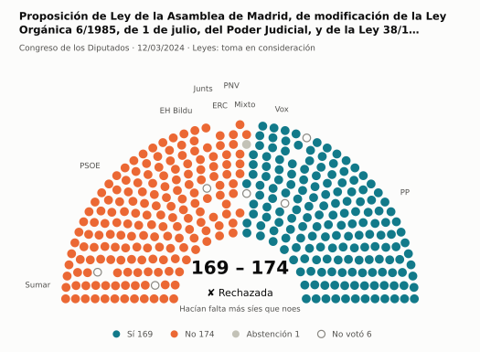
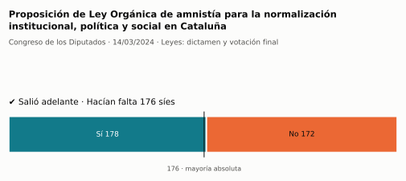
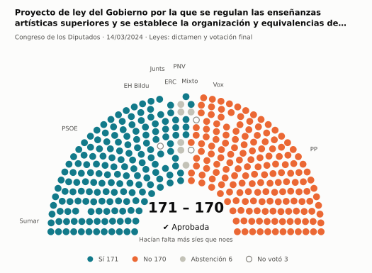
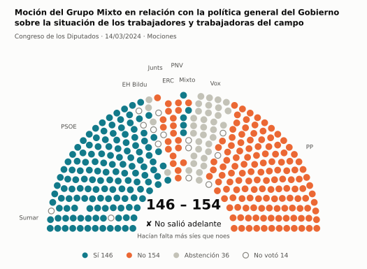
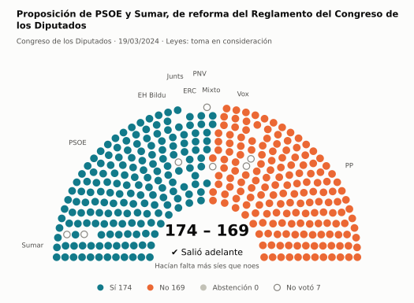
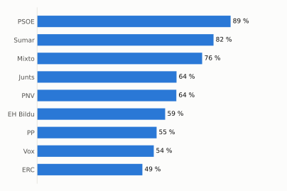
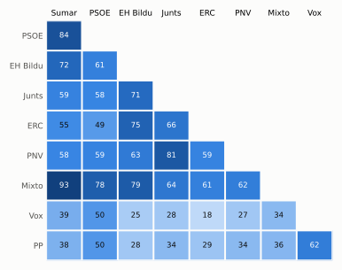

# Qué votó el Congreso en marzo de 2024

Las votaciones del Pleno del Congreso de los Diputados, explicadas sin tecnicismos. Datos oficiales del [Congreso](https://www.congreso.es/es/opendata/votaciones); este resumen se actualiza solo cada mes (última vez: 11/11/2026).

## En pocas palabras

- El Congreso votó **77 veces** en 4 días de pleno. **33 propuestas salieron adelante** y 44 no.
- 41 votaciones fueron sobre leyes, decretos o presupuestos. Otras 28 fueron peticiones al Gobierno que no le obligan (proposiciones no de ley y mociones).
- El Gobierno (PSOE y Sumar) perdió **3** de las 63 votaciones en las que sus grupos votaron lo mismo.
- La votación más reñida se decidió por 1 voto: Proyecto de ley del Gobierno por la que se regulan las enseñanzas artísticas superiores y se establece la organización….
- Los diputados casi siempre votan lo mismo que su grupo: en todo el mes solo hubo 35 votos distintos (sin contar el Grupo Mixto).

## Las votaciones más importantes del mes

Elegidas por su importancia: pesan más las leyes y los decretos que las peticiones al Gobierno, y suben las que se decidieron por pocos votos o las que perdió el Gobierno. Cada punto del dibujo es un diputado, colocado con su grupo, y el color es lo que votó.

### 1. Proposición de Ley de la Asamblea de Madrid, de modificación de la Ley Orgánica 6/1985, de 1 de julio, del Poder Judicial, y de la Ley 38/1988, de…

**12 de marzo · Leyes: toma en consideración.** Primer paso de una ley propuesta por un grupo o una comunidad autónoma: el Congreso decide si empieza a tramitarla.

<picture>
  <source media="(prefers-color-scheme: dark)" srcset="img/2024-03/votacion-L15-S027-V001-oscuro.svg">
  
</picture>

**✘ No salió adelante** por 5 votos: 169 a favor, 174 en contra y 1 abstención.

- **A favor:** PP y Vox
- **En contra:** PSOE, Sumar, Junts, ERC, EH Bildu y PNV
- **Repartidos:** Grupo Mixto (Sí 1, No 5, Abstención 1)

[Datos oficiales](https://www.congreso.es/webpublica/opendata/votaciones/Leg15/Sesion027/20240312/Votacion001/VOT_20240312204246.json)

### 2. Proposición de Ley Orgánica de amnistía para la normalización institucional, política y social en Cataluña

**14 de marzo · Leyes: dictamen y votación final.** Votación del texto de una ley después de trabajarla en comisión.

<picture>
  <source media="(prefers-color-scheme: dark)" srcset="img/2024-03/votacion-L15-S030-V002-oscuro.svg">
  
</picture>

**✔ Salió adelante** superó los 176 síes por 2 votos: 178 a favor, 172 en contra y ninguna abstención.

Fue una votación por llamamiento: cada diputado dijo su voto en voz alta. El voto de cada uno está en el [Diario de Sesiones](https://www.congreso.es/public_oficiales/L15/CONG/DS/PL/DSCD-15-PL-32.PDF?#page=19).

Este asunto tuvo 2 votaciones este mes; aquí se muestra la más disputada.

### 3. Proyecto de ley del Gobierno por la que se regulan las enseñanzas artísticas superiores y se establece la organización y equivalencias de las…

**14 de marzo · Leyes: dictamen y votación final.** Votación del texto de una ley después de trabajarla en comisión.

<picture>
  <source media="(prefers-color-scheme: dark)" srcset="img/2024-03/votacion-L15-S029-V006-oscuro.svg">
  
</picture>

**✔ Salió adelante** por 1 voto: 171 a favor, 170 en contra y 6 abstenciones.

- **A favor:** PSOE, Sumar, Junts, ERC y EH Bildu
- **En contra:** PP y Vox
- **Se abstuvieron:** PNV
- **Repartidos:** Grupo Mixto (Sí 5, No 1, Abstención 1)

Este asunto tuvo 30 votaciones este mes; aquí se muestra la más disputada. [Datos oficiales](https://www.congreso.es/webpublica/opendata/votaciones/Leg15/Sesion029/20240314/Votacion006/VOT_20240314123714.json)

### 4. Moción del Grupo Mixto en relación con la política general del Gobierno sobre la situación de los trabajadores y trabajadoras del campo

**14 de marzo · Mociones.** Petición al Gobierno después de pedirle explicaciones en el Pleno. Expresa la opinión del Congreso, pero no obliga.

<picture>
  <source media="(prefers-color-scheme: dark)" srcset="img/2024-03/votacion-L15-S029-V036-oscuro.svg">
  
</picture>

**✘ No salió adelante** por 8 votos: 146 a favor, 154 en contra y 36 abstenciones.

- **A favor:** PSOE y Sumar
- **En contra:** PP, Junts, ERC y PNV
- **Se abstuvieron:** Vox y EH Bildu
- **Repartidos:** Grupo Mixto (Sí 5, No 1)

Este asunto tuvo 16 votaciones este mes; aquí se muestra la más disputada. [Datos oficiales](https://www.congreso.es/webpublica/opendata/votaciones/Leg15/Sesion029/20240314/Votacion036/VOT_20240314123748.json)

### 5. Proposición de PSOE y Sumar, de reforma del Reglamento del Congreso de los Diputados

**19 de marzo · Leyes: toma en consideración.** Primer paso de una ley propuesta por un grupo o una comunidad autónoma: el Congreso decide si empieza a tramitarla.

<picture>
  <source media="(prefers-color-scheme: dark)" srcset="img/2024-03/votacion-L15-S031-V001-oscuro.svg">
  
</picture>

**✔ Salió adelante** por 5 votos: 174 a favor, 169 en contra y ninguna abstención.

- **A favor:** PSOE, Sumar, Junts, ERC, EH Bildu y PNV
- **En contra:** PP y Vox
- **Repartidos:** Grupo Mixto (Sí 5, No 1)

[Datos oficiales](https://www.congreso.es/webpublica/opendata/votaciones/Leg15/Sesion031/20240319/Votacion001/VOT_20240319201818.json)

## ¿Qué grupos votaron más veces lo que finalmente salió?

<picture>
  <source media="(prefers-color-scheme: dark)" srcset="img/2024-03/ganadora-oscuro.svg">
  
</picture>

Porcentaje de votaciones en que el grupo votó Sí y salió adelante, o votó No y no salió. Abstenerse no cuenta como acertar.

## ¿Quién vota con quién?

<picture>
  <source media="(prefers-color-scheme: dark)" srcset="img/2024-03/afinidad-oscuro.svg">
  
</picture>

Cada casilla dice en qué porcentaje de las votaciones dos grupos votaron lo mismo: 100 es que siempre coincidieron y 0 que nunca.

## ¿Qué tipo de cosas se votaron?

| Tipo | Votaciones | Salieron adelante | Qué es |
| --- | ---: | ---: | --- |
| Leyes: dictamen y votación final | 37 | 11 | Votación del texto de una ley después de trabajarla en comisión. |
| Mociones | 24 | 7 | Petición al Gobierno después de pedirle explicaciones en el Pleno. Expresa la opinión del Congreso, pero no obliga. |
| Tratados internacionales | 5 | 5 | El Congreso autoriza a España a comprometerse con un acuerdo con otro país u organismo. |
| Proposiciones no de ley | 4 | 4 | Petición al Gobierno para que haga algo. Expresa la opinión del Congreso, pero no obliga. |
| Leyes: toma en consideración | 4 | 3 | Primer paso de una ley propuesta por un grupo o una comunidad autónoma: el Congreso decide si empieza a tramitarla. |
| Organización de la Cámara | 3 | 3 | Asunto interno del Congreso: comisiones, plazos o el estatuto de los diputados. |

## Palabras que conviene saber

- **Pleno**: La reunión de los 350 diputados, donde se vota.
- **Grupo parlamentario**: Los diputados de un partido o coalición. Los partidos pequeños van juntos en el Grupo Mixto, aunque no piensen igual.
- **Abstención**: El diputado vota, pero ni a favor ni en contra.
- **No votó**: El diputado no votó: no estaba, estaba de baja o el escaño estaba vacío.
- **Mayoría simple**: Salen adelante las votaciones con más síes que noes. Es lo normal.
- **Mayoría absoluta**: 176 votos a favor, la mitad más uno de 350. La piden las leyes orgánicas (derechos fundamentales, sistema electoral…) y la primera votación de investidura.
- **Votación por llamamiento**: Cada diputado dice su voto en voz alta. Se usa en las investiduras y otras votaciones importantes.

---

**¿Quieres más detalle?** El [análisis detallado](2024-03-detalle.md) tiene la cohesión de cada grupo, un mapa de los diputados según cómo votan, qué diputados votaron distinto de su grupo, las ausencias y la lista completa de votaciones.

_Los resultados están calculados a partir de los votos: el Congreso no publica si cada votación salió adelante. Este proyecto no tiene relación con el Congreso. Método en [docs/DOCUMENTO_FUNCIONAL.md](../docs/DOCUMENTO_FUNCIONAL.md)._
