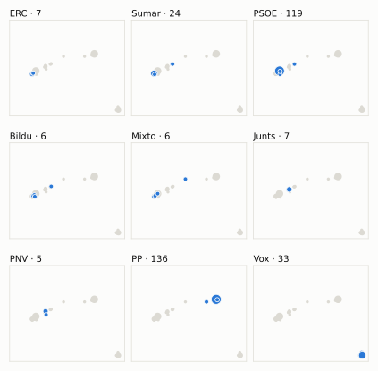
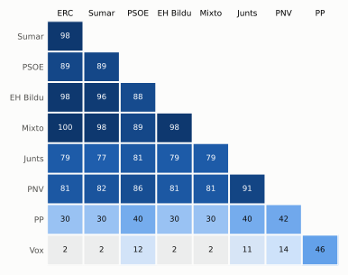

# Análisis detallado: abril de 2024

[← Volver al resumen del mes](2024-04.md)

_Generado automáticamente el 2026-11-11 con datos abiertos del [Congreso de los Diputados](https://www.congreso.es/es/opendata/votaciones). Solo plenos y Diputación Permanente. Método y límites en [docs/DOCUMENTO_FUNCIONAL.md](../docs/DOCUMENTO_FUNCIONAL.md)._

## Resumen

- **57 votaciones** en 2 días de pleno (sesiones 34 y 36).
- **7 aprobadas** y **49 rechazadas**, más 1 empate que obligaron a repetir.
- 13 votaciones se decidieron por 5 votos o menos.
- El grupo que más veces votó con el resultado final: **PNV** (89 % de las votaciones nominales).
- Los grupos del Gobierno (PSOE y Sumar) votaron lo mismo en 51 de 57 votaciones nominales y perdieron 7 de ellas.
- 15 votos individuales se apartaron de la posición de su grupo (15 diputados).

## Cómo votó cada grupo

| Grupo | Diputados | Cohesión | Votó con el resultado | Decisivo | Posición Sí | Posición No | Posición Abst. |
| --- | ---: | ---: | ---: | ---: | ---: | ---: | ---: |
| PP | 137 | 100 % | 53 % | 7 | 18 | 24 | 15 |
| PSOE | 120 | 100 % | 88 % | 12 | 10 | 47 | 0 |
| Vox | 33 | 100 % | 25 % | 7 | 42 | 14 | 1 |
| Sumar | 27 | 100 % | 77 % | 12 | 15 | 41 | 1 |
| Mixto | 8 | 81 % | 77 % | 6 | 16 | 41 | 0 |
| Junts | 7 | 100 % | 84 % | 12 | 7 | 43 | 7 |
| ERC | 7 | 100 % | 77 % | 12 | 16 | 41 | 0 |
| EH Bildu | 6 | 99 % | 77 % | 12 | 16 | 40 | 1 |
| PNV | 5 | 99 % | 89 % | 6 | 8 | 45 | 4 |

*Cohesión*: índice de acuerdo interno (100 % = todo el grupo votó igual). *Votó con el resultado*: el grupo votó Sí y salió aprobada, o No y salió rechazada. *Decisivo*: votaciones cuyo resultado habría cambiado si el grupo se hubiera abstenido en bloque. El Grupo Mixto reúne partidos distintos: su posición es la de su mayoría.

## Mapa de diputados

<picture>
  <source media="(prefers-color-scheme: dark)" srcset="img/2024-04/mapa-oscuro.svg">
  
</picture>

Cada punto es un diputado; dos diputados están cerca si votaron parecido. Un punto más grande reúne a varios que votaron exactamente igual. En cada panel, el grupo en azul y el resto del Congreso en gris.

*Cómo se calcula*: componentes principales de los votos (Sí, No, abstención) en 56 votaciones con algún desacuerdo. El eje horizontal recoge el 77 % de la variación y el vertical el 15 %. Los ejes no tienen nombre ni sentido político propio; por convención, el PP queda a la derecha. No se sitúa a 7 diputados que votó en menos de la mitad.

## Afinidad entre grupos

<picture>
  <source media="(prefers-color-scheme: dark)" srcset="img/2024-04/afinidad-oscuro.svg">
  
</picture>

Porcentaje de votaciones nominales en que los dos grupos tomaron la misma posición. Los grupos están ordenados según el mapa de diputados.

Ver la tabla

|  | PP | PSOE | Vox | Sumar | Mixto | Junts | ERC | EH Bildu | PNV |
| --- | :---: | :---: | :---: | :---: | :---: | :---: | :---: | :---: | :---: |
| PP | 100 % | 40 % | 46 % | 30 % | 30 % | 40 % | 30 % | 30 % | 42 % |
| PSOE | 40 % | 100 % | 12 % | 89 % | 89 % | 81 % | 89 % | 88 % | 86 % |
| Vox | 46 % | 12 % | 100 % | 2 % | 2 % | 11 % | 2 % | 2 % | 14 % |
| Sumar | 30 % | 89 % | 2 % | 100 % | 98 % | 77 % | 98 % | 96 % | 82 % |
| Mixto | 30 % | 89 % | 2 % | 98 % | 100 % | 79 % | 100 % | 98 % | 81 % |
| Junts | 40 % | 81 % | 11 % | 77 % | 79 % | 100 % | 79 % | 79 % | 91 % |
| ERC | 30 % | 89 % | 2 % | 98 % | 100 % | 79 % | 100 % | 98 % | 81 % |
| EH Bildu | 30 % | 88 % | 2 % | 96 % | 98 % | 79 % | 98 % | 100 % | 81 % |
| PNV | 42 % | 86 % | 14 % | 82 % | 81 % | 91 % | 81 % | 81 % | 100 % |

## Quién sacó adelante las votaciones

| Grupos que votaron Sí | Votaciones | Escaños |
| --- | ---: | ---: |
| PP + PSOE + Sumar + Mixto + Junts + ERC + EH Bildu + PNV | 3 | 317 |
| PP + Vox | 1 | 170 |
| Todos los grupos | 1 | 350 |
| PP + Vox + Junts + PNV | 1 | 182 |
| PSOE + Sumar + Mixto + ERC + EH Bildu + PNV | 1 | 173 |

De 7 votaciones nominales aprobadas. La posición de cada grupo es la de la mayoría de sus diputados.

## Votaciones que perdieron los grupos del Gobierno

| Fecha | Asunto | Tipo | PSOE y Sumar votaron | Resultado | Sí | No |
| --- | --- | --- | :---: | --- | ---: | ---: |
| 9 de abril | Proposición no de Ley del Grupo Parlamentario Euskal Herria Bildu, relativa a las medidas para asegurar el derecho efectivo a la vivienda. *(Votación separada por puntos Punto 1.)* | Proposiciones no de ley | Sí | Rechazada | 160 | 182 |
| 9 de abril | Proposición no de Ley del Grupo Parlamentario Euskal Herria Bildu, relativa a las medidas para asegurar el derecho efectivo a la vivienda. *(Votación separada por puntos Punto 2.4)* | Proposiciones no de ley | Sí | Rechazada | 160 | 175 |
| 9 de abril | Proposición no de Ley del Grupo Parlamentario Euskal Herria Bildu, relativa a las medidas para asegurar el derecho efectivo a la vivienda. *(Votación separada por puntos Punto 2.5)* | Proposiciones no de ley | Sí | Rechazada | 167 | 169 |
| 9 de abril | Proposición no de Ley del Grupo Parlamentario Euskal Herria Bildu, relativa a las medidas para asegurar el derecho efectivo a la vivienda. *(Votación separada por puntos Punto 2.7)* | Proposiciones no de ley | Sí | Rechazada | 160 | 170 |
| 9 de abril | Proposición no de Ley del Grupo Parlamentario Euskal Herria Bildu, relativa a las medidas para asegurar el derecho efectivo a la vivienda. *(Votación separada por puntos Punto 2.8)* | Proposiciones no de ley | Sí | Rechazada | 160 | 169 |
| 9 de abril | Proposición no de Ley del Grupo Parlamentario Popular en el Congreso, para deflactar el IRPF ajustándolo a la inflación para ayudar a las familias. | Proposiciones no de ley | No | Aprobada | 169 | 160 |
| 23 de abril | Proposición de Ley del Grupo Parlamentario Popular en el Congreso, relativa a la conservación del lobo en España y su cohabitación con la ganadería extensiva y… | Leyes: toma en consideración | No | Aprobada | 180 | 155 |

Además, PSOE y Sumar votaron distinto entre sí en 6 votaciones.

## Votaciones más ajustadas

| Fecha | Asunto | Resultado | Sí | No | Abst. |
| --- | --- | :---: | ---: | ---: | ---: |
| 9 de abril | Moción consecuencia de interpelación urgente del Grupo Parlamentario Popular en el Congreso, sobre el impacto de las políticas del Gobierno sobre la fortaleza… *(Votación separada por puntos Punto 1.)* | Empate (se repite) | 171 | 171 | 0 |
| 9 de abril | Moción consecuencia de interpelación urgente del Grupo Parlamentario Popular en el Congreso, sobre el impacto de las políticas del Gobierno sobre la fortaleza… *(Votación separada por puntos Punto 1.)* | Rechazada | 171 | 172 | 0 |
| 9 de abril | Moción consecuencia de interpelación urgente del Grupo Parlamentario Popular en el Congreso, sobre el impacto de las políticas del Gobierno sobre la fortaleza… *(Votación separada por puntos Punto 3.)* | Rechazada | 171 | 172 | 0 |
| 9 de abril | Proposición no de Ley del Grupo Parlamentario Euskal Herria Bildu, relativa a las medidas para asegurar el derecho efectivo a la vivienda. *(Votación separada por puntos Punto 2.5)* | Rechazada | 167 | 169 | 7 |
| 9 de abril | Moción consecuencia de interpelación urgente del Grupo Parlamentario Popular en el Congreso, sobre el impacto de las políticas del Gobierno sobre la fortaleza… *(Votación separada por puntos Punto 2.)* | Rechazada | 170 | 172 | 1 |
| 9 de abril | Moción consecuencia de interpelación urgente del Grupo Parlamentario Popular en el Congreso, sobre el impacto de las políticas del Gobierno sobre la fortaleza… *(Votación separada por puntos Punto 4.)* | Rechazada | 170 | 172 | 1 |
| 9 de abril | Moción consecuencia de interpelación urgente del Grupo Parlamentario Popular en el Congreso, sobre el impacto de las políticas del Gobierno sobre la fortaleza… *(Votación separada por puntos Punto 5.)* | Rechazada | 170 | 172 | 0 |
| 23 de abril | Moción consecuencia de interpelación urgente del Grupo Parlamentario Popular en el Congreso, relativa a la inseguridad ciudadana y a la ocupación ilegal que af… *(Votación separada por puntos Punto 1.)* | Rechazada | 168 | 173 | 1 |
| 23 de abril | Moción consecuencia de interpelación urgente del Grupo Parlamentario Popular en el Congreso, relativa a la inseguridad ciudadana y a la ocupación ilegal que af… *(Votación separada por puntos Punto 2.)* | Rechazada | 168 | 173 | 1 |
| 23 de abril | Moción consecuencia de interpelación urgente del Grupo Parlamentario Popular en el Congreso, relativa a la inseguridad ciudadana y a la ocupación ilegal que af… *(Votación separada por puntos Punto 3.)* | Rechazada | 168 | 173 | 1 |

Votaciones decididas por 10 votos o menos (o a esa distancia de la mayoría que exigían). Las públicas por llamamiento no tienen hemiciclo: el voto de cada diputado solo consta en el Diario de Sesiones.

## Qué se votó, por tipo de asunto

| Tipo de asunto | Votaciones | Aprobadas | No aprobadas |
| --- | ---: | ---: | ---: |
| Proposiciones no de ley | 30 | 2 | 28 |
| Mociones | 22 | 1 | 21 |
| Leyes: toma en consideración | 4 | 3 | 1 |
| Organización de la Cámara | 1 | 1 | 0 |

Las proposiciones no de ley y las mociones expresan la posición del Congreso pero no obligan al Gobierno. Las leyes pasan por varias votaciones (toma en consideración, totalidad, dictamen, Senado), así que una misma ley puede aparecer varias veces.

## Votos distintos de su grupo

| Diputado | Grupo | Votos distintos de su grupo |
| --- | --- | ---: |
| Aizpurua Arzallus, Mertxe | EH Bildu | 1 |
| Argota Castro, Trinidad Carmen | PSOE | 1 |
| Bendodo Benasayag, Elías | PP | 1 |
| González Pons, Esteban | PP | 1 |
| Legarda Uriarte, Mikel | PNV | 1 |
| Madrenas i Mir, Marta | Junts | 1 |
| Mariscal Anaya, Guillermo | PP | 1 |
| Montesinos de Miguel, Macarena | PP | 1 |
| Navarro Lacoba, Carmen | PP | 1 |
| Pisarello Prados, Gerardo | Sumar | 1 |
| Pérez López, Álvaro | PP | 1 |
| Rodríguez Serra, Santi | PP | 1 |
| Rufián Romero, Gabriel | ERC | 1 |
| Ruiz de Pinedo Undiano, Iñaki | EH Bildu | 1 |
| Vidal Matas, Vicenç | Sumar | 1 |

Un voto aislado puede ser un error al pulsar, no una decisión política: el Congreso no publica las correcciones. Se excluye el Grupo Mixto.

## Diputados que más veces no votaron

| Diputado | Grupo | No votó | % de votaciones |
| --- | --- | ---: | ---: |
| Núñez Feijóo, Alberto | PP | 57 | 100 % |
| Sánchez Pérez-Castejón, Pedro | PSOE | 57 | 100 % |
| Velarde Gómez, Martina | Mixto | 57 | 100 % |
| Badia Casas, Eloi | Sumar | 38 | 67 % |
| Catalán Higueras, Alberto | Mixto | 38 | 67 % |
| Díaz Pérez, Yolanda | Sumar | 38 | 67 % |
| López Tagliafico, Candela | Sumar | 38 | 67 % |
| Pisarello Prados, Gerardo | Sumar | 19 | 33 % |
| Pozueta Fernández, Isabel | EH Bildu | 19 | 33 % |
| Vidal Matas, Vicenç | Sumar | 19 | 33 % |
| Delgado-Taramona Hernández, Jimena | PP | 14 | 25 % |
| Moraleja Gómez, Tristana María | PP | 3 | 5 % |
| De las Cuevas Cortés, Félix | PP | 2 | 4 % |
| Figaredo Álvarez-Sala, José María | Vox | 2 | 4 % |
| Olano Vela, Jaime Eduardo de | PP | 2 | 4 % |

«No vota» incluye ausencias justificadas (baja, maternidad o paternidad) y escaños vacantes; el portal no las distingue.

## Todas las votaciones

Posición de cada grupo: la opción que votó la mayoría de sus diputados (*Div.*: empate dentro del grupo). El número enlaza al JSON oficial o, en las votaciones por llamamiento, al Diario de Sesiones.

### 9 de abril (sesión 34)

| Nº | Asunto | Resultado | Sí | No | Abst. | PP | PSOE | Vox | Sumar | Mixto | Junts | ERC | EH Bildu | PNV | Decisivos |
| ---: | --- | --- | ---: | ---: | ---: | :---: | :---: | :---: | :---: | :---: | :---: | :---: | :---: | :---: | --- |
| [1](https://www.congreso.es/webpublica/opendata/votaciones/Leg15/Sesion034/20240409/Votacion001/VOT_20240409210631.json) | Proposición de Ley para una regularización extraordinaria para personas extranjeras en España (corresponde al número de expediente 120/000026/0000 de la XIV Le… | Aprobada | 310 | 33 | 0 | Sí | Sí | No | Sí | Sí | Sí | Sí | Sí | Sí |  |
| [2](https://www.congreso.es/webpublica/opendata/votaciones/Leg15/Sesion034/20240409/Votacion002/VOT_20240409210632.json) | Proposición de Ley del Grupo Parlamentario Mixto, para una correcta imposición de los beneficios caídos del cielo de la gran banca. | Rechazada | 41 | 294 | 7 | No | No | No | Sí | Sí | Abst. | Sí | Sí | No |  |
| [3](https://www.congreso.es/webpublica/opendata/votaciones/Leg15/Sesion034/20240409/Votacion003/VOT_20240409210633.json) | Proposición no de Ley del Grupo Parlamentario Euskal Herria Bildu, relativa a las medidas para asegurar el derecho efectivo a la vivienda. *(Votación separada por puntos Punto 1.)* | Rechazada | 160 | 182 | 0 | No | Sí | No | Sí | Sí | No | Sí | Sí | No | PP, Vox |
| [4](https://www.congreso.es/webpublica/opendata/votaciones/Leg15/Sesion034/20240409/Votacion004/VOT_20240409210634.json) | Proposición no de Ley del Grupo Parlamentario Euskal Herria Bildu, relativa a las medidas para asegurar el derecho efectivo a la vivienda. *(Votación separada por puntos Punto 2.1)* | Rechazada | 40 | 303 | 0 | No | No | No | Sí | Sí | No | Sí | Sí | No |  |
| [5](https://www.congreso.es/webpublica/opendata/votaciones/Leg15/Sesion034/20240409/Votacion005/VOT_20240409210635.json) | Proposición no de Ley del Grupo Parlamentario Euskal Herria Bildu, relativa a las medidas para asegurar el derecho efectivo a la vivienda. *(Votación separada por puntos Punto 2.2)* | Rechazada | 41 | 302 | 0 | No | No | No | Sí | Sí | No | Sí | Sí | No |  |
| [6](https://www.congreso.es/webpublica/opendata/votaciones/Leg15/Sesion034/20240409/Votacion006/VOT_20240409210636.json) | Proposición no de Ley del Grupo Parlamentario Euskal Herria Bildu, relativa a las medidas para asegurar el derecho efectivo a la vivienda. *(Votación separada por puntos Punto 2.3)* | Rechazada | 41 | 302 | 0 | No | No | No | Sí | Sí | No | Sí | Sí | No |  |
| [7](https://www.congreso.es/webpublica/opendata/votaciones/Leg15/Sesion034/20240409/Votacion007/VOT_20240409210637.json) | Proposición no de Ley del Grupo Parlamentario Euskal Herria Bildu, relativa a las medidas para asegurar el derecho efectivo a la vivienda. *(Votación separada por puntos Punto 2.4)* | Rechazada | 160 | 175 | 7 | No | Sí | No | Sí | Sí | Abst. | Sí | Sí | No | PP, Vox |
| [8](https://www.congreso.es/webpublica/opendata/votaciones/Leg15/Sesion034/20240409/Votacion008/VOT_20240409210638.json) | Proposición no de Ley del Grupo Parlamentario Euskal Herria Bildu, relativa a las medidas para asegurar el derecho efectivo a la vivienda. *(Votación separada por puntos Punto 2.5)* | Rechazada | 167 | 169 | 7 | No | Sí | No | Sí | Sí | Abst. | Sí | Sí | Sí | PP, Vox |
| [9](https://www.congreso.es/webpublica/opendata/votaciones/Leg15/Sesion034/20240409/Votacion009/VOT_20240409210639.json) | Proposición no de Ley del Grupo Parlamentario Euskal Herria Bildu, relativa a las medidas para asegurar el derecho efectivo a la vivienda. *(Votación separada por puntos Punto 2.6)* | Rechazada | 53 | 289 | 1 | No | No | No | Sí | Sí | Sí | Sí | Sí | Sí |  |
| [10](https://www.congreso.es/webpublica/opendata/votaciones/Leg15/Sesion034/20240409/Votacion010/VOT_20240409210640.json) | Proposición no de Ley del Grupo Parlamentario Euskal Herria Bildu, relativa a las medidas para asegurar el derecho efectivo a la vivienda. *(Votación separada por puntos Punto 2.7)* | Rechazada | 160 | 170 | 13 | No | Sí | No | Sí | Sí | Abst. | Sí | Sí | Abst. | PP, Vox |
| [11](https://www.congreso.es/webpublica/opendata/votaciones/Leg15/Sesion034/20240409/Votacion011/VOT_20240409210641.json) | Proposición no de Ley del Grupo Parlamentario Euskal Herria Bildu, relativa a las medidas para asegurar el derecho efectivo a la vivienda. *(Votación separada por puntos Punto 2.8)* | Rechazada | 160 | 169 | 13 | No | Sí | No | Sí | Sí | Abst. | Sí | Sí | Abst. | PP, Vox |
| [12](https://www.congreso.es/webpublica/opendata/votaciones/Leg15/Sesion034/20240409/Votacion012/VOT_20240409210642.json) | Proposición no de Ley del Grupo Parlamentario Popular en el Congreso, para deflactar el IRPF ajustándolo a la inflación para ayudar a las familias. | Aprobada | 169 | 160 | 14 | Sí | No | Sí | No | No | Abst. | No | No | Abst. | PP, Vox |
| [13](https://www.congreso.es/webpublica/opendata/votaciones/Leg15/Sesion034/20240409/Votacion013/VOT_20240409210643.json) | Moción consecuencia de interpelación urgente del Grupo Parlamentario VOX, sobre las medidas que va a adoptar el Gobierno para garantizar el acceso de los españ… | Rechazada | 34 | 173 | 136 | Abst. | No | Sí | No | No | No | No | No | No |  |
| [14](https://www.congreso.es/webpublica/opendata/votaciones/Leg15/Sesion034/20240409/Votacion014/VOT_20240409210644.json) | Moción consecuencia de interpelación urgente del Grupo Parlamentario Popular en el Congreso, sobre el impacto de las políticas del Gobierno sobre la fortaleza… *(Votación separada por puntos Punto 1.)* | Empate (se repite) | 171 | 171 | 0 | Sí | No | Sí | No | No | No | No | No | No | EH Bildu, Junts, Mixto, ERC, PSOE, Sumar, PNV |
| [15](https://www.congreso.es/webpublica/opendata/votaciones/Leg15/Sesion034/20240409/Votacion015/VOT_20240409210645.json) | Moción consecuencia de interpelación urgente del Grupo Parlamentario Popular en el Congreso, sobre el impacto de las políticas del Gobierno sobre la fortaleza… *(Votación separada por puntos Punto 1.)* | Rechazada | 171 | 172 | 0 | Sí | No | Sí | No | No | No | No | No | No | EH Bildu, Junts, Mixto, ERC, PSOE, Sumar, PNV |
| [16](https://www.congreso.es/webpublica/opendata/votaciones/Leg15/Sesion034/20240409/Votacion016/VOT_20240409210645.json) | Moción consecuencia de interpelación urgente del Grupo Parlamentario Popular en el Congreso, sobre el impacto de las políticas del Gobierno sobre la fortaleza… *(Votación separada por puntos Punto 2.)* | Rechazada | 170 | 172 | 1 | Sí | No | Sí | No | No | No | No | No | No | EH Bildu, Junts, Mixto, ERC, PSOE, Sumar, PNV |
| [17](https://www.congreso.es/webpublica/opendata/votaciones/Leg15/Sesion034/20240409/Votacion017/VOT_20240409210646.json) | Moción consecuencia de interpelación urgente del Grupo Parlamentario Popular en el Congreso, sobre el impacto de las políticas del Gobierno sobre la fortaleza… *(Votación separada por puntos Punto 3.)* | Rechazada | 171 | 172 | 0 | Sí | No | Sí | No | No | No | No | No | No | EH Bildu, Junts, Mixto, ERC, PSOE, Sumar, PNV |
| [18](https://www.congreso.es/webpublica/opendata/votaciones/Leg15/Sesion034/20240409/Votacion018/VOT_20240409210647.json) | Moción consecuencia de interpelación urgente del Grupo Parlamentario Popular en el Congreso, sobre el impacto de las políticas del Gobierno sobre la fortaleza… *(Votación separada por puntos Punto 4.)* | Rechazada | 170 | 172 | 1 | Sí | No | Sí | No | No | No | No | No | No | EH Bildu, Junts, Mixto, ERC, PSOE, Sumar, PNV |
| [19](https://www.congreso.es/webpublica/opendata/votaciones/Leg15/Sesion034/20240409/Votacion019/VOT_20240409210648.json) | Moción consecuencia de interpelación urgente del Grupo Parlamentario Popular en el Congreso, sobre el impacto de las políticas del Gobierno sobre la fortaleza… *(Votación separada por puntos Punto 5.)* | Rechazada | 170 | 172 | 0 | Sí | No | Sí | No | No | No | No | No | No | EH Bildu, Junts, Mixto, ERC, PSOE, Sumar, PNV |

### 23 de abril (sesión 36)

| Nº | Asunto | Resultado | Sí | No | Abst. | PP | PSOE | Vox | Sumar | Mixto | Junts | ERC | EH Bildu | PNV | Decisivos |
| ---: | --- | --- | ---: | ---: | ---: | :---: | :---: | :---: | :---: | :---: | :---: | :---: | :---: | :---: | --- |
| [1](https://www.congreso.es/webpublica/opendata/votaciones/Leg15/Sesion036/20240423/Votacion001/VOT_20240423213512.json) | Proposición de Ley del Grupo Parlamentario Socialista, para la atención integral de las personas afectadas por enfermedades neurodegenerativas, como la Esclero… | Aprobada | 343 | 0 | 0 | Sí | Sí | Sí | Sí | Sí | Sí | Sí | Sí | Sí |  |
| [2](https://www.congreso.es/webpublica/opendata/votaciones/Leg15/Sesion036/20240423/Votacion002/VOT_20240423213513.json) | Proposición de Ley del Grupo Parlamentario Popular en el Congreso, relativa a la conservación del lobo en España y su cohabitación con la ganadería extensiva y… | Aprobada | 180 | 155 | 7 | Sí | No | Sí | No | No | Sí | No | Abst. | Sí | PP, Vox |
| [3](https://www.congreso.es/webpublica/opendata/votaciones/Leg15/Sesion036/20240423/Votacion003/VOT_20240423213514.json) | Proposición no de Ley del Grupo Parlamentario Socialista, relativa a apoyar la vital labor de la UNRWA. Se vota en los términos de la enmienda transaccional pr… | Aprobada | 167 | 32 | 142 | Abst. | Sí | No | Sí | Sí | Abst. | Sí | Sí | Sí |  |
| [4](https://www.congreso.es/webpublica/opendata/votaciones/Leg15/Sesion036/20240423/Votacion004/VOT_20240423213515.json) | Proposición no de Ley del Grupo Parlamentario VOX, para bloquear la invasión inmigratoria ilegal que amenaza a España. *(Votación separada por puntos Punto 1.)* | Rechazada | 33 | 173 | 135 | Abst. | No | Sí | No | No | No | No | No | No |  |
| [5](https://www.congreso.es/webpublica/opendata/votaciones/Leg15/Sesion036/20240423/Votacion005/VOT_20240423213516.json) | Proposición no de Ley del Grupo Parlamentario VOX, para bloquear la invasión inmigratoria ilegal que amenaza a España. *(Votación separada por puntos Punto 2.)* | Rechazada | 33 | 174 | 135 | Abst. | No | Sí | No | No | No | No | No | No |  |
| [6](https://www.congreso.es/webpublica/opendata/votaciones/Leg15/Sesion036/20240423/Votacion006/VOT_20240423213517.json) | Proposición no de Ley del Grupo Parlamentario VOX, para bloquear la invasión inmigratoria ilegal que amenaza a España. *(Votación separada por puntos Punto 3.)* | Rechazada | 33 | 309 | 0 | No | No | Sí | No | No | No | No | No | No |  |
| [7](https://www.congreso.es/webpublica/opendata/votaciones/Leg15/Sesion036/20240423/Votacion007/VOT_20240423213518.json) | Proposición no de Ley del Grupo Parlamentario VOX, para bloquear la invasión inmigratoria ilegal que amenaza a España. *(Votación separada por puntos Punto 4.)* | Rechazada | 33 | 310 | 0 | No | No | Sí | No | No | No | No | No | No |  |
| [8](https://www.congreso.es/webpublica/opendata/votaciones/Leg15/Sesion036/20240423/Votacion008/VOT_20240423213519.json) | Proposición no de Ley del Grupo Parlamentario VOX, para bloquear la invasión inmigratoria ilegal que amenaza a España. *(Votación separada por puntos Punto 5.)* | Rechazada | 32 | 300 | 0 | No | No | Sí | No | No | No | No | No | No |  |
| [9](https://www.congreso.es/webpublica/opendata/votaciones/Leg15/Sesion036/20240423/Votacion009/VOT_20240423213520.json) | Proposición no de Ley del Grupo Parlamentario VOX, para bloquear la invasión inmigratoria ilegal que amenaza a España. *(Votación separada por puntos Punto 6.)* | Rechazada | 33 | 310 | 0 | No | No | Sí | No | No | No | No | No | No |  |
| [10](https://www.congreso.es/webpublica/opendata/votaciones/Leg15/Sesion036/20240423/Votacion010/VOT_20240423213521.json) | Proposición no de Ley del Grupo Parlamentario VOX, para bloquear la invasión inmigratoria ilegal que amenaza a España. *(Votación separada por puntos Punto 7.)* | Rechazada | 33 | 309 | 0 | No | No | Sí | No | No | No | No | No | No |  |
| [11](https://www.congreso.es/webpublica/opendata/votaciones/Leg15/Sesion036/20240423/Votacion011/VOT_20240423213522.json) | Proposición no de Ley del Grupo Parlamentario VOX, para bloquear la invasión inmigratoria ilegal que amenaza a España. *(Votación separada por puntos Punto 8.)* | Rechazada | 33 | 174 | 136 | Abst. | No | Sí | No | No | No | No | No | No |  |
| [12](https://www.congreso.es/webpublica/opendata/votaciones/Leg15/Sesion036/20240423/Votacion012/VOT_20240423213523.json) | Proposición no de Ley del Grupo Parlamentario VOX, para bloquear la invasión inmigratoria ilegal que amenaza a España. *(Votación separada por puntos Punto 9.)* | Rechazada | 33 | 174 | 136 | Abst. | No | Sí | No | No | No | No | No | No |  |
| [13](https://www.congreso.es/webpublica/opendata/votaciones/Leg15/Sesion036/20240423/Votacion013/VOT_20240423213524.json) | Proposición no de Ley del Grupo Parlamentario VOX, para bloquear la invasión inmigratoria ilegal que amenaza a España. *(Votación separada por puntos Punto 10.)* | Rechazada | 33 | 309 | 0 | No | No | Sí | No | No | No | No | No | No |  |
| [14](https://www.congreso.es/webpublica/opendata/votaciones/Leg15/Sesion036/20240423/Votacion014/VOT_20240423213525.json) | Proposición no de Ley del Grupo Parlamentario VOX, para bloquear la invasión inmigratoria ilegal que amenaza a España. *(Votación separada por puntos Punto 11.)* | Rechazada | 33 | 177 | 133 | Abst. | No | Sí | No | No | No | No | No | No |  |
| [15](https://www.congreso.es/webpublica/opendata/votaciones/Leg15/Sesion036/20240423/Votacion015/VOT_20240423213526.json) | Proposición no de Ley del Grupo Parlamentario VOX, para bloquear la invasión inmigratoria ilegal que amenaza a España. *(Votación separada por puntos Punto 12.)* | Rechazada | 33 | 307 | 0 | No | No | Sí | No | No | No | No | No | No |  |
| [16](https://www.congreso.es/webpublica/opendata/votaciones/Leg15/Sesion036/20240423/Votacion016/VOT_20240423213527.json) | Proposición no de Ley del Grupo Parlamentario VOX, para bloquear la invasión inmigratoria ilegal que amenaza a España. *(Votación separada por puntos Punto 13.)* | Rechazada | 33 | 310 | 0 | No | No | Sí | No | No | No | No | No | No |  |
| [17](https://www.congreso.es/webpublica/opendata/votaciones/Leg15/Sesion036/20240423/Votacion017/VOT_20240423213528.json) | Proposición no de Ley del Grupo Parlamentario VOX, para bloquear la invasión inmigratoria ilegal que amenaza a España. *(Votación separada por puntos Punto 14.)* | Rechazada | 33 | 310 | 0 | No | No | Sí | No | No | No | No | No | No |  |
| [18](https://www.congreso.es/webpublica/opendata/votaciones/Leg15/Sesion036/20240423/Votacion018/VOT_20240423213529.json) | Proposición no de Ley del Grupo Parlamentario VOX, para bloquear la invasión inmigratoria ilegal que amenaza a España. *(Votación separada por puntos Punto 15.)* | Rechazada | 34 | 174 | 135 | Abst. | No | Sí | No | No | No | No | No | No |  |
| [19](https://www.congreso.es/webpublica/opendata/votaciones/Leg15/Sesion036/20240423/Votacion019/VOT_20240423213529.json) | Proposición no de Ley del Grupo Parlamentario VOX, para bloquear la invasión inmigratoria ilegal que amenaza a España. *(Votación separada por puntos Punto 16.)* | Rechazada | 33 | 308 | 0 | No | No | Sí | No | No | No | No | No | No |  |
| [20](https://www.congreso.es/webpublica/opendata/votaciones/Leg15/Sesion036/20240423/Votacion020/VOT_20240423213530.json) | Proposición no de Ley del Grupo Parlamentario VOX, para bloquear la invasión inmigratoria ilegal que amenaza a España. *(Votación separada por puntos Punto 17.)* | Rechazada | 33 | 309 | 0 | No | No | Sí | No | No | No | No | No | No |  |
| [21](https://www.congreso.es/webpublica/opendata/votaciones/Leg15/Sesion036/20240423/Votacion021/VOT_20240423213531.json) | Proposición no de Ley del Grupo Parlamentario VOX, para bloquear la invasión inmigratoria ilegal que amenaza a España. *(Votación separada por puntos Punto 18.)* | Rechazada | 33 | 308 | 0 | No | No | Sí | No | No | No | No | No | No |  |
| [22](https://www.congreso.es/webpublica/opendata/votaciones/Leg15/Sesion036/20240423/Votacion022/VOT_20240423213532.json) | Proposición no de Ley del Grupo Parlamentario VOX, para bloquear la invasión inmigratoria ilegal que amenaza a España. *(Votación separada por puntos Punto 19.)* | Rechazada | 33 | 309 | 0 | No | No | Sí | No | No | No | No | No | No |  |
| [23](https://www.congreso.es/webpublica/opendata/votaciones/Leg15/Sesion036/20240423/Votacion023/VOT_20240423213533.json) | Moción consecuencia de interpelación urgente del Grupo Parlamentario Mixto (Sra. Valido), sobre la solución que va a dar el Gobierno a la actual situación de i… | Aprobada | 310 | 0 | 33 | Sí | Sí | Abst. | Sí | Sí | Sí | Sí | Sí | Sí |  |
| [24](https://www.congreso.es/webpublica/opendata/votaciones/Leg15/Sesion036/20240423/Votacion024/VOT_20240423213534.json) | Moción consecuencia de interpelación urgente del Grupo Parlamentario Republicano, sobre la necesidad de acordar una financiación singular para Cataluña a fin d… | Rechazada | 24 | 291 | 28 | No | No | No | Abst. | Sí | Sí | Sí | Sí | Abst. |  |
| [25](https://www.congreso.es/webpublica/opendata/votaciones/Leg15/Sesion036/20240423/Votacion025/VOT_20240423213535.json) | Moción consecuencia de interpelación urgente del Grupo Parlamentario VOX, sobre las medidas que va a llevar a cabo el Gobierno para aprovechar los recursos híd… *(Votación separada por puntos Punto 1.)* | Rechazada | 33 | 176 | 133 | Abst. | No | Sí | No | No | No | No | No | No |  |
| [26](https://www.congreso.es/webpublica/opendata/votaciones/Leg15/Sesion036/20240423/Votacion026/VOT_20240423213536.json) | Moción consecuencia de interpelación urgente del Grupo Parlamentario VOX, sobre las medidas que va a llevar a cabo el Gobierno para aprovechar los recursos híd… *(Votación separada por puntos Punto 2.)* | Rechazada | 32 | 174 | 135 | Abst. | No | Sí | No | No | No | No | No | No |  |
| [27](https://www.congreso.es/webpublica/opendata/votaciones/Leg15/Sesion036/20240423/Votacion027/VOT_20240423213537.json) | Moción consecuencia de interpelación urgente del Grupo Parlamentario VOX, sobre las medidas que va a llevar a cabo el Gobierno para aprovechar los recursos híd… *(Votación separada por puntos Punto 3.)* | Rechazada | 33 | 174 | 135 | Abst. | No | Sí | No | No | No | No | No | No |  |
| [28](https://www.congreso.es/webpublica/opendata/votaciones/Leg15/Sesion036/20240423/Votacion028/VOT_20240423213538.json) | Moción consecuencia de interpelación urgente del Grupo Parlamentario VOX, sobre las medidas que va a llevar a cabo el Gobierno para aprovechar los recursos híd… *(Votación separada por puntos Punto 4.)* | Rechazada | 33 | 174 | 134 | Abst. | No | Sí | No | No | No | No | No | No |  |
| [29](https://www.congreso.es/webpublica/opendata/votaciones/Leg15/Sesion036/20240423/Votacion029/VOT_20240423213539.json) | Moción consecuencia de interpelación urgente del Grupo Parlamentario VOX, sobre las medidas que va a llevar a cabo el Gobierno para aprovechar los recursos híd… *(Votación separada por puntos Punto 5.)* | Rechazada | 33 | 173 | 135 | Abst. | No | Sí | No | No | No | No | No | No |  |
| [30](https://www.congreso.es/webpublica/opendata/votaciones/Leg15/Sesion036/20240423/Votacion030/VOT_20240423213540.json) | Moción consecuencia de interpelación urgente del Grupo Parlamentario VOX, sobre las medidas que va a llevar a cabo el Gobierno para aprovechar los recursos híd… *(Votación separada por puntos Punto 6.)* | Rechazada | 33 | 174 | 135 | Abst. | No | Sí | No | No | No | No | No | No |  |
| [31](https://www.congreso.es/webpublica/opendata/votaciones/Leg15/Sesion036/20240423/Votacion031/VOT_20240423213541.json) | Moción consecuencia de interpelación urgente del Grupo Parlamentario VOX, sobre las medidas que va a llevar a cabo el Gobierno para aprovechar los recursos híd… *(Votación separada por puntos Punto 7.)* | Rechazada | 32 | 174 | 135 | Abst. | No | Sí | No | No | No | No | No | No |  |
| [32](https://www.congreso.es/webpublica/opendata/votaciones/Leg15/Sesion036/20240423/Votacion032/VOT_20240423213542.json) | Moción consecuencia de interpelación urgente del Grupo Parlamentario Popular en el Congreso, relativa a la inseguridad ciudadana y a la ocupación ilegal que af… *(Votación separada por puntos Punto 1.)* | Rechazada | 168 | 173 | 1 | Sí | No | Sí | No | No | No | No | No | No | EH Bildu, Junts, ERC, PSOE, Sumar |
| [33](https://www.congreso.es/webpublica/opendata/votaciones/Leg15/Sesion036/20240423/Votacion033/VOT_20240423213543.json) | Moción consecuencia de interpelación urgente del Grupo Parlamentario Popular en el Congreso, relativa a la inseguridad ciudadana y a la ocupación ilegal que af… *(Votación separada por puntos Punto 2.)* | Rechazada | 168 | 173 | 1 | Sí | No | Sí | No | No | No | No | No | No | EH Bildu, Junts, ERC, PSOE, Sumar |
| [34](https://www.congreso.es/webpublica/opendata/votaciones/Leg15/Sesion036/20240423/Votacion034/VOT_20240423213544.json) | Moción consecuencia de interpelación urgente del Grupo Parlamentario Popular en el Congreso, relativa a la inseguridad ciudadana y a la ocupación ilegal que af… *(Votación separada por puntos Punto 3.)* | Rechazada | 168 | 173 | 1 | Sí | No | Sí | No | No | No | No | No | No | EH Bildu, Junts, ERC, PSOE, Sumar |
| [35](https://www.congreso.es/webpublica/opendata/votaciones/Leg15/Sesion036/20240423/Votacion035/VOT_20240423213545.json) | Moción consecuencia de interpelación urgente del Grupo Parlamentario Popular en el Congreso, relativa a la inseguridad ciudadana y a la ocupación ilegal que af… *(Votación separada por puntos Punto 4.)* | Rechazada | 168 | 173 | 1 | Sí | No | Sí | No | No | No | No | No | No | EH Bildu, Junts, ERC, PSOE, Sumar |
| [36](https://www.congreso.es/webpublica/opendata/votaciones/Leg15/Sesion036/20240423/Votacion036/VOT_20240423213546.json) | Moción consecuencia de interpelación urgente del Grupo Parlamentario Popular en el Congreso, relativa a la inseguridad ciudadana y a la ocupación ilegal que af… *(Votación separada por puntos Punto 5.)* | Rechazada | 168 | 173 | 1 | Sí | No | Sí | No | No | No | No | No | No | EH Bildu, Junts, ERC, PSOE, Sumar |
| [37](https://www.congreso.es/webpublica/opendata/votaciones/Leg15/Sesion036/20240423/Votacion037/VOT_20240423213547.json) | Moción consecuencia de interpelación urgente del Grupo Parlamentario Popular en el Congreso, relativa a la inseguridad ciudadana y a la ocupación ilegal que af… *(Votación separada por puntos Punto 6.)* | Rechazada | 168 | 173 | 1 | Sí | No | Sí | No | No | No | No | No | No | EH Bildu, Junts, ERC, PSOE, Sumar |
| [38](https://www.congreso.es/webpublica/opendata/votaciones/Leg15/Sesion036/20240423/Votacion038/VOT_20240423213548.json) | Propuesta de la Comisión de seguimiento y evaluación de los acuerdos del Pacto de Estado en materia de Violencia de Género, de creación de una Subcomisión para… | Aprobada | 306 | 35 | 0 | Sí | Sí | No | Sí | Sí | Sí | Sí | Sí | Sí |  |
