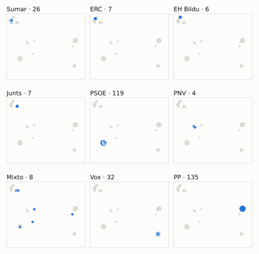
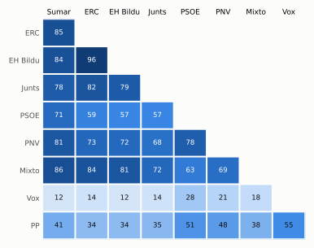

# Análisis detallado: mayo de 2024

[← Volver al resumen del mes](2024-05.md)

_Generado automáticamente el 2026-11-10 con datos abiertos del [Congreso de los Diputados](https://www.congreso.es/es/opendata/votaciones). Solo plenos y Diputación Permanente. Método y límites en [docs/DOCUMENTO_FUNCIONAL.md](../docs/DOCUMENTO_FUNCIONAL.md)._

## Resumen

- **102 votaciones** en 4 días de pleno (sesiones 38, 40, 41 y 43).
- **50 aprobadas** y **52 rechazadas**; de ellas, 1 pública por llamamiento.
- 2 votaciones se decidieron por 5 votos o menos.
- El grupo que más veces votó con el resultado final: **PSOE** (81 % de las votaciones nominales).
- Los grupos del Gobierno (PSOE y Sumar) votaron lo mismo en 70 de 101 votaciones nominales y perdieron 6 de ellas.
- 22 votos individuales se apartaron de la posición de su grupo (20 diputados).

## Cómo votó cada grupo

| Grupo | Diputados | Cohesión | Votó con el resultado | Decisivo | Posición Sí | Posición No | Posición Abst. |
| --- | ---: | ---: | ---: | ---: | ---: | ---: | ---: |
| PP | 137 | 100 % | 70 % | 12 | 67 | 27 | 7 |
| PSOE | 120 | 100 % | 81 % | 23 | 38 | 52 | 11 |
| Vox | 33 | 100 % | 41 % | 5 | 51 | 30 | 20 |
| Sumar | 27 | 100 % | 70 % | 16 | 51 | 47 | 3 |
| Mixto | 8 | 68 % | 68 % | 1 | 48 | 42 | 7 |
| Junts | 7 | 100 % | 62 % | 4 | 43 | 43 | 15 |
| ERC | 7 | 100 % | 63 % | 4 | 44 | 50 | 7 |
| EH Bildu | 6 | 100 % | 61 % | 3 | 44 | 50 | 7 |
| PNV | 5 | 100 % | 80 % | 1 | 35 | 41 | 9 |

*Cohesión*: índice de acuerdo interno (100 % = todo el grupo votó igual). *Votó con el resultado*: el grupo votó Sí y salió aprobada, o No y salió rechazada. *Decisivo*: votaciones cuyo resultado habría cambiado si el grupo se hubiera abstenido en bloque. El Grupo Mixto reúne partidos distintos: su posición es la de su mayoría.

## Mapa de diputados

<picture>
  <source media="(prefers-color-scheme: dark)" srcset="img/2024-05/mapa-oscuro.svg">
  
</picture>

Cada punto es un diputado; dos diputados están cerca si votaron parecido. Un punto más grande reúne a varios que votaron exactamente igual. En cada panel, el grupo en azul y el resto del Congreso en gris.

*Cómo se calcula*: componentes principales de los votos (Sí, No, abstención) en 96 votaciones con algún desacuerdo. El eje horizontal recoge el 64 % de la variación y el vertical el 17 %. Los ejes no tienen nombre ni sentido político propio; por convención, el PP queda a la derecha. No se sitúa a 6 diputados que votó en menos de la mitad.

## Afinidad entre grupos

<picture>
  <source media="(prefers-color-scheme: dark)" srcset="img/2024-05/afinidad-oscuro.svg">
  
</picture>

Porcentaje de votaciones nominales en que los dos grupos tomaron la misma posición. Los grupos están ordenados según el mapa de diputados.

Ver la tabla

|  | PP | PSOE | Vox | Sumar | Mixto | Junts | ERC | EH Bildu | PNV |
| --- | :---: | :---: | :---: | :---: | :---: | :---: | :---: | :---: | :---: |
| PP | 100 % | 51 % | 55 % | 41 % | 38 % | 35 % | 34 % | 34 % | 48 % |
| PSOE | 51 % | 100 % | 28 % | 71 % | 63 % | 57 % | 59 % | 57 % | 78 % |
| Vox | 55 % | 28 % | 100 % | 12 % | 18 % | 14 % | 14 % | 12 % | 21 % |
| Sumar | 41 % | 71 % | 12 % | 100 % | 86 % | 78 % | 85 % | 84 % | 81 % |
| Mixto | 38 % | 63 % | 18 % | 86 % | 100 % | 72 % | 84 % | 81 % | 69 % |
| Junts | 35 % | 57 % | 14 % | 78 % | 72 % | 100 % | 82 % | 79 % | 68 % |
| ERC | 34 % | 59 % | 14 % | 85 % | 84 % | 82 % | 100 % | 96 % | 73 % |
| EH Bildu | 34 % | 57 % | 12 % | 84 % | 81 % | 79 % | 96 % | 100 % | 72 % |
| PNV | 48 % | 78 % | 21 % | 81 % | 69 % | 68 % | 73 % | 72 % | 100 % |

## Quién sacó adelante las votaciones

| Grupos que votaron Sí | Votaciones | Escaños |
| --- | ---: | ---: |
| PP + PSOE + Sumar + Mixto + Junts + ERC + EH Bildu + PNV | 5 | 317 |
| Todos los grupos | 5 | 350 |
| PP + PSOE + Sumar + Junts + ERC + EH Bildu + PNV | 4 | 309 |
| PSOE + Sumar + Mixto + Junts + ERC + EH Bildu + PNV | 3 | 180 |
| PP + PSOE + Vox + PNV | 3 | 295 |
| PP + PSOE + Sumar + Mixto + PNV | 3 | 297 |
| PP + Sumar + Mixto + Junts + ERC + EH Bildu | 3 | 192 |
| PP + Vox + Mixto | 2 | 178 |

De 49 votaciones nominales aprobadas. Otras 21 salieron con combinaciones que se dieron menos veces. La posición de cada grupo es la de la mayoría de sus diputados.

## Votaciones que perdieron los grupos del Gobierno

| Fecha | Asunto | Tipo | PSOE y Sumar votaron | Resultado | Sí | No |
| --- | --- | --- | :---: | --- | ---: | ---: |
| 23 de mayo | Proposición no de Ley del Grupo Parlamentario Popular en el Congreso, para favorecer el acceso a alimentos básicos. *(Votación separada por puntos. Punto 1.)* | Proposiciones no de ley | No | Aprobada | 186 | 153 |
| 23 de mayo | Proposición no de Ley del Grupo Parlamentario Popular en el Congreso, para favorecer el acceso a alimentos básicos. *(Votación separada por puntos. Punto 3.)* | Proposiciones no de ley | No | Aprobada | 173 | 166 |
| 23 de mayo | Moción consecuencia de interpelación urgente del Grupo Parlamentario Popular en el Congreso, sobre el deterioro de la política exterior del Reino de España com… *(Votación separada por puntos. Punto 2.)* | Mociones | No | Aprobada | 169 | 149 |
| 23 de mayo | Moción consecuencia de interpelación urgente del Grupo Parlamentario Popular en el Congreso, sobre el deterioro de la política exterior del Reino de España com… *(Votación separada por puntos. Punto 5.)* | Mociones | No | Aprobada | 171 | 164 |
| 30 de mayo | Proposición no de Ley del Grupo Parlamentario Plurinacional SUMAR, sobre la creación de un Sistema de Información Económica para la Negociación Colectiva (SIEN… | Proposiciones no de ley | Sí | Rechazada | 165 | 171 |
| 30 de mayo | Moción consecuencia de interpelación urgente del Grupo Parlamentario Popular en el Congreso, sobre las medidas que piensa adoptar el Gobierno para favorecer la… *(Votación separada por puntos. Punto 1.)* | Mociones | No | Aprobada | 178 | 164 |

Además, PSOE y Sumar votaron distinto entre sí en 29 votaciones.

## Votaciones más ajustadas

| Fecha | Asunto | Resultado | Sí | No | Abst. |
| --- | --- | :---: | ---: | ---: | ---: |
| 23 de mayo | Moción consecuencia de interpelación urgente del Grupo Parlamentario Popular en el Congreso, sobre el deterioro de la política exterior del Reino de España com… *(Votación separada por puntos. Punto 7.)* | Rechazada | 168 | 170 | 6 |
| 23 de mayo | Proposición no de Ley del Grupo Parlamentario Popular en el Congreso, para favorecer el acceso a alimentos básicos. *(Votación separada por puntos. Punto 2.)* | Rechazada | 168 | 171 | 5 |
| 30 de mayo | Proposición de Ley Orgánica de amnistía para la normalización institucional, política y social en Cataluña. (Pública por llamamiento) | Aprobada (por llamamiento) | 177 | 172 | 0 |
| 30 de mayo | Proposición no de Ley del Grupo Parlamentario Republicano, sobre la lucha contra la corrupción, las cloacas del Estado y la guerra judicial en el Estado españo… *(Votación separada por puntos. Punto 6.)* | Aprobada | 177 | 171 | 1 |
| 30 de mayo | Proposición no de Ley del Grupo Parlamentario Plurinacional SUMAR, sobre la creación de un Sistema de Información Económica para la Negociación Colectiva (SIEN… | Rechazada | 165 | 171 | 13 |
| 30 de mayo | Moción consecuencia de interpelación urgente el Grupo Parlamentario VOX, sobre las medidas que va a impulsar el Gobierno ante las instituciones europeas para g… *(Votación separada por puntos. Punto 5.)* | Rechazada | 171 | 177 | 0 |
| 23 de mayo | Proposición no de Ley del Grupo Parlamentario Popular en el Congreso, para favorecer el acceso a alimentos básicos. *(Votación separada por puntos. Punto 3.)* | Aprobada | 173 | 166 | 5 |
| 23 de mayo | Moción consecuencia de interpelación urgente del Grupo Parlamentario Popular en el Congreso, sobre el deterioro de la política exterior del Reino de España com… *(Votación separada por puntos. Punto 5.)* | Aprobada | 171 | 164 | 8 |
| 23 de mayo | Proyecto de Ley por la que se regulan las enseñanzas artísticas superiores y se establece la organización y equivalencias de las enseñanzas artísticas profesio… *(Votación separada de las enmiendas. Enmienda a la disposici…)* | Rechazada | 168 | 175 | 0 |
| 30 de mayo | Moción consecuencia de interpelación urgente el Grupo Parlamentario VOX, sobre las medidas que va a impulsar el Gobierno ante las instituciones europeas para g… *(Votación separada por puntos. Punto 6.)* | Rechazada | 171 | 178 | 0 |

Votaciones decididas por 10 votos o menos (o a esa distancia de la mayoría que exigían). Las públicas por llamamiento no tienen hemiciclo: el voto de cada diputado solo consta en el Diario de Sesiones.

## Qué se votó, por tipo de asunto

| Tipo de asunto | Votaciones | Aprobadas | No aprobadas |
| --- | ---: | ---: | ---: |
| Mociones | 35 | 11 | 24 |
| Leyes: enmiendas del Senado | 26 | 16 | 10 |
| Proposiciones no de ley | 25 | 9 | 16 |
| Tratados internacionales | 5 | 5 | 0 |
| Leyes: toma en consideración | 4 | 3 | 1 |
| Leyes: dictamen y votación final | 3 | 3 | 0 |
| Leyes: veto del Senado | 1 | 1 | 0 |
| Organización de la Cámara | 1 | 1 | 0 |
| Presupuestos y estabilidad | 1 | 1 | 0 |
| Enmiendas a la totalidad | 1 | 0 | 1 |

Las proposiciones no de ley y las mociones expresan la posición del Congreso pero no obligan al Gobierno. Las leyes pasan por varias votaciones (toma en consideración, totalidad, dictamen, Senado), así que una misma ley puede aparecer varias veces.

## Votos distintos de su grupo

| Diputado | Grupo | Votos distintos de su grupo |
| --- | --- | ---: |
| Gamarra Ruiz-Clavijo, Concepción | PP | 2 |
| Gavin i Valls, Isidre | Junts | 2 |
| Bendodo Benasayag, Elías | PP | 1 |
| Bermúdez de Castro Fernández, José Antonio | PP | 1 |
| Cantera de Castro, Zaida | PSOE | 1 |
| Cobo Vega, Manuel | PP | 1 |
| Cofiño Fernández, Rafael | Sumar | 1 |
| Corujo Berriel, María Dolores | PSOE | 1 |
| De Meer Méndez, Rocío | Vox | 1 |
| Fernández Hernández, Pedro | Vox | 1 |
| Floriano Corrales, Carlos Javier | PP | 1 |
| Ibáñez Mezquita, Alberto | Sumar | 1 |
| Legarda Uriarte, Mikel | PNV | 1 |
| Mariscal Zabala, Manuel | Vox | 1 |
| Martínez Hierro, Lander | Sumar | 1 |

Un voto aislado puede ser un error al pulsar, no una decisión política: el Congreso no publica las correcciones. Se excluye el Grupo Mixto.

## Diputados que más veces no votaron

| Diputado | Grupo | No votó | % de votaciones |
| --- | --- | ---: | ---: |
| Vaquero Montero, Maribel | PNV | 79 | 78 % |
| Díaz Pérez, Yolanda | Sumar | 65 | 64 % |
| Núñez Feijóo, Alberto | PP | 65 | 64 % |
| Sánchez Pérez-Castejón, Pedro | PSOE | 65 | 64 % |
| Sánchez García, José María | Vox | 61 | 60 % |
| Sánchez Sierra, María del Mar | PP | 61 | 60 % |
| Velarde Gómez, Martina | Mixto | 38 | 38 % |
| Legarda Uriarte, Mikel | PNV | 17 | 17 % |
| Agirretxea Urresti, Joseba Andoni | PNV | 16 | 16 % |
| Esteban Bravo, Aitor | PNV | 16 | 16 % |
| Sagastizabal Unzetabarrenetxea, Idoia | PNV | 16 | 16 % |
| Rego Candamil, Néstor | Mixto | 6 | 6 % |
| Pisarello Prados, Gerardo | Sumar | 4 | 4 % |
| Abascal Conde, Santiago | Vox | 3 | 3 % |
| Alfonso Cendón, Javier | PSOE | 3 | 3 % |

«No vota» incluye ausencias justificadas (baja, maternidad o paternidad) y escaños vacantes; el portal no las distingue.

## Todas las votaciones

Posición de cada grupo: la opción que votó la mayoría de sus diputados (*Div.*: empate dentro del grupo). El número enlaza al JSON oficial o, en las votaciones por llamamiento, al Diario de Sesiones.

### 21 de mayo (sesión 38)

| Nº | Asunto | Resultado | Sí | No | Abst. | PP | PSOE | Vox | Sumar | Mixto | Junts | ERC | EH Bildu | PNV | Decisivos |
| ---: | --- | --- | ---: | ---: | ---: | :---: | :---: | :---: | :---: | :---: | :---: | :---: | :---: | :---: | --- |
| [1](https://www.congreso.es/webpublica/opendata/votaciones/Leg15/Sesion038/20240521/Votacion001/VOT_20240521203901.json) | Proposición de Ley del Grupo Parlamentario Republicano, por la que se modifica la Ley 12/2013, de 2 de agosto, de medidas para mejorar el funcionamiento de la… | Aprobada | 175 | 0 | 167 | Abst. | Sí | Abst. | Sí | Sí | Sí | Sí | Sí | Sí |  |
| [2](https://www.congreso.es/webpublica/opendata/votaciones/Leg15/Sesion038/20240521/Votacion002/VOT_20240521203902.json) | Proposición de Ley del Grupo Parlamentario Socialista, Orgánica por la que se modifica la Ley Orgánica 10/1995, de 23 de noviembre, del Código Penal, para proh… | Rechazada | 122 | 184 | 36 | No | Sí | Abst. | No | Div. | No | No | No | No | PP |

### 23 de mayo (sesión 40)

| Nº | Asunto | Resultado | Sí | No | Abst. | PP | PSOE | Vox | Sumar | Mixto | Junts | ERC | EH Bildu | PNV | Decisivos |
| ---: | --- | --- | ---: | ---: | ---: | :---: | :---: | :---: | :---: | :---: | :---: | :---: | :---: | :---: | --- |
| [1](https://www.congreso.es/webpublica/opendata/votaciones/Leg15/Sesion040/20240523/Votacion001/VOT_20240523140931.json) | Proposición no de Ley del Grupo Parlamentario Popular en el Congreso, para favorecer el acceso a alimentos básicos. *(Votación separada por puntos. Punto 1.)* | Aprobada | 186 | 153 | 5 | Sí | No | Sí | No | Sí | No | Sí | Sí | Abst. | PP |
| [2](https://www.congreso.es/webpublica/opendata/votaciones/Leg15/Sesion040/20240523/Votacion002/VOT_20240523140932.json) | Proposición no de Ley del Grupo Parlamentario Popular en el Congreso, para favorecer el acceso a alimentos básicos. *(Votación separada por puntos. Punto 2.)* | Rechazada | 168 | 171 | 5 | Sí | No | Sí | No | No | No | No | No | Abst. | EH Bildu, Junts, Mixto, ERC, PSOE, Sumar |
| [3](https://www.congreso.es/webpublica/opendata/votaciones/Leg15/Sesion040/20240523/Votacion003/VOT_20240523140933.json) | Proposición no de Ley del Grupo Parlamentario Popular en el Congreso, para favorecer el acceso a alimentos básicos. *(Votación separada por puntos. Punto 3.)* | Aprobada | 173 | 166 | 5 | Sí | No | Sí | No | Sí | No | No | No | Abst. | PP, Vox |
| [4](https://www.congreso.es/webpublica/opendata/votaciones/Leg15/Sesion040/20240523/Votacion004/VOT_20240523140934.json) | Proposición no de Ley del Grupo Parlamentario Socialista, sobre la garantía de la aplicación de las políticas de memoria democrática en España. Se vota en los… | Aprobada | 175 | 167 | 0 | No | Sí | No | Sí | Sí | Sí | Sí | Sí | Sí | PSOE, Sumar |
| [5](https://www.congreso.es/webpublica/opendata/votaciones/Leg15/Sesion040/20240523/Votacion005/VOT_20240523140935.json) | Moción consecuencia de interpelación urgente del Grupo Parlamentario Popular en el Congreso, sobre el deterioro de la política exterior del Reino de España com… *(Votación separada por puntos. Punto 1.)* | Aprobada | 216 | 120 | 7 | Sí | No | Sí | Sí | Sí | Abst. | Sí | Sí | Sí | PP |
| [6](https://www.congreso.es/webpublica/opendata/votaciones/Leg15/Sesion040/20240523/Votacion006/VOT_20240523140936.json) | Moción consecuencia de interpelación urgente del Grupo Parlamentario Popular en el Congreso, sobre el deterioro de la política exterior del Reino de España com… *(Votación separada por puntos. Punto 2.)* | Aprobada | 169 | 149 | 21 | Sí | No | Sí | No | Sí | Abst. | Abst. | Abst. | No | PP, Vox |
| [7](https://www.congreso.es/webpublica/opendata/votaciones/Leg15/Sesion040/20240523/Votacion007/VOT_20240523140937.json) | Moción consecuencia de interpelación urgente del Grupo Parlamentario Popular en el Congreso, sobre el deterioro de la política exterior del Reino de España com… *(Votación separada por puntos. Punto 3.)* | Aprobada | 292 | 45 | 7 | Sí | Sí | Sí | No | No | Abst. | No | No | Sí |  |
| [8](https://www.congreso.es/webpublica/opendata/votaciones/Leg15/Sesion040/20240523/Votacion008/VOT_20240523140939.json) | Moción consecuencia de interpelación urgente del Grupo Parlamentario Popular en el Congreso, sobre el deterioro de la política exterior del Reino de España com… *(Votación separada por puntos. Punto 4.)* | Aprobada | 293 | 43 | 7 | Sí | Sí | Sí | No | No | Abst. | No | No | Sí |  |
| [9](https://www.congreso.es/webpublica/opendata/votaciones/Leg15/Sesion040/20240523/Votacion009/VOT_20240523140940.json) | Moción consecuencia de interpelación urgente del Grupo Parlamentario Popular en el Congreso, sobre el deterioro de la política exterior del Reino de España com… *(Votación separada por puntos. Punto 5.)* | Aprobada | 171 | 164 | 8 | Sí | No | Sí | No | No | Abst. | No | No | Sí | PP, Vox |
| [10](https://www.congreso.es/webpublica/opendata/votaciones/Leg15/Sesion040/20240523/Votacion010/VOT_20240523140941.json) | Moción consecuencia de interpelación urgente del Grupo Parlamentario Popular en el Congreso, sobre el deterioro de la política exterior del Reino de España com… *(Votación separada por puntos. Punto 6.)* | Aprobada | 293 | 51 | 0 | Sí | Sí | Sí | No | No | No | No | No | Sí |  |
| [11](https://www.congreso.es/webpublica/opendata/votaciones/Leg15/Sesion040/20240523/Votacion011/VOT_20240523140942.json) | Moción consecuencia de interpelación urgente del Grupo Parlamentario Popular en el Congreso, sobre el deterioro de la política exterior del Reino de España com… *(Votación separada por puntos. Punto 7.)* | Rechazada | 168 | 170 | 6 | Sí | No | Sí | No | Abst. | No | No | No | No | EH Bildu, Junts, ERC, PSOE, Sumar, PNV |
| [12](https://www.congreso.es/webpublica/opendata/votaciones/Leg15/Sesion040/20240523/Votacion012/VOT_20240523140943.json) | Moción consecuencia de interpelación urgente del Grupo Parlamentario Popular en el Congreso, sobre el deterioro de la política exterior del Reino de España com… *(Votación separada por puntos. Punto 8.)* | Aprobada | 300 | 31 | 11 | Sí | Sí | No | Sí | Abst. | Abst. | Sí | Sí | Sí |  |
| [13](https://www.congreso.es/webpublica/opendata/votaciones/Leg15/Sesion040/20240523/Votacion013/VOT_20240523140944.json) | Moción consecuencia de interpelación urgente del Grupo Parlamentario VOX, sobre la presión fiscal que está ejerciendo el Gobierno sobre los españoles. *(Votación separada por puntos. Punto 1.)* | Rechazada | 32 | 311 | 0 | No | No | Sí | No | No | No | No | No | No |  |
| [14](https://www.congreso.es/webpublica/opendata/votaciones/Leg15/Sesion040/20240523/Votacion014/VOT_20240523140945.json) | Moción consecuencia de interpelación urgente del Grupo Parlamentario VOX, sobre la presión fiscal que está ejerciendo el Gobierno sobre los españoles. *(Votación separada por puntos. Punto 2.)* | Rechazada | 32 | 310 | 0 | No | No | Sí | No | No | No | No | No | No |  |
| [15](https://www.congreso.es/webpublica/opendata/votaciones/Leg15/Sesion040/20240523/Votacion015/VOT_20240523140946.json) | Moción consecuencia de interpelación urgente del Grupo Parlamentario VOX, sobre la presión fiscal que está ejerciendo el Gobierno sobre los españoles. *(Votación separada por puntos. Punto 3.)* | Rechazada | 32 | 310 | 0 | No | No | Sí | No | No | No | No | No | No |  |
| [16](https://www.congreso.es/webpublica/opendata/votaciones/Leg15/Sesion040/20240523/Votacion016/VOT_20240523140947.json) | Moción consecuencia de interpelación urgente del Grupo Parlamentario VOX, sobre la presión fiscal que está ejerciendo el Gobierno sobre los españoles. *(Votación separada por puntos. Punto 4.)* | Rechazada | 32 | 312 | 0 | No | No | Sí | No | No | No | No | No | No |  |
| [17](https://www.congreso.es/webpublica/opendata/votaciones/Leg15/Sesion040/20240523/Votacion017/VOT_20240523140948.json) | Moción consecuencia de interpelación urgente del Grupo Parlamentario VOX, sobre la presión fiscal que está ejerciendo el Gobierno sobre los españoles. *(Votación separada por puntos. Punto 5.)* | Rechazada | 32 | 312 | 0 | No | No | Sí | No | No | No | No | No | No |  |
| [18](https://www.congreso.es/webpublica/opendata/votaciones/Leg15/Sesion040/20240523/Votacion018/VOT_20240523140949.json) | Moción consecuencia de interpelación urgente del Grupo Parlamentario VOX, sobre la presión fiscal que está ejerciendo el Gobierno sobre los españoles. *(Votación separada por puntos. Punto 6.)* | Rechazada | 32 | 311 | 0 | No | No | Sí | No | No | No | No | No | No |  |
| [19](https://www.congreso.es/webpublica/opendata/votaciones/Leg15/Sesion040/20240523/Votacion019/VOT_20240523140950.json) | Moción consecuencia de interpelación urgente del Grupo Parlamentario VOX, sobre la presión fiscal que está ejerciendo el Gobierno sobre los españoles. *(Votación separada por puntos. Punto 7.)* | Rechazada | 168 | 176 | 0 | Sí | No | Sí | No | No | No | No | No | No | PSOE, Sumar |
| [20](https://www.congreso.es/webpublica/opendata/votaciones/Leg15/Sesion040/20240523/Votacion020/VOT_20240523140951.json) | Moción consecuencia de interpelación urgente del Grupo Parlamentario VOX, sobre la presión fiscal que está ejerciendo el Gobierno sobre los españoles. *(Votación separada por puntos. Punto 8.)* | Rechazada | 32 | 177 | 135 | Abst. | No | Sí | No | No | No | No | No | No |  |
| [21](https://www.congreso.es/webpublica/opendata/votaciones/Leg15/Sesion040/20240523/Votacion021/VOT_20240523140951.json) | Moción consecuencia de interpelación urgente del Grupo Parlamentario VOX, sobre la presión fiscal que está ejerciendo el Gobierno sobre los españoles. *(Votación separada por puntos. Punto 9.)* | Rechazada | 167 | 177 | 0 | Sí | No | Sí | No | No | No | No | No | No | PSOE, Sumar |
| [22](https://www.congreso.es/webpublica/opendata/votaciones/Leg15/Sesion040/20240523/Votacion022/VOT_20240523140952.json) | Moción consecuencia de interpelación urgente del Grupo Parlamentario VOX, sobre la presión fiscal que está ejerciendo el Gobierno sobre los españoles. *(Votación separada por puntos. Punto 10.)* | Rechazada | 32 | 311 | 0 | No | No | Sí | No | No | No | No | No | No |  |
| [23](https://www.congreso.es/webpublica/opendata/votaciones/Leg15/Sesion040/20240523/Votacion023/VOT_20240523140953.json) | Moción consecuencia de interpelación urgente del Grupo Parlamentario VOX, sobre la presión fiscal que está ejerciendo el Gobierno sobre los españoles. *(Votación separada por puntos. Punto 11.)* | Rechazada | 32 | 310 | 0 | No | No | Sí | No | No | No | No | No | No |  |
| [24](https://www.congreso.es/webpublica/opendata/votaciones/Leg15/Sesion040/20240523/Votacion024/VOT_20240523140954.json) | Moción consecuencia de interpelación urgente del Grupo Parlamentario Mixto (Sra. Belarra Urteaga), en relación con la política general del Gobierno sobre la ev… | Rechazada | 43 | 294 | 7 | No | No | No | Sí | Sí | Abst. | Sí | Sí | No |  |
| [25](https://www.congreso.es/webpublica/opendata/votaciones/Leg15/Sesion040/20240523/Votacion025/VOT_20240523140955.json) | Votación de la enmienda a la totalidad de texto alternativo a la Proposición de reforma del Reglamento del Congreso de los Diputados, presentada por el Grupo P… | Rechazada | 32 | 176 | 136 | Abst. | No | Sí | No | No | No | No | No | No |  |
| [26](https://www.congreso.es/webpublica/opendata/votaciones/Leg15/Sesion040/20240523/Votacion026/VOT_20240523140956.json) | Proyecto de Ley por la que se regulan las enseñanzas artísticas superiores y se establece la organización y equivalencias de las enseñanzas artísticas profesio… *(Votación separada de las enmiendas. Enmienda al Preámbulo,…)* | Aprobada | 308 | 0 | 36 | Sí | Sí | Abst. | Sí | Div. | Sí | Sí | Sí | Sí |  |
| [27](https://www.congreso.es/webpublica/opendata/votaciones/Leg15/Sesion040/20240523/Votacion027/VOT_20240523140957.json) | Proyecto de Ley por la que se regulan las enseñanzas artísticas superiores y se establece la organización y equivalencias de las enseñanzas artísticas profesio… *(Votación separada de las enmiendas. Enmienda al Preámbulo,…)* | Aprobada | 307 | 32 | 4 | Sí | Sí | No | Sí | Div. | Sí | Sí | Sí | Sí |  |
| [28](https://www.congreso.es/webpublica/opendata/votaciones/Leg15/Sesion040/20240523/Votacion028/VOT_20240523140958.json) | Proyecto de Ley por la que se regulan las enseñanzas artísticas superiores y se establece la organización y equivalencias de las enseñanzas artísticas profesio… *(Votación separada de las enmiendas. Enmiendas al artículo 6)* | Aprobada | 312 | 0 | 32 | Sí | Sí | Abst. | Sí | Sí | Sí | Sí | Sí | Sí |  |
| [29](https://www.congreso.es/webpublica/opendata/votaciones/Leg15/Sesion040/20240523/Votacion029/VOT_20240523140959.json) | Proyecto de Ley por la que se regulan las enseñanzas artísticas superiores y se establece la organización y equivalencias de las enseñanzas artísticas profesio… *(Votación separada de las enmiendas. Enmiendas al artículo 7…)* | Rechazada | 136 | 175 | 33 | Sí | No | Abst. | No | No | No | No | No | No | PSOE |
| [30](https://www.congreso.es/webpublica/opendata/votaciones/Leg15/Sesion040/20240523/Votacion030/VOT_20240523141000.json) | Proyecto de Ley por la que se regulan las enseñanzas artísticas superiores y se establece la organización y equivalencias de las enseñanzas artísticas profesio… *(Votación separada de las enmiendas. Enmiendas a los artícul…)* | Aprobada | 292 | 51 | 0 | Sí | Sí | Sí | No | Sí | No | No | No | No |  |
| [31](https://www.congreso.es/webpublica/opendata/votaciones/Leg15/Sesion040/20240523/Votacion031/VOT_20240523141001.json) | Proyecto de Ley por la que se regulan las enseñanzas artísticas superiores y se establece la organización y equivalencias de las enseñanzas artísticas profesio… *(Votación separada de las enmiendas. Enmienda al artículo 22…)* | Aprobada | 312 | 0 | 32 | Sí | Sí | Abst. | Sí | Sí | Sí | Sí | Sí | Sí |  |
| [32](https://www.congreso.es/webpublica/opendata/votaciones/Leg15/Sesion040/20240523/Votacion032/VOT_20240523141002.json) | Proyecto de Ley por la que se regulan las enseñanzas artísticas superiores y se establece la organización y equivalencias de las enseñanzas artísticas profesio… *(Votación separada de las enmiendas. Resto de las enmiendas…)* | Aprobada | 306 | 0 | 37 | Sí | Sí | Abst. | Sí | Abst. | Sí | Sí | Sí | Sí |  |
| [33](https://www.congreso.es/webpublica/opendata/votaciones/Leg15/Sesion040/20240523/Votacion033/VOT_20240523141003.json) | Proyecto de Ley por la que se regulan las enseñanzas artísticas superiores y se establece la organización y equivalencias de las enseñanzas artísticas profesio… *(Votación separada de las enmiendas. Enmienda al artículo 26…)* | Rechazada | 136 | 176 | 32 | Sí | No | Abst. | No | No | No | No | No | No | PSOE |
| [34](https://www.congreso.es/webpublica/opendata/votaciones/Leg15/Sesion040/20240523/Votacion034/VOT_20240523141004.json) | Proyecto de Ley por la que se regulan las enseñanzas artísticas superiores y se establece la organización y equivalencias de las enseñanzas artísticas profesio… *(Votación separada de las enmiendas. Enmienda al artículo 26…)* | Rechazada | 144 | 200 | 0 | Sí | No | No | No | No | Sí | No | No | No | PSOE |
| [35](https://www.congreso.es/webpublica/opendata/votaciones/Leg15/Sesion040/20240523/Votacion035/VOT_20240523141005.json) | Proyecto de Ley por la que se regulan las enseñanzas artísticas superiores y se establece la organización y equivalencias de las enseñanzas artísticas profesio… *(Votación separada de las enmiendas. Enmienda al artículo 27)* | Aprobada | 311 | 33 | 0 | Sí | Sí | No | Sí | Sí | Sí | Sí | Sí | Sí |  |
| [36](https://www.congreso.es/webpublica/opendata/votaciones/Leg15/Sesion040/20240523/Votacion036/VOT_20240523141006.json) | Proyecto de Ley por la que se regulan las enseñanzas artísticas superiores y se establece la organización y equivalencias de las enseñanzas artísticas profesio… *(Votación separada de las enmiendas. Enmienda al artículo 43)* | Aprobada | 301 | 17 | 26 | Sí | Sí | Sí | Abst. | Sí | Sí | No | No | No |  |
| [37](https://www.congreso.es/webpublica/opendata/votaciones/Leg15/Sesion040/20240523/Votacion037/VOT_20240523141007.json) | Proyecto de Ley por la que se regulan las enseñanzas artísticas superiores y se establece la organización y equivalencias de las enseñanzas artísticas profesio… *(Votación separada de las enmiendas. Enmienda al artículo 44)* | Rechazada | 139 | 172 | 33 | Sí | No | Abst. | No | No | No | No | Sí | No | PSOE |
| [38](https://www.congreso.es/webpublica/opendata/votaciones/Leg15/Sesion040/20240523/Votacion038/VOT_20240523141008.json) | Proyecto de Ley por la que se regulan las enseñanzas artísticas superiores y se establece la organización y equivalencias de las enseñanzas artísticas profesio… *(Votación separada de las enmiendas. Enmienda al artículo 44…)* | Aprobada | 310 | 32 | 1 | Sí | Sí | No | Sí | Sí | Sí | Sí | Sí | Sí |  |
| [39](https://www.congreso.es/webpublica/opendata/votaciones/Leg15/Sesion040/20240523/Votacion039/VOT_20240523141009.json) | Proyecto de Ley por la que se regulan las enseñanzas artísticas superiores y se establece la organización y equivalencias de las enseñanzas artísticas profesio… *(Votación separada de las enmiendas. Enmienda al artículo 48)* | Aprobada | 307 | 0 | 37 | Sí | Sí | Abst. | Sí | Abst. | Sí | Sí | Sí | Sí |  |
| [40](https://www.congreso.es/webpublica/opendata/votaciones/Leg15/Sesion040/20240523/Votacion040/VOT_20240523141010.json) | Proyecto de Ley por la que se regulan las enseñanzas artísticas superiores y se establece la organización y equivalencias de las enseñanzas artísticas profesio… *(Votación separada de las enmiendas. Enmienda al artículo 51)* | Rechazada | 140 | 170 | 34 | Sí | No | Abst. | No | No | No | No | No | Sí | PSOE |
| [41](https://www.congreso.es/webpublica/opendata/votaciones/Leg15/Sesion040/20240523/Votacion041/VOT_20240523141011.json) | Proyecto de Ley por la que se regulan las enseñanzas artísticas superiores y se establece la organización y equivalencias de las enseñanzas artísticas profesio… *(Votación separada de las enmiendas. Enmienda al artículo 56)* | Rechazada | 136 | 175 | 33 | Sí | No | Abst. | No | No | No | No | No | No | PSOE |
| [42](https://www.congreso.es/webpublica/opendata/votaciones/Leg15/Sesion040/20240523/Votacion042/VOT_20240523141012.json) | Proyecto de Ley por la que se regulan las enseñanzas artísticas superiores y se establece la organización y equivalencias de las enseñanzas artísticas profesio… *(Votación separada de las enmiendas. Enmienda al artículo 57…)* | Rechazada | 136 | 207 | 1 | Sí | No | No | No | No | No | No | No | No | PSOE |
| [43](https://www.congreso.es/webpublica/opendata/votaciones/Leg15/Sesion040/20240523/Votacion043/VOT_20240523141013.json) | Proyecto de Ley por la que se regulan las enseñanzas artísticas superiores y se establece la organización y equivalencias de las enseñanzas artísticas profesio… *(Votación separada de las enmiendas. Enmienda al artículo 57…)* | Aprobada | 256 | 55 | 32 | Sí | Sí | Abst. | No | No | No | No | No | No |  |
| [44](https://www.congreso.es/webpublica/opendata/votaciones/Leg15/Sesion040/20240523/Votacion044/VOT_20240523141014.json) | Proyecto de Ley por la que se regulan las enseñanzas artísticas superiores y se establece la organización y equivalencias de las enseñanzas artísticas profesio… *(Votación separada de las enmiendas. Enmienda al artículo 57…)* | Rechazada | 168 | 176 | 0 | Sí | No | Sí | No | No | No | No | No | No | PSOE, Sumar |
| [45](https://www.congreso.es/webpublica/opendata/votaciones/Leg15/Sesion040/20240523/Votacion045/VOT_20240523141015.json) | Proyecto de Ley por la que se regulan las enseñanzas artísticas superiores y se establece la organización y equivalencias de las enseñanzas artísticas profesio… *(Votación separada de las enmiendas. Enmienda al artículo 59…)* | Rechazada | 168 | 176 | 0 | Sí | No | Sí | No | No | No | No | No | No | PSOE, Sumar |
| [46](https://www.congreso.es/webpublica/opendata/votaciones/Leg15/Sesion040/20240523/Votacion046/VOT_20240523141016.json) | Proyecto de Ley por la que se regulan las enseñanzas artísticas superiores y se establece la organización y equivalencias de las enseñanzas artísticas profesio… *(Votación separada de las enmiendas. Resto de las enmiendas…)* | Aprobada | 291 | 16 | 36 | Sí | Sí | Abst. | Sí | Div. | Sí | No | No | No |  |
| [47](https://www.congreso.es/webpublica/opendata/votaciones/Leg15/Sesion040/20240523/Votacion047/VOT_20240523141017.json) | Proyecto de Ley por la que se regulan las enseñanzas artísticas superiores y se establece la organización y equivalencias de las enseñanzas artísticas profesio… *(Votación separada de las enmiendas. Enmiendas al artículo 6…)* | Aprobada | 339 | 0 | 5 | Sí | Sí | Sí | Sí | Abst. | Sí | Sí | Sí | Sí |  |
| [48](https://www.congreso.es/webpublica/opendata/votaciones/Leg15/Sesion040/20240523/Votacion048/VOT_20240523141018.json) | Proyecto de Ley por la que se regulan las enseñanzas artísticas superiores y se establece la organización y equivalencias de las enseñanzas artísticas profesio… *(Votación separada de las enmiendas. Enmienda a la disposici…)* | Aprobada | 287 | 20 | 37 | Sí | Sí | Abst. | Sí | Sí | No | No | No | Abst. |  |
| [49](https://www.congreso.es/webpublica/opendata/votaciones/Leg15/Sesion040/20240523/Votacion049/VOT_20240523141019.json) | Proyecto de Ley por la que se regulan las enseñanzas artísticas superiores y se establece la organización y equivalencias de las enseñanzas artísticas profesio… *(Votación separada de las enmiendas. Enmienda a la disposici…)* | Rechazada | 168 | 175 | 0 | Sí | No | Sí | No | No | No | No | No | No | PSOE, Sumar |
| [50](https://www.congreso.es/webpublica/opendata/votaciones/Leg15/Sesion040/20240523/Votacion050/VOT_20240523141020.json) | Proyecto de Ley por la que se regulan las enseñanzas artísticas superiores y se establece la organización y equivalencias de las enseñanzas artísticas profesio… *(Votación separada de las enmiendas. Enmienda a la disposici…)* | Aprobada | 293 | 5 | 46 | Sí | Sí | Abst. | Sí | Sí | Abst. | Abst. | Sí | No |  |
| [51](https://www.congreso.es/webpublica/opendata/votaciones/Leg15/Sesion040/20240523/Votacion051/VOT_20240523141021.json) | Proyecto de Ley por la que se regulan las enseñanzas artísticas superiores y se establece la organización y equivalencias de las enseñanzas artísticas profesio… *(Votación separada de las enmiendas. Enmiendas a la disposic…)* | Aprobada | 343 | 0 | 0 | Sí | Sí | Sí | Sí | Sí | Sí | Sí | Sí | Sí |  |
| [52](https://www.congreso.es/webpublica/opendata/votaciones/Leg15/Sesion040/20240523/Votacion052/VOT_20240523141022.json) | Convenio por el que se crea el Observatorio del Square Kilometre Array (SKAO), hecho en Roma el 12 de marzo de 2019, y Declaraciones que España desea formular. | Aprobada | 291 | 0 | 52 | Sí | Sí | Abst. | Sí | Sí | Abst. | Abst. | Abst. | Sí |  |
| [53](https://www.congreso.es/webpublica/opendata/votaciones/Leg15/Sesion040/20240523/Votacion053/VOT_20240523141023.json) | Suspensión de la aplicación del Tratado sobre Fuerzas Armadas Convencionales en Europa, hecho en París el 19 de noviembre de 1990. | Aprobada | 319 | 17 | 7 | Sí | Sí | Sí | Sí | No | Abst. | No | No | Sí |  |
| [54](https://www.congreso.es/webpublica/opendata/votaciones/Leg15/Sesion040/20240523/Votacion054/VOT_20240523141024.json) | Tratado de cooperación en el ámbito de la defensa entre el Reino de España y la República Francesa, hecho en Barcelona el 19 de enero de 2023. | Aprobada | 319 | 7 | 17 | Sí | Sí | Sí | Sí | Abst. | No | Abst. | Abst. | Sí |  |
| [55](https://www.congreso.es/webpublica/opendata/votaciones/Leg15/Sesion040/20240523/Votacion055/VOT_20240523141025.json) | Declaraciones relativas al Convenio Europeo de asistencia judicial en materia penal, a su Protocolo Adicional y a su Segundo Protocolo Adicional. | Aprobada | 291 | 32 | 20 | Sí | Sí | No | Sí | Sí | Abst. | Abst. | Abst. | Sí |  |
| [56](https://www.congreso.es/webpublica/opendata/votaciones/Leg15/Sesion040/20240523/Votacion056/VOT_20240523141026.json) | Acuerdo entre el Reino de España y la República de Guatemala relativo a la regulación y ordenación de los flujos migratorios laborales entre ambos Estados, hec… | Aprobada | 323 | 1 | 19 | Sí | Sí | Sí | Sí | Sí | Abst. | Abst. | Abst. | Sí |  |
| [57](https://www.congreso.es/webpublica/opendata/votaciones/Leg15/Sesion040/20240523/Votacion057/VOT_20240523141027.json) | Dictamen de la Comisión Mixta para las Relaciones con el Tribunal de Cuentas en relación con la Declaración sobre la Cuenta General del Estado del ejercicio 20… | Aprobada | 291 | 7 | 46 | Sí | Sí | Abst. | Sí | Sí | No | Abst. | Abst. | Sí |  |
| [58](https://www.congreso.es/webpublica/opendata/votaciones/Leg15/Sesion040/20240523/Votacion058/VOT_20240523141028.json) | Propuesta de la Comisión de Educación, Formación Profesional y Deportes, de creación de una Subcomisión relativa al Estatuto del Deportista. | Aprobada | 311 | 0 | 32 | Sí | Sí | Abst. | Sí | Sí | Sí | Sí | Sí | Sí |  |
| [59](https://www.congreso.es/webpublica/opendata/votaciones/Leg15/Sesion040/20240523/Votacion059/VOT_20240523141030.json) | Votación de la solicitud de avocación por el Pleno de la Cámara de la deliberación y votación final del Proyecto de Ley de creación de la Autoridad Administrat… | Aprobada | 344 | 0 | 0 | Sí | Sí | Sí | Sí | Sí | Sí | Sí | Sí | Sí |  |
| [60](https://www.congreso.es/webpublica/opendata/votaciones/Leg15/Sesion040/20240523/Votacion060/VOT_20240523141031.json) | Votación de la solicitud de avocación por el Pleno de la Cámara de la deliberación y votación final del Proyecto de Ley básica de agentes forestales y medioamb… | Aprobada | 344 | 0 | 0 | Sí | Sí | Sí | Sí | Sí | Sí | Sí | Sí | Sí |  |
| [61](https://www.congreso.es/webpublica/opendata/votaciones/Leg15/Sesion040/20240523/Votacion061/VOT_20240523141032.json) | Votación de la solicitud de avocación por el Pleno de la Cámara de la deliberación y votación final del Proyecto de Ley básica de bomberos forestales, presenta… | Aprobada | 343 | 0 | 0 | Sí | Sí | Sí | Sí | Sí | Sí | Sí | Sí | Sí |  |

### 28 de mayo (sesión 41)

| Nº | Asunto | Resultado | Sí | No | Abst. | PP | PSOE | Vox | Sumar | Mixto | Junts | ERC | EH Bildu | PNV | Decisivos |
| ---: | --- | --- | ---: | ---: | ---: | :---: | :---: | :---: | :---: | :---: | :---: | :---: | :---: | :---: | --- |
| [1](https://www.congreso.es/webpublica/opendata/votaciones/Leg15/Sesion041/20240528/Votacion001/VOT_20240528203932.json) | Proposición de Ley del Grupo Parlamentario Popular en el Congreso, relativa a la modificación de la Ley 2/2014, de 25 de marzo, de la Acción y del Servicio Ext… | Aprobada | 302 | 24 | 14 | Sí | Sí | Sí | No | Sí | Sí | Sí | Abst. | Abst. |  |
| [2](https://www.congreso.es/webpublica/opendata/votaciones/Leg15/Sesion041/20240528/Votacion002/VOT_20240528203933.json) | Proposición de Ley del Grupo Parlamentario Socialista, para la mejora de la protección de las personas donantes en vivo de órganos para su posterior trasplante. | Aprobada | 340 | 0 | 0 | Sí | Sí | Sí | Sí | Sí | Sí | Sí | Sí | Sí |  |

### 30 de mayo (sesión 43)

| Nº | Asunto | Resultado | Sí | No | Abst. | PP | PSOE | Vox | Sumar | Mixto | Junts | ERC | EH Bildu | PNV | Decisivos |
| ---: | --- | --- | ---: | ---: | ---: | :---: | :---: | :---: | :---: | :---: | :---: | :---: | :---: | :---: | --- |
| [1](https://www.congreso.es/webpublica/opendata/votaciones/Leg15/Sesion043/20240530/Votacion001/VOT_20240530115955.json) | Proposición no de Ley del Grupo Parlamentario Republicano, sobre la lucha contra la corrupción, las cloacas del Estado y la guerra judicial en el Estado españo… *(Votación separada por puntos. Punto 1.)* | Rechazada | 51 | 293 | 0 | No | No | No | Sí | Sí | Sí | Sí | Sí | — |  |
| [2](https://www.congreso.es/webpublica/opendata/votaciones/Leg15/Sesion043/20240530/Votacion002/VOT_20240530115956.json) | Proposición no de Ley del Grupo Parlamentario Republicano, sobre la lucha contra la corrupción, las cloacas del Estado y la guerra judicial en el Estado españo… *(Votación separada por puntos. Punto 2.)* | Rechazada | 51 | 293 | 0 | No | No | No | Sí | Sí | Sí | Sí | Sí | — |  |
| [3](https://www.congreso.es/webpublica/opendata/votaciones/Leg15/Sesion043/20240530/Votacion003/VOT_20240530115957.json) | Proposición no de Ley del Grupo Parlamentario Republicano, sobre la lucha contra la corrupción, las cloacas del Estado y la guerra judicial en el Estado españo… *(Votación separada por puntos. Punto 3.)* | Rechazada | 50 | 293 | 0 | No | No | No | Sí | Sí | Sí | Sí | Sí | — |  |
| [4](https://www.congreso.es/webpublica/opendata/votaciones/Leg15/Sesion043/20240530/Votacion004/VOT_20240530115958.json) | Proposición no de Ley del Grupo Parlamentario Republicano, sobre la lucha contra la corrupción, las cloacas del Estado y la guerra judicial en el Estado españo… *(Votación separada por puntos. Punto 4.)* | Rechazada | 50 | 293 | 0 | No | No | No | Sí | Sí | Sí | Sí | Sí | — |  |
| [5](https://www.congreso.es/webpublica/opendata/votaciones/Leg15/Sesion043/20240530/Votacion005/VOT_20240530115959.json) | Proposición no de Ley del Grupo Parlamentario Republicano, sobre la lucha contra la corrupción, las cloacas del Estado y la guerra judicial en el Estado españo… *(Votación separada por puntos. Punto 5.)* | Rechazada | 51 | 293 | 0 | No | No | No | Sí | Sí | Sí | Sí | Sí | — |  |
| [6](https://www.congreso.es/webpublica/opendata/votaciones/Leg15/Sesion043/20240530/Votacion006/VOT_20240530120000.json) | Proposición no de Ley del Grupo Parlamentario Republicano, sobre la lucha contra la corrupción, las cloacas del Estado y la guerra judicial en el Estado españo… *(Votación separada por puntos. Punto 6.)* | Aprobada | 177 | 171 | 1 | No | Sí | No | Sí | Sí | Sí | Sí | Sí | Sí | EH Bildu, Junts, ERC, PSOE, Sumar |
| [7](https://www.congreso.es/webpublica/opendata/votaciones/Leg15/Sesion043/20240530/Votacion007/VOT_20240530120002.json) | Proposición no de Ley del Grupo Parlamentario Republicano, sobre la lucha contra la corrupción, las cloacas del Estado y la guerra judicial en el Estado españo… *(Votación separada por puntos. Punto 7.)* | Aprobada | 193 | 34 | 121 | Sí | Abst. | No | Sí | Sí | Sí | Sí | Sí | Sí |  |
| [8](https://www.congreso.es/webpublica/opendata/votaciones/Leg15/Sesion043/20240530/Votacion008/VOT_20240530120003.json) | Proposición no de Ley del Grupo Parlamentario Republicano, sobre la lucha contra la corrupción, las cloacas del Estado y la guerra judicial en el Estado españo… *(Votación separada por puntos. Punto 8.)* | Rechazada | 51 | 170 | 123 | No | Abst. | No | Sí | Sí | Sí | Sí | Sí | — | PP |
| [9](https://www.congreso.es/webpublica/opendata/votaciones/Leg15/Sesion043/20240530/Votacion009/VOT_20240530120004.json) | Proposición no de Ley del Grupo Parlamentario Republicano, sobre la lucha contra la corrupción, las cloacas del Estado y la guerra judicial en el Estado españo… *(Votación separada por puntos. Punto 9.)* | Rechazada | 51 | 293 | 0 | No | No | No | Sí | Sí | Sí | Sí | Sí | — |  |
| [10](https://www.congreso.es/webpublica/opendata/votaciones/Leg15/Sesion043/20240530/Votacion010/VOT_20240530120005.json) | Proposición no de Ley del Grupo Parlamentario Republicano, sobre la lucha contra la corrupción, las cloacas del Estado y la guerra judicial en el Estado españo… *(Votación separada por puntos. Punto 10.)* | Rechazada | 51 | 292 | 0 | No | No | No | Sí | Sí | Sí | Sí | Sí | — |  |
| [11](https://www.congreso.es/webpublica/opendata/votaciones/Leg15/Sesion043/20240530/Votacion011/VOT_20240530120006.json) | Proposición no de Ley del Grupo Parlamentario Republicano, sobre la lucha contra la corrupción, las cloacas del Estado y la guerra judicial en el Estado españo… *(Votación separada por puntos. Punto 11.)* | Rechazada | 51 | 292 | 0 | No | No | No | Sí | Sí | Sí | Sí | Sí | — |  |
| [12](https://www.congreso.es/webpublica/opendata/votaciones/Leg15/Sesion043/20240530/Votacion012/VOT_20240530120007.json) | Proposición no de Ley del Grupo Parlamentario Republicano, sobre la lucha contra la corrupción, las cloacas del Estado y la guerra judicial en el Estado españo… *(Votación separada por puntos. Punto 12.)* | Aprobada | 187 | 33 | 124 | Sí | Abst. | No | Sí | Sí | Sí | Sí | Sí | — |  |
| [13](https://www.congreso.es/webpublica/opendata/votaciones/Leg15/Sesion043/20240530/Votacion013/VOT_20240530120008.json) | Proposición no de Ley del Grupo Parlamentario Republicano, sobre la lucha contra la corrupción, las cloacas del Estado y la guerra judicial en el Estado españo… *(Votación separada por puntos. Punto 13.)* | Aprobada | 194 | 33 | 122 | Sí | Abst. | No | Sí | Sí | Sí | Sí | Sí | Sí |  |
| [14](https://www.congreso.es/webpublica/opendata/votaciones/Leg15/Sesion043/20240530/Votacion014/VOT_20240530120009.json) | Proposición no de Ley del Grupo Parlamentario Republicano, sobre la lucha contra la corrupción, las cloacas del Estado y la guerra judicial en el Estado españo… *(Votación separada por puntos. Punto 14.)* | Aprobada | 188 | 33 | 123 | Sí | Abst. | No | Sí | Sí | Sí | Sí | Sí | — |  |
| [15](https://www.congreso.es/webpublica/opendata/votaciones/Leg15/Sesion043/20240530/Votacion015/VOT_20240530120010.json) | Proposición no de Ley del Grupo Parlamentario Republicano, sobre la lucha contra la corrupción, las cloacas del Estado y la guerra judicial en el Estado españo… *(Votación separada por puntos. Punto 15.)* | Rechazada | 50 | 172 | 121 | No | Abst. | No | Sí | Sí | Sí | Sí | Sí | — | PP |
| [16](https://www.congreso.es/webpublica/opendata/votaciones/Leg15/Sesion043/20240530/Votacion016/VOT_20240530120011.json) | Proposición no de Ley del Grupo Parlamentario Republicano, sobre la lucha contra la corrupción, las cloacas del Estado y la guerra judicial en el Estado españo… *(Votación separada por puntos. Punto 16.)* | Rechazada | 51 | 293 | 0 | No | No | No | Sí | Sí | Sí | Sí | Sí | — |  |
| [17](https://www.congreso.es/webpublica/opendata/votaciones/Leg15/Sesion043/20240530/Votacion017/VOT_20240530120012.json) | Proposición no de Ley del Grupo Parlamentario Republicano, sobre la lucha contra la corrupción, las cloacas del Estado y la guerra judicial en el Estado españo… *(Votación separada por puntos. Punto 17.)* | Rechazada | 51 | 293 | 0 | No | No | No | Sí | Sí | Sí | Sí | Sí | — |  |
| [18](https://www.congreso.es/webpublica/opendata/votaciones/Leg15/Sesion043/20240530/Votacion018/VOT_20240530120013.json) | Proposición no de Ley del Grupo Parlamentario Republicano, sobre la lucha contra la corrupción, las cloacas del Estado y la guerra judicial en el Estado españo… *(Votación separada por puntos. Punto 18.)* | Aprobada | 188 | 33 | 122 | Sí | Abst. | No | Sí | Sí | Sí | Sí | Sí | — |  |
| [19](https://www.congreso.es/webpublica/opendata/votaciones/Leg15/Sesion043/20240530/Votacion019/VOT_20240530120014.json) | Proposición no de Ley del Grupo Parlamentario Republicano, sobre la lucha contra la corrupción, las cloacas del Estado y la guerra judicial en el Estado españo… *(Votación separada por puntos. Punto 19.)* | Rechazada | 51 | 171 | 122 | No | Abst. | No | Sí | Sí | Sí | Sí | Sí | — | PP |
| [20](https://www.congreso.es/webpublica/opendata/votaciones/Leg15/Sesion043/20240530/Votacion020/VOT_20240530120015.json) | Proposición no de Ley del Grupo Parlamentario Republicano, sobre la lucha contra la corrupción, las cloacas del Estado y la guerra judicial en el Estado españo… *(Votación separada por puntos. Punto 20.)* | Rechazada | 57 | 170 | 121 | No | Abst. | No | Sí | Sí | Sí | Sí | Sí | Sí | PP |
| [21](https://www.congreso.es/webpublica/opendata/votaciones/Leg15/Sesion043/20240530/Votacion021/VOT_20240530120016.json) | Proposición no de Ley del Grupo Parlamentario Plurinacional SUMAR, sobre la creación de un Sistema de Información Económica para la Negociación Colectiva (SIEN… | Rechazada | 165 | 171 | 13 | No | Sí | No | Sí | Sí | Abst. | Sí | Sí | Abst. | PP, Vox |
| [22](https://www.congreso.es/webpublica/opendata/votaciones/Leg15/Sesion043/20240530/Votacion022/VOT_20240530120017.json) | Moción consecuencia de interpelación urgente del Grupo Parlamentario Popular en el Congreso, sobre las medidas que piensa adoptar el Gobierno para favorecer la… *(Votación separada por puntos. Punto 1.)* | Aprobada | 178 | 164 | 6 | Sí | No | Sí | No | No | Sí | No | No | Abst. | PP, Vox |
| [23](https://www.congreso.es/webpublica/opendata/votaciones/Leg15/Sesion043/20240530/Votacion023/VOT_20240530120018.json) | Moción consecuencia de interpelación urgente del Grupo Parlamentario Popular en el Congreso, sobre las medidas que piensa adoptar el Gobierno para favorecer la… *(Votación separada por puntos. Punto 2.)* | Aprobada | 303 | 7 | 39 | Sí | Sí | Abst. | Sí | Sí | Abst. | Sí | No | Sí |  |
| [24](https://www.congreso.es/webpublica/opendata/votaciones/Leg15/Sesion043/20240530/Votacion024/VOT_20240530120019.json) | Moción consecuencia de interpelación urgente del Grupo Parlamentario Popular en el Congreso, sobre las medidas que piensa adoptar el Gobierno para favorecer la… *(Votación separada por puntos. Punto 3.)* | Aprobada | 171 | 17 | 161 | Sí | Abst. | Sí | Abst. | No | Abst. | No | No | Abst. |  |
| [25](https://www.congreso.es/webpublica/opendata/votaciones/Leg15/Sesion043/20240530/Votacion025/VOT_20240530120020.json) | Moción consecuencia de interpelación urgente del Grupo Parlamentario Popular en el Congreso, sobre las medidas que piensa adoptar el Gobierno para favorecer la… *(Votación separada por puntos. Punto 4.)* | Aprobada | 178 | 14 | 157 | Sí | Abst. | Sí | Abst. | Abst. | Sí | No | No | Abst. |  |
| [26](https://www.congreso.es/webpublica/opendata/votaciones/Leg15/Sesion043/20240530/Votacion026/VOT_20240530120021.json) | Moción consecuencia de interpelación urgente el Grupo Parlamentario VOX, sobre las medidas que va a impulsar el Gobierno ante las instituciones europeas para g… *(Votación separada por puntos. Punto 1.)* | Rechazada | 170 | 178 | 0 | Sí | No | Sí | No | No | No | No | No | No | PSOE, Sumar |
| [27](https://www.congreso.es/webpublica/opendata/votaciones/Leg15/Sesion043/20240530/Votacion027/VOT_20240530120022.json) | Moción consecuencia de interpelación urgente el Grupo Parlamentario VOX, sobre las medidas que va a impulsar el Gobierno ante las instituciones europeas para g… *(Votación separada por puntos. Punto 2.)* | Rechazada | 33 | 175 | 139 | Abst. | No | Sí | No | No | No | No | No | No |  |
| [28](https://www.congreso.es/webpublica/opendata/votaciones/Leg15/Sesion043/20240530/Votacion028/VOT_20240530120023.json) | Moción consecuencia de interpelación urgente el Grupo Parlamentario VOX, sobre las medidas que va a impulsar el Gobierno ante las instituciones europeas para g… *(Votación separada por puntos. Punto 3.)* | Rechazada | 170 | 178 | 0 | Sí | No | Sí | No | No | No | No | No | No | PSOE, Sumar |
| [29](https://www.congreso.es/webpublica/opendata/votaciones/Leg15/Sesion043/20240530/Votacion029/VOT_20240530120023.json) | Moción consecuencia de interpelación urgente el Grupo Parlamentario VOX, sobre las medidas que va a impulsar el Gobierno ante las instituciones europeas para g… *(Votación separada por puntos. Punto 4.)* | Rechazada | 33 | 177 | 138 | Abst. | No | Sí | No | No | No | No | No | No |  |
| [30](https://www.congreso.es/webpublica/opendata/votaciones/Leg15/Sesion043/20240530/Votacion030/VOT_20240530120024.json) | Moción consecuencia de interpelación urgente el Grupo Parlamentario VOX, sobre las medidas que va a impulsar el Gobierno ante las instituciones europeas para g… *(Votación separada por puntos. Punto 5.)* | Rechazada | 171 | 177 | 0 | Sí | No | Sí | No | No | No | No | No | No | Junts, ERC, PSOE, Sumar |
| [31](https://www.congreso.es/webpublica/opendata/votaciones/Leg15/Sesion043/20240530/Votacion031/VOT_20240530120025.json) | Moción consecuencia de interpelación urgente el Grupo Parlamentario VOX, sobre las medidas que va a impulsar el Gobierno ante las instituciones europeas para g… *(Votación separada por puntos. Punto 6.)* | Rechazada | 171 | 178 | 0 | Sí | No | Sí | No | No | No | No | No | No | PSOE, Sumar |
| [32](https://www.congreso.es/webpublica/opendata/votaciones/Leg15/Sesion043/20240530/Votacion032/VOT_20240530120026.json) | Moción consecuencia de interpelación urgente el Grupo Parlamentario VOX, sobre las medidas que va a impulsar el Gobierno ante las instituciones europeas para g… *(Votación separada por puntos. Punto 7.)* | Rechazada | 171 | 178 | 0 | Sí | No | Sí | No | No | No | No | No | No | PSOE, Sumar |
| [33](https://www.congreso.es/webpublica/opendata/votaciones/Leg15/Sesion043/20240530/Votacion033/VOT_20240530120027.json) | Moción consecuencia de interpelación urgente el Grupo Parlamentario VOX, sobre las medidas que va a impulsar el Gobierno ante las instituciones europeas para g… *(Votación separada por puntos. Punto 8.)* | Rechazada | 171 | 178 | 0 | Sí | No | Sí | No | No | No | No | No | No | PSOE, Sumar |
| [34](https://www.congreso.es/webpublica/opendata/votaciones/Leg15/Sesion043/20240530/Votacion034/VOT_20240530120028.json) | Moción consecuencia de interpelación urgente el Grupo Parlamentario VOX, sobre las medidas que va a impulsar el Gobierno ante las instituciones europeas para g… *(Votación separada por puntos. Punto 9.)* | Rechazada | 33 | 178 | 138 | Abst. | No | Sí | No | No | No | No | No | No |  |
| [35](https://www.congreso.es/webpublica/opendata/votaciones/Leg15/Sesion043/20240530/Votacion035/VOT_20240530120029.json) | Moción consecuencia de interpelación urgente el Grupo Parlamentario VOX, sobre las medidas que va a impulsar el Gobierno ante las instituciones europeas para g… *(Votación separada por puntos. Punto 10.)* | Rechazada | 33 | 178 | 138 | Abst. | No | Sí | No | No | No | No | No | No |  |
| [36](https://www.congreso.es/webpublica/opendata/votaciones/Leg15/Sesion043/20240530/Votacion036/VOT_20240530120030.json) | Moción consecuencia de interpelación urgente el Grupo Parlamentario VOX, sobre las medidas que va a impulsar el Gobierno ante las instituciones europeas para g… *(Votación separada por puntos. Punto 11.)* | Rechazada | 170 | 177 | 0 | Sí | No | Sí | No | No | No | No | No | No | PSOE, Sumar |
| [37](https://www.congreso.es/public_oficiales/L15/CONG/DS/PL/DSCD-15-PL-45.PDF?#page=25) | Proposición de Ley Orgánica de amnistía para la normalización institucional, política y social en Cataluña. (Pública por llamamiento) | Aprobada (por llamamiento) | 177 | 172 | 0 |  |  |  |  |  |  |  |  |  |  |
