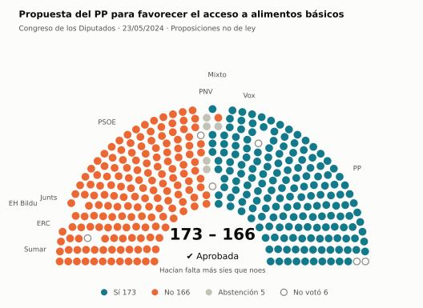
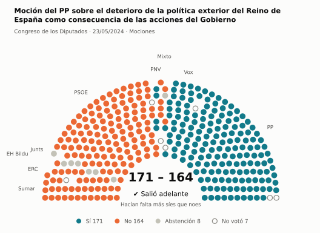
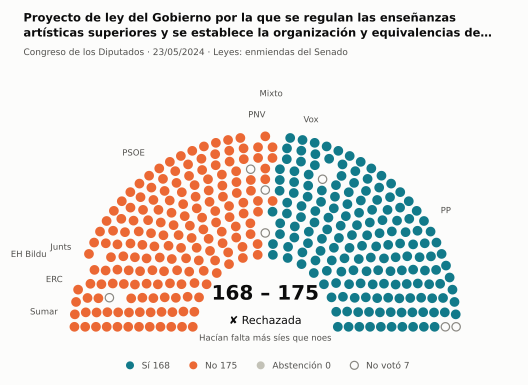
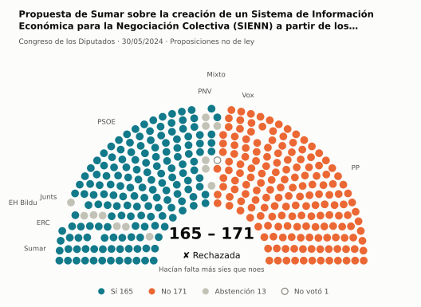
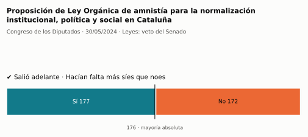
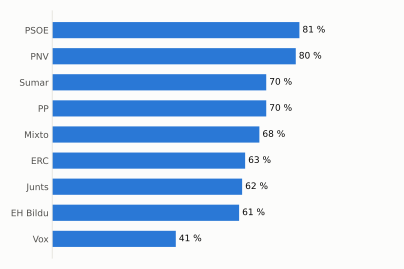
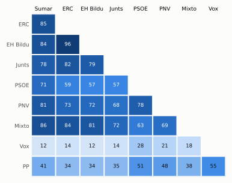

# Qué votó el Congreso en mayo de 2024

Las votaciones del Pleno del Congreso de los Diputados, explicadas sin tecnicismos. Datos oficiales del [Congreso](https://www.congreso.es/es/opendata/votaciones); este resumen se actualiza solo cada mes (última vez: 11/11/2026).

## En pocas palabras

- El Congreso votó **102 veces** en 4 días de pleno. **50 propuestas salieron adelante** y 52 no.
- 36 votaciones fueron sobre leyes, decretos o presupuestos. Otras 60 fueron peticiones al Gobierno que no le obligan (proposiciones no de ley y mociones).
- El Gobierno (PSOE y Sumar) perdió **6** de las 70 votaciones en las que sus grupos votaron lo mismo.
- La votación más reñida se decidió por 2 votos: Moción del PP sobre el deterioro de la política exterior del Reino de España como consecuencia de las acciones del….
- Los diputados casi siempre votan lo mismo que su grupo: en todo el mes solo hubo 22 votos distintos (sin contar el Grupo Mixto).

## Las votaciones más importantes del mes

Elegidas por su importancia: pesan más las leyes y los decretos que las peticiones al Gobierno, y suben las que se decidieron por pocos votos o las que perdió el Gobierno. Cada punto del dibujo es un diputado, colocado con su grupo, y el color es lo que votó.

### 1. Propuesta del PP para favorecer el acceso a alimentos básicos

**23 de mayo · Proposiciones no de ley.** Petición al Gobierno para que haga algo. Expresa la opinión del Congreso, pero no obliga.

<picture>
  <source media="(prefers-color-scheme: dark)" srcset="img/2024-05/votacion-L15-S040-V003-oscuro.svg">
  
</picture>

**✔ Salió adelante** por 7 votos: 173 a favor, 166 en contra y 5 abstenciones.

- **A favor:** PP y Vox
- **En contra:** PSOE, Sumar, Junts, ERC y EH Bildu
- **Se abstuvieron:** PNV
- **Repartidos:** Grupo Mixto (Sí 6, No 1, Abstención 1)

Este asunto tuvo 3 votaciones este mes; aquí se muestra la más disputada. [Datos oficiales](https://www.congreso.es/webpublica/opendata/votaciones/Leg15/Sesion040/20240523/Votacion003/VOT_20240523140933.json)

### 2. Moción del PP sobre el deterioro de la política exterior del Reino de España como consecuencia de las acciones del Gobierno

**23 de mayo · Mociones.** Petición al Gobierno después de pedirle explicaciones en el Pleno. Expresa la opinión del Congreso, pero no obliga.

<picture>
  <source media="(prefers-color-scheme: dark)" srcset="img/2024-05/votacion-L15-S040-V009-oscuro.svg">
  
</picture>

**✔ Salió adelante** por 7 votos: 171 a favor, 164 en contra y 8 abstenciones.

- **A favor:** PP, Vox y PNV
- **En contra:** PSOE, Sumar, ERC y EH Bildu
- **Se abstuvieron:** Junts
- **Repartidos:** Grupo Mixto (Sí 1, No 6, Abstención 1)

Este asunto tuvo 8 votaciones este mes; aquí se muestra la más disputada. [Datos oficiales](https://www.congreso.es/webpublica/opendata/votaciones/Leg15/Sesion040/20240523/Votacion009/VOT_20240523140940.json)

### 3. Proyecto de ley del Gobierno por la que se regulan las enseñanzas artísticas superiores y se establece la organización y equivalencias de las…

**23 de mayo · Leyes: enmiendas del Senado.** El Senado propuso cambios a esta ley y el Congreso decide si los acepta. Es uno de los últimos pasos antes de que la ley se publique.

<picture>
  <source media="(prefers-color-scheme: dark)" srcset="img/2024-05/votacion-L15-S040-V049-oscuro.svg">
  
</picture>

**✘ No salió adelante** por 7 votos: 168 a favor, 175 en contra y ninguna abstención.

- **A favor:** PP y Vox
- **En contra:** PSOE, Sumar, Junts, ERC, EH Bildu y PNV
- **Repartidos:** Grupo Mixto (Sí 1, No 6)

Este asunto tuvo 26 votaciones este mes; aquí se muestra la más disputada. [Datos oficiales](https://www.congreso.es/webpublica/opendata/votaciones/Leg15/Sesion040/20240523/Votacion049/VOT_20240523141019.json)

### 4. Propuesta de Sumar sobre la creación de un Sistema de Información Económica para la Negociación Colectiva (SIENN) a partir de los registros…

**30 de mayo · Proposiciones no de ley.** Petición al Gobierno para que haga algo. Expresa la opinión del Congreso, pero no obliga.

<picture>
  <source media="(prefers-color-scheme: dark)" srcset="img/2024-05/votacion-L15-S043-V021-oscuro.svg">
  
</picture>

**✘ No salió adelante** por 6 votos: 165 a favor, 171 en contra y 13 abstenciones.

- **A favor:** PSOE, Sumar, ERC y EH Bildu
- **En contra:** PP y Vox
- **Se abstuvieron:** Junts y PNV
- **Repartidos:** Grupo Mixto (Sí 5, No 1, Abstención 1)

[Datos oficiales](https://www.congreso.es/webpublica/opendata/votaciones/Leg15/Sesion043/20240530/Votacion021/VOT_20240530120016.json)

### 5. Proposición de Ley Orgánica de amnistía para la normalización institucional, política y social en Cataluña

**30 de mayo · Leyes: veto del Senado.** El Senado rechazó la ley entera. El Congreso puede levantar el veto: enseguida con 176 votos o, pasados dos meses, con más síes que noes.

<picture>
  <source media="(prefers-color-scheme: dark)" srcset="img/2024-05/votacion-L15-S043-V037-oscuro.svg">
  
</picture>

**✔ Salió adelante** por 5 votos: 177 a favor, 172 en contra y ninguna abstención.

Fue una votación por llamamiento: cada diputado dijo su voto en voz alta. El voto de cada uno está en el [Diario de Sesiones](https://www.congreso.es/public_oficiales/L15/CONG/DS/PL/DSCD-15-PL-45.PDF?#page=25).

## ¿Qué grupos votaron más veces lo que finalmente salió?

<picture>
  <source media="(prefers-color-scheme: dark)" srcset="img/2024-05/ganadora-oscuro.svg">
  
</picture>

Porcentaje de votaciones en que el grupo votó Sí y salió adelante, o votó No y no salió. Abstenerse no cuenta como acertar.

## ¿Quién vota con quién?

<picture>
  <source media="(prefers-color-scheme: dark)" srcset="img/2024-05/afinidad-oscuro.svg">
  
</picture>

Cada casilla dice en qué porcentaje de las votaciones dos grupos votaron lo mismo: 100 es que siempre coincidieron y 0 que nunca.

## ¿Qué tipo de cosas se votaron?

| Tipo | Votaciones | Salieron adelante | Qué es |
| --- | ---: | ---: | --- |
| Mociones | 35 | 11 | Petición al Gobierno después de pedirle explicaciones en el Pleno. Expresa la opinión del Congreso, pero no obliga. |
| Leyes: enmiendas del Senado | 26 | 16 | El Senado propuso cambios a esta ley y el Congreso decide si los acepta. Es uno de los últimos pasos antes de que la ley se publique. |
| Proposiciones no de ley | 25 | 9 | Petición al Gobierno para que haga algo. Expresa la opinión del Congreso, pero no obliga. |
| Tratados internacionales | 5 | 5 | El Congreso autoriza a España a comprometerse con un acuerdo con otro país u organismo. |
| Leyes: toma en consideración | 4 | 3 | Primer paso de una ley propuesta por un grupo o una comunidad autónoma: el Congreso decide si empieza a tramitarla. |
| Leyes: dictamen y votación final | 3 | 3 | Votación del texto de una ley después de trabajarla en comisión. |
| Leyes: veto del Senado | 1 | 1 | El Senado rechazó la ley entera. El Congreso puede levantar el veto: enseguida con 176 votos o, pasados dos meses, con más síes que noes. |
| Organización de la Cámara | 1 | 1 | Asunto interno del Congreso: comisiones, plazos o el estatuto de los diputados. |
| Presupuestos y estabilidad | 1 | 1 | Cuentas públicas: límites de déficit y deuda o cuentas del Estado. |
| Enmiendas a la totalidad | 1 | 0 | Un grupo intenta devolver la ley a quien la propuso o sustituirla por otra. Si no sale adelante, la ley sigue su camino. |

## Palabras que conviene saber

- **Pleno**: La reunión de los 350 diputados, donde se vota.
- **Grupo parlamentario**: Los diputados de un partido o coalición. Los partidos pequeños van juntos en el Grupo Mixto, aunque no piensen igual.
- **Abstención**: El diputado vota, pero ni a favor ni en contra.
- **No votó**: El diputado no votó: no estaba, estaba de baja o el escaño estaba vacío.
- **Mayoría simple**: Salen adelante las votaciones con más síes que noes. Es lo normal.
- **Mayoría absoluta**: 176 votos a favor, la mitad más uno de 350. La piden las leyes orgánicas (derechos fundamentales, sistema electoral…) y la primera votación de investidura.
- **Votación por llamamiento**: Cada diputado dice su voto en voz alta. Se usa en las investiduras y otras votaciones importantes.

---

**¿Quieres más detalle?** El [análisis detallado](2024-05-detalle.md) tiene la cohesión de cada grupo, un mapa de los diputados según cómo votan, qué diputados votaron distinto de su grupo, las ausencias y la lista completa de votaciones.

_Los resultados están calculados a partir de los votos: el Congreso no publica si cada votación salió adelante. Este proyecto no tiene relación con el Congreso. Método en [docs/DOCUMENTO_FUNCIONAL.md](../docs/DOCUMENTO_FUNCIONAL.md)._
