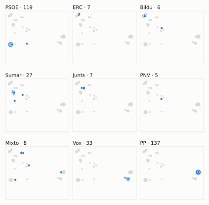
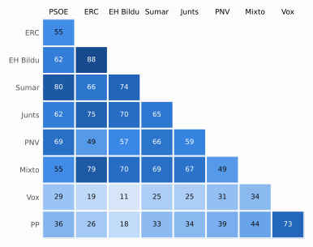

# Análisis detallado: junio de 2024

[← Volver al resumen del mes](2024-06.md)

_Generado automáticamente el 2026-11-10 con datos abiertos del [Congreso de los Diputados](https://www.congreso.es/es/opendata/votaciones). Solo plenos y Diputación Permanente. Método y límites en [docs/DOCUMENTO_FUNCIONAL.md](../docs/DOCUMENTO_FUNCIONAL.md)._

## Resumen

- **102 votaciones** en 6 días de pleno (sesiones 44, 46, 47, 49, 50 y 52).
- **50 aprobadas** y **52 rechazadas**.
- 8 votaciones se decidieron por 5 votos o menos.
- El grupo que más veces votó con el resultado final: **Mixto** (75 % de las votaciones nominales).
- Los grupos del Gobierno (PSOE y Sumar) votaron lo mismo en 67 de 102 votaciones nominales y perdieron 8 de ellas.
- 27 votos individuales se apartaron de la posición de su grupo (23 diputados).

## Cómo votó cada grupo

| Grupo | Diputados | Cohesión | Votó con el resultado | Decisivo | Posición Sí | Posición No | Posición Abst. |
| --- | ---: | ---: | ---: | ---: | ---: | ---: | ---: |
| PP | 137 | 100 % | 69 % | 15 | 63 | 31 | 8 |
| PSOE | 120 | 100 % | 68 % | 24 | 17 | 66 | 19 |
| Vox | 33 | 100 % | 59 % | 7 | 62 | 30 | 10 |
| Sumar | 27 | 100 % | 65 % | 16 | 28 | 56 | 18 |
| Mixto | 8 | 72 % | 75 % | 10 | 55 | 44 | 3 |
| Junts | 7 | 100 % | 64 % | 11 | 46 | 43 | 13 |
| ERC | 7 | 99 % | 58 % | 11 | 44 | 48 | 10 |
| EH Bildu | 6 | 100 % | 49 % | 5 | 34 | 50 | 18 |
| PNV | 5 | 100 % | 64 % | 3 | 32 | 42 | 28 |

*Cohesión*: índice de acuerdo interno (100 % = todo el grupo votó igual). *Votó con el resultado*: el grupo votó Sí y salió aprobada, o No y salió rechazada. *Decisivo*: votaciones cuyo resultado habría cambiado si el grupo se hubiera abstenido en bloque. El Grupo Mixto reúne partidos distintos: su posición es la de su mayoría.

## Mapa de diputados

<picture>
  <source media="(prefers-color-scheme: dark)" srcset="img/2024-06/mapa-oscuro.svg">
  
</picture>

Cada punto es un diputado; dos diputados están cerca si votaron parecido. Un punto más grande reúne a varios que votaron exactamente igual. En cada panel, el grupo en azul y el resto del Congreso en gris.

*Cómo se calcula*: componentes principales de los votos (Sí, No, abstención) en 101 votaciones con algún desacuerdo. El eje horizontal recoge el 72 % de la variación y el vertical el 12 %. Los ejes no tienen nombre ni sentido político propio; por convención, el PP queda a la derecha. No se sitúa a 2 diputados que votó en menos de la mitad.

## Afinidad entre grupos

<picture>
  <source media="(prefers-color-scheme: dark)" srcset="img/2024-06/afinidad-oscuro.svg">
  
</picture>

Porcentaje de votaciones nominales en que los dos grupos tomaron la misma posición. Los grupos están ordenados según el mapa de diputados.

Ver la tabla

|  | PP | PSOE | Vox | Sumar | Mixto | Junts | ERC | EH Bildu | PNV |
| --- | :---: | :---: | :---: | :---: | :---: | :---: | :---: | :---: | :---: |
| PP | 100 % | 36 % | 73 % | 33 % | 44 % | 34 % | 26 % | 18 % | 39 % |
| PSOE | 36 % | 100 % | 29 % | 80 % | 55 % | 62 % | 55 % | 62 % | 69 % |
| Vox | 73 % | 29 % | 100 % | 25 % | 34 % | 25 % | 19 % | 11 % | 31 % |
| Sumar | 33 % | 80 % | 25 % | 100 % | 69 % | 65 % | 66 % | 74 % | 66 % |
| Mixto | 44 % | 55 % | 34 % | 69 % | 100 % | 67 % | 79 % | 70 % | 49 % |
| Junts | 34 % | 62 % | 25 % | 65 % | 67 % | 100 % | 75 % | 70 % | 59 % |
| ERC | 26 % | 55 % | 19 % | 66 % | 79 % | 75 % | 100 % | 88 % | 49 % |
| EH Bildu | 18 % | 62 % | 11 % | 74 % | 70 % | 70 % | 88 % | 100 % | 57 % |
| PNV | 39 % | 69 % | 31 % | 66 % | 49 % | 59 % | 49 % | 57 % | 100 % |

## Quién sacó adelante las votaciones

| Grupos que votaron Sí | Votaciones | Escaños |
| --- | ---: | ---: |
| PSOE + Sumar + Mixto + Junts + ERC + EH Bildu + PNV | 7 | 180 |
| PP + Vox + Mixto | 6 | 178 |
| PP + Vox + Mixto + Junts + ERC | 5 | 192 |
| PP + Vox + Sumar + Mixto + Junts + ERC + EH Bildu + PNV | 3 | 230 |
| PP + Vox + Mixto + PNV | 3 | 183 |
| PP + Vox + PNV | 3 | 175 |
| PP + PSOE + Sumar + Mixto + Junts + ERC + EH Bildu + PNV | 2 | 317 |
| PP + PSOE + Vox + Junts + PNV | 2 | 302 |

De 50 votaciones nominales aprobadas. Otras 19 salieron con combinaciones que se dieron menos veces. La posición de cada grupo es la de la mayoría de sus diputados.

## Votaciones que perdieron los grupos del Gobierno

| Fecha | Asunto | Tipo | PSOE y Sumar votaron | Resultado | Sí | No |
| --- | --- | --- | :---: | --- | ---: | ---: |
| 20 de junio | Proposición no de Ley del Grupo Parlamentario Popular en el Congreso, relativa al Sáhara Occidental y los compromisos pendientes de la XII RAN Marruecos-España. *(Votación separada por puntos. Punto 4.)* | Proposiciones no de ley | No | Aprobada | 181 | 146 |
| 27 de junio | Proposición no de Ley del Grupo Parlamentario Popular en el Congreso, relativa a la consecución urgente de soluciones a la necesidad extrema de profesionales s… | Proposiciones no de ley | No | Aprobada | 176 | 158 |
| 27 de junio | Moción consecuencia de interpelación urgente del Grupo Parlamentario Popular en el Congreso, sobre el respeto a las Cortes Generales y el ejercicio de sus func… *(Votación separada por puntos. Punto 1.)* | Mociones | No | Aprobada | 174 | 172 |
| 27 de junio | Moción consecuencia de interpelación urgente del Grupo Parlamentario Popular en el Congreso, sobre el respeto a las Cortes Generales y el ejercicio de sus func… *(Votación separada por puntos. Punto 2.)* | Mociones | No | Aprobada | 181 | 166 |
| 27 de junio | Moción consecuencia de interpelación urgente del Grupo Parlamentario Popular en el Congreso, sobre el respeto a las Cortes Generales y el ejercicio de sus func… *(Votación separada por puntos. Punto 3.)* | Mociones | No | Aprobada | 171 | 169 |
| 27 de junio | Moción consecuencia de interpelación urgente del Grupo Parlamentario Popular en el Congreso, sobre el respeto a las Cortes Generales y el ejercicio de sus func… *(Votación separada por puntos. Punto 4.)* | Mociones | No | Aprobada | 170 | 163 |
| 27 de junio | Moción consecuencia de interpelación urgente del Grupo Parlamentario Popular en el Congreso, sobre el respeto a las Cortes Generales y el ejercicio de sus func… *(Votación separada por puntos. Punto 5.)* | Mociones | No | Aprobada | 176 | 170 |
| 27 de junio | Moción consecuencia de interpelación urgente del Grupo Parlamentario Popular en el Congreso, sobre el respeto a las Cortes Generales y el ejercicio de sus func… *(Votación separada por puntos. Punto 7.)* | Mociones | No | Aprobada | 182 | 166 |

Además, PSOE y Sumar votaron distinto entre sí en 20 votaciones.

## Votaciones más ajustadas

| Fecha | Asunto | Resultado | Sí | No | Abst. |
| --- | --- | :---: | ---: | ---: | ---: |
| 27 de junio | Proyecto de Ley Orgánica de representación paritaria y presencia equilibrada de mujeres y hombres. *(Votación de conjunto. Votación de conjunto del Proyecto de…)* | Aprobada (necesita 176) | 177 | 171 | 0 |
| 18 de junio | Proposición de Ley del Grupo Parlamentario Popular en el Congreso, de protección del Patrimonio Histórico frente al vandalismo. | Rechazada | 168 | 170 | 5 |
| 27 de junio | Moción consecuencia de interpelación urgente del Grupo Parlamentario Popular en el Congreso, sobre el respeto a las Cortes Generales y el ejercicio de sus func… *(Votación separada por puntos. Punto 1.)* | Aprobada | 174 | 172 | 0 |
| 27 de junio | Moción consecuencia de interpelación urgente del Grupo Parlamentario Popular en el Congreso, sobre el respeto a las Cortes Generales y el ejercicio de sus func… *(Votación separada por puntos. Punto 3.)* | Aprobada | 171 | 169 | 6 |
| 13 de junio | Moción consecuencia de interpelación urgente del Grupo Parlamentario Popular en el Congreso, sobre la actual situación económica, política y social de nuestro… *(Votación separada por puntos. Punto 2.)* | Rechazada | 168 | 172 | 6 |
| 27 de junio | Proyecto de Ley Orgánica de representación paritaria y presencia equilibrada de mujeres y hombres. *(Enmiendas presentadas por el Grupo Parlamentario Popular en…)* | Rechazada | 171 | 175 | 0 |
| 27 de junio | Proyecto de Ley Orgánica de representación paritaria y presencia equilibrada de mujeres y hombres. *(Enmiendas transaccionales Enmienda transaccional a la enmie…)* | Aprobada | 175 | 171 | 1 |
| 27 de junio | Moción consecuencia de interpelación urgente del Grupo Parlamentario VOX, acerca de cuáles van a ser las líneas principales de acción en torno al Poder Judicia… *(Votación separada por puntos. Punto 1.)* | Rechazada | 171 | 176 | 0 |
| 25 de junio | Proposición de Ley del Grupo Parlamentario Popular en el Congreso, Orgánica de modificación de la Ley Orgánica 6/1985, de 1 de julio, del Poder Judicial, relat… | Rechazada | 167 | 173 | 0 |
| 25 de junio | Proposición de Ley del Grupo Parlamentario VOX, Orgánica de modificación de la Ley Orgánica 2/1979, de 3 de octubre, del Tribunal Constitucional. | Rechazada | 167 | 173 | 0 |

Votaciones decididas por 10 votos o menos (o a esa distancia de la mayoría que exigían). Las públicas por llamamiento no tienen hemiciclo: el voto de cada diputado solo consta en el Diario de Sesiones.

## Qué se votó, por tipo de asunto

| Tipo de asunto | Votaciones | Aprobadas | No aprobadas |
| --- | ---: | ---: | ---: |
| Mociones | 33 | 10 | 23 |
| Proposiciones no de ley | 26 | 25 | 1 |
| Leyes: dictamen y votación final | 24 | 4 | 20 |
| Decretos-ley (convalidación) | 6 | 6 | 0 |
| Leyes: toma en consideración | 6 | 3 | 3 |
| Enmiendas a la totalidad | 6 | 1 | 5 |
| Organización de la Cámara | 1 | 1 | 0 |

Las proposiciones no de ley y las mociones expresan la posición del Congreso pero no obligan al Gobierno. Las leyes pasan por varias votaciones (toma en consideración, totalidad, dictamen, Senado), así que una misma ley puede aparecer varias veces.

## Votos distintos de su grupo

| Diputado | Grupo | Votos distintos de su grupo |
| --- | --- | ---: |
| Calvo Gómez, Pilar | Junts | 2 |
| Cantalapiedra Álvarez, María de las Mercedes | PP | 2 |
| Herrero Bono, José Alberto | PP | 2 |
| López Maraver, Ángel | Vox | 2 |
| Delgado Arce, Celso Luis | PP | 1 |
| Fernández Herranz, Sandra | PP | 1 |
| Gamarra Ruiz-Clavijo, Concepción | PP | 1 |
| Granollers Cunillera, Inés | ERC | 1 |
| Iñarritu García, Jon | EH Bildu | 1 |
| Mariscal Zabala, Manuel | Vox | 1 |
| Martín Urriza, Carlos | Sumar | 1 |
| Pérez Coronado, Pablo | PP | 1 |
| Rallo Lombarte, Artemi | PSOE | 1 |
| Sahuquillo García, Luis Carlos | PSOE | 1 |
| Santos Maraver, Agustín | Sumar | 1 |

Un voto aislado puede ser un error al pulsar, no una decisión política: el Congreso no publica las correcciones. Se excluye el Grupo Mixto.

## Diputados que más veces no votaron

| Diputado | Grupo | No votó | % de votaciones |
| --- | --- | ---: | ---: |
| Sánchez Pérez-Castejón, Pedro | PSOE | 77 | 75 % |
| Díaz Pérez, Yolanda | Sumar | 50 | 49 % |
| Matute García de Jalón, Oskar | EH Bildu | 46 | 45 % |
| Pisarello Prados, Gerardo | Sumar | 27 | 26 % |
| González-Robatto Perote, Jacobo | Vox | 19 | 19 % |
| Ábalos Meco, José Luis | Mixto | 11 | 11 % |
| Núñez Feijóo, Alberto | PP | 6 | 6 % |
| Aragonés Mendiguchía, Carlos | PP | 4 | 4 % |
| Badia Casas, Eloi | Sumar | 4 | 4 % |
| González Pons, Esteban | PP | 4 | 4 % |
| Montesinos de Miguel, Macarena | PP | 4 | 4 % |
| Aizpurua Arzallus, Mertxe | EH Bildu | 3 | 3 % |
| Esteban Bravo, Aitor | PNV | 3 | 3 % |
| Rego Candamil, Néstor | Mixto | 3 | 3 % |
| Velasco Morillo, Elvira | PP | 3 | 3 % |

«No vota» incluye ausencias justificadas (baja, maternidad o paternidad) y escaños vacantes; el portal no las distingue.

## Todas las votaciones

Posición de cada grupo: la opción que votó la mayoría de sus diputados (*Div.*: empate dentro del grupo). El número enlaza al JSON oficial o, en las votaciones por llamamiento, al Diario de Sesiones.

### 11 de junio (sesión 44)

| Nº | Asunto | Resultado | Sí | No | Abst. | PP | PSOE | Vox | Sumar | Mixto | Junts | ERC | EH Bildu | PNV | Decisivos |
| ---: | --- | --- | ---: | ---: | ---: | :---: | :---: | :---: | :---: | :---: | :---: | :---: | :---: | :---: | --- |
| [1](https://www.congreso.es/webpublica/opendata/votaciones/Leg15/Sesion044/20240611/Votacion001/VOT_20240611203611.json) | Proposición de Ley del Parlamento de Galicia, Orgánica de transferencia de la titularidad y competencias de la autopista del Atlántico (AP-9) a la Comunidad Au… | Aprobada | 309 | 33 | 0 | Sí | Sí | No | Sí | Sí | Sí | Sí | Sí | Sí |  |
| [2](https://www.congreso.es/webpublica/opendata/votaciones/Leg15/Sesion044/20240611/Votacion002/VOT_20240611203613.json) | Proposición de Ley del Grupo Parlamentario Popular en el Congreso, Orgánica de modificación de la Ley Orgánica 10/1995, de 23 de noviembre, del Código Penal, e… | Aprobada | 302 | 40 | 0 | Sí | Sí | Sí | No | No | Sí | No | No | Sí |  |

### 13 de junio (sesión 46)

| Nº | Asunto | Resultado | Sí | No | Abst. | PP | PSOE | Vox | Sumar | Mixto | Junts | ERC | EH Bildu | PNV | Decisivos |
| ---: | --- | --- | ---: | ---: | ---: | :---: | :---: | :---: | :---: | :---: | :---: | :---: | :---: | :---: | --- |
| [1](https://www.congreso.es/webpublica/opendata/votaciones/Leg15/Sesion046/20240613/Votacion001/VOT_20240613125213.json) | Proposición no de Ley del Grupo Parlamentario Popular en el Congreso, para la protección de los menores en el entorno digital. *(Votación separada por puntos. Punto 1.)* | Aprobada | 177 | 0 | 168 | Sí | Abst. | Sí | Abst. | Abst. | Sí | Abst. | Abst. | Abst. |  |
| [2](https://www.congreso.es/webpublica/opendata/votaciones/Leg15/Sesion046/20240613/Votacion002/VOT_20240613125214.json) | Proposición no de Ley del Grupo Parlamentario Popular en el Congreso, para la protección de los menores en el entorno digital. *(Votación separada por puntos. Punto 2.)* | Aprobada | 174 | 20 | 151 | Sí | Abst. | Sí | Abst. | Sí | No | No | No | Abst. |  |
| [3](https://www.congreso.es/webpublica/opendata/votaciones/Leg15/Sesion046/20240613/Votacion003/VOT_20240613125216.json) | Proposición no de Ley del Grupo Parlamentario Popular en el Congreso, para la protección de los menores en el entorno digital. *(Votación separada por puntos. Punto 3.)* | Aprobada | 175 | 13 | 159 | Sí | Abst. | Sí | Abst. | Sí | Abst. | No | No | Abst. |  |
| [4](https://www.congreso.es/webpublica/opendata/votaciones/Leg15/Sesion046/20240613/Votacion004/VOT_20240613125217.json) | Proposición no de Ley del Grupo Parlamentario Popular en el Congreso, para la protección de los menores en el entorno digital. *(Votación separada por puntos. Punto 4.)* | Aprobada | 183 | 0 | 164 | Sí | Abst. | Sí | Abst. | Sí | Abst. | Sí | Abst. | Abst. |  |
| [5](https://www.congreso.es/webpublica/opendata/votaciones/Leg15/Sesion046/20240613/Votacion005/VOT_20240613125218.json) | Proposición no de Ley del Grupo Parlamentario Popular en el Congreso, para la protección de los menores en el entorno digital. *(Votación separada por puntos. Punto 5.)* | Aprobada | 187 | 0 | 157 | Sí | Abst. | Sí | Abst. | Sí | Sí | Sí | Abst. | Abst. |  |
| [6](https://www.congreso.es/webpublica/opendata/votaciones/Leg15/Sesion046/20240613/Votacion006/VOT_20240613125219.json) | Proposición no de Ley del Grupo Parlamentario Popular en el Congreso, para la protección de los menores en el entorno digital. *(Votación separada por puntos. Punto 6.)* | Aprobada | 188 | 0 | 159 | Sí | Abst. | Sí | Abst. | Sí | Sí | Sí | Abst. | Abst. |  |
| [7](https://www.congreso.es/webpublica/opendata/votaciones/Leg15/Sesion046/20240613/Votacion007/VOT_20240613125220.json) | Proposición no de Ley del Grupo Parlamentario Popular en el Congreso, para la protección de los menores en el entorno digital. *(Votación separada por puntos. Punto 7.)* | Aprobada | 175 | 20 | 152 | Sí | Abst. | Sí | Abst. | Sí | No | No | No | Abst. |  |
| [8](https://www.congreso.es/webpublica/opendata/votaciones/Leg15/Sesion046/20240613/Votacion008/VOT_20240613125221.json) | Proposición no de Ley del Grupo Parlamentario Popular en el Congreso, para la protección de los menores en el entorno digital. *(Votación separada por puntos. Punto 8.)* | Aprobada | 187 | 3 | 157 | Sí | Abst. | Sí | Abst. | Sí | Sí | Sí | Abst. | Abst. |  |
| [9](https://www.congreso.es/webpublica/opendata/votaciones/Leg15/Sesion046/20240613/Votacion009/VOT_20240613125222.json) | Proposición no de Ley del Grupo Parlamentario Popular en el Congreso, para la protección de los menores en el entorno digital. *(Votación separada por puntos. Punto 9.)* | Aprobada | 182 | 0 | 165 | Sí | Abst. | Sí | Abst. | Sí | Sí | Abst. | Abst. | Abst. |  |
| [10](https://www.congreso.es/webpublica/opendata/votaciones/Leg15/Sesion046/20240613/Votacion010/VOT_20240613125223.json) | Proposición no de Ley del Grupo Parlamentario Popular en el Congreso, para la protección de los menores en el entorno digital. *(Votación separada por puntos. Punto 10.)* | Aprobada | 158 | 32 | 157 | Sí | Abst. | No | Abst. | Sí | Sí | Sí | Abst. | Abst. | PP |
| [11](https://www.congreso.es/webpublica/opendata/votaciones/Leg15/Sesion046/20240613/Votacion011/VOT_20240613125224.json) | Proposición no de Ley del Grupo Parlamentario Popular en el Congreso, para la protección de los menores en el entorno digital. *(Votación separada por puntos. Punto 11.)* | Aprobada | 183 | 0 | 164 | Sí | Abst. | Sí | Abst. | Sí | Abst. | Sí | Abst. | Abst. |  |
| [12](https://www.congreso.es/webpublica/opendata/votaciones/Leg15/Sesion046/20240613/Votacion012/VOT_20240613125225.json) | Proposición no de Ley del Grupo Parlamentario Popular en el Congreso, para la protección de los menores en el entorno digital. *(Votación separada por puntos. Punto 12.)* | Aprobada | 172 | 20 | 150 | Sí | Abst. | Sí | Abst. | Sí | No | No | No | Abst. |  |
| [13](https://www.congreso.es/webpublica/opendata/votaciones/Leg15/Sesion046/20240613/Votacion013/VOT_20240613125226.json) | Proposición no de Ley del Grupo Parlamentario Popular en el Congreso, para la protección de los menores en el entorno digital. *(Votación separada por puntos. Punto 13.)* | Aprobada | 176 | 13 | 157 | Sí | Abst. | Sí | Abst. | Sí | Abst. | No | No | Abst. |  |
| [14](https://www.congreso.es/webpublica/opendata/votaciones/Leg15/Sesion046/20240613/Votacion014/VOT_20240613125227.json) | Proposición no de Ley del Grupo Parlamentario Popular en el Congreso, para la protección de los menores en el entorno digital. *(Votación separada por puntos. Punto 14.)* | Aprobada | 189 | 0 | 158 | Sí | Abst. | Sí | Abst. | Sí | Sí | Sí | Abst. | Abst. |  |
| [15](https://www.congreso.es/webpublica/opendata/votaciones/Leg15/Sesion046/20240613/Votacion015/VOT_20240613125228.json) | Proposición no de Ley del Grupo Parlamentario Popular en el Congreso, para la protección de los menores en el entorno digital. *(Votación separada por puntos. Punto 15.)* | Aprobada | 190 | 0 | 157 | Sí | Abst. | Sí | Abst. | Sí | Sí | Sí | Abst. | Abst. |  |
| [16](https://www.congreso.es/webpublica/opendata/votaciones/Leg15/Sesion046/20240613/Votacion016/VOT_20240613125229.json) | Proposición no de Ley del Grupo Parlamentario Socialista, para regular la inteligencia artificial para proteger a los más vulnerables. Se vota en los términos… | Aprobada | 180 | 32 | 135 | Abst. | Sí | No | Sí | Sí | Sí | Sí | Sí | Sí |  |
| [17](https://www.congreso.es/webpublica/opendata/votaciones/Leg15/Sesion046/20240613/Votacion017/VOT_20240613125230.json) | Moción consecuencia de interpelación urgente del Grupo Parlamentario Mixto (Sr. Rego Candamil), relativa a la anulación de la prórroga de 25 años otorgada a la… | Aprobada | 181 | 32 | 132 | Sí | Abst. | No | Sí | Sí | Abst. | Sí | Sí | Abst. |  |
| [18](https://www.congreso.es/webpublica/opendata/votaciones/Leg15/Sesion046/20240613/Votacion018/VOT_20240613125230.json) | Moción consecuencia de interpelación urgente del Grupo Parlamentario Popular en el Congreso, sobre la actual situación económica, política y social de nuestro… *(Votación separada por puntos. Punto 1.)* | Rechazada | 144 | 170 | 32 | Sí | No | Abst. | No | No | No | No | No | Sí | PSOE |
| [19](https://www.congreso.es/webpublica/opendata/votaciones/Leg15/Sesion046/20240613/Votacion019/VOT_20240613125231.json) | Moción consecuencia de interpelación urgente del Grupo Parlamentario Popular en el Congreso, sobre la actual situación económica, política y social de nuestro… *(Votación separada por puntos. Punto 2.)* | Rechazada | 168 | 172 | 6 | Sí | No | Sí | No | No | No | No | No | Abst. | EH Bildu, Junts, Mixto, ERC, PSOE, Sumar |
| [20](https://www.congreso.es/webpublica/opendata/votaciones/Leg15/Sesion046/20240613/Votacion020/VOT_20240613125232.json) | Moción consecuencia de interpelación urgente del Grupo Parlamentario VOX, sobre la medida en que la acción del Gobierno en torno a la guerra contra Hamás puede… | Rechazada | 33 | 177 | 137 | Abst. | No | Sí | No | No | No | No | No | No |  |
| [21](https://www.congreso.es/webpublica/opendata/votaciones/Leg15/Sesion046/20240613/Votacion021/VOT_20240613125233.json) | Votación de la enmienda a la totalidad de texto alternativo a la Proposición de Ley para una regularización extraordinaria para personas extranjeras en España,… | Rechazada | 33 | 315 | 0 | No | No | Sí | No | No | No | No | No | No |  |
| [22](https://www.congreso.es/webpublica/opendata/votaciones/Leg15/Sesion046/20240613/Votacion022/VOT_20240613125234.json) | Proyecto de Ley de creación de la Oficina Española de Derechos de Autor y Conexos, O.A. *(Enmienda a la totalidad de devolución. Votación de la enmie…)* | Rechazada | 33 | 314 | 0 | No | No | Sí | No | No | No | No | No | No |  |
| [23](https://www.congreso.es/webpublica/opendata/votaciones/Leg15/Sesion046/20240613/Votacion023/VOT_20240613125235.json) | Proyecto de Ley de creación de la Oficina Española de Derechos de Autor y Conexos, O.A. *(Solicitud de avocación. Solicitud de avocación por el Pleno…)* | Aprobada | 347 | 0 | 0 | Sí | Sí | Sí | Sí | Sí | Sí | Sí | Sí | Sí |  |
| [24](https://www.congreso.es/webpublica/opendata/votaciones/Leg15/Sesion046/20240613/Votacion024/VOT_20240613125236.json) | Real Decreto-ley 1/2024, de 14 de mayo, por el que se prorrogan las medidas de suspensión de lanzamientos sobre la vivienda habitual para la protección de los… | Aprobada | 347 | 0 | 1 | Sí | Sí | Sí | Sí | Sí | Sí | Sí | Sí | Sí |  |
| [25](https://www.congreso.es/webpublica/opendata/votaciones/Leg15/Sesion046/20240613/Votacion025/VOT_20240613125237.json) | Tramitación como Proyecto de Ley por el procedimiento de urgencia del Real Decreto-ley 1/2024, de 14 de mayo, por el que se prorrogan las medidas de suspensión… | Aprobada | 342 | 0 | 1 | Sí | Sí | Sí | Sí | Sí | Sí | Sí | Sí | Abst. |  |

### 18 de junio (sesión 47)

| Nº | Asunto | Resultado | Sí | No | Abst. | PP | PSOE | Vox | Sumar | Mixto | Junts | ERC | EH Bildu | PNV | Decisivos |
| ---: | --- | --- | ---: | ---: | ---: | :---: | :---: | :---: | :---: | :---: | :---: | :---: | :---: | :---: | --- |
| [1](https://www.congreso.es/webpublica/opendata/votaciones/Leg15/Sesion047/20240618/Votacion001/VOT_20240618211338.json) | Proposición de Ley del Grupo Parlamentario Socialista, Orgánica por la que se modifica el artículo 80 de la Ley Orgánica 1/1979, de 26 de septiembre, General P… | Aprobada | 300 | 14 | 29 | Sí | Sí | Sí | Abst. | Abst. | Sí | No | No | Sí |  |
| [2](https://www.congreso.es/webpublica/opendata/votaciones/Leg15/Sesion047/20240618/Votacion002/VOT_20240618211339.json) | Proposición de Ley del Grupo Parlamentario Popular en el Congreso, de protección del Patrimonio Histórico frente al vandalismo. | Rechazada | 168 | 170 | 5 | Sí | No | Sí | No | No | No | No | No | Abst. | EH Bildu, Junts, Mixto, ERC, PSOE, Sumar |

### 20 de junio (sesión 49)

| Nº | Asunto | Resultado | Sí | No | Abst. | PP | PSOE | Vox | Sumar | Mixto | Junts | ERC | EH Bildu | PNV | Decisivos |
| ---: | --- | --- | ---: | ---: | ---: | :---: | :---: | :---: | :---: | :---: | :---: | :---: | :---: | :---: | --- |
| [1](https://www.congreso.es/webpublica/opendata/votaciones/Leg15/Sesion049/20240620/Votacion001/VOT_20240620132724.json) | Proposición no de Ley del Grupo Parlamentario Popular en el Congreso, relativa al Sáhara Occidental y los compromisos pendientes de la XII RAN Marruecos-España. *(Votación separada por puntos. Punto 1.)* | Aprobada | 215 | 121 | 13 | Sí | No | Sí | Sí | Sí | Sí | Abst. | Abst. | Sí | PP |
| [2](https://www.congreso.es/webpublica/opendata/votaciones/Leg15/Sesion049/20240620/Votacion002/VOT_20240620132725.json) | Proposición no de Ley del Grupo Parlamentario Popular en el Congreso, relativa al Sáhara Occidental y los compromisos pendientes de la XII RAN Marruecos-España. *(Votación separada por puntos. Punto 2.)* | Aprobada | 228 | 121 | 0 | Sí | No | Sí | Sí | Sí | Sí | Sí | Sí | Sí | PP |
| [3](https://www.congreso.es/webpublica/opendata/votaciones/Leg15/Sesion049/20240620/Votacion003/VOT_20240620132726.json) | Proposición no de Ley del Grupo Parlamentario Popular en el Congreso, relativa al Sáhara Occidental y los compromisos pendientes de la XII RAN Marruecos-España. *(Votación separada por puntos. Punto 3.)* | Aprobada | 200 | 129 | 19 | Sí | No | Sí | Sí | Sí | No | Abst. | Abst. | Abst. | PP |
| [4](https://www.congreso.es/webpublica/opendata/votaciones/Leg15/Sesion049/20240620/Votacion004/VOT_20240620132727.json) | Proposición no de Ley del Grupo Parlamentario Popular en el Congreso, relativa al Sáhara Occidental y los compromisos pendientes de la XII RAN Marruecos-España. *(Votación separada por puntos. Punto 4.)* | Aprobada | 181 | 146 | 21 | Sí | No | Sí | No | Sí | Abst. | Abst. | Abst. | Sí | PP |
| [5](https://www.congreso.es/webpublica/opendata/votaciones/Leg15/Sesion049/20240620/Votacion005/VOT_20240620132728.json) | Proposición no de Ley del Grupo Parlamentario Popular en el Congreso, relativa al Sáhara Occidental y los compromisos pendientes de la XII RAN Marruecos-España. *(Votación separada por puntos. Punto 5.)* | Aprobada | 175 | 121 | 52 | Sí | No | Abst. | Sí | Sí | Sí | Abst. | Abst. | Abst. | PP |
| [6](https://www.congreso.es/webpublica/opendata/votaciones/Leg15/Sesion049/20240620/Votacion006/VOT_20240620132729.json) | Proposición no de Ley del Grupo Parlamentario Popular en el Congreso, relativa al Sáhara Occidental y los compromisos pendientes de la XII RAN Marruecos-España. *(Votación separada por puntos. Punto 6.)* | Aprobada | 228 | 121 | 0 | Sí | No | Sí | Sí | Sí | Sí | Sí | Sí | Sí | PP |
| [7](https://www.congreso.es/webpublica/opendata/votaciones/Leg15/Sesion049/20240620/Votacion007/VOT_20240620132730.json) | Proposición no de Ley del Grupo Parlamentario Popular en el Congreso, relativa al Sáhara Occidental y los compromisos pendientes de la XII RAN Marruecos-España. *(Votación separada por puntos. Punto 7.)* | Aprobada | 228 | 121 | 0 | Sí | No | Sí | Sí | Sí | Sí | Sí | Sí | Sí | PP |
| [8](https://www.congreso.es/webpublica/opendata/votaciones/Leg15/Sesion049/20240620/Votacion008/VOT_20240620132731.json) | Proposición no de Ley del Grupo Parlamentario Socialista, sobre un Acuerdo de País contra los Discursos de Odio. | Aprobada | 177 | 33 | 138 | Abst. | Sí | No | Sí | Sí | Sí | Sí | Sí | Sí |  |
| [9](https://www.congreso.es/webpublica/opendata/votaciones/Leg15/Sesion049/20240620/Votacion009/VOT_20240620132732.json) | Moción consecuencia de interpelación urgente del Grupo Parlamentario VOX, sobre las medidas que va a adoptar el Gobierno para garantizar el empleo estable y de… *(Votación separada por puntos. Punto 1.)* | Rechazada | 33 | 316 | 0 | No | No | Sí | No | No | No | No | No | No |  |
| [10](https://www.congreso.es/webpublica/opendata/votaciones/Leg15/Sesion049/20240620/Votacion010/VOT_20240620132733.json) | Moción consecuencia de interpelación urgente del Grupo Parlamentario VOX, sobre las medidas que va a adoptar el Gobierno para garantizar el empleo estable y de… *(Votación separada por puntos. Punto 2.)* | Rechazada | 32 | 317 | 0 | No | No | Sí | No | No | No | No | No | No |  |
| [11](https://www.congreso.es/webpublica/opendata/votaciones/Leg15/Sesion049/20240620/Votacion011/VOT_20240620132734.json) | Moción consecuencia de interpelación urgente del Grupo Parlamentario VOX, sobre las medidas que va a adoptar el Gobierno para garantizar el empleo estable y de… *(Votación separada por puntos. Punto 3.)* | Rechazada | 33 | 176 | 138 | Abst. | No | Sí | No | No | No | No | No | No |  |
| [12](https://www.congreso.es/webpublica/opendata/votaciones/Leg15/Sesion049/20240620/Votacion012/VOT_20240620132735.json) | Moción consecuencia de interpelación urgente del Grupo Parlamentario VOX, sobre las medidas que va a adoptar el Gobierno para garantizar el empleo estable y de… *(Votación separada por puntos. Punto 4.)* | Rechazada | 171 | 178 | 0 | Sí | No | Sí | No | No | No | No | No | No | PSOE, Sumar |
| [13](https://www.congreso.es/webpublica/opendata/votaciones/Leg15/Sesion049/20240620/Votacion013/VOT_20240620132736.json) | Moción consecuencia de interpelación urgente del Grupo Parlamentario VOX, sobre las medidas que va a adoptar el Gobierno para garantizar el empleo estable y de… *(Votación separada por puntos. Punto 5.)* | Rechazada | 171 | 178 | 0 | Sí | No | Sí | No | No | No | No | No | No | PSOE, Sumar |
| [14](https://www.congreso.es/webpublica/opendata/votaciones/Leg15/Sesion049/20240620/Votacion014/VOT_20240620132736.json) | Moción consecuencia de interpelación urgente del Grupo Parlamentario Mixto (Sra. Santana Perera), relativa a las políticas que pretende implementar el Gobierno… *(Votación separada por puntos. Punto 1.)* | Rechazada | 51 | 293 | 5 | No | No | No | Sí | Sí | Sí | Sí | Sí | Abst. |  |
| [15](https://www.congreso.es/webpublica/opendata/votaciones/Leg15/Sesion049/20240620/Votacion015/VOT_20240620132737.json) | Moción consecuencia de interpelación urgente del Grupo Parlamentario Mixto (Sra. Santana Perera), relativa a las políticas que pretende implementar el Gobierno… *(Votación separada por puntos. Punto 2.)* | Rechazada | 30 | 297 | 21 | No | No | No | Sí | Sí | Abst. | Abst. | Abst. | No |  |
| [16](https://www.congreso.es/webpublica/opendata/votaciones/Leg15/Sesion049/20240620/Votacion016/VOT_20240620132738.json) | Moción consecuencia de interpelación urgente del Grupo Parlamentario Mixto (Sra. Santana Perera), relativa a las políticas que pretende implementar el Gobierno… *(Votación separada por puntos. Punto 3.)* | Rechazada | 43 | 298 | 8 | No | No | No | Sí | Sí | Abst. | Sí | Sí | No |  |
| [17](https://www.congreso.es/webpublica/opendata/votaciones/Leg15/Sesion049/20240620/Votacion017/VOT_20240620132739.json) | Moción consecuencia de interpelación urgente del Grupo Parlamentario Mixto (Sra. Santana Perera), relativa a las políticas que pretende implementar el Gobierno… *(Votación separada por puntos. Punto 4.)* | Rechazada | 43 | 298 | 8 | No | No | No | Sí | Sí | Abst. | Sí | Sí | No |  |
| [18](https://www.congreso.es/webpublica/opendata/votaciones/Leg15/Sesion049/20240620/Votacion018/VOT_20240620132740.json) | Moción consecuencia de interpelación urgente del Grupo Parlamentario Mixto (Sra. Santana Perera), relativa a las políticas que pretende implementar el Gobierno… *(Votación separada por puntos. Punto 5.)* | Rechazada | 26 | 322 | 0 | No | No | No | No | Sí | Sí | Sí | Sí | No |  |
| [19](https://www.congreso.es/webpublica/opendata/votaciones/Leg15/Sesion049/20240620/Votacion019/VOT_20240620132741.json) | Real Decreto-ley 2/2024, de 21 de mayo, por el que se adoptan medidas urgentes para la simplificación y mejora del nivel asistencial de la protección por desem… | Aprobada | 178 | 0 | 171 | Abst. | Sí | Abst. | Sí | Sí | Sí | Sí | Sí | Sí |  |
| [20](https://www.congreso.es/webpublica/opendata/votaciones/Leg15/Sesion049/20240620/Votacion020/VOT_20240620132742.json) | Tramitación como Proyecto de Ley por el procedimiento de urgencia del Real Decreto-ley 2/2024, de 21 de mayo, por el que se adoptan medidas urgentes para la si… | Aprobada | 344 | 5 | 0 | Sí | Sí | Sí | Sí | Sí | Sí | Sí | Sí | No |  |
| [21](https://www.congreso.es/webpublica/opendata/votaciones/Leg15/Sesion049/20240620/Votacion021/VOT_20240620132743.json) | Real Decreto-ley 3/2024, de 4 de junio, de medidas de promoción del uso del transporte público colectivo terrestre por parte de los jóvenes para los viajes rea… | Aprobada | 316 | 0 | 33 | Sí | Sí | Abst. | Sí | Sí | Sí | Sí | Sí | Sí |  |
| [22](https://www.congreso.es/webpublica/opendata/votaciones/Leg15/Sesion049/20240620/Votacion022/VOT_20240620132744.json) | Tramitación como Proyecto de Ley por el procedimiento de urgencia del Real Decreto-ley 3/2024, de 4 de junio, de medidas de promoción del uso del transporte pú… | Aprobada | 331 | 5 | 13 | Sí | Sí | Sí | Sí | Sí | Sí | Abst. | Abst. | No |  |
| [23](https://www.congreso.es/webpublica/opendata/votaciones/Leg15/Sesion049/20240620/Votacion023/VOT_20240620132745.json) | Votación de la enmienda a la totalidad de texto alternativo a la Proposición de Ley Orgánica para la atención integral de las necesidades de las personas afect… | Rechazada | 32 | 317 | 0 | No | No | Sí | No | No | No | No | No | No |  |
| [24](https://www.congreso.es/webpublica/opendata/votaciones/Leg15/Sesion049/20240620/Votacion024/VOT_20240620132746.json) | Votación de la enmienda a la totalidad de texto alternativo a la Proposición de Ley para mejorar la calidad de vida de las personas con esclerosis lateral amio… | Rechazada | 33 | 315 | 0 | No | No | Sí | No | No | No | No | No | No |  |
| [25](https://www.congreso.es/webpublica/opendata/votaciones/Leg15/Sesion049/20240620/Votacion025/VOT_20240620132747.json) | Votación de la enmienda a la totalidad de texto alternativo a la Proposición de Ley para la atención integral de las personas afectadas por enfermedades neurod… | Rechazada | 33 | 316 | 0 | No | No | Sí | No | No | No | No | No | No |  |

### 25 de junio (sesión 50)

| Nº | Asunto | Resultado | Sí | No | Abst. | PP | PSOE | Vox | Sumar | Mixto | Junts | ERC | EH Bildu | PNV | Decisivos |
| ---: | --- | --- | ---: | ---: | ---: | :---: | :---: | :---: | :---: | :---: | :---: | :---: | :---: | :---: | --- |
| [1](https://www.congreso.es/webpublica/opendata/votaciones/Leg15/Sesion050/20240625/Votacion001/VOT_20240625212157.json) | Proposición de Ley del Grupo Parlamentario Popular en el Congreso, Orgánica de modificación de la Ley Orgánica 6/1985, de 1 de julio, del Poder Judicial, relat… | Rechazada | 167 | 173 | 0 | Sí | No | Sí | No | No | No | No | No | No | Junts, ERC, PSOE, Sumar |
| [2](https://www.congreso.es/webpublica/opendata/votaciones/Leg15/Sesion050/20240625/Votacion002/VOT_20240625212158.json) | Proposición de Ley del Grupo Parlamentario VOX, Orgánica de modificación de la Ley Orgánica 2/1979, de 3 de octubre, del Tribunal Constitucional. | Rechazada | 167 | 173 | 0 | Sí | No | Sí | No | No | No | No | No | No | Junts, ERC, PSOE, Sumar |

### 27 de junio (sesión 52)

| Nº | Asunto | Resultado | Sí | No | Abst. | PP | PSOE | Vox | Sumar | Mixto | Junts | ERC | EH Bildu | PNV | Decisivos |
| ---: | --- | --- | ---: | ---: | ---: | :---: | :---: | :---: | :---: | :---: | :---: | :---: | :---: | :---: | --- |
| [1](https://www.congreso.es/webpublica/opendata/votaciones/Leg15/Sesion052/20240627/Votacion001/VOT_20240627130333.json) | Proyecto de Ley Orgánica de representación paritaria y presencia equilibrada de mujeres y hombres. *(Enmiendas presentadas por el Grupo Parlamentario Mixto (Sra…)* | Rechazada | 24 | 322 | 1 | No | No | No | No | Sí | Sí | Sí | Sí | No |  |
| [2](https://www.congreso.es/webpublica/opendata/votaciones/Leg15/Sesion052/20240627/Votacion002/VOT_20240627130334.json) | Proyecto de Ley Orgánica de representación paritaria y presencia equilibrada de mujeres y hombres. *(Enmienda presentada por el Grupo Parlamentario Mixto (Sr. R…)* | Rechazada | 29 | 318 | 0 | No | No | No | No | Sí | Sí | Sí | Sí | Sí |  |
| [3](https://www.congreso.es/webpublica/opendata/votaciones/Leg15/Sesion052/20240627/Votacion003/VOT_20240627130335.json) | Proyecto de Ley Orgánica de representación paritaria y presencia equilibrada de mujeres y hombres. *(Enmienda presentada por el Grupo Parlamentario Vasco (EAJ-P…)* | Rechazada | 25 | 296 | 26 | No | No | No | Abst. | No | Sí | Sí | Sí | Sí |  |
| [4](https://www.congreso.es/webpublica/opendata/votaciones/Leg15/Sesion052/20240627/Votacion004/VOT_20240627130336.json) | Proyecto de Ley Orgánica de representación paritaria y presencia equilibrada de mujeres y hombres. *(Enmiendas presentadas por el Grupo Parlamentario Junts per…)* | Rechazada | 12 | 334 | 1 | No | No | No | No | No | Sí | No | No | Sí |  |
| [5](https://www.congreso.es/webpublica/opendata/votaciones/Leg15/Sesion052/20240627/Votacion005/VOT_20240627130337.json) | Proyecto de Ley Orgánica de representación paritaria y presencia equilibrada de mujeres y hombres. *(Enmiendas presentadas por el Grupo Parlamentario Republican…)* | Rechazada | 24 | 322 | 0 | No | No | No | No | Sí | Sí | Sí | Sí | No |  |
| [6](https://www.congreso.es/webpublica/opendata/votaciones/Leg15/Sesion052/20240627/Votacion006/VOT_20240627130338.json) | Proyecto de Ley Orgánica de representación paritaria y presencia equilibrada de mujeres y hombres. *(Enmiendas presentadas por el Grupo Parlamentario Republican…)* | Rechazada | 46 | 300 | 0 | No | No | No | Sí | No | Sí | Sí | Sí | No |  |
| [7](https://www.congreso.es/webpublica/opendata/votaciones/Leg15/Sesion052/20240627/Votacion007/VOT_20240627130339.json) | Proyecto de Ley Orgánica de representación paritaria y presencia equilibrada de mujeres y hombres. *(Enmiendas presentadas por el Grupo Parlamentario Republican…)* | Rechazada | 20 | 327 | 0 | No | No | No | No | No | Sí | Sí | Sí | No |  |
| [8](https://www.congreso.es/webpublica/opendata/votaciones/Leg15/Sesion052/20240627/Votacion008/VOT_20240627130340.json) | Proyecto de Ley Orgánica de representación paritaria y presencia equilibrada de mujeres y hombres. *(Enmiendas presentadas por el Grupo Parlamentario Republican…)* | Rechazada | 17 | 318 | 12 | No | No | No | No | Sí | Abst. | Sí | Sí | Abst. |  |
| [9](https://www.congreso.es/webpublica/opendata/votaciones/Leg15/Sesion052/20240627/Votacion009/VOT_20240627130341.json) | Proyecto de Ley Orgánica de representación paritaria y presencia equilibrada de mujeres y hombres. *(Enmienda presentada por el Grupo Parlamentario Plurinaciona…)* | Rechazada | 44 | 291 | 10 | No | No | No | Sí | Sí | Sí | Sí | Abst. | Abst. |  |
| [10](https://www.congreso.es/webpublica/opendata/votaciones/Leg15/Sesion052/20240627/Votacion010/VOT_20240627130342.json) | Proyecto de Ley Orgánica de representación paritaria y presencia equilibrada de mujeres y hombres. *(Enmiendas presentadas por el Grupo Parlamentario Popular en…)* | Rechazada | 138 | 208 | 0 | Sí | No | No | No | No | No | No | No | No | PSOE |
| [11](https://www.congreso.es/webpublica/opendata/votaciones/Leg15/Sesion052/20240627/Votacion011/VOT_20240627130343.json) | Proyecto de Ley Orgánica de representación paritaria y presencia equilibrada de mujeres y hombres. *(Enmiendas presentadas por el Grupo Parlamentario Popular en…)* | Rechazada | 138 | 176 | 33 | Sí | No | Abst. | No | No | No | No | No | No | PSOE |
| [12](https://www.congreso.es/webpublica/opendata/votaciones/Leg15/Sesion052/20240627/Votacion012/VOT_20240627130344.json) | Proyecto de Ley Orgánica de representación paritaria y presencia equilibrada de mujeres y hombres. *(Enmiendas presentadas por el Grupo Parlamentario Popular en…)* | Rechazada | 136 | 176 | 33 | Sí | No | Abst. | No | No | No | No | No | No | PSOE |
| [13](https://www.congreso.es/webpublica/opendata/votaciones/Leg15/Sesion052/20240627/Votacion013/VOT_20240627130345.json) | Proyecto de Ley Orgánica de representación paritaria y presencia equilibrada de mujeres y hombres. *(Enmiendas presentadas por el Grupo Parlamentario Popular en…)* | Rechazada | 144 | 203 | 0 | Sí | No | No | No | No | No | No | No | Sí | PSOE |
| [14](https://www.congreso.es/webpublica/opendata/votaciones/Leg15/Sesion052/20240627/Votacion014/VOT_20240627130346.json) | Proyecto de Ley Orgánica de representación paritaria y presencia equilibrada de mujeres y hombres. *(Enmiendas presentadas por el Grupo Parlamentario Popular en…)* | Rechazada | 171 | 175 | 0 | Sí | No | Sí | No | No | No | No | No | No | EH Bildu, Junts, Mixto, ERC, PSOE, Sumar, PNV |
| [15](https://www.congreso.es/webpublica/opendata/votaciones/Leg15/Sesion052/20240627/Votacion015/VOT_20240627130347.json) | Proyecto de Ley Orgánica de representación paritaria y presencia equilibrada de mujeres y hombres. *(Enmiendas transaccionales Enmienda transaccional a la enmie…)* | Aprobada | 175 | 171 | 1 | No | Sí | No | Sí | Sí | Sí | Sí | Sí | Sí | EH Bildu, Junts, Mixto, ERC, PSOE, Sumar, PNV |
| [16](https://www.congreso.es/webpublica/opendata/votaciones/Leg15/Sesion052/20240627/Votacion016/VOT_20240627130348.json) | Proyecto de Ley de creación de la Autoridad Administrativa Independiente para la Investigación Técnica de Accidentes e Incidentes ferroviarios, marítimos y de… *(Enmiendas presentadas por el Grupo Parlamentario Mixto (Sr.…)* | Rechazada | 18 | 322 | 7 | No | No | No | No | Sí | Abst. | Sí | Sí | No |  |
| [17](https://www.congreso.es/webpublica/opendata/votaciones/Leg15/Sesion052/20240627/Votacion017/VOT_20240627130349.json) | Proyecto de Ley de creación de la Autoridad Administrativa Independiente para la Investigación Técnica de Accidentes e Incidentes ferroviarios, marítimos y de… *(Enmiendas presentadas por el Grupo Parlamentario Mixto (Sr.…)* | Rechazada | 25 | 322 | 0 | No | No | No | No | Sí | Sí | Sí | Sí | No |  |
| [18](https://www.congreso.es/webpublica/opendata/votaciones/Leg15/Sesion052/20240627/Votacion018/VOT_20240627130350.json) | Proyecto de Ley de creación de la Autoridad Administrativa Independiente para la Investigación Técnica de Accidentes e Incidentes ferroviarios, marítimos y de… *(Enmiendas presentadas por el Grupo Parlamentario Mixto (Sr.…)* | Rechazada | 18 | 327 | 0 | No | No | No | No | Sí | No | Sí | Sí | No |  |
| [19](https://www.congreso.es/webpublica/opendata/votaciones/Leg15/Sesion052/20240627/Votacion019/VOT_20240627130351.json) | Proyecto de Ley de creación de la Autoridad Administrativa Independiente para la Investigación Técnica de Accidentes e Incidentes ferroviarios, marítimos y de… *(Enmiendas presentadas por el Grupo Parlamentario Republican…)* | Rechazada | 25 | 322 | 0 | No | No | No | No | Sí | Sí | Sí | Sí | No |  |
| [20](https://www.congreso.es/webpublica/opendata/votaciones/Leg15/Sesion052/20240627/Votacion020/VOT_20240627130352.json) | Proyecto de Ley de creación de la Autoridad Administrativa Independiente para la Investigación Técnica de Accidentes e Incidentes ferroviarios, marítimos y de… *(Enmiendas presentadas por el Grupo Parlamentario Republican…)* | Rechazada | 17 | 324 | 6 | No | No | No | No | Sí | No | Sí | Sí | Abst. |  |
| [21](https://www.congreso.es/webpublica/opendata/votaciones/Leg15/Sesion052/20240627/Votacion021/VOT_20240627130353.json) | Proyecto de Ley de creación de la Autoridad Administrativa Independiente para la Investigación Técnica de Accidentes e Incidentes ferroviarios, marítimos y de… *(Enmienda presentada por el Grupo Parlamentario Popular en e…)* | Rechazada | 168 | 177 | 2 | Sí | No | Sí | No | No | No | No | No | No | PSOE, Sumar |
| [22](https://www.congreso.es/webpublica/opendata/votaciones/Leg15/Sesion052/20240627/Votacion022/VOT_20240627130354.json) | Proposición no de Ley del Grupo Parlamentario Junts per Catalunya, para el reconocimiento de la República de Kosovo como Estado soberano por parte del Estado e… | Rechazada | 25 | 293 | 27 | No | No | No | Abst. | No | Sí | Sí | Sí | Sí |  |
| [23](https://www.congreso.es/webpublica/opendata/votaciones/Leg15/Sesion052/20240627/Votacion023/VOT_20240627130355.json) | Proposición no de Ley del Grupo Parlamentario Popular en el Congreso, relativa a la consecución urgente de soluciones a la necesidad extrema de profesionales s… | Aprobada | 176 | 158 | 13 | Sí | No | Sí | No | Abst. | No | Abst. | No | Sí | PP, Vox |
| [24](https://www.congreso.es/webpublica/opendata/votaciones/Leg15/Sesion052/20240627/Votacion024/VOT_20240627130356.json) | Moción consecuencia de interpelación urgente del Grupo Parlamentario Popular en el Congreso, sobre las políticas en materia de transición ecológica desarrollad… *(Votación separada por puntos. Punto 1.)* | Aprobada | 182 | 44 | 121 | Sí | Abst. | Sí | No | No | Sí | No | No | Sí |  |
| [25](https://www.congreso.es/webpublica/opendata/votaciones/Leg15/Sesion052/20240627/Votacion025/VOT_20240627130357.json) | Moción consecuencia de interpelación urgente del Grupo Parlamentario Popular en el Congreso, sobre las políticas en materia de transición ecológica desarrollad… *(Votación separada por puntos. Punto 2.)* | Rechazada | 144 | 162 | 40 | Sí | No | Abst. | No | No | Sí | No | No | Abst. | PSOE, Sumar |
| [26](https://www.congreso.es/webpublica/opendata/votaciones/Leg15/Sesion052/20240627/Votacion026/VOT_20240627130358.json) | Moción consecuencia de interpelación urgente del Grupo Parlamentario Popular en el Congreso, sobre las políticas en materia de transición ecológica desarrollad… *(Votación separada por puntos. Punto 3.)* | Rechazada | 138 | 176 | 33 | Sí | No | Abst. | No | No | No | No | No | No | PSOE |
| [27](https://www.congreso.es/webpublica/opendata/votaciones/Leg15/Sesion052/20240627/Votacion027/VOT_20240627130359.json) | Moción consecuencia de interpelación urgente del Grupo Parlamentario Popular en el Congreso, sobre las políticas en materia de transición ecológica desarrollad… *(Votación separada por puntos. Punto 4.)* | Aprobada | 184 | 42 | 119 | Sí | Abst. | Sí | No | No | Sí | No | No | Sí |  |
| [28](https://www.congreso.es/webpublica/opendata/votaciones/Leg15/Sesion052/20240627/Votacion028/VOT_20240627130400.json) | Moción consecuencia de interpelación urgente del Grupo Parlamentario Popular en el Congreso, sobre las políticas en materia de transición ecológica desarrollad… *(Votación separada por puntos. Punto 5.)* | Aprobada | 176 | 36 | 134 | Sí | Abst. | Sí | No | No | Abst. | Abst. | No | Sí |  |
| [29](https://www.congreso.es/webpublica/opendata/votaciones/Leg15/Sesion052/20240627/Votacion029/VOT_20240627130401.json) | Moción consecuencia de interpelación urgente del Grupo Parlamentario Popular en el Congreso, sobre el respeto a las Cortes Generales y el ejercicio de sus func… *(Votación separada por puntos. Punto 1.)* | Aprobada | 174 | 172 | 0 | Sí | No | Sí | No | Sí | No | No | No | No | Mixto, PP, Vox |
| [30](https://www.congreso.es/webpublica/opendata/votaciones/Leg15/Sesion052/20240627/Votacion030/VOT_20240627130402.json) | Moción consecuencia de interpelación urgente del Grupo Parlamentario Popular en el Congreso, sobre el respeto a las Cortes Generales y el ejercicio de sus func… *(Votación separada por puntos. Punto 2.)* | Aprobada | 181 | 166 | 0 | Sí | No | Sí | No | Sí | No | No | No | Sí | PP, Vox |
| [31](https://www.congreso.es/webpublica/opendata/votaciones/Leg15/Sesion052/20240627/Votacion031/VOT_20240627130403.json) | Moción consecuencia de interpelación urgente del Grupo Parlamentario Popular en el Congreso, sobre el respeto a las Cortes Generales y el ejercicio de sus func… *(Votación separada por puntos. Punto 3.)* | Aprobada | 171 | 169 | 6 | Sí | No | Sí | No | No | No | No | No | Abst. | PP, Vox |
| [32](https://www.congreso.es/webpublica/opendata/votaciones/Leg15/Sesion052/20240627/Votacion032/VOT_20240627130404.json) | Moción consecuencia de interpelación urgente del Grupo Parlamentario Popular en el Congreso, sobre el respeto a las Cortes Generales y el ejercicio de sus func… *(Votación separada por puntos. Punto 4.)* | Aprobada | 170 | 163 | 13 | Sí | No | Sí | No | No | Abst. | No | No | Abst. | PP, Vox |
| [33](https://www.congreso.es/webpublica/opendata/votaciones/Leg15/Sesion052/20240627/Votacion033/VOT_20240627130405.json) | Moción consecuencia de interpelación urgente del Grupo Parlamentario Popular en el Congreso, sobre el respeto a las Cortes Generales y el ejercicio de sus func… *(Votación separada por puntos. Punto 5.)* | Aprobada | 176 | 170 | 2 | Sí | No | Sí | No | No | No | No | No | Sí | PP, Vox |
| [34](https://www.congreso.es/webpublica/opendata/votaciones/Leg15/Sesion052/20240627/Votacion034/VOT_20240627130406.json) | Moción consecuencia de interpelación urgente del Grupo Parlamentario Popular en el Congreso, sobre el respeto a las Cortes Generales y el ejercicio de sus func… *(Votación separada por puntos. Punto 6.)* | Rechazada | 137 | 178 | 33 | Sí | No | Abst. | No | No | No | No | No | No | PSOE |
| [35](https://www.congreso.es/webpublica/opendata/votaciones/Leg15/Sesion052/20240627/Votacion035/VOT_20240627130408.json) | Moción consecuencia de interpelación urgente del Grupo Parlamentario Popular en el Congreso, sobre el respeto a las Cortes Generales y el ejercicio de sus func… *(Votación separada por puntos. Punto 7.)* | Aprobada | 182 | 166 | 0 | Sí | No | Sí | No | Sí | No | No | No | Sí | PP, Vox |
| [36](https://www.congreso.es/webpublica/opendata/votaciones/Leg15/Sesion052/20240627/Votacion036/VOT_20240627130409.json) | Moción consecuencia de interpelación urgente del Grupo Parlamentario VOX, acerca de cuáles van a ser las líneas principales de acción en torno al Poder Judicia… *(Votación separada por puntos. Punto 1.)* | Rechazada | 171 | 176 | 0 | Sí | No | Sí | No | No | No | No | No | No | Junts, Mixto, ERC, PSOE, Sumar |
| [37](https://www.congreso.es/webpublica/opendata/votaciones/Leg15/Sesion052/20240627/Votacion037/VOT_20240627130410.json) | Moción consecuencia de interpelación urgente del Grupo Parlamentario VOX, acerca de cuáles van a ser las líneas principales de acción en torno al Poder Judicia… *(Votación separada por puntos. Punto 2.)* | Rechazada | 33 | 176 | 138 | Abst. | No | Sí | No | No | No | No | No | No |  |
| [38](https://www.congreso.es/webpublica/opendata/votaciones/Leg15/Sesion052/20240627/Votacion038/VOT_20240627130411.json) | Moción consecuencia de interpelación urgente del Grupo Parlamentario VOX, acerca de cuáles van a ser las líneas principales de acción en torno al Poder Judicia… *(Votación separada por puntos. Punto 3.)* | Rechazada | 33 | 177 | 138 | Abst. | No | Sí | No | No | No | No | No | No |  |
| [39](https://www.congreso.es/webpublica/opendata/votaciones/Leg15/Sesion052/20240627/Votacion039/VOT_20240627130412.json) | Moción consecuencia de interpelación urgente del Grupo Parlamentario VOX, acerca de cuáles van a ser las líneas principales de acción en torno al Poder Judicia… *(Votación separada por puntos. Punto 4.)* | Rechazada | 33 | 177 | 137 | Abst. | No | Sí | No | No | No | No | No | No |  |
| [40](https://www.congreso.es/webpublica/opendata/votaciones/Leg15/Sesion052/20240627/Votacion040/VOT_20240627130413.json) | Moción consecuencia de interpelación urgente del Grupo Parlamentario VOX, acerca de cuáles van a ser las líneas principales de acción en torno al Poder Judicia… *(Votación separada por puntos. Punto 5.)* | Rechazada | 170 | 177 | 0 | Sí | No | Sí | No | No | No | No | No | No | PSOE, Sumar |
| [41](https://www.congreso.es/webpublica/opendata/votaciones/Leg15/Sesion052/20240627/Votacion041/VOT_20240627130414.json) | Moción consecuencia de interpelación urgente del Grupo Parlamentario VOX, acerca de cuáles van a ser las líneas principales de acción en torno al Poder Judicia… *(Votación separada por puntos. Punto 6.)* | Rechazada | 171 | 177 | 0 | Sí | No | Sí | No | No | No | No | No | No | Junts, Mixto, ERC, PSOE, Sumar |
| [42](https://www.congreso.es/webpublica/opendata/votaciones/Leg15/Sesion052/20240627/Votacion042/VOT_20240627130415.json) | Moción consecuencia de interpelación urgente del Grupo Parlamentario VOX, acerca de cuáles van a ser las líneas principales de acción en torno al Poder Judicia… *(Votación separada por puntos. Punto 7.)* | Rechazada | 171 | 177 | 0 | Sí | No | Sí | No | No | No | No | No | No | Junts, Mixto, ERC, PSOE, Sumar |
| [43](https://www.congreso.es/webpublica/opendata/votaciones/Leg15/Sesion052/20240627/Votacion043/VOT_20240627130415.json) | Proyecto de Ley Orgánica de representación paritaria y presencia equilibrada de mujeres y hombres. *(Votación del dictamen.)* | Aprobada | 177 | 171 | 0 | No | Sí | No | Sí | Sí | Sí | Sí | Sí | Sí | Junts, Mixto, ERC, PSOE, Sumar |
| [44](https://www.congreso.es/webpublica/opendata/votaciones/Leg15/Sesion052/20240627/Votacion044/VOT_20240627130417.json) | Proyecto de Ley Orgánica de representación paritaria y presencia equilibrada de mujeres y hombres. *(Votación de conjunto. Votación de conjunto del Proyecto de…)* | Aprobada (necesita 176) | 177 | 171 | 0 | No | Sí | No | Sí | Sí | Sí | Sí | Sí | Sí | EH Bildu, Junts, Mixto, ERC, PSOE, Sumar, PNV |
| [45](https://www.congreso.es/webpublica/opendata/votaciones/Leg15/Sesion052/20240627/Votacion045/VOT_20240627130418.json) | Votación del dictamen del Proyecto de Ley de creación de la Autoridad Administrativa Independiente para la Investigación Técnica de Accidentes e Incidentes fer… | Aprobada | 178 | 137 | 33 | No | Sí | Abst. | Sí | Sí | Sí | Sí | Sí | Sí | PSOE |
| [46](https://www.congreso.es/webpublica/opendata/votaciones/Leg15/Sesion052/20240627/Votacion046/VOT_20240627130419.json) | Dictamen de la Comisión del Estatuto de los Diputados sobre declaración de actividades de Excmos. Sres. Diputados. | Aprobada | 339 | 1 | 7 | Sí | Sí | Sí | Sí | Sí | Sí | Sí | Abst. | Sí |  |
