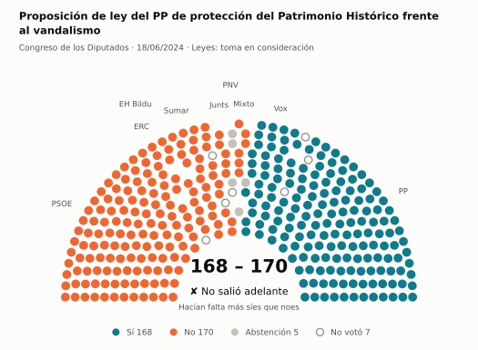
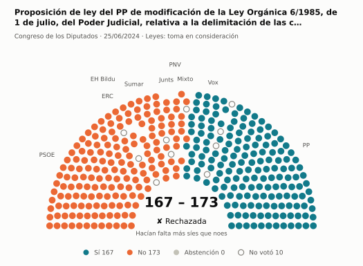
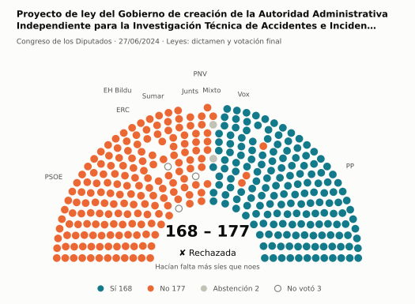
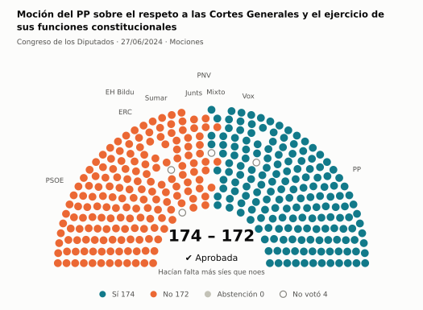
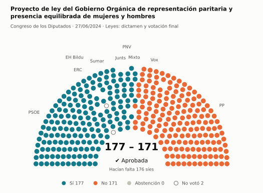
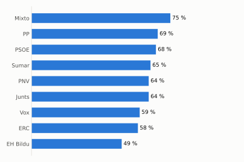
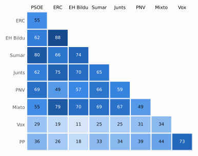

# Qué votó el Congreso en junio de 2024

Las votaciones del Pleno del Congreso de los Diputados, explicadas sin tecnicismos. Datos oficiales del [Congreso](https://www.congreso.es/es/opendata/votaciones); este resumen se actualiza solo cada mes (última vez: 11/11/2026).

## En pocas palabras

- El Congreso votó **102 veces** en 6 días de pleno. **50 propuestas salieron adelante** y 52 no.
- 42 votaciones fueron sobre leyes, decretos o presupuestos. Otras 59 fueron peticiones al Gobierno que no le obligan (proposiciones no de ley y mociones).
- El Gobierno (PSOE y Sumar) perdió **8** de las 67 votaciones en las que sus grupos votaron lo mismo.
- La votación más reñida se decidió superó los 176 síes por 1 voto: Proyecto de ley del Gobierno Orgánica de representación paritaria y presencia equilibrada de mujeres y hombres.
- Los diputados casi siempre votan lo mismo que su grupo: en todo el mes solo hubo 27 votos distintos (sin contar el Grupo Mixto).

## Las votaciones más importantes del mes

Elegidas por su importancia: pesan más las leyes y los decretos que las peticiones al Gobierno, y suben las que se decidieron por pocos votos o las que perdió el Gobierno. Cada punto del dibujo es un diputado, colocado con su grupo, y el color es lo que votó.

### 1. Proposición de ley del PP de protección del Patrimonio Histórico frente al vandalismo

**18 de junio · Leyes: toma en consideración.** Primer paso de una ley propuesta por un grupo o una comunidad autónoma: el Congreso decide si empieza a tramitarla.

<picture>
  <source media="(prefers-color-scheme: dark)" srcset="img/2024-06/votacion-L15-S047-V002-oscuro.svg">
  
</picture>

**✘ No salió adelante** por 2 votos: 168 a favor, 170 en contra y 5 abstenciones.

- **A favor:** PP y Vox
- **En contra:** PSOE, Sumar, Junts, ERC y EH Bildu
- **Se abstuvieron:** PNV
- **Repartidos:** Grupo Mixto (Sí 1, No 6, Abstención 1)

[Datos oficiales](https://www.congreso.es/webpublica/opendata/votaciones/Leg15/Sesion047/20240618/Votacion002/VOT_20240618211339.json)

### 2. Proposición de ley del PP de modificación de la Ley Orgánica 6/1985, de 1 de julio, del Poder Judicial, relativa a la delimitación de las…

**25 de junio · Leyes: toma en consideración.** Primer paso de una ley propuesta por un grupo o una comunidad autónoma: el Congreso decide si empieza a tramitarla.

<picture>
  <source media="(prefers-color-scheme: dark)" srcset="img/2024-06/votacion-L15-S050-V001-oscuro.svg">
  
</picture>

**✘ No salió adelante** por 6 votos: 167 a favor, 173 en contra y ninguna abstención.

- **A favor:** PP y Vox
- **En contra:** PSOE, Sumar, Junts, ERC, EH Bildu y PNV
- **Repartidos:** Grupo Mixto (Sí 1, No 6)

[Datos oficiales](https://www.congreso.es/webpublica/opendata/votaciones/Leg15/Sesion050/20240625/Votacion001/VOT_20240625212157.json)

### 3. Proyecto de ley del Gobierno de creación de la Autoridad Administrativa Independiente para la Investigación Técnica de Accidentes e Incidentes…

**27 de junio · Leyes: dictamen y votación final.** Votación del texto de una ley después de trabajarla en comisión.

<picture>
  <source media="(prefers-color-scheme: dark)" srcset="img/2024-06/votacion-L15-S052-V021-oscuro.svg">
  
</picture>

**✘ No salió adelante** por 9 votos: 168 a favor, 177 en contra y 2 abstenciones.

- **A favor:** PP (134 de 137) y Vox
- **En contra:** PSOE, Sumar, Junts, ERC, EH Bildu y PNV
- **Repartidos:** Grupo Mixto (Sí 1, No 5, Abstención 2)

Este asunto tuvo 6 votaciones este mes; aquí se muestra la más disputada. [Datos oficiales](https://www.congreso.es/webpublica/opendata/votaciones/Leg15/Sesion052/20240627/Votacion021/VOT_20240627130353.json)

### 4. Moción del PP sobre el respeto a las Cortes Generales y el ejercicio de sus funciones constitucionales

**27 de junio · Mociones.** Petición al Gobierno después de pedirle explicaciones en el Pleno. Expresa la opinión del Congreso, pero no obliga.

<picture>
  <source media="(prefers-color-scheme: dark)" srcset="img/2024-06/votacion-L15-S052-V029-oscuro.svg">
  
</picture>

**✔ Salió adelante** por 2 votos: 174 a favor, 172 en contra y ninguna abstención.

- **A favor:** PP y Vox
- **En contra:** PSOE, Sumar, Junts, ERC, EH Bildu y PNV
- **Repartidos:** Grupo Mixto (Sí 5, No 2)

Este asunto tuvo 7 votaciones este mes; aquí se muestra la más disputada. [Datos oficiales](https://www.congreso.es/webpublica/opendata/votaciones/Leg15/Sesion052/20240627/Votacion029/VOT_20240627130401.json)

### 5. Proyecto de ley del Gobierno Orgánica de representación paritaria y presencia equilibrada de mujeres y hombres

**27 de junio · Leyes: dictamen y votación final.** Votación del texto de una ley después de trabajarla en comisión.

<picture>
  <source media="(prefers-color-scheme: dark)" srcset="img/2024-06/votacion-L15-S052-V044-oscuro.svg">
  
</picture>

**✔ Salió adelante** superó los 176 síes por 1 voto: 177 a favor, 171 en contra y ninguna abstención.

- **A favor:** PSOE, Sumar, Junts, ERC, EH Bildu y PNV
- **En contra:** PP y Vox
- **Repartidos:** Grupo Mixto (Sí 7, No 1)

Este asunto tuvo 17 votaciones este mes; aquí se muestra la más disputada. [Datos oficiales](https://www.congreso.es/webpublica/opendata/votaciones/Leg15/Sesion052/20240627/Votacion044/VOT_20240627130417.json)

## ¿Qué grupos votaron más veces lo que finalmente salió?

<picture>
  <source media="(prefers-color-scheme: dark)" srcset="img/2024-06/ganadora-oscuro.svg">
  
</picture>

Porcentaje de votaciones en que el grupo votó Sí y salió adelante, o votó No y no salió. Abstenerse no cuenta como acertar.

## ¿Quién vota con quién?

<picture>
  <source media="(prefers-color-scheme: dark)" srcset="img/2024-06/afinidad-oscuro.svg">
  
</picture>

Cada casilla dice en qué porcentaje de las votaciones dos grupos votaron lo mismo: 100 es que siempre coincidieron y 0 que nunca.

## ¿Qué tipo de cosas se votaron?

| Tipo | Votaciones | Salieron adelante | Qué es |
| --- | ---: | ---: | --- |
| Mociones | 33 | 10 | Petición al Gobierno después de pedirle explicaciones en el Pleno. Expresa la opinión del Congreso, pero no obliga. |
| Proposiciones no de ley | 26 | 25 | Petición al Gobierno para que haga algo. Expresa la opinión del Congreso, pero no obliga. |
| Leyes: dictamen y votación final | 24 | 4 | Votación del texto de una ley después de trabajarla en comisión. |
| Decretos-ley (convalidación) | 6 | 6 | El Gobierno aprobó esta norma por urgencia. Ya está en vigor, pero el Congreso tiene 30 días para confirmarla o tumbarla. |
| Leyes: toma en consideración | 6 | 3 | Primer paso de una ley propuesta por un grupo o una comunidad autónoma: el Congreso decide si empieza a tramitarla. |
| Enmiendas a la totalidad | 6 | 1 | Un grupo intenta devolver la ley a quien la propuso o sustituirla por otra. Si no sale adelante, la ley sigue su camino. |
| Organización de la Cámara | 1 | 1 | Asunto interno del Congreso: comisiones, plazos o el estatuto de los diputados. |

## Palabras que conviene saber

- **Pleno**: La reunión de los 350 diputados, donde se vota.
- **Grupo parlamentario**: Los diputados de un partido o coalición. Los partidos pequeños van juntos en el Grupo Mixto, aunque no piensen igual.
- **Abstención**: El diputado vota, pero ni a favor ni en contra.
- **No votó**: El diputado no votó: no estaba, estaba de baja o el escaño estaba vacío.
- **Mayoría simple**: Salen adelante las votaciones con más síes que noes. Es lo normal.
- **Mayoría absoluta**: 176 votos a favor, la mitad más uno de 350. La piden las leyes orgánicas (derechos fundamentales, sistema electoral…) y la primera votación de investidura.
- **Votación por llamamiento**: Cada diputado dice su voto en voz alta. Se usa en las investiduras y otras votaciones importantes.

---

**¿Quieres más detalle?** El [análisis detallado](2024-06-detalle.md) tiene la cohesión de cada grupo, un mapa de los diputados según cómo votan, qué diputados votaron distinto de su grupo, las ausencias y la lista completa de votaciones.

_Los resultados están calculados a partir de los votos: el Congreso no publica si cada votación salió adelante. Este proyecto no tiene relación con el Congreso. Método en [docs/DOCUMENTO_FUNCIONAL.md](../docs/DOCUMENTO_FUNCIONAL.md)._
