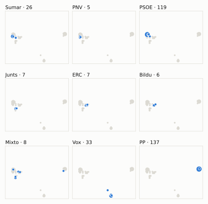
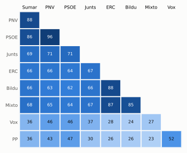

# Análisis detallado: julio de 2024

[← Volver al resumen del mes](2024-07.md)

_Generado automáticamente el 2026-11-11 con datos abiertos del [Congreso de los Diputados](https://www.congreso.es/es/opendata/votaciones). Solo plenos y Diputación Permanente. Método y límites en [docs/DOCUMENTO_FUNCIONAL.md](../docs/DOCUMENTO_FUNCIONAL.md)._

## Resumen

- **91 votaciones** en 3 días de pleno (sesiones 53, 54 y 56).
- **25 aprobadas** y **66 rechazadas**.
- 4 votaciones se decidieron por 5 votos o menos.
- El grupo que más veces votó con el resultado final: **PSOE** (96 % de las votaciones nominales).
- Los grupos del Gobierno (PSOE y Sumar) votaron lo mismo en 78 de 91 votaciones nominales y perdieron 3 de ellas.
- 26 votos individuales se apartaron de la posición de su grupo (21 diputados).

## Cómo votó cada grupo

| Grupo | Diputados | Cohesión | Votó con el resultado | Decisivo | Posición Sí | Posición No | Posición Abst. |
| --- | ---: | ---: | ---: | ---: | ---: | ---: | ---: |
| PP | 137 | 100 % | 52 % | 5 | 50 | 29 | 12 |
| PSOE | 120 | 100 % | 96 % | 34 | 25 | 66 | 0 |
| Vox | 33 | 100 % | 49 % | 3 | 30 | 38 | 23 |
| Sumar | 27 | 100 % | 84 % | 16 | 28 | 56 | 7 |
| Mixto | 8 | 65 % | 59 % | 5 | 50 | 39 | 2 |
| Junts | 7 | 100 % | 71 % | 7 | 22 | 50 | 19 |
| ERC | 7 | 98 % | 60 % | 5 | 47 | 35 | 5 |
| EH Bildu | 6 | 99 % | 62 % | 5 | 46 | 34 | 6 |
| PNV | 5 | 100 % | 91 % | 4 | 23 | 65 | 3 |

*Cohesión*: índice de acuerdo interno (100 % = todo el grupo votó igual). *Votó con el resultado*: el grupo votó Sí y salió aprobada, o No y salió rechazada. *Decisivo*: votaciones cuyo resultado habría cambiado si el grupo se hubiera abstenido en bloque. El Grupo Mixto reúne partidos distintos: su posición es la de su mayoría.

## Mapa de diputados

<picture>
  <source media="(prefers-color-scheme: dark)" srcset="img/2024-07/mapa-oscuro.svg">
  
</picture>

Cada punto es un diputado; dos diputados están cerca si votaron parecido. Un punto más grande reúne a varios que votaron exactamente igual. En cada panel, el grupo en azul y el resto del Congreso en gris.

*Cómo se calcula*: componentes principales de los votos (Sí, No, abstención) en 84 votaciones con algún desacuerdo. El eje horizontal recoge el 71 % de la variación y el vertical el 13 %. Los ejes no tienen nombre ni sentido político propio; por convención, el PP queda a la derecha. No se sitúa a 3 diputados que votó en menos de la mitad.

## Afinidad entre grupos

<picture>
  <source media="(prefers-color-scheme: dark)" srcset="img/2024-07/afinidad-oscuro.svg">
  
</picture>

Porcentaje de votaciones nominales en que los dos grupos tomaron la misma posición. Los grupos están ordenados según el mapa de diputados.

Ver la tabla

|  | PP | PSOE | Vox | Sumar | Mixto | Junts | ERC | EH Bildu | PNV |
| --- | :---: | :---: | :---: | :---: | :---: | :---: | :---: | :---: | :---: |
| PP | 100 % | 47 % | 52 % | 36 % | 23 % | 30 % | 26 % | 26 % | 43 % |
| PSOE | 47 % | 100 % | 46 % | 86 % | 64 % | 71 % | 64 % | 62 % | 96 % |
| Vox | 52 % | 46 % | 100 % | 36 % | 27 % | 37 % | 28 % | 24 % | 46 % |
| Sumar | 36 % | 86 % | 36 % | 100 % | 68 % | 69 % | 66 % | 66 % | 88 % |
| Mixto | 23 % | 64 % | 27 % | 68 % | 100 % | 67 % | 87 % | 85 % | 65 % |
| Junts | 30 % | 71 % | 37 % | 69 % | 67 % | 100 % | 67 % | 66 % | 71 % |
| ERC | 26 % | 64 % | 28 % | 66 % | 87 % | 67 % | 100 % | 88 % | 66 % |
| EH Bildu | 26 % | 62 % | 24 % | 66 % | 85 % | 66 % | 88 % | 100 % | 63 % |
| PNV | 43 % | 96 % | 46 % | 88 % | 65 % | 71 % | 66 % | 63 % | 100 % |

## Quién sacó adelante las votaciones

| Grupos que votaron Sí | Votaciones | Escaños |
| --- | ---: | ---: |
| Todos los grupos | 9 | 350 |
| PSOE + Sumar + Mixto + Junts + ERC + EH Bildu + PNV | 6 | 180 |
| PP + PSOE | 3 | 257 |
| PP + PSOE + Sumar + Mixto + Junts + ERC + EH Bildu + PNV | 3 | 317 |
| PP + PSOE + Vox + Sumar + Mixto + Junts + ERC + PNV | 2 | 344 |
| PP + Sumar + EH Bildu | 1 | 170 |
| PP + Vox + EH Bildu | 1 | 176 |

De 25 votaciones nominales aprobadas. La posición de cada grupo es la de la mayoría de sus diputados.

## Votaciones que perdieron los grupos del Gobierno

| Fecha | Asunto | Tipo | PSOE y Sumar votaron | Resultado | Sí | No |
| --- | --- | --- | :---: | --- | ---: | ---: |
| 23 de julio | Proyecto de Ley Orgánica de representación paritaria y presencia equilibrada de mujeres y hombres. *(Votación separada de las enmiendas. Enmienda a la disposici…)* | Leyes: enmiendas del Senado | No | Aprobada | 177 | 171 |
| 23 de julio | Proposición de Ley de los Grupos Parlamentarios Socialista, Plurinacional SUMAR y Mixto, de modificación de la Ley Orgánica 4/2000, de 11 de enero, sobre derec… | Leyes: toma en consideración | Sí | Rechazada | 171 | 177 |
| 23 de julio | Acuerdo del Gobierno por el que se fijan los objetivos de estabilidad presupuestaria y de deuda pública para el conjunto de Administraciones Públicas y de cada… | Presupuestos y estabilidad | Sí | Rechazada | 171 | 178 |

Además, PSOE y Sumar votaron distinto entre sí en 13 votaciones.

## Votaciones más ajustadas

| Fecha | Asunto | Resultado | Sí | No | Abst. |
| --- | --- | :---: | ---: | ---: | ---: |
| 11 de julio | Proyecto de Ley Orgánica del Derecho de Defensa. *(Votación de conjunto. Votación de conjunto del Proyecto de…)* | Aprobada (necesita 176) | 178 | 0 | 170 |
| 23 de julio | Votación de conjunto del Proyecto de Ley Orgánica de representación paritaria y presencia equilibrada de mujeres y hombres, por tener la misma carácter orgánic… | Aprobada (necesita 176) | 178 | 171 | 0 |
| 23 de julio | Proyecto de Ley básica de bomberos forestales. *(Enmiendas presentadas por el Grupo Parlamentario Popular en…)* | Rechazada | 171 | 175 | 1 |
| 23 de julio | Proyecto de Ley Orgánica de representación paritaria y presencia equilibrada de mujeres y hombres. *(Votación separada de las enmiendas. Enmienda al capítulo I,…)* | Rechazada | 172 | 176 | 0 |
| 23 de julio | Proyecto de Ley básica de agentes forestales y medioambientales. *(Enmiendas presentadas por el Grupo Parlamentario Mixto (Sra…)* | Rechazada | 154 | 160 | 34 |
| 23 de julio | Proyecto de Ley Orgánica de representación paritaria y presencia equilibrada de mujeres y hombres. *(Votación separada de las enmiendas. Enmienda al capítulo II…)* | Rechazada | 171 | 177 | 0 |
| 23 de julio | Proyecto de Ley Orgánica de representación paritaria y presencia equilibrada de mujeres y hombres. *(Votación separada de las enmiendas. Enmienda a la disposici…)* | Aprobada | 177 | 171 | 0 |
| 23 de julio | Proposición de Ley de los Grupos Parlamentarios Socialista, Plurinacional SUMAR y Mixto, de modificación de la Ley Orgánica 4/2000, de 11 de enero, sobre derec… | Rechazada | 171 | 177 | 1 |
| 11 de julio | Proyecto de Ley Orgánica del Derecho de Defensa. *(Enmiendas presentadas por el Grupo Parlamentario VOX Enmien…)* | Rechazada | 170 | 177 | 0 |
| 11 de julio | Proyecto de Ley Orgánica del Derecho de Defensa. *(Enmiendas presentadas por el Grupo Parlamentario Popular en…)* | Rechazada | 170 | 177 | 0 |

Votaciones decididas por 10 votos o menos (o a esa distancia de la mayoría que exigían). Las públicas por llamamiento no tienen hemiciclo: el voto de cada diputado solo consta en el Diario de Sesiones.

## Qué se votó, por tipo de asunto

| Tipo de asunto | Votaciones | Aprobadas | No aprobadas |
| --- | ---: | ---: | ---: |
| Leyes: dictamen y votación final | 59 | 11 | 48 |
| Leyes: enmiendas del Senado | 24 | 11 | 13 |
| Enmiendas a la totalidad | 3 | 0 | 3 |
| Decretos-ley (convalidación) | 2 | 2 | 0 |
| Leyes: toma en consideración | 2 | 1 | 1 |
| Presupuestos y estabilidad | 1 | 0 | 1 |

Las proposiciones no de ley y las mociones expresan la posición del Congreso pero no obligan al Gobierno. Las leyes pasan por varias votaciones (toma en consideración, totalidad, dictamen, Senado), así que una misma ley puede aparecer varias veces.

## Votos distintos de su grupo

| Diputado | Grupo | Votos distintos de su grupo |
| --- | --- | ---: |
| Salvador i Duch, Jordi | ERC | 3 |
| Aizpurua Arzallus, Mertxe | EH Bildu | 2 |
| Jordà i Roura, Teresa | ERC | 2 |
| Rufián Romero, Gabriel | ERC | 2 |
| Carballedo Berlanga, María Eugenia | PP | 1 |
| Chamorro Delmo, Ricardo | Vox | 1 |
| Conde López, Francisco José | PP | 1 |
| Gutiérrez Prieto, Sergio | PSOE | 1 |
| Hernando Fraile, Rafael Antonio | PP | 1 |
| López Cano, Ignacio | PSOE | 1 |
| López Tagliafico, Candela | Sumar | 1 |
| Madrid Olmo, Bartolomé | PP | 1 |
| Maldonado López, Adriana | PSOE | 1 |
| Mesquida Mayans, Joan | PP | 1 |
| Muñoz Abrines, Pedro | PP | 1 |

Un voto aislado puede ser un error al pulsar, no una decisión política: el Congreso no publica las correcciones. Se excluye el Grupo Mixto.

## Diputados que más veces no votaron

| Diputado | Grupo | No votó | % de votaciones |
| --- | --- | ---: | ---: |
| Sánchez Pérez-Castejón, Pedro | PSOE | 78 | 86 % |
| Díaz Pérez, Yolanda | Sumar | 62 | 68 % |
| Chamorro Delmo, Ricardo | Vox | 14 | 15 % |
| Pisarello Prados, Gerardo | Sumar | 13 | 14 % |
| Montero Cuadrado, María Jesús | PSOE | 8 | 9 % |
| Aizpurua Arzallus, Mertxe | EH Bildu | 6 | 7 % |
| Iñarritu García, Jon | EH Bildu | 6 | 7 % |
| Rego Candamil, Néstor | Mixto | 6 | 7 % |
| Bassa Coll, Montserrat | ERC | 5 | 5 % |
| Fullaondo la Cruz, Marije | EH Bildu | 5 | 5 % |
| Granollers Cunillera, Inés | ERC | 5 | 5 % |
| Jordà i Roura, Teresa | ERC | 5 | 5 % |
| Matute García de Jalón, Oskar | EH Bildu | 5 | 5 % |
| Pozueta Fernández, Isabel | EH Bildu | 5 | 5 % |
| Ruiz de Pinedo Undiano, Iñaki | EH Bildu | 5 | 5 % |

«No vota» incluye ausencias justificadas (baja, maternidad o paternidad) y escaños vacantes; el portal no las distingue.

## Todas las votaciones

Posición de cada grupo: la opción que votó la mayoría de sus diputados (*Div.*: empate dentro del grupo). El número enlaza al JSON oficial o, en las votaciones por llamamiento, al Diario de Sesiones.

### 4 de julio (sesión 53)

| Nº | Asunto | Resultado | Sí | No | Abst. | PP | PSOE | Vox | Sumar | Mixto | Junts | ERC | EH Bildu | PNV | Decisivos |
| ---: | --- | --- | ---: | ---: | ---: | :---: | :---: | :---: | :---: | :---: | :---: | :---: | :---: | :---: | --- |
| [1](https://www.congreso.es/webpublica/opendata/votaciones/Leg15/Sesion053/20240704/Votacion001/VOT_20240704135014.json) | Proposición de Ley de los Grupos Parlamentarios Popular en el Congreso y Socialista, Orgánica de reforma de la Ley Orgánica 6/1985, de 1 de julio, del Poder Ju… | Aprobada | 258 | 43 | 33 | Sí | Sí | No | Abst. | No | No | No | — | Abst. |  |

### 11 de julio (sesión 54)

| Nº | Asunto | Resultado | Sí | No | Abst. | PP | PSOE | Vox | Sumar | Mixto | Junts | ERC | EH Bildu | PNV | Decisivos |
| ---: | --- | --- | ---: | ---: | ---: | :---: | :---: | :---: | :---: | :---: | :---: | :---: | :---: | :---: | --- |
| [1](https://www.congreso.es/webpublica/opendata/votaciones/Leg15/Sesion054/20240711/Votacion001/VOT_20240711150621.json) | Proyecto de Ley Orgánica del Derecho de Defensa. *(Enmiendas presentadas por el Grupo Parlamentario Mixto (Sra…)* | Rechazada | 31 | 296 | 20 | No | No | No | Sí | Sí | Abst. | Abst. | Abst. | No |  |
| [2](https://www.congreso.es/webpublica/opendata/votaciones/Leg15/Sesion054/20240711/Votacion002/VOT_20240711150622.json) | Proyecto de Ley Orgánica del Derecho de Defensa. *(Enmiendas presentadas por el Grupo Parlamentario Mixto (Sra…)* | Rechazada | 31 | 296 | 20 | No | No | No | Sí | Sí | Abst. | Abst. | Abst. | No |  |
| [3](https://www.congreso.es/webpublica/opendata/votaciones/Leg15/Sesion054/20240711/Votacion003/VOT_20240711150623.json) | Proyecto de Ley Orgánica del Derecho de Defensa. *(Enmiendas presentadas por el Grupo Parlamentario Mixto (Sr.…)* | Rechazada | 18 | 321 | 7 | No | No | No | No | Sí | Abst. | Sí | Sí | No |  |
| [4](https://www.congreso.es/webpublica/opendata/votaciones/Leg15/Sesion054/20240711/Votacion004/VOT_20240711150624.json) | Proyecto de Ley Orgánica del Derecho de Defensa. *(Enmiendas presentadas por el Grupo Parlamentario VOX Enmien…)* | Rechazada | 170 | 177 | 0 | Sí | No | Sí | No | No | No | No | No | No | PSOE, Sumar |
| [5](https://www.congreso.es/webpublica/opendata/votaciones/Leg15/Sesion054/20240711/Votacion005/VOT_20240711150625.json) | Proyecto de Ley Orgánica del Derecho de Defensa. *(Enmiendas presentadas por el Grupo Parlamentario VOX Enmien…)* | Rechazada | 32 | 177 | 138 | Abst. | No | Sí | No | No | No | No | No | No |  |
| [6](https://www.congreso.es/webpublica/opendata/votaciones/Leg15/Sesion054/20240711/Votacion006/VOT_20240711150626.json) | Proyecto de Ley Orgánica del Derecho de Defensa. *(Enmiendas presentadas por el Grupo Parlamentario VOX Resto…)* | Rechazada | 31 | 315 | 0 | No | No | Sí | No | No | No | No | No | No |  |
| [7](https://www.congreso.es/webpublica/opendata/votaciones/Leg15/Sesion054/20240711/Votacion007/VOT_20240711150627.json) | Proyecto de Ley Orgánica del Derecho de Defensa. *(Enmiendas presentadas por el Grupo Parlamentario Popular en…)* | Rechazada | 170 | 177 | 0 | Sí | No | Sí | No | No | No | No | No | No | PSOE, Sumar |
| [8](https://www.congreso.es/webpublica/opendata/votaciones/Leg15/Sesion054/20240711/Votacion008/VOT_20240711150628.json) | Proyecto de Ley Orgánica del Derecho de Defensa. *(Correcciones técnicas Enmiendas de corrección técnica prese…)* | Aprobada | 346 | 0 | 0 | Sí | Sí | Sí | Sí | Sí | Sí | Sí | Sí | Sí |  |
| [9](https://www.congreso.es/webpublica/opendata/votaciones/Leg15/Sesion054/20240711/Votacion009/VOT_20240711150629.json) | Proyecto de Ley Orgánica del Derecho de Defensa. *(Votación del dictamen. Votación del dictamen del Proyecto d…)* | Aprobada | 178 | 0 | 170 | Abst. | Sí | Abst. | Sí | Sí | Sí | Sí | Sí | Sí |  |
| [10](https://www.congreso.es/webpublica/opendata/votaciones/Leg15/Sesion054/20240711/Votacion010/VOT_20240711150630.json) | Proyecto de Ley Orgánica del Derecho de Defensa. *(Votación de conjunto. Votación de conjunto del Proyecto de…)* | Aprobada (necesita 176) | 178 | 0 | 170 | Abst. | Sí | Abst. | Sí | Sí | Sí | Sí | Sí | Sí | EH Bildu, Junts, Mixto, ERC, PSOE, Sumar, PNV |
| [11](https://www.congreso.es/webpublica/opendata/votaciones/Leg15/Sesion054/20240711/Votacion011/VOT_20240711150631.json) | Votación de la enmienda a la totalidad de devolución al Proyecto de Ley Orgánica de medidas en materia de eficiencia del Servicio Público de Justicia y de acci… | Rechazada | 170 | 178 | 0 | Sí | No | Sí | No | No | No | No | No | No | PSOE, Sumar |
| [12](https://www.congreso.es/webpublica/opendata/votaciones/Leg15/Sesion054/20240711/Votacion012/VOT_20240711150632.json) | Proposición de Ley Orgánica de reforma de la Ley Orgánica 6/1985, de 1 de julio, del Poder Judicial y de reforma de la Ley 50/1981, de 30 de diciembre, por la… *(Enmiendas a la totalidad de texto alternativo. Enmienda a l…)* | Rechazada | 4 | 297 | 33 | No | No | No | Abst. | Sí | Abst. | — | — | No |  |
| [13](https://www.congreso.es/webpublica/opendata/votaciones/Leg15/Sesion054/20240711/Votacion013/VOT_20240711150633.json) | Proposición de Ley Orgánica de reforma de la Ley Orgánica 6/1985, de 1 de julio, del Poder Judicial y de reforma de la Ley 50/1981, de 30 de diciembre, por la… *(Enmiendas a la totalidad de texto alternativo. Enmienda a l…)* | Rechazada | 32 | 302 | 0 | No | No | Sí | No | No | No | — | — | No |  |

### 23 de julio (sesión 56)

| Nº | Asunto | Resultado | Sí | No | Abst. | PP | PSOE | Vox | Sumar | Mixto | Junts | ERC | EH Bildu | PNV | Decisivos |
| ---: | --- | --- | ---: | ---: | ---: | :---: | :---: | :---: | :---: | :---: | :---: | :---: | :---: | :---: | --- |
| [1](https://www.congreso.es/webpublica/opendata/votaciones/Leg15/Sesion056/20240723/Votacion001/VOT_20240723221626.json) | Proyecto de Ley básica de agentes forestales y medioambientales. *(Enmiendas presentadas por el Grupo Parlamentario Mixto (Sra…)* | Rechazada | 4 | 323 | 21 | No | No | No | No | Sí | Abst. | Abst. | Abst. | No |  |
| [2](https://www.congreso.es/webpublica/opendata/votaciones/Leg15/Sesion056/20240723/Votacion002/VOT_20240723221627.json) | Proyecto de Ley básica de agentes forestales y medioambientales. *(Enmiendas presentadas por el Grupo Parlamentario Mixto (Sra…)* | Rechazada | 4 | 335 | 7 | No | No | No | No | Sí | Abst. | No | No | No |  |
| [3](https://www.congreso.es/webpublica/opendata/votaciones/Leg15/Sesion056/20240723/Votacion003/VOT_20240723221628.json) | Proyecto de Ley básica de agentes forestales y medioambientales. *(Enmiendas presentadas por el Grupo Parlamentario Mixto (Sra…)* | Rechazada | 17 | 192 | 138 | Abst. | No | No | No | Sí | No | Sí | Sí | No |  |
| [4](https://www.congreso.es/webpublica/opendata/votaciones/Leg15/Sesion056/20240723/Votacion004/VOT_20240723221629.json) | Proyecto de Ley básica de agentes forestales y medioambientales. *(Enmiendas presentadas por el Grupo Parlamentario Mixto (Sra…)* | Rechazada | 154 | 160 | 34 | Sí | No | Abst. | No | Sí | No | Sí | Sí | No | Junts, PSOE, Sumar |
| [5](https://www.congreso.es/webpublica/opendata/votaciones/Leg15/Sesion056/20240723/Votacion005/VOT_20240723221630.json) | Proyecto de Ley básica de agentes forestales y medioambientales. *(Enmiendas presentadas por el Grupo Parlamentario Mixto (Sra…)* | Rechazada | 18 | 161 | 169 | Abst. | No | Abst. | No | Sí | No | Sí | Sí | No |  |
| [6](https://www.congreso.es/webpublica/opendata/votaciones/Leg15/Sesion056/20240723/Votacion006/VOT_20240723221631.json) | Proyecto de Ley básica de agentes forestales y medioambientales. *(Enmiendas presentadas por el Grupo Parlamentario Mixto (Sra…)* | Rechazada | 18 | 321 | 8 | No | No | No | No | Sí | Abst. | Sí | Sí | No |  |
| [7](https://www.congreso.es/webpublica/opendata/votaciones/Leg15/Sesion056/20240723/Votacion007/VOT_20240723221632.json) | Proyecto de Ley básica de agentes forestales y medioambientales. *(Enmiendas presentadas por el Grupo Parlamentario Mixto (Sra…)* | Rechazada | 51 | 296 | 1 | No | No | Sí | No | Sí | No | Sí | Sí | No |  |
| [8](https://www.congreso.es/webpublica/opendata/votaciones/Leg15/Sesion056/20240723/Votacion008/VOT_20240723221634.json) | Proyecto de Ley básica de agentes forestales y medioambientales. *(Enmiendas presentadas por el Grupo Parlamentario Mixto (Sra…)* | Rechazada | 18 | 302 | 28 | No | No | No | Abst. | Sí | No | Sí | Sí | No |  |
| [9](https://www.congreso.es/webpublica/opendata/votaciones/Leg15/Sesion056/20240723/Votacion009/VOT_20240723221635.json) | Proyecto de Ley básica de agentes forestales y medioambientales. *(Enmiendas presentadas por el Grupo Parlamentario Mixto (Sra…)* | Rechazada | 18 | 322 | 8 | No | No | No | No | Sí | Abst. | Sí | Sí | No |  |
| [10](https://www.congreso.es/webpublica/opendata/votaciones/Leg15/Sesion056/20240723/Votacion010/VOT_20240723221636.json) | Proyecto de Ley básica de agentes forestales y medioambientales. *(Enmiendas presentadas por el Grupo Parlamentario Mixto (Sr.…)* | Rechazada | 156 | 192 | 0 | Sí | No | No | No | Sí | No | Sí | Sí | No | PSOE |
| [11](https://www.congreso.es/webpublica/opendata/votaciones/Leg15/Sesion056/20240723/Votacion011/VOT_20240723221638.json) | Proyecto de Ley básica de agentes forestales y medioambientales. *(Enmiendas presentadas por el Grupo Parlamentario Mixto (Sr.…)* | Rechazada | 18 | 290 | 40 | No | No | Abst. | No | Sí | Abst. | Sí | Sí | No |  |
| [12](https://www.congreso.es/webpublica/opendata/votaciones/Leg15/Sesion056/20240723/Votacion012/VOT_20240723221639.json) | Proyecto de Ley básica de agentes forestales y medioambientales. *(Enmiendas presentadas por el Grupo Parlamentario Mixto (Sr.…)* | Rechazada | 44 | 167 | 137 | Abst. | No | No | Sí | Sí | No | Sí | Sí | No |  |
| [13](https://www.congreso.es/webpublica/opendata/votaciones/Leg15/Sesion056/20240723/Votacion013/VOT_20240723221640.json) | Proyecto de Ley básica de agentes forestales y medioambientales. *(Enmiendas presentadas por el Grupo Parlamentario Mixto (Sr.…)* | Rechazada | 149 | 159 | 40 | Sí | No | Abst. | No | Sí | No | Abst. | Sí | No | PSOE, Sumar |
| [14](https://www.congreso.es/webpublica/opendata/votaciones/Leg15/Sesion056/20240723/Votacion014/VOT_20240723221642.json) | Proyecto de Ley básica de agentes forestales y medioambientales. *(Enmiendas presentadas por el Grupo Parlamentario Mixto (Sr.…)* | Rechazada | 18 | 184 | 145 | Abst. | No | No | No | Sí | Abst. | Sí | Sí | No |  |
| [15](https://www.congreso.es/webpublica/opendata/votaciones/Leg15/Sesion056/20240723/Votacion015/VOT_20240723221643.json) | Proyecto de Ley básica de agentes forestales y medioambientales. *(Enmiendas presentadas por el Grupo Parlamentario Mixto (Sr.…)* | Rechazada | 14 | 321 | 11 | No | No | No | No | Abst. | Abst. | Sí | Sí | No |  |
| [16](https://www.congreso.es/webpublica/opendata/votaciones/Leg15/Sesion056/20240723/Votacion016/VOT_20240723221644.json) | Proyecto de Ley básica de agentes forestales y medioambientales. *(Enmienda presentada por el Grupo Parlamentario Vasco (EAJ-P…)* | Rechazada | 21 | 284 | 42 | No | No | Abst. | No | Sí | Abst. | Sí | Sí | Sí |  |
| [17](https://www.congreso.es/webpublica/opendata/votaciones/Leg15/Sesion056/20240723/Votacion017/VOT_20240723221645.json) | Proyecto de Ley básica de agentes forestales y medioambientales. *(Enmiendas presentadas por el Grupo Parlamentario Junts per…)* | Rechazada | 24 | 322 | 2 | No | No | No | No | Sí | Sí | Sí | Sí | No |  |
| [18](https://www.congreso.es/webpublica/opendata/votaciones/Leg15/Sesion056/20240723/Votacion018/VOT_20240723221646.json) | Proyecto de Ley básica de agentes forestales y medioambientales. *(Enmienda presentada por el Grupo Parlamentario Republicano…)* | Rechazada | 25 | 296 | 27 | No | No | No | Abst. | Sí | Sí | Sí | Sí | No |  |
| [19](https://www.congreso.es/webpublica/opendata/votaciones/Leg15/Sesion056/20240723/Votacion019/VOT_20240723221647.json) | Proyecto de Ley básica de agentes forestales y medioambientales. *(Enmienda presentada por el Grupo Parlamentario Plurinaciona…)* | Rechazada | 45 | 296 | 7 | No | No | No | Sí | Sí | Abst. | Sí | Sí | No |  |
| [20](https://www.congreso.es/webpublica/opendata/votaciones/Leg15/Sesion056/20240723/Votacion020/VOT_20240723221648.json) | Proyecto de Ley básica de agentes forestales y medioambientales. *(Enmiendas presentadas por el Grupo Parlamentario VOX Enmien…)* | Rechazada | 33 | 313 | 0 | No | No | Sí | No | No | No | No | No | No |  |
| [21](https://www.congreso.es/webpublica/opendata/votaciones/Leg15/Sesion056/20240723/Votacion021/VOT_20240723221649.json) | Proyecto de Ley básica de agentes forestales y medioambientales. *(Enmiendas presentadas por el Grupo Parlamentario VOX Resto…)* | Rechazada | 170 | 177 | 0 | Sí | No | Sí | No | No | No | No | No | No | PSOE, Sumar |
| [22](https://www.congreso.es/webpublica/opendata/votaciones/Leg15/Sesion056/20240723/Votacion022/VOT_20240723221650.json) | Proyecto de Ley básica de agentes forestales y medioambientales. *(Enmiendas presentadas por el Grupo Parlamentario Popular en…)* | Rechazada | 138 | 202 | 8 | Sí | No | No | No | No | No | Abst. | No | No | PSOE |
| [23](https://www.congreso.es/webpublica/opendata/votaciones/Leg15/Sesion056/20240723/Votacion023/VOT_20240723221651.json) | Proyecto de Ley básica de agentes forestales y medioambientales. *(Enmiendas presentadas por el Grupo Parlamentario Popular en…)* | Rechazada | 146 | 187 | 14 | Sí | No | No | No | No | Abst. | Sí | Abst. | No | PSOE |
| [24](https://www.congreso.es/webpublica/opendata/votaciones/Leg15/Sesion056/20240723/Votacion024/VOT_20240723221652.json) | Proyecto de Ley básica de agentes forestales y medioambientales. *(Enmiendas presentadas por el Grupo Parlamentario Popular en…)* | Rechazada | 170 | 177 | 1 | Sí | No | Sí | No | No | No | No | No | No | PSOE, Sumar |
| [25](https://www.congreso.es/webpublica/opendata/votaciones/Leg15/Sesion056/20240723/Votacion025/VOT_20240723221653.json) | Proyecto de Ley básica de agentes forestales y medioambientales. *(Enmiendas presentadas por el Grupo Parlamentario Popular en…)* | Rechazada | 138 | 174 | 35 | Sí | No | Abst. | No | No | No | No | No | No | PSOE |
| [26](https://www.congreso.es/webpublica/opendata/votaciones/Leg15/Sesion056/20240723/Votacion026/VOT_20240723221655.json) | Proyecto de Ley básica de agentes forestales y medioambientales. *(Enmiendas presentadas por el Grupo Parlamentario Popular en…)* | Rechazada | 144 | 156 | 48 | Sí | No | Abst. | No | No | Abst. | Sí | Abst. | No | PSOE, Sumar |
| [27](https://www.congreso.es/webpublica/opendata/votaciones/Leg15/Sesion056/20240723/Votacion027/VOT_20240723221656.json) | Proyecto de Ley básica de agentes forestales y medioambientales. *(Enmiendas presentadas por el Grupo Parlamentario Popular en…)* | Rechazada | 141 | 206 | 1 | Sí | No | No | No | No | No | No | No | No | PSOE |
| [28](https://www.congreso.es/webpublica/opendata/votaciones/Leg15/Sesion056/20240723/Votacion028/VOT_20240723221657.json) | Proyecto de Ley básica de agentes forestales y medioambientales. *(Enmiendas presentadas por el Grupo Parlamentario Popular en…)* | Rechazada | 138 | 176 | 34 | Sí | No | Abst. | No | No | No | No | No | No | PSOE |
| [29](https://www.congreso.es/webpublica/opendata/votaciones/Leg15/Sesion056/20240723/Votacion029/VOT_20240723221658.json) | Proyecto de Ley básica de agentes forestales y medioambientales. *(Correcciones técnicas Enmienda de corrección técnica número…)* | Aprobada | 347 | 0 | 0 | Sí | Sí | Sí | Sí | Sí | Sí | Sí | Sí | Sí |  |
| [30](https://www.congreso.es/webpublica/opendata/votaciones/Leg15/Sesion056/20240723/Votacion030/VOT_20240723221659.json) | Proyecto de Ley básica de agentes forestales y medioambientales. *(Correcciones técnicas Enmienda de corrección técnica número…)* | Aprobada | 348 | 0 | 0 | Sí | Sí | Sí | Sí | Sí | Sí | Sí | Sí | Sí |  |
| [31](https://www.congreso.es/webpublica/opendata/votaciones/Leg15/Sesion056/20240723/Votacion031/VOT_20240723221700.json) | Proyecto de Ley básica de agentes forestales y medioambientales. *(Correcciones técnicas Enmienda de corrección técnica número…)* | Aprobada | 348 | 0 | 0 | Sí | Sí | Sí | Sí | Sí | Sí | Sí | Sí | Sí |  |
| [32](https://www.congreso.es/webpublica/opendata/votaciones/Leg15/Sesion056/20240723/Votacion032/VOT_20240723221702.json) | Proyecto de Ley básica de agentes forestales y medioambientales. *(Correcciones técnicas Enmienda de corrección técnica número…)* | Aprobada | 348 | 0 | 0 | Sí | Sí | Sí | Sí | Sí | Sí | Sí | Sí | Sí |  |
| [33](https://www.congreso.es/webpublica/opendata/votaciones/Leg15/Sesion056/20240723/Votacion033/VOT_20240723221702.json) | Proyecto de Ley básica de bomberos forestales. *(Enmiendas presentadas por el Grupo Parlamentario Mixto (Sra…)* | Rechazada | 17 | 330 | 1 | No | No | No | No | Sí | No | Sí | Sí | No |  |
| [34](https://www.congreso.es/webpublica/opendata/votaciones/Leg15/Sesion056/20240723/Votacion034/VOT_20240723221704.json) | Proyecto de Ley básica de bomberos forestales. *(Enmiendas presentadas por el Grupo Parlamentario Mixto (Sra…)* | Rechazada | 10 | 305 | 33 | No | No | No | Abst. | Sí | Abst. | No | Sí | No |  |
| [35](https://www.congreso.es/webpublica/opendata/votaciones/Leg15/Sesion056/20240723/Votacion035/VOT_20240723221705.json) | Proyecto de Ley básica de bomberos forestales. *(Enmiendas presentadas por el Grupo Parlamentario Mixto (Sra…)* | Rechazada | 17 | 187 | 144 | Abst. | No | No | No | Sí | Abst. | Sí | Sí | No |  |
| [36](https://www.congreso.es/webpublica/opendata/votaciones/Leg15/Sesion056/20240723/Votacion036/VOT_20240723221706.json) | Proyecto de Ley básica de bomberos forestales. *(Enmienda presentada por el Grupo Parlamentario Mixto (Sra.…)* | Rechazada | 45 | 301 | 0 | No | No | Sí | No | Sí | No | Sí | No | No |  |
| [37](https://www.congreso.es/webpublica/opendata/votaciones/Leg15/Sesion056/20240723/Votacion037/VOT_20240723221707.json) | Proyecto de Ley básica de bomberos forestales. *(Enmiendas presentadas por el Grupo Parlamentario Mixto (Sr.…)* | Rechazada | 44 | 303 | 1 | No | No | No | Sí | Sí | No | Sí | Sí | No |  |
| [38](https://www.congreso.es/webpublica/opendata/votaciones/Leg15/Sesion056/20240723/Votacion038/VOT_20240723221708.json) | Proyecto de Ley básica de bomberos forestales. *(Enmiendas presentadas por el Grupo Parlamentario Mixto (Sr.…)* | Rechazada | 18 | 289 | 41 | No | No | Abst. | No | Sí | Abst. | Sí | Sí | No |  |
| [39](https://www.congreso.es/webpublica/opendata/votaciones/Leg15/Sesion056/20240723/Votacion039/VOT_20240723221709.json) | Proyecto de Ley básica de bomberos forestales. *(Enmiendas presentadas por el Grupo Parlamentario Mixto (Sr.…)* | Rechazada | 14 | 322 | 12 | No | No | No | No | Abst. | Abst. | Sí | Sí | No |  |
| [40](https://www.congreso.es/webpublica/opendata/votaciones/Leg15/Sesion056/20240723/Votacion040/VOT_20240723221710.json) | Proyecto de Ley básica de bomberos forestales. *(Enmiendas presentadas por el Grupo Parlamentario VOX Enmien…)* | Rechazada | 33 | 177 | 138 | Abst. | No | Sí | No | No | No | No | No | No |  |
| [41](https://www.congreso.es/webpublica/opendata/votaciones/Leg15/Sesion056/20240723/Votacion041/VOT_20240723221711.json) | Proyecto de Ley básica de bomberos forestales. *(Enmiendas presentadas por el Grupo Parlamentario VOX Resto…)* | Rechazada | 33 | 314 | 0 | No | No | Sí | No | No | No | No | No | No |  |
| [42](https://www.congreso.es/webpublica/opendata/votaciones/Leg15/Sesion056/20240723/Votacion042/VOT_20240723221712.json) | Proyecto de Ley básica de bomberos forestales. *(Enmiendas presentadas por el Grupo Parlamentario Popular en…)* | Rechazada | 171 | 175 | 1 | Sí | No | Sí | No | No | No | No | No | No | EH Bildu, Junts, Mixto, ERC, PSOE, Sumar, PNV |
| [43](https://www.congreso.es/webpublica/opendata/votaciones/Leg15/Sesion056/20240723/Votacion043/VOT_20240723221713.json) | Proyecto de Ley básica de bomberos forestales. *(Enmiendas presentadas por el Grupo Parlamentario Popular en…)* | Rechazada | 139 | 174 | 34 | Sí | No | Abst. | No | No | No | No | No | No | PSOE |
| [44](https://www.congreso.es/webpublica/opendata/votaciones/Leg15/Sesion056/20240723/Votacion044/VOT_20240723221714.json) | Proyecto de Ley básica de bomberos forestales. *(Enmiendas presentadas por el Grupo Parlamentario Popular en…)* | Rechazada | 138 | 175 | 35 | Sí | No | Abst. | No | No | No | No | No | No | PSOE |
| [45](https://www.congreso.es/webpublica/opendata/votaciones/Leg15/Sesion056/20240723/Votacion045/VOT_20240723221715.json) | Proyecto de Ley básica de bomberos forestales. *(Enmiendas presentadas por el Grupo Parlamentario Popular en…)* | Rechazada | 138 | 209 | 1 | Sí | No | No | No | No | No | No | No | No | PSOE |
| [46](https://www.congreso.es/webpublica/opendata/votaciones/Leg15/Sesion056/20240723/Votacion046/VOT_20240723221716.json) | Proyecto de Ley Orgánica de representación paritaria y presencia equilibrada de mujeres y hombres. *(Votación separada de las enmiendas. Enmiendas de corrección…)* | Aprobada | 313 | 1 | 34 | Sí | Sí | Abst. | Sí | Sí | Sí | Sí | Sí | Sí |  |
| [47](https://www.congreso.es/webpublica/opendata/votaciones/Leg15/Sesion056/20240723/Votacion047/VOT_20240723221717.json) | Proyecto de Ley Orgánica de representación paritaria y presencia equilibrada de mujeres y hombres. *(Votación separada de las enmiendas. Enmiendas al Preámbulo,…)* | Aprobada | 170 | 144 | 33 | Sí | No | Abst. | Sí | No | No | No | Sí | No | PP, Sumar |
| [48](https://www.congreso.es/webpublica/opendata/votaciones/Leg15/Sesion056/20240723/Votacion048/VOT_20240723221718.json) | Proyecto de Ley Orgánica de representación paritaria y presencia equilibrada de mujeres y hombres. *(Votación separada de las enmiendas. Resto de las enmiendas…)* | Rechazada | 138 | 176 | 33 | Sí | No | Abst. | No | No | No | No | No | No | PSOE |
| [49](https://www.congreso.es/webpublica/opendata/votaciones/Leg15/Sesion056/20240723/Votacion049/VOT_20240723221719.json) | Proyecto de Ley Orgánica de representación paritaria y presencia equilibrada de mujeres y hombres. *(Votación separada de las enmiendas. Enmiendas al Preámbulo,…)* | Rechazada | 138 | 177 | 33 | Sí | No | Abst. | No | No | No | No | No | No | PSOE |
| [50](https://www.congreso.es/webpublica/opendata/votaciones/Leg15/Sesion056/20240723/Votacion050/VOT_20240723221720.json) | Proyecto de Ley Orgánica de representación paritaria y presencia equilibrada de mujeres y hombres. *(Votación separada de las enmiendas. Enmiendas al Preámbulo,…)* | Rechazada | 138 | 177 | 33 | Sí | No | Abst. | No | No | No | No | No | No | PSOE |
| [51](https://www.congreso.es/webpublica/opendata/votaciones/Leg15/Sesion056/20240723/Votacion051/VOT_20240723221721.json) | Proyecto de Ley Orgánica de representación paritaria y presencia equilibrada de mujeres y hombres. *(Votación separada de las enmiendas. Enmienda al Preámbulo,…)* | Aprobada | 344 | 3 | 0 | Sí | Sí | Sí | Sí | Sí | Sí | Sí | Sí | Sí |  |
| [52](https://www.congreso.es/webpublica/opendata/votaciones/Leg15/Sesion056/20240723/Votacion052/VOT_20240723221723.json) | Proyecto de Ley Orgánica de representación paritaria y presencia equilibrada de mujeres y hombres. *(Votación separada de las enmiendas. Enmiendas al capítulo I…)* | Aprobada | 347 | 1 | 0 | Sí | Sí | Sí | Sí | Sí | Sí | Sí | Sí | Sí |  |
| [53](https://www.congreso.es/webpublica/opendata/votaciones/Leg15/Sesion056/20240723/Votacion053/VOT_20240723221724.json) | Proyecto de Ley Orgánica de representación paritaria y presencia equilibrada de mujeres y hombres. *(Votación separada de las enmiendas. Enmienda al capítulo I,…)* | Rechazada | 138 | 210 | 0 | Sí | No | No | No | No | No | No | No | No | PSOE |
| [54](https://www.congreso.es/webpublica/opendata/votaciones/Leg15/Sesion056/20240723/Votacion054/VOT_20240723221725.json) | Proyecto de Ley Orgánica de representación paritaria y presencia equilibrada de mujeres y hombres. *(Votación separada de las enmiendas. Enmienda al capítulo I,…)* | Rechazada | 172 | 176 | 0 | Sí | No | Sí | No | No | No | No | No | No | EH Bildu, Junts, Mixto, ERC, PSOE, Sumar, PNV |
| [55](https://www.congreso.es/webpublica/opendata/votaciones/Leg15/Sesion056/20240723/Votacion055/VOT_20240723221726.json) | Proyecto de Ley Orgánica de representación paritaria y presencia equilibrada de mujeres y hombres. *(Votación separada de las enmiendas. Enmienda al capítulo II…)* | Rechazada | 171 | 177 | 0 | Sí | No | Sí | No | No | No | No | No | No | Junts, Mixto, ERC, PSOE, Sumar |
| [56](https://www.congreso.es/webpublica/opendata/votaciones/Leg15/Sesion056/20240723/Votacion056/VOT_20240723221727.json) | Proyecto de Ley Orgánica de representación paritaria y presencia equilibrada de mujeres y hombres. *(Votación separada de las enmiendas. Enmienda al capítulo II…)* | Rechazada | 138 | 208 | 0 | Sí | No | No | No | No | No | No | No | No | PSOE |
| [57](https://www.congreso.es/webpublica/opendata/votaciones/Leg15/Sesion056/20240723/Votacion057/VOT_20240723221728.json) | Proyecto de Ley Orgánica de representación paritaria y presencia equilibrada de mujeres y hombres. *(Votación separada de las enmiendas. Enmiendas al capítulo V…)* | Rechazada | 138 | 210 | 0 | Sí | No | No | No | No | No | No | No | No | PSOE |
| [58](https://www.congreso.es/webpublica/opendata/votaciones/Leg15/Sesion056/20240723/Votacion058/VOT_20240723221729.json) | Proyecto de Ley Orgánica de representación paritaria y presencia equilibrada de mujeres y hombres. *(Votación separada de las enmiendas. Enmienda a la disposici…)* | Rechazada | 138 | 210 | 0 | Sí | No | No | No | No | No | No | No | No | PSOE |
| [59](https://www.congreso.es/webpublica/opendata/votaciones/Leg15/Sesion056/20240723/Votacion059/VOT_20240723221730.json) | Proyecto de Ley Orgánica de representación paritaria y presencia equilibrada de mujeres y hombres. *(Votación separada de las enmiendas. Enmienda a la disposici…)* | Aprobada | 339 | 9 | 0 | Sí | Sí | Sí | Sí | Sí | Sí | Sí | No | Sí |  |
| [60](https://www.congreso.es/webpublica/opendata/votaciones/Leg15/Sesion056/20240723/Votacion060/VOT_20240723221731.json) | Proyecto de Ley Orgánica de representación paritaria y presencia equilibrada de mujeres y hombres. *(Votación separada de las enmiendas. Enmienda a la disposici…)* | Aprobada | 177 | 171 | 0 | Sí | No | Sí | No | No | No | No | Sí | No | EH Bildu, PP, Vox |
| [61](https://www.congreso.es/webpublica/opendata/votaciones/Leg15/Sesion056/20240723/Votacion061/VOT_20240723221732.json) | Proyecto de Ley Orgánica de representación paritaria y presencia equilibrada de mujeres y hombres. *(Votación separada de las enmiendas. Enmiendas de renumeraci…)* | Rechazada | 139 | 175 | 33 | Sí | No | Abst. | No | No | No | No | No | No | PSOE |
| [62](https://www.congreso.es/webpublica/opendata/votaciones/Leg15/Sesion056/20240723/Votacion062/VOT_20240723221734.json) | Proyecto de Ley Orgánica de representación paritaria y presencia equilibrada de mujeres y hombres. *(Votación separada de las enmiendas. Resto de las enmiendas)* | Rechazada | 138 | 210 | 0 | Sí | No | No | No | No | No | No | No | No | PSOE |
| [63](https://www.congreso.es/webpublica/opendata/votaciones/Leg15/Sesion056/20240723/Votacion063/VOT_20240723221735.json) | Proposición de Ley de los Grupos Parlamentarios Socialista, Plurinacional SUMAR y Mixto, de modificación de la Ley Orgánica 4/2000, de 11 de enero, sobre derec… | Rechazada | 171 | 177 | 1 | No | Sí | No | Sí | Sí | No | Sí | Sí | Sí | Junts, PP, Vox |
| [64](https://www.congreso.es/webpublica/opendata/votaciones/Leg15/Sesion056/20240723/Votacion064/VOT_20240723221735.json) | Proposición de Ley Orgánica de reforma de la Ley Orgánica 6/1985, de 1 de julio, del Poder Judicial y de reforma de la Ley 50/1981, de 30 de diciembre, por la… *(Votación del dictamen. Votación del dictamen de la Proposic…)* | Aprobada | 258 | 44 | 32 | Sí | Sí | No | Abst. | No | No | — | — | Abst. |  |
| [65](https://www.congreso.es/webpublica/opendata/votaciones/Leg15/Sesion056/20240723/Votacion065/VOT_20240723221737.json) | Proposición de Ley Orgánica de reforma de la Ley Orgánica 6/1985, de 1 de julio, del Poder Judicial y de reforma de la Ley 50/1981, de 30 de diciembre, por la… *(Votación de conjunto. Votación de conjunto de la Proposició…)* | Aprobada (necesita 176) | 259 | 43 | 32 | Sí | Sí | No | Abst. | No | No | — | — | Abst. | PP, PSOE |
| [66](https://www.congreso.es/webpublica/opendata/votaciones/Leg15/Sesion056/20240723/Votacion066/VOT_20240723221738.json) | Votación del Dictamen del Proyecto de Ley básica de agentes forestales y medioambientales. | Aprobada | 178 | 0 | 171 | Abst. | Sí | Abst. | Sí | Sí | Sí | Sí | Sí | Sí |  |
| [67](https://www.congreso.es/webpublica/opendata/votaciones/Leg15/Sesion056/20240723/Votacion067/VOT_20240723221739.json) | Votación del Dictamen del Proyecto de Ley básica de bomberos forestales. | Aprobada | 178 | 0 | 171 | Abst. | Sí | Abst. | Sí | Sí | Sí | Sí | Sí | Sí |  |
| [68](https://www.congreso.es/webpublica/opendata/votaciones/Leg15/Sesion056/20240723/Votacion068/VOT_20240723221740.json) | Votación de conjunto del Proyecto de Ley Orgánica de representación paritaria y presencia equilibrada de mujeres y hombres, por tener la misma carácter orgánic… | Aprobada (necesita 176) | 178 | 171 | 0 | No | Sí | No | Sí | Sí | Sí | Sí | Sí | Sí | EH Bildu, Junts, Mixto, ERC, PSOE, Sumar, PNV |
| [69](https://www.congreso.es/webpublica/opendata/votaciones/Leg15/Sesion056/20240723/Votacion069/VOT_20240723221741.json) | Proyecto de Ley de creación de la Autoridad Administrativa Independiente para la Investigación Técnica de Accidentes e Incidentes ferroviarios, marítimos y de… *(Votación separada de las enmiendas. Enmienda al Preámbulo,…)* | Aprobada | 342 | 1 | 6 | Sí | Sí | Sí | Sí | Sí | Sí | Sí | Abst. | Sí |  |
| [70](https://www.congreso.es/webpublica/opendata/votaciones/Leg15/Sesion056/20240723/Votacion070/VOT_20240723221742.json) | Proyecto de Ley de creación de la Autoridad Administrativa Independiente para la Investigación Técnica de Accidentes e Incidentes ferroviarios, marítimos y de… *(Votación separada de las enmiendas. Enmienda al Preámbulo,…)* | Rechazada | 171 | 178 | 0 | Sí | No | Sí | No | No | No | No | No | No | PSOE, Sumar |
| [71](https://www.congreso.es/webpublica/opendata/votaciones/Leg15/Sesion056/20240723/Votacion071/VOT_20240723221743.json) | Proyecto de Ley de creación de la Autoridad Administrativa Independiente para la Investigación Técnica de Accidentes e Incidentes ferroviarios, marítimos y de… *(Votación separada de las enmiendas. Enmienda al Preámbulo,…)* | Aprobada | 316 | 0 | 33 | Sí | Sí | Abst. | Sí | Sí | Sí | Sí | Sí | Sí |  |
| [72](https://www.congreso.es/webpublica/opendata/votaciones/Leg15/Sesion056/20240723/Votacion072/VOT_20240723221744.json) | Proyecto de Ley de creación de la Autoridad Administrativa Independiente para la Investigación Técnica de Accidentes e Incidentes ferroviarios, marítimos y de… *(Votación separada de las enmiendas. Enmiendas a los artícul…)* | Aprobada | 349 | 0 | 0 | Sí | Sí | Sí | Sí | Sí | Sí | Sí | Sí | Sí |  |
| [73](https://www.congreso.es/webpublica/opendata/votaciones/Leg15/Sesion056/20240723/Votacion073/VOT_20240723221745.json) | Proyecto de Ley de creación de la Autoridad Administrativa Independiente para la Investigación Técnica de Accidentes e Incidentes ferroviarios, marítimos y de… *(Votación separada de las enmiendas. Enmiendas al artículo v…)* | Rechazada | 171 | 178 | 0 | Sí | No | Sí | No | No | No | No | No | No | PSOE, Sumar |
| [74](https://www.congreso.es/webpublica/opendata/votaciones/Leg15/Sesion056/20240723/Votacion074/VOT_20240723221746.json) | Proyecto de Ley de creación de la Autoridad Administrativa Independiente para la Investigación Técnica de Accidentes e Incidentes ferroviarios, marítimos y de… *(Votación separada de las enmiendas. Enmiendas a los artícul…)* | Aprobada | 316 | 0 | 33 | Sí | Sí | Abst. | Sí | Sí | Sí | Sí | Sí | Sí |  |
| [75](https://www.congreso.es/webpublica/opendata/votaciones/Leg15/Sesion056/20240723/Votacion075/VOT_20240723221747.json) | Real Decreto-ley 4/2024, de 26 de junio, por el que se prorrogan determinadas medidas para afrontar las consecuencias económicas y sociales derivadas de los co… | Aprobada | 178 | 33 | 138 | Abst. | Sí | No | Sí | Sí | Sí | Sí | Sí | Sí |  |
| [76](https://www.congreso.es/webpublica/opendata/votaciones/Leg15/Sesion056/20240723/Votacion076/VOT_20240723221748.json) | Tramitación como Proyecto de Ley por el procedimiento de urgencia del Real Decreto-ley 4/2024, de 26 de junio, por el que se prorrogan determinadas medidas par… | Aprobada | 349 | 0 | 0 | Sí | Sí | Sí | Sí | Sí | Sí | Sí | Sí | Sí |  |
| [77](https://www.congreso.es/webpublica/opendata/votaciones/Leg15/Sesion056/20240723/Votacion077/VOT_20240723221749.json) | Acuerdo del Gobierno por el que se fijan los objetivos de estabilidad presupuestaria y de deuda pública para el conjunto de Administraciones Públicas y de cada… | Rechazada | 171 | 178 | 0 | No | Sí | No | Sí | Sí | No | Sí | Sí | Sí | PP, Vox |
