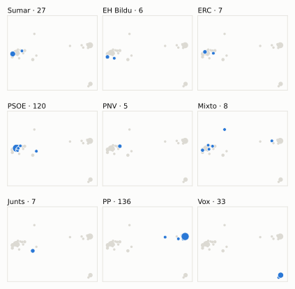
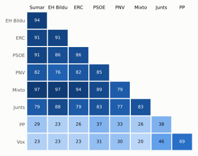

# Análisis detallado: septiembre de 2024

[← Volver al resumen del mes](2024-09.md)

_Generado automáticamente el 2026-11-10 con datos abiertos del [Congreso de los Diputados](https://www.congreso.es/es/opendata/votaciones). Solo plenos y Diputación Permanente. Método y límites en [docs/DOCUMENTO_FUNCIONAL.md](../docs/DOCUMENTO_FUNCIONAL.md)._

## Resumen

- **35 votaciones** en 6 días de pleno (sesiones 57, 58, 59, 60, 61 y 63).
- **15 aprobadas** y **20 rechazadas**.
- 7 votaciones se decidieron por 5 votos o menos.
- El grupo que más veces votó con el resultado final: **PSOE** (91 % de las votaciones nominales).
- Los grupos del Gobierno (PSOE y Sumar) votaron lo mismo en 32 de 35 votaciones nominales y perdieron 3 de ellas.
- 5 votos individuales se apartaron de la posición de su grupo (5 diputados).

## Cómo votó cada grupo

| Grupo | Diputados | Cohesión | Votó con el resultado | Decisivo | Posición Sí | Posición No | Posición Abst. |
| --- | ---: | ---: | ---: | ---: | ---: | ---: | ---: |
| PP | 137 | 100 % | 46 % | 3 | 23 | 7 | 5 |
| PSOE | 120 | 100 % | 91 % | 14 | 16 | 19 | 0 |
| Vox | 33 | 100 % | 40 % | 3 | 22 | 9 | 4 |
| Sumar | 27 | 100 % | 83 % | 11 | 17 | 18 | 0 |
| Mixto | 8 | 76 % | 80 % | 6 | 16 | 19 | 0 |
| Junts | 7 | 100 % | 88 % | 5 | 11 | 12 | 1 |
| EH Bildu | 6 | 100 % | 77 % | 6 | 15 | 19 | 1 |
| ERC | 6 | 100 % | 77 % | 6 | 16 | 17 | 2 |
| PNV | 5 | 100 % | 85 % | 4 | 14 | 16 | 3 |

*Cohesión*: índice de acuerdo interno (100 % = todo el grupo votó igual). *Votó con el resultado*: el grupo votó Sí y salió aprobada, o No y salió rechazada. *Decisivo*: votaciones cuyo resultado habría cambiado si el grupo se hubiera abstenido en bloque. El Grupo Mixto reúne partidos distintos: su posición es la de su mayoría.

## Mapa de diputados

<picture>
  <source media="(prefers-color-scheme: dark)" srcset="img/2024-09/mapa-oscuro.svg">
  
</picture>

Cada punto es un diputado; dos diputados están cerca si votaron parecido. Un punto más grande reúne a varios que votaron exactamente igual. En cada panel, el grupo en azul y el resto del Congreso en gris.

*Cómo se calcula*: componentes principales de los votos (Sí, No, abstención) en 29 votaciones con algún desacuerdo. El eje horizontal recoge el 85 % de la variación y el vertical el 6 %. Los ejes no tienen nombre ni sentido político propio; por convención, el PP queda a la derecha. No se sitúa a 3 diputados que votó en menos de la mitad.

## Afinidad entre grupos

<picture>
  <source media="(prefers-color-scheme: dark)" srcset="img/2024-09/afinidad-oscuro.svg">
  
</picture>

Porcentaje de votaciones nominales en que los dos grupos tomaron la misma posición. Los grupos están ordenados según el mapa de diputados.

Ver la tabla

|  | PP | PSOE | Vox | Sumar | Mixto | Junts | EH Bildu | ERC | PNV |
| --- | :---: | :---: | :---: | :---: | :---: | :---: | :---: | :---: | :---: |
| PP | 100 % | 37 % | 69 % | 29 % | 26 % | 38 % | 23 % | 26 % | 33 % |
| PSOE | 37 % | 100 % | 31 % | 91 % | 89 % | 83 % | 86 % | 86 % | 85 % |
| Vox | 69 % | 31 % | 100 % | 23 % | 20 % | 46 % | 23 % | 23 % | 30 % |
| Sumar | 29 % | 91 % | 23 % | 100 % | 97 % | 79 % | 94 % | 91 % | 82 % |
| Mixto | 26 % | 89 % | 20 % | 97 % | 100 % | 83 % | 97 % | 94 % | 79 % |
| Junts | 38 % | 83 % | 46 % | 79 % | 83 % | 100 % | 88 % | 79 % | 77 % |
| EH Bildu | 23 % | 86 % | 23 % | 94 % | 97 % | 88 % | 100 % | 91 % | 76 % |
| ERC | 26 % | 86 % | 23 % | 91 % | 94 % | 79 % | 91 % | 100 % | 82 % |
| PNV | 33 % | 85 % | 30 % | 82 % | 79 % | 77 % | 76 % | 82 % | 100 % |

## Quién sacó adelante las votaciones

| Grupos que votaron Sí | Votaciones | Escaños |
| --- | ---: | ---: |
| Todos los grupos | 4 | 349 |
| PSOE + Sumar + Mixto + Junts + EH Bildu + ERC + PNV | 2 | 179 |
| PP + PSOE + Sumar + Mixto + EH Bildu + ERC + PNV | 2 | 309 |
| PP + PSOE + Vox + Sumar + Mixto + Junts + EH Bildu + ERC | 2 | 344 |
| PP + Vox + PNV | 1 | 175 |
| PP + PSOE + Vox + Junts + PNV | 1 | 302 |
| PP + PSOE + Vox + Sumar + PNV | 1 | 322 |
| PSOE + Sumar + Mixto + Junts + EH Bildu + ERC | 1 | 174 |

De 15 votaciones nominales aprobadas. Otras 1 salieron con combinaciones que se dieron menos veces. La posición de cada grupo es la de la mayoría de sus diputados.

## Votaciones que perdieron los grupos del Gobierno

| Fecha | Asunto | Tipo | PSOE y Sumar votaron | Resultado | Sí | No |
| --- | --- | --- | :---: | --- | ---: | ---: |
| 11 de septiembre | Proposición no de Ley del Grupo Parlamentario Popular en el Congreso, relativa al reconocimiento de Edmundo González Urrutia como ganador de las elecciones pre… | Proposiciones no de ley | No | Aprobada | 177 | 164 |
| 11 de septiembre | Moción consecuencia de interpelación urgente del Grupo Parlamentario Republicano, sobre la necesidad de reducir el tiempo de trabajo durante toda la vida labor… | Mociones | Sí | Rechazada | 167 | 171 |
| 17 de septiembre | Proposición de Ley del Grupo Parlamentario Plurinacional SUMAR, relativa a la regulación de los contratos de alquiler de vivienda por temporada y alquiler de h… | Leyes: toma en consideración | Sí | Rechazada | 172 | 178 |

Además, PSOE y Sumar votaron distinto entre sí en 3 votaciones.

## Votaciones más ajustadas

| Fecha | Asunto | Resultado | Sí | No | Abst. |
| --- | --- | :---: | ---: | ---: | ---: |
| 11 de septiembre | Moción consecuencia de interpelación urgente del Grupo Parlamentario VOX, sobre los planes del Gobierno para la sanidad española en los próximos meses. *(Votación separada por puntos Punto 1.)* | Rechazada | 171 | 172 | 0 |
| 11 de septiembre | Moción consecuencia de interpelación urgente del Grupo Parlamentario VOX, sobre los planes del Gobierno para la sanidad española en los próximos meses. *(Votación separada por puntos Punto 3.)* | Rechazada | 171 | 172 | 0 |
| 11 de septiembre | Moción consecuencia de interpelación urgente del Grupo Parlamentario VOX, sobre los planes del Gobierno para la sanidad española en los próximos meses. *(Votación separada por puntos Punto 6.)* | Rechazada | 170 | 172 | 0 |
| 24 de septiembre | Proposición de Ley del Grupo Parlamentario Mixto, Orgánica para el impulso de la aplicación de la Ley Orgánica 10/2022, de 6 de septiembre, de garantía integra… | Aprobada | 172 | 170 | 5 |
| 10 de septiembre | Votación de conjunto del texto del Proyecto de Ley Orgánica por la que se modifica la Ley Orgánica 13/1982, de 10 de agosto, de reintegración y amejoramiento d… | Aprobada (necesita 176) | 179 | 169 | 0 |
| 11 de septiembre | Moción consecuencia de interpelación urgente del Grupo Parlamentario Republicano, sobre la necesidad de reducir el tiempo de trabajo durante toda la vida labor… | Rechazada | 167 | 171 | 5 |
| 26 de septiembre | Moción consecuencia de interpelación urgente del Grupo Parlamentario Popular en el Congreso, para que el Gobierno explique si va a cumplir la obligación de pre… *(Votación separada por puntos Punto 1.)* | Rechazada | 170 | 175 | 1 |
| 17 de septiembre | Proposición de Ley del Grupo Parlamentario Plurinacional SUMAR, relativa a la regulación de los contratos de alquiler de vivienda por temporada y alquiler de h… | Rechazada | 172 | 178 | 0 |
| 10 de septiembre | Proposición de Ley del Grupo Parlamentario Popular en el Congreso, Orgánica de modificación de la Ley Orgánica 5/1985, de 19 de junio, del Régimen Electoral Ge… | Rechazada | 170 | 177 | 1 |
| 24 de septiembre | Proposición de Ley el Grupo Parlamentario Vasco (EAJ-PNV), de modificación de la Ley 11/2002, de 6 de mayo, reguladora del Centro Nacional de Inteligencia; y d… | Aprobada | 177 | 170 | 0 |

Votaciones decididas por 10 votos o menos (o a esa distancia de la mayoría que exigían). Las públicas por llamamiento no tienen hemiciclo: el voto de cada diputado solo consta en el Diario de Sesiones.

## Qué se votó, por tipo de asunto

| Tipo de asunto | Votaciones | Aprobadas | No aprobadas |
| --- | ---: | ---: | ---: |
| Mociones | 14 | 1 | 13 |
| Leyes: dictamen y votación final | 6 | 5 | 1 |
| Proposiciones no de ley | 6 | 4 | 2 |
| Leyes: toma en consideración | 6 | 3 | 3 |
| Enmiendas a la totalidad | 2 | 1 | 1 |
| Organización de la Cámara | 1 | 1 | 0 |

Las proposiciones no de ley y las mociones expresan la posición del Congreso pero no obligan al Gobierno. Las leyes pasan por varias votaciones (toma en consideración, totalidad, dictamen, Senado), así que una misma ley puede aparecer varias veces.

## Votos distintos de su grupo

| Diputado | Grupo | Votos distintos de su grupo |
| --- | --- | ---: |
| Azorín Salar, Lázaro | PSOE | 1 |
| Cofiño Fernández, Rafael | Sumar | 1 |
| Ruiz de Diego, Víctor Javier | PSOE | 1 |
| Sánchez Díaz, María Carmen | PSOE | 1 |
| Sánchez García, José María | Vox | 1 |

Un voto aislado puede ser un error al pulsar, no una decisión política: el Congreso no publica las correcciones. Se excluye el Grupo Mixto.

## Diputados que más veces no votaron

| Diputado | Grupo | No votó | % de votaciones |
| --- | --- | ---: | ---: |
| Núñez Feijóo, Alberto | PP | 21 | 60 % |
| Calvo Gómez, Pilar | Junts | 11 | 31 % |
| Cervera Pinart, Josep Maria | Junts | 11 | 31 % |
| Cruset Domènech, Josep Maria | Junts | 11 | 31 % |
| Gavin i Valls, Isidre | Junts | 11 | 31 % |
| Madrenas i Mir, Marta | Junts | 11 | 31 % |
| Nogueras i Camero, Míriam | Junts | 11 | 31 % |
| Pagès i Massó, Josep | Junts | 11 | 31 % |
| Díaz Pérez, Yolanda | Sumar | 9 | 26 % |
| Ramírez Martín, María Lourdes | PP | 9 | 26 % |
| Sánchez Serna, Javier | Mixto | 9 | 26 % |
| Sánchez Pérez-Castejón, Pedro | PSOE | 7 | 20 % |
| Iñarritu García, Jon | EH Bildu | 4 | 11 % |
| Moraleja Gómez, Tristana María | PP | 3 | 9 % |
| Agirretxea Urresti, Joseba Andoni | PNV | 2 | 6 % |

«No vota» incluye ausencias justificadas (baja, maternidad o paternidad) y escaños vacantes; el portal no las distingue.

## Todas las votaciones

Posición de cada grupo: la opción que votó la mayoría de sus diputados (*Div.*: empate dentro del grupo). El número enlaza al JSON oficial o, en las votaciones por llamamiento, al Diario de Sesiones.

### 10 de septiembre (sesión 57)

| Nº | Asunto | Resultado | Sí | No | Abst. | PP | PSOE | Vox | Sumar | Mixto | Junts | EH Bildu | ERC | PNV | Decisivos |
| ---: | --- | --- | ---: | ---: | ---: | :---: | :---: | :---: | :---: | :---: | :---: | :---: | :---: | :---: | --- |
| [1](https://www.congreso.es/webpublica/opendata/votaciones/Leg15/Sesion057/20240910/Votacion001/VOT_20240910210835.json) | Proposición de Ley del Grupo Parlamentario Popular en el Congreso, Orgánica de modificación de la Ley Orgánica 5/1985, de 19 de junio, del Régimen Electoral Ge… | Rechazada | 170 | 177 | 1 | Sí | No | Sí | No | No | No | No | No | No | PSOE, Sumar |
| [2](https://www.congreso.es/webpublica/opendata/votaciones/Leg15/Sesion057/20240910/Votacion002/VOT_20240910210837.json) | Proposición de Ley del Grupo Parlamentario VOX, por la que se modifica el artículo 274 del texto refundido de la Ley General de la Seguridad Social, aprobado p… | Rechazada | 170 | 178 | 0 | Sí | No | Sí | No | No | No | No | No | No | PSOE, Sumar |
| [3](https://www.congreso.es/webpublica/opendata/votaciones/Leg15/Sesion057/20240910/Votacion003/VOT_20240910210838.json) | Votación de conjunto del texto del Proyecto de Ley Orgánica por la que se modifica la Ley Orgánica 13/1982, de 10 de agosto, de reintegración y amejoramiento d… | Aprobada (necesita 176) | 179 | 169 | 0 | No | Sí | No | Sí | Sí | Sí | Sí | Sí | Sí | EH Bildu, Junts, Mixto, ERC, PSOE, Sumar, PNV |

### 11 de septiembre (sesión 58)

| Nº | Asunto | Resultado | Sí | No | Abst. | PP | PSOE | Vox | Sumar | Mixto | Junts | EH Bildu | ERC | PNV | Decisivos |
| ---: | --- | --- | ---: | ---: | ---: | :---: | :---: | :---: | :---: | :---: | :---: | :---: | :---: | :---: | --- |
| [1](https://www.congreso.es/webpublica/opendata/votaciones/Leg15/Sesion058/20240911/Votacion001/VOT_20240911151645.json) | Proposición no de Ley del Grupo Parlamentario Popular en el Congreso, relativa al reconocimiento de Edmundo González Urrutia como ganador de las elecciones pre… | Aprobada | 177 | 164 | 1 | Sí | No | Sí | No | No | — | No | No | Sí | PP, Vox |
| [2](https://www.congreso.es/webpublica/opendata/votaciones/Leg15/Sesion058/20240911/Votacion002/VOT_20240911151646.json) | Proposición no de Ley del Grupo Parlamentario Socialista, por la que se insta al Gobierno a adoptar medidas en relación con la práctica de la reduflación. | Aprobada | 308 | 0 | 33 | Sí | Sí | Abst. | Sí | Sí | — | Sí | Sí | Sí |  |
| [3](https://www.congreso.es/webpublica/opendata/votaciones/Leg15/Sesion058/20240911/Votacion003/VOT_20240911151647.json) | Moción consecuencia de interpelación urgente del Grupo Parlamentario VOX, sobre los planes del Gobierno para la sanidad española en los próximos meses. *(Votación separada por puntos Punto 1.)* | Rechazada | 171 | 172 | 0 | Sí | No | Sí | No | No | — | No | No | No | EH Bildu, Mixto, ERC, PSOE, Sumar, PNV |
| [4](https://www.congreso.es/webpublica/opendata/votaciones/Leg15/Sesion058/20240911/Votacion004/VOT_20240911151648.json) | Moción consecuencia de interpelación urgente del Grupo Parlamentario VOX, sobre los planes del Gobierno para la sanidad española en los próximos meses. *(Votación separada por puntos Punto 2.)* | Rechazada | 33 | 170 | 139 | Abst. | No | Sí | No | No | — | No | No | No |  |
| [5](https://www.congreso.es/webpublica/opendata/votaciones/Leg15/Sesion058/20240911/Votacion005/VOT_20240911151649.json) | Moción consecuencia de interpelación urgente del Grupo Parlamentario VOX, sobre los planes del Gobierno para la sanidad española en los próximos meses. *(Votación separada por puntos Punto 3.)* | Rechazada | 171 | 172 | 0 | Sí | No | Sí | No | No | — | No | No | No | EH Bildu, Mixto, ERC, PSOE, Sumar, PNV |
| [6](https://www.congreso.es/webpublica/opendata/votaciones/Leg15/Sesion058/20240911/Votacion006/VOT_20240911151650.json) | Moción consecuencia de interpelación urgente del Grupo Parlamentario VOX, sobre los planes del Gobierno para la sanidad española en los próximos meses. *(Votación separada por puntos Punto 4.)* | Rechazada | 33 | 172 | 137 | Abst. | No | Sí | No | No | — | No | No | No |  |
| [7](https://www.congreso.es/webpublica/opendata/votaciones/Leg15/Sesion058/20240911/Votacion007/VOT_20240911151651.json) | Moción consecuencia de interpelación urgente del Grupo Parlamentario VOX, sobre los planes del Gobierno para la sanidad española en los próximos meses. *(Votación separada por puntos Punto 5.)* | Rechazada | 33 | 171 | 138 | Abst. | No | Sí | No | No | — | No | No | No |  |
| [8](https://www.congreso.es/webpublica/opendata/votaciones/Leg15/Sesion058/20240911/Votacion008/VOT_20240911151652.json) | Moción consecuencia de interpelación urgente del Grupo Parlamentario VOX, sobre los planes del Gobierno para la sanidad española en los próximos meses. *(Votación separada por puntos Punto 6.)* | Rechazada | 170 | 172 | 0 | Sí | No | Sí | No | No | — | No | No | No | EH Bildu, Mixto, ERC, PSOE, Sumar, PNV |
| [9](https://www.congreso.es/webpublica/opendata/votaciones/Leg15/Sesion058/20240911/Votacion009/VOT_20240911151653.json) | Moción consecuencia de interpelación urgente del Grupo Parlamentario Popular en el Congreso, para que el Gobierno dé cuenta de las previsiones y compromisos ad… | Rechazada | 139 | 171 | 33 | Sí | No | Abst. | No | No | — | No | No | No | PSOE |
| [10](https://www.congreso.es/webpublica/opendata/votaciones/Leg15/Sesion058/20240911/Votacion010/VOT_20240911151654.json) | Moción consecuencia de interpelación urgente del Grupo Parlamentario Republicano, sobre la necesidad de reducir el tiempo de trabajo durante toda la vida labor… | Rechazada | 167 | 171 | 5 | No | Sí | No | Sí | Sí | — | Sí | Sí | Abst. | PP, Vox |
| [11](https://www.congreso.es/webpublica/opendata/votaciones/Leg15/Sesion058/20240911/Votacion011/VOT_20240911151655.json) | Propuesta de la Comisión de Igualdad, de creación de una Subcomisión relativa a la lucha contra los discursos de odio. | Aprobada | 310 | 33 | 0 | Sí | Sí | No | Sí | Sí | — | Sí | Sí | Sí |  |

### 17 de septiembre (sesión 59)

| Nº | Asunto | Resultado | Sí | No | Abst. | PP | PSOE | Vox | Sumar | Mixto | Junts | EH Bildu | ERC | PNV | Decisivos |
| ---: | --- | --- | ---: | ---: | ---: | :---: | :---: | :---: | :---: | :---: | :---: | :---: | :---: | :---: | --- |
| [1](https://www.congreso.es/webpublica/opendata/votaciones/Leg15/Sesion059/20240917/Votacion001/VOT_20240917204416.json) | Proposición de Ley del Grupo Parlamentario Plurinacional SUMAR, relativa a la regulación de los contratos de alquiler de vivienda por temporada y alquiler de h… | Rechazada | 172 | 178 | 0 | No | Sí | No | Sí | Sí | No | Sí | Sí | Sí | Junts, PP, Vox |
| [2](https://www.congreso.es/webpublica/opendata/votaciones/Leg15/Sesion059/20240917/Votacion002/VOT_20240917204417.json) | Proposición de Ley del Grupo Parlamentario Junts per Catalunya, Orgánica en materia de multirreincidencia, por la que se modifica la Ley Orgánica 10/1995, de 2… | Aprobada | 304 | 38 | 8 | Sí | Sí | Sí | No | No | Sí | No | Abst. | Sí |  |
| [3](https://www.congreso.es/webpublica/opendata/votaciones/Leg15/Sesion059/20240917/Votacion003/VOT_20240917204419.json) | Proyecto de Ley Orgánica por la que se modifica la Ley Orgánica 7/2014, de 12 de noviembre, sobre intercambio de información de antecedentes penales y consider… *(Enmienda presentada por el Grupo Parlamentario Mixto (Sra.…)* | Rechazada | 57 | 291 | 2 | No | No | No | Sí | Sí | Sí | Sí | Sí | Sí |  |

### 18 de septiembre (sesión 60)

| Nº | Asunto | Resultado | Sí | No | Abst. | PP | PSOE | Vox | Sumar | Mixto | Junts | EH Bildu | ERC | PNV | Decisivos |
| ---: | --- | --- | ---: | ---: | ---: | :---: | :---: | :---: | :---: | :---: | :---: | :---: | :---: | :---: | --- |
| [1](https://www.congreso.es/webpublica/opendata/votaciones/Leg15/Sesion060/20240918/Votacion001/VOT_20240919102648.json) | Proyecto de Ley Orgánica por la que se modifica la Ley Orgánica 7/2014, de 12 de noviembre, sobre intercambio de información de antecedentes penales y consider… *(Votación del dictamen.)* | Aprobada | 346 | 0 | 0 | Sí | Sí | Sí | Sí | Sí | Sí | Sí | Sí | Sí |  |
| [2](https://www.congreso.es/webpublica/opendata/votaciones/Leg15/Sesion060/20240918/Votacion002/VOT_20240919102649.json) | Proyecto de Ley Orgánica por la que se modifica la Ley Orgánica 7/2014, de 12 de noviembre, sobre intercambio de información de antecedentes penales y consider… *(Votación de conjunto. Votación de conjunto del Proyecto de…)* | Aprobada (necesita 176) | 346 | 0 | 0 | Sí | Sí | Sí | Sí | Sí | Sí | Sí | Sí | Sí |  |
| [3](https://www.congreso.es/webpublica/opendata/votaciones/Leg15/Sesion060/20240918/Votacion003/VOT_20240919102650.json) | Proposición no de Ley del Grupo Parlamentario VOX, relativa a la defensa del principio de la caja única de la Seguridad Social. | Rechazada | 168 | 178 | 0 | Sí | No | Sí | No | No | No | No | No | No | PSOE, Sumar |
| [4](https://www.congreso.es/webpublica/opendata/votaciones/Leg15/Sesion060/20240918/Votacion004/VOT_20240919102652.json) | Proposición no de Ley del Grupo Parlamentario Plurinacional SUMAR, relativa a la creación de una empresa pública para la gestión pública de las concesiones adm… | Rechazada | 44 | 302 | 1 | No | No | No | Sí | Sí | No | Sí | Sí | No |  |
| [5](https://www.congreso.es/webpublica/opendata/votaciones/Leg15/Sesion060/20240918/Votacion005/VOT_20240919102653.json) | Moción consecuencia de interpelación urgente del Grupo Parlamentario VOX, sobre las medidas que el Gobierno va a adoptar para paliar la situación de emergencia… | Rechazada | 33 | 177 | 137 | Abst. | No | Sí | No | No | No | No | No | No |  |
| [6](https://www.congreso.es/webpublica/opendata/votaciones/Leg15/Sesion060/20240918/Votacion006/VOT_20240919102654.json) | Moción consecuencia de interpelación urgente del Grupo Parlamentario Mixto (Sr. Catalán Higueras), sobre los plazos y previsiones presupuestarias para la const… | Aprobada | 319 | 25 | 3 | Sí | Sí | Sí | Sí | No | No | No | No | Sí |  |
| [7](https://www.congreso.es/webpublica/opendata/votaciones/Leg15/Sesion060/20240918/Votacion007/VOT_20240919102655.json) | Moción consecuencia de interpelación urgente del Grupo Parlamentario Popular en el Congreso, sobre la crisis migratoria y la protección de nuestras fronteras. | Rechazada | 138 | 209 | 0 | Sí | No | No | No | No | No | No | No | No | PSOE |

### 24 de septiembre (sesión 61)

| Nº | Asunto | Resultado | Sí | No | Abst. | PP | PSOE | Vox | Sumar | Mixto | Junts | EH Bildu | ERC | PNV | Decisivos |
| ---: | --- | --- | ---: | ---: | ---: | :---: | :---: | :---: | :---: | :---: | :---: | :---: | :---: | :---: | --- |
| [1](https://www.congreso.es/webpublica/opendata/votaciones/Leg15/Sesion061/20240924/Votacion001/VOT_20240924203510.json) | Proposición de Ley el Grupo Parlamentario Vasco (EAJ-PNV), de modificación de la Ley 11/2002, de 6 de mayo, reguladora del Centro Nacional de Inteligencia; y d… | Aprobada | 177 | 170 | 0 | No | Sí | No | Sí | Sí | Sí | Sí | Sí | Sí | Junts, Mixto, PSOE, Sumar |
| [2](https://www.congreso.es/webpublica/opendata/votaciones/Leg15/Sesion061/20240924/Votacion002/VOT_20240924203511.json) | Proposición de Ley del Grupo Parlamentario Mixto, Orgánica para el impulso de la aplicación de la Ley Orgánica 10/2022, de 6 de septiembre, de garantía integra… | Aprobada | 172 | 170 | 5 | No | Sí | No | Sí | Sí | Sí | Sí | Sí | Abst. | EH Bildu, Junts, Mixto, ERC, PSOE, Sumar |

### 26 de septiembre (sesión 63)

| Nº | Asunto | Resultado | Sí | No | Abst. | PP | PSOE | Vox | Sumar | Mixto | Junts | EH Bildu | ERC | PNV | Decisivos |
| ---: | --- | --- | ---: | ---: | ---: | :---: | :---: | :---: | :---: | :---: | :---: | :---: | :---: | :---: | --- |
| [1](https://www.congreso.es/webpublica/opendata/votaciones/Leg15/Sesion063/20240926/Votacion001/VOT_20240926161652.json) | Proposición no de Ley del Grupo Parlamentario Vasco (EAJ-PNV), relativa al reconocimiento y compensación de las víctimas del amianto. | Aprobada | 346 | 0 | 0 | Sí | Sí | Sí | Sí | Sí | Sí | Sí | Sí | Sí |  |
| [2](https://www.congreso.es/webpublica/opendata/votaciones/Leg15/Sesion063/20240926/Votacion002/VOT_20240926161653.json) | Proposición no de Ley del Grupo Parlamentario Mixto (Sra. Valido García), sobre la paralización definitiva de la privatización de las torres de control de Aena… | Aprobada | 300 | 0 | 46 | Sí | Sí | Abst. | Sí | Sí | Abst. | Abst. | Sí | Sí |  |
| [3](https://www.congreso.es/webpublica/opendata/votaciones/Leg15/Sesion063/20240926/Votacion003/VOT_20240926161654.json) | Moción consecuencia de interpelación urgente del Grupo Parlamentario VOX, sobre cuál es la política de colaboración del Gobierno con los países de nuestro ento… | Rechazada | 33 | 177 | 136 | Abst. | No | Sí | No | No | No | No | No | No |  |
| [4](https://www.congreso.es/webpublica/opendata/votaciones/Leg15/Sesion063/20240926/Votacion004/VOT_20240926161655.json) | Moción consecuencia de interpelación urgente del Grupo Parlamentario Popular en el Congreso, para que el Gobierno explique si va a cumplir la obligación de pre… *(Votación separada por puntos Punto 1.)* | Rechazada | 170 | 175 | 1 | Sí | No | Sí | No | No | No | No | No | No | EH Bildu, Junts, ERC, PSOE, Sumar |
| [5](https://www.congreso.es/webpublica/opendata/votaciones/Leg15/Sesion063/20240926/Votacion005/VOT_20240926161657.json) | Moción consecuencia de interpelación urgente del Grupo Parlamentario Popular en el Congreso, para que el Gobierno explique si va a cumplir la obligación de pre… *(Votación separada por puntos Punto 2.)* | Rechazada | 137 | 164 | 44 | Sí | No | Abst. | No | No | No | No | Abst. | Abst. | PSOE |
| [6](https://www.congreso.es/webpublica/opendata/votaciones/Leg15/Sesion063/20240926/Votacion006/VOT_20240926161658.json) | Proyecto de Ley de Movilidad Sostenible. *(Enmienda a la totalidad de devolución. Enmienda a la totali…)* | Rechazada | 168 | 176 | 1 | Sí | No | Sí | No | No | No | No | No | No | PSOE, Sumar |
| [7](https://www.congreso.es/webpublica/opendata/votaciones/Leg15/Sesion063/20240926/Votacion007/VOT_20240926161659.json) | Proyecto de Ley de Movilidad Sostenible. *(Solicitudes de avocación. Solicitudes de avocación por el P…)* | Aprobada | 346 | 0 | 0 | Sí | Sí | Sí | Sí | Sí | Sí | Sí | Sí | Sí |  |
| [8](https://www.congreso.es/webpublica/opendata/votaciones/Leg15/Sesion063/20240926/Votacion008/VOT_20240926161700.json) | Solicitudes de avocación por el Pleno de la Cámara de la deliberación y votación final de la Proposición de Ley para mejorar la calidad de vida de personas con… | Aprobada | 339 | 0 | 0 | Sí | Sí | Sí | Sí | Sí | Sí | Sí | Sí | — |  |
| [9](https://www.congreso.es/webpublica/opendata/votaciones/Leg15/Sesion063/20240926/Votacion009/VOT_20240926161701.json) | Solicitud de avocación por el Pleno de la Cámara de la deliberación y votación final del Proyecto de Ley por la que se establece un Impuesto Complementario par… | Aprobada | 339 | 0 | 0 | Sí | Sí | Sí | Sí | Sí | Sí | Sí | Sí | — |  |
