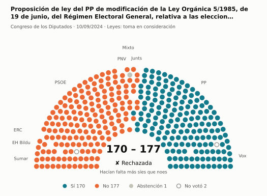
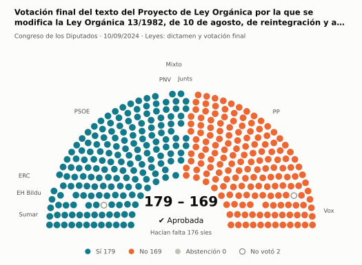
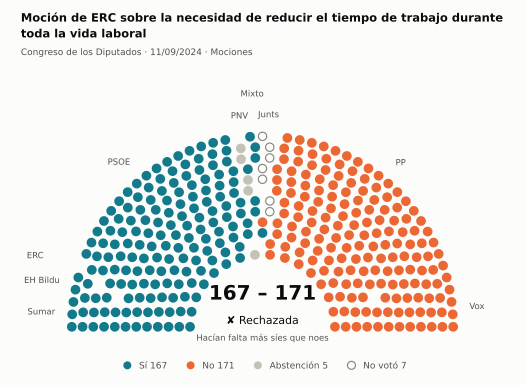
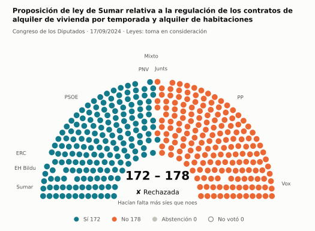
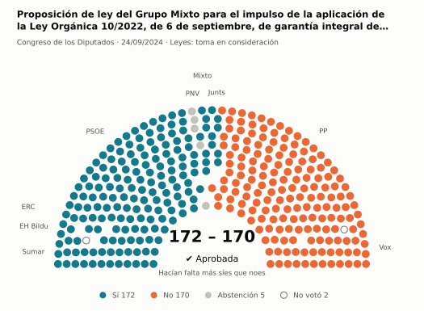
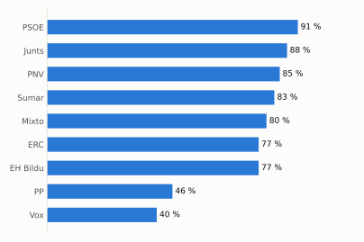
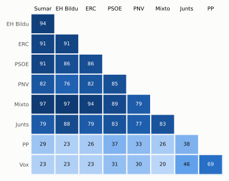

# Qué votó el Congreso en septiembre de 2024

Las votaciones del Pleno del Congreso de los Diputados, explicadas sin tecnicismos. Datos oficiales del [Congreso](https://www.congreso.es/es/opendata/votaciones); este resumen se actualiza solo cada mes (última vez: 11/11/2026).

## En pocas palabras

- El Congreso votó **35 veces** en 6 días de pleno. **15 propuestas salieron adelante** y 20 no.
- 14 votaciones fueron sobre leyes, decretos o presupuestos. Otras 20 fueron peticiones al Gobierno que no le obligan (proposiciones no de ley y mociones).
- El Gobierno (PSOE y Sumar) perdió **3** de las 32 votaciones en las que sus grupos votaron lo mismo.
- La votación más reñida se decidió por 1 voto: Moción de Vox sobre los planes del Gobierno para la sanidad española en los próximos meses.
- Los diputados casi siempre votan lo mismo que su grupo: en todo el mes solo hubo 5 votos distintos (sin contar el Grupo Mixto).

## Las votaciones más importantes del mes

Elegidas por su importancia: pesan más las leyes y los decretos que las peticiones al Gobierno, y suben las que se decidieron por pocos votos o las que perdió el Gobierno. Cada punto del dibujo es un diputado, colocado con su grupo, y el color es lo que votó.

### 1. Proposición de ley del PP de modificación de la Ley Orgánica 5/1985, de 19 de junio, del Régimen Electoral General, relativa a las elecciones al…

**10 de septiembre · Leyes: toma en consideración.** Primer paso de una ley propuesta por un grupo o una comunidad autónoma: el Congreso decide si empieza a tramitarla.

<picture>
  <source media="(prefers-color-scheme: dark)" srcset="img/2024-09/votacion-L15-S057-V001-oscuro.svg">
  
</picture>

**✘ No salió adelante** por 7 votos: 170 a favor, 177 en contra y 1 abstención.

- **A favor:** PP y Vox
- **En contra:** PSOE, Sumar, Junts, EH Bildu, ERC y PNV
- **Repartidos:** Grupo Mixto (Sí 1, No 6, Abstención 1)

[Datos oficiales](https://www.congreso.es/webpublica/opendata/votaciones/Leg15/Sesion057/20240910/Votacion001/VOT_20240910210835.json)

### 2. Votación final del texto del Proyecto de Ley Orgánica por la que se modifica la Ley Orgánica 13/1982, de 10 de agosto, de reintegración y…

**10 de septiembre · Leyes: dictamen y votación final.** Votación del texto de una ley después de trabajarla en comisión.

<picture>
  <source media="(prefers-color-scheme: dark)" srcset="img/2024-09/votacion-L15-S057-V003-oscuro.svg">
  
</picture>

**✔ Salió adelante** superó los 176 síes por 3 votos: 179 a favor, 169 en contra y ninguna abstención.

- **A favor:** PSOE, Sumar, Grupo Mixto, Junts, EH Bildu, ERC y PNV
- **En contra:** PP y Vox

[Datos oficiales](https://www.congreso.es/webpublica/opendata/votaciones/Leg15/Sesion057/20240910/Votacion003/VOT_20240910210838.json)

### 3. Moción de ERC sobre la necesidad de reducir el tiempo de trabajo durante toda la vida laboral

**11 de septiembre · Mociones.** Petición al Gobierno después de pedirle explicaciones en el Pleno. Expresa la opinión del Congreso, pero no obliga.

<picture>
  <source media="(prefers-color-scheme: dark)" srcset="img/2024-09/votacion-L15-S058-V010-oscuro.svg">
  
</picture>

**✘ No salió adelante** por 4 votos: 167 a favor, 171 en contra y 5 abstenciones.

- **A favor:** PSOE, Sumar, EH Bildu y ERC
- **En contra:** PP y Vox
- **Se abstuvieron:** PNV
- **Repartidos:** Grupo Mixto (Sí 7, No 1)

[Datos oficiales](https://www.congreso.es/webpublica/opendata/votaciones/Leg15/Sesion058/20240911/Votacion010/VOT_20240911151654.json)

### 4. Proposición de ley de Sumar relativa a la regulación de los contratos de alquiler de vivienda por temporada y alquiler de habitaciones

**17 de septiembre · Leyes: toma en consideración.** Primer paso de una ley propuesta por un grupo o una comunidad autónoma: el Congreso decide si empieza a tramitarla.

<picture>
  <source media="(prefers-color-scheme: dark)" srcset="img/2024-09/votacion-L15-S059-V001-oscuro.svg">
  
</picture>

**✘ No salió adelante** por 6 votos: 172 a favor, 178 en contra y ninguna abstención.

- **A favor:** PSOE, Sumar, EH Bildu, ERC y PNV
- **En contra:** PP, Vox y Junts
- **Repartidos:** Grupo Mixto (Sí 7, No 1)

[Datos oficiales](https://www.congreso.es/webpublica/opendata/votaciones/Leg15/Sesion059/20240917/Votacion001/VOT_20240917204416.json)

### 5. Proposición de ley del Grupo Mixto para el impulso de la aplicación de la Ley Orgánica 10/2022, de 6 de septiembre, de garantía integral de la…

**24 de septiembre · Leyes: toma en consideración.** Primer paso de una ley propuesta por un grupo o una comunidad autónoma: el Congreso decide si empieza a tramitarla.

<picture>
  <source media="(prefers-color-scheme: dark)" srcset="img/2024-09/votacion-L15-S061-V002-oscuro.svg">
  
</picture>

**✔ Salió adelante** por 2 votos: 172 a favor, 170 en contra y 5 abstenciones.

- **A favor:** PSOE, Sumar, Junts, EH Bildu y ERC
- **En contra:** PP y Vox
- **Se abstuvieron:** PNV
- **Repartidos:** Grupo Mixto (Sí 7, No 1)

[Datos oficiales](https://www.congreso.es/webpublica/opendata/votaciones/Leg15/Sesion061/20240924/Votacion002/VOT_20240924203511.json)

## ¿Qué grupos votaron más veces lo que finalmente salió?

<picture>
  <source media="(prefers-color-scheme: dark)" srcset="img/2024-09/ganadora-oscuro.svg">
  
</picture>

Porcentaje de votaciones en que el grupo votó Sí y salió adelante, o votó No y no salió. Abstenerse no cuenta como acertar.

## ¿Quién vota con quién?

<picture>
  <source media="(prefers-color-scheme: dark)" srcset="img/2024-09/afinidad-oscuro.svg">
  
</picture>

Cada casilla dice en qué porcentaje de las votaciones dos grupos votaron lo mismo: 100 es que siempre coincidieron y 0 que nunca.

## ¿Qué tipo de cosas se votaron?

| Tipo | Votaciones | Salieron adelante | Qué es |
| --- | ---: | ---: | --- |
| Mociones | 14 | 1 | Petición al Gobierno después de pedirle explicaciones en el Pleno. Expresa la opinión del Congreso, pero no obliga. |
| Leyes: dictamen y votación final | 6 | 5 | Votación del texto de una ley después de trabajarla en comisión. |
| Proposiciones no de ley | 6 | 4 | Petición al Gobierno para que haga algo. Expresa la opinión del Congreso, pero no obliga. |
| Leyes: toma en consideración | 6 | 3 | Primer paso de una ley propuesta por un grupo o una comunidad autónoma: el Congreso decide si empieza a tramitarla. |
| Enmiendas a la totalidad | 2 | 1 | Un grupo intenta devolver la ley a quien la propuso o sustituirla por otra. Si no sale adelante, la ley sigue su camino. |
| Organización de la Cámara | 1 | 1 | Asunto interno del Congreso: comisiones, plazos o el estatuto de los diputados. |

## Palabras que conviene saber

- **Pleno**: La reunión de los 350 diputados, donde se vota.
- **Grupo parlamentario**: Los diputados de un partido o coalición. Los partidos pequeños van juntos en el Grupo Mixto, aunque no piensen igual.
- **Abstención**: El diputado vota, pero ni a favor ni en contra.
- **No votó**: El diputado no votó: no estaba, estaba de baja o el escaño estaba vacío.
- **Mayoría simple**: Salen adelante las votaciones con más síes que noes. Es lo normal.
- **Mayoría absoluta**: 176 votos a favor, la mitad más uno de 350. La piden las leyes orgánicas (derechos fundamentales, sistema electoral…) y la primera votación de investidura.
- **Votación por llamamiento**: Cada diputado dice su voto en voz alta. Se usa en las investiduras y otras votaciones importantes.

---

**¿Quieres más detalle?** El [análisis detallado](2024-09-detalle.md) tiene la cohesión de cada grupo, un mapa de los diputados según cómo votan, qué diputados votaron distinto de su grupo, las ausencias y la lista completa de votaciones.

_Los resultados están calculados a partir de los votos: el Congreso no publica si cada votación salió adelante. Este proyecto no tiene relación con el Congreso. Método en [docs/DOCUMENTO_FUNCIONAL.md](../docs/DOCUMENTO_FUNCIONAL.md)._
