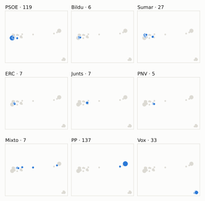
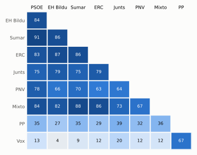

# Análisis detallado: octubre de 2024

[← Volver al resumen del mes](2024-10.md)

_Generado automáticamente el 2026-11-11 con datos abiertos del [Congreso de los Diputados](https://www.congreso.es/es/opendata/votaciones). Solo plenos y Diputación Permanente. Método y límites en [docs/DOCUMENTO_FUNCIONAL.md](../docs/DOCUMENTO_FUNCIONAL.md)._

## Resumen

- **77 votaciones** en 8 días de pleno (sesiones 64, 66, 67, 68, 69, 70, 71 y 73).
- **39 aprobadas** y **33 rechazadas**, más 5 empates que obligaron a repetir.
- 19 votaciones se decidieron por 5 votos o menos.
- Los grupos que más veces votaron con el resultado final: **Mixto y Junts** (82 % de las votaciones nominales).
- Los grupos del Gobierno (PSOE y Sumar) votaron lo mismo en 70 de 77 votaciones nominales y perdieron 11 de ellas.
- 10 votos individuales se apartaron de la posición de su grupo (10 diputados).

## Cómo votó cada grupo

| Grupo | Diputados | Cohesión | Votó con el resultado | Decisivo | Posición Sí | Posición No | Posición Abst. |
| --- | ---: | ---: | ---: | ---: | ---: | ---: | ---: |
| PP | 137 | 100 % | 55 % | 13 | 57 | 12 | 6 |
| PSOE | 120 | 100 % | 81 % | 28 | 24 | 51 | 2 |
| Vox | 33 | 100 % | 29 % | 11 | 56 | 17 | 2 |
| Sumar | 27 | 100 % | 81 % | 29 | 24 | 51 | 2 |
| Mixto | 8 | 72 % | 82 % | 17 | 29 | 46 | 2 |
| Junts | 7 | 100 % | 82 % | 24 | 25 | 43 | 9 |
| ERC | 7 | 100 % | 75 % | 24 | 24 | 48 | 5 |
| EH Bildu | 6 | 99 % | 70 % | 20 | 18 | 49 | 10 |
| PNV | 5 | 100 % | 71 % | 9 | 22 | 36 | 18 |

*Cohesión*: índice de acuerdo interno (100 % = todo el grupo votó igual). *Votó con el resultado*: el grupo votó Sí y salió aprobada, o No y salió rechazada. *Decisivo*: votaciones cuyo resultado habría cambiado si el grupo se hubiera abstenido en bloque. El Grupo Mixto reúne partidos distintos: su posición es la de su mayoría.

## Mapa de diputados

<picture>
  <source media="(prefers-color-scheme: dark)" srcset="img/2024-10/mapa-oscuro.svg">
  
</picture>

Cada punto es un diputado; dos diputados están cerca si votaron parecido. Un punto más grande reúne a varios que votaron exactamente igual. En cada panel, el grupo en azul y el resto del Congreso en gris.

*Cómo se calcula*: componentes principales de los votos (Sí, No, abstención) en 74 votaciones con algún desacuerdo. El eje horizontal recoge el 82 % de la variación y el vertical el 11 %. Los ejes no tienen nombre ni sentido político propio; por convención, el PP queda a la derecha. No se sitúa a 3 diputados que votó en menos de la mitad.

## Afinidad entre grupos

<picture>
  <source media="(prefers-color-scheme: dark)" srcset="img/2024-10/afinidad-oscuro.svg">
  
</picture>

Porcentaje de votaciones nominales en que los dos grupos tomaron la misma posición. Los grupos están ordenados según el mapa de diputados.

Ver la tabla

|  | PP | PSOE | Vox | Sumar | Mixto | Junts | ERC | EH Bildu | PNV |
| --- | :---: | :---: | :---: | :---: | :---: | :---: | :---: | :---: | :---: |
| PP | 100 % | 35 % | 67 % | 35 % | 36 % | 39 % | 29 % | 27 % | 32 % |
| PSOE | 35 % | 100 % | 13 % | 91 % | 84 % | 75 % | 83 % | 84 % | 78 % |
| Vox | 67 % | 13 % | 100 % | 9 % | 12 % | 20 % | 12 % | 4 % | 12 % |
| Sumar | 35 % | 91 % | 9 % | 100 % | 88 % | 75 % | 86 % | 86 % | 70 % |
| Mixto | 36 % | 84 % | 12 % | 88 % | 100 % | 73 % | 86 % | 82 % | 67 % |
| Junts | 39 % | 75 % | 20 % | 75 % | 73 % | 100 % | 79 % | 79 % | 64 % |
| ERC | 29 % | 83 % | 12 % | 86 % | 86 % | 79 % | 100 % | 87 % | 63 % |
| EH Bildu | 27 % | 84 % | 4 % | 86 % | 82 % | 79 % | 87 % | 100 % | 66 % |
| PNV | 32 % | 78 % | 12 % | 70 % | 67 % | 64 % | 63 % | 66 % | 100 % |

## Quién sacó adelante las votaciones

| Grupos que votaron Sí | Votaciones | Escaños |
| --- | ---: | ---: |
| PSOE + Sumar + Mixto + Junts + ERC + EH Bildu + PNV | 6 | 180 |
| PP + Vox + Junts | 6 | 177 |
| PP + PSOE + Sumar + Mixto + Junts + ERC + EH Bildu + PNV | 4 | 317 |
| PP + Vox + Mixto | 2 | 178 |
| PP + PSOE + Sumar + Mixto + EH Bildu + PNV | 2 | 303 |
| Todos los grupos | 2 | 350 |
| PP + PSOE + Sumar + Mixto + Junts + ERC + EH Bildu | 2 | 312 |
| PP + PSOE + Vox + Sumar + Mixto + Junts + ERC + EH Bildu | 1 | 345 |

De 39 votaciones nominales aprobadas. Otras 14 salieron con combinaciones que se dieron menos veces. La posición de cada grupo es la de la mayoría de sus diputados.

## Votaciones que perdieron los grupos del Gobierno

| Fecha | Asunto | Tipo | PSOE y Sumar votaron | Resultado | Sí | No |
| --- | --- | --- | :---: | --- | ---: | ---: |
| 10 de octubre | Proposición no de Ley del Grupo Parlamentario Popular en el Congreso, para revertir el empeoramiento del compromiso de puntualidad de Renfe. *(Votación separada por puntos. Punto 1.)* | Proposiciones no de ley | No | Aprobada | 183 | 144 |
| 10 de octubre | Proposición no de Ley del Grupo Parlamentario Popular en el Congreso, para revertir el empeoramiento del compromiso de puntualidad de Renfe. *(Votación separada por puntos. Punto 3.)* | Proposiciones no de ley | No | Aprobada | 174 | 164 |
| 16 de octubre | Moción consecuencia de interpelación urgente del Grupo Parlamentario Popular en el Congreso, sobre las múltiples incidencias y problemas ocurridos durante los… | Mociones | No | Aprobada | 186 | 156 |
| 23 de octubre | Proposición no de Ley del Grupo Parlamentario Popular en el Congreso, relativa a la revisión y readecuación de la normativa derivada del Real Decreto 933/2021,… *(Votación separada por puntos. Primer guion.)* | Proposiciones no de ley | No | Aprobada | 177 | 160 |
| 23 de octubre | Proposición no de Ley del Grupo Parlamentario Popular en el Congreso, relativa a la revisión y readecuación de la normativa derivada del Real Decreto 933/2021,… *(Votación separada por puntos. Segundo guion.)* | Proposiciones no de ley | No | Aprobada | 178 | 163 |
| 23 de octubre | Proposición no de Ley del Grupo Parlamentario Popular en el Congreso, relativa a la revisión y readecuación de la normativa derivada del Real Decreto 933/2021,… *(Votación separada por puntos. Tercer guion.)* | Proposiciones no de ley | No | Aprobada | 179 | 164 |
| 23 de octubre | Proposición no de Ley del Grupo Parlamentario Popular en el Congreso, relativa a la revisión y readecuación de la normativa derivada del Real Decreto 933/2021,… *(Votación separada por puntos. Cuarto guion.)* | Proposiciones no de ley | No | Aprobada | 177 | 164 |
| 23 de octubre | Proposición no de Ley del Grupo Parlamentario Popular en el Congreso, relativa a la revisión y readecuación de la normativa derivada del Real Decreto 933/2021,… *(Votación separada por puntos. Quinto guion.)* | Proposiciones no de ley | No | Aprobada | 179 | 164 |
| 23 de octubre | Moción consecuencia de interpelación urgente del Grupo Parlamentario Popular en el Congreso, sobre la implicación del Ministerio del Interior en los múltiples… *(Votación separada por puntos. Punto 3.)* | Mociones | No | Aprobada | 172 | 171 |
| 23 de octubre | Moción consecuencia de interpelación urgente del Grupo Parlamentario Popular en el Congreso, sobre la implicación del Ministerio del Interior en los múltiples… *(Votación separada por puntos. Punto 4.)* | Mociones | No | Aprobada | 179 | 170 |
| 23 de octubre | Moción consecuencia de interpelación urgente del Grupo Parlamentario Popular en el Congreso, sobre la implicación del Ministerio del Interior en los múltiples… *(Votación separada por puntos. Punto 5.)* | Mociones | No | Aprobada | 178 | 168 |

Además, PSOE y Sumar votaron distinto entre sí en 7 votaciones.

## Votaciones más ajustadas

| Fecha | Asunto | Resultado | Sí | No | Abst. |
| --- | --- | :---: | ---: | ---: | ---: |
| 23 de octubre | Proposición no de Ley del Grupo Parlamentario Popular en el Congreso, relativa a la revisión y readecuación de la normativa derivada del Real Decreto 933/2021,… *(Votación separada por puntos. Sexto guion.)* | Empate (se repite) | 172 | 172 | 5 |
| 23 de octubre | Proposición no de Ley del Grupo Parlamentario Popular en el Congreso, relativa a la revisión y readecuación de la normativa derivada del Real Decreto 933/2021,… *(Votación separada por puntos. Sexto guion.)* | Empate (se repite) | 172 | 172 | 4 |
| 23 de octubre | Proposición no de Ley del Grupo Parlamentario Popular en el Congreso, relativa a la revisión y readecuación de la normativa derivada del Real Decreto 933/2021,… *(Votación separada por puntos. Sexto guion.)* | Empate (se repite) | 172 | 172 | 5 |
| 23 de octubre | Proposición no de Ley del Grupo Parlamentario Popular en el Congreso, relativa a la revisión y readecuación de la normativa derivada del Real Decreto 933/2021,… *(Votación separada por puntos. Séptimo guion.)* | Empate (se repite) | 172 | 172 | 5 |
| 23 de octubre | Moción consecuencia de interpelación urgente del Grupo Parlamentario Popular en el Congreso, sobre la implicación del Ministerio del Interior en los múltiples… *(Votación separada por puntos. Punto 3.)* | Empate (se repite) | 171 | 171 | 6 |
| 23 de octubre | Proposición no de Ley del Grupo Parlamentario Popular en el Congreso, relativa a la revisión y readecuación de la normativa derivada del Real Decreto 933/2021,… *(Votación separada por puntos. Séptimo guion.)* | Rechazada | 172 | 173 | 4 |
| 23 de octubre | Moción consecuencia de interpelación urgente del Grupo Parlamentario Popular en el Congreso, sobre la implicación del Ministerio del Interior en los múltiples… *(Votación separada por puntos. Punto 3.)* | Aprobada | 172 | 171 | 5 |
| 16 de octubre | Proposición no de Ley del Grupo Parlamentario Popular en el Congreso, sobre equiparación salarial real y total de la Policía Nacional y la Guardia Civil, así c… *(Votación separada por puntos. Punto 3.)* | Rechazada | 171 | 173 | 1 |
| 16 de octubre | Proposición no de Ley del Grupo Parlamentario Popular en el Congreso, sobre equiparación salarial real y total de la Policía Nacional y la Guardia Civil, así c… *(Votación separada por puntos. Punto 1.)* | Rechazada | 171 | 174 | 0 |
| 10 de octubre | Moción consecuencia de interpelación urgente del Grupo Parlamentario VOX, sobre cuál es la política del Gobierno en materia de educación. *(Votación separada por puntos. Punto 2.)* | Rechazada | 171 | 175 | 0 |

Votaciones decididas por 10 votos o menos (o a esa distancia de la mayoría que exigían). Las públicas por llamamiento no tienen hemiciclo: el voto de cada diputado solo consta en el Diario de Sesiones.

## Qué se votó, por tipo de asunto

| Tipo de asunto | Votaciones | Aprobadas | No aprobadas |
| --- | ---: | ---: | ---: |
| Mociones | 34 | 11 | 23 |
| Proposiciones no de ley | 20 | 12 | 8 |
| Leyes: toma en consideración | 8 | 5 | 3 |
| Tratados internacionales | 5 | 5 | 0 |
| Organización de la Cámara | 3 | 3 | 0 |
| Leyes: dictamen y votación final | 3 | 1 | 2 |
| Decretos-ley (convalidación) | 2 | 2 | 0 |
| Enmiendas a la totalidad | 2 | 0 | 2 |

Las proposiciones no de ley y las mociones expresan la posición del Congreso pero no obligan al Gobierno. Las leyes pasan por varias votaciones (toma en consideración, totalidad, dictamen, Senado), así que una misma ley puede aparecer varias veces.

## Votos distintos de su grupo

| Diputado | Grupo | Votos distintos de su grupo |
| --- | --- | ---: |
| Aizpurua Arzallus, Mertxe | EH Bildu | 1 |
| Andala Ubbi, Teslem | Sumar | 1 |
| Esteban Bravo, Aitor | PNV | 1 |
| Flores Juberías, Carlos | Vox | 1 |
| Gil de Reboleño Lastortres, Esther | Sumar | 1 |
| Mariscal Zabala, Manuel | Vox | 1 |
| Martín Urriza, Carlos | Sumar | 1 |
| Román Jasanada, Antonio | PP | 1 |
| Ruiz de Pinedo Undiano, Iñaki | EH Bildu | 1 |
| Álvaro Vidal, Francesc-Marc | ERC | 1 |

Un voto aislado puede ser un error al pulsar, no una decisión política: el Congreso no publica las correcciones. Se excluye el Grupo Mixto.

## Diputados que más veces no votaron

| Diputado | Grupo | No votó | % de votaciones |
| --- | --- | ---: | ---: |
| Ábalos Meco, José Luis | Mixto | 52 | 68 % |
| Sánchez Pérez-Castejón, Pedro | PSOE | 42 | 55 % |
| López Tagliafico, Candela | Sumar | 34 | 44 % |
| Pisarello Prados, Gerardo | Sumar | 34 | 44 % |
| Núñez Feijóo, Alberto | PP | 26 | 34 % |
| Montero Cuadrado, María Jesús | PSOE | 18 | 23 % |
| Figaredo Álvarez-Sala, José María | Vox | 6 | 8 % |
| Díaz Pérez, Yolanda | Sumar | 5 | 6 % |
| Fúnez de Gregorio, Carmen | PP | 5 | 6 % |
| Agirretxea Urresti, Joseba Andoni | PNV | 4 | 5 % |
| Bravo Baena, Juan | PP | 4 | 5 % |
| Ortega Smith-Molina, Francisco Javier | Vox | 4 | 5 % |
| Aragonés Mendiguchía, Carlos | PP | 3 | 4 % |
| Asarta Cuevas, Alberto | Vox | 3 | 4 % |
| Beamonte Mesa, Luis María | PP | 3 | 4 % |

«No vota» incluye ausencias justificadas (baja, maternidad o paternidad) y escaños vacantes; el portal no las distingue.

## Todas las votaciones

Posición de cada grupo: la opción que votó la mayoría de sus diputados (*Div.*: empate dentro del grupo). El número enlaza al JSON oficial o, en las votaciones por llamamiento, al Diario de Sesiones.

### 8 de octubre (sesión 64)

| Nº | Asunto | Resultado | Sí | No | Abst. | PP | PSOE | Vox | Sumar | Mixto | Junts | ERC | EH Bildu | PNV | Decisivos |
| ---: | --- | --- | ---: | ---: | ---: | :---: | :---: | :---: | :---: | :---: | :---: | :---: | :---: | :---: | --- |
| [1](https://www.congreso.es/webpublica/opendata/votaciones/Leg15/Sesion064/20241008/Votacion001/VOT_20241008205543.json) | Proposición de Ley de modificación de la Ley 39/2006, de 14 de diciembre, de Promoción de la Autonomía Personal y Atención a las personas en situación de depen… | Aprobada | 341 | 0 | 0 | Sí | Sí | Sí | Sí | Sí | Sí | Sí | Sí | — |  |
| [2](https://www.congreso.es/webpublica/opendata/votaciones/Leg15/Sesion064/20241008/Votacion002/VOT_20241008205544.json) | Proposición de Ley del Grupo Parlamentario Socialista, Orgánica por la que se modifica la Ley Orgánica 1/2002, de 22 de marzo, reguladora del derecho de asocia… | Aprobada | 314 | 33 | 0 | Sí | Sí | No | Sí | Sí | Sí | Sí | Sí | Sí |  |

### 10 de octubre (sesión 66)

| Nº | Asunto | Resultado | Sí | No | Abst. | PP | PSOE | Vox | Sumar | Mixto | Junts | ERC | EH Bildu | PNV | Decisivos |
| ---: | --- | --- | ---: | ---: | ---: | :---: | :---: | :---: | :---: | :---: | :---: | :---: | :---: | :---: | --- |
| [1](https://www.congreso.es/webpublica/opendata/votaciones/Leg15/Sesion066/20241010/Votacion001/VOT_20241010194916.json) | Proposición de Ley para mejorar la calidad de vida de personas con Esclerosis Lateral Amiotrófica y otras enfermedades o procesos de alta complejidad y curso i… *(Enmiendas presentadas por el Grupo Parlamentario Mixto (Sra…)* | Rechazada | 12 | 326 | 6 | No | No | No | No | Sí | No | Sí | Abst. | No |  |
| [2](https://www.congreso.es/webpublica/opendata/votaciones/Leg15/Sesion066/20241010/Votacion002/VOT_20241010194917.json) | Proposición de Ley para mejorar la calidad de vida de personas con Esclerosis Lateral Amiotrófica y otras enfermedades o procesos de alta complejidad y curso i… *(Enmiendas presentadas por el Grupo Parlamentario Mixto (Sr.…)* | Rechazada | 12 | 324 | 7 | No | No | No | No | Sí | No | Sí | Abst. | No |  |
| [3](https://www.congreso.es/webpublica/opendata/votaciones/Leg15/Sesion066/20241010/Votacion003/VOT_20241010194919.json) | Proposición no de Ley del Grupo Parlamentario Popular en el Congreso, para revertir el empeoramiento del compromiso de puntualidad de Renfe. *(Votación separada por puntos. Punto 1.)* | Aprobada | 183 | 144 | 19 | Sí | No | Sí | No | Sí | Abst. | Sí | Abst. | Abst. | PP |
| [4](https://www.congreso.es/webpublica/opendata/votaciones/Leg15/Sesion066/20241010/Votacion004/VOT_20241010194920.json) | Proposición no de Ley del Grupo Parlamentario Popular en el Congreso, para revertir el empeoramiento del compromiso de puntualidad de Renfe. *(Votación separada por puntos. Punto 2.)* | Aprobada | 330 | 0 | 13 | Sí | Sí | Sí | Sí | Sí | Abst. | Sí | Abst. | Sí |  |
| [5](https://www.congreso.es/webpublica/opendata/votaciones/Leg15/Sesion066/20241010/Votacion005/VOT_20241010194920.json) | Proposición no de Ley del Grupo Parlamentario Popular en el Congreso, para revertir el empeoramiento del compromiso de puntualidad de Renfe. *(Votación separada por puntos. Punto 3.)* | Aprobada | 174 | 164 | 7 | Sí | No | Sí | No | Sí | Abst. | No | No | No | PP, Vox |
| [6](https://www.congreso.es/webpublica/opendata/votaciones/Leg15/Sesion066/20241010/Votacion006/VOT_20241010194921.json) | Proposición no de Ley del Grupo Parlamentario Socialista, para reducir la tasa máxima de alcohol en sangre permitida a todos los conductores de vehículos motor… | Aprobada | 175 | 33 | 138 | Abst. | Sí | No | Sí | Sí | Sí | Sí | Sí | Sí |  |
| [7](https://www.congreso.es/webpublica/opendata/votaciones/Leg15/Sesion066/20241010/Votacion007/VOT_20241010194923.json) | Moción consecuencia de interpelación urgente del Grupo Parlamentario Mixto (Sra. Valido García), sobre la declaración de un parque nacional marino en las aguas… | Aprobada | 299 | 0 | 47 | Sí | Sí | Abst. | Sí | Sí | Abst. | Abst. | Sí | Sí |  |
| [8](https://www.congreso.es/webpublica/opendata/votaciones/Leg15/Sesion066/20241010/Votacion008/VOT_20241010194924.json) | Moción consecuencia de interpelación urgente del Grupo Parlamentario VOX, sobre cuál es la política del Gobierno en materia de educación. *(Votación separada por puntos. Punto 1.)* | Rechazada | 33 | 313 | 0 | No | No | Sí | No | No | No | No | No | No |  |
| [9](https://www.congreso.es/webpublica/opendata/votaciones/Leg15/Sesion066/20241010/Votacion009/VOT_20241010194925.json) | Moción consecuencia de interpelación urgente del Grupo Parlamentario VOX, sobre cuál es la política del Gobierno en materia de educación. *(Votación separada por puntos. Punto 2.)* | Rechazada | 171 | 175 | 0 | Sí | No | Sí | No | No | No | No | No | No | EH Bildu, Junts, Mixto, ERC, PSOE, Sumar, PNV |
| [10](https://www.congreso.es/webpublica/opendata/votaciones/Leg15/Sesion066/20241010/Votacion010/VOT_20241010194926.json) | Moción consecuencia de interpelación urgente del Grupo Parlamentario VOX, sobre cuál es la política del Gobierno en materia de educación. *(Votación separada por puntos. Punto 3.)* | Rechazada | 171 | 175 | 0 | Sí | No | Sí | No | No | No | No | No | No | EH Bildu, Junts, Mixto, ERC, PSOE, Sumar, PNV |
| [11](https://www.congreso.es/webpublica/opendata/votaciones/Leg15/Sesion066/20241010/Votacion011/VOT_20241010194926.json) | Moción consecuencia de interpelación urgente del Grupo Parlamentario VOX, sobre cuál es la política del Gobierno en materia de educación. *(Votación separada por puntos. Punto 4.)* | Rechazada | 171 | 175 | 0 | Sí | No | Sí | No | No | No | No | No | No | EH Bildu, Junts, Mixto, ERC, PSOE, Sumar, PNV |
| [12](https://www.congreso.es/webpublica/opendata/votaciones/Leg15/Sesion066/20241010/Votacion012/VOT_20241010194927.json) | Moción consecuencia de interpelación urgente del Grupo Parlamentario VOX, sobre cuál es la política del Gobierno en materia de educación. *(Votación separada por puntos. Punto 5.)* | Rechazada | 171 | 175 | 0 | Sí | No | Sí | No | No | No | No | No | No | EH Bildu, Junts, Mixto, ERC, PSOE, Sumar, PNV |
| [13](https://www.congreso.es/webpublica/opendata/votaciones/Leg15/Sesion066/20241010/Votacion013/VOT_20241010194928.json) | Moción consecuencia de interpelación urgente del Grupo Parlamentario VOX, sobre cuál es la política del Gobierno en materia de educación. *(Votación separada por puntos. Punto 6.)* | Rechazada | 171 | 175 | 0 | Sí | No | Sí | No | No | No | No | No | No | EH Bildu, Junts, Mixto, ERC, PSOE, Sumar, PNV |
| [14](https://www.congreso.es/webpublica/opendata/votaciones/Leg15/Sesion066/20241010/Votacion014/VOT_20241010194929.json) | Moción consecuencia de interpelación urgente del Grupo Parlamentario Popular en el Congreso, sobre los principios democráticos que inspiran la acción del Gobie… | Rechazada | 171 | 175 | 0 | Sí | No | Sí | No | No | No | No | No | No | EH Bildu, Junts, Mixto, ERC, PSOE, Sumar, PNV |
| [15](https://www.congreso.es/webpublica/opendata/votaciones/Leg15/Sesion066/20241010/Votacion015/VOT_20241010194930.json) | Votación del dictamen de la Proposición de Ley para mejorar la calidad de vida de personas con Esclerosis Lateral Amiotrófica y otras enfermedades o procesos d… | Aprobada | 344 | 0 | 0 | Sí | Sí | Sí | Sí | Sí | Sí | Sí | Sí | Sí |  |
| [16](https://www.congreso.es/webpublica/opendata/votaciones/Leg15/Sesion066/20241010/Votacion016/VOT_20241010194931.json) | Acuerdo sobre Inmunidades y Prerrogativas entre el Reino de España y el Banco Centroamericano de Integración Económica, hecho en Madrid el 28 de julio de 2022. | Aprobada | 299 | 0 | 47 | Sí | Sí | Abst. | Sí | Sí | Abst. | Abst. | Sí | Sí |  |
| [17](https://www.congreso.es/webpublica/opendata/votaciones/Leg15/Sesion066/20241010/Votacion017/VOT_20241010194932.json) | Acuerdo entre el Reino de España y los Estados Unidos de América sobre la cooperación en el despliegue de agentes de seguridad en el interior de vuelos hacia,… | Aprobada | 303 | 4 | 38 | Sí | Sí | Sí | Abst. | No | Sí | Abst. | Abst. | Sí |  |
| [18](https://www.congreso.es/webpublica/opendata/votaciones/Leg15/Sesion066/20241010/Votacion018/VOT_20241010194933.json) | Acuerdo complementario del Convenio Básico de cooperación científica y técnica entre el Reino de España y los Estados Unidos Mexicanos para el financiamiento d… | Aprobada | 293 | 33 | 19 | Sí | Sí | No | Sí | Sí | Abst. | Abst. | Abst. | Sí |  |
| [19](https://www.congreso.es/webpublica/opendata/votaciones/Leg15/Sesion066/20241010/Votacion019/VOT_20241010194934.json) | Acuerdo entre el Reino de España y la Corte Penal Internacional relativo a la ejecución de las penas de la Corte Penal Internacional, hecho en La Haya el 8 de… | Aprobada | 300 | 33 | 13 | Sí | Sí | No | Sí | Sí | Sí | Abst. | Abst. | Sí |  |
| [20](https://www.congreso.es/webpublica/opendata/votaciones/Leg15/Sesion066/20241010/Votacion020/VOT_20241010194935.json) | Acuerdo entre el Reino de España y la Organización de las Naciones Unidas para la Educación, la Ciencia y la Cultura relativo a la Conferencia del Decenio de l… | Aprobada | 161 | 33 | 152 | Abst. | Sí | No | Sí | Sí | Abst. | Sí | Abst. | Sí |  |

### 15 de octubre (sesión 67)

| Nº | Asunto | Resultado | Sí | No | Abst. | PP | PSOE | Vox | Sumar | Mixto | Junts | ERC | EH Bildu | PNV | Decisivos |
| ---: | --- | --- | ---: | ---: | ---: | :---: | :---: | :---: | :---: | :---: | :---: | :---: | :---: | :---: | --- |
| [1](https://www.congreso.es/webpublica/opendata/votaciones/Leg15/Sesion067/20241015/Votacion001/VOT_20241015205431.json) | Proposición de Ley del Grupo Parlamentario Popular en el Congreso, Orgánica de modificación de la Ley Orgánica 5/1985, de 19 de junio, del Régimen Electoral Ge… | Rechazada | 169 | 174 | 0 | Sí | No | Sí | No | No | No | No | No | No | EH Bildu, Junts, ERC, PSOE, Sumar |
| [2](https://www.congreso.es/webpublica/opendata/votaciones/Leg15/Sesion067/20241015/Votacion002/VOT_20241015205432.json) | Proposición de Ley del Grupo Parlamentario VOX, Orgánica relativa a la modificación del régimen jurídico de la nacionalidad. | Rechazada | 33 | 175 | 135 | Abst. | No | Sí | No | No | No | No | No | No |  |
| [3](https://www.congreso.es/webpublica/opendata/votaciones/Leg15/Sesion067/20241015/Votacion003/VOT_20241015205434.json) | Votación de la enmienda a la totalidad de texto alternativo al Proyecto de Ley por la que se modifica la Ley 1/2005, de 9 de marzo, por la que se regula el rég… | Rechazada | 33 | 174 | 136 | Abst. | No | Sí | No | No | No | No | No | No |  |

### 16 de octubre (sesión 68)

| Nº | Asunto | Resultado | Sí | No | Abst. | PP | PSOE | Vox | Sumar | Mixto | Junts | ERC | EH Bildu | PNV | Decisivos |
| ---: | --- | --- | ---: | ---: | ---: | :---: | :---: | :---: | :---: | :---: | :---: | :---: | :---: | :---: | --- |
| [1](https://www.congreso.es/webpublica/opendata/votaciones/Leg15/Sesion068/20241016/Votacion001/VOT_20241017130151.json) | Proposición no de Ley del Grupo Parlamentario Popular en el Congreso, sobre equiparación salarial real y total de la Policía Nacional y la Guardia Civil, así c… *(Votación separada por puntos. Punto 1.)* | Rechazada | 171 | 174 | 0 | Sí | No | Sí | No | No | No | No | No | No | EH Bildu, Junts, Mixto, ERC, PSOE, Sumar, PNV |
| [2](https://www.congreso.es/webpublica/opendata/votaciones/Leg15/Sesion068/20241016/Votacion002/VOT_20241017130152.json) | Proposición no de Ley del Grupo Parlamentario Popular en el Congreso, sobre equiparación salarial real y total de la Policía Nacional y la Guardia Civil, así c… *(Votación separada por puntos. Punto 2.)* | Rechazada | 170 | 174 | 0 | Sí | No | Sí | No | No | No | No | No | No | EH Bildu, Junts, Mixto, ERC, PSOE, Sumar, PNV |
| [3](https://www.congreso.es/webpublica/opendata/votaciones/Leg15/Sesion068/20241016/Votacion003/VOT_20241017130153.json) | Proposición no de Ley del Grupo Parlamentario Popular en el Congreso, sobre equiparación salarial real y total de la Policía Nacional y la Guardia Civil, así c… *(Votación separada por puntos. Punto 3.)* | Rechazada | 171 | 173 | 1 | Sí | No | Sí | No | No | No | No | No | No | EH Bildu, Junts, Mixto, ERC, PSOE, Sumar, PNV |
| [4](https://www.congreso.es/webpublica/opendata/votaciones/Leg15/Sesion068/20241016/Votacion004/VOT_20241017130154.json) | Proposición no de Ley del Grupo Parlamentario Popular en el Congreso, sobre equiparación salarial real y total de la Policía Nacional y la Guardia Civil, así c… *(Votación separada por puntos. Punto 4.)* | Aprobada | 199 | 21 | 124 | Sí | Abst. | Sí | Sí | Sí | No | No | No | Abst. |  |
| [5](https://www.congreso.es/webpublica/opendata/votaciones/Leg15/Sesion068/20241016/Votacion005/VOT_20241017130155.json) | Proposición no de Ley del Grupo Parlamentario Socialista, sobre lucha contra la violencia de género en el ámbito digital. Se vota en los términos de la enmiend… | Aprobada | 312 | 33 | 0 | Sí | Sí | No | Sí | Sí | Sí | Sí | Sí | Sí |  |
| [6](https://www.congreso.es/webpublica/opendata/votaciones/Leg15/Sesion068/20241016/Votacion006/VOT_20241017130156.json) | Moción consecuencia de interpelación urgente del Grupo Parlamentario VOX, sobre las medidas que va a adoptar el Gobierno para combatir el empobrecimiento de lo… *(Votación separada por puntos. Punto 1.)* | Rechazada | 170 | 175 | 0 | Sí | No | Sí | No | No | No | No | No | No | EH Bildu, Junts, Mixto, ERC, PSOE, Sumar |
| [7](https://www.congreso.es/webpublica/opendata/votaciones/Leg15/Sesion068/20241016/Votacion007/VOT_20241017130157.json) | Moción consecuencia de interpelación urgente del Grupo Parlamentario VOX, sobre las medidas que va a adoptar el Gobierno para combatir el empobrecimiento de lo… *(Votación separada por puntos. Punto 2.)* | Rechazada | 33 | 312 | 0 | No | No | Sí | No | No | No | No | No | No |  |
| [8](https://www.congreso.es/webpublica/opendata/votaciones/Leg15/Sesion068/20241016/Votacion008/VOT_20241017130159.json) | Moción consecuencia de interpelación urgente del Grupo Parlamentario VOX, sobre las medidas que va a adoptar el Gobierno para combatir el empobrecimiento de lo… *(Votación separada por puntos. Punto 3.)* | Rechazada | 33 | 312 | 0 | No | No | Sí | No | No | No | No | No | No |  |
| [9](https://www.congreso.es/webpublica/opendata/votaciones/Leg15/Sesion068/20241016/Votacion009/VOT_20241017130200.json) | Moción consecuencia de interpelación urgente del Grupo Parlamentario VOX, sobre las medidas que va a adoptar el Gobierno para combatir el empobrecimiento de lo… *(Votación separada por puntos. Punto 4.)* | Rechazada | 33 | 312 | 0 | No | No | Sí | No | No | No | No | No | No |  |
| [10](https://www.congreso.es/webpublica/opendata/votaciones/Leg15/Sesion068/20241016/Votacion010/VOT_20241017130201.json) | Moción consecuencia de interpelación urgente del Grupo Parlamentario VOX, sobre las medidas que va a adoptar el Gobierno para combatir el empobrecimiento de lo… *(Votación separada por puntos. Punto 5.)* | Rechazada | 33 | 312 | 0 | No | No | Sí | No | No | No | No | No | No |  |
| [11](https://www.congreso.es/webpublica/opendata/votaciones/Leg15/Sesion068/20241016/Votacion011/VOT_20241017130202.json) | Moción consecuencia de interpelación urgente del Grupo Parlamentario Mixto (Sr. Rego Candamil), relativa a la disposición del Gobierno de proceder de forma inm… *(Votación separada por puntos. Punto 1.)* | Aprobada | 178 | 154 | 13 | Sí | No | No | Sí | Sí | Abst. | Sí | Sí | Abst. | PP, Sumar |
| [12](https://www.congreso.es/webpublica/opendata/votaciones/Leg15/Sesion068/20241016/Votacion012/VOT_20241017130203.json) | Moción consecuencia de interpelación urgente del Grupo Parlamentario Mixto (Sr. Rego Candamil), relativa a la disposición del Gobierno de proceder de forma inm… *(Votación separada por puntos. Punto 2.)* | Aprobada | 306 | 33 | 5 | Sí | Sí | No | Sí | Sí | Sí | Sí | Sí | Abst. |  |
| [13](https://www.congreso.es/webpublica/opendata/votaciones/Leg15/Sesion068/20241016/Votacion013/VOT_20241017130204.json) | Moción consecuencia de interpelación urgente del Grupo Parlamentario Mixto (Sr. Rego Candamil), relativa a la disposición del Gobierno de proceder de forma inm… *(Votación separada por puntos. Punto 3.)* | Aprobada | 307 | 33 | 5 | Sí | Sí | No | Sí | Sí | Sí | Sí | Sí | Abst. |  |
| [14](https://www.congreso.es/webpublica/opendata/votaciones/Leg15/Sesion068/20241016/Votacion014/VOT_20241017130205.json) | Moción consecuencia de interpelación urgente del Grupo Parlamentario Popular en el Congreso, sobre las múltiples incidencias y problemas ocurridos durante los… | Aprobada | 186 | 156 | 3 | Sí | No | Sí | No | Sí | Sí | Sí | No | No | PP, Vox |

### 22 de octubre (sesión 69)

| Nº | Asunto | Resultado | Sí | No | Abst. | PP | PSOE | Vox | Sumar | Mixto | Junts | ERC | EH Bildu | PNV | Decisivos |
| ---: | --- | --- | ---: | ---: | ---: | :---: | :---: | :---: | :---: | :---: | :---: | :---: | :---: | :---: | --- |
| [1](https://www.congreso.es/webpublica/opendata/votaciones/Leg15/Sesion069/20241022/Votacion001/VOT_20241022211822.json) | Proposición de Ley del Grupo Parlamentario Popular en el Congreso, Orgánica relativa a la reforma de la Ley Orgánica 5/2005, de 17 de noviembre, de la Defensa… | Aprobada | 174 | 144 | 30 | Sí | No | Sí | Abst. | Sí | No | No | No | No | PP, Vox |
| [2](https://www.congreso.es/webpublica/opendata/votaciones/Leg15/Sesion069/20241022/Votacion002/VOT_20241022211823.json) | Proposición de Ley del Grupo Parlamentario Plurinacional SUMAR, relativa a la regulación de las cláusulas Redito Ad Libitum en la contratación de préstamos y c… | Aprobada | 314 | 31 | 0 | Sí | Sí | No | Sí | Sí | Sí | Sí | Sí | Sí |  |
| [3](https://www.congreso.es/webpublica/opendata/votaciones/Leg15/Sesion069/20241022/Votacion003/VOT_20241022211825.json) | Votación de la enmienda a la totalidad de devolución al Proyecto de Ley por la que se modifican el texto refundido de la Ley del Estatuto de los Trabajadores,… | Rechazada | 33 | 315 | 0 | No | No | Sí | No | No | No | No | No | No |  |

### 23 de octubre (sesión 70)

| Nº | Asunto | Resultado | Sí | No | Abst. | PP | PSOE | Vox | Sumar | Mixto | Junts | ERC | EH Bildu | PNV | Decisivos |
| ---: | --- | --- | ---: | ---: | ---: | :---: | :---: | :---: | :---: | :---: | :---: | :---: | :---: | :---: | --- |
| [1](https://www.congreso.es/webpublica/opendata/votaciones/Leg15/Sesion070/20241023/Votacion001/VOT_20241023184331.json) | Proposición no de Ley del Grupo Parlamentario Popular en el Congreso, relativa a la revisión y readecuación de la normativa derivada del Real Decreto 933/2021,… *(Votación separada por puntos. Primer guion.)* | Aprobada | 177 | 160 | 10 | Sí | No | Sí | No | Abst. | Sí | No | No | Abst. | PP, Vox |
| [2](https://www.congreso.es/webpublica/opendata/votaciones/Leg15/Sesion070/20241023/Votacion002/VOT_20241023184333.json) | Proposición no de Ley del Grupo Parlamentario Popular en el Congreso, relativa a la revisión y readecuación de la normativa derivada del Real Decreto 933/2021,… *(Votación separada por puntos. Segundo guion.)* | Aprobada | 178 | 163 | 7 | Sí | No | Sí | No | No | Sí | No | No | Abst. | PP, Vox |
| [3](https://www.congreso.es/webpublica/opendata/votaciones/Leg15/Sesion070/20241023/Votacion003/VOT_20241023184335.json) | Proposición no de Ley del Grupo Parlamentario Popular en el Congreso, relativa a la revisión y readecuación de la normativa derivada del Real Decreto 933/2021,… *(Votación separada por puntos. Tercer guion.)* | Aprobada | 179 | 164 | 5 | Sí | No | Sí | No | No | Sí | No | No | Abst. | PP, Vox |
| [4](https://www.congreso.es/webpublica/opendata/votaciones/Leg15/Sesion070/20241023/Votacion004/VOT_20241023184336.json) | Proposición no de Ley del Grupo Parlamentario Popular en el Congreso, relativa a la revisión y readecuación de la normativa derivada del Real Decreto 933/2021,… *(Votación separada por puntos. Cuarto guion.)* | Aprobada | 177 | 164 | 6 | Sí | No | Sí | No | No | Sí | No | No | Abst. | PP, Vox |
| [5](https://www.congreso.es/webpublica/opendata/votaciones/Leg15/Sesion070/20241023/Votacion005/VOT_20241023184338.json) | Proposición no de Ley del Grupo Parlamentario Popular en el Congreso, relativa a la revisión y readecuación de la normativa derivada del Real Decreto 933/2021,… *(Votación separada por puntos. Quinto guion.)* | Aprobada | 179 | 164 | 6 | Sí | No | Sí | No | No | Sí | No | No | Abst. | PP, Vox |
| [6](https://www.congreso.es/webpublica/opendata/votaciones/Leg15/Sesion070/20241023/Votacion006/VOT_20241023184340.json) | Proposición no de Ley del Grupo Parlamentario Popular en el Congreso, relativa a la revisión y readecuación de la normativa derivada del Real Decreto 933/2021,… *(Votación separada por puntos. Sexto guion.)* | Empate (se repite) | 172 | 172 | 5 | Sí | No | Sí | No | No | No | No | No | Abst. | EH Bildu, Junts, Mixto, ERC, PSOE, Sumar |
| [7](https://www.congreso.es/webpublica/opendata/votaciones/Leg15/Sesion070/20241023/Votacion007/VOT_20241023184341.json) | Proposición no de Ley del Grupo Parlamentario Popular en el Congreso, relativa a la revisión y readecuación de la normativa derivada del Real Decreto 933/2021,… *(Votación separada por puntos. Sexto guion.)* | Empate (se repite) | 172 | 172 | 4 | Sí | No | Sí | No | No | No | No | No | Abst. | EH Bildu, Junts, Mixto, ERC, PSOE, Sumar |
| [8](https://www.congreso.es/webpublica/opendata/votaciones/Leg15/Sesion070/20241023/Votacion008/VOT_20241023184342.json) | Proposición no de Ley del Grupo Parlamentario Popular en el Congreso, relativa a la revisión y readecuación de la normativa derivada del Real Decreto 933/2021,… *(Votación separada por puntos. Sexto guion.)* | Empate (se repite) | 172 | 172 | 5 | Sí | No | Sí | No | No | No | No | No | Abst. | EH Bildu, Junts, Mixto, ERC, PSOE, Sumar |
| [9](https://www.congreso.es/webpublica/opendata/votaciones/Leg15/Sesion070/20241023/Votacion009/VOT_20241023184344.json) | Proposición no de Ley del Grupo Parlamentario Popular en el Congreso, relativa a la revisión y readecuación de la normativa derivada del Real Decreto 933/2021,… *(Votación separada por puntos. Séptimo guion.)* | Empate (se repite) | 172 | 172 | 5 | Sí | No | Sí | No | No | No | No | No | Abst. | EH Bildu, Junts, Mixto, ERC, PSOE, Sumar |
| [10](https://www.congreso.es/webpublica/opendata/votaciones/Leg15/Sesion070/20241023/Votacion010/VOT_20241023184345.json) | Proposición no de Ley del Grupo Parlamentario Popular en el Congreso, relativa a la revisión y readecuación de la normativa derivada del Real Decreto 933/2021,… *(Votación separada por puntos. Séptimo guion.)* | Rechazada | 172 | 173 | 4 | Sí | No | Sí | No | No | No | No | No | Abst. | EH Bildu, Junts, Mixto, ERC, PSOE, Sumar |
| [11](https://www.congreso.es/webpublica/opendata/votaciones/Leg15/Sesion070/20241023/Votacion011/VOT_20241023184347.json) | Proposición no de Ley del Grupo Parlamentario Socialista, para reforzar la protección digital de la salud mental de la juventud. Se vota en los términos de la… | Aprobada | 316 | 33 | 0 | Sí | Sí | No | Sí | Sí | Sí | Sí | Sí | Sí |  |
| [12](https://www.congreso.es/webpublica/opendata/votaciones/Leg15/Sesion070/20241023/Votacion012/VOT_20241023184348.json) | Moción consecuencia de interpelación urgente del Grupo Parlamentario Junts per Catalunya, sobre un Corredor Mediterráneo exclusivo de mercancías: de alta capac… | Aprobada | 174 | 34 | 138 | Sí | Abst. | No | Sí | Abst. | Sí | Sí | Abst. | Abst. |  |
| [13](https://www.congreso.es/webpublica/opendata/votaciones/Leg15/Sesion070/20241023/Votacion013/VOT_20241023184350.json) | Moción consecuencia de interpelación urgente del Grupo Parlamentario Popular en el Congreso, sobre la implicación del Ministerio del Interior en los múltiples… *(Votación separada por puntos. Punto 1.)* | Aprobada | 297 | 52 | 0 | Sí | Sí | Sí | No | No | No | No | No | Sí |  |
| [14](https://www.congreso.es/webpublica/opendata/votaciones/Leg15/Sesion070/20241023/Votacion014/VOT_20241023184352.json) | Moción consecuencia de interpelación urgente del Grupo Parlamentario Popular en el Congreso, sobre la implicación del Ministerio del Interior en los múltiples… *(Votación separada por puntos. Punto 2.)* | Aprobada | 304 | 31 | 14 | Sí | Sí | Sí | No | No | Abst. | Sí | Abst. | Sí |  |
| [15](https://www.congreso.es/webpublica/opendata/votaciones/Leg15/Sesion070/20241023/Votacion015/VOT_20241023184353.json) | Moción consecuencia de interpelación urgente del Grupo Parlamentario Popular en el Congreso, sobre la implicación del Ministerio del Interior en los múltiples… *(Votación separada por puntos. Punto 3.)* | Empate (se repite) | 171 | 171 | 6 | Sí | No | Sí | No | No | No | No | No | Abst. | EH Bildu, Junts, Mixto, ERC, PSOE, Sumar |
| [16](https://www.congreso.es/webpublica/opendata/votaciones/Leg15/Sesion070/20241023/Votacion016/VOT_20241023184355.json) | Moción consecuencia de interpelación urgente del Grupo Parlamentario Popular en el Congreso, sobre la implicación del Ministerio del Interior en los múltiples… *(Votación separada por puntos. Punto 3.)* | Aprobada | 172 | 171 | 5 | Sí | No | Sí | No | No | No | No | No | Abst. | PP, Vox |
| [17](https://www.congreso.es/webpublica/opendata/votaciones/Leg15/Sesion070/20241023/Votacion017/VOT_20241023184356.json) | Moción consecuencia de interpelación urgente del Grupo Parlamentario Popular en el Congreso, sobre la implicación del Ministerio del Interior en los múltiples… *(Votación separada por puntos. Punto 4.)* | Aprobada | 179 | 170 | 0 | Sí | No | Sí | No | No | No | No | No | Sí | PP, Vox |
| [18](https://www.congreso.es/webpublica/opendata/votaciones/Leg15/Sesion070/20241023/Votacion018/VOT_20241023184357.json) | Moción consecuencia de interpelación urgente del Grupo Parlamentario Popular en el Congreso, sobre la implicación del Ministerio del Interior en los múltiples… *(Votación separada por puntos. Punto 5.)* | Aprobada | 178 | 168 | 2 | Sí | No | Sí | No | No | Sí | No | No | No | PP, Vox |
| [19](https://www.congreso.es/webpublica/opendata/votaciones/Leg15/Sesion070/20241023/Votacion019/VOT_20241023184359.json) | Moción consecuencia de interpelación urgente del Grupo Parlamentario Popular en el Congreso, sobre la implicación del Ministerio del Interior en los múltiples… *(Votación separada por puntos. Punto 6.)* | Rechazada | 171 | 177 | 1 | Sí | No | Sí | No | No | No | No | No | No | Junts, ERC, PSOE, Sumar |
| [20](https://www.congreso.es/webpublica/opendata/votaciones/Leg15/Sesion070/20241023/Votacion020/VOT_20241023184400.json) | Moción consecuencia de interpelación urgente del Grupo Parlamentario Popular en el Congreso, sobre la implicación del Ministerio del Interior en los múltiples… *(Votación separada por puntos. Punto 7.)* | Rechazada | 171 | 176 | 2 | Sí | No | Sí | No | No | No | No | No | No | EH Bildu, Junts, ERC, PSOE, Sumar |
| [21](https://www.congreso.es/webpublica/opendata/votaciones/Leg15/Sesion070/20241023/Votacion021/VOT_20241023184402.json) | Moción consecuencia de interpelación urgente del Grupo Parlamentario VOX, sobre las medidas que va a adoptar el Gobierno para garantizar a los españoles trabaj… *(Votación separada por puntos. Punto 1.)* | Rechazada | 170 | 178 | 1 | Sí | No | Sí | No | No | No | No | No | No | PSOE, Sumar |
| [22](https://www.congreso.es/webpublica/opendata/votaciones/Leg15/Sesion070/20241023/Votacion022/VOT_20241023184403.json) | Moción consecuencia de interpelación urgente del Grupo Parlamentario VOX, sobre las medidas que va a adoptar el Gobierno para garantizar a los españoles trabaj… *(Votación separada por puntos. Punto 2.)* | Rechazada | 164 | 177 | 1 | Sí | No | Sí | No | No | No | No | No | No | PSOE, Sumar |
| [23](https://www.congreso.es/webpublica/opendata/votaciones/Leg15/Sesion070/20241023/Votacion023/VOT_20241023184404.json) | Moción consecuencia de interpelación urgente del Grupo Parlamentario VOX, sobre las medidas que va a adoptar el Gobierno para garantizar a los españoles trabaj… *(Votación separada por puntos. Punto 3.)* | Rechazada | 171 | 178 | 0 | Sí | No | Sí | No | No | No | No | No | No | PSOE, Sumar |
| [24](https://www.congreso.es/webpublica/opendata/votaciones/Leg15/Sesion070/20241023/Votacion024/VOT_20241023184405.json) | Moción consecuencia de interpelación urgente del Grupo Parlamentario VOX, sobre las medidas que va a adoptar el Gobierno para garantizar a los españoles trabaj… *(Votación separada por puntos. Punto 4.)* | Rechazada | 33 | 316 | 0 | No | No | Sí | No | No | No | No | No | No |  |
| [25](https://www.congreso.es/webpublica/opendata/votaciones/Leg15/Sesion070/20241023/Votacion025/VOT_20241023184406.json) | Moción consecuencia de interpelación urgente del Grupo Parlamentario VOX, sobre las medidas que va a adoptar el Gobierno para garantizar a los españoles trabaj… *(Votación separada por puntos. Punto 5.)* | Rechazada | 33 | 178 | 138 | Abst. | No | Sí | No | No | No | No | No | No |  |
| [26](https://www.congreso.es/webpublica/opendata/votaciones/Leg15/Sesion070/20241023/Votacion026/VOT_20241023184407.json) | Moción consecuencia de interpelación urgente del Grupo Parlamentario VOX, sobre las medidas que va a adoptar el Gobierno para garantizar a los españoles trabaj… *(Votación separada por puntos. Punto 6.)* | Rechazada | 33 | 177 | 138 | Abst. | No | Sí | No | No | No | No | No | No |  |
| [27](https://www.congreso.es/webpublica/opendata/votaciones/Leg15/Sesion070/20241023/Votacion027/VOT_20241023184408.json) | Moción consecuencia de interpelación urgente del Grupo Parlamentario VOX, sobre las medidas que va a adoptar el Gobierno para garantizar a los españoles trabaj… *(Votación separada por puntos. Punto 7.)* | Rechazada | 171 | 178 | 0 | Sí | No | Sí | No | No | No | No | No | No | PSOE, Sumar |
| [28](https://www.congreso.es/webpublica/opendata/votaciones/Leg15/Sesion070/20241023/Votacion028/VOT_20241023184409.json) | Moción consecuencia de interpelación urgente del Grupo Parlamentario VOX, sobre las medidas que va a adoptar el Gobierno para garantizar a los españoles trabaj… *(Votación separada por puntos. Punto 8.)* | Rechazada | 171 | 177 | 0 | Sí | No | Sí | No | No | No | No | No | No | Junts, ERC, PSOE, Sumar |
| [29](https://www.congreso.es/webpublica/opendata/votaciones/Leg15/Sesion070/20241023/Votacion029/VOT_20241023184410.json) | Dictamen de la Comisión del Estatuto de los Diputados sobre declaración de actividades de Excmos. Sres. Diputados. | Aprobada | 347 | 0 | 1 | Sí | Sí | Sí | Sí | Sí | Sí | Sí | Sí | Sí |  |
| [30](https://www.congreso.es/webpublica/opendata/votaciones/Leg15/Sesion070/20241023/Votacion030/VOT_20241023184411.json) | Solicitud de prórroga por un año del plazo para la realización del Dictamen de la Comisión de Investigación sobre la denominada "Operación Cataluña" y las actu… | Aprobada | 177 | 170 | 2 | No | Sí | No | Sí | Sí | Sí | Sí | Sí | Sí | Junts, ERC, PSOE, Sumar |
| [31](https://www.congreso.es/webpublica/opendata/votaciones/Leg15/Sesion070/20241023/Votacion031/VOT_20241023184412.json) | Solicitud de prórroga, hasta la finalización de los trabajos que tiene atribuidos, del plazo para la realización del Dictamen de la Comisión de Investigación s… | Aprobada | 177 | 171 | 1 | No | Sí | No | Sí | Sí | Sí | Sí | Sí | Sí | EH Bildu, Junts, ERC, PSOE, Sumar |

### 29 de octubre (sesión 71)

| Nº | Asunto | Resultado | Sí | No | Abst. | PP | PSOE | Vox | Sumar | Mixto | Junts | ERC | EH Bildu | PNV | Decisivos |
| ---: | --- | --- | ---: | ---: | ---: | :---: | :---: | :---: | :---: | :---: | :---: | :---: | :---: | :---: | --- |
| [1](https://www.congreso.es/webpublica/opendata/votaciones/Leg15/Sesion071/20241029/Votacion001/VOT_20241029212331.json) | Proposición de Ley de los Grupos Parlamentarios Socialista, Plurinacional SUMAR, Euskal Herria Bildu y Vasco (EAJ-PNV), Orgánica de protección de las libertade… | Aprobada | 176 | 170 | 0 | No | Sí | No | Sí | Sí | Sí | Sí | Sí | Sí | EH Bildu, Junts, Mixto, ERC, PSOE, Sumar |
| [2](https://www.congreso.es/webpublica/opendata/votaciones/Leg15/Sesion071/20241029/Votacion002/VOT_20241029212332.json) | Proposición de Ley del Grupo Parlamentario Popular en el Congreso, para garantizar la representación internacional de las federaciones deportivas españolas en… | Rechazada | 170 | 176 | 0 | Sí | No | Sí | No | No | No | No | No | No | Junts, ERC, PSOE, Sumar |

### 30 de octubre (sesión 73)

| Nº | Asunto | Resultado | Sí | No | Abst. | PP | PSOE | Vox | Sumar | Mixto | Junts | ERC | EH Bildu | PNV | Decisivos |
| ---: | --- | --- | ---: | ---: | ---: | :---: | :---: | :---: | :---: | :---: | :---: | :---: | :---: | :---: | --- |
| [1](https://www.congreso.es/webpublica/opendata/votaciones/Leg15/Sesion073/20241030/Votacion001/VOT_20241030123350.json) | Real Decreto-ley 5/2024, de 22 de octubre, por el que se modifica la Ley 17/2006, de 5 de junio, de la radio y la televisión de titularidad estatal, para adopt… | Aprobada | 175 | 1 | 0 | — | Sí | — | Sí | Sí | Sí | Sí | Sí | Sí |  |
| [2](https://www.congreso.es/webpublica/opendata/votaciones/Leg15/Sesion073/20241030/Votacion002/VOT_20241030123352.json) | Tramitación como Proyecto de Ley por el procedimiento de urgencia del Real Decreto-ley 5/2024, de 22 de octubre, por el que se modifica la Ley 17/2006, de 5 de… | Aprobada | 176 | 0 | 0 | — | Sí | — | Sí | Sí | Sí | Sí | Sí | Sí |  |
