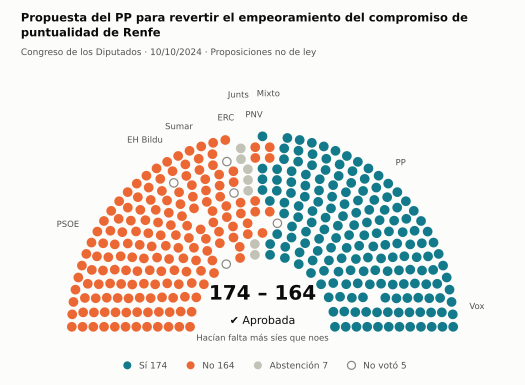
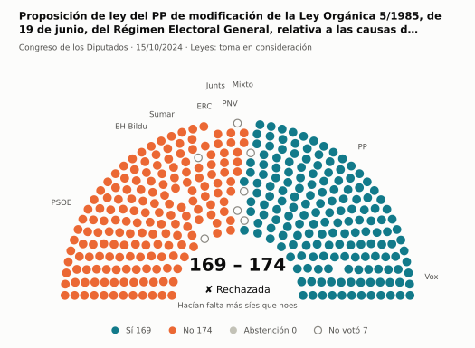
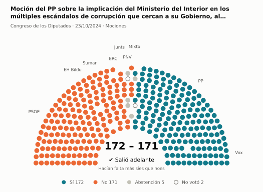
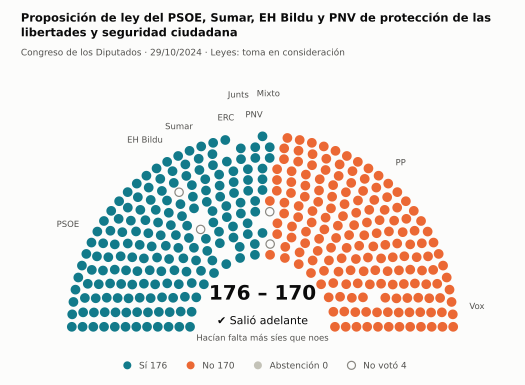
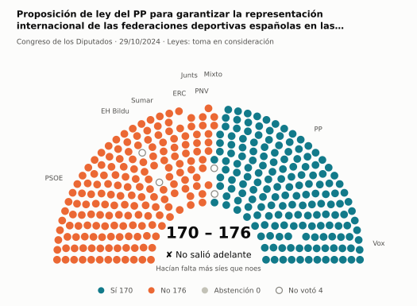
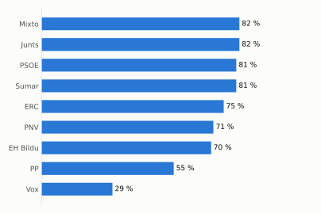
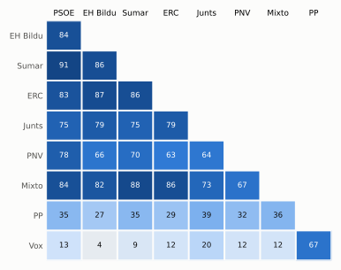

# Qué votó el Congreso en octubre de 2024

Las votaciones del Pleno del Congreso de los Diputados, explicadas sin tecnicismos. Datos oficiales del [Congreso](https://www.congreso.es/es/opendata/votaciones); este resumen se actualiza solo cada mes (última vez: 10/11/2026).

## En pocas palabras

- El Congreso votó **77 veces** en 8 días de pleno. **39 propuestas salieron adelante** y 33 no; hubo además 5 empates, que se repiten.
- 15 votaciones fueron sobre leyes, decretos o presupuestos. Otras 54 fueron peticiones al Gobierno que no le obligan (proposiciones no de ley y mociones).
- El Gobierno (PSOE y Sumar) perdió **11** de las 70 votaciones en las que sus grupos votaron lo mismo.
- La votación más reñida se decidió por 1 voto: Propuesta del PP relativa a la revisión y readecuación de la normativa derivada del Real Decreto 933/2021, de 26 de oct….
- Los diputados casi siempre votan lo mismo que su grupo: en todo el mes solo hubo 10 votos distintos (sin contar el Grupo Mixto).

## Las votaciones más importantes del mes

Elegidas por su importancia: pesan más las leyes y los decretos que las peticiones al Gobierno, y suben las que se decidieron por pocos votos o las que perdió el Gobierno. Cada punto del dibujo es un diputado, colocado con su grupo, y el color es lo que votó.

### 1. Propuesta del PP para revertir el empeoramiento del compromiso de puntualidad de Renfe

**10 de octubre · Proposiciones no de ley.** Petición al Gobierno para que haga algo. Expresa la opinión del Congreso, pero no obliga.

<picture>
  <source media="(prefers-color-scheme: dark)" srcset="img/2024-10/votacion-L15-S066-V005-oscuro.svg">
  
</picture>

**✔ Salió adelante** por 10 votos: 174 a favor, 164 en contra y 7 abstenciones.

- **A favor:** PP y Vox
- **En contra:** PSOE, Sumar, ERC, EH Bildu y PNV
- **Se abstuvieron:** Junts
- **Repartidos:** Grupo Mixto (Sí 5, No 3)

Este asunto tuvo 3 votaciones este mes; aquí se muestra la más disputada. [Datos oficiales](https://www.congreso.es/webpublica/opendata/votaciones/Leg15/Sesion066/20241010/Votacion005/VOT_20241010194920.json)

### 2. Proposición de ley del PP de modificación de la Ley Orgánica 5/1985, de 19 de junio, del Régimen Electoral General, relativa a las causas de inelegib…

**15 de octubre · Leyes: toma en consideración.** Primer paso de una ley propuesta por un grupo o una comunidad autónoma: el Congreso decide si empieza a tramitarla.

<picture>
  <source media="(prefers-color-scheme: dark)" srcset="img/2024-10/votacion-L15-S067-V001-oscuro.svg">
  
</picture>

**✘ No salió adelante** por 5 votos: 169 a favor, 174 en contra y ninguna abstención.

- **A favor:** PP y Vox
- **En contra:** PSOE, Sumar, Junts, ERC, EH Bildu y PNV
- **Repartidos:** Grupo Mixto (Sí 1, No 5)

[Datos oficiales](https://www.congreso.es/webpublica/opendata/votaciones/Leg15/Sesion067/20241015/Votacion001/VOT_20241015205431.json)

### 3. Moción del PP sobre la implicación del Ministerio del Interior en los múltiples escándalos de corrupción que cercan a su Gobierno, al Partido Sociali…

**23 de octubre · Mociones.** Petición al Gobierno después de pedirle explicaciones en el Pleno. Expresa la opinión del Congreso, pero no obliga.

<picture>
  <source media="(prefers-color-scheme: dark)" srcset="img/2024-10/votacion-L15-S070-V016-oscuro.svg">
  
</picture>

**✔ Salió adelante** por 1 voto: 172 a favor, 171 en contra y 5 abstenciones.

- **A favor:** PP y Vox
- **En contra:** PSOE, Sumar, Junts, ERC y EH Bildu
- **Se abstuvieron:** PNV
- **Repartidos:** Grupo Mixto (Sí 2, No 4, Abstención 1)

Este asunto tuvo 7 votaciones este mes; aquí se muestra la más disputada. [Datos oficiales](https://www.congreso.es/webpublica/opendata/votaciones/Leg15/Sesion070/20241023/Votacion016/VOT_20241023184355.json)

### 4. Proposición de ley del PSOE, Sumar, EH Bildu y PNV de protección de las libertades y seguridad ciudadana

**29 de octubre · Leyes: toma en consideración.** Primer paso de una ley propuesta por un grupo o una comunidad autónoma: el Congreso decide si empieza a tramitarla.

<picture>
  <source media="(prefers-color-scheme: dark)" srcset="img/2024-10/votacion-L15-S071-V001-oscuro.svg">
  
</picture>

**✔ Salió adelante** por 6 votos: 176 a favor, 170 en contra y ninguna abstención.

- **A favor:** PSOE, Sumar, Junts, ERC, EH Bildu y PNV
- **En contra:** PP y Vox
- **Repartidos:** Grupo Mixto (Sí 6, No 1)

[Datos oficiales](https://www.congreso.es/webpublica/opendata/votaciones/Leg15/Sesion071/20241029/Votacion001/VOT_20241029212331.json)

### 5. Proposición de ley del PP para garantizar la representación internacional de las federaciones deportivas españolas en las actividades y competiciones…

**29 de octubre · Leyes: toma en consideración.** Primer paso de una ley propuesta por un grupo o una comunidad autónoma: el Congreso decide si empieza a tramitarla.

<picture>
  <source media="(prefers-color-scheme: dark)" srcset="img/2024-10/votacion-L15-S071-V002-oscuro.svg">
  
</picture>

**✘ No salió adelante** por 6 votos: 170 a favor, 176 en contra y ninguna abstención.

- **A favor:** PP y Vox
- **En contra:** PSOE, Sumar, Junts, ERC, EH Bildu y PNV
- **Repartidos:** Grupo Mixto (Sí 1, No 6)

[Datos oficiales](https://www.congreso.es/webpublica/opendata/votaciones/Leg15/Sesion071/20241029/Votacion002/VOT_20241029212332.json)

## ¿Qué grupos votaron más veces lo que finalmente salió?

<picture>
  <source media="(prefers-color-scheme: dark)" srcset="img/2024-10/ganadora-oscuro.svg">
  
</picture>

Porcentaje de votaciones en que el grupo votó Sí y salió adelante, o votó No y no salió. Abstenerse no cuenta como acertar.

## ¿Quién vota con quién?

<picture>
  <source media="(prefers-color-scheme: dark)" srcset="img/2024-10/afinidad-oscuro.svg">
  
</picture>

Cada casilla dice en qué porcentaje de las votaciones dos grupos votaron lo mismo: 100 es que siempre coincidieron y 0 que nunca.

## ¿Qué tipo de cosas se votaron?

| Tipo | Votaciones | Salieron adelante | Qué es |
| --- | ---: | ---: | --- |
| Mociones | 34 | 11 | Petición al Gobierno después de pedirle explicaciones en el Pleno. Expresa la opinión del Congreso, pero no obliga. |
| Proposiciones no de ley | 20 | 12 | Petición al Gobierno para que haga algo. Expresa la opinión del Congreso, pero no obliga. |
| Leyes: toma en consideración | 8 | 5 | Primer paso de una ley propuesta por un grupo o una comunidad autónoma: el Congreso decide si empieza a tramitarla. |
| Tratados internacionales | 5 | 5 | El Congreso autoriza a España a comprometerse con un acuerdo con otro país u organismo. |
| Organización de la Cámara | 3 | 3 | Asunto interno del Congreso: comisiones, plazos o el estatuto de los diputados. |
| Leyes: dictamen y votación final | 3 | 1 | Votación del texto de una ley después de trabajarla en comisión. |
| Decretos-ley (convalidación) | 2 | 2 | El Gobierno aprobó esta norma por urgencia. Ya está en vigor, pero el Congreso tiene 30 días para confirmarla o tumbarla. |
| Enmiendas a la totalidad | 2 | 0 | Un grupo intenta devolver la ley a quien la propuso o sustituirla por otra. Si no sale adelante, la ley sigue su camino. |

## Palabras que conviene saber

- **Pleno**: La reunión de los 350 diputados, donde se vota.
- **Grupo parlamentario**: Los diputados de un partido o coalición. Los partidos pequeños van juntos en el Grupo Mixto, aunque no piensen igual.
- **Abstención**: El diputado vota, pero ni a favor ni en contra.
- **No votó**: El diputado no votó: no estaba, estaba de baja o el escaño estaba vacío.
- **Mayoría simple**: Salen adelante las votaciones con más síes que noes. Es lo normal.
- **Mayoría absoluta**: 176 votos a favor, la mitad más uno de 350. La piden las leyes orgánicas (derechos fundamentales, sistema electoral…) y la primera votación de investidura.
- **Votación por llamamiento**: Cada diputado dice su voto en voz alta. Se usa en las investiduras y otras votaciones importantes.

---

**¿Quieres más detalle?** El [análisis detallado](2024-10-detalle.md) tiene la cohesión de cada grupo, un mapa de los diputados según cómo votan, qué diputados votaron distinto de su grupo, las ausencias y la lista completa de votaciones.

_Los resultados están calculados a partir de los votos: el Congreso no publica si cada votación salió adelante. Este proyecto no tiene relación con el Congreso. Método en [docs/DOCUMENTO_FUNCIONAL.md](../docs/DOCUMENTO_FUNCIONAL.md)._
