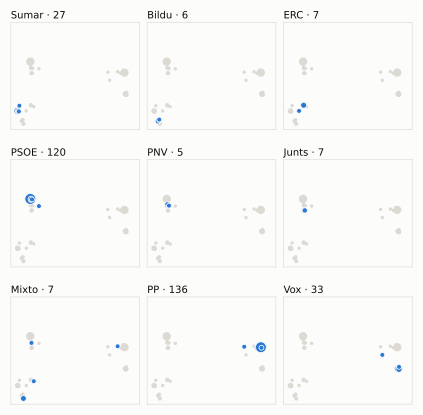
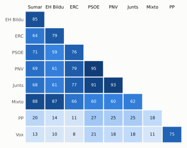

# Análisis detallado: noviembre de 2024

[← Volver al resumen del mes](2024-11.md)

_Generado automáticamente el 2026-11-10 con datos abiertos del [Congreso de los Diputados](https://www.congreso.es/es/opendata/votaciones). Solo plenos y Diputación Permanente. Método y límites en [docs/DOCUMENTO_FUNCIONAL.md](../docs/DOCUMENTO_FUNCIONAL.md)._

## Resumen

- **131 votaciones** en 6 días de pleno (sesiones 74, 76, 77, 79, 80 y 82).
- **64 aprobadas** y **67 rechazadas**.
- 4 votaciones se decidieron por 5 votos o menos.
- El grupo que más veces votó con el resultado final: **PSOE** (74 % de las votaciones nominales).
- Los grupos del Gobierno (PSOE y Sumar) votaron lo mismo en 92 de 131 votaciones nominales y perdieron 7 de ellas.
- 49 votos individuales se apartaron de la posición de su grupo (32 diputados).

## Cómo votó cada grupo

| Grupo | Diputados | Cohesión | Votó con el resultado | Decisivo | Posición Sí | Posición No | Posición Abst. |
| --- | ---: | ---: | ---: | ---: | ---: | ---: | ---: |
| PP | 137 | 100 % | 53 % | 34 | 71 | 49 | 11 |
| PSOE | 120 | 100 % | 74 % | 50 | 46 | 60 | 25 |
| Vox | 33 | 99 % | 41 % | 6 | 62 | 61 | 8 |
| Sumar | 27 | 100 % | 66 % | 47 | 50 | 79 | 2 |
| Mixto | 8 | 68 % | 63 % | 5 | 54 | 76 | 1 |
| Junts | 7 | 100 % | 70 % | 8 | 45 | 59 | 27 |
| ERC | 7 | 98 % | 56 % | 8 | 52 | 45 | 34 |
| EH Bildu | 6 | 100 % | 59 % | 5 | 51 | 70 | 10 |
| PNV | 5 | 100 % | 72 % | 1 | 48 | 56 | 27 |

*Cohesión*: índice de acuerdo interno (100 % = todo el grupo votó igual). *Votó con el resultado*: el grupo votó Sí y salió aprobada, o No y salió rechazada. *Decisivo*: votaciones cuyo resultado habría cambiado si el grupo se hubiera abstenido en bloque. El Grupo Mixto reúne partidos distintos: su posición es la de su mayoría.

## Mapa de diputados

<picture>
  <source media="(prefers-color-scheme: dark)" srcset="img/2024-11/mapa-oscuro.svg">
  
</picture>

Cada punto es un diputado; dos diputados están cerca si votaron parecido. Un punto más grande reúne a varios que votaron exactamente igual. En cada panel, el grupo en azul y el resto del Congreso en gris.

*Cómo se calcula*: componentes principales de los votos (Sí, No, abstención) en 129 votaciones con algún desacuerdo. El eje horizontal recoge el 81 % de la variación y el vertical el 8 %. Los ejes no tienen nombre ni sentido político propio; por convención, el PP queda a la derecha. No se sitúa a 2 diputados que votó en menos de la mitad.

## Afinidad entre grupos

<picture>
  <source media="(prefers-color-scheme: dark)" srcset="img/2024-11/afinidad-oscuro.svg">
  
</picture>

Porcentaje de votaciones nominales en que los dos grupos tomaron la misma posición. Los grupos están ordenados según el mapa de diputados.

Ver la tabla

|  | PP | PSOE | Vox | Sumar | Mixto | Junts | ERC | EH Bildu | PNV |
| --- | :---: | :---: | :---: | :---: | :---: | :---: | :---: | :---: | :---: |
| PP | 100 % | 27 % | 75 % | 20 % | 18 % | 25 % | 11 % | 14 % | 25 % |
| PSOE | 27 % | 100 % | 21 % | 71 % | 60 % | 91 % | 76 % | 59 % | 95 % |
| Vox | 75 % | 21 % | 100 % | 13 % | 11 % | 18 % | 8 % | 10 % | 18 % |
| Sumar | 20 % | 71 % | 13 % | 100 % | 88 % | 68 % | 64 % | 85 % | 69 % |
| Mixto | 18 % | 60 % | 11 % | 88 % | 100 % | 62 % | 66 % | 87 % | 60 % |
| Junts | 25 % | 91 % | 18 % | 68 % | 62 % | 100 % | 77 % | 61 % | 93 % |
| ERC | 11 % | 76 % | 8 % | 64 % | 66 % | 77 % | 100 % | 79 % | 79 % |
| EH Bildu | 14 % | 59 % | 10 % | 85 % | 87 % | 61 % | 79 % | 100 % | 61 % |
| PNV | 25 % | 95 % | 18 % | 69 % | 60 % | 93 % | 79 % | 61 % | 100 % |

## Quién sacó adelante las votaciones

| Grupos que votaron Sí | Votaciones | Escaños |
| --- | ---: | ---: |
| PSOE + Sumar + Mixto + Junts + ERC + EH Bildu + PNV | 21 | 180 |
| PP + Vox | 21 | 170 |
| PP + PSOE + Sumar + Mixto + Junts + ERC + EH Bildu + PNV | 7 | 317 |
| PP | 3 | 137 |
| Todos los grupos | 2 | 350 |
| PP + Junts + ERC + EH Bildu + PNV | 1 | 162 |
| PP + PSOE + Sumar + Mixto + PNV | 1 | 297 |
| PP + PSOE + Sumar + Mixto + Junts + PNV | 1 | 304 |

De 64 votaciones nominales aprobadas. Otras 7 salieron con combinaciones que se dieron menos veces. La posición de cada grupo es la de la mayoría de sus diputados.

## Votaciones que perdieron los grupos del Gobierno

| Fecha | Asunto | Tipo | PSOE y Sumar votaron | Resultado | Sí | No |
| --- | --- | --- | :---: | --- | ---: | ---: |
| 14 de noviembre | Proyecto de Ley Orgánica de medidas en materia de eficiencia del Servicio Público de Justicia (antes denominado Proyecto de Ley Orgánica de medidas en materia… *(Enmiendas presentadas por el Grupo Parlamentario Vasco (EAJ…)* | Leyes: dictamen y votación final | No | Aprobada | 160 | 154 |
| 21 de noviembre | Proyecto de Ley por la que se establecen un Impuesto Complementario para garantizar un nivel mínimo global de imposición para los grupos multinacionales y los… *(Enmiendas presentadas por el Grupo Parlamentario Plurinacio…)* | Leyes: dictamen y votación final | Sí | Rechazada | 164 | 178 |
| 21 de noviembre | Proyecto de Ley por la que se establecen un Impuesto Complementario para garantizar un nivel mínimo global de imposición para los grupos multinacionales y los… *(Enmiendas presentadas por el Grupo Parlamentario Socialista…)* | Leyes: dictamen y votación final | Sí | Rechazada | 164 | 184 |
| 21 de noviembre | Proyecto de Ley por la que se establecen un Impuesto Complementario para garantizar un nivel mínimo global de imposición para los grupos multinacionales y los… *(Enmiendas presentadas por el Grupo Parlamentario Socialista…)* | Leyes: dictamen y votación final | Sí | Rechazada | 172 | 175 |
| 21 de noviembre | Proyecto de Ley por la que se establecen un Impuesto Complementario para garantizar un nivel mínimo global de imposición para los grupos multinacionales y los… *(Votos particulares Voto particular número 2 del Grupo Parla…)* | Leyes: dictamen y votación final | Sí | Rechazada | 159 | 175 |
| 21 de noviembre | Proyecto de Ley por la que se establecen un Impuesto Complementario para garantizar un nivel mínimo global de imposición para los grupos multinacionales y los… *(Votos particulares Voto particular número 3 del Grupo Parla…)* | Leyes: dictamen y votación final | Sí | Rechazada | 159 | 189 |
| 21 de noviembre | Proyecto de Ley por la que se establecen un Impuesto Complementario para garantizar un nivel mínimo global de imposición para los grupos multinacionales y los… *(Votos particulares Votos particulares números 4 y 5 del Gru…)* | Leyes: dictamen y votación final | Sí | Rechazada | 159 | 173 |

Además, PSOE y Sumar votaron distinto entre sí en 38 votaciones.

## Votaciones más ajustadas

| Fecha | Asunto | Resultado | Sí | No | Abst. |
| --- | --- | :---: | ---: | ---: | ---: |
| 14 de noviembre | Proyecto de Ley Orgánica de medidas en materia de eficiencia del Servicio Público de Justicia (antes denominado Proyecto de Ley Orgánica de medidas en materia… *(Votación de conjunto. Votación de conjunto del Proyecto de…)* | Aprobada (necesita 176) | 179 | 168 | 0 |
| 21 de noviembre | Proyecto de Ley por la que se establecen un Impuesto Complementario para garantizar un nivel mínimo global de imposición para los grupos multinacionales y los… *(Enmiendas presentadas por el Grupo Parlamentario Socialista…)* | Rechazada | 172 | 175 | 1 |
| 21 de noviembre | Moción consecuencia de interpelación urgente del Grupo Parlamentario VOX, sobre la política del Gobierno acerca de la participación de las Fuerzas Armadas en l… *(Votación separada por puntos Punto 3.)* | Rechazada | 171 | 176 | 1 |
| 21 de noviembre | Moción consecuencia de interpelación urgente del Grupo Parlamentario VOX, sobre las medidas que va a adoptar el Gobierno para garantizar los servicios ferrovia… *(Votación separada por puntos Punto 8.)* | Rechazada | 171 | 176 | 0 |
| 14 de noviembre | Proyecto de Ley Orgánica de medidas en materia de eficiencia del Servicio Público de Justicia (antes denominado Proyecto de Ley Orgánica de medidas en materia… *(Enmiendas presentadas por el Grupo Parlamentario Vasco (EAJ…)* | Aprobada | 160 | 154 | 33 |
| 21 de noviembre | Proyecto de Ley por la que se establecen un Impuesto Complementario para garantizar un nivel mínimo global de imposición para los grupos multinacionales y los… *(Enmiendas presentadas por el Grupo Parlamentario Socialista…)* | Aprobada | 177 | 171 | 0 |
| 21 de noviembre | Moción consecuencia de interpelación urgente del Grupo Parlamentario VOX, sobre las medidas que va a adoptar el Gobierno para garantizar los servicios ferrovia… *(Votación separada por puntos Punto 9.)* | Rechazada | 171 | 177 | 0 |
| 21 de noviembre | Proyecto de Ley por la que se establecen un Impuesto Complementario para garantizar un nivel mínimo global de imposición para los grupos multinacionales y los… *(Enmiendas presentadas por el Grupo Parlamentario Socialista…)* | Aprobada | 177 | 170 | 0 |
| 21 de noviembre | Moción consecuencia de interpelación urgente del Grupo Parlamentario VOX, sobre la política del Gobierno acerca de la participación de las Fuerzas Armadas en l… *(Votación separada por puntos Punto 1.)* | Rechazada | 171 | 178 | 0 |
| 21 de noviembre | Moción consecuencia de interpelación urgente del Grupo Parlamentario VOX, sobre la política del Gobierno acerca de la participación de las Fuerzas Armadas en l… *(Votación separada por puntos Punto 4.)* | Rechazada | 171 | 178 | 0 |

Votaciones decididas por 10 votos o menos (o a esa distancia de la mayoría que exigían). Las públicas por llamamiento no tienen hemiciclo: el voto de cada diputado solo consta en el Diario de Sesiones.

## Qué se votó, por tipo de asunto

| Tipo de asunto | Votaciones | Aprobadas | No aprobadas |
| --- | ---: | ---: | ---: |
| Leyes: dictamen y votación final | 62 | 26 | 36 |
| Mociones | 48 | 25 | 23 |
| Proposiciones no de ley | 8 | 3 | 5 |
| Leyes: toma en consideración | 4 | 3 | 1 |
| Enmiendas a la totalidad | 3 | 1 | 2 |
| Decretos-ley (convalidación) | 2 | 2 | 0 |
| Tratados internacionales | 2 | 2 | 0 |
| Leyes: veto del Senado | 1 | 1 | 0 |
| Presupuestos y estabilidad | 1 | 1 | 0 |

Las proposiciones no de ley y las mociones expresan la posición del Congreso pero no obligan al Gobierno. Las leyes pasan por varias votaciones (toma en consideración, totalidad, dictamen, Senado), así que una misma ley puede aparecer varias veces.

## Votos distintos de su grupo

| Diputado | Grupo | Votos distintos de su grupo |
| --- | --- | ---: |
| Álvaro Vidal, Francesc-Marc | ERC | 10 |
| Delgado Arce, Celso Luis | PP | 3 |
| Rodríguez Almeida, Andrés Alberto | Vox | 3 |
| Asarta Cuevas, Alberto | Vox | 2 |
| Del Valle Rodríguez, Emilio Jesús | Vox | 2 |
| Delgado-Taramona Hernández, Jimena | PP | 2 |
| Rojas Manrique, Juan Antonio | PP | 2 |
| Agirretxea Urresti, Joseba Andoni | PNV | 1 |
| Aizcorbe Torra, Juan José | Vox | 1 |
| Alcaraz Martos, Francisco José | Vox | 1 |
| Aragonés Mendiguchía, Carlos | PP | 1 |
| Bravo Baena, Juan | PP | 1 |
| Carballedo Berlanga, María Eugenia | PP | 1 |
| Cortés Carballo, Mario | PP | 1 |
| Cuesta Rodríguez, María del Socorro | PP | 1 |

Un voto aislado puede ser un error al pulsar, no una decisión política: el Congreso no publica las correcciones. Se excluye el Grupo Mixto.

## Diputados que más veces no votaron

| Diputado | Grupo | No votó | % de votaciones |
| --- | --- | ---: | ---: |
| Ábalos Meco, José Luis | Mixto | 87 | 66 % |
| Núñez Feijóo, Alberto | PP | 66 | 50 % |
| Sánchez Sierra, María del Mar | PP | 45 | 34 % |
| Mejías Sánchez, Carina | Vox | 44 | 34 % |
| Sánchez Pérez-Castejón, Pedro | PSOE | 25 | 19 % |
| Díaz Pérez, Yolanda | Sumar | 6 | 5 % |
| Delgado Arce, Celso Luis | PP | 3 | 2 % |
| Gil Santiago, Carlos | PP | 3 | 2 % |
| Montesinos de Miguel, Macarena | PP | 3 | 2 % |
| Narbona Ruiz, Cristina | PSOE | 3 | 2 % |
| Santiago Romero, Enrique Fernando | Sumar | 3 | 2 % |
| Bolaños García, Félix | PSOE | 2 | 2 % |
| Figaredo Álvarez-Sala, José María | Vox | 2 | 2 % |
| García Félix, Manuel | PP | 2 | 2 % |
| Gutiérrez Prieto, Sergio | PSOE | 2 | 2 % |

«No vota» incluye ausencias justificadas (baja, maternidad o paternidad) y escaños vacantes; el portal no las distingue.

## Todas las votaciones

Posición de cada grupo: la opción que votó la mayoría de sus diputados (*Div.*: empate dentro del grupo). El número enlaza al JSON oficial o, en las votaciones por llamamiento, al Diario de Sesiones.

### 12 de noviembre (sesión 74)

| Nº | Asunto | Resultado | Sí | No | Abst. | PP | PSOE | Vox | Sumar | Mixto | Junts | ERC | EH Bildu | PNV | Decisivos |
| ---: | --- | --- | ---: | ---: | ---: | :---: | :---: | :---: | :---: | :---: | :---: | :---: | :---: | :---: | --- |
| [2](https://www.congreso.es/webpublica/opendata/votaciones/Leg15/Sesion074/20241112/Votacion002/VOT_20241112152835.json) | Proposición de Ley del Parlamento de Cataluña, de modificación de la prescripción de los delitos contra la libertad sexual cometidos contra menores de edad (Or… | Aprobada | 305 | 32 | 1 | Sí | Sí | No | Sí | Sí | Sí | Sí | Sí | Sí |  |

### 14 de noviembre (sesión 76)

| Nº | Asunto | Resultado | Sí | No | Abst. | PP | PSOE | Vox | Sumar | Mixto | Junts | ERC | EH Bildu | PNV | Decisivos |
| ---: | --- | --- | ---: | ---: | ---: | :---: | :---: | :---: | :---: | :---: | :---: | :---: | :---: | :---: | --- |
| [1](https://www.congreso.es/webpublica/opendata/votaciones/Leg15/Sesion076/20241114/Votacion001/VOT_20241114151005.json) | Proyecto de Ley Orgánica de medidas en materia de eficiencia del Servicio Público de Justicia (antes denominado Proyecto de Ley Orgánica de medidas en materia… *(Enmiendas presentadas por el Grupo Parlamentario Mixto (Sra…)* | Rechazada | 18 | 329 | 0 | No | No | No | No | Sí | No | Sí | Sí | No |  |
| [2](https://www.congreso.es/webpublica/opendata/votaciones/Leg15/Sesion076/20241114/Votacion002/VOT_20241114151007.json) | Proyecto de Ley Orgánica de medidas en materia de eficiencia del Servicio Público de Justicia (antes denominado Proyecto de Ley Orgánica de medidas en materia… *(Enmiendas presentadas por el Grupo Parlamentario Mixto (Sra…)* | Rechazada | 9 | 337 | 1 | No | No | No | No | No | No | Sí | No | No |  |
| [3](https://www.congreso.es/webpublica/opendata/votaciones/Leg15/Sesion076/20241114/Votacion003/VOT_20241114151008.json) | Proyecto de Ley Orgánica de medidas en materia de eficiencia del Servicio Público de Justicia (antes denominado Proyecto de Ley Orgánica de medidas en materia… *(Enmiendas presentadas por el Grupo Parlamentario Mixto (Sr.…)* | Aprobada | 177 | 167 | 0 | No | Sí | No | Sí | Sí | Sí | Sí | Sí | Sí | PSOE, Sumar |
| [4](https://www.congreso.es/webpublica/opendata/votaciones/Leg15/Sesion076/20241114/Votacion004/VOT_20241114151010.json) | Proyecto de Ley Orgánica de medidas en materia de eficiencia del Servicio Público de Justicia (antes denominado Proyecto de Ley Orgánica de medidas en materia… *(Enmiendas presentadas por el Grupo Parlamentario Mixto (Sr.…)* | Rechazada | 18 | 329 | 0 | No | No | No | No | Sí | No | Sí | Sí | No |  |
| [5](https://www.congreso.es/webpublica/opendata/votaciones/Leg15/Sesion076/20241114/Votacion005/VOT_20241114151011.json) | Proyecto de Ley Orgánica de medidas en materia de eficiencia del Servicio Público de Justicia (antes denominado Proyecto de Ley Orgánica de medidas en materia… *(Enmiendas presentadas por el Grupo Parlamentario Vasco (EAJ…)* | Aprobada | 160 | 154 | 33 | Sí | No | Abst. | No | No | Sí | Sí | Sí | Sí | EH Bildu, Junts, PP, ERC |
| [6](https://www.congreso.es/webpublica/opendata/votaciones/Leg15/Sesion076/20241114/Votacion006/VOT_20241114151012.json) | Proyecto de Ley Orgánica de medidas en materia de eficiencia del Servicio Público de Justicia (antes denominado Proyecto de Ley Orgánica de medidas en materia… *(Enmiendas presentadas por el Grupo Parlamentario Vasco (EAJ…)* | Rechazada | 142 | 204 | 1 | No | Sí | No | No | No | Sí | Sí | No | Sí | PP |
| [7](https://www.congreso.es/webpublica/opendata/votaciones/Leg15/Sesion076/20241114/Votacion007/VOT_20241114151014.json) | Proyecto de Ley Orgánica de medidas en materia de eficiencia del Servicio Público de Justicia (antes denominado Proyecto de Ley Orgánica de medidas en materia… *(Enmiendas presentadas por el Grupo Parlamentario Vasco (EAJ…)* | Rechazada | 18 | 329 | 0 | No | No | No | No | No | No | Sí | Sí | Sí |  |
| [8](https://www.congreso.es/webpublica/opendata/votaciones/Leg15/Sesion076/20241114/Votacion008/VOT_20241114151015.json) | Proyecto de Ley Orgánica de medidas en materia de eficiencia del Servicio Público de Justicia (antes denominado Proyecto de Ley Orgánica de medidas en materia… *(Enmienda presentada por el Grupo Parlamentario Junts per Ca…)* | Rechazada | 28 | 317 | 2 | No | No | No | No | Sí | Sí | Sí | Sí | Sí |  |
| [9](https://www.congreso.es/webpublica/opendata/votaciones/Leg15/Sesion076/20241114/Votacion009/VOT_20241114151016.json) | Proyecto de Ley Orgánica de medidas en materia de eficiencia del Servicio Público de Justicia (antes denominado Proyecto de Ley Orgánica de medidas en materia… *(Enmiendas presentadas por el Grupo Parlamentario Republican…)* | Rechazada | 25 | 322 | 0 | No | No | No | No | Sí | Sí | Sí | Sí | No |  |
| [10](https://www.congreso.es/webpublica/opendata/votaciones/Leg15/Sesion076/20241114/Votacion010/VOT_20241114151018.json) | Proyecto de Ley Orgánica de medidas en materia de eficiencia del Servicio Público de Justicia (antes denominado Proyecto de Ley Orgánica de medidas en materia… *(Enmiendas presentadas por el Grupo Parlamentario Plurinacio…)* | Rechazada | 46 | 301 | 0 | No | No | No | Sí | Sí | No | Sí | Sí | No |  |
| [11](https://www.congreso.es/webpublica/opendata/votaciones/Leg15/Sesion076/20241114/Votacion011/VOT_20241114151019.json) | Proyecto de Ley Orgánica de medidas en materia de eficiencia del Servicio Público de Justicia (antes denominado Proyecto de Ley Orgánica de medidas en materia… *(Enmiendas presentadas por el Grupo Parlamentario Plurinacio…)* | Rechazada | 45 | 302 | 0 | No | No | No | Sí | Sí | No | Sí | Sí | No |  |
| [12](https://www.congreso.es/webpublica/opendata/votaciones/Leg15/Sesion076/20241114/Votacion012/VOT_20241114151020.json) | Proyecto de Ley Orgánica de medidas en materia de eficiencia del Servicio Público de Justicia (antes denominado Proyecto de Ley Orgánica de medidas en materia… *(Enmiendas presentadas por el Grupo Parlamentario VOX Enmien…)* | Rechazada | 168 | 179 | 0 | Sí | No | Sí | No | No | No | No | No | No | PSOE, Sumar |
| [13](https://www.congreso.es/webpublica/opendata/votaciones/Leg15/Sesion076/20241114/Votacion013/VOT_20241114151021.json) | Proyecto de Ley Orgánica de medidas en materia de eficiencia del Servicio Público de Justicia (antes denominado Proyecto de Ley Orgánica de medidas en materia… *(Enmiendas presentadas por el Grupo Parlamentario VOX Enmien…)* | Rechazada | 32 | 179 | 136 | Abst. | No | Sí | No | No | No | No | No | No |  |
| [14](https://www.congreso.es/webpublica/opendata/votaciones/Leg15/Sesion076/20241114/Votacion014/VOT_20241114151022.json) | Proyecto de Ley Orgánica de medidas en materia de eficiencia del Servicio Público de Justicia (antes denominado Proyecto de Ley Orgánica de medidas en materia… *(Enmiendas presentadas por el Grupo Parlamentario VOX Resto…)* | Rechazada | 32 | 315 | 0 | No | No | Sí | No | No | No | No | No | No |  |
| [15](https://www.congreso.es/webpublica/opendata/votaciones/Leg15/Sesion076/20241114/Votacion015/VOT_20241114151023.json) | Proyecto de Ley Orgánica de medidas en materia de eficiencia del Servicio Público de Justicia (antes denominado Proyecto de Ley Orgánica de medidas en materia… *(Enmiendas presentadas por el Grupo Parlamentario Popular en…)* | Rechazada | 135 | 211 | 0 | Sí | No | No | No | No | No | No | No | No | PSOE |
| [16](https://www.congreso.es/webpublica/opendata/votaciones/Leg15/Sesion076/20241114/Votacion016/VOT_20241114151024.json) | Proyecto de Ley Orgánica de medidas en materia de eficiencia del Servicio Público de Justicia (antes denominado Proyecto de Ley Orgánica de medidas en materia… *(Enmiendas presentadas por el Grupo Parlamentario Popular en…)* | Rechazada | 168 | 178 | 0 | Sí | No | Sí | No | No | No | No | No | No | PSOE, Sumar |
| [17](https://www.congreso.es/webpublica/opendata/votaciones/Leg15/Sesion076/20241114/Votacion017/VOT_20241114151025.json) | Proyecto de Ley Orgánica de medidas en materia de eficiencia del Servicio Público de Justicia (antes denominado Proyecto de Ley Orgánica de medidas en materia… *(Enmiendas presentadas por el Grupo Parlamentario Popular en…)* | Rechazada | 136 | 178 | 32 | Sí | No | Abst. | No | No | No | No | No | No | PSOE |
| [18](https://www.congreso.es/webpublica/opendata/votaciones/Leg15/Sesion076/20241114/Votacion018/VOT_20241114151026.json) | Proyecto de Ley Orgánica de medidas en materia de eficiencia del Servicio Público de Justicia (antes denominado Proyecto de Ley Orgánica de medidas en materia… *(Votos particulares. Voto particular número 1 del Grupo Parl…)* | Aprobada | 179 | 168 | 0 | No | Sí | No | Sí | Sí | Sí | Sí | Sí | Sí | PSOE, Sumar |
| [19](https://www.congreso.es/webpublica/opendata/votaciones/Leg15/Sesion076/20241114/Votacion019/VOT_20241114151027.json) | Proyecto de Ley Orgánica de medidas en materia de eficiencia del Servicio Público de Justicia (antes denominado Proyecto de Ley Orgánica de medidas en materia… *(Votos particulares. Voto particular número 8 del Grupo Parl…)* | Rechazada | 135 | 180 | 32 | Sí | No | Abst. | No | No | No | No | No | No | PSOE |
| [20](https://www.congreso.es/webpublica/opendata/votaciones/Leg15/Sesion076/20241114/Votacion020/VOT_20241114151028.json) | Proyecto de Ley Orgánica de medidas en materia de eficiencia del Servicio Público de Justicia (antes denominado Proyecto de Ley Orgánica de medidas en materia… *(Votos particulares. Resto de votos particulares del Grupo P…)* | Rechazada | 168 | 178 | 0 | Sí | No | Sí | No | No | No | No | No | No | PSOE, Sumar |
| [21](https://www.congreso.es/webpublica/opendata/votaciones/Leg15/Sesion076/20241114/Votacion021/VOT_20241114151029.json) | Proyecto de Ley Orgánica de medidas en materia de eficiencia del Servicio Público de Justicia (antes denominado Proyecto de Ley Orgánica de medidas en materia… *(Correcciones técnicas. Enmienda de corrección técnica númer…)* | Aprobada | 179 | 167 | 1 | No | Sí | No | Sí | Sí | Sí | Sí | Sí | Sí | PSOE, Sumar |
| [22](https://www.congreso.es/webpublica/opendata/votaciones/Leg15/Sesion076/20241114/Votacion022/VOT_20241114151030.json) | Proyecto de Ley Orgánica de medidas en materia de eficiencia del Servicio Público de Justicia (antes denominado Proyecto de Ley Orgánica de medidas en materia… *(Correcciones técnicas. Enmienda de corrección técnica númer…)* | Aprobada | 315 | 31 | 0 | Sí | Sí | No | Sí | Sí | Sí | Sí | Sí | Sí |  |
| [23](https://www.congreso.es/webpublica/opendata/votaciones/Leg15/Sesion076/20241114/Votacion023/VOT_20241114151031.json) | Proyecto de Ley Orgánica de medidas en materia de eficiencia del Servicio Público de Justicia (antes denominado Proyecto de Ley Orgánica de medidas en materia… *(Correcciones técnicas. Enmienda de corrección técnica númer…)* | Aprobada | 315 | 31 | 0 | Sí | Sí | No | Sí | Sí | Sí | Sí | Sí | Sí |  |
| [24](https://www.congreso.es/webpublica/opendata/votaciones/Leg15/Sesion076/20241114/Votacion024/VOT_20241114151032.json) | Proyecto de Ley Orgánica de medidas en materia de eficiencia del Servicio Público de Justicia (antes denominado Proyecto de Ley Orgánica de medidas en materia… *(Correcciones técnicas. Enmienda de corrección técnica númer…)* | Aprobada | 178 | 168 | 0 | No | Sí | No | Sí | Sí | Sí | Sí | Sí | Sí | PSOE, Sumar |
| [25](https://www.congreso.es/webpublica/opendata/votaciones/Leg15/Sesion076/20241114/Votacion025/VOT_20241114151033.json) | Proyecto de Ley Orgánica de medidas en materia de eficiencia del Servicio Público de Justicia (antes denominado Proyecto de Ley Orgánica de medidas en materia… *(Correcciones técnicas. Enmienda de corrección técnica númer…)* | Aprobada | 179 | 168 | 0 | No | Sí | No | Sí | Sí | Sí | Sí | Sí | Sí | PSOE, Sumar |
| [26](https://www.congreso.es/webpublica/opendata/votaciones/Leg15/Sesion076/20241114/Votacion026/VOT_20241114151034.json) | Proyecto de Ley Orgánica de medidas en materia de eficiencia del Servicio Público de Justicia (antes denominado Proyecto de Ley Orgánica de medidas en materia… *(Correcciones técnicas. Enmienda de corrección técnica númer…)* | Aprobada | 313 | 34 | 0 | Sí | Sí | No | Sí | Sí | Sí | Sí | Sí | Sí |  |
| [27](https://www.congreso.es/webpublica/opendata/votaciones/Leg15/Sesion076/20241114/Votacion027/VOT_20241114151035.json) | Proyecto de Ley Orgánica de medidas en materia de eficiencia del Servicio Público de Justicia (antes denominado Proyecto de Ley Orgánica de medidas en materia… *(Correcciones técnicas. Enmienda de corrección técnica númer…)* | Aprobada | 180 | 167 | 0 | No | Sí | No | Sí | Sí | Sí | Sí | Sí | Sí | PSOE, Sumar |
| [28](https://www.congreso.es/webpublica/opendata/votaciones/Leg15/Sesion076/20241114/Votacion028/VOT_20241114151036.json) | Proyecto de Ley Orgánica de medidas en materia de eficiencia del Servicio Público de Justicia (antes denominado Proyecto de Ley Orgánica de medidas en materia… *(Correcciones técnicas. Enmienda de corrección técnica númer…)* | Aprobada | 179 | 168 | 0 | No | Sí | No | Sí | Sí | Sí | Sí | Sí | Sí | PSOE, Sumar |
| [29](https://www.congreso.es/webpublica/opendata/votaciones/Leg15/Sesion076/20241114/Votacion029/VOT_20241114151038.json) | Proyecto de Ley Orgánica de medidas en materia de eficiencia del Servicio Público de Justicia (antes denominado Proyecto de Ley Orgánica de medidas en materia… *(Correcciones técnicas. Enmienda de corrección técnica númer…)* | Aprobada | 179 | 168 | 0 | No | Sí | No | Sí | Sí | Sí | Sí | Sí | Sí | PSOE, Sumar |
| [30](https://www.congreso.es/webpublica/opendata/votaciones/Leg15/Sesion076/20241114/Votacion030/VOT_20241114151039.json) | Proyecto de Ley Orgánica de medidas en materia de eficiencia del Servicio Público de Justicia (antes denominado Proyecto de Ley Orgánica de medidas en materia… *(Correcciones técnicas. Enmienda de corrección técnica númer…)* | Aprobada | 179 | 168 | 0 | No | Sí | No | Sí | Sí | Sí | Sí | Sí | Sí | PSOE, Sumar |
| [31](https://www.congreso.es/webpublica/opendata/votaciones/Leg15/Sesion076/20241114/Votacion031/VOT_20241114151040.json) | Proyecto de Ley Orgánica de medidas en materia de eficiencia del Servicio Público de Justicia (antes denominado Proyecto de Ley Orgánica de medidas en materia… *(Correcciones técnicas. Enmienda de corrección técnica númer…)* | Aprobada | 179 | 168 | 0 | No | Sí | No | Sí | Sí | Sí | Sí | Sí | Sí | PSOE, Sumar |
| [32](https://www.congreso.es/webpublica/opendata/votaciones/Leg15/Sesion076/20241114/Votacion032/VOT_20241114151041.json) | Proyecto de Ley Orgánica de medidas en materia de eficiencia del Servicio Público de Justicia (antes denominado Proyecto de Ley Orgánica de medidas en materia… *(Correcciones técnicas. Enmienda de corrección técnica númer…)* | Aprobada | 315 | 32 | 0 | Sí | Sí | No | Sí | Sí | Sí | Sí | Sí | Sí |  |
| [33](https://www.congreso.es/webpublica/opendata/votaciones/Leg15/Sesion076/20241114/Votacion033/VOT_20241114151042.json) | Proyecto de Ley Orgánica de medidas en materia de eficiencia del Servicio Público de Justicia (antes denominado Proyecto de Ley Orgánica de medidas en materia… *(Correcciones técnicas. Enmienda de corrección técnica númer…)* | Aprobada | 314 | 32 | 0 | Sí | Sí | No | Sí | Sí | Sí | Sí | Sí | Sí |  |
| [35](https://www.congreso.es/webpublica/opendata/votaciones/Leg15/Sesion076/20241114/Votacion035/VOT_20241114151043.json) | Dictamen de la Comisión Mixta para las Relaciones con el Tribunal de Cuentas en relación con la Declaración sobre la Cuenta General del Estado del ejercicio 20… | Aprobada | 291 | 39 | 14 | Sí | Sí | No | Sí | Sí | No | Abst. | Abst. | Sí |  |
| [36](https://www.congreso.es/webpublica/opendata/votaciones/Leg15/Sesion076/20241114/Votacion036/VOT_20241114151044.json) | Convenio de Seguridad Social entre el Reino de España y los Estados Unidos de América, hecho en Madrid el 8 de abril de 2024. | Aprobada | 301 | 0 | 45 | Sí | Sí | Abst. | Sí | Sí | Sí | Abst. | Abst. | Sí |  |
| [37](https://www.congreso.es/webpublica/opendata/votaciones/Leg15/Sesion076/20241114/Votacion037/VOT_20241114151045.json) | Resolución 79-1 de la Junta de Gobernadores del Fondo Monetario Internacional relativa a la Decimosexta Revisión General de Cuotas, adoptada el 15 de diciembre… | Aprobada | 262 | 37 | 48 | Sí | Sí | No | Abst. | No | Abst. | Abst. | Abst. | Sí |  |
| [38](https://www.congreso.es/webpublica/opendata/votaciones/Leg15/Sesion076/20241114/Votacion038/VOT_20241114151046.json) | Proyecto de Ley Orgánica de medidas en materia de eficiencia del Servicio Público de Justicia (antes denominado Proyecto de Ley Orgánica de medidas en materia… *(Votación del dictamen. Votación del Dictamen, en lo relativ…)* | Aprobada | 180 | 167 | 0 | No | Sí | No | Sí | Sí | Sí | Sí | Sí | Sí | PSOE, Sumar |
| [39](https://www.congreso.es/webpublica/opendata/votaciones/Leg15/Sesion076/20241114/Votacion039/VOT_20241114151048.json) | Proyecto de Ley Orgánica de medidas en materia de eficiencia del Servicio Público de Justicia (antes denominado Proyecto de Ley Orgánica de medidas en materia… *(Votación del dictamen. Resto del Dictamen)* | Aprobada | 180 | 167 | 0 | No | Sí | No | Sí | Sí | Sí | Sí | Sí | Sí | PSOE, Sumar |
| [40](https://www.congreso.es/webpublica/opendata/votaciones/Leg15/Sesion076/20241114/Votacion040/VOT_20241114151049.json) | Proyecto de Ley Orgánica de medidas en materia de eficiencia del Servicio Público de Justicia (antes denominado Proyecto de Ley Orgánica de medidas en materia… *(Votación de conjunto. Votación de conjunto del Proyecto de…)* | Aprobada (necesita 176) | 179 | 168 | 0 | No | Sí | No | Sí | Sí | Sí | Sí | Sí | Sí | EH Bildu, Junts, Mixto, ERC, PSOE, Sumar, PNV |
| [41](https://www.congreso.es/webpublica/opendata/votaciones/Leg15/Sesion076/20241114/Votacion041/VOT_20241114151050.json) | Votación de la solicitud de avocación por el Pleno de la Cámara de la deliberación y votación final del Proyecto de Ley por la que se modifica la Ley 1/2005, d… | Aprobada | 343 | 0 | 0 | Sí | Sí | Sí | Sí | Sí | Sí | Sí | Sí | Sí |  |
| [42](https://www.congreso.es/webpublica/opendata/votaciones/Leg15/Sesion076/20241114/Votacion042/VOT_20241114151052.json) | Proposición no de Ley del Grupo Parlamentario VOX, para defender al campo español. Se vota en los términos de la enmienda presentada por el Grupo Parlamentario… | Rechazada | 32 | 179 | 136 | Abst. | No | Sí | No | No | No | No | No | No |  |
| [43](https://www.congreso.es/webpublica/opendata/votaciones/Leg15/Sesion076/20241114/Votacion043/VOT_20241114151053.json) | Proposición no de Ley del Grupo Parlamentario Popular en el Congreso, reclamando el cese del Fiscal General del Estado. | Rechazada | 168 | 178 | 0 | Sí | No | Sí | No | No | No | No | No | No | PSOE, Sumar |
| [44](https://www.congreso.es/webpublica/opendata/votaciones/Leg15/Sesion076/20241114/Votacion044/VOT_20241114151054.json) | Moción consecuencia de interpelación urgente del Grupo Parlamentario VOX, sobre las medidas que va a adoptar el Gobierno para garantizar el prestigio de las in… | Rechazada | 32 | 179 | 136 | Abst. | No | Sí | No | No | No | No | No | No |  |
| [45](https://www.congreso.es/webpublica/opendata/votaciones/Leg15/Sesion076/20241114/Votacion045/VOT_20241114151055.json) | Moción consecuencia de interpelación urgente del Grupo Parlamentario Popular en el Congreso, sobre la responsabilidad del Ministro de la Presidencia, Justicia… | Rechazada | 167 | 179 | 0 | Sí | No | Sí | No | No | No | No | No | No | PSOE, Sumar |

### 19 de noviembre (sesión 77)

| Nº | Asunto | Resultado | Sí | No | Abst. | PP | PSOE | Vox | Sumar | Mixto | Junts | ERC | EH Bildu | PNV | Decisivos |
| ---: | --- | --- | ---: | ---: | ---: | :---: | :---: | :---: | :---: | :---: | :---: | :---: | :---: | :---: | --- |
| [1](https://www.congreso.es/webpublica/opendata/votaciones/Leg15/Sesion077/20241119/Votacion001/VOT_20241119211707.json) | Proposición de Ley del Grupo Parlamentario Socialista, de modificación de la Ley 24/2013, de 26 de diciembre, del Sector Eléctrico y la Ley 34/1998, de 7 de oc… | Aprobada | 176 | 33 | 136 | Abst. | Sí | No | Sí | Sí | Sí | Sí | Sí | Sí |  |
| [2](https://www.congreso.es/webpublica/opendata/votaciones/Leg15/Sesion077/20241119/Votacion002/VOT_20241119211708.json) | Proposición de Ley del Grupo Parlamentario Popular en el Congreso, Orgánica de modificación de la Ley Orgánica 1/1979, de 26 de septiembre, General Penitenciar… | Aprobada | 295 | 40 | 11 | Sí | Sí | Sí | No | Abst. | Abst. | No | No | Sí |  |

### 21 de noviembre (sesión 79)

| Nº | Asunto | Resultado | Sí | No | Abst. | PP | PSOE | Vox | Sumar | Mixto | Junts | ERC | EH Bildu | PNV | Decisivos |
| ---: | --- | --- | ---: | ---: | ---: | :---: | :---: | :---: | :---: | :---: | :---: | :---: | :---: | :---: | --- |
| [1](https://www.congreso.es/webpublica/opendata/votaciones/Leg15/Sesion079/20241121/Votacion001/VOT_20241121173755.json) | Proyecto de Ley por la que se establecen un Impuesto Complementario para garantizar un nivel mínimo global de imposición para los grupos multinacionales y los… *(Enmiendas presentadas por el Grupo Parlamentario Mixto (Sra…)* | Rechazada | 18 | 330 | 0 | No | No | No | No | Sí | No | Sí | Sí | No |  |
| [2](https://www.congreso.es/webpublica/opendata/votaciones/Leg15/Sesion079/20241121/Votacion002/VOT_20241121173756.json) | Proyecto de Ley por la que se establecen un Impuesto Complementario para garantizar un nivel mínimo global de imposición para los grupos multinacionales y los… *(Enmiendas presentadas por el Grupo Parlamentario Mixto (Sra…)* | Rechazada | 32 | 303 | 13 | No | No | No | Sí | Sí | No | Abst. | Abst. | No |  |
| [3](https://www.congreso.es/webpublica/opendata/votaciones/Leg15/Sesion079/20241121/Votacion003/VOT_20241121173757.json) | Proyecto de Ley por la que se establecen un Impuesto Complementario para garantizar un nivel mínimo global de imposición para los grupos multinacionales y los… *(Enmiendas presentadas por el Grupo Parlamentario Mixto (Sra…)* | Rechazada | 45 | 303 | 0 | No | No | No | Sí | Sí | No | Sí | Sí | No |  |
| [4](https://www.congreso.es/webpublica/opendata/votaciones/Leg15/Sesion079/20241121/Votacion004/VOT_20241121173758.json) | Proyecto de Ley por la que se establecen un Impuesto Complementario para garantizar un nivel mínimo global de imposición para los grupos multinacionales y los… *(Enmiendas presentadas por el Grupo Parlamentario Mixto (Sra…)* | Rechazada | 32 | 303 | 13 | No | No | No | Sí | Sí | No | Abst. | Abst. | No |  |
| [5](https://www.congreso.es/webpublica/opendata/votaciones/Leg15/Sesion079/20241121/Votacion005/VOT_20241121173759.json) | Proyecto de Ley por la que se establecen un Impuesto Complementario para garantizar un nivel mínimo global de imposición para los grupos multinacionales y los… *(Enmiendas presentadas por el Grupo Parlamentario Mixto (Sra…)* | Rechazada | 5 | 342 | 0 | No | No | No | No | Sí | No | No | No | No |  |
| [6](https://www.congreso.es/webpublica/opendata/votaciones/Leg15/Sesion079/20241121/Votacion006/VOT_20241121173801.json) | Proyecto de Ley por la que se establecen un Impuesto Complementario para garantizar un nivel mínimo global de imposición para los grupos multinacionales y los… *(Enmiendas presentadas por el Grupo Parlamentario Mixto (Sra…)* | Rechazada | 139 | 162 | 47 | Sí | No | Abst. | No | No | No | Abst. | Abst. | No | PSOE, Sumar |
| [7](https://www.congreso.es/webpublica/opendata/votaciones/Leg15/Sesion079/20241121/Votacion007/VOT_20241121173803.json) | Proyecto de Ley por la que se establecen un Impuesto Complementario para garantizar un nivel mínimo global de imposición para los grupos multinacionales y los… *(Enmiendas presentadas por el Grupo Parlamentario Mixto (Sr.…)* | Rechazada | 18 | 329 | 1 | No | No | No | No | Sí | No | Sí | Sí | No |  |
| [8](https://www.congreso.es/webpublica/opendata/votaciones/Leg15/Sesion079/20241121/Votacion008/VOT_20241121173804.json) | Proyecto de Ley por la que se establecen un Impuesto Complementario para garantizar un nivel mínimo global de imposición para los grupos multinacionales y los… *(Enmiendas presentadas por el Grupo Parlamentario Euskal Her…)* | Rechazada | 45 | 303 | 0 | No | No | No | Sí | Sí | No | Sí | Sí | No |  |
| [9](https://www.congreso.es/webpublica/opendata/votaciones/Leg15/Sesion079/20241121/Votacion009/VOT_20241121173805.json) | Proyecto de Ley por la que se establecen un Impuesto Complementario para garantizar un nivel mínimo global de imposición para los grupos multinacionales y los… *(Enmiendas presentadas por el Grupo Parlamentario Euskal Her…)* | Rechazada | 45 | 303 | 0 | No | No | No | Sí | Sí | No | Sí | Sí | No |  |
| [10](https://www.congreso.es/webpublica/opendata/votaciones/Leg15/Sesion079/20241121/Votacion010/VOT_20241121173807.json) | Proyecto de Ley por la que se establecen un Impuesto Complementario para garantizar un nivel mínimo global de imposición para los grupos multinacionales y los… *(Enmienda presentada por el Grupo Parlamentario Republicano…)* | Rechazada | 18 | 330 | 0 | No | No | No | No | Sí | No | Sí | Sí | No |  |
| [11](https://www.congreso.es/webpublica/opendata/votaciones/Leg15/Sesion079/20241121/Votacion011/VOT_20241121173808.json) | Proyecto de Ley por la que se establecen un Impuesto Complementario para garantizar un nivel mínimo global de imposición para los grupos multinacionales y los… *(Enmiendas presentadas por el Grupo Parlamentario Plurinacio…)* | Rechazada | 164 | 178 | 5 | No | Sí | No | Sí | Sí | No | Sí | Sí | Abst. | PP, Vox |
| [12](https://www.congreso.es/webpublica/opendata/votaciones/Leg15/Sesion079/20241121/Votacion012/VOT_20241121173809.json) | Proyecto de Ley por la que se establecen un Impuesto Complementario para garantizar un nivel mínimo global de imposición para los grupos multinacionales y los… *(Enmiendas presentadas por el Grupo Parlamentario Plurinacio…)* | Rechazada | 44 | 303 | 0 | No | No | No | Sí | Sí | No | Sí | Sí | No |  |
| [13](https://www.congreso.es/webpublica/opendata/votaciones/Leg15/Sesion079/20241121/Votacion013/VOT_20241121173810.json) | Proyecto de Ley por la que se establecen un Impuesto Complementario para garantizar un nivel mínimo global de imposición para los grupos multinacionales y los… *(Enmiendas presentadas por el Grupo Parlamentario VOX Votaci…)* | Rechazada | 33 | 315 | 0 | No | No | Sí | No | No | No | No | No | No |  |
| [14](https://www.congreso.es/webpublica/opendata/votaciones/Leg15/Sesion079/20241121/Votacion014/VOT_20241121173811.json) | Proyecto de Ley por la que se establecen un Impuesto Complementario para garantizar un nivel mínimo global de imposición para los grupos multinacionales y los… *(Enmiendas presentadas por el Grupo Parlamentario Socialista…)* | Rechazada | 145 | 201 | 1 | No | Sí | No | No | No | Sí | Sí | Sí | Sí | PP |
| [15](https://www.congreso.es/webpublica/opendata/votaciones/Leg15/Sesion079/20241121/Votacion015/VOT_20241121173812.json) | Proyecto de Ley por la que se establecen un Impuesto Complementario para garantizar un nivel mínimo global de imposición para los grupos multinacionales y los… *(Enmiendas presentadas por el Grupo Parlamentario Socialista…)* | Rechazada | 164 | 184 | 0 | No | Sí | No | Sí | Sí | Sí | No | No | Sí | PP, Vox |
| [16](https://www.congreso.es/webpublica/opendata/votaciones/Leg15/Sesion079/20241121/Votacion016/VOT_20241121173813.json) | Proyecto de Ley por la que se establecen un Impuesto Complementario para garantizar un nivel mínimo global de imposición para los grupos multinacionales y los… *(Enmiendas presentadas por el Grupo Parlamentario Socialista…)* | Aprobada | 179 | 169 | 0 | No | Sí | No | Sí | Sí | Sí | Sí | Sí | Sí | PSOE, Sumar |
| [17](https://www.congreso.es/webpublica/opendata/votaciones/Leg15/Sesion079/20241121/Votacion017/VOT_20241121173814.json) | Proyecto de Ley por la que se establecen un Impuesto Complementario para garantizar un nivel mínimo global de imposición para los grupos multinacionales y los… *(Enmiendas presentadas por el Grupo Parlamentario Socialista…)* | Aprobada | 177 | 170 | 0 | No | Sí | No | Sí | Sí | Sí | Sí | Sí | Sí | Junts, ERC, PSOE, Sumar |
| [18](https://www.congreso.es/webpublica/opendata/votaciones/Leg15/Sesion079/20241121/Votacion018/VOT_20241121173815.json) | Proyecto de Ley por la que se establecen un Impuesto Complementario para garantizar un nivel mínimo global de imposición para los grupos multinacionales y los… *(Enmiendas presentadas por el Grupo Parlamentario Socialista…)* | Aprobada | 177 | 171 | 0 | No | Sí | No | Sí | Sí | Sí | Sí | Sí | Sí | EH Bildu, Junts, Mixto, ERC, PSOE, Sumar |
| [19](https://www.congreso.es/webpublica/opendata/votaciones/Leg15/Sesion079/20241121/Votacion019/VOT_20241121173816.json) | Proyecto de Ley por la que se establecen un Impuesto Complementario para garantizar un nivel mínimo global de imposición para los grupos multinacionales y los… *(Enmiendas presentadas por el Grupo Parlamentario Socialista…)* | Rechazada | 172 | 175 | 1 | No | Sí | No | Sí | No | Sí | Sí | Sí | Sí | Mixto, PP, Vox |
| [20](https://www.congreso.es/webpublica/opendata/votaciones/Leg15/Sesion079/20241121/Votacion020/VOT_20241121173817.json) | Proyecto de Ley por la que se establecen un Impuesto Complementario para garantizar un nivel mínimo global de imposición para los grupos multinacionales y los… *(Votos particulares Voto particular número 1 del Grupo Parla…)* | Aprobada | 159 | 148 | 41 | No | Sí | Abst. | Sí | No | Sí | Abst. | Abst. | Sí | PSOE, Sumar |
| [21](https://www.congreso.es/webpublica/opendata/votaciones/Leg15/Sesion079/20241121/Votacion021/VOT_20241121173818.json) | Proyecto de Ley por la que se establecen un Impuesto Complementario para garantizar un nivel mínimo global de imposición para los grupos multinacionales y los… *(Votos particulares Voto particular número 2 del Grupo Parla…)* | Rechazada | 159 | 175 | 14 | No | Sí | No | Sí | No | Sí | Abst. | Abst. | Sí | PP, Vox |
| [22](https://www.congreso.es/webpublica/opendata/votaciones/Leg15/Sesion079/20241121/Votacion022/VOT_20241121173819.json) | Proyecto de Ley por la que se establecen un Impuesto Complementario para garantizar un nivel mínimo global de imposición para los grupos multinacionales y los… *(Votos particulares Voto particular número 3 del Grupo Parla…)* | Rechazada | 159 | 189 | 0 | No | Sí | No | Sí | No | Sí | No | No | Sí | PP, Vox |
| [23](https://www.congreso.es/webpublica/opendata/votaciones/Leg15/Sesion079/20241121/Votacion023/VOT_20241121173820.json) | Proyecto de Ley por la que se establecen un Impuesto Complementario para garantizar un nivel mínimo global de imposición para los grupos multinacionales y los… *(Votos particulares Votos particulares números 4 y 5 del Gru…)* | Rechazada | 159 | 173 | 15 | No | Sí | No | Sí | No | Sí | Abst. | Abst. | Sí | PP, Vox |
| [24](https://www.congreso.es/webpublica/opendata/votaciones/Leg15/Sesion079/20241121/Votacion024/VOT_20241121173821.json) | Proyecto de Ley por la que se establecen un Impuesto Complementario para garantizar un nivel mínimo global de imposición para los grupos multinacionales y los… *(Correcciones técnicas Enmienda de corrección técnica presen…)* | Aprobada | 177 | 169 | 2 | No | Sí | No | Sí | Sí | Sí | Sí | Sí | Sí | PSOE, Sumar |
| [25](https://www.congreso.es/webpublica/opendata/votaciones/Leg15/Sesion079/20241121/Votacion025/VOT_20241121173822.json) | Proposición no de Ley del Grupo Parlamentario Socialista, sobre el compromiso con el derecho a la igualdad efectiva entre hombres y mujeres, con especial atenc… | Aprobada | 178 | 33 | 138 | Abst. | Sí | No | Sí | Sí | Sí | Sí | Sí | Sí |  |
| [26](https://www.congreso.es/webpublica/opendata/votaciones/Leg15/Sesion079/20241121/Votacion026/VOT_20241121173823.json) | Proposición no de Ley del Grupo Parlamentario Plurinacional SUMAR, sobre medidas urgentes para garantizar el abastecimiento energético en los barrios que están… | Aprobada | 170 | 33 | 144 | Abst. | Sí | No | Sí | Sí | Abst. | Sí | Sí | Sí |  |
| [27](https://www.congreso.es/webpublica/opendata/votaciones/Leg15/Sesion079/20241121/Votacion027/VOT_20241121173825.json) | Moción consecuencia de interpelación urgente del Grupo Parlamentario Mixto (Sra. Belarra Urteaga y Sr. Sánchez Serna), en relación con la desclasificación de t… | Rechazada | 57 | 291 | 1 | No | No | No | Sí | Sí | Sí | Sí | Sí | Sí |  |
| [28](https://www.congreso.es/webpublica/opendata/votaciones/Leg15/Sesion079/20241121/Votacion028/VOT_20241121173825.json) | Moción consecuencia de interpelación urgente del Grupo Parlamentario VOX, sobre la política del Gobierno acerca de la participación de las Fuerzas Armadas en l… *(Votación separada por puntos Punto 1.)* | Rechazada | 171 | 178 | 0 | Sí | No | Sí | No | No | No | No | No | No | PSOE, Sumar |
| [29](https://www.congreso.es/webpublica/opendata/votaciones/Leg15/Sesion079/20241121/Votacion029/VOT_20241121173826.json) | Moción consecuencia de interpelación urgente del Grupo Parlamentario VOX, sobre la política del Gobierno acerca de la participación de las Fuerzas Armadas en l… *(Votación separada por puntos Punto 2.)* | Rechazada | 33 | 177 | 138 | Abst. | No | Sí | No | No | No | No | No | No |  |
| [30](https://www.congreso.es/webpublica/opendata/votaciones/Leg15/Sesion079/20241121/Votacion030/VOT_20241121173827.json) | Moción consecuencia de interpelación urgente del Grupo Parlamentario VOX, sobre la política del Gobierno acerca de la participación de las Fuerzas Armadas en l… *(Votación separada por puntos Punto 3.)* | Rechazada | 171 | 176 | 1 | Sí | No | Sí | No | No | No | No | No | No | EH Bildu, Junts, Mixto, ERC, PSOE, Sumar |
| [31](https://www.congreso.es/webpublica/opendata/votaciones/Leg15/Sesion079/20241121/Votacion031/VOT_20241121173828.json) | Moción consecuencia de interpelación urgente del Grupo Parlamentario VOX, sobre la política del Gobierno acerca de la participación de las Fuerzas Armadas en l… *(Votación separada por puntos Punto 4.)* | Rechazada | 171 | 178 | 0 | Sí | No | Sí | No | No | No | No | No | No | PSOE, Sumar |
| [32](https://www.congreso.es/webpublica/opendata/votaciones/Leg15/Sesion079/20241121/Votacion032/VOT_20241121173829.json) | Moción consecuencia de interpelación urgente del Grupo Parlamentario VOX, sobre la política del Gobierno acerca de la participación de las Fuerzas Armadas en l… *(Votación separada por puntos Punto 5.)* | Rechazada | 169 | 180 | 0 | Sí | No | Sí | No | No | No | No | No | No | PSOE, Sumar |
| [33](https://www.congreso.es/webpublica/opendata/votaciones/Leg15/Sesion079/20241121/Votacion033/VOT_20241121173830.json) | Moción consecuencia de interpelación urgente del Grupo Parlamentario VOX, sobre las medidas que va a adoptar el Gobierno para garantizar los servicios ferrovia… *(Votación separada por puntos Punto 1.)* | Rechazada | 171 | 178 | 0 | Sí | No | Sí | No | No | No | No | No | No | PSOE, Sumar |
| [34](https://www.congreso.es/webpublica/opendata/votaciones/Leg15/Sesion079/20241121/Votacion034/VOT_20241121173831.json) | Moción consecuencia de interpelación urgente del Grupo Parlamentario VOX, sobre las medidas que va a adoptar el Gobierno para garantizar los servicios ferrovia… *(Votación separada por puntos Punto 2.)* | Rechazada | 170 | 179 | 0 | Sí | No | Sí | No | No | No | No | No | No | PSOE, Sumar |
| [35](https://www.congreso.es/webpublica/opendata/votaciones/Leg15/Sesion079/20241121/Votacion035/VOT_20241121173832.json) | Moción consecuencia de interpelación urgente del Grupo Parlamentario VOX, sobre las medidas que va a adoptar el Gobierno para garantizar los servicios ferrovia… *(Votación separada por puntos Punto 3.)* | Rechazada | 33 | 178 | 138 | Abst. | No | Sí | No | No | No | No | No | No |  |
| [36](https://www.congreso.es/webpublica/opendata/votaciones/Leg15/Sesion079/20241121/Votacion036/VOT_20241121173833.json) | Moción consecuencia de interpelación urgente del Grupo Parlamentario VOX, sobre las medidas que va a adoptar el Gobierno para garantizar los servicios ferrovia… *(Votación separada por puntos Punto 4.)* | Rechazada | 171 | 178 | 0 | Sí | No | Sí | No | No | No | No | No | No | PSOE, Sumar |
| [37](https://www.congreso.es/webpublica/opendata/votaciones/Leg15/Sesion079/20241121/Votacion037/VOT_20241121173834.json) | Moción consecuencia de interpelación urgente del Grupo Parlamentario VOX, sobre las medidas que va a adoptar el Gobierno para garantizar los servicios ferrovia… *(Votación separada por puntos Punto 5.)* | Rechazada | 171 | 178 | 0 | Sí | No | Sí | No | No | No | No | No | No | PSOE, Sumar |
| [38](https://www.congreso.es/webpublica/opendata/votaciones/Leg15/Sesion079/20241121/Votacion038/VOT_20241121173835.json) | Moción consecuencia de interpelación urgente del Grupo Parlamentario VOX, sobre las medidas que va a adoptar el Gobierno para garantizar los servicios ferrovia… *(Votación separada por puntos Punto 6.)* | Rechazada | 170 | 178 | 0 | Sí | No | Sí | No | No | No | No | No | No | PSOE, Sumar |
| [39](https://www.congreso.es/webpublica/opendata/votaciones/Leg15/Sesion079/20241121/Votacion039/VOT_20241121173836.json) | Moción consecuencia de interpelación urgente del Grupo Parlamentario VOX, sobre las medidas que va a adoptar el Gobierno para garantizar los servicios ferrovia… *(Votación separada por puntos Punto 7.)* | Rechazada | 171 | 178 | 0 | Sí | No | Sí | No | No | No | No | No | No | PSOE, Sumar |
| [40](https://www.congreso.es/webpublica/opendata/votaciones/Leg15/Sesion079/20241121/Votacion040/VOT_20241121173837.json) | Moción consecuencia de interpelación urgente del Grupo Parlamentario VOX, sobre las medidas que va a adoptar el Gobierno para garantizar los servicios ferrovia… *(Votación separada por puntos Punto 8.)* | Rechazada | 171 | 176 | 0 | Sí | No | Sí | No | No | No | No | No | No | EH Bildu, Junts, Mixto, ERC, PSOE, Sumar |
| [41](https://www.congreso.es/webpublica/opendata/votaciones/Leg15/Sesion079/20241121/Votacion041/VOT_20241121173838.json) | Moción consecuencia de interpelación urgente del Grupo Parlamentario VOX, sobre las medidas que va a adoptar el Gobierno para garantizar los servicios ferrovia… *(Votación separada por puntos Punto 9.)* | Rechazada | 171 | 177 | 0 | Sí | No | Sí | No | No | No | No | No | No | Junts, ERC, PSOE, Sumar |
| [42](https://www.congreso.es/webpublica/opendata/votaciones/Leg15/Sesion079/20241121/Votacion042/VOT_20241121173839.json) | Moción consecuencia de interpelación urgente del Grupo Parlamentario VOX, sobre las medidas que va a adoptar el Gobierno para garantizar los servicios ferrovia… *(Votación separada por puntos Punto 10.)* | Rechazada | 170 | 178 | 1 | Sí | No | Sí | No | No | No | No | No | No | PSOE, Sumar |
| [43](https://www.congreso.es/webpublica/opendata/votaciones/Leg15/Sesion079/20241121/Votacion043/VOT_20241121173840.json) | Moción consecuencia de interpelación urgente del Grupo Parlamentario VOX, sobre las medidas que va a adoptar el Gobierno para garantizar los servicios ferrovia… *(Votación separada por puntos Punto 11.)* | Rechazada | 171 | 178 | 0 | Sí | No | Sí | No | No | No | No | No | No | PSOE, Sumar |
| [44](https://www.congreso.es/webpublica/opendata/votaciones/Leg15/Sesion079/20241121/Votacion044/VOT_20241121173841.json) | Moción consecuencia de interpelación urgente del Grupo Parlamentario VOX, sobre las medidas que va a adoptar el Gobierno para garantizar los servicios ferrovia… *(Votación separada por puntos Punto 12.)* | Rechazada | 33 | 178 | 138 | Abst. | No | Sí | No | No | No | No | No | No |  |
| [45](https://www.congreso.es/webpublica/opendata/votaciones/Leg15/Sesion079/20241121/Votacion045/VOT_20241121173842.json) | Moción consecuencia de interpelación urgente del Grupo Parlamentario Mixto (Sr. Catalán Higueras), sobre los trámites pendientes, plazos y previsiones para la… | Aprobada | 292 | 44 | 13 | Sí | Sí | Sí | No | No | Abst. | No | No | Abst. |  |
| [46](https://www.congreso.es/webpublica/opendata/votaciones/Leg15/Sesion079/20241121/Votacion046/VOT_20241121173843.json) | Moción consecuencia de interpelación urgente del Grupo Parlamentario Popular en el Congreso, sobre las responsabilidades y actuaciones del Ministerio del Inter… *(Votación separada por puntos Punto 1.)* | Aprobada | 171 | 37 | 141 | Sí | Abst. | Sí | No | No | Abst. | Abst. | No | Abst. | PP |
| [47](https://www.congreso.es/webpublica/opendata/votaciones/Leg15/Sesion079/20241121/Votacion047/VOT_20241121173844.json) | Moción consecuencia de interpelación urgente del Grupo Parlamentario Popular en el Congreso, sobre las responsabilidades y actuaciones del Ministerio del Inter… *(Votación separada por puntos Punto 2.)* | Aprobada | 172 | 37 | 140 | Sí | Abst. | Sí | No | No | Abst. | Abst. | No | Abst. | PP |
| [48](https://www.congreso.es/webpublica/opendata/votaciones/Leg15/Sesion079/20241121/Votacion048/VOT_20241121173845.json) | Moción consecuencia de interpelación urgente del Grupo Parlamentario Popular en el Congreso, sobre las responsabilidades y actuaciones del Ministerio del Inter… *(Votación separada por puntos Punto 3.)* | Aprobada | 170 | 36 | 140 | Sí | Abst. | Sí | No | No | Abst. | Abst. | No | Abst. | PP |
| [49](https://www.congreso.es/webpublica/opendata/votaciones/Leg15/Sesion079/20241121/Votacion049/VOT_20241121173847.json) | Moción consecuencia de interpelación urgente del Grupo Parlamentario Popular en el Congreso, sobre las responsabilidades y actuaciones del Ministerio del Inter… *(Votación separada por puntos Punto 4.)* | Aprobada | 139 | 36 | 172 | Sí | Abst. | Abst. | No | No | Abst. | Abst. | No | Abst. | PP |
| [50](https://www.congreso.es/webpublica/opendata/votaciones/Leg15/Sesion079/20241121/Votacion050/VOT_20241121173848.json) | Moción consecuencia de interpelación urgente del Grupo Parlamentario Popular en el Congreso, sobre las responsabilidades y actuaciones del Ministerio del Inter… *(Votación separada por puntos Punto 5.)* | Aprobada | 171 | 37 | 141 | Sí | Abst. | Sí | No | No | Abst. | Abst. | No | Abst. | PP |
| [51](https://www.congreso.es/webpublica/opendata/votaciones/Leg15/Sesion079/20241121/Votacion051/VOT_20241121173849.json) | Moción consecuencia de interpelación urgente del Grupo Parlamentario Popular en el Congreso, sobre las responsabilidades y actuaciones del Ministerio del Inter… *(Votación separada por puntos Punto 6.)* | Aprobada | 169 | 37 | 142 | Sí | Abst. | Sí | No | No | Abst. | Abst. | No | Abst. | PP |
| [52](https://www.congreso.es/webpublica/opendata/votaciones/Leg15/Sesion079/20241121/Votacion052/VOT_20241121173850.json) | Moción consecuencia de interpelación urgente del Grupo Parlamentario Popular en el Congreso, sobre las responsabilidades y actuaciones del Ministerio del Inter… *(Votación separada por puntos Punto 7.)* | Aprobada | 171 | 37 | 141 | Sí | Abst. | Sí | No | No | Abst. | Abst. | No | Abst. | PP |
| [53](https://www.congreso.es/webpublica/opendata/votaciones/Leg15/Sesion079/20241121/Votacion053/VOT_20241121173850.json) | Moción consecuencia de interpelación urgente del Grupo Parlamentario Popular en el Congreso, sobre las responsabilidades y actuaciones del Ministerio del Inter… *(Votación separada por puntos Punto 8.)* | Aprobada | 171 | 37 | 141 | Sí | Abst. | Sí | No | No | Abst. | Abst. | No | Abst. | PP |
| [54](https://www.congreso.es/webpublica/opendata/votaciones/Leg15/Sesion079/20241121/Votacion054/VOT_20241121173851.json) | Moción consecuencia de interpelación urgente del Grupo Parlamentario Popular en el Congreso, sobre las responsabilidades y actuaciones del Ministerio del Inter… *(Votación separada por puntos Punto 9.)* | Aprobada | 171 | 37 | 141 | Sí | Abst. | Sí | No | No | Abst. | Abst. | No | Abst. | PP |
| [55](https://www.congreso.es/webpublica/opendata/votaciones/Leg15/Sesion079/20241121/Votacion055/VOT_20241121173852.json) | Moción consecuencia de interpelación urgente del Grupo Parlamentario Popular en el Congreso, sobre las responsabilidades y actuaciones del Ministerio del Inter… *(Votación separada por puntos Punto 10.)* | Aprobada | 171 | 36 | 141 | Sí | Abst. | Sí | No | No | Abst. | Abst. | No | Abst. | PP |
| [56](https://www.congreso.es/webpublica/opendata/votaciones/Leg15/Sesion079/20241121/Votacion056/VOT_20241121173853.json) | Moción consecuencia de interpelación urgente del Grupo Parlamentario Popular en el Congreso, sobre las responsabilidades y actuaciones del Ministerio del Inter… *(Votación separada por puntos Punto 11.)* | Aprobada | 171 | 37 | 141 | Sí | Abst. | Sí | No | No | Abst. | Abst. | No | Abst. | PP |
| [57](https://www.congreso.es/webpublica/opendata/votaciones/Leg15/Sesion079/20241121/Votacion057/VOT_20241121173854.json) | Moción consecuencia de interpelación urgente del Grupo Parlamentario Popular en el Congreso, sobre las responsabilidades y actuaciones del Ministerio del Inter… *(Votación separada por puntos Punto 12.)* | Aprobada | 171 | 37 | 141 | Sí | Abst. | Sí | No | No | Abst. | Abst. | No | Abst. | PP |
| [58](https://www.congreso.es/webpublica/opendata/votaciones/Leg15/Sesion079/20241121/Votacion058/VOT_20241121173855.json) | Moción consecuencia de interpelación urgente del Grupo Parlamentario Popular en el Congreso, sobre las responsabilidades y actuaciones del Ministerio del Inter… *(Votación separada por puntos Punto 13.)* | Aprobada | 171 | 37 | 141 | Sí | Abst. | Sí | No | No | Abst. | Abst. | No | Abst. | PP |
| [59](https://www.congreso.es/webpublica/opendata/votaciones/Leg15/Sesion079/20241121/Votacion059/VOT_20241121173856.json) | Moción consecuencia de interpelación urgente del Grupo Parlamentario Popular en el Congreso, sobre las responsabilidades y actuaciones del Ministerio del Inter… *(Votación separada por puntos Punto 14.)* | Aprobada | 138 | 70 | 141 | Sí | Abst. | No | No | No | Abst. | Abst. | No | Abst. | PP |
| [60](https://www.congreso.es/webpublica/opendata/votaciones/Leg15/Sesion079/20241121/Votacion060/VOT_20241121173857.json) | Real Decreto-ley 6/2024, de 5 de noviembre, por el que se adoptan medidas urgentes de respuesta ante los daños causados por la Depresión Aislada en Niveles Alt… | Aprobada | 314 | 33 | 2 | Sí | Sí | No | Sí | Sí | Sí | Sí | Sí | Sí |  |
| [61](https://www.congreso.es/webpublica/opendata/votaciones/Leg15/Sesion079/20241121/Votacion061/VOT_20241121173858.json) | Tramitación como Proyecto de Ley por el procedimiento de urgencia del Real Decreto-ley 6/2024, de 5 de noviembre, por el que se adoptan medidas urgentes de res… | Aprobada | 349 | 0 | 0 | Sí | Sí | Sí | Sí | Sí | Sí | Sí | Sí | Sí |  |
| [62](https://www.congreso.es/webpublica/opendata/votaciones/Leg15/Sesion079/20241121/Votacion062/VOT_20241121173859.json) | Votación del dictamen del Proyecto de Ley por la que se establecen un Impuesto Complementario para garantizar un nivel mínimo global de imposición para los gru… | Aprobada | 178 | 171 | 0 | No | Sí | No | Sí | Sí | Sí | Sí | Sí | Sí | Junts, ERC, PSOE, Sumar |
| [63](https://www.congreso.es/webpublica/opendata/votaciones/Leg15/Sesion079/20241121/Votacion063/VOT_20241121173900.json) | Proyecto de Ley por la que se crea la Autoridad Administrativa Independiente de Defensa del Cliente Financiero para la resolución extrajudicial de conflictos e… *(Enmienda a la totalidad de devolución. Enmienda a la totali…)* | Rechazada | 170 | 178 | 1 | Sí | No | Sí | No | No | No | No | No | No | PSOE, Sumar |
| [64](https://www.congreso.es/webpublica/opendata/votaciones/Leg15/Sesion079/20241121/Votacion064/VOT_20241121173901.json) | Proyecto de Ley por la que se crea la Autoridad Administrativa Independiente de Defensa del Cliente Financiero para la resolución extrajudicial de conflictos e… *(Solicitud de avocación. Solicitud de avocación por el Pleno…)* | Aprobada | 342 | 7 | 0 | Sí | Sí | Sí | Sí | Sí | Sí | No | Sí | Sí |  |
| [65](https://www.congreso.es/webpublica/opendata/votaciones/Leg15/Sesion079/20241121/Votacion065/VOT_20241121173902.json) | Proyecto de Ley Orgánica por la que se modifica la Ley Orgánica 13/1982, de 10 de agosto, de reintegración y amejoramiento del Régimen Foral de Navarra, en cua… | Aprobada | 179 | 170 | 0 | No | Sí | No | Sí | Sí | Sí | Sí | Sí | Sí | PSOE, Sumar |

### 26 de noviembre (sesión 80)

| Nº | Asunto | Resultado | Sí | No | Abst. | PP | PSOE | Vox | Sumar | Mixto | Junts | ERC | EH Bildu | PNV | Decisivos |
| ---: | --- | --- | ---: | ---: | ---: | :---: | :---: | :---: | :---: | :---: | :---: | :---: | :---: | :---: | --- |
| [3](https://www.congreso.es/webpublica/opendata/votaciones/Leg15/Sesion080/20241126/Votacion003/VOT_20241126173408.json) | Proposición de Ley del Grupo Parlamentario VOX, para la garantía, a nivel estatal, del funcionamiento efectivo de la tarjeta sanitaria individual y de la plena… | Rechazada | 32 | 174 | 134 | Abst. | No | Sí | No | No | No | No | No | No |  |

### 28 de noviembre (sesión 82)

| Nº | Asunto | Resultado | Sí | No | Abst. | PP | PSOE | Vox | Sumar | Mixto | Junts | ERC | EH Bildu | PNV | Decisivos |
| ---: | --- | --- | ---: | ---: | ---: | :---: | :---: | :---: | :---: | :---: | :---: | :---: | :---: | :---: | --- |
| [1](https://www.congreso.es/webpublica/opendata/votaciones/Leg15/Sesion082/20241128/Votacion001/VOT_20241128143703.json) | Proposición no de Ley del Grupo Parlamentario Junts per Catalunya, para la activación inmediata de hasta 15.000 millones de euros para paliar los daños ocasion… | Aprobada | 144 | 33 | 167 | Sí | Abst. | No | Abst. | Sí | Sí | Abst. | Abst. | Abst. | PP |
| [2](https://www.congreso.es/webpublica/opendata/votaciones/Leg15/Sesion082/20241128/Votacion002/VOT_20241128143705.json) | Proposición no de Ley del Grupo Parlamentario Popular en el Congreso, sobre la aplicación de la Tasa en relación con los residuos municipales que deben implant… | Rechazada | 167 | 177 | 1 | Sí | No | Sí | No | No | No | No | No | No | PSOE, Sumar |
| [3](https://www.congreso.es/webpublica/opendata/votaciones/Leg15/Sesion082/20241128/Votacion003/VOT_20241128143707.json) | Moción consecuencia de interpelación urgente del Grupo Parlamentario Popular en el Congreso, sobre la necesidad de implementar de manera urgente las ayudas que… *(Votación separada por puntos Punto 1.)* | Aprobada | 170 | 38 | 140 | Sí | Abst. | Sí | No | No | Abst. | Abst. | No | Abst. | PP |
| [4](https://www.congreso.es/webpublica/opendata/votaciones/Leg15/Sesion082/20241128/Votacion004/VOT_20241128143708.json) | Moción consecuencia de interpelación urgente del Grupo Parlamentario Popular en el Congreso, sobre la necesidad de implementar de manera urgente las ayudas que… *(Votación separada por puntos Punto 2.)* | Aprobada | 170 | 38 | 140 | Sí | Abst. | Sí | No | No | Abst. | Abst. | No | Abst. | PP |
| [5](https://www.congreso.es/webpublica/opendata/votaciones/Leg15/Sesion082/20241128/Votacion005/VOT_20241128143710.json) | Moción consecuencia de interpelación urgente del Grupo Parlamentario Popular en el Congreso, sobre la necesidad de implementar de manera urgente las ayudas que… *(Votación separada por puntos Punto 3.)* | Aprobada | 170 | 38 | 140 | Sí | Abst. | Sí | No | No | Abst. | Abst. | No | Abst. | PP |
| [6](https://www.congreso.es/webpublica/opendata/votaciones/Leg15/Sesion082/20241128/Votacion006/VOT_20241128143711.json) | Moción consecuencia de interpelación urgente del Grupo Parlamentario Popular en el Congreso, sobre la necesidad de implementar de manera urgente las ayudas que… *(Votación separada por puntos Punto 4.)* | Aprobada | 169 | 37 | 141 | Sí | Abst. | Sí | No | No | Abst. | Abst. | No | Abst. | PP |
| [7](https://www.congreso.es/webpublica/opendata/votaciones/Leg15/Sesion082/20241128/Votacion007/VOT_20241128143712.json) | Moción consecuencia de interpelación urgente del Grupo Parlamentario Popular en el Congreso, sobre la necesidad de implementar de manera urgente las ayudas que… *(Votación separada por puntos Punto 5.)* | Aprobada | 137 | 37 | 172 | Sí | Abst. | Abst. | No | No | Abst. | Abst. | No | Abst. | PP |
| [8](https://www.congreso.es/webpublica/opendata/votaciones/Leg15/Sesion082/20241128/Votacion008/VOT_20241128143714.json) | Moción consecuencia de interpelación urgente del Grupo Parlamentario Popular en el Congreso, sobre la necesidad de implementar de manera urgente las ayudas que… *(Votación separada por puntos Punto 6.)* | Aprobada | 169 | 38 | 140 | Sí | Abst. | Sí | No | No | Abst. | Abst. | No | Abst. | PP |
| [9](https://www.congreso.es/webpublica/opendata/votaciones/Leg15/Sesion082/20241128/Votacion009/VOT_20241128143715.json) | Moción consecuencia de interpelación urgente del Grupo Parlamentario Popular en el Congreso, sobre la necesidad de implementar de manera urgente las ayudas que… *(Votación separada por puntos Punto 7.)* | Aprobada | 170 | 38 | 140 | Sí | Abst. | Sí | No | No | Abst. | Abst. | No | Abst. | PP |
| [10](https://www.congreso.es/webpublica/opendata/votaciones/Leg15/Sesion082/20241128/Votacion010/VOT_20241128143717.json) | Moción consecuencia de interpelación urgente del Grupo Parlamentario Popular en el Congreso, sobre la necesidad de implementar de manera urgente las ayudas que… *(Votación separada por puntos Punto 8.)* | Aprobada | 168 | 38 | 141 | Sí | Abst. | Sí | No | No | Abst. | Abst. | No | Abst. | PP |
| [11](https://www.congreso.es/webpublica/opendata/votaciones/Leg15/Sesion082/20241128/Votacion011/VOT_20241128143718.json) | Moción consecuencia de interpelación urgente del Grupo Parlamentario Popular en el Congreso, sobre la necesidad de implementar de manera urgente las ayudas que… *(Votación separada por puntos Punto 9.)* | Aprobada | 170 | 38 | 140 | Sí | Abst. | Sí | No | No | Abst. | Abst. | No | Abst. | PP |
| [12](https://www.congreso.es/webpublica/opendata/votaciones/Leg15/Sesion082/20241128/Votacion012/VOT_20241128143719.json) | Moción consecuencia de interpelación urgente del Grupo Parlamentario Popular en el Congreso, sobre la necesidad de implementar de manera urgente las ayudas que… *(Votación separada por puntos Punto 10.)* | Aprobada | 170 | 46 | 132 | Sí | Abst. | Sí | No | No | No | Abst. | No | Abst. | PP |
| [13](https://www.congreso.es/webpublica/opendata/votaciones/Leg15/Sesion082/20241128/Votacion013/VOT_20241128143721.json) | Moción consecuencia de interpelación urgente del Grupo Parlamentario Popular en el Congreso, sobre los continuos ataques a jueces y magistrados por parte de mi… *(Votación separada por puntos Punto 1.)* | Rechazada | 170 | 178 | 0 | Sí | No | Sí | No | No | No | No | No | No | PSOE, Sumar |
| [14](https://www.congreso.es/webpublica/opendata/votaciones/Leg15/Sesion082/20241128/Votacion014/VOT_20241128143723.json) | Moción consecuencia de interpelación urgente del Grupo Parlamentario Popular en el Congreso, sobre los continuos ataques a jueces y magistrados por parte de mi… *(Votación separada por puntos Punto 2.)* | Rechazada | 170 | 177 | 0 | Sí | No | Sí | No | No | No | No | No | No | PSOE, Sumar |
| [15](https://www.congreso.es/webpublica/opendata/votaciones/Leg15/Sesion082/20241128/Votacion015/VOT_20241128143724.json) | Moción consecuencia de interpelación urgente del Grupo Parlamentario Popular en el Congreso, sobre los continuos ataques a jueces y magistrados por parte de mi… *(Votación separada por puntos Punto 3.)* | Rechazada | 169 | 177 | 0 | Sí | No | Sí | No | No | No | No | No | No | PSOE, Sumar |
| [16](https://www.congreso.es/webpublica/opendata/votaciones/Leg15/Sesion082/20241128/Votacion016/VOT_20241128143725.json) | Moción consecuencia de interpelación urgente del Grupo Parlamentario Popular en el Congreso, sobre los continuos ataques a jueces y magistrados por parte de mi… *(Votación separada por puntos Punto 4.)* | Rechazada | 169 | 178 | 0 | Sí | No | Sí | No | No | No | No | No | No | PSOE, Sumar |
| [17](https://www.congreso.es/webpublica/opendata/votaciones/Leg15/Sesion082/20241128/Votacion017/VOT_20241128143727.json) | Moción consecuencia de interpelación urgente del Grupo Parlamentario Popular en el Congreso, sobre los continuos ataques a jueces y magistrados por parte de mi… *(Votación separada por puntos Punto 5.)* | Rechazada | 170 | 177 | 1 | Sí | No | Sí | No | No | No | No | No | No | PSOE, Sumar |
| [18](https://www.congreso.es/webpublica/opendata/votaciones/Leg15/Sesion082/20241128/Votacion018/VOT_20241128143728.json) | Votación de la enmienda a la totalidad de texto alternativo a la Proposición de Ley Orgánica por la que se modifica la Ley Orgánica 1/2002, de 22 de marzo, reg… | Rechazada | 34 | 178 | 135 | Abst. | No | Sí | No | No | No | No | No | No |  |
