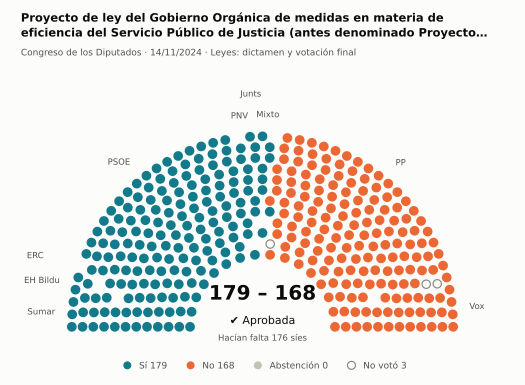
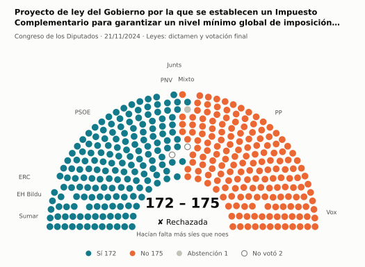
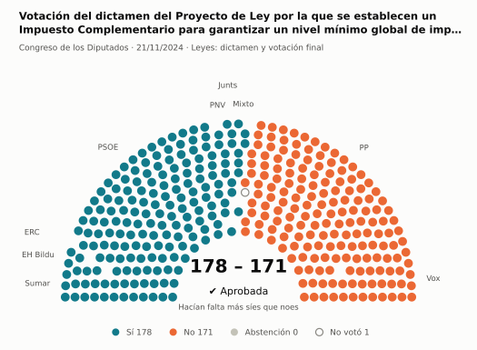
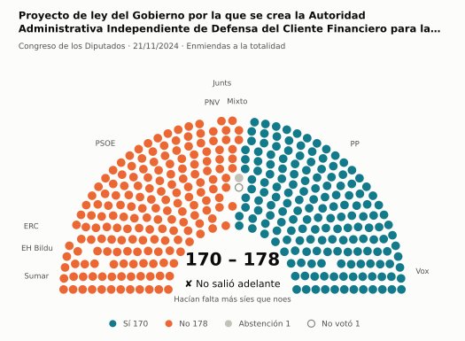
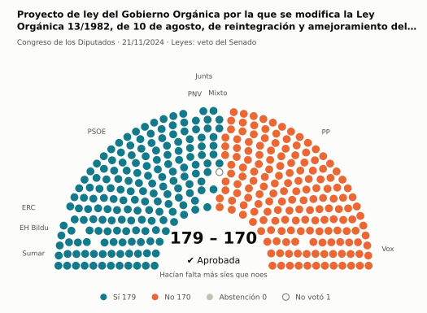
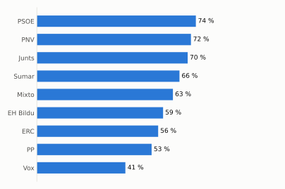
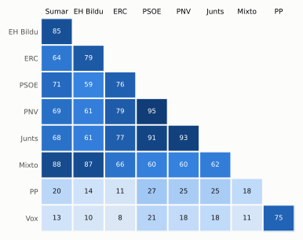

# Qué votó el Congreso en noviembre de 2024

Las votaciones del Pleno del Congreso de los Diputados, explicadas sin tecnicismos. Datos oficiales del [Congreso](https://www.congreso.es/es/opendata/votaciones); este resumen se actualiza solo cada mes (última vez: 11/11/2026).

## En pocas palabras

- El Congreso votó **131 veces** en 6 días de pleno. **64 propuestas salieron adelante** y 67 no.
- 73 votaciones fueron sobre leyes, decretos o presupuestos. Otras 56 fueron peticiones al Gobierno que no le obligan (proposiciones no de ley y mociones).
- El Gobierno (PSOE y Sumar) perdió **7** de las 92 votaciones en las que sus grupos votaron lo mismo.
- La votación más reñida se decidió superó los 176 síes por 3 votos: Proyecto de ley del Gobierno Orgánica de medidas en materia de eficiencia del Servicio Público de Justicia (antes….
- Los diputados casi siempre votan lo mismo que su grupo: en todo el mes solo hubo 49 votos distintos (sin contar el Grupo Mixto).

## Las votaciones más importantes del mes

Elegidas por su importancia: pesan más las leyes y los decretos que las peticiones al Gobierno, y suben las que se decidieron por pocos votos o las que perdió el Gobierno. Cada punto del dibujo es un diputado, colocado con su grupo, y el color es lo que votó.

### 1. Proyecto de ley del Gobierno Orgánica de medidas en materia de eficiencia del Servicio Público de Justicia (antes denominado Proyecto de Ley…

**14 de noviembre · Leyes: dictamen y votación final.** Votación del texto de una ley después de trabajarla en comisión.

<picture>
  <source media="(prefers-color-scheme: dark)" srcset="img/2024-11/votacion-L15-S076-V040-oscuro.svg">
  
</picture>

**✔ Salió adelante** superó los 176 síes por 3 votos: 179 a favor, 168 en contra y ninguna abstención.

- **A favor:** PSOE, Sumar, Junts, ERC, EH Bildu y PNV
- **En contra:** PP y Vox
- **Repartidos:** Grupo Mixto (Sí 7, No 1)

Este asunto tuvo 36 votaciones este mes; aquí se muestra la más disputada. [Datos oficiales](https://www.congreso.es/webpublica/opendata/votaciones/Leg15/Sesion076/20241114/Votacion040/VOT_20241114151049.json)

### 2. Proyecto de ley del Gobierno por la que se establecen un Impuesto Complementario para garantizar un nivel mínimo global de imposición para los…

**21 de noviembre · Leyes: dictamen y votación final.** Votación del texto de una ley después de trabajarla en comisión.

<picture>
  <source media="(prefers-color-scheme: dark)" srcset="img/2024-11/votacion-L15-S079-V019-oscuro.svg">
  
</picture>

**✘ No salió adelante** por 3 votos: 172 a favor, 175 en contra y 1 abstención.

- **A favor:** PSOE, Sumar, Junts, ERC, EH Bildu y PNV
- **En contra:** PP y Vox
- **Repartidos:** Grupo Mixto (Sí 1, No 5, Abstención 1)

Este asunto tuvo 24 votaciones este mes; aquí se muestra la más disputada. [Datos oficiales](https://www.congreso.es/webpublica/opendata/votaciones/Leg15/Sesion079/20241121/Votacion019/VOT_20241121173816.json)

### 3. Votación del dictamen del Proyecto de Ley por la que se establecen un Impuesto Complementario para garantizar un nivel mínimo global de imposición…

**21 de noviembre · Leyes: dictamen y votación final.** Votación del texto de una ley después de trabajarla en comisión.

<picture>
  <source media="(prefers-color-scheme: dark)" srcset="img/2024-11/votacion-L15-S079-V062-oscuro.svg">
  
</picture>

**✔ Salió adelante** por 7 votos: 178 a favor, 171 en contra y ninguna abstención.

- **A favor:** PSOE, Sumar, Junts, ERC, EH Bildu y PNV
- **En contra:** PP y Vox
- **Repartidos:** Grupo Mixto (Sí 6, No 1)

[Datos oficiales](https://www.congreso.es/webpublica/opendata/votaciones/Leg15/Sesion079/20241121/Votacion062/VOT_20241121173859.json)

### 4. Proyecto de ley del Gobierno por la que se crea la Autoridad Administrativa Independiente de Defensa del Cliente Financiero para la resolución…

**21 de noviembre · Enmiendas a la totalidad.** Un grupo intenta devolver la ley a quien la propuso o sustituirla por otra. Si no sale adelante, la ley sigue su camino.

<picture>
  <source media="(prefers-color-scheme: dark)" srcset="img/2024-11/votacion-L15-S079-V063-oscuro.svg">
  
</picture>

**✘ No salió adelante** por 8 votos: 170 a favor, 178 en contra y 1 abstención.

- **A favor:** PP y Vox
- **En contra:** PSOE, Sumar, Junts, ERC, EH Bildu y PNV
- **Repartidos:** Grupo Mixto (No 6, Abstención 1)

Este asunto tuvo 2 votaciones este mes; aquí se muestra la más disputada. [Datos oficiales](https://www.congreso.es/webpublica/opendata/votaciones/Leg15/Sesion079/20241121/Votacion063/VOT_20241121173900.json)

### 5. Proyecto de ley del Gobierno Orgánica por la que se modifica la Ley Orgánica 13/1982, de 10 de agosto, de reintegración y amejoramiento del Régimen…

**21 de noviembre · Leyes: veto del Senado.** El Senado rechazó la ley entera. El Congreso puede levantar el veto: enseguida con 176 votos o, pasados dos meses, con más síes que noes.

<picture>
  <source media="(prefers-color-scheme: dark)" srcset="img/2024-11/votacion-L15-S079-V065-oscuro.svg">
  
</picture>

**✔ Salió adelante** por 9 votos: 179 a favor, 170 en contra y ninguna abstención.

- **A favor:** PSOE, Sumar, Grupo Mixto, Junts, ERC, EH Bildu y PNV
- **En contra:** PP y Vox

[Datos oficiales](https://www.congreso.es/webpublica/opendata/votaciones/Leg15/Sesion079/20241121/Votacion065/VOT_20241121173902.json)

## ¿Qué grupos votaron más veces lo que finalmente salió?

<picture>
  <source media="(prefers-color-scheme: dark)" srcset="img/2024-11/ganadora-oscuro.svg">
  
</picture>

Porcentaje de votaciones en que el grupo votó Sí y salió adelante, o votó No y no salió. Abstenerse no cuenta como acertar.

## ¿Quién vota con quién?

<picture>
  <source media="(prefers-color-scheme: dark)" srcset="img/2024-11/afinidad-oscuro.svg">
  
</picture>

Cada casilla dice en qué porcentaje de las votaciones dos grupos votaron lo mismo: 100 es que siempre coincidieron y 0 que nunca.

## ¿Qué tipo de cosas se votaron?

| Tipo | Votaciones | Salieron adelante | Qué es |
| --- | ---: | ---: | --- |
| Leyes: dictamen y votación final | 62 | 26 | Votación del texto de una ley después de trabajarla en comisión. |
| Mociones | 48 | 25 | Petición al Gobierno después de pedirle explicaciones en el Pleno. Expresa la opinión del Congreso, pero no obliga. |
| Proposiciones no de ley | 8 | 3 | Petición al Gobierno para que haga algo. Expresa la opinión del Congreso, pero no obliga. |
| Leyes: toma en consideración | 4 | 3 | Primer paso de una ley propuesta por un grupo o una comunidad autónoma: el Congreso decide si empieza a tramitarla. |
| Enmiendas a la totalidad | 3 | 1 | Un grupo intenta devolver la ley a quien la propuso o sustituirla por otra. Si no sale adelante, la ley sigue su camino. |
| Decretos-ley (convalidación) | 2 | 2 | El Gobierno aprobó esta norma por urgencia. Ya está en vigor, pero el Congreso tiene 30 días para confirmarla o tumbarla. |
| Tratados internacionales | 2 | 2 | El Congreso autoriza a España a comprometerse con un acuerdo con otro país u organismo. |
| Leyes: veto del Senado | 1 | 1 | El Senado rechazó la ley entera. El Congreso puede levantar el veto: enseguida con 176 votos o, pasados dos meses, con más síes que noes. |
| Presupuestos y estabilidad | 1 | 1 | Cuentas públicas: límites de déficit y deuda o cuentas del Estado. |

## Palabras que conviene saber

- **Pleno**: La reunión de los 350 diputados, donde se vota.
- **Grupo parlamentario**: Los diputados de un partido o coalición. Los partidos pequeños van juntos en el Grupo Mixto, aunque no piensen igual.
- **Abstención**: El diputado vota, pero ni a favor ni en contra.
- **No votó**: El diputado no votó: no estaba, estaba de baja o el escaño estaba vacío.
- **Mayoría simple**: Salen adelante las votaciones con más síes que noes. Es lo normal.
- **Mayoría absoluta**: 176 votos a favor, la mitad más uno de 350. La piden las leyes orgánicas (derechos fundamentales, sistema electoral…) y la primera votación de investidura.
- **Votación por llamamiento**: Cada diputado dice su voto en voz alta. Se usa en las investiduras y otras votaciones importantes.

---

**¿Quieres más detalle?** El [análisis detallado](2024-11-detalle.md) tiene la cohesión de cada grupo, un mapa de los diputados según cómo votan, qué diputados votaron distinto de su grupo, las ausencias y la lista completa de votaciones.

_Los resultados están calculados a partir de los votos: el Congreso no publica si cada votación salió adelante. Este proyecto no tiene relación con el Congreso. Método en [docs/DOCUMENTO_FUNCIONAL.md](../docs/DOCUMENTO_FUNCIONAL.md)._
