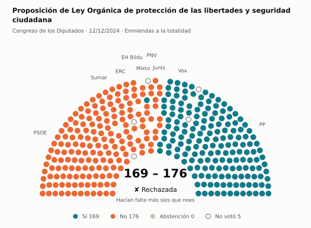
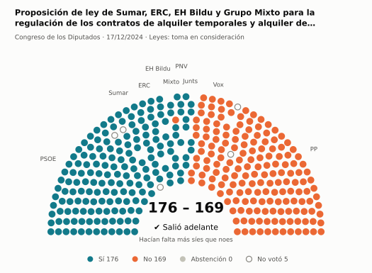
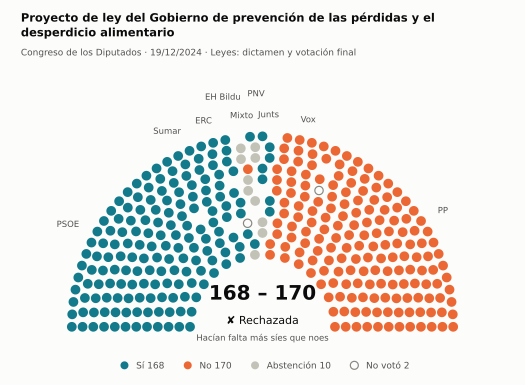
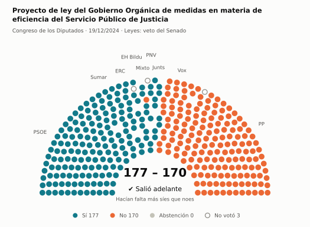
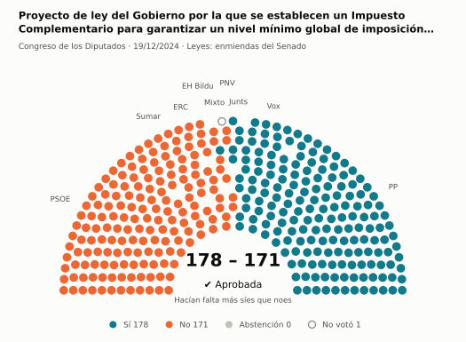
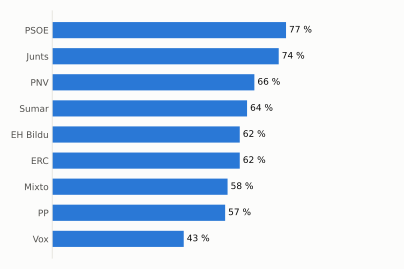
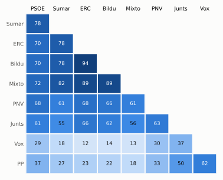

# Qué votó el Congreso en diciembre de 2024

Las votaciones del Pleno del Congreso de los Diputados, explicadas sin tecnicismos. Datos oficiales del [Congreso](https://www.congreso.es/es/opendata/votaciones); este resumen se actualiza solo cada mes (última vez: 10/11/2026).

## En pocas palabras

- El Congreso votó **125 veces** en 4 días de pleno. **50 propuestas salieron adelante** y 74 no; hubo además 1 empate, que se repiten.
- 86 votaciones fueron sobre leyes, decretos o presupuestos. Otras 36 fueron peticiones al Gobierno que no le obligan (proposiciones no de ley y mociones).
- El Gobierno (PSOE y Sumar) perdió **21** de las 96 votaciones en las que sus grupos votaron lo mismo.
- La votación más reñida se decidió por 2 votos: Proyecto de ley del Gobierno de prevención de las pérdidas y el desperdicio alimentario.
- Los diputados casi siempre votan lo mismo que su grupo: en todo el mes solo hubo 62 votos distintos (sin contar el Grupo Mixto).

## Las votaciones más importantes del mes

Elegidas por su importancia: pesan más las leyes y los decretos que las peticiones al Gobierno, y suben las que se decidieron por pocos votos o las que perdió el Gobierno. Cada punto del dibujo es un diputado, colocado con su grupo, y el color es lo que votó.

### 1. Proposición de Ley Orgánica de protección de las libertades y seguridad ciudadana

**12 de diciembre · Enmiendas a la totalidad.** Un grupo intenta devolver la ley a quien la propuso o sustituirla por otra. Si no sale adelante, la ley sigue su camino.

<picture>
  <source media="(prefers-color-scheme: dark)" srcset="img/2024-12/votacion-L15-S085-V008-oscuro.svg">
  
</picture>

**✘ No salió adelante** por 7 votos: 169 a favor, 176 en contra y ninguna abstención.

- **A favor:** PP y Vox
- **En contra:** PSOE, Sumar, Junts, ERC, EH Bildu y PNV
- **Repartidos:** Grupo Mixto (Sí 1, No 6)

Este asunto tuvo 2 votaciones este mes; aquí se muestra la más disputada. [Datos oficiales](https://www.congreso.es/webpublica/opendata/votaciones/Leg15/Sesion085/20241212/Votacion008/VOT_20241212130551.json)

### 2. Proposición de ley de Sumar, ERC, EH Bildu y Grupo Mixto para la regulación de los contratos de alquiler temporales y alquiler de habitaciones

**17 de diciembre · Leyes: toma en consideración.** Primer paso de una ley propuesta por un grupo o una comunidad autónoma: el Congreso decide si empieza a tramitarla.

<picture>
  <source media="(prefers-color-scheme: dark)" srcset="img/2024-12/votacion-L15-S086-V001-oscuro.svg">
  
</picture>

**✔ Salió adelante** por 7 votos: 176 a favor, 169 en contra y ninguna abstención.

- **A favor:** PSOE, Sumar, Junts, ERC, EH Bildu y PNV
- **En contra:** PP y Vox
- **Repartidos:** Grupo Mixto (Sí 7, No 1)

[Datos oficiales](https://www.congreso.es/webpublica/opendata/votaciones/Leg15/Sesion086/20241217/Votacion001/VOT_20241217205720.json)

### 3. Proyecto de ley del Gobierno de prevención de las pérdidas y el desperdicio alimentario

**19 de diciembre · Leyes: dictamen y votación final.** Votación del texto de una ley después de trabajarla en comisión.

<picture>
  <source media="(prefers-color-scheme: dark)" srcset="img/2024-12/votacion-L15-S088-V029-oscuro.svg">
  
</picture>

**✘ No salió adelante** por 2 votos: 168 a favor, 170 en contra y 10 abstenciones.

- **A favor:** PSOE, Sumar, Junts, ERC y EH Bildu
- **En contra:** PP y Vox
- **Se abstuvieron:** PNV
- **Repartidos:** Grupo Mixto (Sí 2, No 1, Abstención 5)

Este asunto tuvo 54 votaciones este mes; aquí se muestra la más disputada. [Datos oficiales](https://www.congreso.es/webpublica/opendata/votaciones/Leg15/Sesion088/20241219/Votacion029/VOT_20241219162734.json)

### 4. Proyecto de ley del Gobierno Orgánica de medidas en materia de eficiencia del Servicio Público de Justicia

**19 de diciembre · Leyes: veto del Senado.** El Senado rechazó la ley entera. El Congreso puede levantar el veto: enseguida con 176 votos o, pasados dos meses, con más síes que noes.

<picture>
  <source media="(prefers-color-scheme: dark)" srcset="img/2024-12/votacion-L15-S088-V088-oscuro.svg">
  
</picture>

**✔ Salió adelante** por 7 votos: 177 a favor, 170 en contra y ninguna abstención.

- **A favor:** PSOE, Sumar, Junts, ERC, EH Bildu y PNV
- **En contra:** PP y Vox
- **Repartidos:** Grupo Mixto (Sí 6, No 1)

[Datos oficiales](https://www.congreso.es/webpublica/opendata/votaciones/Leg15/Sesion088/20241219/Votacion088/VOT_20241219162842.json)

### 5. Proyecto de ley del Gobierno por la que se establecen un Impuesto Complementario para garantizar un nivel mínimo global de imposición para los grupos…

**19 de diciembre · Leyes: enmiendas del Senado.** El Senado propuso cambios a esta ley y el Congreso decide si los acepta. Es uno de los últimos pasos antes de que la ley se publique.

<picture>
  <source media="(prefers-color-scheme: dark)" srcset="img/2024-12/votacion-L15-S088-V091-oscuro.svg">
  
</picture>

**✔ Salió adelante** por 7 votos: 178 a favor, 171 en contra y ninguna abstención.

- **A favor:** PP, Vox y Junts
- **En contra:** PSOE, Sumar, ERC, EH Bildu y PNV
- **Repartidos:** Grupo Mixto (Sí 1, No 6)

Este asunto tuvo 16 votaciones este mes; aquí se muestra la más disputada. [Datos oficiales](https://www.congreso.es/webpublica/opendata/votaciones/Leg15/Sesion088/20241219/Votacion091/VOT_20241219162846.json)

## ¿Qué grupos votaron más veces lo que finalmente salió?

<picture>
  <source media="(prefers-color-scheme: dark)" srcset="img/2024-12/ganadora-oscuro.svg">
  
</picture>

Porcentaje de votaciones en que el grupo votó Sí y salió adelante, o votó No y no salió. Abstenerse no cuenta como acertar.

## ¿Quién vota con quién?

<picture>
  <source media="(prefers-color-scheme: dark)" srcset="img/2024-12/afinidad-oscuro.svg">
  
</picture>

Cada casilla dice en qué porcentaje de las votaciones dos grupos votaron lo mismo: 100 es que siempre coincidieron y 0 que nunca.

## ¿Qué tipo de cosas se votaron?

| Tipo | Votaciones | Salieron adelante | Qué es |
| --- | ---: | ---: | --- |
| Leyes: dictamen y votación final | 58 | 11 | Votación del texto de una ley después de trabajarla en comisión. |
| Mociones | 29 | 17 | Petición al Gobierno después de pedirle explicaciones en el Pleno. Expresa la opinión del Congreso, pero no obliga. |
| Leyes: enmiendas del Senado | 17 | 5 | El Senado propuso cambios a esta ley y el Congreso decide si los acepta. Es uno de los últimos pasos antes de que la ley se publique. |
| Proposiciones no de ley | 7 | 6 | Petición al Gobierno para que haga algo. Expresa la opinión del Congreso, pero no obliga. |
| Decretos-ley (convalidación) | 4 | 4 | El Gobierno aprobó esta norma por urgencia. Ya está en vigor, pero el Congreso tiene 30 días para confirmarla o tumbarla. |
| Leyes: toma en consideración | 4 | 3 | Primer paso de una ley propuesta por un grupo o una comunidad autónoma: el Congreso decide si empieza a tramitarla. |
| Organización de la Cámara | 3 | 3 | Asunto interno del Congreso: comisiones, plazos o el estatuto de los diputados. |
| Enmiendas a la totalidad | 2 | 0 | Un grupo intenta devolver la ley a quien la propuso o sustituirla por otra. Si no sale adelante, la ley sigue su camino. |
| Leyes: veto del Senado | 1 | 1 | El Senado rechazó la ley entera. El Congreso puede levantar el veto: enseguida con 176 votos o, pasados dos meses, con más síes que noes. |

## Palabras que conviene saber

- **Pleno**: La reunión de los 350 diputados, donde se vota.
- **Grupo parlamentario**: Los diputados de un partido o coalición. Los partidos pequeños van juntos en el Grupo Mixto, aunque no piensen igual.
- **Abstención**: El diputado vota, pero ni a favor ni en contra.
- **No votó**: El diputado no votó: no estaba, estaba de baja o el escaño estaba vacío.
- **Mayoría simple**: Salen adelante las votaciones con más síes que noes. Es lo normal.
- **Mayoría absoluta**: 176 votos a favor, la mitad más uno de 350. La piden las leyes orgánicas (derechos fundamentales, sistema electoral…) y la primera votación de investidura.
- **Votación por llamamiento**: Cada diputado dice su voto en voz alta. Se usa en las investiduras y otras votaciones importantes.

---

**¿Quieres más detalle?** El [análisis detallado](2024-12-detalle.md) tiene la cohesión de cada grupo, un mapa de los diputados según cómo votan, qué diputados votaron distinto de su grupo, las ausencias y la lista completa de votaciones.

_Los resultados están calculados a partir de los votos: el Congreso no publica si cada votación salió adelante. Este proyecto no tiene relación con el Congreso. Método en [docs/DOCUMENTO_FUNCIONAL.md](../docs/DOCUMENTO_FUNCIONAL.md)._
