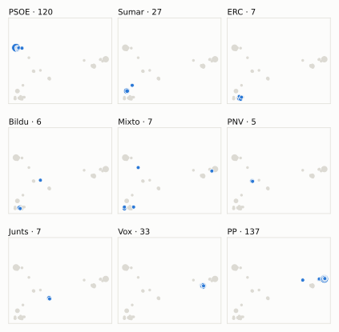
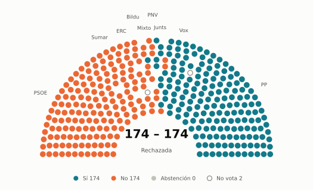
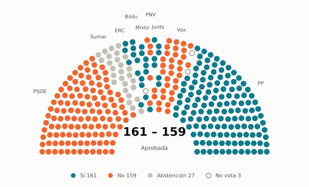
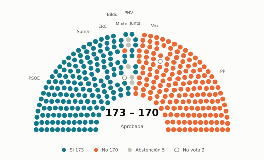

# Votaciones del Congreso: diciembre de 2024

_Generado automáticamente el 2026-11-10 con datos abiertos del [Congreso de los Diputados](https://www.congreso.es/es/opendata/votaciones). Solo plenos y Diputación Permanente. Método y límites en [docs/DOCUMENTO_FUNCIONAL.md](../docs/DOCUMENTO_FUNCIONAL.md)._

## Resumen

- **125 votaciones** en 4 días de pleno (sesiones 83, 85, 86 y 88).
- **50 aprobadas** y **74 rechazadas**, más 1 empate que obligaron a repetir.
- 7 votaciones se decidieron por 5 votos o menos.
- El grupo que más veces votó con el resultado final: **PSOE** (77 % de las votaciones nominales).
- Los grupos del Gobierno (PSOE y Sumar) votaron lo mismo en 96 de 125 votaciones nominales y perdieron 21 de ellas.
- 62 votos individuales se apartaron de la posición de su grupo (59 diputados).

## Cómo votó cada grupo

| Grupo | Diputados | Cohesión | Votó con el resultado | Decisivo | Posición Sí | Posición No | Posición Abst. |
| --- | ---: | ---: | ---: | ---: | ---: | ---: | ---: |
| PP | 137 | 100 % | 57 % | 26 | 75 | 35 | 15 |
| PSOE | 120 | 100 % | 77 % | 42 | 43 | 79 | 3 |
| Vox | 33 | 100 % | 43 % | 19 | 48 | 46 | 31 |
| Sumar | 27 | 100 % | 64 % | 26 | 48 | 68 | 9 |
| Mixto | 8 | 70 % | 58 % | 5 | 57 | 66 | 2 |
| Junts | 7 | 100 % | 74 % | 13 | 55 | 56 | 14 |
| ERC | 7 | 99 % | 62 % | 8 | 64 | 56 | 5 |
| Bildu | 6 | 100 % | 62 % | 4 | 63 | 55 | 7 |
| PNV | 5 | 100 % | 66 % | 1 | 41 | 59 | 25 |

*Cohesión*: índice de acuerdo interno (100 % = todo el grupo votó igual). *Votó con el resultado*: el grupo votó Sí y salió aprobada, o No y salió rechazada. *Decisivo*: votaciones cuyo resultado habría cambiado si el grupo se hubiera abstenido en bloque. El Grupo Mixto reúne partidos distintos: su posición es la de su mayoría.

## Mapa de diputados

<picture>
  <source media="(prefers-color-scheme: dark)" srcset="img/2024-12/mapa-oscuro.svg">
  
</picture>

Cada punto es un diputado; dos diputados están cerca si votaron parecido. Un punto más grande reúne a varios que votaron exactamente igual. En cada panel, el grupo en azul y el resto del Congreso en gris.

*Cómo se calcula*: componentes principales de los votos (Sí, No, abstención) en 120 votaciones con algún desacuerdo. El eje horizontal recoge el 75 % de la variación y el vertical el 10 %. Los ejes no tienen nombre ni sentido político propio; por convención, el PP queda a la derecha. No se sitúa a 2 diputados que votó en menos de la mitad.

## Afinidad entre grupos

<picture>
  <source media="(prefers-color-scheme: dark)" srcset="img/2024-12/afinidad-oscuro.svg">
  
</picture>

Porcentaje de votaciones nominales en que los dos grupos tomaron la misma posición. Los grupos están ordenados según el mapa de diputados.

Ver la tabla

|  | PP | PSOE | Vox | Sumar | Mixto | Junts | ERC | Bildu | PNV |
| --- | :---: | :---: | :---: | :---: | :---: | :---: | :---: | :---: | :---: |
| PP | 100 % | 37 % | 62 % | 27 % | 18 % | 50 % | 23 % | 22 % | 33 % |
| PSOE | 37 % | 100 % | 29 % | 78 % | 72 % | 61 % | 70 % | 70 % | 68 % |
| Vox | 62 % | 29 % | 100 % | 18 % | 13 % | 37 % | 12 % | 14 % | 30 % |
| Sumar | 27 % | 78 % | 18 % | 100 % | 82 % | 55 % | 78 % | 78 % | 61 % |
| Mixto | 18 % | 72 % | 13 % | 82 % | 100 % | 56 % | 89 % | 89 % | 61 % |
| Junts | 50 % | 61 % | 37 % | 55 % | 56 % | 100 % | 66 % | 62 % | 63 % |
| ERC | 23 % | 70 % | 12 % | 78 % | 89 % | 66 % | 100 % | 94 % | 68 % |
| Bildu | 22 % | 70 % | 14 % | 78 % | 89 % | 62 % | 94 % | 100 % | 66 % |
| PNV | 33 % | 68 % | 30 % | 61 % | 61 % | 63 % | 68 % | 66 % | 100 % |

## Quién sacó adelante las votaciones

| Grupos que votaron Sí | Votaciones | Escaños |
| --- | ---: | ---: |
| Todos los grupos | 6 | 350 |
| PP + Vox + Junts | 6 | 177 |
| PP + PSOE + Sumar + Mixto + Junts + ERC + Bildu + PNV | 5 | 317 |
| PSOE + Sumar + Mixto + Junts + ERC + Bildu + PNV | 4 | 180 |
| PP + Vox + Junts + PNV | 3 | 182 |
| PP + Vox | 2 | 170 |
| PP + Junts + ERC + Bildu + PNV | 2 | 162 |
| PP + Sumar + Junts + ERC + Bildu + PNV | 2 | 189 |

De 50 votaciones nominales aprobadas. Otras 20 salieron con combinaciones que se dieron menos veces. La posición de cada grupo es la de la mayoría de sus diputados.

## Votaciones que perdieron los grupos del Gobierno

| Fecha | Asunto | Tipo | PSOE y Sumar votaron | Resultado | Sí | No |
| --- | --- | --- | :---: | --- | ---: | ---: |
| 10 de diciembre | Proposición de Ley del Grupo Parlamentario Socialista, sobre el derecho a otorgar instrucciones previas. | Leyes: toma en consideración | Sí | Rechazada | 162 | 180 |
| 12 de diciembre | Proposición no de Ley del Grupo Parlamentario Popular en el Congreso, para que España respalde la investigación de la Fiscalía del Tribunal Penal Internacional… *(Votación separada por puntos. Punto 1.)* | Proposiciones no de ley | No | Aprobada | 183 | 163 |
| 12 de diciembre | Proposición no de Ley del Grupo Parlamentario Popular en el Congreso, para que España respalde la investigación de la Fiscalía del Tribunal Penal Internacional… *(Votación separada por puntos. Punto 2.)* | Proposiciones no de ley | No | Aprobada | 171 | 161 |
| 12 de diciembre | Proposición no de Ley del Grupo Parlamentario Popular en el Congreso, para que España respalde la investigación de la Fiscalía del Tribunal Penal Internacional… *(Votación separada por puntos. Punto 4.)* | Proposiciones no de ley | No | Aprobada | 183 | 163 |
| 19 de diciembre | Proyecto de Ley de prevención de las pérdidas y el desperdicio alimentario. *(Enmiendas presentadas por el Grupo Parlamentario Mixto (Sra…)* | Leyes: dictamen y votación final | No | Aprobada | 171 | 167 |
| 19 de diciembre | Proyecto de Ley de prevención de las pérdidas y el desperdicio alimentario. *(Enmiendas presentadas por el Grupo Parlamentario Socialista…)* | Leyes: dictamen y votación final | Sí | Rechazada | 168 | 170 |
| 19 de diciembre | Proyecto de Ley de prevención de las pérdidas y el desperdicio alimentario. *(Enmiendas presentadas por el Grupo Parlamentario Socialista…)* | Leyes: dictamen y votación final | Sí | Rechazada | 165 | 177 |
| 19 de diciembre | Proyecto de Ley de prevención de las pérdidas y el desperdicio alimentario. *(Enmiendas presentadas por el Grupo Parlamentario Popular en…)* | Leyes: dictamen y votación final | No | Aprobada | 178 | 170 |
| 19 de diciembre | Proyecto de Ley de prevención de las pérdidas y el desperdicio alimentario. *(Enmiendas presentadas por el Grupo Parlamentario Popular en…)* | Leyes: dictamen y votación final | No | Aprobada | 177 | 171 |
| 19 de diciembre | Proyecto de Ley de prevención de las pérdidas y el desperdicio alimentario. *(Enmiendas presentadas por el Grupo Parlamentario Popular en…)* | Leyes: dictamen y votación final | No | Aprobada | 177 | 171 |
| 19 de diciembre | Proyecto de Ley de prevención de las pérdidas y el desperdicio alimentario. *(Votos particulares Voto particular número 1 presentado por…)* | Leyes: dictamen y votación final | Sí | Rechazada | 171 | 177 |
| 19 de diciembre | Proyecto de Ley de prevención de las pérdidas y el desperdicio alimentario. *(Votos particulares Voto particular número 2 presentado por…)* | Leyes: dictamen y votación final | Sí | Rechazada | 164 | 177 |
| 19 de diciembre | Proyecto de Ley de prevención de las pérdidas y el desperdicio alimentario. *(Votos particulares Voto particular número 3 presentado por…)* | Leyes: dictamen y votación final | Sí | Rechazada | 172 | 176 |
| 19 de diciembre | Proyecto de Ley de prevención de las pérdidas y el desperdicio alimentario. *(Votos particulares Voto particular número 5 presentado por…)* | Leyes: dictamen y votación final | Sí | Rechazada | 157 | 176 |
| 19 de diciembre | Proposición no de Ley del Grupo Parlamentario Euskal Herria Bildu, relativa al aumento de la indemnización por despido improcedente. | Proposiciones no de ley | Sí | Rechazada | 165 | 172 |

Y 6 más (ver «Todas las votaciones»).

Además, PSOE y Sumar votaron distinto entre sí en 27 votaciones.

## Votaciones más ajustadas

**19 de diciembre** · Proyecto de Ley de prevención de las pérdidas y el desperdicio alimentario. *(Enmiendas presentadas por el Grupo Parlamentario Popular en…)*

<picture>
  <source media="(prefers-color-scheme: dark)" srcset="img/2024-12/hemiciclo-L15-S088-V037-oscuro.svg">
  
</picture>

**19 de diciembre** · Proyecto de Ley de prevención de las pérdidas y el desperdicio alimentario. *(Enmiendas presentadas por el Grupo Parlamentario Republican…)*

<picture>
  <source media="(prefers-color-scheme: dark)" srcset="img/2024-12/hemiciclo-L15-S088-V017-oscuro.svg">
  
</picture>

**19 de diciembre** · Proyecto de Ley de prevención de las pérdidas y el desperdicio alimentario. *(Enmiendas presentadas por el Grupo Parlamentario Socialista…)*

<picture>
  <source media="(prefers-color-scheme: dark)" srcset="img/2024-12/hemiciclo-L15-S088-V029-oscuro.svg">
  
</picture>

**19 de diciembre** · Proyecto de Ley de prevención de las pérdidas y el desperdicio alimentario. *(Enmiendas transaccionales Enmienda transaccional número 1 a…)*

<picture>
  <source media="(prefers-color-scheme: dark)" srcset="img/2024-12/hemiciclo-L15-S088-V054-oscuro.svg">
  
</picture>

Cada punto es un escaño, agrupado por grupo parlamentario; el color es su voto.

| Fecha | Asunto | Resultado | Sí | No | Abst. |
| --- | --- | :---: | ---: | ---: | ---: |
| 19 de diciembre | Proyecto de Ley de prevención de las pérdidas y el desperdicio alimentario. *(Enmiendas presentadas por el Grupo Parlamentario Popular en…)* | Empate (se repite) | 174 | 174 | 0 |
| 19 de diciembre | Proyecto de Ley de prevención de las pérdidas y el desperdicio alimentario. *(Enmiendas presentadas por el Grupo Parlamentario Republican…)* | Aprobada | 161 | 159 | 27 |
| 19 de diciembre | Proyecto de Ley de prevención de las pérdidas y el desperdicio alimentario. *(Enmiendas presentadas por el Grupo Parlamentario Socialista…)* | Rechazada | 168 | 170 | 10 |
| 19 de diciembre | Proyecto de Ley de prevención de las pérdidas y el desperdicio alimentario. *(Enmiendas transaccionales Enmienda transaccional número 1 a…)* | Aprobada | 173 | 170 | 5 |
| 19 de diciembre | Proyecto de Ley de prevención de las pérdidas y el desperdicio alimentario. *(Enmiendas presentadas por el Grupo Parlamentario Mixto (Sra…)* | Aprobada | 171 | 167 | 10 |
| 19 de diciembre | Proyecto de Ley de prevención de las pérdidas y el desperdicio alimentario. *(Votos particulares Voto particular número 3 presentado por…)* | Rechazada | 172 | 176 | 0 |
| 19 de diciembre | Moción consecuencia de interpelación urgente del Grupo Parlamentario Republicano, sobre la democratización del sistema de representatividad y la lucha contra l… *(Votación separada por puntos Punto 7.)* | Aprobada | 28 | 23 | 298 |
| 19 de diciembre | Proyecto de Ley de prevención de las pérdidas y el desperdicio alimentario. *(Enmiendas presentadas por el Grupo Parlamentario Popular en…)* | Aprobada | 177 | 171 | 0 |
| 19 de diciembre | Proyecto de Ley de prevención de las pérdidas y el desperdicio alimentario. *(Enmiendas presentadas por el Grupo Parlamentario Popular en…)* | Aprobada | 177 | 171 | 0 |
| 19 de diciembre | Proyecto de Ley de prevención de las pérdidas y el desperdicio alimentario. *(Votos particulares Voto particular número 1 presentado por…)* | Rechazada | 171 | 177 | 0 |

Votaciones decididas por 10 votos o menos (o a esa distancia de la mayoría que exigían). Las públicas por llamamiento no tienen hemiciclo: el voto de cada diputado solo consta en el Diario de Sesiones.

## Qué se votó, por tipo de asunto

| Tipo de asunto | Votaciones | Aprobadas | No aprobadas |
| --- | ---: | ---: | ---: |
| Leyes: dictamen y votación final | 58 | 11 | 47 |
| Mociones | 29 | 17 | 12 |
| Leyes: enmiendas del Senado | 17 | 5 | 12 |
| Proposiciones no de ley | 7 | 6 | 1 |
| Decretos-ley (convalidación) | 4 | 4 | 0 |
| Leyes: toma en consideración | 4 | 3 | 1 |
| Organización de la Cámara | 3 | 3 | 0 |
| Enmiendas a la totalidad | 2 | 0 | 2 |
| Otros | 1 | 1 | 0 |

Las proposiciones no de ley y las mociones expresan la posición del Congreso pero no obligan al Gobierno. Las leyes pasan por varias votaciones (toma en consideración, totalidad, dictamen, Senado), así que una misma ley puede aparecer varias veces.

## Votos distintos de su grupo

| Diputado | Grupo | Votos distintos de su grupo |
| --- | --- | ---: |
| Díaz Pérez, Yolanda | Sumar | 2 |
| Hernández Quero, Carlos | Vox | 2 |
| Mesquida Mayans, Joan | PP | 2 |
| Acedo Reyes, Sofía | PP | 1 |
| Agirretxea Urresti, Joseba Andoni | PNV | 1 |
| Alfonso Silvestre, Alma | PP | 1 |
| Argüelles García, Silverio | PP | 1 |
| Belda Pérez-Pedrero, Enrique | PP | 1 |
| Belmonte Gómez, Rafael Benigno | PP | 1 |
| Bendodo Benasayag, Elías | PP | 1 |
| Bravo Baena, Juan | PP | 1 |
| Cuesta Rodríguez, María del Socorro | PP | 1 |
| De Meer Méndez, Rocío | Vox | 1 |
| De las Cuevas Cortés, Félix | PP | 1 |
| Del Valle Rodríguez, Emilio Jesús | Vox | 1 |

Un voto aislado puede ser un error al pulsar, no una decisión política: el Congreso no publica las correcciones. Se excluye el Grupo Mixto.

## Diputados que más veces no votaron

| Diputado | Grupo | No votó | % de votaciones |
| --- | --- | ---: | ---: |
| Ábalos Meco, José Luis | Mixto | 70 | 56 % |
| Pozueta Fernández, Isabel | Bildu | 56 | 45 % |
| Núñez González, Noelia | PP | 55 | 44 % |
| Díaz Pérez, Yolanda | Sumar | 18 | 14 % |
| Núñez Feijóo, Alberto | PP | 18 | 14 % |
| Sánchez Pérez-Castejón, Pedro | PSOE | 18 | 14 % |
| Legarda Uriarte, Mikel | PNV | 4 | 3 % |
| Puente Santiago, Óscar | PSOE | 4 | 3 % |
| Agirretxea Urresti, Joseba Andoni | PNV | 3 | 2 % |
| Delgado Arce, Celso Luis | PP | 3 | 2 % |
| Martínez Labella, Ana | PP | 3 | 2 % |
| Ortega Smith-Molina, Francisco Javier | Vox | 3 | 2 % |
| Celaya Brey, Javier | PP | 2 | 2 % |
| Esteban Bravo, Aitor | PNV | 2 | 2 % |
| Granollers Cunillera, Inés | ERC | 2 | 2 % |

«No vota» incluye ausencias justificadas (baja, maternidad o paternidad) y escaños vacantes; el portal no las distingue.

## Todas las votaciones

Posición de cada grupo: la opción que votó la mayoría de sus diputados (*Div.*: empate dentro del grupo). El número enlaza al JSON oficial o, en las votaciones por llamamiento, al Diario de Sesiones.

### 10 de diciembre (sesión 83)

| Nº | Asunto | Resultado | Sí | No | Abst. | PP | PSOE | Vox | Sumar | Mixto | Junts | ERC | Bildu | PNV | Decisivos |
| ---: | --- | --- | ---: | ---: | ---: | :---: | :---: | :---: | :---: | :---: | :---: | :---: | :---: | :---: | --- |
| [1](https://www.congreso.es/webpublica/opendata/votaciones/Leg15/Sesion083/20241210/Votacion001/VOT_20241210202031.json) | Proposición de Ley sobre ratios de enfermeras para garantizar la seguridad del paciente en centros sanitarios y otros ámbitos (corresponde a los números de exp… | Aprobada | 316 | 5 | 21 | Sí | Sí | Sí | Sí | Sí | Abst. | Abst. | Abst. | No |  |
| [2](https://www.congreso.es/webpublica/opendata/votaciones/Leg15/Sesion083/20241210/Votacion002/VOT_20241210202032.json) | Proposición de Ley del Grupo Parlamentario Socialista, sobre el derecho a otorgar instrucciones previas. | Rechazada | 162 | 180 | 1 | No | Sí | No | Sí | Sí | No | Sí | Sí | No | PP, Vox |

### 12 de diciembre (sesión 85)

| Nº | Asunto | Resultado | Sí | No | Abst. | PP | PSOE | Vox | Sumar | Mixto | Junts | ERC | Bildu | PNV | Decisivos |
| ---: | --- | --- | ---: | ---: | ---: | :---: | :---: | :---: | :---: | :---: | :---: | :---: | :---: | :---: | --- |
| [1](https://www.congreso.es/webpublica/opendata/votaciones/Leg15/Sesion085/20241212/Votacion001/VOT_20241212130537.json) | Proposición no de Ley del Grupo Parlamentario Socialista, para el reconocimiento a las mujeres constituyentes. | Aprobada | 287 | 33 | 26 | Sí | Sí | No | Sí | Sí | Abst. | Abst. | Abst. | Abst. |  |
| [2](https://www.congreso.es/webpublica/opendata/votaciones/Leg15/Sesion085/20241212/Votacion002/VOT_20241212130540.json) | Proposición no de Ley del Grupo Parlamentario Popular en el Congreso, para que España respalde la investigación de la Fiscalía del Tribunal Penal Internacional… *(Votación separada por puntos. Punto 1.)* | Aprobada | 183 | 163 | 0 | Sí | No | Sí | No | No | Sí | No | No | Sí | PP, Vox |
| [3](https://www.congreso.es/webpublica/opendata/votaciones/Leg15/Sesion085/20241212/Votacion003/VOT_20241212130542.json) | Proposición no de Ley del Grupo Parlamentario Popular en el Congreso, para que España respalde la investigación de la Fiscalía del Tribunal Penal Internacional… *(Votación separada por puntos. Punto 2.)* | Aprobada | 171 | 161 | 13 | Sí | No | Sí | No | No | Abst. | No | No | Abst. | PP, Vox |
| [4](https://www.congreso.es/webpublica/opendata/votaciones/Leg15/Sesion085/20241212/Votacion004/VOT_20241212130543.json) | Proposición no de Ley del Grupo Parlamentario Popular en el Congreso, para que España respalde la investigación de la Fiscalía del Tribunal Penal Internacional… *(Votación separada por puntos. Punto 3.)* | Aprobada | 302 | 31 | 13 | Sí | Sí | Sí | No | No | Sí | Abst. | Abst. | Sí |  |
| [5](https://www.congreso.es/webpublica/opendata/votaciones/Leg15/Sesion085/20241212/Votacion005/VOT_20241212130545.json) | Proposición no de Ley del Grupo Parlamentario Popular en el Congreso, para que España respalde la investigación de la Fiscalía del Tribunal Penal Internacional… *(Votación separada por puntos. Punto 4.)* | Aprobada | 183 | 163 | 0 | Sí | No | Sí | No | No | Sí | No | No | Sí | PP, Vox |
| [6](https://www.congreso.es/webpublica/opendata/votaciones/Leg15/Sesion085/20241212/Votacion006/VOT_20241212130547.json) | Moción consecuencia de interpelación urgente del Grupo Parlamentario VOX, sobre la política que va a desarrollar el Gobierno para afrontar la regularización de… | Rechazada | 33 | 176 | 137 | Abst. | No | Sí | No | No | No | No | No | No |  |
| [7](https://www.congreso.es/webpublica/opendata/votaciones/Leg15/Sesion085/20241212/Votacion007/VOT_20241212130549.json) | Moción consecuencia de interpelación urgente del Grupo Parlamentario Popular en el Congreso, sobre cómo está afectando al Ministerio de Política Territorial y… | Rechazada | 137 | 175 | 33 | Sí | No | Abst. | No | No | No | No | No | No | PSOE |
| [8](https://www.congreso.es/webpublica/opendata/votaciones/Leg15/Sesion085/20241212/Votacion008/VOT_20241212130551.json) | Proposición de Ley Orgánica de protección de las libertades y seguridad ciudadana. *(Enmiendas a la totalidad de texto alternativo. Enmienda a l…)* | Rechazada | 169 | 176 | 0 | Sí | No | Sí | No | No | No | No | No | No | PSOE, Sumar |
| [9](https://www.congreso.es/webpublica/opendata/votaciones/Leg15/Sesion085/20241212/Votacion009/VOT_20241212130552.json) | Proposición de Ley Orgánica de protección de las libertades y seguridad ciudadana. *(Enmiendas a la totalidad de texto alternativo. Enmienda a l…)* | Rechazada | 33 | 176 | 137 | Abst. | No | Sí | No | No | No | No | No | No |  |
| [10](https://www.congreso.es/webpublica/opendata/votaciones/Leg15/Sesion085/20241212/Votacion010/VOT_20241212130554.json) | Real Decreto-ley 7/2024, de 11 de noviembre, por el que se adoptan medidas urgentes para el impulso del Plan de respuesta inmediata, reconstrucción y relanzami… | Aprobada | 312 | 33 | 0 | Sí | Sí | No | Sí | Sí | Sí | Sí | Sí | Sí |  |
| [11](https://www.congreso.es/webpublica/opendata/votaciones/Leg15/Sesion085/20241212/Votacion011/VOT_20241212130556.json) | Tramitación como Proyecto de Ley por el procedimiento de urgencia del Real Decreto-ley 7/2024, de 11 de noviembre, por el que se adoptan medidas urgentes para… | Aprobada | 346 | 0 | 0 | Sí | Sí | Sí | Sí | Sí | Sí | Sí | Sí | Sí |  |
| [12](https://www.congreso.es/webpublica/opendata/votaciones/Leg15/Sesion085/20241212/Votacion012/VOT_20241212130557.json) | Proposición de Ley para la mejora de la protección de las personas donantes en vivo de órganos o tejidos para su posterior trasplante. Votación de la enmienda. | Rechazada | 136 | 177 | 33 | Sí | No | Abst. | No | No | No | No | No | No | PSOE |
| [13](https://www.congreso.es/webpublica/opendata/votaciones/Leg15/Sesion085/20241212/Votacion013/VOT_20241212130559.json) | Votación de la solicitud de avocación por el Pleno de la Cámara de la deliberación y votación final del Proyecto de Ley de modificación del Texto Refundido de… | Aprobada | 346 | 0 | 0 | Sí | Sí | Sí | Sí | Sí | Sí | Sí | Sí | Sí |  |
| [14](https://www.congreso.es/webpublica/opendata/votaciones/Leg15/Sesion085/20241212/Votacion014/VOT_20241212130600.json) | Solicitud de la Comisión de seguimiento y evaluación de los acuerdos del Pacto de Estado en materia de Violencia de Género, de prórroga del plazo para la concl… | Aprobada | 313 | 33 | 0 | Sí | Sí | No | Sí | Sí | Sí | Sí | Sí | Sí |  |

### 17 de diciembre (sesión 86)

| Nº | Asunto | Resultado | Sí | No | Abst. | PP | PSOE | Vox | Sumar | Mixto | Junts | ERC | Bildu | PNV | Decisivos |
| ---: | --- | --- | ---: | ---: | ---: | :---: | :---: | :---: | :---: | :---: | :---: | :---: | :---: | :---: | --- |
| [1](https://www.congreso.es/webpublica/opendata/votaciones/Leg15/Sesion086/20241217/Votacion001/VOT_20241217205720.json) | Proposición de Ley de los Grupos Parlamentarios Plurinacional SUMAR, Republicano, Euskal Herria Bildu y Mixto, para la regulación de los contratos de alquiler… | Aprobada | 176 | 169 | 0 | No | Sí | No | Sí | Sí | Sí | Sí | Sí | Sí | Junts, Mixto, ERC, PSOE, Sumar |
| [2](https://www.congreso.es/webpublica/opendata/votaciones/Leg15/Sesion086/20241217/Votacion002/VOT_20241217205721.json) | Proposición de Ley del Grupo Parlamentario Socialista, de modificación del Real Decreto Legislativo 1/2007, de 16 de noviembre, por el que se aprueba el texto… | Aprobada | 311 | 33 | 0 | Sí | Sí | No | Sí | Sí | Sí | Sí | Sí | Sí |  |

### 19 de diciembre (sesión 88)

| Nº | Asunto | Resultado | Sí | No | Abst. | PP | PSOE | Vox | Sumar | Mixto | Junts | ERC | Bildu | PNV | Decisivos |
| ---: | --- | --- | ---: | ---: | ---: | :---: | :---: | :---: | :---: | :---: | :---: | :---: | :---: | :---: | --- |
| [1](https://www.congreso.es/webpublica/opendata/votaciones/Leg15/Sesion088/20241219/Votacion001/VOT_20241219162658.json) | Proyecto de Ley de prevención de las pérdidas y el desperdicio alimentario. *(Enmiendas presentadas por el Grupo Parlamentario Mixto (Sra…)* | Rechazada | 44 | 303 | 1 | No | No | No | Sí | Sí | No | Sí | Sí | No |  |
| [2](https://www.congreso.es/webpublica/opendata/votaciones/Leg15/Sesion088/20241219/Votacion002/VOT_20241219162700.json) | Proyecto de Ley de prevención de las pérdidas y el desperdicio alimentario. *(Enmiendas presentadas por el Grupo Parlamentario Mixto (Sra…)* | Rechazada | 16 | 331 | 1 | No | No | No | No | Sí | No | Sí | Sí | No |  |
| [3](https://www.congreso.es/webpublica/opendata/votaciones/Leg15/Sesion088/20241219/Votacion003/VOT_20241219162701.json) | Proyecto de Ley de prevención de las pérdidas y el desperdicio alimentario. *(Enmiendas presentadas por el Grupo Parlamentario Mixto (Sra…)* | Rechazada | 56 | 291 | 0 | No | No | No | Sí | Sí | Sí | Sí | Sí | Sí |  |
| [4](https://www.congreso.es/webpublica/opendata/votaciones/Leg15/Sesion088/20241219/Votacion004/VOT_20241219162702.json) | Proyecto de Ley de prevención de las pérdidas y el desperdicio alimentario. *(Enmiendas presentadas por el Grupo Parlamentario Mixto (Sra…)* | Rechazada | 24 | 297 | 27 | No | No | No | Abst. | Sí | Sí | Sí | Sí | No |  |
| [5](https://www.congreso.es/webpublica/opendata/votaciones/Leg15/Sesion088/20241219/Votacion005/VOT_20241219162703.json) | Proyecto de Ley de prevención de las pérdidas y el desperdicio alimentario. *(Enmiendas presentadas por el Grupo Parlamentario Mixto (Sra…)* | Rechazada | 51 | 162 | 134 | Abst. | No | No | Sí | Sí | Sí | Sí | Sí | No | PSOE |
| [6](https://www.congreso.es/webpublica/opendata/votaciones/Leg15/Sesion088/20241219/Votacion006/VOT_20241219162704.json) | Proyecto de Ley de prevención de las pérdidas y el desperdicio alimentario. *(Enmiendas presentadas por el Grupo Parlamentario Mixto (Sra…)* | Rechazada | 17 | 304 | 27 | No | No | No | Abst. | Sí | No | Sí | Sí | No |  |
| [7](https://www.congreso.es/webpublica/opendata/votaciones/Leg15/Sesion088/20241219/Votacion007/VOT_20241219162705.json) | Proyecto de Ley de prevención de las pérdidas y el desperdicio alimentario. *(Enmiendas presentadas por el Grupo Parlamentario Mixto (Sra…)* | Rechazada | 36 | 279 | 33 | No | No | Sí | Abst. | No | No | No | No | Abst. |  |
| [8](https://www.congreso.es/webpublica/opendata/votaciones/Leg15/Sesion088/20241219/Votacion008/VOT_20241219162707.json) | Proyecto de Ley de prevención de las pérdidas y el desperdicio alimentario. *(Enmiendas presentadas por el Grupo Parlamentario Mixto (Sra…)* | Aprobada | 297 | 23 | 28 | Sí | Sí | Sí | Abst. | No | No | No | Sí | No |  |
| [9](https://www.congreso.es/webpublica/opendata/votaciones/Leg15/Sesion088/20241219/Votacion009/VOT_20241219162708.json) | Proyecto de Ley de prevención de las pérdidas y el desperdicio alimentario. *(Enmiendas presentadas por el Grupo Parlamentario Mixto (Sra…)* | Rechazada | 35 | 150 | 163 | Abst. | No | Sí | Abst. | No | No | No | No | No | PSOE |
| [10](https://www.congreso.es/webpublica/opendata/votaciones/Leg15/Sesion088/20241219/Votacion010/VOT_20241219162709.json) | Proyecto de Ley de prevención de las pérdidas y el desperdicio alimentario. *(Enmiendas presentadas por el Grupo Parlamentario Mixto (Sra…)* | Rechazada | 2 | 345 | 0 | No | No | No | No | No | No | No | No | No |  |
| [11](https://www.congreso.es/webpublica/opendata/votaciones/Leg15/Sesion088/20241219/Votacion011/VOT_20241219162710.json) | Proyecto de Ley de prevención de las pérdidas y el desperdicio alimentario. *(Enmiendas presentadas por el Grupo Parlamentario Mixto (Sra…)* | Rechazada | 170 | 178 | 0 | Sí | No | Sí | No | No | No | No | No | No | PSOE, Sumar |
| [12](https://www.congreso.es/webpublica/opendata/votaciones/Leg15/Sesion088/20241219/Votacion012/VOT_20241219162712.json) | Proyecto de Ley de prevención de las pérdidas y el desperdicio alimentario. *(Enmiendas presentadas por el Grupo Parlamentario Mixto (Sra…)* | Aprobada | 171 | 167 | 10 | Sí | No | Sí | No | No | No | No | Abst. | Abst. | PP, Vox |
| [13](https://www.congreso.es/webpublica/opendata/votaciones/Leg15/Sesion088/20241219/Votacion013/VOT_20241219162714.json) | Proyecto de Ley de prevención de las pérdidas y el desperdicio alimentario. *(Enmiendas presentadas por el Grupo Parlamentario Vasco (EAJ…)* | Rechazada | 152 | 194 | 0 | No | Sí | No | No | Sí | Sí | Sí | Sí | Sí | PP |
| [14](https://www.congreso.es/webpublica/opendata/votaciones/Leg15/Sesion088/20241219/Votacion014/VOT_20241219162715.json) | Proyecto de Ley de prevención de las pérdidas y el desperdicio alimentario. *(Enmiendas presentadas por el Grupo Parlamentario Vasco (EAJ…)* | Rechazada | 29 | 318 | 0 | No | No | No | No | Sí | Sí | Sí | Sí | Sí |  |
| [15](https://www.congreso.es/webpublica/opendata/votaciones/Leg15/Sesion088/20241219/Votacion015/VOT_20241219162717.json) | Proyecto de Ley de prevención de las pérdidas y el desperdicio alimentario. *(Enmiendas presentadas por el Grupo Parlamentario Republican…)* | Rechazada | 50 | 296 | 0 | No | No | No | Sí | Sí | Sí | Sí | Sí | No |  |
| [16](https://www.congreso.es/webpublica/opendata/votaciones/Leg15/Sesion088/20241219/Votacion016/VOT_20241219162718.json) | Proyecto de Ley de prevención de las pérdidas y el desperdicio alimentario. *(Enmiendas presentadas por el Grupo Parlamentario Republican…)* | Rechazada | 23 | 324 | 1 | No | No | No | No | Sí | Sí | Sí | Sí | No |  |
| [17](https://www.congreso.es/webpublica/opendata/votaciones/Leg15/Sesion088/20241219/Votacion017/VOT_20241219162719.json) | Proyecto de Ley de prevención de las pérdidas y el desperdicio alimentario. *(Enmiendas presentadas por el Grupo Parlamentario Republican…)* | Aprobada | 161 | 159 | 27 | Sí | No | No | Abst. | Sí | Sí | Sí | Sí | No | Bildu, Junts, Mixto, PP, ERC |
| [18](https://www.congreso.es/webpublica/opendata/votaciones/Leg15/Sesion088/20241219/Votacion018/VOT_20241219162721.json) | Proyecto de Ley de prevención de las pérdidas y el desperdicio alimentario. *(Enmiendas presentadas por el Grupo Parlamentario Republican…)* | Rechazada | 16 | 298 | 33 | No | No | No | Abst. | Sí | No | Sí | Sí | Abst. |  |
| [19](https://www.congreso.es/webpublica/opendata/votaciones/Leg15/Sesion088/20241219/Votacion019/VOT_20241219162722.json) | Proyecto de Ley de prevención de las pérdidas y el desperdicio alimentario. *(Enmiendas presentadas por el Grupo Parlamentario Plurinacio…)* | Rechazada | 43 | 266 | 38 | No | No | Abst. | Sí | Sí | No | Sí | Sí | Abst. |  |
| [20](https://www.congreso.es/webpublica/opendata/votaciones/Leg15/Sesion088/20241219/Votacion020/VOT_20241219162723.json) | Proyecto de Ley de prevención de las pérdidas y el desperdicio alimentario. *(Enmiendas presentadas por el Grupo Parlamentario Plurinacio…)* | Rechazada | 43 | 162 | 142 | Abst. | No | No | Sí | Sí | No | Sí | Sí | Abst. | PSOE |
| [21](https://www.congreso.es/webpublica/opendata/votaciones/Leg15/Sesion088/20241219/Votacion021/VOT_20241219162724.json) | Proyecto de Ley de prevención de las pérdidas y el desperdicio alimentario. *(Enmiendas presentadas por el Grupo Parlamentario Plurinacio…)* | Rechazada | 51 | 260 | 37 | No | No | Abst. | Sí | Sí | Sí | Sí | Sí | Abst. |  |
| [22](https://www.congreso.es/webpublica/opendata/votaciones/Leg15/Sesion088/20241219/Votacion022/VOT_20241219162725.json) | Proyecto de Ley de prevención de las pérdidas y el desperdicio alimentario. *(Enmiendas presentadas por el Grupo Parlamentario Plurinacio…)* | Rechazada | 44 | 292 | 12 | No | No | No | Sí | Sí | Abst. | Sí | Sí | Abst. |  |
| [23](https://www.congreso.es/webpublica/opendata/votaciones/Leg15/Sesion088/20241219/Votacion023/VOT_20241219162727.json) | Proyecto de Ley de prevención de las pérdidas y el desperdicio alimentario. *(Enmiendas presentadas por el Grupo Parlamentario Plurinacio…)* | Rechazada | 51 | 296 | 0 | No | No | No | Sí | Sí | Sí | Sí | Sí | No |  |
| [24](https://www.congreso.es/webpublica/opendata/votaciones/Leg15/Sesion088/20241219/Votacion024/VOT_20241219162728.json) | Proyecto de Ley de prevención de las pérdidas y el desperdicio alimentario. *(Enmiendas presentadas por el Grupo Parlamentario Plurinacio…)* | Rechazada | 44 | 297 | 6 | No | No | No | Sí | Sí | No | Sí | Sí | Abst. |  |
| [25](https://www.congreso.es/webpublica/opendata/votaciones/Leg15/Sesion088/20241219/Votacion025/VOT_20241219162729.json) | Proyecto de Ley de prevención de las pérdidas y el desperdicio alimentario. *(Enmiendas presentadas por el Grupo Parlamentario Plurinacio…)* | Rechazada | 44 | 303 | 0 | No | No | No | Sí | Sí | No | Sí | Sí | No |  |
| [26](https://www.congreso.es/webpublica/opendata/votaciones/Leg15/Sesion088/20241219/Votacion026/VOT_20241219162730.json) | Proyecto de Ley de prevención de las pérdidas y el desperdicio alimentario. *(Enmiendas presentadas por el Grupo Parlamentario VOX Enmien…)* | Rechazada | 33 | 178 | 137 | Abst. | No | Sí | No | No | No | No | No | No |  |
| [27](https://www.congreso.es/webpublica/opendata/votaciones/Leg15/Sesion088/20241219/Votacion027/VOT_20241219162731.json) | Proyecto de Ley de prevención de las pérdidas y el desperdicio alimentario. *(Enmiendas presentadas por el Grupo Parlamentario VOX Enmien…)* | Rechazada | 169 | 178 | 0 | Sí | No | Sí | No | No | No | No | No | No | PSOE, Sumar |
| [28](https://www.congreso.es/webpublica/opendata/votaciones/Leg15/Sesion088/20241219/Votacion028/VOT_20241219162732.json) | Proyecto de Ley de prevención de las pérdidas y el desperdicio alimentario. *(Enmiendas presentadas por el Grupo Parlamentario VOX Resto…)* | Rechazada | 33 | 315 | 0 | No | No | Sí | No | No | No | No | No | No |  |
| [29](https://www.congreso.es/webpublica/opendata/votaciones/Leg15/Sesion088/20241219/Votacion029/VOT_20241219162734.json) | Proyecto de Ley de prevención de las pérdidas y el desperdicio alimentario. *(Enmiendas presentadas por el Grupo Parlamentario Socialista…)* | Rechazada | 168 | 170 | 10 | No | Sí | No | Sí | Abst. | Sí | Sí | Sí | Abst. | PP, Vox |
| [30](https://www.congreso.es/webpublica/opendata/votaciones/Leg15/Sesion088/20241219/Votacion030/VOT_20241219162735.json) | Proyecto de Ley de prevención de las pérdidas y el desperdicio alimentario. *(Enmiendas presentadas por el Grupo Parlamentario Socialista…)* | Rechazada | 126 | 198 | 21 | No | Sí | No | No | Abst. | Sí | Abst. | Abst. | Abst. | PP |
| [31](https://www.congreso.es/webpublica/opendata/votaciones/Leg15/Sesion088/20241219/Votacion031/VOT_20241219162736.json) | Proyecto de Ley de prevención de las pérdidas y el desperdicio alimentario. *(Enmiendas presentadas por el Grupo Parlamentario Socialista…)* | Rechazada | 165 | 177 | 6 | No | Sí | No | Sí | Sí | No | Sí | Sí | Abst. | PP, Vox |
| [32](https://www.congreso.es/webpublica/opendata/votaciones/Leg15/Sesion088/20241219/Votacion032/VOT_20241219162737.json) | Proyecto de Ley de prevención de las pérdidas y el desperdicio alimentario. *(Enmiendas presentadas por el Grupo Parlamentario Popular en…)* | Rechazada | 170 | 178 | 0 | Sí | No | Sí | No | No | No | No | No | No | PSOE, Sumar |
| [33](https://www.congreso.es/webpublica/opendata/votaciones/Leg15/Sesion088/20241219/Votacion033/VOT_20241219162739.json) | Proyecto de Ley de prevención de las pérdidas y el desperdicio alimentario. *(Enmiendas presentadas por el Grupo Parlamentario Popular en…)* | Rechazada | 136 | 173 | 38 | Sí | No | Abst. | No | No | No | No | No | Abst. | PSOE |
| [34](https://www.congreso.es/webpublica/opendata/votaciones/Leg15/Sesion088/20241219/Votacion034/VOT_20241219162740.json) | Proyecto de Ley de prevención de las pérdidas y el desperdicio alimentario. *(Enmiendas presentadas por el Grupo Parlamentario Popular en…)* | Rechazada | 137 | 209 | 2 | Sí | No | No | No | No | No | No | No | No | PSOE |
| [35](https://www.congreso.es/webpublica/opendata/votaciones/Leg15/Sesion088/20241219/Votacion035/VOT_20241219162742.json) | Proyecto de Ley de prevención de las pérdidas y el desperdicio alimentario. *(Enmiendas presentadas por el Grupo Parlamentario Popular en…)* | Rechazada | 137 | 210 | 1 | Sí | No | No | No | No | No | No | No | No | PSOE |
| [36](https://www.congreso.es/webpublica/opendata/votaciones/Leg15/Sesion088/20241219/Votacion036/VOT_20241219162743.json) | Proyecto de Ley de prevención de las pérdidas y el desperdicio alimentario. *(Enmiendas presentadas por el Grupo Parlamentario Popular en…)* | Rechazada | 144 | 204 | 0 | Sí | No | No | No | No | Sí | No | No | No | PSOE |
| [37](https://www.congreso.es/webpublica/opendata/votaciones/Leg15/Sesion088/20241219/Votacion037/VOT_20241219162744.json) | Proyecto de Ley de prevención de las pérdidas y el desperdicio alimentario. *(Enmiendas presentadas por el Grupo Parlamentario Popular en…)* | Empate (se repite) | 174 | 174 | 0 | Sí | No | Sí | No | No | Sí | No | No | No | Bildu, Mixto, ERC, PSOE, Sumar, PNV |
| [38](https://www.congreso.es/webpublica/opendata/votaciones/Leg15/Sesion088/20241219/Votacion038/VOT_20241219162746.json) | Proyecto de Ley de prevención de las pérdidas y el desperdicio alimentario. *(Enmiendas presentadas por el Grupo Parlamentario Popular en…)* | Aprobada | 178 | 170 | 0 | Sí | No | Sí | No | No | Sí | No | No | No | PP, Vox |
| [39](https://www.congreso.es/webpublica/opendata/votaciones/Leg15/Sesion088/20241219/Votacion039/VOT_20241219162747.json) | Proyecto de Ley de prevención de las pérdidas y el desperdicio alimentario. *(Enmiendas presentadas por el Grupo Parlamentario Popular en…)* | Rechazada | 145 | 166 | 37 | Sí | No | Abst. | No | No | Sí | No | No | Abst. | PSOE, Sumar |
| [40](https://www.congreso.es/webpublica/opendata/votaciones/Leg15/Sesion088/20241219/Votacion040/VOT_20241219162748.json) | Proyecto de Ley de prevención de las pérdidas y el desperdicio alimentario. *(Enmiendas presentadas por el Grupo Parlamentario Popular en…)* | Rechazada | 151 | 159 | 38 | Sí | No | Abst. | No | No | Sí | Sí | No | Abst. | PSOE, Sumar |
| [41](https://www.congreso.es/webpublica/opendata/votaciones/Leg15/Sesion088/20241219/Votacion041/VOT_20241219162749.json) | Proyecto de Ley de prevención de las pérdidas y el desperdicio alimentario. *(Enmiendas presentadas por el Grupo Parlamentario Popular en…)* | Rechazada | 170 | 178 | 0 | Sí | No | Sí | No | No | No | No | No | No | PSOE, Sumar |
| [42](https://www.congreso.es/webpublica/opendata/votaciones/Leg15/Sesion088/20241219/Votacion042/VOT_20241219162750.json) | Proyecto de Ley de prevención de las pérdidas y el desperdicio alimentario. *(Enmiendas presentadas por el Grupo Parlamentario Popular en…)* | Aprobada | 177 | 171 | 0 | Sí | No | Sí | No | No | Sí | No | No | No | Junts, PP, Vox |
| [43](https://www.congreso.es/webpublica/opendata/votaciones/Leg15/Sesion088/20241219/Votacion043/VOT_20241219162751.json) | Proyecto de Ley de prevención de las pérdidas y el desperdicio alimentario. *(Enmiendas presentadas por el Grupo Parlamentario Popular en…)* | Rechazada | 169 | 176 | 0 | Sí | No | Sí | No | No | No | No | No | No | PSOE, Sumar |
| [44](https://www.congreso.es/webpublica/opendata/votaciones/Leg15/Sesion088/20241219/Votacion044/VOT_20241219162752.json) | Proyecto de Ley de prevención de las pérdidas y el desperdicio alimentario. *(Enmiendas presentadas por el Grupo Parlamentario Popular en…)* | Aprobada | 177 | 171 | 0 | Sí | No | Sí | No | No | Sí | No | No | No | Junts, PP, Vox |
| [45](https://www.congreso.es/webpublica/opendata/votaciones/Leg15/Sesion088/20241219/Votacion045/VOT_20241219162753.json) | Proyecto de Ley de prevención de las pérdidas y el desperdicio alimentario. *(Enmiendas presentadas por el Grupo Parlamentario Popular en…)* | Rechazada | 137 | 210 | 0 | Sí | No | No | No | No | No | No | No | No | PSOE |
| [46](https://www.congreso.es/webpublica/opendata/votaciones/Leg15/Sesion088/20241219/Votacion046/VOT_20241219162754.json) | Proyecto de Ley de prevención de las pérdidas y el desperdicio alimentario. *(Enmiendas presentadas por el Grupo Parlamentario Popular en…)* | Rechazada | 143 | 203 | 0 | Sí | No | No | No | No | Sí | No | No | No | PSOE |
| [47](https://www.congreso.es/webpublica/opendata/votaciones/Leg15/Sesion088/20241219/Votacion047/VOT_20241219162755.json) | Proyecto de Ley de prevención de las pérdidas y el desperdicio alimentario. *(Enmiendas presentadas por el Grupo Parlamentario Popular en…)* | Rechazada | 134 | 178 | 33 | Sí | No | Abst. | No | No | No | No | No | No | PSOE |
| [48](https://www.congreso.es/webpublica/opendata/votaciones/Leg15/Sesion088/20241219/Votacion048/VOT_20241219162756.json) | Proyecto de Ley de prevención de las pérdidas y el desperdicio alimentario. *(Votos particulares Voto particular número 1 presentado por…)* | Rechazada | 171 | 177 | 0 | No | Sí | No | Sí | Sí | No | Sí | Sí | Sí | Junts, PP, Vox |
| [49](https://www.congreso.es/webpublica/opendata/votaciones/Leg15/Sesion088/20241219/Votacion049/VOT_20241219162757.json) | Proyecto de Ley de prevención de las pérdidas y el desperdicio alimentario. *(Votos particulares Voto particular número 2 presentado por…)* | Rechazada | 164 | 177 | 5 | No | Sí | No | Sí | Sí | No | Sí | Sí | Abst. | PP, Vox |
| [50](https://www.congreso.es/webpublica/opendata/votaciones/Leg15/Sesion088/20241219/Votacion050/VOT_20241219162758.json) | Proyecto de Ley de prevención de las pérdidas y el desperdicio alimentario. *(Votos particulares Voto particular número 3 presentado por…)* | Rechazada | 172 | 176 | 0 | No | Sí | No | Sí | Sí | No | Sí | Sí | Sí | Junts, PP, Vox |
| [51](https://www.congreso.es/webpublica/opendata/votaciones/Leg15/Sesion088/20241219/Votacion051/VOT_20241219162759.json) | Proyecto de Ley de prevención de las pérdidas y el desperdicio alimentario. *(Votos particulares Voto particular número 4 presentado por…)* | Rechazada | 121 | 222 | 5 | No | Sí | No | No | No | No | No | No | Abst. | PP |
| [52](https://www.congreso.es/webpublica/opendata/votaciones/Leg15/Sesion088/20241219/Votacion052/VOT_20241219162800.json) | Proyecto de Ley de prevención de las pérdidas y el desperdicio alimentario. *(Votos particulares Voto particular número 5 presentado por…)* | Rechazada | 157 | 176 | 14 | No | Sí | No | Sí | Sí | No | Abst. | Sí | Abst. | PP, Vox |
| [53](https://www.congreso.es/webpublica/opendata/votaciones/Leg15/Sesion088/20241219/Votacion053/VOT_20241219162801.json) | Proyecto de Ley de prevención de las pérdidas y el desperdicio alimentario. *(Votos particulares Voto particular número 6 presentado por…)* | Rechazada | 170 | 178 | 0 | Sí | No | Sí | No | No | No | No | No | No | PSOE, Sumar |
| [54](https://www.congreso.es/webpublica/opendata/votaciones/Leg15/Sesion088/20241219/Votacion054/VOT_20241219162803.json) | Proyecto de Ley de prevención de las pérdidas y el desperdicio alimentario. *(Enmiendas transaccionales Enmienda transaccional número 1 a…)* | Aprobada | 173 | 170 | 5 | No | Sí | No | Sí | Sí | Sí | Sí | Sí | Abst. | Bildu, Junts, Mixto, ERC, PSOE, Sumar |
| [55](https://www.congreso.es/webpublica/opendata/votaciones/Leg15/Sesion088/20241219/Votacion055/VOT_20241219162804.json) | Proyecto de Ley de prevención de las pérdidas y el desperdicio alimentario. *(Enmiendas transaccionales Enmienda transaccional número 2 a…)* | Aprobada | 177 | 169 | 0 | No | Sí | No | Sí | Sí | Sí | Sí | Sí | Sí | PSOE, Sumar |
| [56](https://www.congreso.es/webpublica/opendata/votaciones/Leg15/Sesion088/20241219/Votacion056/VOT_20241219162805.json) | Proposición no de Ley del Grupo Parlamentario Euskal Herria Bildu, relativa al aumento de la indemnización por despido improcedente. | Rechazada | 165 | 172 | 12 | No | Sí | No | Sí | Sí | Abst. | Sí | Sí | Abst. | PP, Vox |
| [57](https://www.congreso.es/webpublica/opendata/votaciones/Leg15/Sesion088/20241219/Votacion057/VOT_20241219162806.json) | Proposición no de Ley del Grupo Parlamentario Popular en el Congreso, relativa a garantizar la dotación adecuada de recursos para asegurar el pleno cumplimient… | Aprobada | 348 | 0 | 0 | Sí | Sí | Sí | Sí | Sí | Sí | Sí | Sí | Sí |  |
| [58](https://www.congreso.es/webpublica/opendata/votaciones/Leg15/Sesion088/20241219/Votacion058/VOT_20241219162807.json) | Moción consecuencia de interpelación urgente del Grupo Parlamentario Vasco (EAJ-PNV), sobre las medidas que va a tomar el Gobierno para garantizar el acceso a… *(Votación separada por puntos. Punto 1.)* | Aprobada | 164 | 151 | 34 | Sí | No | Abst. | No | No | Sí | Sí | Sí | Sí | PP |
| [59](https://www.congreso.es/webpublica/opendata/votaciones/Leg15/Sesion088/20241219/Votacion059/VOT_20241219162808.json) | Moción consecuencia de interpelación urgente del Grupo Parlamentario Vasco (EAJ-PNV), sobre las medidas que va a tomar el Gobierno para garantizar el acceso a… *(Votación separada por puntos. Punto 2.)* | Aprobada | 164 | 150 | 33 | Sí | No | Abst. | No | No | Sí | Sí | Sí | Sí | PP |
| [60](https://www.congreso.es/webpublica/opendata/votaciones/Leg15/Sesion088/20241219/Votacion060/VOT_20241219162809.json) | Moción consecuencia de interpelación urgente del Grupo Parlamentario Vasco (EAJ-PNV), sobre las medidas que va a tomar el Gobierno para garantizar el acceso a… *(Votación separada por puntos. Punto 3.)* | Aprobada | 192 | 4 | 153 | Sí | Abst. | Abst. | Sí | No | Sí | Sí | Sí | Sí |  |
| [61](https://www.congreso.es/webpublica/opendata/votaciones/Leg15/Sesion088/20241219/Votacion061/VOT_20241219162810.json) | Moción consecuencia de interpelación urgente del Grupo Parlamentario Vasco (EAJ-PNV), sobre las medidas que va a tomar el Gobierno para garantizar el acceso a… *(Votación separada por puntos. Punto 4.)* | Aprobada | 192 | 124 | 33 | Sí | No | Abst. | Sí | No | Sí | Sí | Sí | Sí | PP |
| [62](https://www.congreso.es/webpublica/opendata/votaciones/Leg15/Sesion088/20241219/Votacion062/VOT_20241219162811.json) | Moción consecuencia de interpelación urgente del Grupo Parlamentario Vasco (EAJ-PNV), sobre las medidas que va a tomar el Gobierno para garantizar el acceso a… *(Votación separada por puntos. Punto 5.)* | Aprobada | 271 | 38 | 40 | Sí | Sí | Abst. | No | No | Sí | No | Abst. | Sí |  |
| [63](https://www.congreso.es/webpublica/opendata/votaciones/Leg15/Sesion088/20241219/Votacion063/VOT_20241219162812.json) | Moción consecuencia de interpelación urgente del Grupo Parlamentario Vasco (EAJ-PNV), sobre las medidas que va a tomar el Gobierno para garantizar el acceso a… *(Votación separada por puntos. Punto 6.)* | Aprobada | 301 | 4 | 40 | Sí | Sí | Abst. | Sí | No | Sí | Sí | Abst. | Sí |  |
| [64](https://www.congreso.es/webpublica/opendata/votaciones/Leg15/Sesion088/20241219/Votacion064/VOT_20241219162814.json) | Moción consecuencia de interpelación urgente del Grupo Parlamentario Vasco (EAJ-PNV), sobre las medidas que va a tomar el Gobierno para garantizar el acceso a… *(Votación separada por puntos. Punto 7.)* | Aprobada | 284 | 31 | 34 | Sí | Sí | Abst. | No | No | Sí | Sí | Sí | Sí |  |
| [65](https://www.congreso.es/webpublica/opendata/votaciones/Leg15/Sesion088/20241219/Votacion065/VOT_20241219162815.json) | Moción consecuencia de interpelación urgente del Grupo Parlamentario Vasco (EAJ-PNV), sobre las medidas que va a tomar el Gobierno para garantizar el acceso a… *(Votación separada por puntos. Punto 8.)* | Aprobada | 311 | 37 | 1 | Sí | Sí | No | Sí | No | Sí | Sí | Sí | Sí |  |
| [66](https://www.congreso.es/webpublica/opendata/votaciones/Leg15/Sesion088/20241219/Votacion066/VOT_20241219162816.json) | Moción consecuencia de interpelación urgente del Grupo Parlamentario VOX, sobre cuál va a ser la política del Gobierno en materia de agua y fuentes de energía… | Rechazada | 33 | 177 | 138 | Abst. | No | Sí | No | No | No | No | No | No |  |
| [67](https://www.congreso.es/webpublica/opendata/votaciones/Leg15/Sesion088/20241219/Votacion067/VOT_20241219162817.json) | Moción consecuencia de interpelación urgente del Grupo Parlamentario Republicano, sobre la democratización del sistema de representatividad y la lucha contra l… *(Votación separada por puntos Punto 1.)* | Rechazada | 23 | 147 | 179 | Abst. | No | Abst. | No | Sí | Abst. | Sí | Sí | Sí |  |
| [68](https://www.congreso.es/webpublica/opendata/votaciones/Leg15/Sesion088/20241219/Votacion068/VOT_20241219162819.json) | Moción consecuencia de interpelación urgente del Grupo Parlamentario Republicano, sobre la democratización del sistema de representatividad y la lucha contra l… *(Votación separada por puntos Punto 2.)* | Rechazada | 23 | 147 | 179 | Abst. | No | Abst. | No | Sí | Abst. | Sí | Sí | Sí |  |
| [69](https://www.congreso.es/webpublica/opendata/votaciones/Leg15/Sesion088/20241219/Votacion069/VOT_20241219162820.json) | Moción consecuencia de interpelación urgente del Grupo Parlamentario Republicano, sobre la democratización del sistema de representatividad y la lucha contra l… *(Votación separada por puntos Punto 3.)* | Aprobada | 307 | 0 | 41 | Sí | Sí | Abst. | Sí | Sí | Abst. | Sí | Sí | Sí |  |
| [70](https://www.congreso.es/webpublica/opendata/votaciones/Leg15/Sesion088/20241219/Votacion070/VOT_20241219162820.json) | Moción consecuencia de interpelación urgente del Grupo Parlamentario Republicano, sobre la democratización del sistema de representatividad y la lucha contra l… *(Votación separada por puntos Punto 4.)* | Aprobada | 172 | 0 | 176 | Abst. | Sí | Abst. | Sí | Sí | Abst. | Sí | Sí | Sí |  |
| [71](https://www.congreso.es/webpublica/opendata/votaciones/Leg15/Sesion088/20241219/Votacion071/VOT_20241219162821.json) | Moción consecuencia de interpelación urgente del Grupo Parlamentario Republicano, sobre la democratización del sistema de representatividad y la lucha contra l… *(Votación separada por puntos Punto 5.)* | Aprobada | 172 | 0 | 177 | Abst. | Sí | Abst. | Sí | Sí | Abst. | Sí | Sí | Sí |  |
| [72](https://www.congreso.es/webpublica/opendata/votaciones/Leg15/Sesion088/20241219/Votacion072/VOT_20241219162822.json) | Moción consecuencia de interpelación urgente del Grupo Parlamentario Republicano, sobre la democratización del sistema de representatividad y la lucha contra l… *(Votación separada por puntos Punto 6.)* | Aprobada | 25 | 0 | 323 | Abst. | Abst. | Abst. | Abst. | Sí | Abst. | Sí | Sí | Sí |  |
| [73](https://www.congreso.es/webpublica/opendata/votaciones/Leg15/Sesion088/20241219/Votacion073/VOT_20241219162824.json) | Moción consecuencia de interpelación urgente del Grupo Parlamentario Republicano, sobre la democratización del sistema de representatividad y la lucha contra l… *(Votación separada por puntos Punto 7.)* | Aprobada | 28 | 23 | 298 | Abst. | Abst. | Abst. | Abst. | Sí | Sí | Sí | Sí | Abst. | Bildu, Junts, Mixto, ERC |
| [74](https://www.congreso.es/webpublica/opendata/votaciones/Leg15/Sesion088/20241219/Votacion074/VOT_20241219162825.json) | Moción consecuencia de interpelación urgente del Grupo Parlamentario Republicano, sobre la democratización del sistema de representatividad y la lucha contra l… *(Votación separada por puntos Punto 8.)* | Rechazada | 18 | 296 | 35 | No | No | Abst. | No | Sí | No | Sí | Sí | No |  |
| [75](https://www.congreso.es/webpublica/opendata/votaciones/Leg15/Sesion088/20241219/Votacion075/VOT_20241219162827.json) | Moción consecuencia de interpelación urgente del Grupo Parlamentario Republicano, sobre la democratización del sistema de representatividad y la lucha contra l… *(Votación separada por puntos Punto 9.)* | Aprobada | 310 | 0 | 38 | Sí | Sí | Abst. | Sí | Sí | Sí | Sí | Sí | Abst. |  |
| [76](https://www.congreso.es/webpublica/opendata/votaciones/Leg15/Sesion088/20241219/Votacion076/VOT_20241219162828.json) | Moción consecuencia de interpelación urgente del Grupo Parlamentario Republicano, sobre la democratización del sistema de representatividad y la lucha contra l… *(Votación separada por puntos Punto 10.)* | Aprobada | 311 | 0 | 37 | Sí | Sí | Abst. | Sí | Sí | Sí | Sí | Sí | Abst. |  |
| [77](https://www.congreso.es/webpublica/opendata/votaciones/Leg15/Sesion088/20241219/Votacion077/VOT_20241219162829.json) | Moción consecuencia de interpelación urgente del Grupo Parlamentario Republicano, sobre la democratización del sistema de representatividad y la lucha contra l… *(Votación separada por puntos Punto 11.)* | Aprobada | 309 | 0 | 40 | Sí | Sí | Abst. | Sí | Sí | Abst. | Sí | Sí | Sí |  |
| [78](https://www.congreso.es/webpublica/opendata/votaciones/Leg15/Sesion088/20241219/Votacion078/VOT_20241219162830.json) | Moción consecuencia de interpelación urgente del Grupo Parlamentario Republicano, sobre la democratización del sistema de representatividad y la lucha contra l… *(Votación separada por puntos Punto 12.)* | Aprobada | 166 | 3 | 178 | Abst. | Sí | Abst. | Sí | Sí | Abst. | Sí | Sí | Abst. |  |
| [79](https://www.congreso.es/webpublica/opendata/votaciones/Leg15/Sesion088/20241219/Votacion079/VOT_20241219162831.json) | Moción consecuencia de interpelación urgente del Grupo Parlamentario Republicano, sobre la democratización del sistema de representatividad y la lucha contra l… *(Votación separada por puntos Punto 13.)* | Rechazada | 23 | 283 | 43 | No | No | Abst. | No | Sí | Abst. | Sí | Sí | Sí |  |
| [80](https://www.congreso.es/webpublica/opendata/votaciones/Leg15/Sesion088/20241219/Votacion080/VOT_20241219162832.json) | Moción consecuencia de interpelación urgente del Grupo Parlamentario Popular en el Congreso, sobre los escándalos que rodean la gestión del Ministro para la Tr… *(Votación separada por puntos Punto 1.)* | Rechazada | 171 | 178 | 0 | Sí | No | Sí | No | No | No | No | No | No | PSOE, Sumar |
| [81](https://www.congreso.es/webpublica/opendata/votaciones/Leg15/Sesion088/20241219/Votacion081/VOT_20241219162834.json) | Moción consecuencia de interpelación urgente del Grupo Parlamentario Popular en el Congreso, sobre los escándalos que rodean la gestión del Ministro para la Tr… *(Votación separada por puntos Punto 2.)* | Rechazada | 171 | 178 | 0 | Sí | No | Sí | No | No | No | No | No | No | PSOE, Sumar |
| [82](https://www.congreso.es/webpublica/opendata/votaciones/Leg15/Sesion088/20241219/Votacion082/VOT_20241219162835.json) | Moción consecuencia de interpelación urgente del Grupo Parlamentario Popular en el Congreso, sobre los escándalos que rodean la gestión del Ministro para la Tr… *(Votación separada por puntos Punto 3.)* | Rechazada | 171 | 178 | 0 | Sí | No | Sí | No | No | No | No | No | No | PSOE, Sumar |
| [83](https://www.congreso.es/webpublica/opendata/votaciones/Leg15/Sesion088/20241219/Votacion083/VOT_20241219162835.json) | Moción consecuencia de interpelación urgente del Grupo Parlamentario Popular en el Congreso, sobre los escándalos que rodean la gestión del Ministro para la Tr… *(Votación separada por puntos Punto 4.)* | Rechazada | 171 | 178 | 0 | Sí | No | Sí | No | No | No | No | No | No | PSOE, Sumar |
| [84](https://www.congreso.es/webpublica/opendata/votaciones/Leg15/Sesion088/20241219/Votacion084/VOT_20241219162837.json) | Moción consecuencia de interpelación urgente del Grupo Parlamentario Popular en el Congreso, sobre los escándalos que rodean la gestión del Ministro para la Tr… *(Votación separada por puntos Punto 5.)* | Rechazada | 170 | 178 | 0 | Sí | No | Sí | No | No | No | No | No | No | PSOE, Sumar |
| [85](https://www.congreso.es/webpublica/opendata/votaciones/Leg15/Sesion088/20241219/Votacion085/VOT_20241219162838.json) | Votación del dictamen del Proyecto de Ley de prevención de las pérdidas y el desperdicio alimentario, teniendo en cuenta las correcciones técnicas distribuidas. | Aprobada | 176 | 33 | 138 | Abst. | Sí | No | Sí | Sí | Sí | Sí | Sí | Sí |  |
| [86](https://www.congreso.es/webpublica/opendata/votaciones/Leg15/Sesion088/20241219/Votacion086/VOT_20241219162839.json) | Real Decreto-ley 8/2024, de 28 de noviembre, por el que se adoptan medidas urgentes complementarias en el marco del Plan de respuesta inmediata, reconstrucción… | Aprobada | 316 | 33 | 0 | Sí | Sí | No | Sí | Sí | Sí | Sí | Sí | Sí |  |
| [87](https://www.congreso.es/webpublica/opendata/votaciones/Leg15/Sesion088/20241219/Votacion087/VOT_20241219162840.json) | Tramitación como Proyecto de Ley por el procedimiento de urgencia del Real Decreto-ley 8/2024, de 28 de noviembre, por el que se adoptan medidas urgentes compl… | Aprobada | 348 | 0 | 0 | Sí | Sí | Sí | Sí | Sí | Sí | Sí | Sí | Sí |  |
| [88](https://www.congreso.es/webpublica/opendata/votaciones/Leg15/Sesion088/20241219/Votacion088/VOT_20241219162842.json) | Proyecto de Ley Orgánica de medidas en materia de eficiencia del Servicio Público de Justicia. | Aprobada | 177 | 170 | 0 | No | Sí | No | Sí | Sí | Sí | Sí | Sí | Sí | Junts, PSOE, Sumar |
| [89](https://www.congreso.es/webpublica/opendata/votaciones/Leg15/Sesion088/20241219/Votacion089/VOT_20241219162843.json) | Dictamen de la Comisión del Estatuto de los Diputados sobre declaración de actividades de Excmos. Sres. Diputados. | Aprobada | 348 | 0 | 1 | Sí | Sí | Sí | Sí | Sí | Sí | Sí | Sí | Sí |  |
| [90](https://www.congreso.es/webpublica/opendata/votaciones/Leg15/Sesion088/20241219/Votacion090/VOT_20241219162845.json) | Proyecto de Ley por la que se establecen un Impuesto Complementario para garantizar un nivel mínimo global de imposición para los grupos multinacionales y los… *(Votación separada de las enmiendas Enmiendas al Preámbulo,…)* | Rechazada | 138 | 178 | 33 | Sí | No | Abst. | No | No | No | No | No | No | PSOE |
| [91](https://www.congreso.es/webpublica/opendata/votaciones/Leg15/Sesion088/20241219/Votacion091/VOT_20241219162846.json) | Proyecto de Ley por la que se establecen un Impuesto Complementario para garantizar un nivel mínimo global de imposición para los grupos multinacionales y los… *(Votación separada de las enmiendas Enmiendas al Preámbulo,…)* | Aprobada | 178 | 171 | 0 | Sí | No | Sí | No | No | Sí | No | No | No | Junts, PP, Vox |
| [92](https://www.congreso.es/webpublica/opendata/votaciones/Leg15/Sesion088/20241219/Votacion092/VOT_20241219162847.json) | Proyecto de Ley por la que se establecen un Impuesto Complementario para garantizar un nivel mínimo global de imposición para los grupos multinacionales y los… *(Votación separada de las enmiendas Resto de las enmiendas a…)* | Rechazada | 171 | 177 | 0 | Sí | No | Sí | No | No | No | No | No | No | Junts, ERC, PSOE, Sumar |
| [93](https://www.congreso.es/webpublica/opendata/votaciones/Leg15/Sesion088/20241219/Votacion093/VOT_20241219162849.json) | Proyecto de Ley por la que se establecen un Impuesto Complementario para garantizar un nivel mínimo global de imposición para los grupos multinacionales y los… *(Votación separada de las enmiendas Enmiendas a los artículo…)* | Rechazada | 138 | 177 | 33 | Sí | No | Abst. | No | No | No | No | No | No | PSOE |
| [94](https://www.congreso.es/webpublica/opendata/votaciones/Leg15/Sesion088/20241219/Votacion094/VOT_20241219162850.json) | Proyecto de Ley por la que se establecen un Impuesto Complementario para garantizar un nivel mínimo global de imposición para los grupos multinacionales y los… *(Votación separada de las enmiendas Enmiendas a la disposici…)* | Aprobada | 311 | 38 | 0 | Sí | Sí | Sí | No | No | Sí | Sí | No | Sí |  |
| [95](https://www.congreso.es/webpublica/opendata/votaciones/Leg15/Sesion088/20241219/Votacion095/VOT_20241219162852.json) | Proyecto de Ley por la que se establecen un Impuesto Complementario para garantizar un nivel mínimo global de imposición para los grupos multinacionales y los… *(Votación separada de las enmiendas Enmiendas a la disposici…)* | Rechazada | 171 | 178 | 0 | Sí | No | Sí | No | No | No | No | No | No | PSOE, Sumar |
| [96](https://www.congreso.es/webpublica/opendata/votaciones/Leg15/Sesion088/20241219/Votacion096/VOT_20241219162854.json) | Proyecto de Ley por la que se establecen un Impuesto Complementario para garantizar un nivel mínimo global de imposición para los grupos multinacionales y los… *(Votación separada de las enmiendas Enmiendas a la disposici…)* | Aprobada | 181 | 167 | 1 | Sí | No | Sí | No | No | Sí | No | No | No | PP, Vox |
| [97](https://www.congreso.es/webpublica/opendata/votaciones/Leg15/Sesion088/20241219/Votacion097/VOT_20241219162855.json) | Proyecto de Ley por la que se establecen un Impuesto Complementario para garantizar un nivel mínimo global de imposición para los grupos multinacionales y los… *(Votación separada de las enmiendas Enmiendas a la disposici…)* | Rechazada | 171 | 178 | 0 | Sí | No | Sí | No | No | No | No | No | No | PSOE, Sumar |
| [98](https://www.congreso.es/webpublica/opendata/votaciones/Leg15/Sesion088/20241219/Votacion098/VOT_20241219162856.json) | Proyecto de Ley por la que se establecen un Impuesto Complementario para garantizar un nivel mínimo global de imposición para los grupos multinacionales y los… *(Votación separada de las enmiendas Enmiendas a la disposici…)* | Aprobada | 179 | 170 | 0 | Sí | No | Sí | No | No | Sí | No | No | No | PP, Vox |
| [99](https://www.congreso.es/webpublica/opendata/votaciones/Leg15/Sesion088/20241219/Votacion099/VOT_20241219162858.json) | Proyecto de Ley por la que se establecen un Impuesto Complementario para garantizar un nivel mínimo global de imposición para los grupos multinacionales y los… *(Votación separada de las enmiendas Enmiendas a la disposici…)* | Rechazada | 138 | 178 | 33 | Sí | No | Abst. | No | No | No | No | No | No | PSOE |
| [100](https://www.congreso.es/webpublica/opendata/votaciones/Leg15/Sesion088/20241219/Votacion100/VOT_20241219162859.json) | Proyecto de Ley por la que se establecen un Impuesto Complementario para garantizar un nivel mínimo global de imposición para los grupos multinacionales y los… *(Votación separada de las enmiendas Enmiendas a la disposici…)* | Rechazada | 171 | 177 | 0 | Sí | No | Sí | No | No | No | No | No | No | Junts, ERC, PSOE, Sumar |
| [101](https://www.congreso.es/webpublica/opendata/votaciones/Leg15/Sesion088/20241219/Votacion101/VOT_20241219162900.json) | Proyecto de Ley por la que se establecen un Impuesto Complementario para garantizar un nivel mínimo global de imposición para los grupos multinacionales y los… *(Votación separada de las enmiendas Enmiendas a la disposici…)* | Rechazada | 138 | 211 | 0 | Sí | No | No | No | No | No | No | No | No | PSOE |
| [102](https://www.congreso.es/webpublica/opendata/votaciones/Leg15/Sesion088/20241219/Votacion102/VOT_20241219162901.json) | Proyecto de Ley por la que se establecen un Impuesto Complementario para garantizar un nivel mínimo global de imposición para los grupos multinacionales y los… *(Votación separada de las enmiendas Enmiendas a la disposici…)* | Rechazada | 171 | 177 | 1 | Sí | No | Sí | No | No | No | No | No | No | Junts, ERC, PSOE, Sumar |
| [103](https://www.congreso.es/webpublica/opendata/votaciones/Leg15/Sesion088/20241219/Votacion103/VOT_20241219162903.json) | Proyecto de Ley por la que se establecen un Impuesto Complementario para garantizar un nivel mínimo global de imposición para los grupos multinacionales y los… *(Votación separada de las enmiendas Enmiendas a las disposic…)* | Aprobada | 183 | 166 | 0 | Sí | No | Sí | No | No | Sí | No | No | Sí | PP, Vox |
| [104](https://www.congreso.es/webpublica/opendata/votaciones/Leg15/Sesion088/20241219/Votacion104/VOT_20241219162904.json) | Proyecto de Ley por la que se establecen un Impuesto Complementario para garantizar un nivel mínimo global de imposición para los grupos multinacionales y los… *(Votación separada de las enmiendas Resto de las enmiendas a…)* | Rechazada | 171 | 178 | 0 | Sí | No | Sí | No | No | No | No | No | No | PSOE, Sumar |
| [105](https://www.congreso.es/webpublica/opendata/votaciones/Leg15/Sesion088/20241219/Votacion105/VOT_20241219162906.json) | Proyecto de Ley por la que se establecen un Impuesto Complementario para garantizar un nivel mínimo global de imposición para los grupos multinacionales y los… *(Votación separada de las enmiendas Resto de las enmiendas d…)* | Rechazada | 171 | 178 | 0 | Sí | No | Sí | No | No | No | No | No | No | PSOE, Sumar |
| [106](https://www.congreso.es/webpublica/opendata/votaciones/Leg15/Sesion088/20241219/Votacion106/VOT_20241219162907.json) | Votación de la solicitud de avocación por el Pleno de la Cámara de la deliberación y votación final del Proyecto de Ley por la que se modifican la Ley 48/1960,… | Aprobada | 348 | 0 | 0 | Sí | Sí | Sí | Sí | Sí | Sí | Sí | Sí | Sí |  |
| [107](https://www.congreso.es/webpublica/opendata/votaciones/Leg15/Sesion088/20241219/Votacion107/VOT_20241219162909.json) | Propuesta de la Comisión de Juventud e Infancia, de creación de una Subcomisión sobre el estudio de un Pacto de Estado para la erradicación de la Pobreza Infan… | Aprobada | 317 | 31 | 0 | Sí | Sí | No | Sí | Sí | Sí | Sí | Sí | Sí |  |
