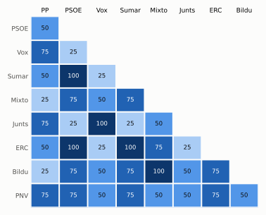

# Análisis detallado: enero de 2025

[← Volver al resumen del mes](2025-01.md)

_Generado automáticamente el 2026-11-10 con datos abiertos del [Congreso de los Diputados](https://www.congreso.es/es/opendata/votaciones). Solo plenos y Diputación Permanente. Método y límites en [docs/DOCUMENTO_FUNCIONAL.md](../docs/DOCUMENTO_FUNCIONAL.md)._

## Resumen

- **5 votaciones** en 1 día de pleno (sesión 89).
- **3 aprobadas** y **2 rechazadas**; de ellas, 1 secreta.
- 0 votaciones se decidieron por 5 votos o menos.
- El grupo que más veces votó con el resultado final: **PP** (100 % de las votaciones nominales).
- Los grupos del Gobierno (PSOE y Sumar) votaron lo mismo en 4 de 4 votaciones nominales y perdieron 2 de ellas.

## Cómo votó cada grupo

| Grupo | Diputados | Cohesión | Votó con el resultado | Decisivo | Posición Sí | Posición No | Posición Abst. |
| --- | ---: | ---: | ---: | ---: | ---: | ---: | ---: |
| PP | 137 | 100 % | 100 % | 2 | 2 | 2 | 0 |
| PSOE | 120 | 100 % | 50 % | 0 | 4 | 0 | 0 |
| Vox | 33 | 100 % | 75 % | 2 | 1 | 3 | 0 |
| Sumar | 27 | 100 % | 50 % | 0 | 4 | 0 | 0 |
| Mixto | 8 | 73 % | 25 % | 0 | 3 | 1 | 0 |
| Junts | 7 | 100 % | 75 % | 1 | 1 | 3 | 0 |
| ERC | 7 | 100 % | 50 % | 0 | 4 | 0 | 0 |
| EH Bildu | 6 | 100 % | 25 % | 0 | 3 | 1 | 0 |
| PNV | 5 | 100 % | 75 % | 0 | 3 | 1 | 0 |

*Cohesión*: índice de acuerdo interno (100 % = todo el grupo votó igual). *Votó con el resultado*: el grupo votó Sí y salió aprobada, o No y salió rechazada. *Decisivo*: votaciones cuyo resultado habría cambiado si el grupo se hubiera abstenido en bloque. El Grupo Mixto reúne partidos distintos: su posición es la de su mayoría.

## Afinidad entre grupos

<picture>
  <source media="(prefers-color-scheme: dark)" srcset="img/2025-01/afinidad-oscuro.svg">
  
</picture>

Porcentaje de votaciones nominales en que los dos grupos tomaron la misma posición. Los grupos están ordenados según el mapa de diputados.

Ver la tabla

|  | PP | PSOE | Vox | Sumar | Mixto | Junts | ERC | EH Bildu | PNV |
| --- | :---: | :---: | :---: | :---: | :---: | :---: | :---: | :---: | :---: |
| PP | 100 % | 50 % | 75 % | 50 % | 25 % | 75 % | 50 % | 25 % | 75 % |
| PSOE | 50 % | 100 % | 25 % | 100 % | 75 % | 25 % | 100 % | 75 % | 75 % |
| Vox | 75 % | 25 % | 100 % | 25 % | 50 % | 100 % | 25 % | 50 % | 50 % |
| Sumar | 50 % | 100 % | 25 % | 100 % | 75 % | 25 % | 100 % | 75 % | 75 % |
| Mixto | 25 % | 75 % | 50 % | 75 % | 100 % | 50 % | 75 % | 100 % | 50 % |
| Junts | 75 % | 25 % | 100 % | 25 % | 50 % | 100 % | 25 % | 50 % | 50 % |
| ERC | 50 % | 100 % | 25 % | 100 % | 75 % | 25 % | 100 % | 75 % | 75 % |
| EH Bildu | 25 % | 75 % | 50 % | 75 % | 100 % | 50 % | 75 % | 100 % | 50 % |
| PNV | 75 % | 75 % | 50 % | 75 % | 50 % | 50 % | 75 % | 50 % | 100 % |

## Quién sacó adelante las votaciones

| Grupos que votaron Sí | Votaciones | Escaños |
| --- | ---: | ---: |
| PP + PSOE + Sumar + ERC + PNV | 1 | 296 |
| Todos los grupos | 1 | 350 |

De 2 votaciones nominales aprobadas. La posición de cada grupo es la de la mayoría de sus diputados.

## Votaciones que perdieron los grupos del Gobierno

| Fecha | Asunto | Tipo | PSOE y Sumar votaron | Resultado | Sí | No |
| --- | --- | --- | :---: | --- | ---: | ---: |
| 22 de enero | Real Decreto-ley 9/2024, de 23 de diciembre, por el que se adoptan medidas urgentes en materia económica, tributaria, de transporte, y de Seguridad Social, y s… | Decretos-ley (convalidación) | Sí | Rechazada | 171 | 177 |
| 22 de enero | Real Decreto-ley 10/2024, de 23 de diciembre, para el establecimiento de un gravamen temporal energético durante el año 2025. | Decretos-ley (convalidación) | Sí | Rechazada | 165 | 183 |

## Votaciones más ajustadas

| Fecha | Asunto | Resultado | Sí | No | Abst. |
| --- | --- | :---: | ---: | ---: | ---: |
| 22 de enero | Real Decreto-ley 9/2024, de 23 de diciembre, por el que se adoptan medidas urgentes en materia económica, tributaria, de transporte, y de Seguridad Social, y s… | Rechazada | 171 | 177 | 1 |

Votaciones decididas por 10 votos o menos (o a esa distancia de la mayoría que exigían). Las públicas por llamamiento no tienen hemiciclo: el voto de cada diputado solo consta en el Diario de Sesiones.

## Qué se votó, por tipo de asunto

| Tipo de asunto | Votaciones | Aprobadas | No aprobadas |
| --- | ---: | ---: | ---: |
| Decretos-ley (convalidación) | 4 | 2 | 2 |
| Organización de la Cámara | 1 | 1 | 0 |

Las proposiciones no de ley y las mociones expresan la posición del Congreso pero no obligan al Gobierno. Las leyes pasan por varias votaciones (toma en consideración, totalidad, dictamen, Senado), así que una misma ley puede aparecer varias veces.

## Votos distintos de su grupo

Ningún diputado votó distinto de su grupo este mes (sin contar el Mixto).

## Diputados que más veces no votaron

| Diputado | Grupo | No votó | % de votaciones |
| --- | --- | ---: | ---: |
| Ábalos Meco, José Luis | Mixto | 4 | 100 % |

«No vota» incluye ausencias justificadas (baja, maternidad o paternidad) y escaños vacantes; el portal no las distingue.

## Todas las votaciones

Posición de cada grupo: la opción que votó la mayoría de sus diputados (*Div.*: empate dentro del grupo). El número enlaza al JSON oficial o, en las votaciones por llamamiento, al Diario de Sesiones.

### 22 de enero (sesión 89)

| Nº | Asunto | Resultado | Sí | No | Abst. | PP | PSOE | Vox | Sumar | Mixto | Junts | ERC | EH Bildu | PNV | Decisivos |
| ---: | --- | --- | ---: | ---: | ---: | :---: | :---: | :---: | :---: | :---: | :---: | :---: | :---: | :---: | --- |
| [1](https://www.congreso.es/webpublica/opendata/votaciones/Leg15/Sesion089/20250122/Votacion001/VOT_20250122154425.json) | Real Decreto-ley 9/2024, de 23 de diciembre, por el que se adoptan medidas urgentes en materia económica, tributaria, de transporte, y de Seguridad Social, y s… | Rechazada | 171 | 177 | 1 | No | Sí | No | Sí | Sí | No | Sí | Sí | Sí | Junts, PP, Vox |
| [2](https://www.congreso.es/webpublica/opendata/votaciones/Leg15/Sesion089/20250122/Votacion002/VOT_20250122154427.json) | Real Decreto-ley 10/2024, de 23 de diciembre, para el establecimiento de un gravamen temporal energético durante el año 2025. | Rechazada | 165 | 183 | 1 | No | Sí | No | Sí | Sí | No | Sí | Sí | No | PP, Vox |
| [3](https://www.congreso.es/webpublica/opendata/votaciones/Leg15/Sesion089/20250122/Votacion003/VOT_20250122154429.json) | Real Decreto-ley 11/2024, de 23 de diciembre, para la mejora de la compatibilidad de la pensión de jubilación con el trabajo. | Aprobada | 298 | 51 | 0 | Sí | Sí | No | Sí | No | No | Sí | No | Sí |  |
| [4](https://www.congreso.es/webpublica/opendata/votaciones/Leg15/Sesion089/20250122/Votacion004/VOT_20250122154430.json) | Tramitación como Proyecto de Ley por el procedimiento de urgencia del Real Decreto-ley 11/2024, de 23 de diciembre, para la mejora de la compatibilidad de la p… | Aprobada | 349 | 0 | 0 | Sí | Sí | Sí | Sí | Sí | Sí | Sí | Sí | Sí |  |
| [5](https://www.congreso.es/webpublica/opendata/votaciones/Leg15/Sesion089/20250122/Votacion005/VOT_20250122154430.json) | Dictamen de la Comisión del Estatuto de los Diputados acerca del suplicatorio formulado en relación con un Sr. Diputado. | Aprobada (secreta) | 345 | 0 | 0 |  |  |  |  |  |  |  |  |  |  |
