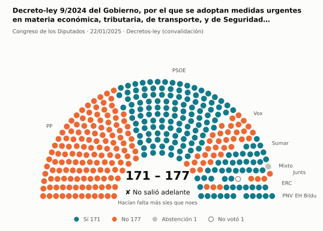
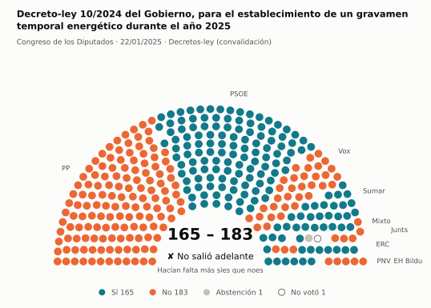
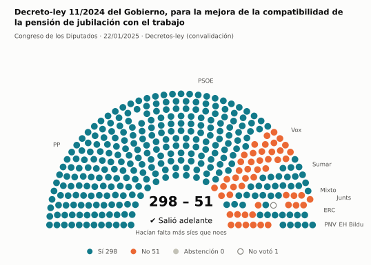
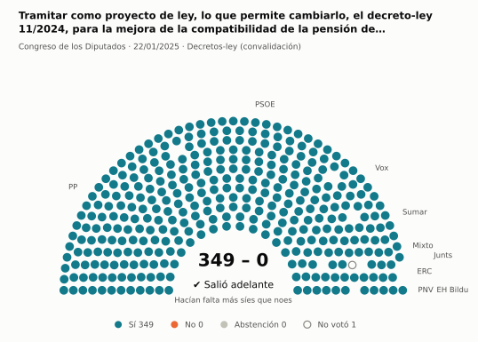
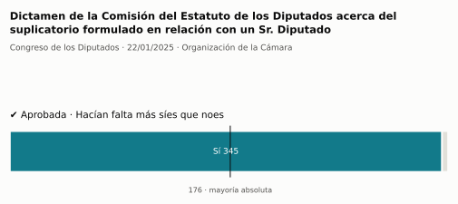
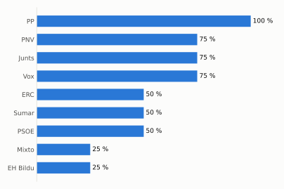
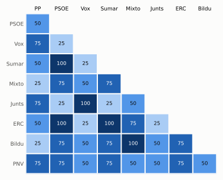

# Qué votó el Congreso en enero de 2025

Las votaciones del Pleno del Congreso de los Diputados, explicadas sin tecnicismos. Datos oficiales del [Congreso](https://www.congreso.es/es/opendata/votaciones); este resumen se actualiza solo cada mes (última vez: 11/11/2026).

## En pocas palabras

- El Congreso votó **5 veces** en 1 día de pleno. **3 propuestas salieron adelante** y 2 no.
- 4 votaciones fueron sobre leyes, decretos o presupuestos.
- El Gobierno (PSOE y Sumar) perdió **2** de las 4 votaciones en las que sus grupos votaron lo mismo.
- La votación más reñida se decidió por 6 votos: Decreto-ley 9/2024 del Gobierno, por el que se adoptan medidas urgentes en materia económica, tributaria, de….

## Las votaciones más importantes del mes

Elegidas por su importancia: pesan más las leyes y los decretos que las peticiones al Gobierno, y suben las que se decidieron por pocos votos o las que perdió el Gobierno. Cada punto del dibujo es un diputado, colocado con su grupo, y el color es lo que votó.

### 1. Decreto-ley 9/2024 del Gobierno, por el que se adoptan medidas urgentes en materia económica, tributaria, de transporte, y de Seguridad Social, y se…

**22 de enero · Decretos-ley (convalidación).** El Gobierno aprobó esta norma por urgencia. Ya está en vigor, pero el Congreso tiene 30 días para confirmarla o tumbarla.

<picture>
  <source media="(prefers-color-scheme: dark)" srcset="img/2025-01/votacion-L15-S089-V001-oscuro.svg">
  
</picture>

**✘ No salió adelante** por 6 votos: 171 a favor, 177 en contra y 1 abstención.

- **A favor:** PSOE, Sumar, ERC, EH Bildu y PNV
- **En contra:** PP, Vox y Junts
- **Repartidos:** Grupo Mixto (Sí 6, Abstención 1)

[Datos oficiales](https://www.congreso.es/webpublica/opendata/votaciones/Leg15/Sesion089/20250122/Votacion001/VOT_20250122154425.json)

### 2. Decreto-ley 10/2024 del Gobierno, para el establecimiento de un gravamen temporal energético durante el año 2025

**22 de enero · Decretos-ley (convalidación).** El Gobierno aprobó esta norma por urgencia. Ya está en vigor, pero el Congreso tiene 30 días para confirmarla o tumbarla.

<picture>
  <source media="(prefers-color-scheme: dark)" srcset="img/2025-01/votacion-L15-S089-V002-oscuro.svg">
  
</picture>

**✘ No salió adelante** por 18 votos: 165 a favor, 183 en contra y 1 abstención.

- **A favor:** PSOE, Sumar, ERC y EH Bildu
- **En contra:** PP, Vox, Junts y PNV
- **Repartidos:** Grupo Mixto (Sí 5, No 1, Abstención 1)

[Datos oficiales](https://www.congreso.es/webpublica/opendata/votaciones/Leg15/Sesion089/20250122/Votacion002/VOT_20250122154427.json)

### 3. Decreto-ley 11/2024 del Gobierno, para la mejora de la compatibilidad de la pensión de jubilación con el trabajo

**22 de enero · Decretos-ley (convalidación).** El Gobierno aprobó esta norma por urgencia. Ya está en vigor, pero el Congreso tiene 30 días para confirmarla o tumbarla.

<picture>
  <source media="(prefers-color-scheme: dark)" srcset="img/2025-01/votacion-L15-S089-V003-oscuro.svg">
  
</picture>

**✔ Salió adelante** por 247 votos: 298 a favor, 51 en contra y ninguna abstención.

- **A favor:** PP, PSOE, Sumar, ERC y PNV
- **En contra:** Vox, Junts y EH Bildu
- **Repartidos:** Grupo Mixto (Sí 2, No 5)

[Datos oficiales](https://www.congreso.es/webpublica/opendata/votaciones/Leg15/Sesion089/20250122/Votacion003/VOT_20250122154429.json)

### 4. Tramitar como proyecto de ley, lo que permite cambiarlo, el decreto-ley 11/2024, para la mejora de la compatibilidad de la pensión de jubilación con…

**22 de enero · Decretos-ley (convalidación).** El Gobierno aprobó esta norma por urgencia. Ya está en vigor, pero el Congreso tiene 30 días para confirmarla o tumbarla.

<picture>
  <source media="(prefers-color-scheme: dark)" srcset="img/2025-01/votacion-L15-S089-V004-oscuro.svg">
  
</picture>

**✔ Salió adelante** por 349 votos: 349 a favor, 0 en contra y ninguna abstención.

- **A favor:** PP, PSOE, Vox, Sumar, Grupo Mixto, Junts, ERC, EH Bildu y PNV

[Datos oficiales](https://www.congreso.es/webpublica/opendata/votaciones/Leg15/Sesion089/20250122/Votacion004/VOT_20250122154430.json)

### 5. Dictamen de la Comisión del Estatuto de los Diputados acerca del suplicatorio formulado en relación con un Sr. Diputado

**22 de enero · Organización de la Cámara.** Asunto interno del Congreso: comisiones, plazos o el estatuto de los diputados.

<picture>
  <source media="(prefers-color-scheme: dark)" srcset="img/2025-01/votacion-L15-S089-V005-oscuro.svg">
  
</picture>

**✔ Salió adelante** por 345 votos: 345 a favor, 0 en contra y ninguna abstención.

[Datos oficiales](https://www.congreso.es/webpublica/opendata/votaciones/Leg15/Sesion089/20250122/Votacion005/VOT_20250122154430.json)

## ¿Qué grupos votaron más veces lo que finalmente salió?

<picture>
  <source media="(prefers-color-scheme: dark)" srcset="img/2025-01/ganadora-oscuro.svg">
  
</picture>

Porcentaje de votaciones en que el grupo votó Sí y salió adelante, o votó No y no salió. Abstenerse no cuenta como acertar.

## ¿Quién vota con quién?

<picture>
  <source media="(prefers-color-scheme: dark)" srcset="img/2025-01/afinidad-oscuro.svg">
  
</picture>

Cada casilla dice en qué porcentaje de las votaciones dos grupos votaron lo mismo: 100 es que siempre coincidieron y 0 que nunca.

## ¿Qué tipo de cosas se votaron?

| Tipo | Votaciones | Salieron adelante | Qué es |
| --- | ---: | ---: | --- |
| Decretos-ley (convalidación) | 4 | 2 | El Gobierno aprobó esta norma por urgencia. Ya está en vigor, pero el Congreso tiene 30 días para confirmarla o tumbarla. |
| Organización de la Cámara | 1 | 1 | Asunto interno del Congreso: comisiones, plazos o el estatuto de los diputados. |

## Palabras que conviene saber

- **Pleno**: La reunión de los 350 diputados, donde se vota.
- **Grupo parlamentario**: Los diputados de un partido o coalición. Los partidos pequeños van juntos en el Grupo Mixto, aunque no piensen igual.
- **Abstención**: El diputado vota, pero ni a favor ni en contra.
- **No votó**: El diputado no votó: no estaba, estaba de baja o el escaño estaba vacío.
- **Mayoría simple**: Salen adelante las votaciones con más síes que noes. Es lo normal.
- **Mayoría absoluta**: 176 votos a favor, la mitad más uno de 350. La piden las leyes orgánicas (derechos fundamentales, sistema electoral…) y la primera votación de investidura.
- **Votación por llamamiento**: Cada diputado dice su voto en voz alta. Se usa en las investiduras y otras votaciones importantes.

---

**¿Quieres más detalle?** El [análisis detallado](2025-01-detalle.md) tiene la cohesión de cada grupo, un mapa de los diputados según cómo votan, qué diputados votaron distinto de su grupo, las ausencias y la lista completa de votaciones.

_Los resultados están calculados a partir de los votos: el Congreso no publica si cada votación salió adelante. Este proyecto no tiene relación con el Congreso. Método en [docs/DOCUMENTO_FUNCIONAL.md](../docs/DOCUMENTO_FUNCIONAL.md)._
