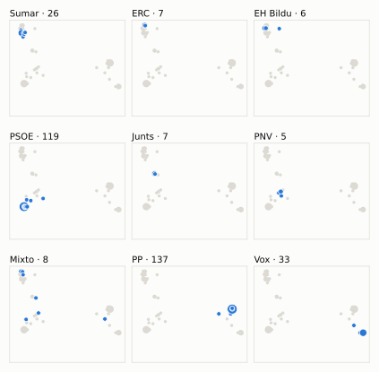
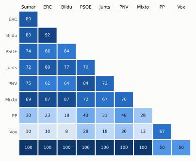

# Análisis detallado: febrero de 2025

[← Volver al resumen del mes](2025-02.md)

_Generado automáticamente el 2026-11-11 con datos abiertos del [Congreso de los Diputados](https://www.congreso.es/es/opendata/votaciones). Solo plenos y Diputación Permanente. Método y límites en [docs/DOCUMENTO_FUNCIONAL.md](../docs/DOCUMENTO_FUNCIONAL.md)._

## Resumen

- **61 votaciones** en 6 días de pleno (sesiones 90, 91, 92, 93, 94 y 95).
- **21 aprobadas** y **40 rechazadas**.
- 6 votaciones se decidieron por 5 votos o menos.
- El grupo que más veces votó con el resultado final: **** (100 % de las votaciones nominales).
- Los grupos del Gobierno (PSOE y Sumar) votaron lo mismo en 45 de 61 votaciones nominales y perdieron 4 de ellas.
- 14 votos individuales se apartaron de la posición de su grupo (12 diputados).

## Cómo votó cada grupo

| Grupo | Diputados | Cohesión | Votó con el resultado | Decisivo | Posición Sí | Posición No | Posición Abst. |
| --- | ---: | ---: | ---: | ---: | ---: | ---: | ---: |
| PP | 137 | 100 % | 57 % | 8 | 40 | 14 | 7 |
| PSOE | 120 | 100 % | 85 % | 19 | 16 | 43 | 2 |
| Vox | 33 | 100 % | 36 % | 4 | 41 | 17 | 3 |
| Sumar | 27 | 100 % | 72 % | 20 | 21 | 34 | 6 |
| Mixto | 8 | 74 % | 70 % | 10 | 25 | 36 | 0 |
| Junts | 7 | 100 % | 74 % | 12 | 11 | 38 | 12 |
| ERC | 7 | 100 % | 66 % | 12 | 20 | 35 | 6 |
| EH Bildu | 6 | 100 % | 61 % | 5 | 18 | 35 | 8 |
| PNV | 5 | 99 % | 90 % | 2 | 21 | 37 | 3 |
|  | 1 | 100 % | 100 % | 0 | 1 | 1 | 0 |

*Cohesión*: índice de acuerdo interno (100 % = todo el grupo votó igual). *Votó con el resultado*: el grupo votó Sí y salió aprobada, o No y salió rechazada. *Decisivo*: votaciones cuyo resultado habría cambiado si el grupo se hubiera abstenido en bloque. El Grupo Mixto reúne partidos distintos: su posición es la de su mayoría.

## Mapa de diputados

<picture>
  <source media="(prefers-color-scheme: dark)" srcset="img/2025-02/mapa-oscuro.svg">
  
</picture>

Cada punto es un diputado; dos diputados están cerca si votaron parecido. Un punto más grande reúne a varios que votaron exactamente igual. En cada panel, el grupo en azul y el resto del Congreso en gris.

*Cómo se calcula*: componentes principales de los votos (Sí, No, abstención) en 59 votaciones con algún desacuerdo. El eje horizontal recoge el 75 % de la variación y el vertical el 12 %. Los ejes no tienen nombre ni sentido político propio; por convención, el PP queda a la derecha. No se sitúa a 3 diputados que votó en menos de la mitad.

## Afinidad entre grupos

<picture>
  <source media="(prefers-color-scheme: dark)" srcset="img/2025-02/afinidad-oscuro.svg">
  
</picture>

Porcentaje de votaciones nominales en que los dos grupos tomaron la misma posición. Los grupos están ordenados según el mapa de diputados.

Ver la tabla

|  | PP | PSOE | Vox | Sumar | Mixto | Junts | ERC | EH Bildu | PNV |  |
| --- | :---: | :---: | :---: | :---: | :---: | :---: | :---: | :---: | :---: | :---: |
| PP | 100 % | 43 % | 67 % | 30 % | 28 % | 31 % | 23 % | 18 % | 48 % | 50 % |
| PSOE | 43 % | 100 % | 28 % | 74 % | 72 % | 70 % | 66 % | 64 % | 84 % | 100 % |
| Vox | 67 % | 28 % | 100 % | 10 % | 13 % | 18 % | 10 % | 8 % | 30 % | 50 % |
| Sumar | 30 % | 74 % | 10 % | 100 % | 89 % | 72 % | 80 % | 80 % | 75 % | 100 % |
| Mixto | 28 % | 72 % | 13 % | 89 % | 100 % | 67 % | 87 % | 87 % | 70 % | 100 % |
| Junts | 31 % | 70 % | 18 % | 72 % | 67 % | 100 % | 80 % | 77 % | 72 % | 100 % |
| ERC | 23 % | 66 % | 10 % | 80 % | 87 % | 80 % | 100 % | 92 % | 62 % | 100 % |
| EH Bildu | 18 % | 64 % | 8 % | 80 % | 87 % | 77 % | 92 % | 100 % | 64 % | 100 % |
| PNV | 48 % | 84 % | 30 % | 75 % | 70 % | 72 % | 62 % | 64 % | 100 % | 100 % |
|  | 50 % | 100 % | 50 % | 100 % | 100 % | 100 % | 100 % | 100 % | 100 % | 100 % |

## Quién sacó adelante las votaciones

| Grupos que votaron Sí | Votaciones | Escaños |
| --- | ---: | ---: |
| PP + PSOE + Sumar + Mixto + Junts + ERC + EH Bildu + PNV | 4 | 317 |
| PP + PSOE + Vox + Sumar + Mixto + PNV | 3 | 330 |
| PP + PSOE + Vox + Sumar + Mixto + Junts + ERC + EH Bildu + PNV | 2 | 350 |
| PP + PSOE + Sumar + Mixto + PNV | 2 | 297 |
| PP + Vox + PNV | 2 | 175 |
| PP + PSOE + Vox + PNV | 2 | 295 |
| Todos los grupos | 1 | 351 |
| PP + Vox | 1 | 170 |

De 21 votaciones nominales aprobadas. Otras 4 salieron con combinaciones que se dieron menos veces. La posición de cada grupo es la de la mayoría de sus diputados.

## Votaciones que perdieron los grupos del Gobierno

| Fecha | Asunto | Tipo | PSOE y Sumar votaron | Resultado | Sí | No |
| --- | --- | --- | :---: | --- | ---: | ---: |
| 12 de febrero | Proposición no de Ley del Grupo Parlamentario Popular en el Congreso, sobre el cierre programado de la generación nuclear en España. | Proposiciones no de ley | No | Aprobada | 171 | 164 |
| 19 de febrero | Moción consecuencia de interpelación urgente del Grupo Parlamentario Popular en el Congreso, sobre el fracaso de la política del Gobierno en materia de viviend… *(Votación separada por puntos. Punto 1.)* | Mociones | No | Aprobada | 173 | 170 |
| 19 de febrero | Moción consecuencia de interpelación urgente del Grupo Parlamentario Popular en el Congreso, sobre el fracaso de la política del Gobierno en materia de viviend… *(Votación separada por puntos. Punto 4.)* | Mociones | No | Aprobada | 172 | 163 |
| 19 de febrero | Moción consecuencia de interpelación urgente del Grupo Parlamentario Popular en el Congreso, sobre el fracaso de la política del Gobierno en materia de viviend… *(Votación separada por puntos. Punto 6.)* | Mociones | No | Aprobada | 180 | 162 |

Además, PSOE y Sumar votaron distinto entre sí en 16 votaciones.

## Votaciones más ajustadas

| Fecha | Asunto | Resultado | Sí | No | Abst. |
| --- | --- | :---: | ---: | ---: | ---: |
| 11 de febrero | Proposición de Ley del Grupo Parlamentario Popular en el Congreso, relativa a la violencia en el ámbito sanitario. | Rechazada | 171 | 173 | 0 |
| 19 de febrero | Moción consecuencia de interpelación urgente del Grupo Parlamentario Popular en el Congreso, sobre el fracaso de la política del Gobierno en materia de viviend… *(Votación separada por puntos. Punto 1.)* | Aprobada | 173 | 170 | 1 |
| 12 de febrero | Moción consecuencia de interpelación urgente del Grupo Parlamentario Popular en el Congreso, sobre el balance de las actuaciones del Gobierno que han provocado… *(Votación separada por puntos. Punto 3.)* | Rechazada | 171 | 176 | 0 |
| 18 de febrero | Proposición de Ley del Grupo Parlamentario VOX, de modificación de la Ley 7/1985, de 2 de abril, Reguladora de las Bases del Régimen Local, con el fin de modif… | Rechazada | 169 | 174 | 0 |
| 26 de febrero | Moción consecuencia de interpelación urgente del Grupo Parlamentario Popular en el Congreso, sobre cómo están afectando a su Departamento las ramificaciones te… *(Votación separada por puntos Punto 1.)* | Rechazada | 171 | 176 | 0 |
| 26 de febrero | Moción consecuencia de interpelación urgente del Grupo Parlamentario Popular en el Congreso, sobre cómo están afectando a su Departamento las ramificaciones te… *(Votación separada por puntos Punto 3.)* | Rechazada | 171 | 176 | 0 |
| 12 de febrero | Moción consecuencia de interpelación urgente del Grupo Parlamentario Popular en el Congreso, sobre el balance de las actuaciones del Gobierno que han provocado… *(Votación separada por puntos. Punto 4.)* | Rechazada | 171 | 177 | 0 |
| 12 de febrero | Moción consecuencia de interpelación urgente del Grupo Parlamentario Popular en el Congreso, sobre el balance de las actuaciones del Gobierno que han provocado… *(Votación separada por puntos. Punto 7.)* | Rechazada | 171 | 177 | 0 |
| 19 de febrero | Moción consecuencia de interpelación urgente del Grupo Parlamentario Popular en el Congreso, sobre el fracaso de la política del Gobierno en materia de viviend… *(Votación separada por puntos. Punto 5.)* | Rechazada | 169 | 175 | 0 |
| 26 de febrero | Moción consecuencia de interpelación urgente del Grupo Parlamentario VOX, sobre las medidas que adoptará el Gobierno para evitar que el Pacto Verde europeo arr… *(Votación separada por puntos Punto 7.)* | Rechazada | 171 | 177 | 0 |

Votaciones decididas por 10 votos o menos (o a esa distancia de la mayoría que exigían). Las públicas por llamamiento no tienen hemiciclo: el voto de cada diputado solo consta en el Diario de Sesiones.

## Qué se votó, por tipo de asunto

| Tipo de asunto | Votaciones | Aprobadas | No aprobadas |
| --- | ---: | ---: | ---: |
| Mociones | 35 | 6 | 29 |
| Organización de la Cámara | 8 | 2 | 6 |
| Proposiciones no de ley | 6 | 4 | 2 |
| Leyes: toma en consideración | 6 | 3 | 3 |
| Tratados internacionales | 4 | 4 | 0 |
| Decretos-ley (convalidación) | 2 | 2 | 0 |

Las proposiciones no de ley y las mociones expresan la posición del Congreso pero no obligan al Gobierno. Las leyes pasan por varias votaciones (toma en consideración, totalidad, dictamen, Senado), así que una misma ley puede aparecer varias veces.

## Votos distintos de su grupo

| Diputado | Grupo | Votos distintos de su grupo |
| --- | --- | ---: |
| López Cano, Ignacio | PSOE | 2 |
| Vidal Sáez, Aina | Sumar | 2 |
| Agirretxea Urresti, Joseba Andoni | PNV | 1 |
| Aragonés Mendiguchía, Carlos | PP | 1 |
| González-Robatto Perote, Jacobo | Vox | 1 |
| Lorente Anaya, Macarena | PP | 1 |
| Montero Cuadrado, María Jesús | PSOE | 1 |
| Pisarello Prados, Gerardo | Sumar | 1 |
| Puente Santiago, Óscar | PSOE | 1 |
| Sahuquillo García, Luis Carlos | PSOE | 1 |
| Santana Aguilera, Ada | PSOE | 1 |
| Sánchez Pérez-Castejón, Pedro | PSOE | 1 |

Un voto aislado puede ser un error al pulsar, no una decisión política: el Congreso no publica las correcciones. Se excluye el Grupo Mixto.

## Diputados que más veces no votaron

| Diputado | Grupo | No votó | % de votaciones |
| --- | --- | ---: | ---: |
| Sánchez Pérez-Castejón, Pedro | PSOE | 45 | 74 % |
| Díaz Pérez, Yolanda | Sumar | 41 | 67 % |
| Armengol Socias, Francina | PSOE | 24 | 39 % |
| Núñez Feijóo, Alberto | PP | 21 | 34 % |
| Rego Candamil, Néstor | Mixto | 21 | 34 % |
| Esteban Bravo, Aitor | PNV | 16 | 26 % |
| Del Valle Rodríguez, Emilio Jesús | Vox | 15 | 25 % |
| Montero Cuadrado, María Jesús | PSOE | 6 | 10 % |
| Bolaños García, Félix | PSOE | 2 | 3 % |
| Cofiño Fernández, Rafael | Sumar | 2 | 3 % |
| Conde López, Francisco José | PP | 2 | 3 % |
| Delgado Arce, Celso Luis | PP | 2 | 3 % |
| Fullaondo la Cruz, Marije | EH Bildu | 2 | 3 % |
| López Tagliafico, Candela | Sumar | 2 | 3 % |
| Mariscal Zabala, Manuel | Vox | 2 | 3 % |

«No vota» incluye ausencias justificadas (baja, maternidad o paternidad) y escaños vacantes; el portal no las distingue.

## Todas las votaciones

Posición de cada grupo: la opción que votó la mayoría de sus diputados (*Div.*: empate dentro del grupo). El número enlaza al JSON oficial o, en las votaciones por llamamiento, al Diario de Sesiones.

### 11 de febrero (sesión 90)

| Nº | Asunto | Resultado | Sí | No | Abst. | PP | PSOE | Vox | Sumar | Mixto | Junts | ERC | EH Bildu | PNV |  | Decisivos |
| ---: | --- | --- | ---: | ---: | ---: | :---: | :---: | :---: | :---: | :---: | :---: | :---: | :---: | :---: | :---: | --- |
| [1](https://www.congreso.es/webpublica/opendata/votaciones/Leg15/Sesion090/20250211/Votacion001/VOT_20250211202648.json) | Proposición de Ley del Parlamento de Andalucía, de reforma parcial del texto refundido de la Ley del Estatuto Básico del Empleado Público, aprobado por Real De… | Aprobada | 344 | 0 | 0 | Sí | Sí | Sí | Sí | Sí | Sí | Sí | Sí | Sí | Sí |  |
| [2](https://www.congreso.es/webpublica/opendata/votaciones/Leg15/Sesion090/20250211/Votacion002/VOT_20250211202649.json) | Proposición de Ley del Grupo Parlamentario Popular en el Congreso, relativa a la violencia en el ámbito sanitario. | Rechazada | 171 | 173 | 0 | Sí | No | Sí | No | No | No | No | No | No | No | EH Bildu, Junts, Mixto, ERC, PSOE, Sumar, PNV |

### 12 de febrero (sesión 91)

| Nº | Asunto | Resultado | Sí | No | Abst. | PP | PSOE | Vox | Sumar | Mixto | Junts | ERC | EH Bildu | PNV |  | Decisivos |
| ---: | --- | --- | ---: | ---: | ---: | :---: | :---: | :---: | :---: | :---: | :---: | :---: | :---: | :---: | :---: | --- |
| [1](https://www.congreso.es/webpublica/opendata/votaciones/Leg15/Sesion091/20250212/Votacion001/VOT_20250212154036.json) | Proposición no de Ley del Grupo Parlamentario Popular en el Congreso, sobre el cierre programado de la generación nuclear en España. | Aprobada | 171 | 164 | 14 | Sí | No | Sí | No | No | Abst. | Abst. | No | No | nan | PP, Vox |
| [2](https://www.congreso.es/webpublica/opendata/votaciones/Leg15/Sesion091/20250212/Votacion002/VOT_20250212154037.json) | Proposición no de Ley del Grupo Parlamentario Socialista, sobre la menopausia. Se vota en los términos de la enmienda transaccional presentada por el Grupo Par… | Aprobada | 316 | 33 | 0 | Sí | Sí | No | Sí | Sí | Sí | Sí | Sí | Sí | nan |  |
| [3](https://www.congreso.es/webpublica/opendata/votaciones/Leg15/Sesion091/20250212/Votacion003/VOT_20250212154038.json) | Moción consecuencia de interpelación urgente del Grupo Parlamentario Mixto (Sra. Valido García), sobre la atención sanitaria a los miles de migrantes que llega… | Aprobada | 315 | 33 | 0 | Sí | Sí | No | Sí | Sí | Sí | Sí | Sí | Sí | nan |  |
| [4](https://www.congreso.es/webpublica/opendata/votaciones/Leg15/Sesion091/20250212/Votacion004/VOT_20250212154039.json) | Moción consecuencia de interpelación urgente del Grupo Parlamentario VOX, sobre cuáles son los planes del Gobierno para hacer frente al invierno demográfico qu… | Rechazada | 33 | 177 | 138 | Abst. | No | Sí | No | No | No | No | No | No | nan |  |
| [5](https://www.congreso.es/webpublica/opendata/votaciones/Leg15/Sesion091/20250212/Votacion005/VOT_20250212154040.json) | Moción consecuencia de interpelación urgente del Grupo Parlamentario Popular en el Congreso, sobre el balance de las actuaciones del Gobierno que han provocado… *(Votación separada por puntos. Punto 1.)* | Rechazada | 169 | 178 | 0 | Sí | No | Sí | No | No | No | No | No | No | nan | PSOE, Sumar |
| [6](https://www.congreso.es/webpublica/opendata/votaciones/Leg15/Sesion091/20250212/Votacion006/VOT_20250212154041.json) | Moción consecuencia de interpelación urgente del Grupo Parlamentario Popular en el Congreso, sobre el balance de las actuaciones del Gobierno que han provocado… *(Votación separada por puntos. Punto 2.)* | Rechazada | 170 | 178 | 0 | Sí | No | Sí | No | No | No | No | No | No | nan | PSOE, Sumar |
| [7](https://www.congreso.es/webpublica/opendata/votaciones/Leg15/Sesion091/20250212/Votacion007/VOT_20250212154042.json) | Moción consecuencia de interpelación urgente del Grupo Parlamentario Popular en el Congreso, sobre el balance de las actuaciones del Gobierno que han provocado… *(Votación separada por puntos. Punto 3.)* | Rechazada | 171 | 176 | 0 | Sí | No | Sí | No | No | No | No | No | No | nan | EH Bildu, Junts, Mixto, ERC, PSOE, Sumar |
| [8](https://www.congreso.es/webpublica/opendata/votaciones/Leg15/Sesion091/20250212/Votacion008/VOT_20250212154043.json) | Moción consecuencia de interpelación urgente del Grupo Parlamentario Popular en el Congreso, sobre el balance de las actuaciones del Gobierno que han provocado… *(Votación separada por puntos. Punto 4.)* | Rechazada | 171 | 177 | 0 | Sí | No | Sí | No | No | No | No | No | No | nan | Junts, Mixto, ERC, PSOE, Sumar |
| [9](https://www.congreso.es/webpublica/opendata/votaciones/Leg15/Sesion091/20250212/Votacion009/VOT_20250212154044.json) | Moción consecuencia de interpelación urgente del Grupo Parlamentario Popular en el Congreso, sobre el balance de las actuaciones del Gobierno que han provocado… *(Votación separada por puntos. Punto 5.)* | Rechazada | 171 | 178 | 0 | Sí | No | Sí | No | No | No | No | No | No | nan | PSOE, Sumar |
| [10](https://www.congreso.es/webpublica/opendata/votaciones/Leg15/Sesion091/20250212/Votacion010/VOT_20250212154045.json) | Moción consecuencia de interpelación urgente del Grupo Parlamentario Popular en el Congreso, sobre el balance de las actuaciones del Gobierno que han provocado… *(Votación separada por puntos. Punto 6.)* | Rechazada | 171 | 178 | 0 | Sí | No | Sí | No | No | No | No | No | No | nan | PSOE, Sumar |
| [11](https://www.congreso.es/webpublica/opendata/votaciones/Leg15/Sesion091/20250212/Votacion011/VOT_20250212154046.json) | Moción consecuencia de interpelación urgente del Grupo Parlamentario Popular en el Congreso, sobre el balance de las actuaciones del Gobierno que han provocado… *(Votación separada por puntos. Punto 7.)* | Rechazada | 171 | 177 | 0 | Sí | No | Sí | No | No | No | No | No | No | nan | Junts, Mixto, ERC, PSOE, Sumar |
| [12](https://www.congreso.es/webpublica/opendata/votaciones/Leg15/Sesion091/20250212/Votacion012/VOT_20250212154047.json) | Real Decreto-ley 1/2025, de 28 de enero, por el que se aprueban medidas urgentes en materia económica, de transporte, de Seguridad Social, y para hacer frente… | Aprobada | 315 | 33 | 1 | Sí | Sí | No | Sí | Sí | Sí | Sí | Sí | Sí | nan |  |
| [13](https://www.congreso.es/webpublica/opendata/votaciones/Leg15/Sesion091/20250212/Votacion013/VOT_20250212154048.json) | Tramitación como Proyecto de Ley por el procedimiento de urgencia del Real Decreto-ley 1/2025, de 28 de enero, por el que se aprueban medidas urgentes en mater… | Aprobada | 347 | 1 | 0 | Sí | Sí | Sí | Sí | Sí | Sí | Sí | Sí | Sí | nan |  |
| [14](https://www.congreso.es/webpublica/opendata/votaciones/Leg15/Sesion091/20250212/Votacion014/VOT_20250212154049.json) | Acuerdo de cooperación científica entre el Reino de España y los Estados Unidos de América sobre la estación de seguimiento de la NASA, hecho en Madrid el 10 d… | Aprobada | 327 | 1 | 20 | Sí | Sí | Sí | Sí | Sí | Abst. | Abst. | Abst. | Sí | nan |  |
| [15](https://www.congreso.es/webpublica/opendata/votaciones/Leg15/Sesion091/20250212/Votacion015/VOT_20250212154050.json) | Protocolo común relativo a la aplicación de la Convención de Viena y del Convenio de París, hecho en Viena el 21 de septiembre de 1988. | Aprobada | 327 | 0 | 20 | Sí | Sí | Sí | Sí | Sí | Abst. | Abst. | Abst. | Sí | nan |  |
| [16](https://www.congreso.es/webpublica/opendata/votaciones/Leg15/Sesion091/20250212/Votacion016/VOT_20250212154051.json) | Acuerdo Global de Transporte Aéreo entre los Estados miembros de la Asociación de Naciones del Asia Sudoriental y la Unión Europea y sus Estados miembros, hech… | Aprobada | 294 | 0 | 53 | Sí | Sí | Abst. | Sí | Sí | Abst. | Abst. | Abst. | Sí | nan |  |
| [17](https://www.congreso.es/webpublica/opendata/votaciones/Leg15/Sesion091/20250212/Votacion017/VOT_20250212154052.json) | Canje de Notas constitutivo de Acuerdo entre el Reino de España y la Agencia Espacial Europea por el que se enmienda el Acuerdo entre el Reino de España y la A… | Aprobada | 328 | 0 | 20 | Sí | Sí | Sí | Sí | Sí | Abst. | Abst. | Abst. | Sí | nan |  |
| [18](https://www.congreso.es/webpublica/opendata/votaciones/Leg15/Sesion091/20250212/Votacion018/VOT_20250212154053.json) | Solicitud de la Comisión de Sanidad, de prórroga del plazo para la conclusión de los trabajos de la Subcomisión para mejorar la protección, la promoción y la a… | Aprobada | 348 | 0 | 0 | Sí | Sí | Sí | Sí | Sí | Sí | Sí | Sí | Sí | nan |  |

### 18 de febrero (sesión 92)

| Nº | Asunto | Resultado | Sí | No | Abst. | PP | PSOE | Vox | Sumar | Mixto | Junts | ERC | EH Bildu | PNV |  | Decisivos |
| ---: | --- | --- | ---: | ---: | ---: | :---: | :---: | :---: | :---: | :---: | :---: | :---: | :---: | :---: | :---: | --- |
| [1](https://www.congreso.es/webpublica/opendata/votaciones/Leg15/Sesion092/20250218/Votacion001/VOT_20250218194306.json) | Proposición de Ley de los Grupos Parlamentarios Socialista y Mixto, de modificación de la Ley 19/1994, de 6 de julio, de modificación del Régimen Económico y F… | Aprobada | 299 | 37 | 6 | Sí | Sí | No | Sí | No | Sí | Sí | Abst. | Sí | nan |  |
| [2](https://www.congreso.es/webpublica/opendata/votaciones/Leg15/Sesion092/20250218/Votacion002/VOT_20250218194308.json) | Proposición de Ley del Grupo Parlamentario VOX, de modificación de la Ley 7/1985, de 2 de abril, Reguladora de las Bases del Régimen Local, con el fin de modif… | Rechazada | 169 | 174 | 0 | Sí | No | Sí | No | No | No | No | No | No | nan | EH Bildu, Junts, Mixto, ERC, PSOE, Sumar |

### 19 de febrero (sesión 93)

| Nº | Asunto | Resultado | Sí | No | Abst. | PP | PSOE | Vox | Sumar | Mixto | Junts | ERC | EH Bildu | PNV |  | Decisivos |
| ---: | --- | --- | ---: | ---: | ---: | :---: | :---: | :---: | :---: | :---: | :---: | :---: | :---: | :---: | :---: | --- |
| [1](https://www.congreso.es/webpublica/opendata/votaciones/Leg15/Sesion093/20250219/Votacion001/VOT_20250219135530.json) | Proposición no de Ley del Grupo Parlamentario VOX, relativa a la precariedad que están sufriendo las familias españolas ante el aumento de los precios y de los… | Rechazada | 32 | 175 | 137 | Abst. | No | Sí | No | No | No | No | No | No | nan |  |
| [2](https://www.congreso.es/webpublica/opendata/votaciones/Leg15/Sesion093/20250219/Votacion002/VOT_20250219135532.json) | Proposición no de Ley del Grupo Parlamentario Plurinacional SUMAR, relativa al fondo complementario que compense la merma de ingresos que va a sufrir en 2025 l… *(Votación separada por puntos. Punto 1.)* | Aprobada | 174 | 152 | 17 | Sí | No | No | Sí | Sí | Abst. | Sí | Abst. | Abst. | nan | PP, Sumar |
| [3](https://www.congreso.es/webpublica/opendata/votaciones/Leg15/Sesion093/20250219/Votacion003/VOT_20250219135534.json) | Proposición no de Ley del Grupo Parlamentario Plurinacional SUMAR, relativa al fondo complementario que compense la merma de ingresos que va a sufrir en 2025 l… *(Votación separada por puntos. Punto 2.)* | Aprobada | 290 | 33 | 21 | Sí | Sí | No | Sí | Sí | Abst. | Abst. | Abst. | Sí | nan |  |
| [5](https://www.congreso.es/webpublica/opendata/votaciones/Leg15/Sesion093/20250219/Votacion005/VOT_20250219135536.json) | Moción consecuencia de interpelación urgente del Grupo Parlamentario Mixto (Sra. Belarra Urteaga), sobre la política del Gobierno para garantizar el derecho a… *(Votación separada por puntos Punto 1.)* | Rechazada | 12 | 301 | 31 | No | No | No | Abst. | Sí | No | Sí | Abst. | No | nan |  |
| [6](https://www.congreso.es/webpublica/opendata/votaciones/Leg15/Sesion093/20250219/Votacion006/VOT_20250219135538.json) | Moción consecuencia de interpelación urgente del Grupo Parlamentario Mixto (Sra. Belarra Urteaga), sobre la política del Gobierno para garantizar el derecho a… *(Votación separada por puntos Punto 2.)* | Rechazada | 42 | 298 | 0 | No | No | No | Sí | Sí | No | Sí | Sí | No | nan |  |
| [7](https://www.congreso.es/webpublica/opendata/votaciones/Leg15/Sesion093/20250219/Votacion007/VOT_20250219135540.json) | Moción consecuencia de interpelación urgente del Grupo Parlamentario Mixto (Sra. Belarra Urteaga), sobre la política del Gobierno para garantizar el derecho a… *(Votación separada por puntos Punto 3.)* | Rechazada | 43 | 175 | 126 | No | Abst. | No | Sí | Sí | Abst. | Sí | Sí | No | nan | PP |
| [8](https://www.congreso.es/webpublica/opendata/votaciones/Leg15/Sesion093/20250219/Votacion008/VOT_20250219135542.json) | Moción consecuencia de interpelación urgente del Grupo Parlamentario Mixto (Sra. Belarra Urteaga), sobre la política del Gobierno para garantizar el derecho a… *(Votación separada por puntos Punto 4.)* | Rechazada | 43 | 301 | 0 | No | No | No | Sí | Sí | No | Sí | Sí | No | nan |  |
| [9](https://www.congreso.es/webpublica/opendata/votaciones/Leg15/Sesion093/20250219/Votacion009/VOT_20250219135543.json) | Moción consecuencia de interpelación urgente del Grupo Parlamentario Mixto (Sra. Belarra Urteaga), sobre la política del Gobierno para garantizar el derecho a… *(Votación separada por puntos Punto 5.)* | Rechazada | 46 | 296 | 0 | No | No | No | Sí | Sí | No | Sí | Sí | Sí | nan |  |
| [10](https://www.congreso.es/webpublica/opendata/votaciones/Leg15/Sesion093/20250219/Votacion010/VOT_20250219135545.json) | Moción consecuencia de interpelación urgente del Grupo Parlamentario VOX, sobre cuáles son las medidas que va a adoptar el Gobierno para garantizar que los esp… | Rechazada | 33 | 175 | 136 | Abst. | No | Sí | No | No | No | No | No | No | nan |  |
| [11](https://www.congreso.es/webpublica/opendata/votaciones/Leg15/Sesion093/20250219/Votacion011/VOT_20250219135547.json) | Moción consecuencia de interpelación urgente del Grupo Parlamentario Popular en el Congreso, sobre el fracaso de la política del Gobierno en materia de viviend… *(Votación separada por puntos. Punto 1.)* | Aprobada | 173 | 170 | 1 | Sí | No | Sí | No | No | No | No | No | Sí | nan | PP, PNV, Vox |
| [12](https://www.congreso.es/webpublica/opendata/votaciones/Leg15/Sesion093/20250219/Votacion012/VOT_20250219135549.json) | Moción consecuencia de interpelación urgente del Grupo Parlamentario Popular en el Congreso, sobre el fracaso de la política del Gobierno en materia de viviend… *(Votación separada por puntos. Punto 2.)* | Aprobada | 292 | 26 | 25 | Sí | Sí | Sí | Abst. | No | No | No | No | Sí | nan |  |
| [13](https://www.congreso.es/webpublica/opendata/votaciones/Leg15/Sesion093/20250219/Votacion013/VOT_20250219135551.json) | Moción consecuencia de interpelación urgente del Grupo Parlamentario Popular en el Congreso, sobre el fracaso de la política del Gobierno en materia de viviend… *(Votación separada por puntos. Punto 3.)* | Aprobada | 293 | 50 | 0 | Sí | Sí | Sí | No | No | No | No | No | Sí | nan |  |
| [14](https://www.congreso.es/webpublica/opendata/votaciones/Leg15/Sesion093/20250219/Votacion014/VOT_20250219135553.json) | Moción consecuencia de interpelación urgente del Grupo Parlamentario Popular en el Congreso, sobre el fracaso de la política del Gobierno en materia de viviend… *(Votación separada por puntos. Punto 4.)* | Aprobada | 172 | 163 | 7 | Sí | No | Sí | No | No | Abst. | No | No | Sí | nan | PP, Vox |
| [15](https://www.congreso.es/webpublica/opendata/votaciones/Leg15/Sesion093/20250219/Votacion015/VOT_20250219135555.json) | Moción consecuencia de interpelación urgente del Grupo Parlamentario Popular en el Congreso, sobre el fracaso de la política del Gobierno en materia de viviend… *(Votación separada por puntos. Punto 5.)* | Rechazada | 169 | 175 | 0 | Sí | No | Sí | No | No | No | No | No | No | nan | Junts, ERC, PSOE, Sumar |
| [16](https://www.congreso.es/webpublica/opendata/votaciones/Leg15/Sesion093/20250219/Votacion016/VOT_20250219135557.json) | Moción consecuencia de interpelación urgente del Grupo Parlamentario Popular en el Congreso, sobre el fracaso de la política del Gobierno en materia de viviend… *(Votación separada por puntos. Punto 6.)* | Aprobada | 180 | 162 | 0 | Sí | No | Sí | No | No | Sí | No | No | Sí | nan | PP, Vox |

### 25 de febrero (sesión 94)

| Nº | Asunto | Resultado | Sí | No | Abst. | PP | PSOE | Vox | Sumar | Mixto | Junts | ERC | EH Bildu | PNV |  | Decisivos |
| ---: | --- | --- | ---: | ---: | ---: | :---: | :---: | :---: | :---: | :---: | :---: | :---: | :---: | :---: | :---: | --- |
| [1](https://www.congreso.es/webpublica/opendata/votaciones/Leg15/Sesion094/20250225/Votacion001/VOT_20250225201645.json) | Proposición de Ley del Grupo Parlamentario Plurinacional SUMAR, sobre concesión de nacionalidad española a las y los saharauis nacidos bajo la administración e… | Aprobada | 195 | 116 | 33 | Sí | No | Abst. | Sí | Sí | Sí | Sí | Sí | Sí | nan | PP |
| [2](https://www.congreso.es/webpublica/opendata/votaciones/Leg15/Sesion094/20250225/Votacion002/VOT_20250225201647.json) | Proposición de Ley del Grupo Parlamentario Vasco (EAJ-PNV), por la que se modifica el texto refundido de la Ley de Suelo y Rehabilitación Urbana, aprobado por… | Rechazada | 124 | 186 | 34 | No | Sí | Abst. | No | No | No | No | No | Sí | nan | PP |

### 26 de febrero (sesión 95)

| Nº | Asunto | Resultado | Sí | No | Abst. | PP | PSOE | Vox | Sumar | Mixto | Junts | ERC | EH Bildu | PNV |  | Decisivos |
| ---: | --- | --- | ---: | ---: | ---: | :---: | :---: | :---: | :---: | :---: | :---: | :---: | :---: | :---: | :---: | --- |
| [1](https://www.congreso.es/webpublica/opendata/votaciones/Leg15/Sesion095/20250226/Votacion001/VOT_20250226151616.json) | Informe de la Subcomisión para la renovación y actualización del Pacto de Estado en materia de violencia de género. *(Votos particulares del Grupo Parlamentario Mixto (Sra. Bela…)* | Rechazada | 51 | 296 | 0 | No | No | No | Sí | Sí | Sí | Sí | Sí | No | nan |  |
| [2](https://www.congreso.es/webpublica/opendata/votaciones/Leg15/Sesion095/20250226/Votacion002/VOT_20250226151618.json) | Informe de la Subcomisión para la renovación y actualización del Pacto de Estado en materia de violencia de género. *(Votos particulares del Grupo Parlamentario Mixto (Sra. Bela…)* | Rechazada | 18 | 296 | 33 | No | No | No | Abst. | Sí | Abst. | Sí | Sí | No | nan |  |
| [3](https://www.congreso.es/webpublica/opendata/votaciones/Leg15/Sesion095/20250226/Votacion003/VOT_20250226151621.json) | Informe de la Subcomisión para la renovación y actualización del Pacto de Estado en materia de violencia de género. *(Votos particulares del Grupo Parlamentario Mixto (Sr. Rego…)* | Rechazada | 51 | 263 | 33 | No | No | Sí | Abst. | Sí | Abst. | Sí | Sí | No | nan |  |
| [4](https://www.congreso.es/webpublica/opendata/votaciones/Leg15/Sesion095/20250226/Votacion004/VOT_20250226151623.json) | Informe de la Subcomisión para la renovación y actualización del Pacto de Estado en materia de violencia de género. *(Votos particulares del Grupo Parlamentario Mixto (Sr. Rego…)* | Rechazada | 11 | 305 | 31 | No | No | No | Abst. | Sí | No | No | Sí | Abst. | nan |  |
| [5](https://www.congreso.es/webpublica/opendata/votaciones/Leg15/Sesion095/20250226/Votacion005/VOT_20250226151625.json) | Informe de la Subcomisión para la renovación y actualización del Pacto de Estado en materia de violencia de género. *(Votos particulares del Grupo Parlamentario Mixto (Sr. Rego…)* | Rechazada | 18 | 291 | 38 | No | No | No | Abst. | Sí | Abst. | Sí | Sí | Abst. | nan |  |
| [6](https://www.congreso.es/webpublica/opendata/votaciones/Leg15/Sesion095/20250226/Votacion006/VOT_20250226151627.json) | Informe de la Subcomisión para la renovación y actualización del Pacto de Estado en materia de violencia de género. *(Votos particulares del Grupo Parlamentario VOX. Voto partic…)* | Rechazada | 34 | 313 | 0 | No | No | Sí | No | No | No | No | No | No | nan |  |
| [7](https://www.congreso.es/webpublica/opendata/votaciones/Leg15/Sesion095/20250226/Votacion007/VOT_20250226151629.json) | Proposición no de Ley del Grupo Parlamentario Mixto (Sra. Belarra Urteaga), relativa a la regularización de personas migrantes. Se vota en los términos de la e… | Rechazada | 46 | 183 | 119 | No | Abst. | No | Sí | Sí | No | Sí | Sí | No | nan |  |
| [8](https://www.congreso.es/webpublica/opendata/votaciones/Leg15/Sesion095/20250226/Votacion008/VOT_20250226151631.json) | Moción consecuencia de interpelación urgente del Grupo Parlamentario VOX, sobre las medidas que adoptará el Gobierno para evitar que el Pacto Verde europeo arr… *(Votación separada por puntos Punto 1.)* | Rechazada | 33 | 177 | 138 | Abst. | No | Sí | No | No | No | No | No | No | nan |  |
| [9](https://www.congreso.es/webpublica/opendata/votaciones/Leg15/Sesion095/20250226/Votacion009/VOT_20250226151633.json) | Moción consecuencia de interpelación urgente del Grupo Parlamentario VOX, sobre las medidas que adoptará el Gobierno para evitar que el Pacto Verde europeo arr… *(Votación separada por puntos Punto 2.)* | Rechazada | 32 | 315 | 0 | No | No | Sí | No | No | No | No | No | No | nan |  |
| [10](https://www.congreso.es/webpublica/opendata/votaciones/Leg15/Sesion095/20250226/Votacion010/VOT_20250226151635.json) | Moción consecuencia de interpelación urgente del Grupo Parlamentario VOX, sobre las medidas que adoptará el Gobierno para evitar que el Pacto Verde europeo arr… *(Votación separada por puntos Punto 3.)* | Rechazada | 33 | 176 | 139 | Abst. | No | Sí | No | No | No | No | No | No | nan |  |
| [11](https://www.congreso.es/webpublica/opendata/votaciones/Leg15/Sesion095/20250226/Votacion011/VOT_20250226151638.json) | Moción consecuencia de interpelación urgente del Grupo Parlamentario VOX, sobre las medidas que adoptará el Gobierno para evitar que el Pacto Verde europeo arr… *(Votación separada por puntos Punto 4.)* | Rechazada | 32 | 174 | 135 | Abst. | No | Sí | No | No | No | No | No | No | nan |  |
| [12](https://www.congreso.es/webpublica/opendata/votaciones/Leg15/Sesion095/20250226/Votacion012/VOT_20250226151639.json) | Moción consecuencia de interpelación urgente del Grupo Parlamentario VOX, sobre las medidas que adoptará el Gobierno para evitar que el Pacto Verde europeo arr… *(Votación separada por puntos Punto 5.)* | Rechazada | 33 | 177 | 138 | Abst. | No | Sí | No | No | No | No | No | No | nan |  |
| [13](https://www.congreso.es/webpublica/opendata/votaciones/Leg15/Sesion095/20250226/Votacion013/VOT_20250226151641.json) | Moción consecuencia de interpelación urgente del Grupo Parlamentario VOX, sobre las medidas que adoptará el Gobierno para evitar que el Pacto Verde europeo arr… *(Votación separada por puntos Punto 6.)* | Rechazada | 170 | 177 | 0 | Sí | No | Sí | No | No | No | No | No | No | nan | PSOE, Sumar |
| [14](https://www.congreso.es/webpublica/opendata/votaciones/Leg15/Sesion095/20250226/Votacion014/VOT_20250226151643.json) | Moción consecuencia de interpelación urgente del Grupo Parlamentario VOX, sobre las medidas que adoptará el Gobierno para evitar que el Pacto Verde europeo arr… *(Votación separada por puntos Punto 7.)* | Rechazada | 171 | 177 | 0 | Sí | No | Sí | No | No | No | No | No | No | nan | Junts, Mixto, ERC, PSOE, Sumar |
| [15](https://www.congreso.es/webpublica/opendata/votaciones/Leg15/Sesion095/20250226/Votacion015/VOT_20250226151645.json) | Moción consecuencia de interpelación urgente del Grupo Parlamentario VOX, sobre las medidas que adoptará el Gobierno para evitar que el Pacto Verde europeo arr… *(Votación separada por puntos Punto 8.)* | Rechazada | 171 | 177 | 0 | Sí | No | Sí | No | No | No | No | No | No | nan | Junts, Mixto, ERC, PSOE, Sumar |
| [16](https://www.congreso.es/webpublica/opendata/votaciones/Leg15/Sesion095/20250226/Votacion016/VOT_20250226151647.json) | Moción consecuencia de interpelación urgente del Grupo Parlamentario VOX, sobre las medidas que adoptará el Gobierno para evitar que el Pacto Verde europeo arr… *(Votación separada por puntos Punto 9.)* | Rechazada | 170 | 177 | 0 | Sí | No | Sí | No | No | No | No | No | No | nan | PSOE, Sumar |
| [17](https://www.congreso.es/webpublica/opendata/votaciones/Leg15/Sesion095/20250226/Votacion017/VOT_20250226151649.json) | Moción consecuencia de interpelación urgente del Grupo Parlamentario Popular en el Congreso, sobre cómo están afectando a su Departamento las ramificaciones te… *(Votación separada por puntos Punto 1.)* | Rechazada | 171 | 176 | 0 | Sí | No | Sí | No | No | No | No | No | No | nan | EH Bildu, Junts, Mixto, ERC, PSOE, Sumar |
| [18](https://www.congreso.es/webpublica/opendata/votaciones/Leg15/Sesion095/20250226/Votacion018/VOT_20250226151651.json) | Moción consecuencia de interpelación urgente del Grupo Parlamentario Popular en el Congreso, sobre cómo están afectando a su Departamento las ramificaciones te… *(Votación separada por puntos Punto 2.)* | Rechazada | 171 | 177 | 0 | Sí | No | Sí | No | No | No | No | No | No | nan | Junts, Mixto, ERC, PSOE, Sumar |
| [19](https://www.congreso.es/webpublica/opendata/votaciones/Leg15/Sesion095/20250226/Votacion019/VOT_20250226151653.json) | Moción consecuencia de interpelación urgente del Grupo Parlamentario Popular en el Congreso, sobre cómo están afectando a su Departamento las ramificaciones te… *(Votación separada por puntos Punto 3.)* | Rechazada | 171 | 176 | 0 | Sí | No | Sí | No | No | No | No | No | No | nan | EH Bildu, Junts, Mixto, ERC, PSOE, Sumar |
| [20](https://www.congreso.es/webpublica/opendata/votaciones/Leg15/Sesion095/20250226/Votacion020/VOT_20250226151655.json) | Moción consecuencia de interpelación urgente del Grupo Parlamentario Popular en el Congreso, sobre cómo están afectando a su Departamento las ramificaciones te… *(Votación separada por puntos Punto 4.)* | Rechazada | 170 | 177 | 0 | Sí | No | Sí | No | No | No | No | No | No | nan | PSOE, Sumar |
| [21](https://www.congreso.es/webpublica/opendata/votaciones/Leg15/Sesion095/20250226/Votacion021/VOT_20250226151657.json) | Moción consecuencia de interpelación urgente del Grupo Parlamentario Popular en el Congreso, sobre cómo están afectando a su Departamento las ramificaciones te… *(Votación separada por puntos Punto 5.)* | Rechazada | 170 | 176 | 0 | Sí | No | Sí | No | No | No | No | No | No | nan | Junts, ERC, PSOE, Sumar |
| [22](https://www.congreso.es/webpublica/opendata/votaciones/Leg15/Sesion095/20250226/Votacion022/VOT_20250226151659.json) | Informe de la Subcomisión para la renovación y actualización del Pacto de Estado en materia de violencia de género. | Aprobada | 315 | 33 | 0 | Sí | Sí | No | Sí | Sí | Sí | Sí | Sí | Sí | nan |  |
