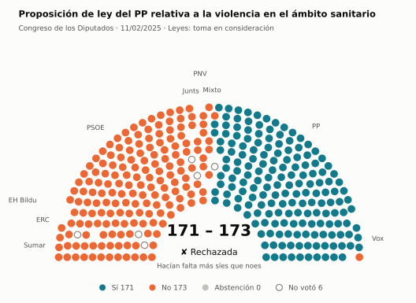
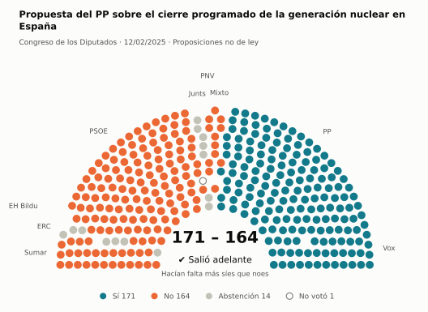
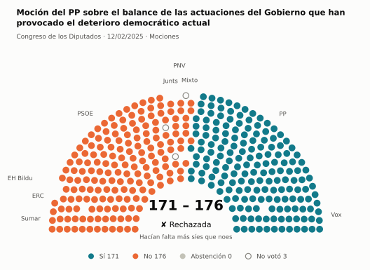
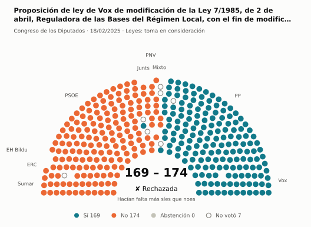
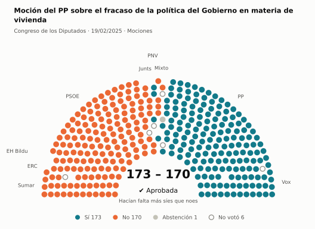
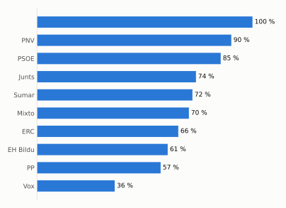
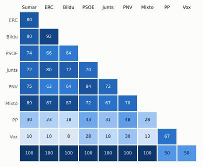

# Qué votó el Congreso en febrero de 2025

Las votaciones del Pleno del Congreso de los Diputados, explicadas sin tecnicismos. Datos oficiales del [Congreso](https://www.congreso.es/es/opendata/votaciones); este resumen se actualiza solo cada mes (última vez: 11/11/2026).

## En pocas palabras

- El Congreso votó **61 veces** en 6 días de pleno. **21 propuestas salieron adelante** y 40 no.
- 8 votaciones fueron sobre leyes, decretos o presupuestos. Otras 41 fueron peticiones al Gobierno que no le obligan (proposiciones no de ley y mociones).
- El Gobierno (PSOE y Sumar) perdió **4** de las 45 votaciones en las que sus grupos votaron lo mismo.
- La votación más reñida se decidió por 2 votos: Proposición de ley del PP relativa a la violencia en el ámbito sanitario.
- Los diputados casi siempre votan lo mismo que su grupo: en todo el mes solo hubo 14 votos distintos (sin contar el Grupo Mixto).

## Las votaciones más importantes del mes

Elegidas por su importancia: pesan más las leyes y los decretos que las peticiones al Gobierno, y suben las que se decidieron por pocos votos o las que perdió el Gobierno. Cada punto del dibujo es un diputado, colocado con su grupo, y el color es lo que votó.

### 1. Proposición de ley del PP relativa a la violencia en el ámbito sanitario

**11 de febrero · Leyes: toma en consideración.** Primer paso de una ley propuesta por un grupo o una comunidad autónoma: el Congreso decide si empieza a tramitarla.

<picture>
  <source media="(prefers-color-scheme: dark)" srcset="img/2025-02/votacion-L15-S090-V002-oscuro.svg">
  
</picture>

**✘ No salió adelante** por 2 votos: 171 a favor, 173 en contra y ninguna abstención.

- **A favor:** PP y Vox
- **En contra:** PSOE, Sumar, Junts, ERC, EH Bildu, PNV y 
- **Repartidos:** Grupo Mixto (Sí 2, No 5)

[Datos oficiales](https://www.congreso.es/webpublica/opendata/votaciones/Leg15/Sesion090/20250211/Votacion002/VOT_20250211202649.json)

### 2. Propuesta del PP sobre el cierre programado de la generación nuclear en España

**12 de febrero · Proposiciones no de ley.** Petición al Gobierno para que haga algo. Expresa la opinión del Congreso, pero no obliga.

<picture>
  <source media="(prefers-color-scheme: dark)" srcset="img/2025-02/votacion-L15-S091-V001-oscuro.svg">
  
</picture>

**✔ Salió adelante** por 7 votos: 171 a favor, 164 en contra y 14 abstenciones.

- **A favor:** PP y Vox
- **En contra:** PSOE, Sumar, EH Bildu y PNV
- **Se abstuvieron:** Junts y ERC
- **Repartidos:** Grupo Mixto (Sí 1, No 7)

[Datos oficiales](https://www.congreso.es/webpublica/opendata/votaciones/Leg15/Sesion091/20250212/Votacion001/VOT_20250212154036.json)

### 3. Moción del PP sobre el balance de las actuaciones del Gobierno que han provocado el deterioro democrático actual

**12 de febrero · Mociones.** Petición al Gobierno después de pedirle explicaciones en el Pleno. Expresa la opinión del Congreso, pero no obliga.

<picture>
  <source media="(prefers-color-scheme: dark)" srcset="img/2025-02/votacion-L15-S091-V007-oscuro.svg">
  
</picture>

**✘ No salió adelante** por 5 votos: 171 a favor, 176 en contra y ninguna abstención.

- **A favor:** PP y Vox
- **En contra:** PSOE, Sumar, Junts, ERC, EH Bildu y PNV
- **Repartidos:** Grupo Mixto (Sí 1, No 6)

Este asunto tuvo 7 votaciones este mes; aquí se muestra la más disputada. [Datos oficiales](https://www.congreso.es/webpublica/opendata/votaciones/Leg15/Sesion091/20250212/Votacion007/VOT_20250212154042.json)

### 4. Proposición de ley de Vox de modificación de la Ley 7/1985, de 2 de abril, Reguladora de las Bases del Régimen Local, con el fin de modificar el…

**18 de febrero · Leyes: toma en consideración.** Primer paso de una ley propuesta por un grupo o una comunidad autónoma: el Congreso decide si empieza a tramitarla.

<picture>
  <source media="(prefers-color-scheme: dark)" srcset="img/2025-02/votacion-L15-S092-V002-oscuro.svg">
  
</picture>

**✘ No salió adelante** por 5 votos: 169 a favor, 174 en contra y ninguna abstención.

- **A favor:** PP y Vox
- **En contra:** PSOE (117 de 118), Sumar, Grupo Mixto, Junts, ERC, EH Bildu y PNV

[Datos oficiales](https://www.congreso.es/webpublica/opendata/votaciones/Leg15/Sesion092/20250218/Votacion002/VOT_20250218194308.json)

### 5. Moción del PP sobre el fracaso de la política del Gobierno en materia de vivienda

**19 de febrero · Mociones.** Petición al Gobierno después de pedirle explicaciones en el Pleno. Expresa la opinión del Congreso, pero no obliga.

<picture>
  <source media="(prefers-color-scheme: dark)" srcset="img/2025-02/votacion-L15-S093-V011-oscuro.svg">
  
</picture>

**✔ Salió adelante** por 3 votos: 173 a favor, 170 en contra y 1 abstención.

- **A favor:** PP, Vox y PNV
- **En contra:** PSOE, Sumar, Junts, ERC y EH Bildu
- **Repartidos:** Grupo Mixto (Sí 1, No 5, Abstención 1)

Este asunto tuvo 6 votaciones este mes; aquí se muestra la más disputada. [Datos oficiales](https://www.congreso.es/webpublica/opendata/votaciones/Leg15/Sesion093/20250219/Votacion011/VOT_20250219135547.json)

## ¿Qué grupos votaron más veces lo que finalmente salió?

<picture>
  <source media="(prefers-color-scheme: dark)" srcset="img/2025-02/ganadora-oscuro.svg">
  
</picture>

Porcentaje de votaciones en que el grupo votó Sí y salió adelante, o votó No y no salió. Abstenerse no cuenta como acertar.

## ¿Quién vota con quién?

<picture>
  <source media="(prefers-color-scheme: dark)" srcset="img/2025-02/afinidad-oscuro.svg">
  
</picture>

Cada casilla dice en qué porcentaje de las votaciones dos grupos votaron lo mismo: 100 es que siempre coincidieron y 0 que nunca.

## ¿Qué tipo de cosas se votaron?

| Tipo | Votaciones | Salieron adelante | Qué es |
| --- | ---: | ---: | --- |
| Mociones | 35 | 6 | Petición al Gobierno después de pedirle explicaciones en el Pleno. Expresa la opinión del Congreso, pero no obliga. |
| Organización de la Cámara | 8 | 2 | Asunto interno del Congreso: comisiones, plazos o el estatuto de los diputados. |
| Proposiciones no de ley | 6 | 4 | Petición al Gobierno para que haga algo. Expresa la opinión del Congreso, pero no obliga. |
| Leyes: toma en consideración | 6 | 3 | Primer paso de una ley propuesta por un grupo o una comunidad autónoma: el Congreso decide si empieza a tramitarla. |
| Tratados internacionales | 4 | 4 | El Congreso autoriza a España a comprometerse con un acuerdo con otro país u organismo. |
| Decretos-ley (convalidación) | 2 | 2 | El Gobierno aprobó esta norma por urgencia. Ya está en vigor, pero el Congreso tiene 30 días para confirmarla o tumbarla. |

## Palabras que conviene saber

- **Pleno**: La reunión de los 350 diputados, donde se vota.
- **Grupo parlamentario**: Los diputados de un partido o coalición. Los partidos pequeños van juntos en el Grupo Mixto, aunque no piensen igual.
- **Abstención**: El diputado vota, pero ni a favor ni en contra.
- **No votó**: El diputado no votó: no estaba, estaba de baja o el escaño estaba vacío.
- **Mayoría simple**: Salen adelante las votaciones con más síes que noes. Es lo normal.
- **Mayoría absoluta**: 176 votos a favor, la mitad más uno de 350. La piden las leyes orgánicas (derechos fundamentales, sistema electoral…) y la primera votación de investidura.
- **Votación por llamamiento**: Cada diputado dice su voto en voz alta. Se usa en las investiduras y otras votaciones importantes.

---

**¿Quieres más detalle?** El [análisis detallado](2025-02-detalle.md) tiene la cohesión de cada grupo, un mapa de los diputados según cómo votan, qué diputados votaron distinto de su grupo, las ausencias y la lista completa de votaciones.

_Los resultados están calculados a partir de los votos: el Congreso no publica si cada votación salió adelante. Este proyecto no tiene relación con el Congreso. Método en [docs/DOCUMENTO_FUNCIONAL.md](../docs/DOCUMENTO_FUNCIONAL.md)._
