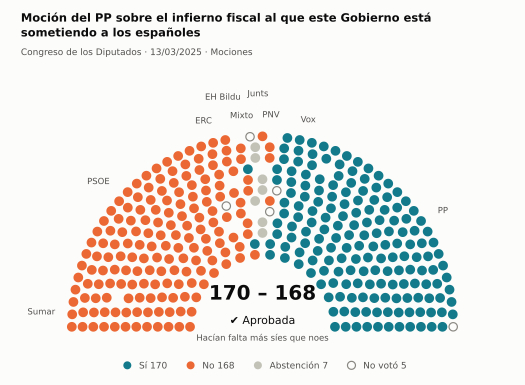
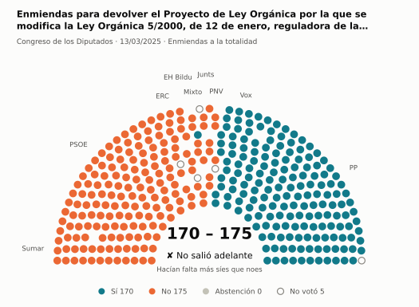
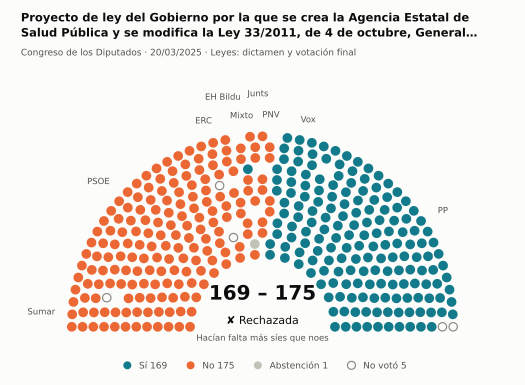
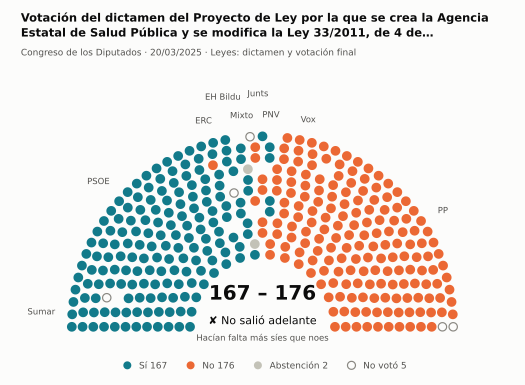
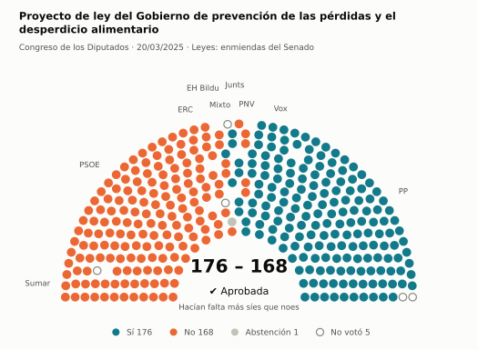
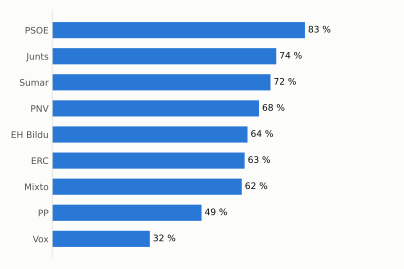
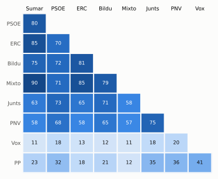

# Qué votó el Congreso en marzo de 2025

Las votaciones del Pleno del Congreso de los Diputados, explicadas sin tecnicismos. Datos oficiales del [Congreso](https://www.congreso.es/es/opendata/votaciones); este resumen se actualiza solo cada mes (última vez: 10/11/2026).

## En pocas palabras

- El Congreso votó **106 veces** en 6 días de pleno. **51 propuestas salieron adelante** y 55 no.
- 61 votaciones fueron sobre leyes, decretos o presupuestos. Otras 42 fueron peticiones al Gobierno que no le obligan (proposiciones no de ley y mociones).
- El Gobierno (PSOE y Sumar) perdió **12** de las 85 votaciones en las que sus grupos votaron lo mismo.
- La votación más reñida se decidió por 2 votos: Propuesta del PP para que el Gobierno ejerza de manera efectiva y uniforme sus competencias en materia de inmigración e….
- Los diputados casi siempre votan lo mismo que su grupo: en todo el mes solo hubo 34 votos distintos (sin contar el Grupo Mixto).

## Las votaciones más importantes del mes

Elegidas por su importancia: pesan más las leyes y los decretos que las peticiones al Gobierno, y suben las que se decidieron por pocos votos o las que perdió el Gobierno. Cada punto del dibujo es un diputado, colocado con su grupo, y el color es lo que votó.

### 1. Moción del PP sobre el infierno fiscal al que este Gobierno está sometiendo a los españoles

**13 de marzo · Mociones.** Petición al Gobierno después de pedirle explicaciones en el Pleno. Expresa la opinión del Congreso, pero no obliga.

<picture>
  <source media="(prefers-color-scheme: dark)" srcset="img/2025-03/votacion-L15-S098-V010-oscuro.svg">
  
</picture>

**✔ Salió adelante** por 2 votos: 170 a favor, 168 en contra y 7 abstenciones.

- **A favor:** PP y Vox
- **En contra:** PSOE, Sumar, ERC, EH Bildu y PNV
- **Se abstuvieron:** Junts
- **Repartidos:** Grupo Mixto (Sí 2, No 5)

Este asunto tuvo 5 votaciones este mes; aquí se muestra la más disputada. [Datos oficiales](https://www.congreso.es/webpublica/opendata/votaciones/Leg15/Sesion098/20250313/Votacion010/VOT_20250313133902.json)

### 2. Enmiendas para devolver el Proyecto de Ley Orgánica por la que se modifica la Ley Orgánica 5/2000, de 12 de enero, reguladora de la responsabilidad p…

**13 de marzo · Enmiendas a la totalidad.** Un grupo intenta devolver la ley a quien la propuso o sustituirla por otra. Si no sale adelante, la ley sigue su camino.

<picture>
  <source media="(prefers-color-scheme: dark)" srcset="img/2025-03/votacion-L15-S098-V017-oscuro.svg">
  
</picture>

**✘ No salió adelante** por 5 votos: 170 a favor, 175 en contra y ninguna abstención.

- **A favor:** PP y Vox
- **En contra:** PSOE, Sumar, Junts, ERC, EH Bildu y PNV
- **Repartidos:** Grupo Mixto (Sí 1, No 6)

[Datos oficiales](https://www.congreso.es/webpublica/opendata/votaciones/Leg15/Sesion098/20250313/Votacion017/VOT_20250313133910.json)

### 3. Proyecto de ley del Gobierno por la que se crea la Agencia Estatal de Salud Pública y se modifica la Ley 33/2011, de 4 de octubre, General de Salud P…

**20 de marzo · Leyes: dictamen y votación final.** Votación del texto de una ley después de trabajarla en comisión.

<picture>
  <source media="(prefers-color-scheme: dark)" srcset="img/2025-03/votacion-L15-S101-V003-oscuro.svg">
  
</picture>

**✘ No salió adelante** por 6 votos: 169 a favor, 175 en contra y 1 abstención.

- **A favor:** PP y Vox
- **En contra:** PSOE, Sumar, Junts, ERC, EH Bildu y PNV
- **Repartidos:** Grupo Mixto (Sí 1, No 6, Abstención 1)

Este asunto tuvo 3 votaciones este mes; aquí se muestra la más disputada. [Datos oficiales](https://www.congreso.es/webpublica/opendata/votaciones/Leg15/Sesion101/20250320/Votacion003/VOT_20250320125702.json)

### 4. Votación del dictamen del Proyecto de Ley por la que se crea la Agencia Estatal de Salud Pública y se modifica la Ley 33/2011, de 4 de octubre, Gener…

**20 de marzo · Leyes: dictamen y votación final.** Votación del texto de una ley después de trabajarla en comisión.

<picture>
  <source media="(prefers-color-scheme: dark)" srcset="img/2025-03/votacion-L15-S101-V019-oscuro.svg">
  
</picture>

**✘ No salió adelante** por 9 votos: 167 a favor, 176 en contra y 2 abstenciones.

- **A favor:** PSOE (119 de 120), Sumar, ERC, EH Bildu y PNV
- **En contra:** PP, Vox y Junts
- **Repartidos:** Grupo Mixto (Sí 5, Abstención 2)

[Datos oficiales](https://www.congreso.es/webpublica/opendata/votaciones/Leg15/Sesion101/20250320/Votacion019/VOT_20250320125720.json)

### 5. Proyecto de ley del Gobierno de prevención de las pérdidas y el desperdicio alimentario

**20 de marzo · Leyes: enmiendas del Senado.** El Senado propuso cambios a esta ley y el Congreso decide si los acepta. Es uno de los últimos pasos antes de que la ley se publique.

<picture>
  <source media="(prefers-color-scheme: dark)" srcset="img/2025-03/votacion-L15-S101-V055-oscuro.svg">
  
</picture>

**✔ Salió adelante** por 8 votos: 176 a favor, 168 en contra y 1 abstención.

- **A favor:** PP, Vox y Junts
- **En contra:** PSOE, Sumar, ERC, EH Bildu y PNV
- **Repartidos:** Grupo Mixto (Sí 1, No 5, Abstención 1)

Este asunto tuvo 45 votaciones este mes; aquí se muestra la más disputada. [Datos oficiales](https://www.congreso.es/webpublica/opendata/votaciones/Leg15/Sesion101/20250320/Votacion055/VOT_20250320125804.json)

## ¿Qué grupos votaron más veces lo que finalmente salió?

<picture>
  <source media="(prefers-color-scheme: dark)" srcset="img/2025-03/ganadora-oscuro.svg">
  
</picture>

Porcentaje de votaciones en que el grupo votó Sí y salió adelante, o votó No y no salió. Abstenerse no cuenta como acertar.

## ¿Quién vota con quién?

<picture>
  <source media="(prefers-color-scheme: dark)" srcset="img/2025-03/afinidad-oscuro.svg">
  
</picture>

Cada casilla dice en qué porcentaje de las votaciones dos grupos votaron lo mismo: 100 es que siempre coincidieron y 0 que nunca.

## ¿Qué tipo de cosas se votaron?

| Tipo | Votaciones | Salieron adelante | Qué es |
| --- | ---: | ---: | --- |
| Leyes: enmiendas del Senado | 45 | 22 | El Senado propuso cambios a esta ley y el Congreso decide si los acepta. Es uno de los últimos pasos antes de que la ley se publique. |
| Mociones | 31 | 16 | Petición al Gobierno después de pedirle explicaciones en el Pleno. Expresa la opinión del Congreso, pero no obliga. |
| Proposiciones no de ley | 11 | 4 | Petición al Gobierno para que haga algo. Expresa la opinión del Congreso, pero no obliga. |
| Leyes: toma en consideración | 6 | 4 | Primer paso de una ley propuesta por un grupo o una comunidad autónoma: el Congreso decide si empieza a tramitarla. |
| Leyes: dictamen y votación final | 6 | 2 | Votación del texto de una ley después de trabajarla en comisión. |
| Enmiendas a la totalidad | 4 | 0 | Un grupo intenta devolver la ley a quien la propuso o sustituirla por otra. Si no sale adelante, la ley sigue su camino. |
| Tratados internacionales | 2 | 2 | El Congreso autoriza a España a comprometerse con un acuerdo con otro país u organismo. |
| Organización de la Cámara | 1 | 1 | Asunto interno del Congreso: comisiones, plazos o el estatuto de los diputados. |

## Palabras que conviene saber

- **Pleno**: La reunión de los 350 diputados, donde se vota.
- **Grupo parlamentario**: Los diputados de un partido o coalición. Los partidos pequeños van juntos en el Grupo Mixto, aunque no piensen igual.
- **Abstención**: El diputado vota, pero ni a favor ni en contra.
- **No votó**: El diputado no votó: no estaba, estaba de baja o el escaño estaba vacío.
- **Mayoría simple**: Salen adelante las votaciones con más síes que noes. Es lo normal.
- **Mayoría absoluta**: 176 votos a favor, la mitad más uno de 350. La piden las leyes orgánicas (derechos fundamentales, sistema electoral…) y la primera votación de investidura.
- **Votación por llamamiento**: Cada diputado dice su voto en voz alta. Se usa en las investiduras y otras votaciones importantes.

---

**¿Quieres más detalle?** El [análisis detallado](2025-03-detalle.md) tiene la cohesión de cada grupo, un mapa de los diputados según cómo votan, qué diputados votaron distinto de su grupo, las ausencias y la lista completa de votaciones.

_Los resultados están calculados a partir de los votos: el Congreso no publica si cada votación salió adelante. Este proyecto no tiene relación con el Congreso. Método en [docs/DOCUMENTO_FUNCIONAL.md](../docs/DOCUMENTO_FUNCIONAL.md)._
