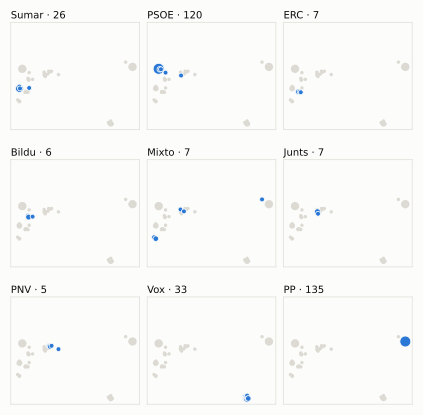
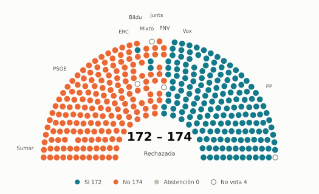
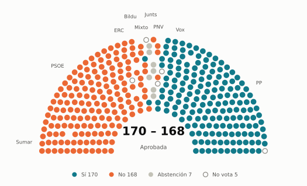
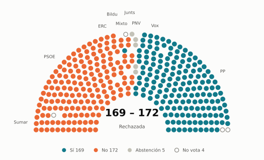
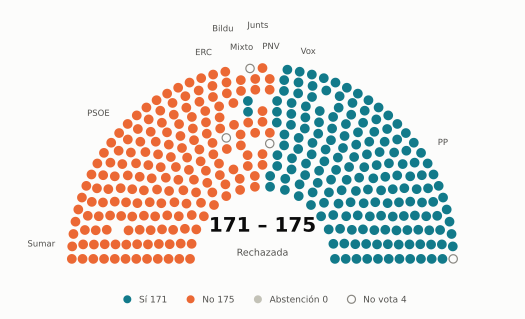

# Votaciones del Congreso: marzo de 2025

_Generado automáticamente el 2026-11-10 con datos abiertos del [Congreso de los Diputados](https://www.congreso.es/es/opendata/votaciones). Solo plenos y Diputación Permanente. Método y límites en [docs/DOCUMENTO_FUNCIONAL.md](../docs/DOCUMENTO_FUNCIONAL.md)._

## Resumen

- **106 votaciones** en 6 días de pleno (sesiones 96, 98, 99, 101, 102 y 103).
- **51 aprobadas** y **55 rechazadas**.
- 11 votaciones se decidieron por 5 votos o menos.
- El grupo que más veces votó con el resultado final: **PSOE** (83 % de las votaciones nominales).
- Los grupos del Gobierno (PSOE y Sumar) votaron lo mismo en 85 de 106 votaciones nominales y perdieron 12 de ellas.
- 34 votos individuales se apartaron de la posición de su grupo (31 diputados).

## Cómo votó cada grupo

| Grupo | Diputados | Cohesión | Votó con el resultado | Decisivo | Posición Sí | Posición No | Posición Abst. |
| --- | ---: | ---: | ---: | ---: | ---: | ---: | ---: |
| PP | 137 | 100 % | 49 % | 18 | 80 | 13 | 13 |
| PSOE | 120 | 100 % | 83 % | 41 | 39 | 64 | 3 |
| Vox | 33 | 100 % | 32 % | 12 | 39 | 33 | 34 |
| Sumar | 27 | 100 % | 72 % | 20 | 36 | 69 | 1 |
| Mixto | 8 | 64 % | 62 % | 7 | 29 | 77 | 0 |
| Junts | 7 | 100 % | 74 % | 13 | 38 | 49 | 19 |
| ERC | 7 | 99 % | 63 % | 14 | 33 | 65 | 8 |
| Bildu | 6 | 100 % | 64 % | 5 | 38 | 59 | 9 |
| PNV | 5 | 99 % | 68 % | 2 | 44 | 43 | 19 |

*Cohesión*: índice de acuerdo interno (100 % = todo el grupo votó igual). *Votó con el resultado*: el grupo votó Sí y salió aprobada, o No y salió rechazada. *Decisivo*: votaciones cuyo resultado habría cambiado si el grupo se hubiera abstenido en bloque. El Grupo Mixto reúne partidos distintos: su posición es la de su mayoría.

## Mapa de diputados

<picture>
  <source media="(prefers-color-scheme: dark)" srcset="img/2025-03/mapa-oscuro.svg">
  
</picture>

Cada punto es un diputado; dos diputados están cerca si votaron parecido. Un punto más grande reúne a varios que votaron exactamente igual. En cada panel, el grupo en azul y el resto del Congreso en gris.

*Cómo se calcula*: componentes principales de los votos (Sí, No, abstención) en 106 votaciones con algún desacuerdo. El eje horizontal recoge el 75 % de la variación y el vertical el 12 %. Los ejes no tienen nombre ni sentido político propio; por convención, el PP queda a la derecha. No se sitúa a 4 diputados que votó en menos de la mitad.

## Afinidad entre grupos

<picture>
  <source media="(prefers-color-scheme: dark)" srcset="img/2025-03/afinidad-oscuro.svg">
  
</picture>

Porcentaje de votaciones nominales en que los dos grupos tomaron la misma posición. Los grupos están ordenados según el mapa de diputados.

Ver la tabla

|  | PP | PSOE | Vox | Sumar | Mixto | Junts | ERC | Bildu | PNV |
| --- | :---: | :---: | :---: | :---: | :---: | :---: | :---: | :---: | :---: |
| PP | 100 % | 32 % | 41 % | 23 % | 12 % | 35 % | 18 % | 21 % | 36 % |
| PSOE | 32 % | 100 % | 18 % | 80 % | 71 % | 73 % | 70 % | 72 % | 68 % |
| Vox | 41 % | 18 % | 100 % | 11 % | 11 % | 18 % | 13 % | 12 % | 20 % |
| Sumar | 23 % | 80 % | 11 % | 100 % | 90 % | 63 % | 85 % | 75 % | 58 % |
| Mixto | 12 % | 71 % | 11 % | 90 % | 100 % | 58 % | 85 % | 79 % | 57 % |
| Junts | 35 % | 73 % | 18 % | 63 % | 58 % | 100 % | 65 % | 71 % | 75 % |
| ERC | 18 % | 70 % | 13 % | 85 % | 85 % | 65 % | 100 % | 81 % | 58 % |
| Bildu | 21 % | 72 % | 12 % | 75 % | 79 % | 71 % | 81 % | 100 % | 65 % |
| PNV | 36 % | 68 % | 20 % | 58 % | 57 % | 75 % | 58 % | 65 % | 100 % |

## Quién sacó adelante las votaciones

| Grupos que votaron Sí | Votaciones | Escaños |
| --- | ---: | ---: |
| PP + Vox | 7 | 170 |
| PSOE + Sumar + Mixto + Junts + ERC + Bildu + PNV | 7 | 180 |
| PP + PSOE + Junts + Bildu + PNV | 6 | 275 |
| PP + PSOE + Sumar + Mixto + Junts + ERC + Bildu + PNV | 4 | 317 |
| PP + Vox + PNV | 3 | 175 |
| PP + PSOE + Sumar + Junts + ERC + Bildu + PNV | 2 | 309 |
| PP + Sumar + Mixto + ERC + Bildu + PNV | 1 | 190 |
| PP + Vox + Sumar + Mixto + ERC + PNV | 1 | 217 |

De 51 votaciones nominales aprobadas. Otras 20 salieron con combinaciones que se dieron menos veces. La posición de cada grupo es la de la mayoría de sus diputados.

## Votaciones que perdieron los grupos del Gobierno

| Fecha | Asunto | Tipo | PSOE y Sumar votaron | Resultado | Sí | No |
| --- | --- | --- | :---: | --- | ---: | ---: |
| 13 de marzo | Moción consecuencia de interpelación urgente del Grupo Parlamentario Popular en el Congreso, sobre el infierno fiscal al que este Gobierno está sometiendo a lo… *(Votación separada por puntos. Punto 1.)* | Mociones | No | Aprobada | 170 | 168 |
| 13 de marzo | Moción consecuencia de interpelación urgente del Grupo Parlamentario Popular en el Congreso, sobre el infierno fiscal al que este Gobierno está sometiendo a lo… *(Votación separada por puntos. Punto 2.)* | Mociones | No | Aprobada | 171 | 167 |
| 13 de marzo | Moción consecuencia de interpelación urgente del Grupo Parlamentario Popular en el Congreso, sobre el infierno fiscal al que este Gobierno está sometiendo a lo… *(Votación separada por puntos. Punto 3.)* | Mociones | No | Aprobada | 175 | 163 |
| 20 de marzo | Moción consecuencia de interpelación urgente del Grupo Parlamentario Popular en el Congreso, sobre las cesiones que acaba de realizar el Gobierno en materia de… *(Votación separada por puntos. Punto 3.)* | Mociones | No | Aprobada | 175 | 170 |
| 20 de marzo | Votación del dictamen del Proyecto de Ley por la que se crea la Agencia Estatal de Salud Pública y se modifica la Ley 33/2011, de 4 de octubre, General de Salu… | Leyes: dictamen y votación final | Sí | Rechazada | 167 | 176 |
| 20 de marzo | Proyecto de Ley de prevención de las pérdidas y el desperdicio alimentario. *(Votación separada de las enmiendas Enmiendas a la disposici…)* | Leyes: enmiendas del Senado | No | Aprobada | 181 | 150 |
| 20 de marzo | Proyecto de Ley de prevención de las pérdidas y el desperdicio alimentario. *(Votación separada de las enmiendas Enmiendas a la disposici…)* | Leyes: enmiendas del Senado | No | Aprobada | 176 | 168 |
| 20 de marzo | Proyecto de Ley de prevención de las pérdidas y el desperdicio alimentario. *(Votación separada de las enmiendas Enmiendas a la disposici…)* | Leyes: enmiendas del Senado | No | Aprobada | 174 | 150 |
| 26 de marzo | Moción consecuencia de interpelación urgente del Grupo Parlamentario Popular en el Congreso, sobre la nueva programación militar de la defensa y el nuevo conce… *(Votación separada por puntos. Punto 1.)* | Mociones | No | Aprobada | 169 | 162 |
| 26 de marzo | Moción consecuencia de interpelación urgente del Grupo Parlamentario Popular en el Congreso, sobre la nueva programación militar de la defensa y el nuevo conce… *(Votación separada por puntos. Punto 2.)* | Mociones | No | Aprobada | 172 | 161 |
| 26 de marzo | Moción consecuencia de interpelación urgente del Grupo Parlamentario Popular en el Congreso, sobre la nueva programación militar de la defensa y el nuevo conce… *(Votación separada por puntos. Punto 3.)* | Mociones | No | Aprobada | 169 | 162 |
| 26 de marzo | Moción consecuencia de interpelación urgente del Grupo Parlamentario Popular en el Congreso, sobre la nueva programación militar de la defensa y el nuevo conce… *(Votación separada por puntos. Punto 4.)* | Mociones | No | Aprobada | 171 | 162 |

Además, PSOE y Sumar votaron distinto entre sí en 21 votaciones.

## Votaciones más ajustadas

**13 de marzo** · Proposición no de Ley del Grupo Parlamentario Popular en el Congreso, para que el Gobierno ejerza de manera efectiva y uniforme sus competencias en materia de… *(Votación separada por puntos. Punto 1.)*

<picture>
  <source media="(prefers-color-scheme: dark)" srcset="img/2025-03/hemiciclo-L15-S098-V002-oscuro.svg">
  
</picture>

**13 de marzo** · Moción consecuencia de interpelación urgente del Grupo Parlamentario Popular en el Congreso, sobre el infierno fiscal al que este Gobierno está sometiendo a lo… *(Votación separada por puntos. Punto 1.)*

<picture>
  <source media="(prefers-color-scheme: dark)" srcset="img/2025-03/hemiciclo-L15-S098-V010-oscuro.svg">
  
</picture>

**20 de marzo** · Moción consecuencia de interpelación urgente del Grupo Parlamentario Mixto (Sr. Catalán Higueras), sobre la criminalidad en nuestro país y las medidas que tien…

<picture>
  <source media="(prefers-color-scheme: dark)" srcset="img/2025-03/hemiciclo-L15-S101-V013-oscuro.svg">
  
</picture>

**13 de marzo** · Proposición no de Ley del Grupo Parlamentario Popular en el Congreso, para que el Gobierno ejerza de manera efectiva y uniforme sus competencias en materia de… *(Votación separada por puntos. Punto 2.)*

<picture>
  <source media="(prefers-color-scheme: dark)" srcset="img/2025-03/hemiciclo-L15-S098-V003-oscuro.svg">
  
</picture>

Cada punto es un escaño, agrupado por grupo parlamentario; el color es su voto.

| Fecha | Asunto | Resultado | Sí | No | Abst. |
| --- | --- | :---: | ---: | ---: | ---: |
| 13 de marzo | Proposición no de Ley del Grupo Parlamentario Popular en el Congreso, para que el Gobierno ejerza de manera efectiva y uniforme sus competencias en materia de… *(Votación separada por puntos. Punto 1.)* | Rechazada | 172 | 174 | 0 |
| 13 de marzo | Moción consecuencia de interpelación urgente del Grupo Parlamentario Popular en el Congreso, sobre el infierno fiscal al que este Gobierno está sometiendo a lo… *(Votación separada por puntos. Punto 1.)* | Aprobada | 170 | 168 | 7 |
| 20 de marzo | Moción consecuencia de interpelación urgente del Grupo Parlamentario Mixto (Sr. Catalán Higueras), sobre la criminalidad en nuestro país y las medidas que tien… | Rechazada | 169 | 172 | 5 |
| 13 de marzo | Proposición no de Ley del Grupo Parlamentario Popular en el Congreso, para que el Gobierno ejerza de manera efectiva y uniforme sus competencias en materia de… *(Votación separada por puntos. Punto 2.)* | Rechazada | 171 | 175 | 0 |
| 13 de marzo | Proposición no de Ley del Grupo Parlamentario Popular en el Congreso, para que el Gobierno ejerza de manera efectiva y uniforme sus competencias en materia de… *(Votación separada por puntos. Punto 4.)* | Rechazada | 171 | 175 | 0 |
| 13 de marzo | Moción consecuencia de interpelación urgente del Grupo Parlamentario Popular en el Congreso, sobre el infierno fiscal al que este Gobierno está sometiendo a lo… *(Votación separada por puntos. Punto 2.)* | Aprobada | 171 | 167 | 7 |
| 20 de marzo | Proyecto de Ley de prevención de las pérdidas y el desperdicio alimentario. *(Votación separada de las enmiendas Enmiendas al apartado 1,…)* | Rechazada | 154 | 158 | 34 |
| 20 de marzo | Proyecto de Ley de prevención de las pérdidas y el desperdicio alimentario. *(Votación separada de las enmiendas Enmiendas por la que se…)* | Rechazada | 167 | 171 | 6 |
| 13 de marzo | Moción consecuencia de interpelación urgente del Grupo Parlamentario Popular en el Congreso, sobre el infierno fiscal al que este Gobierno está sometiendo a lo… *(Votación separada por puntos. Punto 5.)* | Rechazada | 146 | 151 | 49 |
| 13 de marzo | Votación conjunta de las enmiendas a la totalidad de devolución al Proyecto de Ley Orgánica por la que se modifica la Ley Orgánica 5/2000, de 12 de enero, regu… | Rechazada | 170 | 175 | 0 |

Votaciones decididas por 10 votos o menos (o a esa distancia de la mayoría que exigían). Las públicas por llamamiento no tienen hemiciclo: el voto de cada diputado solo consta en el Diario de Sesiones.

## Qué se votó, por tipo de asunto

| Tipo de asunto | Votaciones | Aprobadas | No aprobadas |
| --- | ---: | ---: | ---: |
| Leyes: enmiendas del Senado | 45 | 22 | 23 |
| Mociones | 31 | 16 | 15 |
| Proposiciones no de ley | 11 | 4 | 7 |
| Leyes: toma en consideración | 6 | 4 | 2 |
| Leyes: dictamen y votación final | 6 | 2 | 4 |
| Enmiendas a la totalidad | 4 | 0 | 4 |
| Tratados internacionales | 2 | 2 | 0 |
| Organización de la Cámara | 1 | 1 | 0 |

Las proposiciones no de ley y las mociones expresan la posición del Congreso pero no obligan al Gobierno. Las leyes pasan por varias votaciones (toma en consideración, totalidad, dictamen, Senado), así que una misma ley puede aparecer varias veces.

## Votos distintos de su grupo

| Diputado | Grupo | Votos distintos de su grupo |
| --- | --- | ---: |
| Chamorro Delmo, Ricardo | Vox | 2 |
| Del Valle Rodríguez, Emilio Jesús | Vox | 2 |
| Pozueta Fernández, Isabel | Bildu | 2 |
| Abascal Conde, Santiago | Vox | 1 |
| Agirretxea Urresti, Joseba Andoni | PNV | 1 |
| Asarta Cuevas, Alberto | Vox | 1 |
| Beamonte Mesa, Luis María | PP | 1 |
| Conde López, Francisco José | PP | 1 |
| De Meer Méndez, Rocío | Vox | 1 |
| De las Cuevas Cortés, Félix | PP | 1 |
| Díaz Pérez, Yolanda | Sumar | 1 |
| Esteban Bravo, Aitor | PNV | 1 |
| Estrems Fayos, Etna | ERC | 1 |
| García López, Maribel | PSOE | 1 |
| Hernando Fraile, Rafael Antonio | PP | 1 |

Un voto aislado puede ser un error al pulsar, no una decisión política: el Congreso no publica las correcciones. Se excluye el Grupo Mixto.

## Diputados que más veces no votaron

| Diputado | Grupo | No votó | % de votaciones |
| --- | --- | ---: | ---: |
| Varela Pazos, Marta | PP | 86 | 81 % |
| Ábalos Meco, José Luis | Mixto | 85 | 80 % |
| Pisarello Prados, Gerardo | Sumar | 81 | 76 % |
| Núñez Feijóo, Alberto | PP | 72 | 68 % |
| Sánchez Pérez-Castejón, Pedro | PSOE | 39 | 37 % |
| Esteban Bravo, Aitor | PNV | 21 | 20 % |
| Díaz Pérez, Yolanda | Sumar | 20 | 19 % |
| Montero Cuadrado, María Jesús | PSOE | 20 | 19 % |
| Iñarritu García, Jon | Bildu | 6 | 6 % |
| Pozueta Fernández, Isabel | Bildu | 4 | 4 % |
| Abascal Conde, Santiago | Vox | 3 | 3 % |
| Bolaños García, Félix | PSOE | 3 | 3 % |
| Delgado Arce, Celso Luis | PP | 3 | 3 % |
| Rego Candamil, Néstor | Mixto | 3 | 3 % |
| Alós López, Ana Isabel | PP | 2 | 2 % |

«No vota» incluye ausencias justificadas (baja, maternidad o paternidad) y escaños vacantes; el portal no las distingue.

## Todas las votaciones

Posición de cada grupo: la opción que votó la mayoría de sus diputados (*Div.*: empate dentro del grupo). El número enlaza al JSON oficial o, en las votaciones por llamamiento, al Diario de Sesiones.

### 11 de marzo (sesión 96)

| Nº | Asunto | Resultado | Sí | No | Abst. | PP | PSOE | Vox | Sumar | Mixto | Junts | ERC | Bildu | PNV | Decisivos |
| ---: | --- | --- | ---: | ---: | ---: | :---: | :---: | :---: | :---: | :---: | :---: | :---: | :---: | :---: | --- |
| [1](https://www.congreso.es/webpublica/opendata/votaciones/Leg15/Sesion096/20250311/Votacion001/VOT_20250311203733.json) | Proposición de Ley del Parlamento de Cataluña, para garantizar el retorno social del rescate bancario. | Rechazada | 56 | 282 | 1 | No | No | No | Sí | Sí | Sí | Sí | Sí | Sí |  |
| [2](https://www.congreso.es/webpublica/opendata/votaciones/Leg15/Sesion096/20250311/Votacion002/VOT_20250311203734.json) | Proposición de Ley del Grupo Parlamentario Popular en el Congreso, para la recuperación de la bonificación de las cuotas patronales de la Seguridad Social para… | Aprobada | 169 | 44 | 131 | Sí | Abst. | Sí | No | No | Abst. | No | No | Abst. | PP |

### 13 de marzo (sesión 98)

| Nº | Asunto | Resultado | Sí | No | Abst. | PP | PSOE | Vox | Sumar | Mixto | Junts | ERC | Bildu | PNV | Decisivos |
| ---: | --- | --- | ---: | ---: | ---: | :---: | :---: | :---: | :---: | :---: | :---: | :---: | :---: | :---: | --- |
| [1](https://www.congreso.es/webpublica/opendata/votaciones/Leg15/Sesion098/20250313/Votacion001/VOT_20250313133850.json) | Proposición no de Ley del Grupo Parlamentario Republicano, sobre el marco regulatorio contra la opacidad algorítmica y el estudio para la posible creación de u… | Aprobada | 175 | 167 | 0 | No | Sí | No | Sí | Sí | Sí | Sí | Sí | Sí | PSOE, Sumar |
| [2](https://www.congreso.es/webpublica/opendata/votaciones/Leg15/Sesion098/20250313/Votacion002/VOT_20250313133851.json) | Proposición no de Ley del Grupo Parlamentario Popular en el Congreso, para que el Gobierno ejerza de manera efectiva y uniforme sus competencias en materia de… *(Votación separada por puntos. Punto 1.)* | Rechazada | 172 | 174 | 0 | Sí | No | Sí | No | No | No | No | No | No | Bildu, Junts, Mixto, ERC, PSOE, Sumar, PNV |
| [3](https://www.congreso.es/webpublica/opendata/votaciones/Leg15/Sesion098/20250313/Votacion003/VOT_20250313133853.json) | Proposición no de Ley del Grupo Parlamentario Popular en el Congreso, para que el Gobierno ejerza de manera efectiva y uniforme sus competencias en materia de… *(Votación separada por puntos. Punto 2.)* | Rechazada | 171 | 175 | 0 | Sí | No | Sí | No | No | No | No | No | No | Bildu, Junts, Mixto, ERC, PSOE, Sumar |
| [4](https://www.congreso.es/webpublica/opendata/votaciones/Leg15/Sesion098/20250313/Votacion004/VOT_20250313133854.json) | Proposición no de Ley del Grupo Parlamentario Popular en el Congreso, para que el Gobierno ejerza de manera efectiva y uniforme sus competencias en materia de… *(Votación separada por puntos. Punto 3.)* | Rechazada | 170 | 176 | 0 | Sí | No | Sí | No | No | No | No | No | No | Junts, ERC, PSOE, Sumar |
| [5](https://www.congreso.es/webpublica/opendata/votaciones/Leg15/Sesion098/20250313/Votacion005/VOT_20250313133856.json) | Proposición no de Ley del Grupo Parlamentario Popular en el Congreso, para que el Gobierno ejerza de manera efectiva y uniforme sus competencias en materia de… *(Votación separada por puntos. Punto 4.)* | Rechazada | 171 | 175 | 0 | Sí | No | Sí | No | No | No | No | No | No | Bildu, Junts, Mixto, ERC, PSOE, Sumar |
| [6](https://www.congreso.es/webpublica/opendata/votaciones/Leg15/Sesion098/20250313/Votacion006/VOT_20250313133857.json) | Proposición no de Ley del Grupo Parlamentario Popular en el Congreso, para que el Gobierno ejerza de manera efectiva y uniforme sus competencias en materia de… *(Votación separada por puntos. Punto 5.)* | Rechazada | 170 | 176 | 0 | Sí | No | Sí | No | No | No | No | No | No | Junts, ERC, PSOE, Sumar |
| [7](https://www.congreso.es/webpublica/opendata/votaciones/Leg15/Sesion098/20250313/Votacion007/VOT_20250313133858.json) | Proposición no de Ley del Grupo Parlamentario Popular en el Congreso, para que el Gobierno ejerza de manera efectiva y uniforme sus competencias en materia de… *(Votación separada por puntos. Punto 6.)* | Rechazada | 170 | 176 | 0 | Sí | No | Sí | No | No | No | No | No | No | Junts, ERC, PSOE, Sumar |
| [8](https://www.congreso.es/webpublica/opendata/votaciones/Leg15/Sesion098/20250313/Votacion008/VOT_20250313133859.json) | Moción consecuencia de interpelación urgente del Grupo Parlamentario Mixto (Sra. Belarra Urteaga), relativa a la posición del Gobierno sobre la retribución del… | Aprobada | 186 | 153 | 7 | Sí | No | No | Sí | Sí | Abst. | Sí | Sí | Sí | PP |
| [9](https://www.congreso.es/webpublica/opendata/votaciones/Leg15/Sesion098/20250313/Votacion009/VOT_20250313133900.json) | Moción consecuencia de interpelación urgente del Grupo Parlamentario VOX, sobre las medidas que adoptará el Gobierno para garantizar la soberanía energética de… | Rechazada | 33 | 313 | 0 | No | No | Sí | No | No | No | No | No | No |  |
| [10](https://www.congreso.es/webpublica/opendata/votaciones/Leg15/Sesion098/20250313/Votacion010/VOT_20250313133902.json) | Moción consecuencia de interpelación urgente del Grupo Parlamentario Popular en el Congreso, sobre el infierno fiscal al que este Gobierno está sometiendo a lo… *(Votación separada por puntos. Punto 1.)* | Aprobada | 170 | 168 | 7 | Sí | No | Sí | No | No | Abst. | No | No | No | PP, Vox |
| [11](https://www.congreso.es/webpublica/opendata/votaciones/Leg15/Sesion098/20250313/Votacion011/VOT_20250313133903.json) | Moción consecuencia de interpelación urgente del Grupo Parlamentario Popular en el Congreso, sobre el infierno fiscal al que este Gobierno está sometiendo a lo… *(Votación separada por puntos. Punto 2.)* | Aprobada | 171 | 167 | 7 | Sí | No | Sí | No | No | Abst. | No | No | No | PP, Vox |
| [12](https://www.congreso.es/webpublica/opendata/votaciones/Leg15/Sesion098/20250313/Votacion012/VOT_20250313133904.json) | Moción consecuencia de interpelación urgente del Grupo Parlamentario Popular en el Congreso, sobre el infierno fiscal al que este Gobierno está sometiendo a lo… *(Votación separada por puntos. Punto 3.)* | Aprobada | 175 | 163 | 8 | Sí | No | Sí | No | No | Abst. | No | No | Sí | PP, Vox |
| [13](https://www.congreso.es/webpublica/opendata/votaciones/Leg15/Sesion098/20250313/Votacion013/VOT_20250313133906.json) | Moción consecuencia de interpelación urgente del Grupo Parlamentario Popular en el Congreso, sobre el infierno fiscal al que este Gobierno está sometiendo a lo… *(Votación separada por puntos. Punto 4.)* | Aprobada | 211 | 121 | 13 | Sí | No | Sí | Sí | Sí | Abst. | Sí | Abst. | Sí | PP |
| [14](https://www.congreso.es/webpublica/opendata/votaciones/Leg15/Sesion098/20250313/Votacion014/VOT_20250313133907.json) | Moción consecuencia de interpelación urgente del Grupo Parlamentario Popular en el Congreso, sobre el infierno fiscal al que este Gobierno está sometiendo a lo… *(Votación separada por puntos. Punto 5.)* | Rechazada | 146 | 151 | 49 | Sí | No | Abst. | No | No | Abst. | Sí | Abst. | Abst. | PSOE, Sumar |
| [15](https://www.congreso.es/webpublica/opendata/votaciones/Leg15/Sesion098/20250313/Votacion015/VOT_20250313133908.json) | Votación de la enmienda a la totalidad de devolución al Proyecto de Ley integral de impulso de la economía social, presentada por el Grupo Parlamentario VOX. | Rechazada | 33 | 175 | 137 | Abst. | No | Sí | No | No | No | No | No | No |  |
| [16](https://www.congreso.es/webpublica/opendata/votaciones/Leg15/Sesion098/20250313/Votacion016/VOT_20250313133909.json) | Votación conjunta de las enmiendas a la totalidad de devolución al Proyecto de Ley por la que se modifica la Ley 1/2000, de 7 de enero, de Enjuiciamiento Civil… | Rechazada | 170 | 176 | 0 | Sí | No | Sí | No | No | No | No | No | No | Junts, ERC, PSOE, Sumar |
| [17](https://www.congreso.es/webpublica/opendata/votaciones/Leg15/Sesion098/20250313/Votacion017/VOT_20250313133910.json) | Votación conjunta de las enmiendas a la totalidad de devolución al Proyecto de Ley Orgánica por la que se modifica la Ley Orgánica 5/2000, de 12 de enero, regu… | Rechazada | 170 | 175 | 0 | Sí | No | Sí | No | No | No | No | No | No | Junts, Mixto, ERC, PSOE, Sumar |
| [18](https://www.congreso.es/webpublica/opendata/votaciones/Leg15/Sesion098/20250313/Votacion018/VOT_20250313133911.json) | Acuerdo internacional entre el Reino de España y la República de Gambia en materia de cooperación en el ámbito de la seguridad y la lucha contra la delincuenci… | Aprobada | 299 | 0 | 45 | Sí | Sí | Abst. | Sí | Sí | Sí | Abst. | Abst. | Sí |  |
| [19](https://www.congreso.es/webpublica/opendata/votaciones/Leg15/Sesion098/20250313/Votacion019/VOT_20250313133912.json) | Convención de las Naciones Unidas sobre los efectos internacionales de las ventas judiciales de buques, hecha en Nueva York el 7 de diciembre de 2022. | Aprobada | 292 | 0 | 52 | Sí | Sí | Abst. | Sí | Sí | Abst. | Abst. | Abst. | Sí |  |
| [20](https://www.congreso.es/webpublica/opendata/votaciones/Leg15/Sesion098/20250313/Votacion020/VOT_20250313133914.json) | Solicitud de los Grupos Parlamentarios Plurinacional SUMAR, Mixto, Republicano y Junts per Catalunya, de creación de una Comisión de Investigación sobre la ges… | Aprobada | 176 | 169 | 1 | No | Sí | No | Sí | Sí | Sí | Sí | Sí | Sí | Junts, ERC, PSOE, Sumar |
| [21](https://www.congreso.es/webpublica/opendata/votaciones/Leg15/Sesion098/20250313/Votacion021/VOT_20250313133915.json) | Votación de la solicitud de avocación por el Pleno de la Cámara de la deliberación y votación final del Proyecto de Ley de la Función Pública de la Administrac… | Aprobada | 326 | 1 | 16 | Sí | Sí | Sí | Sí | Sí | Abst. | Sí | Abst. | Abst. |  |

### 18 de marzo (sesión 99)

| Nº | Asunto | Resultado | Sí | No | Abst. | PP | PSOE | Vox | Sumar | Mixto | Junts | ERC | Bildu | PNV | Decisivos |
| ---: | --- | --- | ---: | ---: | ---: | :---: | :---: | :---: | :---: | :---: | :---: | :---: | :---: | :---: | --- |
| [1](https://www.congreso.es/webpublica/opendata/votaciones/Leg15/Sesion099/20250318/Votacion001/VOT_20250318201321.json) | Proposición de Ley del Grupo Parlamentario Junts per Catalunya, de medidas urgentes para hacer frente a la ocupación ilegal de inmuebles (Orgánica). | Aprobada | 300 | 44 | 0 | Sí | Sí | Sí | No | No | Sí | No | No | Sí |  |
| [2](https://www.congreso.es/webpublica/opendata/votaciones/Leg15/Sesion099/20250318/Votacion002/VOT_20250318201322.json) | Proposición de Ley del Grupo Parlamentario Socialista, sobre la reducción de la tasa máxima de alcohol en la conducción y la prohibición de la difusión de la u… | Aprobada | 177 | 32 | 135 | Abst. | Sí | No | Sí | Sí | Sí | Sí | Sí | Sí |  |

### 20 de marzo (sesión 101)

| Nº | Asunto | Resultado | Sí | No | Abst. | PP | PSOE | Vox | Sumar | Mixto | Junts | ERC | Bildu | PNV | Decisivos |
| ---: | --- | --- | ---: | ---: | ---: | :---: | :---: | :---: | :---: | :---: | :---: | :---: | :---: | :---: | --- |
| [1](https://www.congreso.es/webpublica/opendata/votaciones/Leg15/Sesion101/20250320/Votacion001/VOT_20250320125659.json) | Proyecto de Ley por la que se crea la Agencia Estatal de Salud Pública y se modifica la Ley 33/2011, de 4 de octubre, General de Salud Pública. *(Enmiendas presentadas por el Grupo Parlamentario Mixto (Sr.…)* | Rechazada | 17 | 327 | 0 | No | No | No | No | Sí | No | Sí | Sí | No |  |
| [2](https://www.congreso.es/webpublica/opendata/votaciones/Leg15/Sesion101/20250320/Votacion002/VOT_20250320125701.json) | Proyecto de Ley por la que se crea la Agencia Estatal de Salud Pública y se modifica la Ley 33/2011, de 4 de octubre, General de Salud Pública. *(Enmiendas presentadas por el Grupo Parlamentario VOX Votaci…)* | Rechazada | 33 | 312 | 0 | No | No | Sí | No | No | No | No | No | No |  |
| [3](https://www.congreso.es/webpublica/opendata/votaciones/Leg15/Sesion101/20250320/Votacion003/VOT_20250320125702.json) | Proyecto de Ley por la que se crea la Agencia Estatal de Salud Pública y se modifica la Ley 33/2011, de 4 de octubre, General de Salud Pública. *(Enmiendas presentadas por el Grupo Parlamentario Popular en…)* | Rechazada | 169 | 175 | 1 | Sí | No | Sí | No | No | No | No | No | No | Junts, ERC, PSOE, Sumar |
| [4](https://www.congreso.es/webpublica/opendata/votaciones/Leg15/Sesion101/20250320/Votacion004/VOT_20250320125703.json) | Proposición no de Ley del Grupo Parlamentario Socialista, para adaptar la Ley 49/60, de 21 de julio, sobre propiedad horizontal, a la Convención sobre los dere… | Aprobada | 166 | 33 | 147 | Abst. | Sí | No | Sí | Sí | Abst. | Sí | Sí | Abst. |  |
| [5](https://www.congreso.es/webpublica/opendata/votaciones/Leg15/Sesion101/20250320/Votacion005/VOT_20250320125704.json) | Proposición no de Ley del Grupo Parlamentario Popular en el Congreso, relativa a reafirmar el apoyo a Ucrania y fortalecer la relación transatlántica. | Rechazada | 136 | 165 | 45 | Sí | No | Abst. | No | No | Abst. | No | No | Abst. | PSOE |
| [6](https://www.congreso.es/webpublica/opendata/votaciones/Leg15/Sesion101/20250320/Votacion006/VOT_20250320125706.json) | Moción consecuencia de interpelación urgente del Grupo Parlamentario Mixto (Sr. Rego Candamil), relativa a la posición del Gobierno español ante los anuncios i… *(Votación separada por puntos. Punto 1.)* | Aprobada | 178 | 32 | 135 | Abst. | Sí | No | Sí | Sí | Sí | Sí | Sí | Sí |  |
| [7](https://www.congreso.es/webpublica/opendata/votaciones/Leg15/Sesion101/20250320/Votacion007/VOT_20250320125707.json) | Moción consecuencia de interpelación urgente del Grupo Parlamentario Mixto (Sr. Rego Candamil), relativa a la posición del Gobierno español ante los anuncios i… *(Votación separada por puntos. Punto 2.)* | Aprobada | 178 | 33 | 135 | Abst. | Sí | No | Sí | Sí | Sí | Sí | Sí | Sí |  |
| [8](https://www.congreso.es/webpublica/opendata/votaciones/Leg15/Sesion101/20250320/Votacion008/VOT_20250320125708.json) | Moción consecuencia de interpelación urgente del Grupo Parlamentario Mixto (Sr. Rego Candamil), relativa a la posición del Gobierno español ante los anuncios i… *(Votación separada por puntos. Punto 3.)* | Rechazada | 37 | 302 | 7 | No | No | No | Sí | Sí | No | Abst. | Sí | No |  |
| [9](https://www.congreso.es/webpublica/opendata/votaciones/Leg15/Sesion101/20250320/Votacion009/VOT_20250320125710.json) | Moción consecuencia de interpelación urgente del Grupo Parlamentario Mixto (Sr. Rego Candamil), relativa a la posición del Gobierno español ante los anuncios i… *(Votación separada por puntos. Punto 4.)* | Rechazada | 44 | 302 | 0 | No | No | No | Sí | Sí | No | Sí | Sí | No |  |
| [10](https://www.congreso.es/webpublica/opendata/votaciones/Leg15/Sesion101/20250320/Votacion010/VOT_20250320125711.json) | Moción consecuencia de interpelación urgente del Grupo Parlamentario Mixto (Sr. Rego Candamil), relativa a la posición del Gobierno español ante los anuncios i… *(Votación separada por puntos. Punto 5.)* | Aprobada | 172 | 34 | 139 | Abst. | Sí | No | Sí | Sí | Sí | Sí | Sí | Abst. |  |
| [11](https://www.congreso.es/webpublica/opendata/votaciones/Leg15/Sesion101/20250320/Votacion011/VOT_20250320125712.json) | Moción consecuencia de interpelación urgente del Grupo Parlamentario Mixto (Sr. Rego Candamil), relativa a la posición del Gobierno español ante los anuncios i… *(Votación separada por puntos. Punto 6.)* | Rechazada | 37 | 302 | 7 | No | No | No | Sí | Sí | No | Abst. | Sí | No |  |
| [12](https://www.congreso.es/webpublica/opendata/votaciones/Leg15/Sesion101/20250320/Votacion012/VOT_20250320125714.json) | Moción consecuencia de interpelación urgente del Grupo Parlamentario VOX, sobre las medidas que adoptará el Gobierno para la restauración de las zonas arrasada… | Rechazada | 33 | 177 | 136 | Abst. | No | Sí | No | No | No | No | No | No |  |
| [13](https://www.congreso.es/webpublica/opendata/votaciones/Leg15/Sesion101/20250320/Votacion013/VOT_20250320125715.json) | Moción consecuencia de interpelación urgente del Grupo Parlamentario Mixto (Sr. Catalán Higueras), sobre la criminalidad en nuestro país y las medidas que tien… | Rechazada | 169 | 172 | 5 | Sí | No | Sí | No | No | No | No | No | Abst. | Bildu, Junts, Mixto, ERC, PSOE, Sumar |
| [14](https://www.congreso.es/webpublica/opendata/votaciones/Leg15/Sesion101/20250320/Votacion014/VOT_20250320125716.json) | Moción consecuencia de interpelación urgente del Grupo Parlamentario Popular en el Congreso, sobre las cesiones que acaba de realizar el Gobierno en materia de… *(Votación separada por puntos. Punto 1.)* | Rechazada | 170 | 176 | 0 | Sí | No | Sí | No | No | No | No | No | No | Junts, ERC, PSOE, Sumar |
| [15](https://www.congreso.es/webpublica/opendata/votaciones/Leg15/Sesion101/20250320/Votacion015/VOT_20250320125716.json) | Moción consecuencia de interpelación urgente del Grupo Parlamentario Popular en el Congreso, sobre las cesiones que acaba de realizar el Gobierno en materia de… *(Votación separada por puntos. Punto 2.)* | Rechazada | 135 | 210 | 0 | Sí | No | No | No | No | No | No | No | No | PSOE |
| [16](https://www.congreso.es/webpublica/opendata/votaciones/Leg15/Sesion101/20250320/Votacion016/VOT_20250320125717.json) | Moción consecuencia de interpelación urgente del Grupo Parlamentario Popular en el Congreso, sobre las cesiones que acaba de realizar el Gobierno en materia de… *(Votación separada por puntos. Punto 3.)* | Aprobada | 175 | 170 | 0 | Sí | No | Sí | No | No | No | No | No | Sí | PP, PNV, Vox |
| [17](https://www.congreso.es/webpublica/opendata/votaciones/Leg15/Sesion101/20250320/Votacion017/VOT_20250320125719.json) | Moción consecuencia de interpelación urgente del Grupo Parlamentario Popular en el Congreso, sobre las cesiones que acaba de realizar el Gobierno en materia de… *(Votación separada por puntos. Punto 4.)* | Rechazada | 168 | 176 | 1 | Sí | No | Sí | No | No | No | No | No | No | PSOE, Sumar |
| [18](https://www.congreso.es/webpublica/opendata/votaciones/Leg15/Sesion101/20250320/Votacion018/VOT_20250320125719.json) | Moción consecuencia de interpelación urgente del Grupo Parlamentario Popular en el Congreso, sobre las cesiones que acaba de realizar el Gobierno en materia de… *(Votación separada por puntos. Punto 5.)* | Rechazada | 141 | 204 | 1 | Sí | No | No | No | No | No | No | No | Sí | PSOE |
| [19](https://www.congreso.es/webpublica/opendata/votaciones/Leg15/Sesion101/20250320/Votacion019/VOT_20250320125720.json) | Votación del dictamen del Proyecto de Ley por la que se crea la Agencia Estatal de Salud Pública y se modifica la Ley 33/2011, de 4 de octubre, General de Salu… | Rechazada | 167 | 176 | 2 | No | Sí | No | Sí | Sí | No | Sí | Sí | Sí | PP, Vox |
| [20](https://www.congreso.es/webpublica/opendata/votaciones/Leg15/Sesion101/20250320/Votacion020/VOT_20250320125722.json) | Proyecto de Ley de prevención de las pérdidas y el desperdicio alimentario. *(Votación separada de las enmiendas Enmiendas de modificació…)* | Aprobada | 309 | 37 | 0 | Sí | Sí | No | Sí | No | Sí | Sí | Sí | Sí |  |
| [21](https://www.congreso.es/webpublica/opendata/votaciones/Leg15/Sesion101/20250320/Votacion021/VOT_20250320125723.json) | Proyecto de Ley de prevención de las pérdidas y el desperdicio alimentario. *(Votación separada de las enmiendas Enmiendas de supresión d…)* | Rechazada | 136 | 176 | 33 | Sí | No | Abst. | No | No | No | No | No | No | PSOE |
| [22](https://www.congreso.es/webpublica/opendata/votaciones/Leg15/Sesion101/20250320/Votacion022/VOT_20250320125724.json) | Proyecto de Ley de prevención de las pérdidas y el desperdicio alimentario. *(Votación separada de las enmiendas Enmiendas de modificació…)* | Aprobada | 263 | 50 | 33 | Sí | Sí | Abst. | No | No | No | No | No | Sí |  |
| [23](https://www.congreso.es/webpublica/opendata/votaciones/Leg15/Sesion101/20250320/Votacion023/VOT_20250320125725.json) | Proyecto de Ley de prevención de las pérdidas y el desperdicio alimentario. *(Votación separada de las enmiendas Resto de enmiendas al pr…)* | Aprobada | 275 | 37 | 34 | Sí | Sí | Abst. | No | No | Sí | No | Sí | Sí |  |
| [24](https://www.congreso.es/webpublica/opendata/votaciones/Leg15/Sesion101/20250320/Votacion024/VOT_20250320125726.json) | Proyecto de Ley de prevención de las pérdidas y el desperdicio alimentario. *(Votación separada de las enmiendas Enmiendas por la que se…)* | Rechazada | 136 | 171 | 39 | Sí | No | Abst. | No | No | No | No | No | Abst. | PSOE |
| [25](https://www.congreso.es/webpublica/opendata/votaciones/Leg15/Sesion101/20250320/Votacion025/VOT_20250320125727.json) | Proyecto de Ley de prevención de las pérdidas y el desperdicio alimentario. *(Votación separada de las enmiendas Resto de enmiendas al ar…)* | Rechazada | 142 | 170 | 34 | Sí | No | Abst. | No | No | No | No | Sí | No | PSOE |
| [26](https://www.congreso.es/webpublica/opendata/votaciones/Leg15/Sesion101/20250320/Votacion026/VOT_20250320125728.json) | Proyecto de Ley de prevención de las pérdidas y el desperdicio alimentario. *(Votación separada de las enmiendas Enmiendas al primer párr…)* | Rechazada | 136 | 209 | 1 | Sí | No | No | No | No | No | No | No | No | PSOE |
| [27](https://www.congreso.es/webpublica/opendata/votaciones/Leg15/Sesion101/20250320/Votacion027/VOT_20250320125729.json) | Proyecto de Ley de prevención de las pérdidas y el desperdicio alimentario. *(Votación separada de las enmiendas Enmiendas de modificació…)* | Rechazada | 136 | 170 | 39 | Sí | No | Abst. | No | No | No | No | No | Abst. | PSOE |
| [28](https://www.congreso.es/webpublica/opendata/votaciones/Leg15/Sesion101/20250320/Votacion028/VOT_20250320125730.json) | Proyecto de Ley de prevención de las pérdidas y el desperdicio alimentario. *(Votación separada de las enmiendas Resto de enmiendas al ar…)* | Rechazada | 136 | 174 | 34 | Sí | No | Abst. | No | No | No | No | No | No | PSOE |
| [29](https://www.congreso.es/webpublica/opendata/votaciones/Leg15/Sesion101/20250320/Votacion029/VOT_20250320125731.json) | Proyecto de Ley de prevención de las pérdidas y el desperdicio alimentario. *(Votación separada de las enmiendas Enmiendas al artículo 4,…)* | Aprobada | 275 | 37 | 33 | Sí | Sí | Abst. | No | No | Sí | No | Sí | Sí |  |
| [30](https://www.congreso.es/webpublica/opendata/votaciones/Leg15/Sesion101/20250320/Votacion030/VOT_20250320125733.json) | Proyecto de Ley de prevención de las pérdidas y el desperdicio alimentario. *(Votación separada de las enmiendas Enmiendas al apartado 1,…)* | Rechazada | 154 | 158 | 34 | Sí | No | Abst. | No | No | Sí | No | Sí | Sí | Mixto, ERC, PSOE, Sumar |
| [31](https://www.congreso.es/webpublica/opendata/votaciones/Leg15/Sesion101/20250320/Votacion031/VOT_20250320125734.json) | Proyecto de Ley de prevención de las pérdidas y el desperdicio alimentario. *(Votación separada de las enmiendas Enmiendas al apartado 2…)* | Rechazada | 136 | 209 | 1 | Sí | No | No | No | No | No | No | No | No | PSOE |
| [32](https://www.congreso.es/webpublica/opendata/votaciones/Leg15/Sesion101/20250320/Votacion032/VOT_20250320125736.json) | Proyecto de Ley de prevención de las pérdidas y el desperdicio alimentario. *(Votación separada de las enmiendas Enmiendas al apartado 4…)* | Rechazada | 136 | 209 | 1 | Sí | No | No | No | No | No | No | No | No | PSOE |
| [33](https://www.congreso.es/webpublica/opendata/votaciones/Leg15/Sesion101/20250320/Votacion033/VOT_20250320125737.json) | Proyecto de Ley de prevención de las pérdidas y el desperdicio alimentario. *(Votación separada de las enmiendas Resto de enmiendas al ar…)* | Rechazada | 135 | 177 | 34 | Sí | No | Abst. | No | No | No | No | No | No | PSOE |
| [34](https://www.congreso.es/webpublica/opendata/votaciones/Leg15/Sesion101/20250320/Votacion034/VOT_20250320125738.json) | Proyecto de Ley de prevención de las pérdidas y el desperdicio alimentario. *(Votación separada de las enmiendas Enmiendas de supresión d…)* | Aprobada | 300 | 45 | 1 | Sí | Sí | No | Sí | No | Sí | No | Sí | Sí |  |
| [35](https://www.congreso.es/webpublica/opendata/votaciones/Leg15/Sesion101/20250320/Votacion035/VOT_20250320125739.json) | Proyecto de Ley de prevención de las pérdidas y el desperdicio alimentario. *(Votación separada de las enmiendas Enmiendas de modificació…)* | Aprobada | 297 | 15 | 34 | Sí | Sí | Abst. | Sí | No | Sí | Sí | No | No |  |
| [36](https://www.congreso.es/webpublica/opendata/votaciones/Leg15/Sesion101/20250320/Votacion036/VOT_20250320125741.json) | Proyecto de Ley de prevención de las pérdidas y el desperdicio alimentario. *(Votación separada de las enmiendas Resto de enmiendas al ar…)* | Aprobada | 283 | 30 | 33 | Sí | Sí | Abst. | No | No | Sí | Sí | Sí | Sí |  |
| [37](https://www.congreso.es/webpublica/opendata/votaciones/Leg15/Sesion101/20250320/Votacion037/VOT_20250320125742.json) | Proyecto de Ley de prevención de las pérdidas y el desperdicio alimentario. *(Votación separada de las enmiendas Enmiendas de modificació…)* | Aprobada | 331 | 10 | 5 | Sí | Sí | Sí | Sí | No | Sí | Sí | No | Abst. |  |
| [38](https://www.congreso.es/webpublica/opendata/votaciones/Leg15/Sesion101/20250320/Votacion038/VOT_20250320125743.json) | Proyecto de Ley de prevención de las pérdidas y el desperdicio alimentario. *(Votación separada de las enmiendas Enmiendas de adición del…)* | Rechazada | 142 | 171 | 33 | Sí | No | Abst. | No | No | No | No | No | Abst. | PSOE |
| [39](https://www.congreso.es/webpublica/opendata/votaciones/Leg15/Sesion101/20250320/Votacion039/VOT_20250320125744.json) | Proyecto de Ley de prevención de las pérdidas y el desperdicio alimentario. *(Votación separada de las enmiendas Resto de enmiendas al ar…)* | Aprobada | 276 | 37 | 33 | Sí | Sí | Abst. | No | No | Sí | No | Sí | Sí |  |
| [40](https://www.congreso.es/webpublica/opendata/votaciones/Leg15/Sesion101/20250320/Votacion040/VOT_20250320125746.json) | Proyecto de Ley de prevención de las pérdidas y el desperdicio alimentario. *(Votación separada de las enmiendas Enmiendas al primer párr…)* | Rechazada | 135 | 176 | 34 | Sí | No | Abst. | No | No | No | No | No | No | PSOE |
| [41](https://www.congreso.es/webpublica/opendata/votaciones/Leg15/Sesion101/20250320/Votacion041/VOT_20250320125747.json) | Proyecto de Ley de prevención de las pérdidas y el desperdicio alimentario. *(Votación separada de las enmiendas Resto de enmiendas al ar…)* | Aprobada | 276 | 36 | 33 | Sí | Sí | Abst. | No | No | Sí | No | Sí | Sí |  |
| [42](https://www.congreso.es/webpublica/opendata/votaciones/Leg15/Sesion101/20250320/Votacion042/VOT_20250320125748.json) | Proyecto de Ley de prevención de las pérdidas y el desperdicio alimentario. *(Votación separada de las enmiendas Enmiendas por la que se…)* | Aprobada | 301 | 10 | 34 | Sí | Sí | Abst. | Sí | No | Sí | Sí | No | Sí |  |
| [43](https://www.congreso.es/webpublica/opendata/votaciones/Leg15/Sesion101/20250320/Votacion043/VOT_20250320125749.json) | Proyecto de Ley de prevención de las pérdidas y el desperdicio alimentario. *(Votación separada de las enmiendas Resto de enmiendas al ar…)* | Aprobada | 274 | 37 | 34 | Sí | Sí | Abst. | No | No | Sí | No | Sí | Sí |  |
| [44](https://www.congreso.es/webpublica/opendata/votaciones/Leg15/Sesion101/20250320/Votacion044/VOT_20250320125751.json) | Proyecto de Ley de prevención de las pérdidas y el desperdicio alimentario. *(Votación separada de las enmiendas Enmiendas al artículo 12…)* | Aprobada | 309 | 37 | 0 | Sí | Sí | No | Sí | No | Sí | Sí | Sí | Sí |  |
| [45](https://www.congreso.es/webpublica/opendata/votaciones/Leg15/Sesion101/20250320/Votacion045/VOT_20250320125752.json) | Proyecto de Ley de prevención de las pérdidas y el desperdicio alimentario. *(Votación separada de las enmiendas Enmiendas al artículo 14.)* | Rechazada | 136 | 177 | 33 | Sí | No | Abst. | No | No | No | No | No | No | PSOE |
| [46](https://www.congreso.es/webpublica/opendata/votaciones/Leg15/Sesion101/20250320/Votacion046/VOT_20250320125753.json) | Proyecto de Ley de prevención de las pérdidas y el desperdicio alimentario. *(Votación separada de las enmiendas Enmiendas al artículo 18…)* | Aprobada | 292 | 17 | 37 | Sí | Sí | Abst. | Sí | No | Sí | No | No | Abst. |  |
| [47](https://www.congreso.es/webpublica/opendata/votaciones/Leg15/Sesion101/20250320/Votacion047/VOT_20250320125754.json) | Proyecto de Ley de prevención de las pérdidas y el desperdicio alimentario. *(Votación separada de las enmiendas Enmiendas al artículo 19…)* | Rechazada | 134 | 176 | 34 | Sí | No | Abst. | No | No | No | No | No | No | PSOE |
| [48](https://www.congreso.es/webpublica/opendata/votaciones/Leg15/Sesion101/20250320/Votacion048/VOT_20250320125755.json) | Proyecto de Ley de prevención de las pérdidas y el desperdicio alimentario. *(Votación separada de las enmiendas Enmiendas a la disposici…)* | Aprobada | 181 | 150 | 14 | Sí | No | Sí | No | No | Sí | Abst. | Abst. | Sí | PP, Vox |
| [49](https://www.congreso.es/webpublica/opendata/votaciones/Leg15/Sesion101/20250320/Votacion049/VOT_20250320125756.json) | Proyecto de Ley de prevención de las pérdidas y el desperdicio alimentario. *(Votación separada de las enmiendas Enmiendas a la disposici…)* | Aprobada | 314 | 10 | 20 | Sí | Sí | Sí | Sí | No | Abst. | Abst. | No | Abst. |  |
| [50](https://www.congreso.es/webpublica/opendata/votaciones/Leg15/Sesion101/20250320/Votacion050/VOT_20250320125757.json) | Proyecto de Ley de prevención de las pérdidas y el desperdicio alimentario. *(Votación separada de las enmiendas Enmiendas a la disposici…)* | Rechazada | 136 | 177 | 33 | Sí | No | Abst. | No | No | No | No | No | No | PSOE |
| [51](https://www.congreso.es/webpublica/opendata/votaciones/Leg15/Sesion101/20250320/Votacion051/VOT_20250320125759.json) | Proyecto de Ley de prevención de las pérdidas y el desperdicio alimentario. *(Votación separada de las enmiendas Enmiendas por la que se…)* | Rechazada | 141 | 157 | 48 | Sí | No | Abst. | No | No | No | Abst. | Abst. | Sí | PSOE, Sumar |
| [52](https://www.congreso.es/webpublica/opendata/votaciones/Leg15/Sesion101/20250320/Votacion052/VOT_20250320125800.json) | Proyecto de Ley de prevención de las pérdidas y el desperdicio alimentario. *(Votación separada de las enmiendas Enmiendas de supresión d…)* | Rechazada | 135 | 176 | 34 | Sí | No | Abst. | No | No | No | No | No | No | PSOE |
| [53](https://www.congreso.es/webpublica/opendata/votaciones/Leg15/Sesion101/20250320/Votacion053/VOT_20250320125802.json) | Proyecto de Ley de prevención de las pérdidas y el desperdicio alimentario. *(Votación separada de las enmiendas Enmiendas a la disposici…)* | Rechazada | 133 | 178 | 35 | No | Sí | Abst. | No | No | No | No | No | Sí | PP |
| [54](https://www.congreso.es/webpublica/opendata/votaciones/Leg15/Sesion101/20250320/Votacion054/VOT_20250320125803.json) | Proyecto de Ley de prevención de las pérdidas y el desperdicio alimentario. *(Votación separada de las enmiendas Enmiendas a la disposici…)* | Rechazada | 135 | 176 | 33 | Sí | No | Abst. | No | No | No | No | No | No | PSOE |
| [55](https://www.congreso.es/webpublica/opendata/votaciones/Leg15/Sesion101/20250320/Votacion055/VOT_20250320125804.json) | Proyecto de Ley de prevención de las pérdidas y el desperdicio alimentario. *(Votación separada de las enmiendas Enmiendas a la disposici…)* | Aprobada | 176 | 168 | 1 | Sí | No | Sí | No | No | Sí | No | No | No | PP, Vox |
| [56](https://www.congreso.es/webpublica/opendata/votaciones/Leg15/Sesion101/20250320/Votacion056/VOT_20250320125805.json) | Proyecto de Ley de prevención de las pérdidas y el desperdicio alimentario. *(Votación separada de las enmiendas Enmiendas a la disposici…)* | Rechazada | 136 | 177 | 33 | Sí | No | Abst. | No | No | No | No | No | No | PSOE |
| [57](https://www.congreso.es/webpublica/opendata/votaciones/Leg15/Sesion101/20250320/Votacion057/VOT_20250320125806.json) | Proyecto de Ley de prevención de las pérdidas y el desperdicio alimentario. *(Votación separada de las enmiendas Enmiendas por la que se…)* | Rechazada | 167 | 171 | 6 | Sí | No | Sí | No | No | No | No | No | Abst. | Bildu, Junts, Mixto, ERC, PSOE, Sumar |
| [58](https://www.congreso.es/webpublica/opendata/votaciones/Leg15/Sesion101/20250320/Votacion058/VOT_20250320125807.json) | Proyecto de Ley de prevención de las pérdidas y el desperdicio alimentario. *(Votación separada de las enmiendas Enmiendas a la disposici…)* | Aprobada | 276 | 36 | 33 | Sí | Sí | Abst. | No | No | Sí | No | Sí | Sí |  |
| [59](https://www.congreso.es/webpublica/opendata/votaciones/Leg15/Sesion101/20250320/Votacion059/VOT_20250320125808.json) | Proyecto de Ley de prevención de las pérdidas y el desperdicio alimentario. *(Votación separada de las enmiendas Enmiendas a la disposici…)* | Aprobada | 312 | 33 | 0 | Sí | Sí | No | Sí | Sí | Sí | Sí | Sí | Sí |  |
| [60](https://www.congreso.es/webpublica/opendata/votaciones/Leg15/Sesion101/20250320/Votacion060/VOT_20250320125809.json) | Proyecto de Ley de prevención de las pérdidas y el desperdicio alimentario. *(Votación separada de las enmiendas Enmiendas a la disposici…)* | Rechazada | 149 | 157 | 39 | Sí | No | Abst. | No | No | Sí | Sí | Abst. | No | PSOE, Sumar |
| [61](https://www.congreso.es/webpublica/opendata/votaciones/Leg15/Sesion101/20250320/Votacion061/VOT_20250320125810.json) | Proyecto de Ley de prevención de las pérdidas y el desperdicio alimentario. *(Votación separada de las enmiendas Enmiendas a la disposici…)* | Aprobada | 174 | 150 | 21 | Sí | No | Sí | No | No | Abst. | Abst. | Abst. | Sí | PP, Vox |
| [62](https://www.congreso.es/webpublica/opendata/votaciones/Leg15/Sesion101/20250320/Votacion062/VOT_20250320125812.json) | Proyecto de Ley de prevención de las pérdidas y el desperdicio alimentario. *(Votación separada de las enmiendas Enmiendas a los párrafos…)* | Rechazada | 167 | 177 | 0 | Sí | No | Sí | No | No | No | No | No | No | PSOE, Sumar |
| [63](https://www.congreso.es/webpublica/opendata/votaciones/Leg15/Sesion101/20250320/Votacion063/VOT_20250320125813.json) | Proyecto de Ley de prevención de las pérdidas y el desperdicio alimentario. *(Votación separada de las enmiendas Enmiendas al resto de la…)* | Aprobada | 308 | 37 | 0 | Sí | Sí | Sí | No | No | Sí | No | Sí | Sí |  |
| [64](https://www.congreso.es/webpublica/opendata/votaciones/Leg15/Sesion101/20250320/Votacion064/VOT_20250320125814.json) | Proyecto de Ley de prevención de las pérdidas y el desperdicio alimentario. *(Votación separada de las enmiendas Enmiendas de supresión d…)* | Aprobada | 282 | 30 | 33 | Sí | Sí | Abst. | Sí | No | No | No | No | No |  |
| [65](https://www.congreso.es/webpublica/opendata/votaciones/Leg15/Sesion101/20250320/Votacion065/VOT_20250320125815.json) | Votación de la solicitud de avocación por el Pleno de la Cámara de la deliberación y votación final del Proyecto de Ley por la que se regulan los servicios de… | Aprobada | 340 | 0 | 5 | Sí | Sí | Sí | Sí | Sí | Sí | Sí | Sí | Abst. |  |

### 25 de marzo (sesión 102)

| Nº | Asunto | Resultado | Sí | No | Abst. | PP | PSOE | Vox | Sumar | Mixto | Junts | ERC | Bildu | PNV | Decisivos |
| ---: | --- | --- | ---: | ---: | ---: | :---: | :---: | :---: | :---: | :---: | :---: | :---: | :---: | :---: | --- |
| [1](https://www.congreso.es/webpublica/opendata/votaciones/Leg15/Sesion102/20250325/Votacion001/VOT_20250325212231.json) | Votación de la enmienda a la totalidad de devolución al Proyecto de Ley de transparencia e integridad de las actividades de los grupos de interés, presentada p… | Rechazada | 32 | 177 | 136 | Abst. | No | Sí | No | No | No | No | No | No |  |
| [2](https://www.congreso.es/webpublica/opendata/votaciones/Leg15/Sesion102/20250325/Votacion002/VOT_20250325212232.json) | Proposición de Ley del Grupo Parlamentario Popular en el Congreso, Orgánica para garantizar el funcionamiento de las secciones de los Tribunales de Instancia y… | Rechazada | 149 | 196 | 0 | Sí | No | No | No | No | Sí | No | No | Sí | PSOE |
| [3](https://www.congreso.es/webpublica/opendata/votaciones/Leg15/Sesion102/20250325/Votacion003/VOT_20250325212233.json) | Proposición de Ley del Grupo Parlamentario Socialista, por la que se modifica la Ley 1/2005, de 9 de marzo, por la que se regula el régimen del comercio de der… | Aprobada | 176 | 32 | 137 | Abst. | Sí | No | Sí | Sí | Sí | Sí | Sí | Sí |  |

### 26 de marzo (sesión 103)

| Nº | Asunto | Resultado | Sí | No | Abst. | PP | PSOE | Vox | Sumar | Mixto | Junts | ERC | Bildu | PNV | Decisivos |
| ---: | --- | --- | ---: | ---: | ---: | :---: | :---: | :---: | :---: | :---: | :---: | :---: | :---: | :---: | --- |
| [1](https://www.congreso.es/webpublica/opendata/votaciones/Leg15/Sesion103/20250326/Votacion001/VOT_20250326194434.json) | Proposición no de Ley del Grupo Parlamentario Vasco (EAJ-PNV), relativa al acceso al bono social. Se vota en los términos de la enmienda transaccional presenta… | Aprobada | 168 | 33 | 145 | Abst. | Sí | No | Sí | Sí | Abst. | Sí | Sí | Sí |  |
| [2](https://www.congreso.es/webpublica/opendata/votaciones/Leg15/Sesion103/20250326/Votacion002/VOT_20250326194436.json) | Proposición no de Ley del Grupo Parlamentario Socialista, relativa a la posición de España y la Unión Europea respecto al desmantelamiento de la cooperación al… | Aprobada | 175 | 33 | 138 | Abst. | Sí | No | Sí | Sí | Sí | Sí | Sí | Sí |  |
| [3](https://www.congreso.es/webpublica/opendata/votaciones/Leg15/Sesion103/20250326/Votacion003/VOT_20250326194437.json) | Moción consecuencia de interpelación urgente del Grupo Parlamentario VOX, sobre las medidas que pretende adoptar el Gobierno para evitar la pérdida de soberaní… | Rechazada | 33 | 176 | 137 | Abst. | No | Sí | No | No | No | No | No | No |  |
| [4](https://www.congreso.es/webpublica/opendata/votaciones/Leg15/Sesion103/20250326/Votacion004/VOT_20250326194438.json) | Moción consecuencia de interpelación urgente del Grupo Parlamentario Republicano, sobre las causas y asunción de responsabilidades con relación a la agravación… *(Votación separada por puntos. Punto 1.)* | Rechazada | 56 | 170 | 120 | No | Abst. | No | Sí | Sí | Sí | Sí | Sí | Sí | PP |
| [5](https://www.congreso.es/webpublica/opendata/votaciones/Leg15/Sesion103/20250326/Votacion005/VOT_20250326194439.json) | Moción consecuencia de interpelación urgente del Grupo Parlamentario Republicano, sobre las causas y asunción de responsabilidades con relación a la agravación… *(Votación separada por puntos. Punto 2.)* | Rechazada | 29 | 155 | 162 | Abst. | No | No | Abst. | Sí | Sí | Sí | Sí | Sí |  |
| [6](https://www.congreso.es/webpublica/opendata/votaciones/Leg15/Sesion103/20250326/Votacion006/VOT_20250326194440.json) | Moción consecuencia de interpelación urgente del Grupo Parlamentario Republicano, sobre las causas y asunción de responsabilidades con relación a la agravación… *(Votación separada por puntos. Punto 3.)* | Aprobada | 313 | 33 | 0 | Sí | Sí | No | Sí | Sí | Sí | Sí | Sí | Sí |  |
| [7](https://www.congreso.es/webpublica/opendata/votaciones/Leg15/Sesion103/20250326/Votacion007/VOT_20250326194441.json) | Moción consecuencia de interpelación urgente del Grupo Parlamentario Republicano, sobre las causas y asunción de responsabilidades con relación a la agravación… *(Votación separada por puntos. Punto 4.)* | Rechazada | 49 | 170 | 127 | No | Abst. | No | Sí | Sí | Abst. | Sí | Sí | Sí | PP |
| [8](https://www.congreso.es/webpublica/opendata/votaciones/Leg15/Sesion103/20250326/Votacion008/VOT_20250326194442.json) | Moción consecuencia de interpelación urgente del Grupo Parlamentario Republicano, sobre las causas y asunción de responsabilidades con relación a la agravación… *(Votación separada por puntos. Punto 5.)* | Aprobada | 312 | 33 | 0 | Sí | Sí | No | Sí | Sí | Sí | Sí | Sí | Sí |  |
| [9](https://www.congreso.es/webpublica/opendata/votaciones/Leg15/Sesion103/20250326/Votacion009/VOT_20250326194443.json) | Moción consecuencia de interpelación urgente del Grupo Parlamentario Republicano, sobre las causas y asunción de responsabilidades con relación a la agravación… *(Votación separada por puntos. Punto 6.)* | Aprobada | 313 | 33 | 0 | Sí | Sí | No | Sí | Sí | Sí | Sí | Sí | Sí |  |
| [10](https://www.congreso.es/webpublica/opendata/votaciones/Leg15/Sesion103/20250326/Votacion010/VOT_20250326194444.json) | Moción consecuencia de interpelación urgente del Grupo Parlamentario Popular en el Congreso, sobre la nueva programación militar de la defensa y el nuevo conce… *(Votación separada por puntos. Punto 1.)* | Aprobada | 169 | 162 | 15 | Sí | No | Sí | No | No | Abst. | No | No | Abst. | PP, Vox |
| [11](https://www.congreso.es/webpublica/opendata/votaciones/Leg15/Sesion103/20250326/Votacion011/VOT_20250326194445.json) | Moción consecuencia de interpelación urgente del Grupo Parlamentario Popular en el Congreso, sobre la nueva programación militar de la defensa y el nuevo conce… *(Votación separada por puntos. Punto 2.)* | Aprobada | 172 | 161 | 13 | Sí | No | Sí | No | No | Abst. | No | No | Abst. | PP, Vox |
| [12](https://www.congreso.es/webpublica/opendata/votaciones/Leg15/Sesion103/20250326/Votacion012/VOT_20250326194446.json) | Moción consecuencia de interpelación urgente del Grupo Parlamentario Popular en el Congreso, sobre la nueva programación militar de la defensa y el nuevo conce… *(Votación separada por puntos. Punto 3.)* | Aprobada | 169 | 162 | 15 | Sí | No | Sí | No | No | Abst. | No | No | Abst. | PP, Vox |
| [13](https://www.congreso.es/webpublica/opendata/votaciones/Leg15/Sesion103/20250326/Votacion013/VOT_20250326194447.json) | Moción consecuencia de interpelación urgente del Grupo Parlamentario Popular en el Congreso, sobre la nueva programación militar de la defensa y el nuevo conce… *(Votación separada por puntos. Punto 4.)* | Aprobada | 171 | 162 | 13 | Sí | No | Sí | No | No | Abst. | No | No | Abst. | PP, Vox |
