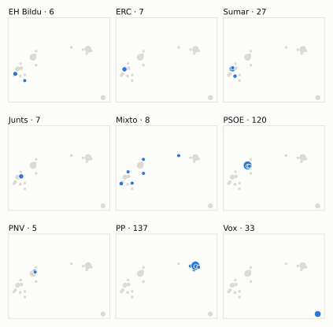
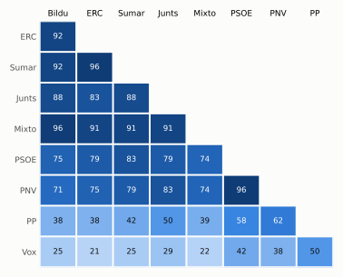

# Análisis detallado: abril de 2025

[← Volver al resumen del mes](2025-04.md)

_Generado automáticamente el 2026-11-11 con datos abiertos del [Congreso de los Diputados](https://www.congreso.es/es/opendata/votaciones). Solo plenos y Diputación Permanente. Método y límites en [docs/DOCUMENTO_FUNCIONAL.md](../docs/DOCUMENTO_FUNCIONAL.md)._

## Resumen

- **24 votaciones** en 2 días de pleno (sesiones 104 y 106).
- **15 aprobadas** y **9 rechazadas**.
- 1 votación se decidió por 5 votos o menos.
- El grupo que más veces votó con el resultado final: **PNV** (96 % de las votaciones nominales).
- Los grupos del Gobierno (PSOE y Sumar) votaron lo mismo en 18 de 24 votaciones nominales y no perdieron ninguna de ellas.
- 8 votos individuales se apartaron de la posición de su grupo (5 diputados).

## Cómo votó cada grupo

| Grupo | Diputados | Cohesión | Votó con el resultado | Decisivo | Posición Sí | Posición No | Posición Abst. |
| --- | ---: | ---: | ---: | ---: | ---: | ---: | ---: |
| PP | 137 | 100 % | 67 % | 1 | 14 | 6 | 4 |
| PSOE | 120 | 100 % | 92 % | 5 | 13 | 9 | 2 |
| Vox | 33 | 100 % | 38 % | 0 | 9 | 12 | 3 |
| Sumar | 27 | 99 % | 75 % | 4 | 17 | 5 | 2 |
| Mixto | 8 | 79 % | 74 % | 1 | 16 | 7 | 0 |
| Junts | 7 | 100 % | 83 % | 2 | 17 | 7 | 0 |
| ERC | 7 | 100 % | 71 % | 2 | 16 | 5 | 3 |
| EH Bildu | 6 | 98 % | 71 % | 1 | 16 | 7 | 1 |
| PNV | 5 | 100 % | 96 % | 1 | 14 | 9 | 1 |

*Cohesión*: índice de acuerdo interno (100 % = todo el grupo votó igual). *Votó con el resultado*: el grupo votó Sí y salió aprobada, o No y salió rechazada. *Decisivo*: votaciones cuyo resultado habría cambiado si el grupo se hubiera abstenido en bloque. El Grupo Mixto reúne partidos distintos: su posición es la de su mayoría.

## Mapa de diputados

<picture>
  <source media="(prefers-color-scheme: dark)" srcset="img/2025-04/mapa-oscuro.svg">
  
</picture>

Cada punto es un diputado; dos diputados están cerca si votaron parecido. Un punto más grande reúne a varios que votaron exactamente igual. En cada panel, el grupo en azul y el resto del Congreso en gris.

*Cómo se calcula*: componentes principales de los votos (Sí, No, abstención) en 20 votaciones con algún desacuerdo. El eje horizontal recoge el 62 % de la variación y el vertical el 21 %. Los ejes no tienen nombre ni sentido político propio; por convención, el PP queda a la derecha.

## Afinidad entre grupos

<picture>
  <source media="(prefers-color-scheme: dark)" srcset="img/2025-04/afinidad-oscuro.svg">
  
</picture>

Porcentaje de votaciones nominales en que los dos grupos tomaron la misma posición. Los grupos están ordenados según el mapa de diputados.

Ver la tabla

|  | PP | PSOE | Vox | Sumar | Mixto | Junts | ERC | EH Bildu | PNV |
| --- | :---: | :---: | :---: | :---: | :---: | :---: | :---: | :---: | :---: |
| PP | 100 % | 58 % | 50 % | 42 % | 39 % | 50 % | 38 % | 38 % | 62 % |
| PSOE | 58 % | 100 % | 42 % | 83 % | 74 % | 79 % | 79 % | 75 % | 96 % |
| Vox | 50 % | 42 % | 100 % | 25 % | 22 % | 29 % | 21 % | 25 % | 38 % |
| Sumar | 42 % | 83 % | 25 % | 100 % | 91 % | 88 % | 96 % | 92 % | 79 % |
| Mixto | 39 % | 74 % | 22 % | 91 % | 100 % | 91 % | 91 % | 96 % | 74 % |
| Junts | 50 % | 79 % | 29 % | 88 % | 91 % | 100 % | 83 % | 88 % | 83 % |
| ERC | 38 % | 79 % | 21 % | 96 % | 91 % | 83 % | 100 % | 92 % | 75 % |
| EH Bildu | 38 % | 75 % | 25 % | 92 % | 96 % | 88 % | 92 % | 100 % | 71 % |
| PNV | 62 % | 96 % | 38 % | 79 % | 74 % | 83 % | 75 % | 71 % | 100 % |

## Quién sacó adelante las votaciones

| Grupos que votaron Sí | Votaciones | Escaños |
| --- | ---: | ---: |
| Todos los grupos | 4 | 350 |
| PP + PSOE + Sumar + Mixto + Junts + ERC + EH Bildu + PNV | 4 | 317 |
| PSOE + Sumar + Mixto + Junts + ERC + EH Bildu + PNV | 4 | 180 |
| PP + PSOE + Vox + Sumar + Junts + PNV | 1 | 329 |
| PP | 1 | 137 |
| PP + Junts + PNV | 1 | 149 |

De 15 votaciones nominales aprobadas. La posición de cada grupo es la de la mayoría de sus diputados.

## Votaciones que perdieron los grupos del Gobierno

PSOE y Sumar no perdieron ninguna votación en la que votaran lo mismo.
Además, PSOE y Sumar votaron distinto entre sí en 4 votaciones.

## Votaciones más ajustadas

| Fecha | Asunto | Resultado | Sí | No | Abst. |
| --- | --- | :---: | ---: | ---: | ---: |
| 10 de abril | Proposición de Ley Orgánica por la que se modifica la Ley Orgánica 1/2002, de 22 de marzo, reguladora del derecho de asociación. *(Votación de conjunto. Votación de conjunto de la Proposició…)* | Aprobada (necesita 176) | 178 | 33 | 137 |
| 10 de abril | Proposición de Ley Orgánica por la que se modifica la Ley Orgánica 1/2002, de 22 de marzo, reguladora del derecho de asociación. *(Enmiendas presentadas por el Grupo Parlamentario Popular en…)* | Rechazada | 171 | 177 | 0 |
| 10 de abril | Proposición de Ley Orgánica por la que se modifica la Ley Orgánica 1/2002, de 22 de marzo, reguladora del derecho de asociación. *(Enmiendas presentadas por el Grupo Parlamentario Mixto (Sr.…)* | Rechazada | 171 | 179 | 0 |
| 10 de abril | Real Decreto-ley 2/2025, de 18 de marzo, por el que se aprueban medidas urgentes para la garantía del interés superior de la infancia y adolescencia ante situa… | Aprobada | 179 | 170 | 1 |

Votaciones decididas por 10 votos o menos (o a esa distancia de la mayoría que exigían). Las públicas por llamamiento no tienen hemiciclo: el voto de cada diputado solo consta en el Diario de Sesiones.

## Qué se votó, por tipo de asunto

| Tipo de asunto | Votaciones | Aprobadas | No aprobadas |
| --- | ---: | ---: | ---: |
| Leyes: dictamen y votación final | 13 | 5 | 8 |
| Decretos-ley (convalidación) | 4 | 4 | 0 |
| Mociones | 3 | 2 | 1 |
| Leyes: toma en consideración | 2 | 2 | 0 |
| Proposiciones no de ley | 2 | 2 | 0 |

Las proposiciones no de ley y las mociones expresan la posición del Congreso pero no obligan al Gobierno. Las leyes pasan por varias votaciones (toma en consideración, totalidad, dictamen, Senado), así que una misma ley puede aparecer varias veces.

## Votos distintos de su grupo

| Diputado | Grupo | Votos distintos de su grupo |
| --- | --- | ---: |
| Ibáñez Mezquita, Alberto | Sumar | 2 |
| Micó Micó, Àgueda | Sumar | 2 |
| Pozueta Fernández, Isabel | EH Bildu | 2 |
| Aragonés Mendiguchía, Carlos | PP | 1 |
| Franco González, Silvia | PP | 1 |

Un voto aislado puede ser un error al pulsar, no una decisión política: el Congreso no publica las correcciones. Se excluye el Grupo Mixto.

## Diputados que más veces no votaron

| Diputado | Grupo | No votó | % de votaciones |
| --- | --- | ---: | ---: |
| Ábalos Meco, José Luis | Mixto | 8 | 33 % |
| Badia Casas, Eloi | Sumar | 3 | 12 % |
| Bolaños García, Félix | PSOE | 3 | 12 % |
| Díaz Pérez, Yolanda | Sumar | 3 | 12 % |
| Montero Cuadrado, María Jesús | PSOE | 3 | 12 % |
| Núñez Feijóo, Alberto | PP | 3 | 12 % |
| Requena Ruiz, Juan Diego | PP | 3 | 12 % |
| Sánchez Serna, Javier | Mixto | 3 | 12 % |
| Pozueta Fernández, Isabel | EH Bildu | 2 | 8 % |
| Agirretxea Urresti, Joseba Andoni | PNV | 1 | 4 % |
| Alonso Cantorné, Fèlix | Sumar | 1 | 4 % |
| Alós López, Ana Isabel | PP | 1 | 4 % |
| Arribas Maroto, Manuel | PSOE | 1 | 4 % |
| Bendodo Benasayag, Elías | PP | 1 | 4 % |
| Cabezón Casas, Tomás | PP | 1 | 4 % |

«No vota» incluye ausencias justificadas (baja, maternidad o paternidad) y escaños vacantes; el portal no las distingue.

## Todas las votaciones

Posición de cada grupo: la opción que votó la mayoría de sus diputados (*Div.*: empate dentro del grupo). El número enlaza al JSON oficial o, en las votaciones por llamamiento, al Diario de Sesiones.

### 8 de abril (sesión 104)

| Nº | Asunto | Resultado | Sí | No | Abst. | PP | PSOE | Vox | Sumar | Mixto | Junts | ERC | EH Bildu | PNV | Decisivos |
| ---: | --- | --- | ---: | ---: | ---: | :---: | :---: | :---: | :---: | :---: | :---: | :---: | :---: | :---: | --- |
| [1](https://www.congreso.es/webpublica/opendata/votaciones/Leg15/Sesion104/20250408/Votacion001/VOT_20250408213857.json) | Proposición de Ley del Parlamento de Andalucía, relativa a la gratuidad de los productos ópticos y de salud visual. | Aprobada | 342 | 0 | 0 | Sí | Sí | Sí | Sí | Sí | Sí | Sí | Sí | Sí |  |
| [2](https://www.congreso.es/webpublica/opendata/votaciones/Leg15/Sesion104/20250408/Votacion002/VOT_20250408213859.json) | Proposición del Grupo Parlamentario Popular en el Congreso, de reforma del Reglamento del Congreso de los Diputados relativa a la regulación del debate de polí… | Aprobada | 324 | 6 | 10 | Sí | Sí | Sí | Sí | Div. | Sí | Abst. | No | Sí |  |
| [3](https://www.congreso.es/webpublica/opendata/votaciones/Leg15/Sesion104/20250408/Votacion003/VOT_20250408213900.json) | Acuerdo de tramitación directa y en lectura única de Proyecto de Ley por la que se modifica la Ley 12/2002, de 23 de mayo, por la que se aprueba el Concierto E… | Aprobada | 306 | 33 | 2 | Sí | Sí | No | Sí | Sí | Sí | Sí | Sí | Sí |  |

### 10 de abril (sesión 106)

| Nº | Asunto | Resultado | Sí | No | Abst. | PP | PSOE | Vox | Sumar | Mixto | Junts | ERC | EH Bildu | PNV | Decisivos |
| ---: | --- | --- | ---: | ---: | ---: | :---: | :---: | :---: | :---: | :---: | :---: | :---: | :---: | :---: | --- |
| [1](https://www.congreso.es/webpublica/opendata/votaciones/Leg15/Sesion106/20250410/Votacion001/VOT_20250410155136.json) | Proposición de Ley Orgánica por la que se modifica la Ley Orgánica 1/2002, de 22 de marzo, reguladora del derecho de asociación. *(Enmiendas presentadas por el Grupo Parlamentario Mixto (Sra…)* | Rechazada | 44 | 305 | 1 | No | No | No | Sí | Sí | No | Sí | Sí | No |  |
| [2](https://www.congreso.es/webpublica/opendata/votaciones/Leg15/Sesion106/20250410/Votacion002/VOT_20250410155138.json) | Proposición de Ley Orgánica por la que se modifica la Ley Orgánica 1/2002, de 22 de marzo, reguladora del derecho de asociación. *(Enmiendas presentadas por el Grupo Parlamentario Mixto (Sr.…)* | Rechazada | 171 | 179 | 0 | Sí | No | Sí | No | No | No | No | No | No | PSOE, Sumar |
| [3](https://www.congreso.es/webpublica/opendata/votaciones/Leg15/Sesion106/20250410/Votacion003/VOT_20250410155139.json) | Proposición de Ley Orgánica por la que se modifica la Ley Orgánica 1/2002, de 22 de marzo, reguladora del derecho de asociación. *(Enmiendas presentadas por el Grupo Parlamentario Mixto (Sr.…)* | Rechazada | 52 | 298 | 0 | No | No | No | Sí | Sí | Sí | Sí | Sí | No |  |
| [4](https://www.congreso.es/webpublica/opendata/votaciones/Leg15/Sesion106/20250410/Votacion004/VOT_20250410155141.json) | Proposición de Ley Orgánica por la que se modifica la Ley Orgánica 1/2002, de 22 de marzo, reguladora del derecho de asociación. *(Enmiendas presentadas por el Grupo Parlamentario Mixto (Sr.…)* | Rechazada | 52 | 298 | 0 | No | No | No | Sí | Sí | Sí | Sí | Sí | No |  |
| [5](https://www.congreso.es/webpublica/opendata/votaciones/Leg15/Sesion106/20250410/Votacion005/VOT_20250410155142.json) | Proposición de Ley Orgánica por la que se modifica la Ley Orgánica 1/2002, de 22 de marzo, reguladora del derecho de asociación. *(Enmiendas presentadas por el Grupo Parlamentario Mixto (Sr.…)* | Rechazada | 52 | 298 | 0 | No | No | No | Sí | Sí | Sí | Sí | Sí | No |  |
| [6](https://www.congreso.es/webpublica/opendata/votaciones/Leg15/Sesion106/20250410/Votacion006/VOT_20250410155144.json) | Proposición de Ley Orgánica por la que se modifica la Ley Orgánica 1/2002, de 22 de marzo, reguladora del derecho de asociación. *(Enmiendas presentadas por el Grupo Parlamentario Popular en…)* | Rechazada | 138 | 178 | 33 | Sí | No | Abst. | No | No | No | No | No | No | PSOE |
| [7](https://www.congreso.es/webpublica/opendata/votaciones/Leg15/Sesion106/20250410/Votacion007/VOT_20250410155145.json) | Proposición de Ley Orgánica por la que se modifica la Ley Orgánica 1/2002, de 22 de marzo, reguladora del derecho de asociación. *(Enmiendas presentadas por el Grupo Parlamentario Popular en…)* | Rechazada | 171 | 177 | 0 | Sí | No | Sí | No | No | No | No | No | No | Junts, ERC, PSOE, Sumar |
| [8](https://www.congreso.es/webpublica/opendata/votaciones/Leg15/Sesion106/20250410/Votacion008/VOT_20250410155146.json) | Proposición no de Ley del Grupo Parlamentario Popular en el Congreso, sobre el nuevo mapa concesional estatal de los servicios de transporte público regular de… | Aprobada | 139 | 51 | 159 | Sí | Abst. | No | Abst. | No | No | Abst. | No | Abst. | PP |
| [9](https://www.congreso.es/webpublica/opendata/votaciones/Leg15/Sesion106/20250410/Votacion009/VOT_20250410155148.json) | Proposición no de Ley del Grupo Parlamentario Socialista, sobre reconocimiento y apoyo al pueblo gitano. | Aprobada | 312 | 0 | 33 | Sí | Sí | Abst. | Sí | Sí | Sí | Sí | Sí | Sí |  |
| [10](https://www.congreso.es/webpublica/opendata/votaciones/Leg15/Sesion106/20250410/Votacion010/VOT_20250410155149.json) | Moción consecuencia de interpelación urgente del Grupo Parlamentario Mixto (Sra. Valido García), sobre el impacto en la economía canaria de la intención de imp… | Aprobada | 317 | 33 | 0 | Sí | Sí | No | Sí | Sí | Sí | Sí | Sí | Sí |  |
| [11](https://www.congreso.es/webpublica/opendata/votaciones/Leg15/Sesion106/20250410/Votacion011/VOT_20250410155150.json) | Moción consecuencia de interpelación urgente del Grupo Parlamentario VOX, sobre las medidas que pretende adoptar el Gobierno para que los españoles que trabaja… | Rechazada | 33 | 180 | 137 | Abst. | No | Sí | No | No | No | No | No | No |  |
| [12](https://www.congreso.es/webpublica/opendata/votaciones/Leg15/Sesion106/20250410/Votacion012/VOT_20250410155151.json) | Moción consecuencia de interpelación urgente del Grupo Parlamentario Popular en el Congreso, para que el Ministro de Agricultura, Pesca y Alimentación informe… | Aprobada | 151 | 5 | 194 | Sí | Abst. | Abst. | Abst. | No | Sí | Abst. | Abst. | Sí |  |
| [13](https://www.congreso.es/webpublica/opendata/votaciones/Leg15/Sesion106/20250410/Votacion013/VOT_20250410155152.json) | Real Decreto-ley 3/2025, de 1 de abril, por el que se establece el programa de incentivos ligados a la movilidad eléctrica (MOVES III) para el año 2025. | Aprobada | 180 | 33 | 137 | Abst. | Sí | No | Sí | Sí | Sí | Sí | Sí | Sí |  |
| [14](https://www.congreso.es/webpublica/opendata/votaciones/Leg15/Sesion106/20250410/Votacion014/VOT_20250410155153.json) | Tramitación como Proyecto de Ley por el procedimiento de urgencia del Real Decreto-ley 3/2025, de 1 de abril, por el que se establece el programa de incentivos… | Aprobada | 349 | 0 | 0 | Sí | Sí | Sí | Sí | Sí | Sí | Sí | Sí | Sí |  |
| [15](https://www.congreso.es/webpublica/opendata/votaciones/Leg15/Sesion106/20250410/Votacion015/VOT_20250410155154.json) | Real Decreto-ley 2/2025, de 18 de marzo, por el que se aprueban medidas urgentes para la garantía del interés superior de la infancia y adolescencia ante situa… | Aprobada | 179 | 170 | 1 | No | Sí | No | Sí | Sí | Sí | Sí | Sí | Sí | PSOE, Sumar |
| [16](https://www.congreso.es/webpublica/opendata/votaciones/Leg15/Sesion106/20250410/Votacion016/VOT_20250410155156.json) | Tramitación como Proyecto de Ley por el procedimiento de urgencia del Real Decreto-ley 2/2025, de 18 de marzo, por el que se aprueban medidas urgentes para la… | Aprobada | 349 | 0 | 0 | Sí | Sí | Sí | Sí | Sí | Sí | Sí | Sí | Sí |  |
| [17](https://www.congreso.es/webpublica/opendata/votaciones/Leg15/Sesion106/20250410/Votacion017/VOT_20250410155157.json) | Proposición de Ley Orgánica por la que se modifica la Ley Orgánica 1/2002, de 22 de marzo, reguladora del derecho de asociación. *(Votación del dictamen.)* | Aprobada | 179 | 34 | 136 | Abst. | Sí | No | Sí | Sí | Sí | Sí | Sí | Sí |  |
| [18](https://www.congreso.es/webpublica/opendata/votaciones/Leg15/Sesion106/20250410/Votacion018/VOT_20250410155158.json) | Proposición de Ley Orgánica por la que se modifica la Ley Orgánica 1/2002, de 22 de marzo, reguladora del derecho de asociación. *(Votación de conjunto. Votación de conjunto de la Proposició…)* | Aprobada (necesita 176) | 178 | 33 | 137 | Abst. | Sí | No | Sí | Sí | Sí | Sí | Sí | Sí | EH Bildu, Junts, Mixto, ERC, PSOE, Sumar, PNV |
| [19](https://www.congreso.es/webpublica/opendata/votaciones/Leg15/Sesion106/20250410/Votacion019/VOT_20250410155159.json) | Votación de la enmienda a la totalidad de devolución al Proyecto de Ley por la que se modifica la Ley 12/2002, de 23 de mayo, por la que se aprueba el Conciert… | Rechazada | 33 | 316 | 0 | No | No | Sí | No | No | No | No | No | No |  |
| [20](https://www.congreso.es/webpublica/opendata/votaciones/Leg15/Sesion106/20250410/Votacion020/VOT_20250410155201.json) | Votación de conjunto del texto del Proyecto de Ley por la que se modifica la Ley 12/2002, de 23 de mayo, por la que se aprueba el Concierto Económico con la Co… | Aprobada | 312 | 34 | 3 | Sí | Sí | No | Sí | Sí | Sí | Sí | Sí | Sí |  |
| [21](https://www.congreso.es/webpublica/opendata/votaciones/Leg15/Sesion106/20250410/Votacion021/VOT_20250410155202.json) | Votación de la solicitud de avocación por el Pleno de la Cámara de la deliberación y votación final de la Proposición de Ley de modificación de la Ley 24/2013,… | Aprobada | 349 | 0 | 0 | Sí | Sí | Sí | Sí | Sí | Sí | Sí | Sí | Sí |  |
