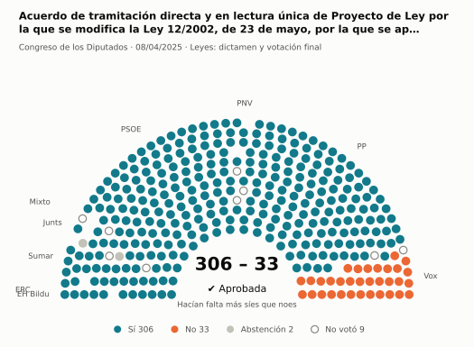
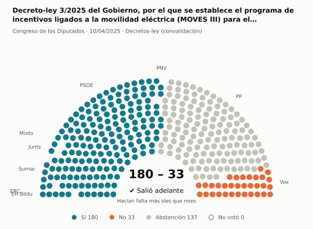
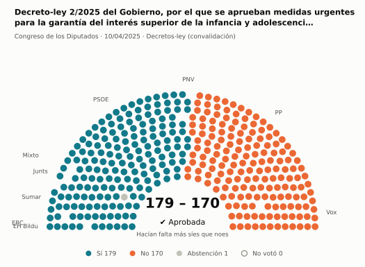
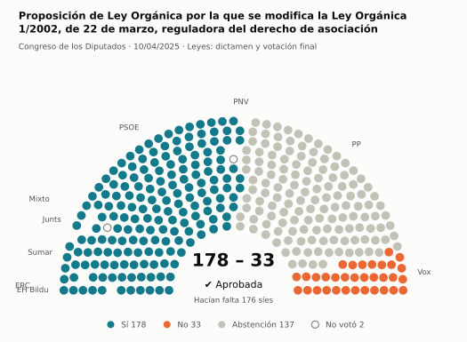
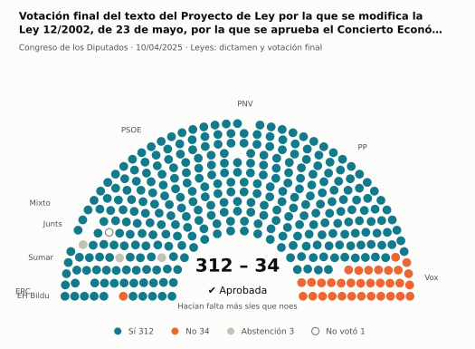
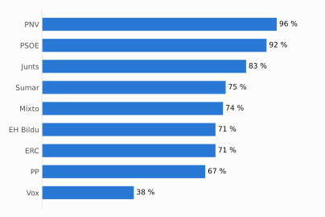
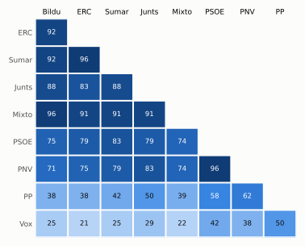

# Qué votó el Congreso en abril de 2025

Las votaciones del Pleno del Congreso de los Diputados, explicadas sin tecnicismos. Datos oficiales del [Congreso](https://www.congreso.es/es/opendata/votaciones); este resumen se actualiza solo cada mes (última vez: 10/11/2026).

## En pocas palabras

- El Congreso votó **24 veces** en 2 días de pleno. **15 propuestas salieron adelante** y 9 no.
- 19 votaciones fueron sobre leyes, decretos o presupuestos. Otras 5 fueron peticiones al Gobierno que no le obligan (proposiciones no de ley y mociones).
- El Gobierno (PSOE y Sumar) no perdió ninguna de las 18 votaciones en las que sus grupos votaron lo mismo.
- La votación más reñida se decidió superó los 176 síes por 2 votos: Proposición de Ley Orgánica por la que se modifica la Ley Orgánica 1/2002, de 22 de marzo, reguladora del derecho de as….
- Los diputados casi siempre votan lo mismo que su grupo: en todo el mes solo hubo 8 votos distintos (sin contar el Grupo Mixto).

## Las votaciones más importantes del mes

Elegidas por su importancia: pesan más las leyes y los decretos que las peticiones al Gobierno, y suben las que se decidieron por pocos votos o las que perdió el Gobierno. Cada punto del dibujo es un diputado, colocado con su grupo, y el color es lo que votó.

### 1. Acuerdo de tramitación directa y en lectura única de Proyecto de Ley por la que se modifica la Ley 12/2002, de 23 de mayo, por la que se aprueba el C…

**8 de abril · Leyes: dictamen y votación final.** Votación del texto de una ley después de trabajarla en comisión.

<picture>
  <source media="(prefers-color-scheme: dark)" srcset="img/2025-04/votacion-L15-S104-V003-oscuro.svg">
  
</picture>

**✔ Salió adelante** por 273 votos: 306 a favor, 33 en contra y 2 abstenciones.

- **A favor:** PP, PSOE, Sumar (23 de 25), Grupo Mixto, Junts, ERC, EH Bildu y PNV
- **En contra:** Vox

[Datos oficiales](https://www.congreso.es/webpublica/opendata/votaciones/Leg15/Sesion104/20250408/Votacion003/VOT_20250408213900.json)

### 2. Decreto-ley 3/2025 del Gobierno, por el que se establece el programa de incentivos ligados a la movilidad eléctrica (MOVES III) para el año 2025

**10 de abril · Decretos-ley (convalidación).** El Gobierno aprobó esta norma por urgencia. Ya está en vigor, pero el Congreso tiene 30 días para confirmarla o tumbarla.

<picture>
  <source media="(prefers-color-scheme: dark)" srcset="img/2025-04/votacion-L15-S106-V013-oscuro.svg">
  
</picture>

**✔ Salió adelante** por 147 votos: 180 a favor, 33 en contra y 137 abstenciones.

- **A favor:** PSOE, Sumar, Grupo Mixto, Junts, ERC, EH Bildu y PNV
- **En contra:** Vox
- **Se abstuvieron:** PP

[Datos oficiales](https://www.congreso.es/webpublica/opendata/votaciones/Leg15/Sesion106/20250410/Votacion013/VOT_20250410155152.json)

### 3. Decreto-ley 2/2025 del Gobierno, por el que se aprueban medidas urgentes para la garantía del interés superior de la infancia y adolescencia ante sit…

**10 de abril · Decretos-ley (convalidación).** El Gobierno aprobó esta norma por urgencia. Ya está en vigor, pero el Congreso tiene 30 días para confirmarla o tumbarla.

<picture>
  <source media="(prefers-color-scheme: dark)" srcset="img/2025-04/votacion-L15-S106-V015-oscuro.svg">
  
</picture>

**✔ Salió adelante** por 9 votos: 179 a favor, 170 en contra y 1 abstención.

- **A favor:** PSOE, Sumar, Junts, ERC, EH Bildu y PNV
- **En contra:** PP y Vox
- **Repartidos:** Grupo Mixto (Sí 7, Abstención 1)

[Datos oficiales](https://www.congreso.es/webpublica/opendata/votaciones/Leg15/Sesion106/20250410/Votacion015/VOT_20250410155154.json)

### 4. Proposición de Ley Orgánica por la que se modifica la Ley Orgánica 1/2002, de 22 de marzo, reguladora del derecho de asociación

**10 de abril · Leyes: dictamen y votación final.** Votación del texto de una ley después de trabajarla en comisión.

<picture>
  <source media="(prefers-color-scheme: dark)" srcset="img/2025-04/votacion-L15-S106-V018-oscuro.svg">
  
</picture>

**✔ Salió adelante** superó los 176 síes por 2 votos: 178 a favor, 33 en contra y 137 abstenciones.

- **A favor:** PSOE, Sumar, Grupo Mixto, Junts, ERC, EH Bildu y PNV
- **En contra:** Vox
- **Se abstuvieron:** PP

Este asunto tuvo 9 votaciones este mes; aquí se muestra la más disputada. [Datos oficiales](https://www.congreso.es/webpublica/opendata/votaciones/Leg15/Sesion106/20250410/Votacion018/VOT_20250410155158.json)

### 5. Votación final del texto del Proyecto de Ley por la que se modifica la Ley 12/2002, de 23 de mayo, por la que se aprueba el Concierto Económico con l…

**10 de abril · Leyes: dictamen y votación final.** Votación del texto de una ley después de trabajarla en comisión.

<picture>
  <source media="(prefers-color-scheme: dark)" srcset="img/2025-04/votacion-L15-S106-V020-oscuro.svg">
  
</picture>

**✔ Salió adelante** por 278 votos: 312 a favor, 34 en contra y 3 abstenciones.

- **A favor:** PP, PSOE, Sumar (25 de 27), Junts, ERC, EH Bildu (5 de 6) y PNV
- **En contra:** Vox
- **Repartidos:** Grupo Mixto (Sí 6, Abstención 1)

[Datos oficiales](https://www.congreso.es/webpublica/opendata/votaciones/Leg15/Sesion106/20250410/Votacion020/VOT_20250410155201.json)

## ¿Qué grupos votaron más veces lo que finalmente salió?

<picture>
  <source media="(prefers-color-scheme: dark)" srcset="img/2025-04/ganadora-oscuro.svg">
  
</picture>

Porcentaje de votaciones en que el grupo votó Sí y salió adelante, o votó No y no salió. Abstenerse no cuenta como acertar.

## ¿Quién vota con quién?

<picture>
  <source media="(prefers-color-scheme: dark)" srcset="img/2025-04/afinidad-oscuro.svg">
  
</picture>

Cada casilla dice en qué porcentaje de las votaciones dos grupos votaron lo mismo: 100 es que siempre coincidieron y 0 que nunca.

## ¿Qué tipo de cosas se votaron?

| Tipo | Votaciones | Salieron adelante | Qué es |
| --- | ---: | ---: | --- |
| Leyes: dictamen y votación final | 13 | 5 | Votación del texto de una ley después de trabajarla en comisión. |
| Decretos-ley (convalidación) | 4 | 4 | El Gobierno aprobó esta norma por urgencia. Ya está en vigor, pero el Congreso tiene 30 días para confirmarla o tumbarla. |
| Mociones | 3 | 2 | Petición al Gobierno después de pedirle explicaciones en el Pleno. Expresa la opinión del Congreso, pero no obliga. |
| Leyes: toma en consideración | 2 | 2 | Primer paso de una ley propuesta por un grupo o una comunidad autónoma: el Congreso decide si empieza a tramitarla. |
| Proposiciones no de ley | 2 | 2 | Petición al Gobierno para que haga algo. Expresa la opinión del Congreso, pero no obliga. |

## Palabras que conviene saber

- **Pleno**: La reunión de los 350 diputados, donde se vota.
- **Grupo parlamentario**: Los diputados de un partido o coalición. Los partidos pequeños van juntos en el Grupo Mixto, aunque no piensen igual.
- **Abstención**: El diputado vota, pero ni a favor ni en contra.
- **No votó**: El diputado no votó: no estaba, estaba de baja o el escaño estaba vacío.
- **Mayoría simple**: Salen adelante las votaciones con más síes que noes. Es lo normal.
- **Mayoría absoluta**: 176 votos a favor, la mitad más uno de 350. La piden las leyes orgánicas (derechos fundamentales, sistema electoral…) y la primera votación de investidura.
- **Votación por llamamiento**: Cada diputado dice su voto en voz alta. Se usa en las investiduras y otras votaciones importantes.

---

**¿Quieres más detalle?** El [análisis detallado](2025-04-detalle.md) tiene la cohesión de cada grupo, un mapa de los diputados según cómo votan, qué diputados votaron distinto de su grupo, las ausencias y la lista completa de votaciones.

_Los resultados están calculados a partir de los votos: el Congreso no publica si cada votación salió adelante. Este proyecto no tiene relación con el Congreso. Método en [docs/DOCUMENTO_FUNCIONAL.md](../docs/DOCUMENTO_FUNCIONAL.md)._
