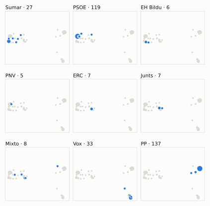
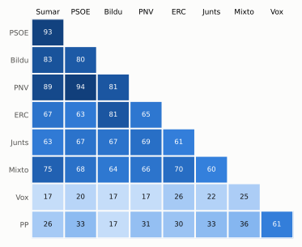

# Análisis detallado: mayo de 2025

[← Volver al resumen del mes](2025-05.md)

_Generado automáticamente el 2026-11-11 con datos abiertos del [Congreso de los Diputados](https://www.congreso.es/es/opendata/votaciones). Solo plenos y Diputación Permanente. Método y límites en [docs/DOCUMENTO_FUNCIONAL.md](../docs/DOCUMENTO_FUNCIONAL.md)._

## Resumen

- **54 votaciones** en 7 días de pleno (sesiones 107, 109, 110, 111, 112, 114 y 115).
- **35 aprobadas** y **19 rechazadas**.
- 8 votaciones se decidieron por 5 votos o menos.
- El grupo que más veces votó con el resultado final: **PSOE** (74 % de las votaciones nominales).
- Los grupos del Gobierno (PSOE y Sumar) votaron lo mismo en 50 de 54 votaciones nominales y perdieron 14 de ellas.
- 9 votos individuales se apartaron de la posición de su grupo (6 diputados).

## Cómo votó cada grupo

| Grupo | Diputados | Cohesión | Votó con el resultado | Decisivo | Posición Sí | Posición No | Posición Abst. |
| --- | ---: | ---: | ---: | ---: | ---: | ---: | ---: |
| PP | 137 | 100 % | 59 % | 14 | 35 | 13 | 6 |
| PSOE | 120 | 100 % | 74 % | 16 | 25 | 29 | 0 |
| Vox | 33 | 100 % | 46 % | 13 | 25 | 21 | 8 |
| Sumar | 27 | 100 % | 67 % | 12 | 27 | 27 | 0 |
| Mixto | 8 | 76 % | 70 % | 6 | 29 | 19 | 5 |
| Junts | 7 | 100 % | 67 % | 8 | 25 | 16 | 13 |
| ERC | 7 | 100 % | 65 % | 9 | 27 | 17 | 10 |
| EH Bildu | 6 | 98 % | 56 % | 7 | 22 | 24 | 8 |
| PNV | 5 | 100 % | 69 % | 4 | 25 | 28 | 1 |

*Cohesión*: índice de acuerdo interno (100 % = todo el grupo votó igual). *Votó con el resultado*: el grupo votó Sí y salió aprobada, o No y salió rechazada. *Decisivo*: votaciones cuyo resultado habría cambiado si el grupo se hubiera abstenido en bloque. El Grupo Mixto reúne partidos distintos: su posición es la de su mayoría.

## Mapa de diputados

<picture>
  <source media="(prefers-color-scheme: dark)" srcset="img/2025-05/mapa-oscuro.svg">
  
</picture>

Cada punto es un diputado; dos diputados están cerca si votaron parecido. Un punto más grande reúne a varios que votaron exactamente igual. En cada panel, el grupo en azul y el resto del Congreso en gris.

*Cómo se calcula*: componentes principales de los votos (Sí, No, abstención) en 53 votaciones con algún desacuerdo. El eje horizontal recoge el 82 % de la variación y el vertical el 9 %. Los ejes no tienen nombre ni sentido político propio; por convención, el PP queda a la derecha. No se sitúa a 1 diputado que votó en menos de la mitad.

## Afinidad entre grupos

<picture>
  <source media="(prefers-color-scheme: dark)" srcset="img/2025-05/afinidad-oscuro.svg">
  
</picture>

Porcentaje de votaciones nominales en que los dos grupos tomaron la misma posición. Los grupos están ordenados según el mapa de diputados.

Ver la tabla

|  | PP | PSOE | Vox | Sumar | Mixto | Junts | ERC | EH Bildu | PNV |
| --- | :---: | :---: | :---: | :---: | :---: | :---: | :---: | :---: | :---: |
| PP | 100 % | 33 % | 61 % | 26 % | 36 % | 33 % | 30 % | 17 % | 31 % |
| PSOE | 33 % | 100 % | 20 % | 93 % | 68 % | 67 % | 63 % | 80 % | 94 % |
| Vox | 61 % | 20 % | 100 % | 17 % | 25 % | 22 % | 26 % | 17 % | 17 % |
| Sumar | 26 % | 93 % | 17 % | 100 % | 75 % | 63 % | 67 % | 83 % | 89 % |
| Mixto | 36 % | 68 % | 25 % | 75 % | 100 % | 60 % | 70 % | 64 % | 66 % |
| Junts | 33 % | 67 % | 22 % | 63 % | 60 % | 100 % | 61 % | 67 % | 69 % |
| ERC | 30 % | 63 % | 26 % | 67 % | 70 % | 61 % | 100 % | 81 % | 65 % |
| EH Bildu | 17 % | 80 % | 17 % | 83 % | 64 % | 67 % | 81 % | 100 % | 81 % |
| PNV | 31 % | 94 % | 17 % | 89 % | 66 % | 69 % | 65 % | 81 % | 100 % |

## Quién sacó adelante las votaciones

| Grupos que votaron Sí | Votaciones | Escaños |
| --- | ---: | ---: |
| PP + PSOE + Sumar + Mixto + Junts + ERC + EH Bildu + PNV | 6 | 317 |
| PSOE + Sumar + Mixto + Junts + ERC + EH Bildu + PNV | 6 | 180 |
| PP + Vox | 5 | 170 |
| PP + Vox + Mixto + ERC | 3 | 185 |
| Todos los grupos | 3 | 350 |
| PSOE + Sumar + Mixto + Junts | 1 | 162 |
| PSOE + Sumar + Junts + ERC + EH Bildu + PNV | 1 | 172 |
| PP + Vox + Junts | 1 | 177 |

De 35 votaciones nominales aprobadas. Otras 9 salieron con combinaciones que se dieron menos veces. La posición de cada grupo es la de la mayoría de sus diputados.

## Votaciones que perdieron los grupos del Gobierno

| Fecha | Asunto | Tipo | PSOE y Sumar votaron | Resultado | Sí | No |
| --- | --- | --- | :---: | --- | ---: | ---: |
| 8 de mayo | Proyecto de Ley por la que se modifican la Ley 48/1960, de 21 de julio, sobre Navegación Aérea, y la Ley 21/2003, de 7 de julio, de Seguridad Aérea. *(Enmiendas presentadas por el Grupo Parlamentario Socialista…)* | Leyes: dictamen y votación final | Sí | Rechazada | 162 | 174 |
| 8 de mayo | Moción consecuencia de interpelación urgente del Grupo Parlamentario Popular en el Congreso, sobre los planes del Gobierno para poder afrontar, sin Presupuesto… *(Votación separada por puntos. Punto 1.)* | Mociones | No | Aprobada | 183 | 158 |
| 8 de mayo | Moción consecuencia de interpelación urgente del Grupo Parlamentario Popular en el Congreso, sobre los planes del Gobierno para poder afrontar, sin Presupuesto… *(Votación separada por puntos. Punto 2.)* | Mociones | No | Aprobada | 183 | 153 |
| 13 de mayo | Proposición de Ley del Grupo Parlamentario Popular en el Congreso, de modificación de la Ley 39/1995, de 19 de diciembre, de Organización del Centro de Investi… | Leyes: toma en consideración | No | Aprobada | 178 | 167 |
| 14 de mayo | Moción consecuencia de interpelación urgente del Grupo Parlamentario Popular en el Congreso, sobre las causas del apagón eléctrico sucedido el 28 de abril de 2… | Mociones | No | Aprobada | 171 | 168 |
| 14 de mayo | Tratado de Amistad y Cooperación entre el Reino de España y la República Francesa, hecho en Barcelona el 19 de enero de 2023. | Tratados internacionales | Sí | Rechazada | 163 | 171 |
| 20 de mayo | Proposición no de Ley del Grupo Parlamentario Popular en el Congreso, sobre la atención a los pasajeros en caso de incidencias extraordinarias. | Proposiciones no de ley | No | Aprobada | 170 | 163 |
| 20 de mayo | Moción consecuencia de interpelación urgente del Grupo Parlamentario Popular en el Congreso, sobre la política del Gobierno en materia de gobernanza de empresa… *(Votación separada por puntos. Punto 1.)* | Mociones | No | Aprobada | 171 | 168 |
| 20 de mayo | Moción consecuencia de interpelación urgente del Grupo Parlamentario Popular en el Congreso, sobre la política del Gobierno en materia de gobernanza de empresa… *(Votación separada por puntos. Punto 2.)* | Mociones | No | Aprobada | 185 | 155 |
| 20 de mayo | Moción consecuencia de interpelación urgente del Grupo Parlamentario Popular en el Congreso, sobre la política del Gobierno en materia de gobernanza de empresa… *(Votación separada por puntos. Punto 3.)* | Mociones | No | Aprobada | 182 | 162 |
| 20 de mayo | Moción consecuencia de interpelación urgente del Grupo Parlamentario Popular en el Congreso, sobre la política del Gobierno en materia de gobernanza de empresa… *(Votación separada por puntos. Punto 4.)* | Mociones | No | Aprobada | 191 | 155 |
| 20 de mayo | Moción consecuencia de interpelación urgente del Grupo Parlamentario Popular en el Congreso, sobre la política del Gobierno en materia de gobernanza de empresa… *(Votación separada por puntos. Punto 5.)* | Mociones | No | Aprobada | 171 | 167 |
| 28 de mayo | Moción consecuencia de interpelación urgente del Grupo Parlamentario Popular en el Congreso, sobre la implicación de la Vicepresidenta Primera del Gobierno y M… | Mociones | No | Aprobada | 171 | 163 |
| 28 de mayo | Solicitud del Sr. Tellado Filgueira y otros 130 Diputados, de creación de una Comisión de Investigación sobre la interrupción del suministro eléctrico y de las… | Organización de la Cámara | No | Aprobada | 180 | 165 |

Además, PSOE y Sumar votaron distinto entre sí en 4 votaciones.

## Votaciones más ajustadas

| Fecha | Asunto | Resultado | Sí | No | Abst. |
| --- | --- | :---: | ---: | ---: | ---: |
| 13 de mayo | Proposición de Ley de la Asamblea Regional de Murcia, relativa al mantenimiento del trasvase Tajo-Segura (corresponde al número de expediente 125/000022/0000 d… | Rechazada | 170 | 171 | 4 |
| 8 de mayo | Moción consecuencia de interpelación urgente del Grupo Parlamentario Popular en el Congreso, sobre los planes del Gobierno para poder afrontar, sin Presupuesto… *(Votación separada por puntos. Punto 3.)* | Rechazada | 170 | 172 | 7 |
| 14 de mayo | Moción consecuencia de interpelación urgente del Grupo Parlamentario Popular en el Congreso, sobre las causas del apagón eléctrico sucedido el 28 de abril de 2… | Aprobada | 171 | 168 | 7 |
| 20 de mayo | Moción consecuencia de interpelación urgente del Grupo Parlamentario Popular en el Congreso, sobre la política del Gobierno en materia de gobernanza de empresa… *(Votación separada por puntos. Punto 1.)* | Aprobada | 171 | 168 | 8 |
| 20 de mayo | Moción consecuencia de interpelación urgente del Grupo Parlamentario Popular en el Congreso, sobre la política del Gobierno en materia de gobernanza de empresa… *(Votación separada por puntos. Punto 5.)* | Aprobada | 171 | 167 | 9 |
| 20 de mayo | Proposición de Ley de los Grupos Parlamentarios Plurinacional SUMAR y Mixto, por la que se reforma la Ley 53/2007, de 28 de diciembre, sobre el control del com… | Aprobada | 176 | 171 | 0 |
| 28 de mayo | Moción consecuencia de interpelación urgente del Grupo Parlamentario VOX, sobre las medidas que pretende adoptar el Gobierno para garantizar el funcionamiento… | Rechazada | 171 | 176 | 0 |
| 28 de mayo | Solicitud de los Grupos Parlamentarios Socialista y Plurinacional SUMAR, de creación de una Comisión de Investigación sobre los hechos, las causas, las respons… | Aprobada | 175 | 170 | 1 |
| 6 de mayo | Proposición de Ley del Grupo Parlamentario VOX, Orgánica de modificación de la Ley Orgánica 10/1995, de 23 de noviembre, del Código Penal, para el endurecimien… | Rechazada | 169 | 175 | 0 |
| 14 de mayo | Proposición no de Ley del Grupo Parlamentario Socialista, en defensa del Pacto Verde europeo. | Aprobada | 175 | 169 | 1 |

Votaciones decididas por 10 votos o menos (o a esa distancia de la mayoría que exigían). Las públicas por llamamiento no tienen hemiciclo: el voto de cada diputado solo consta en el Diario de Sesiones.

## Qué se votó, por tipo de asunto

| Tipo de asunto | Votaciones | Aprobadas | No aprobadas |
| --- | ---: | ---: | ---: |
| Mociones | 16 | 9 | 7 |
| Leyes: dictamen y votación final | 9 | 4 | 5 |
| Leyes: toma en consideración | 8 | 5 | 3 |
| Proposiciones no de ley | 8 | 5 | 3 |
| Tratados internacionales | 6 | 5 | 1 |
| Organización de la Cámara | 5 | 5 | 0 |
| Decretos-ley (convalidación) | 2 | 2 | 0 |

Las proposiciones no de ley y las mociones expresan la posición del Congreso pero no obligan al Gobierno. Las leyes pasan por varias votaciones (toma en consideración, totalidad, dictamen, Senado), así que una misma ley puede aparecer varias veces.

## Votos distintos de su grupo

| Diputado | Grupo | Votos distintos de su grupo |
| --- | --- | ---: |
| Pozueta Fernández, Isabel | EH Bildu | 4 |
| Aragonés Mendiguchía, Carlos | PP | 1 |
| Cabezón Casas, Tomás | PP | 1 |
| Rey de las Heras, Luis Alfonso | PSOE | 1 |
| Sahuquillo García, Luis Carlos | PSOE | 1 |
| Tarno Blanco, Ricardo | PP | 1 |

Un voto aislado puede ser un error al pulsar, no una decisión política: el Congreso no publica las correcciones. Se excluye el Grupo Mixto.

## Diputados que más veces no votaron

| Diputado | Grupo | No votó | % de votaciones |
| --- | --- | ---: | ---: |
| Sánchez Pérez-Castejón, Pedro | PSOE | 42 | 78 % |
| Díaz Pérez, Yolanda | Sumar | 25 | 46 % |
| Montero Cuadrado, María Jesús | PSOE | 20 | 37 % |
| Rodríguez de Millán Parro, María José | Vox | 18 | 33 % |
| Vidal Sáez, Aina | Sumar | 16 | 30 % |
| Ábalos Meco, José Luis | Mixto | 14 | 26 % |
| Núñez Feijóo, Alberto | PP | 13 | 24 % |
| Rivera Arias, Engracia | Sumar | 12 | 22 % |
| Gil de Reboleño Lastortres, Esther | Sumar | 10 | 19 % |
| Nogueras i Camero, Míriam | Junts | 10 | 19 % |
| Mariscal Zabala, Manuel | Vox | 8 | 15 % |
| Sánchez García, José María | Vox | 8 | 15 % |
| Bolaños García, Félix | PSOE | 6 | 11 % |
| Campos Asensi, Jorge | Vox | 6 | 11 % |
| Núñez González, Noelia | PP | 6 | 11 % |

«No vota» incluye ausencias justificadas (baja, maternidad o paternidad) y escaños vacantes; el portal no las distingue.

## Todas las votaciones

Posición de cada grupo: la opción que votó la mayoría de sus diputados (*Div.*: empate dentro del grupo). El número enlaza al JSON oficial o, en las votaciones por llamamiento, al Diario de Sesiones.

### 6 de mayo (sesión 107)

| Nº | Asunto | Resultado | Sí | No | Abst. | PP | PSOE | Vox | Sumar | Mixto | Junts | ERC | EH Bildu | PNV | Decisivos |
| ---: | --- | --- | ---: | ---: | ---: | :---: | :---: | :---: | :---: | :---: | :---: | :---: | :---: | :---: | --- |
| [1](https://www.congreso.es/webpublica/opendata/votaciones/Leg15/Sesion107/20250506/Votacion001/VOT_20250506211452.json) | Proposición de Ley del Grupo Parlamentario Socialista, de modificación del Real Decreto Legislativo 8/2015, de 30 de octubre, por el que se aprueba el texto re… | Aprobada | 311 | 0 | 32 | Sí | Sí | Abst. | Sí | Sí | Sí | Sí | Sí | Sí |  |
| [2](https://www.congreso.es/webpublica/opendata/votaciones/Leg15/Sesion107/20250506/Votacion002/VOT_20250506211454.json) | Proposición de Ley del Grupo Parlamentario VOX, Orgánica de modificación de la Ley Orgánica 10/1995, de 23 de noviembre, del Código Penal, para el endurecimien… | Rechazada | 169 | 175 | 0 | Sí | No | Sí | No | No | No | No | No | No | Junts, ERC, PSOE, Sumar |
| [3](https://www.congreso.es/webpublica/opendata/votaciones/Leg15/Sesion107/20250506/Votacion003/VOT_20250506211455.json) | Acuerdo de tramitación directa y en lectura única del Proyecto de Ley Orgánica por la que se autoriza la ratificación de cuatro enmiendas al artículo 8.2 del E… | Aprobada | 311 | 0 | 33 | Sí | Sí | Abst. | Sí | Sí | Sí | Sí | Sí | Sí |  |

### 8 de mayo (sesión 109)

| Nº | Asunto | Resultado | Sí | No | Abst. | PP | PSOE | Vox | Sumar | Mixto | Junts | ERC | EH Bildu | PNV | Decisivos |
| ---: | --- | --- | ---: | ---: | ---: | :---: | :---: | :---: | :---: | :---: | :---: | :---: | :---: | :---: | --- |
| [1](https://www.congreso.es/webpublica/opendata/votaciones/Leg15/Sesion109/20250508/Votacion001/VOT_20250508130738.json) | Proyecto de Ley por la que se modifican la Ley 48/1960, de 21 de julio, sobre Navegación Aérea, y la Ley 21/2003, de 7 de julio, de Seguridad Aérea. *(Enmiendas presentadas por el Grupo Parlamentario Vasco (EAJ…)* | Rechazada | 27 | 303 | 4 | No | No | No | No | Abst. | Sí | Sí | Sí | Sí |  |
| [2](https://www.congreso.es/webpublica/opendata/votaciones/Leg15/Sesion109/20250508/Votacion002/VOT_20250508130739.json) | Proyecto de Ley por la que se modifican la Ley 48/1960, de 21 de julio, sobre Navegación Aérea, y la Ley 21/2003, de 7 de julio, de Seguridad Aérea. *(Enmiendas presentadas por el Grupo Parlamentario Junts per…)* | Aprobada | 155 | 140 | 40 | No | Sí | Abst. | Sí | Sí | Sí | Abst. | Abst. | No | PSOE, Sumar |
| [3](https://www.congreso.es/webpublica/opendata/votaciones/Leg15/Sesion109/20250508/Votacion003/VOT_20250508130741.json) | Proyecto de Ley por la que se modifican la Ley 48/1960, de 21 de julio, sobre Navegación Aérea, y la Ley 21/2003, de 7 de julio, de Seguridad Aérea. *(Enmiendas presentadas por el Grupo Parlamentario Socialista…)* | Rechazada | 162 | 174 | 0 | No | Sí | No | Sí | No | Sí | No | Sí | Sí | PP, Vox |
| [4](https://www.congreso.es/webpublica/opendata/votaciones/Leg15/Sesion109/20250508/Votacion004/VOT_20250508130743.json) | Proyecto de Ley por la que se modifican la Ley 48/1960, de 21 de julio, sobre Navegación Aérea, y la Ley 21/2003, de 7 de julio, de Seguridad Aérea. *(Enmiendas presentadas por el Grupo Parlamentario Popular en…)* | Rechazada | 162 | 174 | 0 | Sí | No | Sí | No | No | No | No | No | No | PSOE, Sumar |
| [5](https://www.congreso.es/webpublica/opendata/votaciones/Leg15/Sesion109/20250508/Votacion005/VOT_20250508130745.json) | Proyecto de Ley por la que se modifican la Ley 48/1960, de 21 de julio, sobre Navegación Aérea, y la Ley 21/2003, de 7 de julio, de Seguridad Aérea. *(Enmiendas presentadas por el Grupo Parlamentario Popular en…)* | Rechazada | 144 | 189 | 1 | Sí | No | No | No | Sí | No | Sí | No | No | PSOE |
| [6](https://www.congreso.es/webpublica/opendata/votaciones/Leg15/Sesion109/20250508/Votacion006/VOT_20250508130747.json) | Proyecto de Ley por la que se modifican la Ley 48/1960, de 21 de julio, sobre Navegación Aérea, y la Ley 21/2003, de 7 de julio, de Seguridad Aérea. *(Enmiendas presentadas por el Grupo Parlamentario Popular en…)* | Rechazada | 134 | 200 | 0 | Sí | No | No | No | No | No | No | No | No | PSOE |
| [7](https://www.congreso.es/webpublica/opendata/votaciones/Leg15/Sesion109/20250508/Votacion007/VOT_20250508130749.json) | Proposición no de Ley del Grupo Parlamentario VOX, en defensa de la libertad de expresión. | Rechazada | 32 | 180 | 137 | Abst. | No | Sí | No | No | No | No | No | No |  |
| [8](https://www.congreso.es/webpublica/opendata/votaciones/Leg15/Sesion109/20250508/Votacion008/VOT_20250508130751.json) | Proposición no de Ley del Grupo Parlamentario Popular en el Congreso, para una Estrategia Integral para una Transición Energética limpia, justa y competitiva. | Rechazada | 138 | 204 | 7 | Sí | No | No | No | No | Abst. | No | No | No | PSOE |
| [9](https://www.congreso.es/webpublica/opendata/votaciones/Leg15/Sesion109/20250508/Votacion009/VOT_20250508130752.json) | Moción consecuencia de interpelación urgente del Grupo Parlamentario VOX, sobre las medidas que pretende adoptar el Gobierno para disminuir la delincuencia en… | Rechazada | 32 | 179 | 138 | Abst. | No | Sí | No | No | No | No | No | No |  |
| [10](https://www.congreso.es/webpublica/opendata/votaciones/Leg15/Sesion109/20250508/Votacion010/VOT_20250508130754.json) | Moción consecuencia de interpelación urgente del Grupo Parlamentario Popular en el Congreso, sobre los planes del Gobierno para poder afrontar, sin Presupuesto… *(Votación separada por puntos. Punto 1.)* | Aprobada | 183 | 158 | 7 | Sí | No | Sí | No | Sí | Abst. | Sí | No | No | PP, Vox |
| [11](https://www.congreso.es/webpublica/opendata/votaciones/Leg15/Sesion109/20250508/Votacion011/VOT_20250508130756.json) | Moción consecuencia de interpelación urgente del Grupo Parlamentario Popular en el Congreso, sobre los planes del Gobierno para poder afrontar, sin Presupuesto… *(Votación separada por puntos. Punto 2.)* | Aprobada | 183 | 153 | 13 | Sí | No | Sí | No | Sí | Abst. | Sí | Abst. | No | PP, Vox |
| [12](https://www.congreso.es/webpublica/opendata/votaciones/Leg15/Sesion109/20250508/Votacion012/VOT_20250508130758.json) | Moción consecuencia de interpelación urgente del Grupo Parlamentario Popular en el Congreso, sobre los planes del Gobierno para poder afrontar, sin Presupuesto… *(Votación separada por puntos. Punto 3.)* | Rechazada | 170 | 172 | 7 | Sí | No | Sí | No | No | Abst. | No | No | No | EH Bildu, Mixto, ERC, PSOE, Sumar, PNV |
| [13](https://www.congreso.es/webpublica/opendata/votaciones/Leg15/Sesion109/20250508/Votacion013/VOT_20250508130800.json) | Votación del dictamen del Proyecto de Ley por la que se modifican la Ley 48/1960, de 21 de julio, sobre Navegación Aérea, y la Ley 21/2003, de 7 de julio, de S… | Aprobada | 180 | 32 | 137 | Abst. | Sí | No | Sí | Sí | Sí | Sí | Sí | Sí |  |
| [14](https://www.congreso.es/webpublica/opendata/votaciones/Leg15/Sesion109/20250508/Votacion014/VOT_20250508130802.json) | Real Decreto-ley 4/2025, de 8 de abril, de medidas urgentes de respuesta a la amenaza arancelaria y de relanzamiento comercial. | Aprobada | 176 | 169 | 4 | No | Sí | No | Sí | Div. | Sí | Sí | Sí | Sí | Junts, ERC, PSOE, Sumar |
| [15](https://www.congreso.es/webpublica/opendata/votaciones/Leg15/Sesion109/20250508/Votacion015/VOT_20250508130805.json) | Tramitación como Proyecto de Ley por el procedimiento de urgencia del Real Decreto-ley 4/2025, de 8 de abril, de medidas urgentes de respuesta a la amenaza ara… | Aprobada | 347 | 0 | 0 | Sí | Sí | Sí | Sí | Sí | Sí | Sí | Sí | Sí |  |
| [16](https://www.congreso.es/webpublica/opendata/votaciones/Leg15/Sesion109/20250508/Votacion016/VOT_20250508130807.json) | Votación de conjunto del texto del Proyecto de Ley Orgánica por la que se autoriza la ratificación de cuatro enmiendas al artículo 8.2 del Estatuto de Roma de… | Aprobada (necesita 176) | 317 | 0 | 32 | Sí | Sí | Abst. | Sí | Sí | Sí | Sí | Sí | Sí |  |
| [17](https://www.congreso.es/webpublica/opendata/votaciones/Leg15/Sesion109/20250508/Votacion017/VOT_20250508130808.json) | Dictamen de la Comisión del Estatuto de los Diputados sobre declaración de actividades de Excmos. Sres. Diputados. | Aprobada | 340 | 0 | 3 | Sí | Sí | Sí | Sí | Sí | Sí | Sí | Sí | Sí |  |
| [18](https://www.congreso.es/webpublica/opendata/votaciones/Leg15/Sesion109/20250508/Votacion018/VOT_20250508130810.json) | Solicitud de la Comisión de Igualdad, de prórroga de seis meses del plazo para la conclusión de los trabajos de la Subcomisión relativa a la lucha contra los d… | Aprobada | 317 | 32 | 0 | Sí | Sí | No | Sí | Sí | Sí | Sí | Sí | Sí |  |

### 13 de mayo (sesión 110)

| Nº | Asunto | Resultado | Sí | No | Abst. | PP | PSOE | Vox | Sumar | Mixto | Junts | ERC | EH Bildu | PNV | Decisivos |
| ---: | --- | --- | ---: | ---: | ---: | :---: | :---: | :---: | :---: | :---: | :---: | :---: | :---: | :---: | --- |
| [1](https://www.congreso.es/webpublica/opendata/votaciones/Leg15/Sesion110/20250513/Votacion001/VOT_20250513201840.json) | Proposición de Ley de la Asamblea Regional de Murcia, relativa al mantenimiento del trasvase Tajo-Segura (corresponde al número de expediente 125/000022/0000 d… | Rechazada | 170 | 171 | 4 | Sí | No | Sí | No | Abst. | No | No | No | No | EH Bildu, Junts, ERC, PSOE, Sumar, PNV |
| [2](https://www.congreso.es/webpublica/opendata/votaciones/Leg15/Sesion110/20250513/Votacion002/VOT_20250513201842.json) | Proposición de Ley del Grupo Parlamentario Popular en el Congreso, de modificación de la Ley 39/1995, de 19 de diciembre, de Organización del Centro de Investi… | Aprobada | 178 | 167 | 0 | Sí | No | Sí | No | No | Sí | No | No | No | PP, Vox |

### 14 de mayo (sesión 111)

| Nº | Asunto | Resultado | Sí | No | Abst. | PP | PSOE | Vox | Sumar | Mixto | Junts | ERC | EH Bildu | PNV | Decisivos |
| ---: | --- | --- | ---: | ---: | ---: | :---: | :---: | :---: | :---: | :---: | :---: | :---: | :---: | :---: | --- |
| [1](https://www.congreso.es/webpublica/opendata/votaciones/Leg15/Sesion111/20250514/Votacion001/VOT_20250514165626.json) | Proposición no de Ley del Grupo Parlamentario Socialista, en defensa del Pacto Verde europeo. | Aprobada | 175 | 169 | 1 | No | Sí | No | Sí | Sí | Sí | Sí | Sí | Sí | EH Bildu, Junts, Mixto, ERC, PSOE, Sumar |
| [2](https://www.congreso.es/webpublica/opendata/votaciones/Leg15/Sesion111/20250514/Votacion002/VOT_20250514165627.json) | Proposición no de Ley del Grupo Parlamentario Plurinacional SUMAR, para la creación de un impuesto que grave las emisiones ocasionadas por el uso de medios de… | Rechazada | 43 | 290 | 13 | No | No | No | Sí | Sí | Abst. | Sí | Sí | Abst. |  |
| [3](https://www.congreso.es/webpublica/opendata/votaciones/Leg15/Sesion111/20250514/Votacion003/VOT_20250514165629.json) | Moción consecuencia de Interpelación urgente del Grupo Parlamentario Mixto (Sra. Belarra Urteaga), relativa a la posición del Gobierno sobre el control público… *(Votación separada por puntos Punto 1.)* | Rechazada | 43 | 302 | 0 | No | No | No | Sí | Sí | No | Sí | Sí | No |  |
| [4](https://www.congreso.es/webpublica/opendata/votaciones/Leg15/Sesion111/20250514/Votacion004/VOT_20250514165630.json) | Moción consecuencia de Interpelación urgente del Grupo Parlamentario Mixto (Sra. Belarra Urteaga), relativa a la posición del Gobierno sobre el control público… *(Votación separada por puntos Punto 2.)* | Rechazada | 30 | 303 | 13 | No | No | No | Sí | Sí | No | Abst. | Abst. | No |  |
| [5](https://www.congreso.es/webpublica/opendata/votaciones/Leg15/Sesion111/20250514/Votacion005/VOT_20250514165631.json) | Moción consecuencia de interpelación urgente del Grupo Parlamentario VOX, sobre las medidas que pretende adoptar el Gobierno para garantizar el suministro eléc… | Rechazada | 33 | 175 | 138 | Abst. | No | Sí | No | No | No | No | No | No |  |
| [6](https://www.congreso.es/webpublica/opendata/votaciones/Leg15/Sesion111/20250514/Votacion006/VOT_20250514165633.json) | Moción consecuencia de interpelación urgente del Grupo Parlamentario Popular en el Congreso, sobre las causas del apagón eléctrico sucedido el 28 de abril de 2… | Aprobada | 171 | 168 | 7 | Sí | No | Sí | No | No | Abst. | No | No | No | PP, Vox |
| [7](https://www.congreso.es/webpublica/opendata/votaciones/Leg15/Sesion111/20250514/Votacion007/VOT_20250514165634.json) | Acuerdo Marco Avanzado entre la Unión Europea y sus Estados miembros, por una parte, y la República de Chile, por otra, hecho ad referendum en Bruselas el 13 d… | Aprobada | 263 | 61 | 20 | Sí | Sí | No | No | No | Abst. | Abst. | Abst. | Sí |  |
| [8](https://www.congreso.es/webpublica/opendata/votaciones/Leg15/Sesion111/20250514/Votacion008/VOT_20250514165636.json) | Tratado de Amistad y Cooperación entre el Reino de España y la República Francesa, hecho en Barcelona el 19 de enero de 2023. | Rechazada | 163 | 171 | 11 | No | Sí | No | Sí | Abst. | Abst. | Sí | Sí | Sí | PP, Vox |
| [9](https://www.congreso.es/webpublica/opendata/votaciones/Leg15/Sesion111/20250514/Votacion009/VOT_20250514165637.json) | Acuerdo entre el Reino de España y la República Portuguesa para la construcción de un puente internacional sobre el río Guadiana, entre las localidades de Sanl… | Aprobada | 323 | 0 | 20 | Sí | Sí | Sí | Sí | Sí | Abst. | Abst. | Abst. | Sí |  |
| [10](https://www.congreso.es/webpublica/opendata/votaciones/Leg15/Sesion111/20250514/Votacion010/VOT_20250514165639.json) | Renovación de la Reserva formulada por España al Convenio penal sobre la corrupción del Consejo de Europa, hecho en Estrasburgo el 27 de enero de 1999. | Aprobada | 293 | 4 | 46 | Sí | Sí | Abst. | Sí | No | Sí | Abst. | Abst. | Sí |  |
| [11](https://www.congreso.es/webpublica/opendata/votaciones/Leg15/Sesion111/20250514/Votacion011/VOT_20250514165641.json) | Protocolo nº 16 al Convenio para la Protección de los Derechos Humanos y de las Libertades Fundamentales, hecho ad referendum en Estrasburgo el 2 de octubre de… | Aprobada | 299 | 33 | 13 | Sí | Sí | No | Sí | Sí | Sí | Abst. | Abst. | Sí |  |
| [12](https://www.congreso.es/webpublica/opendata/votaciones/Leg15/Sesion111/20250514/Votacion012/VOT_20250514165642.json) | Acuerdo entre el Reino de España y la República Portuguesa para la seguridad de la navegación y la náutica de recreo en el Tramo Internacional del Río Guadiana… | Aprobada | 291 | 0 | 53 | Sí | Sí | Abst. | Sí | Sí | Abst. | Abst. | Abst. | Sí |  |

### 20 de mayo (sesión 112)

| Nº | Asunto | Resultado | Sí | No | Abst. | PP | PSOE | Vox | Sumar | Mixto | Junts | ERC | EH Bildu | PNV | Decisivos |
| ---: | --- | --- | ---: | ---: | ---: | :---: | :---: | :---: | :---: | :---: | :---: | :---: | :---: | :---: | --- |
| [1](https://www.congreso.es/webpublica/opendata/votaciones/Leg15/Sesion112/20250520/Votacion001/VOT_20250520203909.json) | Proposición de los Grupos Parlamentarios Socialista y Vasco (EAJ-PNV), de reforma del Reglamento del Congreso de los Diputados. | Aprobada | 176 | 170 | 0 | No | Sí | No | Sí | Sí | Sí | Sí | Sí | Sí | EH Bildu, Junts, Mixto, ERC, PSOE, Sumar |
| [2](https://www.congreso.es/webpublica/opendata/votaciones/Leg15/Sesion112/20250520/Votacion002/VOT_20250520203911.json) | Proposición de Ley de los Grupos Parlamentarios Plurinacional SUMAR y Mixto, por la que se reforma la Ley 53/2007, de 28 de diciembre, sobre el control del com… | Aprobada | 176 | 171 | 0 | No | Sí | No | Sí | Sí | Sí | Sí | Sí | Sí | EH Bildu, Junts, Mixto, ERC, PSOE, Sumar, PNV |
| [3](https://www.congreso.es/webpublica/opendata/votaciones/Leg15/Sesion112/20250520/Votacion003/VOT_20250520203913.json) | Proposición no de Ley del Grupo Parlamentario Popular en el Congreso, sobre la atención a los pasajeros en caso de incidencias extraordinarias. | Aprobada | 170 | 163 | 13 | Sí | No | Sí | No | Abst. | Abst. | No | No | No | PP, Vox |
| [4](https://www.congreso.es/webpublica/opendata/votaciones/Leg15/Sesion112/20250520/Votacion004/VOT_20250520203914.json) | Proposición no de Ley del Grupo Parlamentario Socialista, relativa a impulsar la atracción y retención del talento científico e innovador, como respuesta a la… | Aprobada | 169 | 33 | 144 | Abst. | Sí | No | Sí | Sí | Abst. | Sí | Sí | Sí |  |
| [5](https://www.congreso.es/webpublica/opendata/votaciones/Leg15/Sesion112/20250520/Votacion005/VOT_20250520203916.json) | Moción consecuencia de interpelación urgente del Grupo Parlamentario Popular en el Congreso, sobre la política del Gobierno en materia de gobernanza de empresa… *(Votación separada por puntos. Punto 1.)* | Aprobada | 171 | 168 | 8 | Sí | No | Sí | No | No | No | Abst. | No | No | PP, Vox |
| [6](https://www.congreso.es/webpublica/opendata/votaciones/Leg15/Sesion112/20250520/Votacion006/VOT_20250520203918.json) | Moción consecuencia de interpelación urgente del Grupo Parlamentario Popular en el Congreso, sobre la política del Gobierno en materia de gobernanza de empresa… *(Votación separada por puntos. Punto 2.)* | Aprobada | 185 | 155 | 7 | Sí | No | Sí | No | Abst. | Sí | Sí | No | No | PP, Vox |
| [7](https://www.congreso.es/webpublica/opendata/votaciones/Leg15/Sesion112/20250520/Votacion007/VOT_20250520203919.json) | Moción consecuencia de interpelación urgente del Grupo Parlamentario Popular en el Congreso, sobre la política del Gobierno en materia de gobernanza de empresa… *(Votación separada por puntos. Punto 3.)* | Aprobada | 182 | 162 | 2 | Sí | No | Sí | No | Sí | No | Sí | No | No | PP, Vox |
| [8](https://www.congreso.es/webpublica/opendata/votaciones/Leg15/Sesion112/20250520/Votacion008/VOT_20250520203921.json) | Moción consecuencia de interpelación urgente del Grupo Parlamentario Popular en el Congreso, sobre la política del Gobierno en materia de gobernanza de empresa… *(Votación separada por puntos. Punto 4.)* | Aprobada | 191 | 155 | 1 | Sí | No | Sí | No | Sí | Sí | Sí | No | No | PP |
| [9](https://www.congreso.es/webpublica/opendata/votaciones/Leg15/Sesion112/20250520/Votacion009/VOT_20250520203922.json) | Moción consecuencia de interpelación urgente del Grupo Parlamentario Popular en el Congreso, sobre la política del Gobierno en materia de gobernanza de empresa… *(Votación separada por puntos. Punto 5.)* | Aprobada | 171 | 167 | 9 | Sí | No | Sí | No | No | No | Abst. | No | No | PP, Vox |

### 27 de mayo (sesión 114)

| Nº | Asunto | Resultado | Sí | No | Abst. | PP | PSOE | Vox | Sumar | Mixto | Junts | ERC | EH Bildu | PNV | Decisivos |
| ---: | --- | --- | ---: | ---: | ---: | :---: | :---: | :---: | :---: | :---: | :---: | :---: | :---: | :---: | --- |
| [1](https://www.congreso.es/webpublica/opendata/votaciones/Leg15/Sesion114/20250527/Votacion001/VOT_20250527201600.json) | Proposición de Ley del Grupo Parlamentario Popular en el Congreso, relativa a incrementar las medidas de prevención en el consumo de alcohol y drogas por los c… | Rechazada | 137 | 175 | 33 | Sí | No | Abst. | No | No | No | No | No | No | PSOE |
| [2](https://www.congreso.es/webpublica/opendata/votaciones/Leg15/Sesion114/20250527/Votacion002/VOT_20250527201601.json) | Proposición de Ley del Grupo Parlamentario Socialista, Orgánica por la que se modifica la Ley Orgánica 2/2023, de 22 de marzo, del Sistema Universitario. | Aprobada | 177 | 168 | 0 | No | Sí | No | Sí | Sí | Sí | Sí | Sí | Sí | PSOE, Sumar |

### 28 de mayo (sesión 115)

| Nº | Asunto | Resultado | Sí | No | Abst. | PP | PSOE | Vox | Sumar | Mixto | Junts | ERC | EH Bildu | PNV | Decisivos |
| ---: | --- | --- | ---: | ---: | ---: | :---: | :---: | :---: | :---: | :---: | :---: | :---: | :---: | :---: | --- |
| [1](https://www.congreso.es/webpublica/opendata/votaciones/Leg15/Sesion115/20250528/Votacion001/VOT_20250528152328.json) | Proposición no de Ley del Grupo Parlamentario Popular en el Congreso, relativa a financiar con máxima urgencia la "Ley 3/2024, de 30 de octubre, para mejorar l… | Aprobada | 345 | 1 | 0 | Sí | Sí | Sí | Sí | Sí | Sí | Sí | Sí | Sí |  |
| [2](https://www.congreso.es/webpublica/opendata/votaciones/Leg15/Sesion115/20250528/Votacion002/VOT_20250528152330.json) | Proposición no de Ley del Grupo Parlamentario Socialista, de reconocimiento del movimiento vecinal. Se vota en los términos de la enmienda transaccional presen… | Aprobada | 313 | 33 | 0 | Sí | Sí | No | Sí | Sí | Sí | Sí | Sí | Sí |  |
| [3](https://www.congreso.es/webpublica/opendata/votaciones/Leg15/Sesion115/20250528/Votacion003/VOT_20250528152332.json) | Moción consecuencia de interpelación urgente del Grupo Parlamentario VOX, sobre las medidas que pretende adoptar el Gobierno para garantizar el funcionamiento… | Rechazada | 171 | 176 | 0 | Sí | No | Sí | No | No | No | No | No | No | EH Bildu, Junts, Mixto, ERC, PSOE, Sumar |
| [4](https://www.congreso.es/webpublica/opendata/votaciones/Leg15/Sesion115/20250528/Votacion004/VOT_20250528152335.json) | Moción consecuencia de interpelación urgente del Grupo Parlamentario VOX, sobre las medidas que va a adoptar el Gobierno para terminar con la precariedad resid… | Rechazada | 33 | 177 | 137 | Abst. | No | Sí | No | No | No | No | No | No |  |
| [5](https://www.congreso.es/webpublica/opendata/votaciones/Leg15/Sesion115/20250528/Votacion005/VOT_20250528152337.json) | Moción consecuencia de interpelación urgente del Grupo Parlamentario Popular en el Congreso, sobre la implicación de la Vicepresidenta Primera del Gobierno y M… | Aprobada | 171 | 163 | 13 | Sí | No | Sí | No | No | Abst. | Abst. | No | No | PP, Vox |
| [6](https://www.congreso.es/webpublica/opendata/votaciones/Leg15/Sesion115/20250528/Votacion006/VOT_20250528152339.json) | Solicitud del Sr. Tellado Filgueira y otros 130 Diputados, de creación de una Comisión de Investigación sobre la interrupción del suministro eléctrico y de las… | Aprobada | 180 | 165 | 1 | Sí | No | Sí | No | Sí | Sí | No | No | No | PP, Vox |
| [7](https://www.congreso.es/webpublica/opendata/votaciones/Leg15/Sesion115/20250528/Votacion007/VOT_20250528152341.json) | Solicitud de los Grupos Parlamentarios Socialista y Plurinacional SUMAR, de creación de una Comisión de Investigación sobre los hechos, las causas, las respons… | Aprobada | 175 | 170 | 1 | No | Sí | No | Sí | Sí | Sí | Sí | Sí | Sí | EH Bildu, Junts, Mixto, ERC, PSOE, Sumar, PNV |
| [8](https://www.congreso.es/webpublica/opendata/votaciones/Leg15/Sesion115/20250528/Votacion008/VOT_20250528152343.json) | Solicitud de la Comisión de Educación, Formación Profesional y Deportes, de prórroga de seis meses del plazo para la conclusión de los trabajos de la Subcomisi… | Aprobada | 314 | 0 | 33 | Sí | Sí | Abst. | Sí | Sí | Sí | Sí | Sí | Sí |  |
