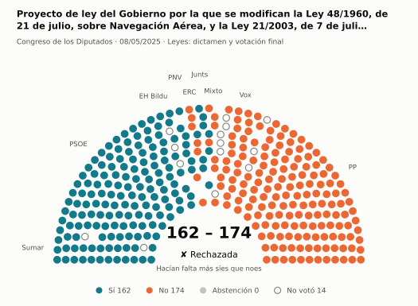
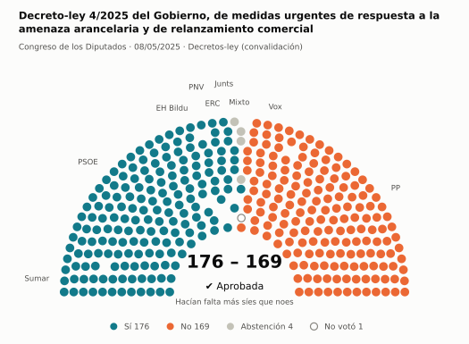
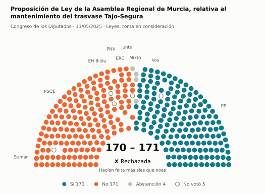
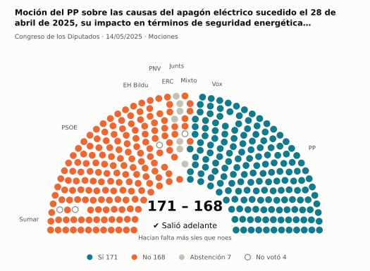
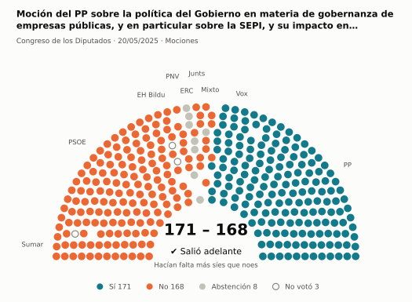
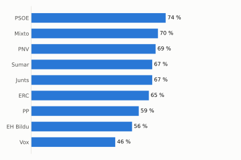
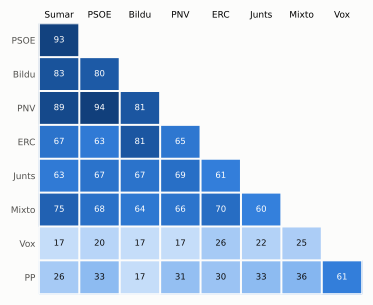

# Qué votó el Congreso en mayo de 2025

Las votaciones del Pleno del Congreso de los Diputados, explicadas sin tecnicismos. Datos oficiales del [Congreso](https://www.congreso.es/es/opendata/votaciones); este resumen se actualiza solo cada mes (última vez: 10/11/2026).

## En pocas palabras

- El Congreso votó **54 veces** en 7 días de pleno. **35 propuestas salieron adelante** y 19 no.
- 19 votaciones fueron sobre leyes, decretos o presupuestos. Otras 24 fueron peticiones al Gobierno que no le obligan (proposiciones no de ley y mociones).
- El Gobierno (PSOE y Sumar) perdió **14** de las 50 votaciones en las que sus grupos votaron lo mismo.
- La votación más reñida se decidió por 1 voto: Proposición de Ley de la Asamblea Regional de Murcia, relativa al mantenimiento del trasvase Tajo-Segura.
- Los diputados casi siempre votan lo mismo que su grupo: en todo el mes solo hubo 9 votos distintos (sin contar el Grupo Mixto).

## Las votaciones más importantes del mes

Elegidas por su importancia: pesan más las leyes y los decretos que las peticiones al Gobierno, y suben las que se decidieron por pocos votos o las que perdió el Gobierno. Cada punto del dibujo es un diputado, colocado con su grupo, y el color es lo que votó.

### 1. Proyecto de ley del Gobierno por la que se modifican la Ley 48/1960, de 21 de julio, sobre Navegación Aérea, y la Ley 21/2003, de 7 de julio, de Segu…

**8 de mayo · Leyes: dictamen y votación final.** Votación del texto de una ley después de trabajarla en comisión.

<picture>
  <source media="(prefers-color-scheme: dark)" srcset="img/2025-05/votacion-L15-S109-V003-oscuro.svg">
  
</picture>

**✘ No salió adelante** por 12 votos: 162 a favor, 174 en contra y ninguna abstención.

- **A favor:** PSOE, Sumar, Junts, EH Bildu y PNV
- **En contra:** PP, Vox y ERC
- **Repartidos:** Grupo Mixto (Sí 2, No 6)

Este asunto tuvo 6 votaciones este mes; aquí se muestra la más disputada. [Datos oficiales](https://www.congreso.es/webpublica/opendata/votaciones/Leg15/Sesion109/20250508/Votacion003/VOT_20250508130741.json)

### 2. Decreto-ley 4/2025 del Gobierno, de medidas urgentes de respuesta a la amenaza arancelaria y de relanzamiento comercial

**8 de mayo · Decretos-ley (convalidación).** El Gobierno aprobó esta norma por urgencia. Ya está en vigor, pero el Congreso tiene 30 días para confirmarla o tumbarla.

<picture>
  <source media="(prefers-color-scheme: dark)" srcset="img/2025-05/votacion-L15-S109-V014-oscuro.svg">
  
</picture>

**✔ Salió adelante** por 7 votos: 176 a favor, 169 en contra y 4 abstenciones.

- **A favor:** PSOE, Sumar, Junts, ERC, EH Bildu y PNV
- **En contra:** PP y Vox
- **Repartidos:** Grupo Mixto (Sí 4, Abstención 4)

[Datos oficiales](https://www.congreso.es/webpublica/opendata/votaciones/Leg15/Sesion109/20250508/Votacion014/VOT_20250508130802.json)

### 3. Proposición de Ley de la Asamblea Regional de Murcia, relativa al mantenimiento del trasvase Tajo-Segura

**13 de mayo · Leyes: toma en consideración.** Primer paso de una ley propuesta por un grupo o una comunidad autónoma: el Congreso decide si empieza a tramitarla.

<picture>
  <source media="(prefers-color-scheme: dark)" srcset="img/2025-05/votacion-L15-S110-V001-oscuro.svg">
  
</picture>

**✘ No salió adelante** por 1 voto: 170 a favor, 171 en contra y 4 abstenciones.

- **A favor:** PP y Vox
- **En contra:** PSOE, Sumar, Junts, ERC, EH Bildu y PNV
- **Repartidos:** Grupo Mixto (Sí 1, No 2, Abstención 4)

[Datos oficiales](https://www.congreso.es/webpublica/opendata/votaciones/Leg15/Sesion110/20250513/Votacion001/VOT_20250513201840.json)

### 4. Moción del PP sobre las causas del apagón eléctrico sucedido el 28 de abril de 2025, su impacto en términos de seguridad energética nacional, y las g…

**14 de mayo · Mociones.** Petición al Gobierno después de pedirle explicaciones en el Pleno. Expresa la opinión del Congreso, pero no obliga.

<picture>
  <source media="(prefers-color-scheme: dark)" srcset="img/2025-05/votacion-L15-S111-V006-oscuro.svg">
  
</picture>

**✔ Salió adelante** por 3 votos: 171 a favor, 168 en contra y 7 abstenciones.

- **A favor:** PP y Vox
- **En contra:** PSOE, Sumar, ERC, EH Bildu y PNV
- **Se abstuvieron:** Junts
- **Repartidos:** Grupo Mixto (Sí 1, No 6)

[Datos oficiales](https://www.congreso.es/webpublica/opendata/votaciones/Leg15/Sesion111/20250514/Votacion006/VOT_20250514165633.json)

### 5. Moción del PP sobre la política del Gobierno en materia de gobernanza de empresas públicas, y en particular sobre la SEPI, y su impacto en los aconte…

**20 de mayo · Mociones.** Petición al Gobierno después de pedirle explicaciones en el Pleno. Expresa la opinión del Congreso, pero no obliga.

<picture>
  <source media="(prefers-color-scheme: dark)" srcset="img/2025-05/votacion-L15-S112-V005-oscuro.svg">
  
</picture>

**✔ Salió adelante** por 3 votos: 171 a favor, 168 en contra y 8 abstenciones.

- **A favor:** PP y Vox
- **En contra:** PSOE, Sumar, Junts, EH Bildu y PNV
- **Se abstuvieron:** ERC
- **Repartidos:** Grupo Mixto (Sí 1, No 6, Abstención 1)

Este asunto tuvo 5 votaciones este mes; aquí se muestra la más disputada. [Datos oficiales](https://www.congreso.es/webpublica/opendata/votaciones/Leg15/Sesion112/20250520/Votacion005/VOT_20250520203916.json)

## ¿Qué grupos votaron más veces lo que finalmente salió?

<picture>
  <source media="(prefers-color-scheme: dark)" srcset="img/2025-05/ganadora-oscuro.svg">
  
</picture>

Porcentaje de votaciones en que el grupo votó Sí y salió adelante, o votó No y no salió. Abstenerse no cuenta como acertar.

## ¿Quién vota con quién?

<picture>
  <source media="(prefers-color-scheme: dark)" srcset="img/2025-05/afinidad-oscuro.svg">
  
</picture>

Cada casilla dice en qué porcentaje de las votaciones dos grupos votaron lo mismo: 100 es que siempre coincidieron y 0 que nunca.

## ¿Qué tipo de cosas se votaron?

| Tipo | Votaciones | Salieron adelante | Qué es |
| --- | ---: | ---: | --- |
| Mociones | 16 | 9 | Petición al Gobierno después de pedirle explicaciones en el Pleno. Expresa la opinión del Congreso, pero no obliga. |
| Leyes: dictamen y votación final | 9 | 4 | Votación del texto de una ley después de trabajarla en comisión. |
| Leyes: toma en consideración | 8 | 5 | Primer paso de una ley propuesta por un grupo o una comunidad autónoma: el Congreso decide si empieza a tramitarla. |
| Proposiciones no de ley | 8 | 5 | Petición al Gobierno para que haga algo. Expresa la opinión del Congreso, pero no obliga. |
| Tratados internacionales | 6 | 5 | El Congreso autoriza a España a comprometerse con un acuerdo con otro país u organismo. |
| Organización de la Cámara | 5 | 5 | Asunto interno del Congreso: comisiones, plazos o el estatuto de los diputados. |
| Decretos-ley (convalidación) | 2 | 2 | El Gobierno aprobó esta norma por urgencia. Ya está en vigor, pero el Congreso tiene 30 días para confirmarla o tumbarla. |

## Palabras que conviene saber

- **Pleno**: La reunión de los 350 diputados, donde se vota.
- **Grupo parlamentario**: Los diputados de un partido o coalición. Los partidos pequeños van juntos en el Grupo Mixto, aunque no piensen igual.
- **Abstención**: El diputado vota, pero ni a favor ni en contra.
- **No votó**: El diputado no votó: no estaba, estaba de baja o el escaño estaba vacío.
- **Mayoría simple**: Salen adelante las votaciones con más síes que noes. Es lo normal.
- **Mayoría absoluta**: 176 votos a favor, la mitad más uno de 350. La piden las leyes orgánicas (derechos fundamentales, sistema electoral…) y la primera votación de investidura.
- **Votación por llamamiento**: Cada diputado dice su voto en voz alta. Se usa en las investiduras y otras votaciones importantes.

---

**¿Quieres más detalle?** El [análisis detallado](2025-05-detalle.md) tiene la cohesión de cada grupo, un mapa de los diputados según cómo votan, qué diputados votaron distinto de su grupo, las ausencias y la lista completa de votaciones.

_Los resultados están calculados a partir de los votos: el Congreso no publica si cada votación salió adelante. Este proyecto no tiene relación con el Congreso. Método en [docs/DOCUMENTO_FUNCIONAL.md](../docs/DOCUMENTO_FUNCIONAL.md)._
