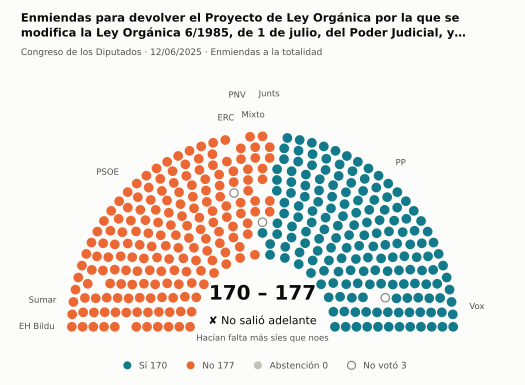
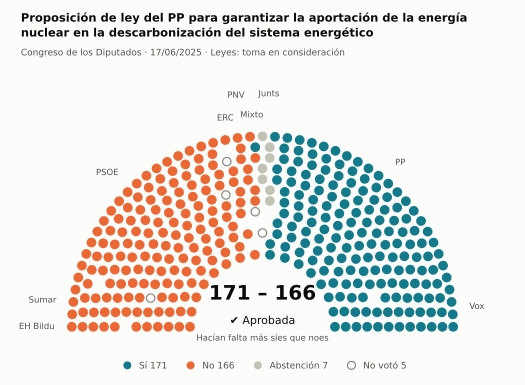
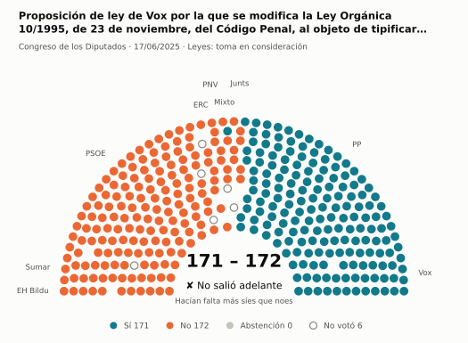
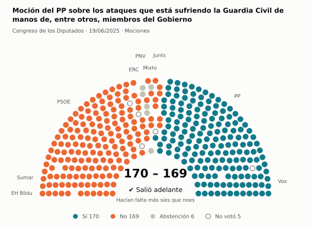
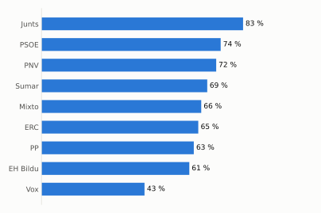
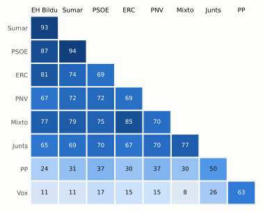

# Qué votó el Congreso en junio de 2025

Las votaciones del Pleno del Congreso de los Diputados, explicadas sin tecnicismos. Datos oficiales del [Congreso](https://www.congreso.es/es/opendata/votaciones); este resumen se actualiza solo cada mes (última vez: 11/11/2026).

## En pocas palabras

- El Congreso votó **54 veces** en 6 días de pleno. **32 propuestas salieron adelante** y 22 no.
- 14 votaciones fueron sobre leyes, decretos o presupuestos. Otras 34 fueron peticiones al Gobierno que no le obligan (proposiciones no de ley y mociones).
- El Gobierno (PSOE y Sumar) perdió **14** de las 51 votaciones en las que sus grupos votaron lo mismo.
- La votación más reñida se decidió por 1 voto: Proposición de ley de Vox por la que se modifica la Ley Orgánica 10/1995, de 23 de noviembre, del Código Penal, al….
- Los diputados casi siempre votan lo mismo que su grupo: en todo el mes solo hubo 24 votos distintos (sin contar el Grupo Mixto).

## Las votaciones más importantes del mes

Elegidas por su importancia: pesan más las leyes y los decretos que las peticiones al Gobierno, y suben las que se decidieron por pocos votos o las que perdió el Gobierno. Cada punto del dibujo es un diputado, colocado con su grupo, y el color es lo que votó.

### 1. Enmiendas para devolver el Proyecto de Ley Orgánica por la que se modifica la Ley Orgánica 6/1985, de 1 de julio, del Poder Judicial, y la Ley…

**12 de junio · Enmiendas a la totalidad.** Un grupo intenta devolver la ley a quien la propuso o sustituirla por otra. Si no sale adelante, la ley sigue su camino.

<picture>
  <source media="(prefers-color-scheme: dark)" srcset="img/2025-06/votacion-L15-S118-V018-oscuro.svg">
  
</picture>

**✘ No salió adelante** por 7 votos: 170 a favor, 177 en contra y ninguna abstención.

- **A favor:** PP y Vox
- **En contra:** PSOE, Sumar, Junts, ERC, EH Bildu y PNV
- **Repartidos:** Grupo Mixto (Sí 1, No 6)

[Datos oficiales](https://www.congreso.es/webpublica/opendata/votaciones/Leg15/Sesion118/20250612/Votacion018/VOT_20250612132301.json)

### 2. Proposición de ley del PP para garantizar la aportación de la energía nuclear en la descarbonización del sistema energético

**17 de junio · Leyes: toma en consideración.** Primer paso de una ley propuesta por un grupo o una comunidad autónoma: el Congreso decide si empieza a tramitarla.

<picture>
  <source media="(prefers-color-scheme: dark)" srcset="img/2025-06/votacion-L15-S119-V001-oscuro.svg">
  
</picture>

**✔ Salió adelante** por 5 votos: 171 a favor, 166 en contra y 7 abstenciones.

- **A favor:** PP y Vox
- **En contra:** PSOE, Sumar, ERC, EH Bildu y PNV
- **Se abstuvieron:** Junts
- **Repartidos:** Grupo Mixto (Sí 1, No 5)

[Datos oficiales](https://www.congreso.es/webpublica/opendata/votaciones/Leg15/Sesion119/20250617/Votacion001/VOT_20250617203251.json)

### 3. Proposición de ley de Vox por la que se modifica la Ley Orgánica 10/1995, de 23 de noviembre, del Código Penal, al objeto de tipificar penalmente el…

**17 de junio · Leyes: toma en consideración.** Primer paso de una ley propuesta por un grupo o una comunidad autónoma: el Congreso decide si empieza a tramitarla.

<picture>
  <source media="(prefers-color-scheme: dark)" srcset="img/2025-06/votacion-L15-S119-V002-oscuro.svg">
  
</picture>

**✘ No salió adelante** por 1 voto: 171 a favor, 172 en contra y ninguna abstención.

- **A favor:** PP y Vox
- **En contra:** PSOE, Sumar, Junts, ERC, EH Bildu y PNV
- **Repartidos:** Grupo Mixto (Sí 1, No 5)

[Datos oficiales](https://www.congreso.es/webpublica/opendata/votaciones/Leg15/Sesion119/20250617/Votacion002/VOT_20250617203252.json)

### 4. Proposición de Ley Orgánica de modificación del artículo 515 de la Ley Orgánica 10/1995, de 23 de noviembre, del Código Penal (antes denominada…

**19 de junio · Leyes: enmiendas del Senado.** El Senado propuso cambios a esta ley y el Congreso decide si los acepta. Es uno de los últimos pasos antes de que la ley se publique.

<picture>
  <source media="(prefers-color-scheme: dark)" srcset="img/2025-06/votacion-L15-S121-V001-oscuro.svg">
  
</picture>

**✘ No salió adelante** por 6 votos: 170 a favor, 176 en contra y ninguna abstención.

- **A favor:** PP y Vox
- **En contra:** PSOE, Sumar, Junts, ERC, EH Bildu y PNV
- **Repartidos:** Grupo Mixto (Sí 1, No 6)

[Datos oficiales](https://www.congreso.es/webpublica/opendata/votaciones/Leg15/Sesion121/20250619/Votacion001/VOT_20250619120737.json)

### 5. Moción del PP sobre los ataques que está sufriendo la Guardia Civil de manos de, entre otros, miembros del Gobierno

**19 de junio · Mociones.** Petición al Gobierno después de pedirle explicaciones en el Pleno. Expresa la opinión del Congreso, pero no obliga.

<picture>
  <source media="(prefers-color-scheme: dark)" srcset="img/2025-06/votacion-L15-S121-V007-oscuro.svg">
  
</picture>

**✔ Salió adelante** por 1 voto: 170 a favor, 169 en contra y 6 abstenciones.

- **A favor:** PP y Vox
- **En contra:** PSOE, Sumar, Junts, ERC y EH Bildu
- **Se abstuvieron:** PNV
- **Repartidos:** Grupo Mixto (Sí 1, No 5, Abstención 1)

Este asunto tuvo 3 votaciones este mes; aquí se muestra la más disputada. [Datos oficiales](https://www.congreso.es/webpublica/opendata/votaciones/Leg15/Sesion121/20250619/Votacion007/VOT_20250619120744.json)

## ¿Qué grupos votaron más veces lo que finalmente salió?

<picture>
  <source media="(prefers-color-scheme: dark)" srcset="img/2025-06/ganadora-oscuro.svg">
  
</picture>

Porcentaje de votaciones en que el grupo votó Sí y salió adelante, o votó No y no salió. Abstenerse no cuenta como acertar.

## ¿Quién vota con quién?

<picture>
  <source media="(prefers-color-scheme: dark)" srcset="img/2025-06/afinidad-oscuro.svg">
  
</picture>

Cada casilla dice en qué porcentaje de las votaciones dos grupos votaron lo mismo: 100 es que siempre coincidieron y 0 que nunca.

## ¿Qué tipo de cosas se votaron?

| Tipo | Votaciones | Salieron adelante | Qué es |
| --- | ---: | ---: | --- |
| Mociones | 21 | 10 | Petición al Gobierno después de pedirle explicaciones en el Pleno. Expresa la opinión del Congreso, pero no obliga. |
| Proposiciones no de ley | 13 | 7 | Petición al Gobierno para que haga algo. Expresa la opinión del Congreso, pero no obliga. |
| Leyes: toma en consideración | 6 | 5 | Primer paso de una ley propuesta por un grupo o una comunidad autónoma: el Congreso decide si empieza a tramitarla. |
| Organización de la Cámara | 3 | 3 | Asunto interno del Congreso: comisiones, plazos o el estatuto de los diputados. |
| Tratados internacionales | 3 | 3 | El Congreso autoriza a España a comprometerse con un acuerdo con otro país u organismo. |
| Leyes: dictamen y votación final | 3 | 2 | Votación del texto de una ley después de trabajarla en comisión. |
| Decretos-ley (convalidación) | 2 | 2 | El Gobierno aprobó esta norma por urgencia. Ya está en vigor, pero el Congreso tiene 30 días para confirmarla o tumbarla. |
| Enmiendas a la totalidad | 2 | 0 | Un grupo intenta devolver la ley a quien la propuso o sustituirla por otra. Si no sale adelante, la ley sigue su camino. |
| Leyes: enmiendas del Senado | 1 | 0 | El Senado propuso cambios a esta ley y el Congreso decide si los acepta. Es uno de los últimos pasos antes de que la ley se publique. |

## Palabras que conviene saber

- **Pleno**: La reunión de los 350 diputados, donde se vota.
- **Grupo parlamentario**: Los diputados de un partido o coalición. Los partidos pequeños van juntos en el Grupo Mixto, aunque no piensen igual.
- **Abstención**: El diputado vota, pero ni a favor ni en contra.
- **No votó**: El diputado no votó: no estaba, estaba de baja o el escaño estaba vacío.
- **Mayoría simple**: Salen adelante las votaciones con más síes que noes. Es lo normal.
- **Mayoría absoluta**: 176 votos a favor, la mitad más uno de 350. La piden las leyes orgánicas (derechos fundamentales, sistema electoral…) y la primera votación de investidura.
- **Votación por llamamiento**: Cada diputado dice su voto en voz alta. Se usa en las investiduras y otras votaciones importantes.

---

**¿Quieres más detalle?** El [análisis detallado](2025-06-detalle.md) tiene la cohesión de cada grupo, un mapa de los diputados según cómo votan, qué diputados votaron distinto de su grupo, las ausencias y la lista completa de votaciones.

_Los resultados están calculados a partir de los votos: el Congreso no publica si cada votación salió adelante. Este proyecto no tiene relación con el Congreso. Método en [docs/DOCUMENTO_FUNCIONAL.md](../docs/DOCUMENTO_FUNCIONAL.md)._
