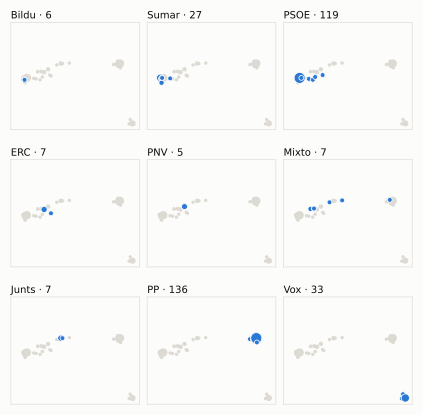
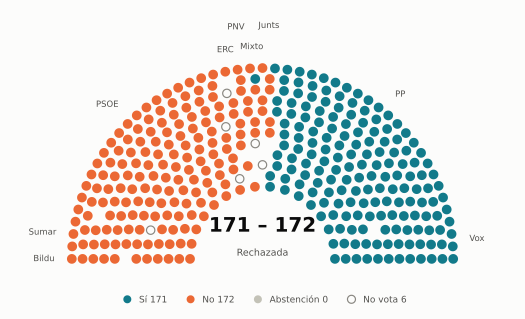
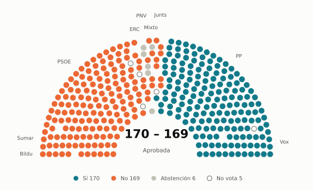
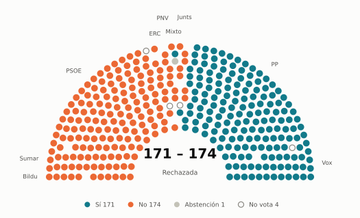

# Votaciones del Congreso: junio de 2025

_Generado automáticamente el 2026-11-10 con datos abiertos del [Congreso de los Diputados](https://www.congreso.es/es/opendata/votaciones). Solo plenos y Diputación Permanente. Método y límites en [docs/DOCUMENTO_FUNCIONAL.md](../docs/DOCUMENTO_FUNCIONAL.md)._

## Resumen

- **54 votaciones** en 6 días de pleno (sesiones 116, 118, 119, 121, 122 y 124).
- **32 aprobadas** y **22 rechazadas**.
- 9 votaciones se decidieron por 5 votos o menos.
- El grupo que más veces votó con el resultado final: **Junts** (83 % de las votaciones nominales).
- Los grupos del Gobierno (PSOE y Sumar) votaron lo mismo en 51 de 54 votaciones nominales y perdieron 14 de ellas.
- 24 votos individuales se apartaron de la posición de su grupo (17 diputados).

## Cómo votó cada grupo

| Grupo | Diputados | Cohesión | Votó con el resultado | Decisivo | Posición Sí | Posición No | Posición Abst. |
| --- | ---: | ---: | ---: | ---: | ---: | ---: | ---: |
| PP | 137 | 100 % | 63 % | 14 | 38 | 9 | 7 |
| PSOE | 120 | 100 % | 74 % | 13 | 18 | 36 | 0 |
| Vox | 33 | 100 % | 43 % | 13 | 39 | 13 | 2 |
| Sumar | 27 | 99 % | 69 % | 12 | 19 | 35 | 0 |
| Mixto | 8 | 72 % | 66 % | 5 | 18 | 27 | 8 |
| Junts | 7 | 100 % | 83 % | 9 | 26 | 23 | 5 |
| ERC | 7 | 100 % | 65 % | 9 | 18 | 26 | 10 |
| Bildu | 6 | 99 % | 61 % | 7 | 15 | 36 | 3 |
| PNV | 5 | 100 % | 72 % | 6 | 19 | 26 | 9 |

*Cohesión*: índice de acuerdo interno (100 % = todo el grupo votó igual). *Votó con el resultado*: el grupo votó Sí y salió aprobada, o No y salió rechazada. *Decisivo*: votaciones cuyo resultado habría cambiado si el grupo se hubiera abstenido en bloque. El Grupo Mixto reúne partidos distintos: su posición es la de su mayoría.

## Mapa de diputados

<picture>
  <source media="(prefers-color-scheme: dark)" srcset="img/2025-06/mapa-oscuro.svg">
  
</picture>

Cada punto es un diputado; dos diputados están cerca si votaron parecido. Un punto más grande reúne a varios que votaron exactamente igual. En cada panel, el grupo en azul y el resto del Congreso en gris.

*Cómo se calcula*: componentes principales de los votos (Sí, No, abstención) en 53 votaciones con algún desacuerdo. El eje horizontal recoge el 80 % de la variación y el vertical el 11 %. Los ejes no tienen nombre ni sentido político propio; por convención, el PP queda a la derecha. No se sitúa a 4 diputados que votó en menos de la mitad.

## Afinidad entre grupos

<picture>
  <source media="(prefers-color-scheme: dark)" srcset="img/2025-06/afinidad-oscuro.svg">
  
</picture>

Porcentaje de votaciones nominales en que los dos grupos tomaron la misma posición. Los grupos están ordenados según el mapa de diputados.

Ver la tabla

|  | PP | PSOE | Vox | Sumar | Mixto | Junts | ERC | Bildu | PNV |
| --- | :---: | :---: | :---: | :---: | :---: | :---: | :---: | :---: | :---: |
| PP | 100 % | 37 % | 63 % | 31 % | 30 % | 50 % | 30 % | 24 % | 37 % |
| PSOE | 37 % | 100 % | 17 % | 94 % | 75 % | 70 % | 69 % | 87 % | 72 % |
| Vox | 63 % | 17 % | 100 % | 11 % | 8 % | 26 % | 15 % | 11 % | 15 % |
| Sumar | 31 % | 94 % | 11 % | 100 % | 79 % | 69 % | 74 % | 93 % | 72 % |
| Mixto | 30 % | 75 % | 8 % | 79 % | 100 % | 77 % | 85 % | 77 % | 70 % |
| Junts | 50 % | 70 % | 26 % | 69 % | 77 % | 100 % | 67 % | 65 % | 70 % |
| ERC | 30 % | 69 % | 15 % | 74 % | 85 % | 67 % | 100 % | 81 % | 69 % |
| Bildu | 24 % | 87 % | 11 % | 93 % | 77 % | 65 % | 81 % | 100 % | 67 % |
| PNV | 37 % | 72 % | 15 % | 72 % | 70 % | 70 % | 69 % | 67 % | 100 % |

## Quién sacó adelante las votaciones

| Grupos que votaron Sí | Votaciones | Escaños |
| --- | ---: | ---: |
| PSOE + Sumar + Mixto + Junts + ERC + Bildu + PNV | 5 | 180 |
| PP + Vox + Junts | 5 | 177 |
| PP + PSOE + Sumar + Mixto + Junts + ERC + Bildu + PNV | 5 | 317 |
| PP + Vox | 3 | 170 |
| PP + Vox + Junts + PNV | 2 | 182 |
| PP + Vox + ERC | 2 | 177 |
| PP + PSOE + Sumar + Mixto + Junts + PNV | 2 | 304 |
| Todos los grupos | 2 | 350 |

De 32 votaciones nominales aprobadas. Otras 6 salieron con combinaciones que se dieron menos veces. La posición de cada grupo es la de la mayoría de sus diputados.

## Votaciones que perdieron los grupos del Gobierno

| Fecha | Asunto | Tipo | PSOE y Sumar votaron | Resultado | Sí | No |
| --- | --- | --- | :---: | --- | ---: | ---: |
| 10 de junio | Proposición de Ley del Grupo Parlamentario Popular en el Congreso, relativa a la modificación de la Ley 22/1988, de 28 de julio, de Costas, para la preservació… | Leyes: toma en consideración | No | Aprobada | 189 | 155 |
| 12 de junio | Proposición no de Ley del Grupo Parlamentario Popular en el Congreso, para ajustar el IRPF por la inflación. | Proposiciones no de ley | No | Aprobada | 179 | 164 |
| 12 de junio | Moción consecuencia de interpelación urgente del Grupo Parlamentario Popular en el Congreso, para que la Vicepresidenta Tercera del Gobierno y Ministra para la… *(Votación separada por puntos. Punto 1.)* | Mociones | No | Aprobada | 180 | 152 |
| 12 de junio | Moción consecuencia de interpelación urgente del Grupo Parlamentario Popular en el Congreso, para que la Vicepresidenta Tercera del Gobierno y Ministra para la… *(Votación separada por puntos. Punto 2.)* | Mociones | No | Aprobada | 179 | 153 |
| 12 de junio | Moción consecuencia de interpelación urgente del Grupo Parlamentario Popular en el Congreso, para que la Vicepresidenta Tercera del Gobierno y Ministra para la… *(Votación separada por puntos. Punto 3.)* | Mociones | No | Aprobada | 179 | 157 |
| 12 de junio | Moción consecuencia de interpelación urgente del Grupo Parlamentario Popular en el Congreso, para que la Vicepresidenta Tercera del Gobierno y Ministra para la… *(Votación separada por puntos. Punto 4.)* | Mociones | No | Aprobada | 184 | 152 |
| 17 de junio | Proposición de Ley del Grupo Parlamentario Popular en el Congreso, para garantizar la aportación de la energía nuclear en la descarbonización del sistema energ… | Leyes: toma en consideración | No | Aprobada | 171 | 166 |
| 19 de junio | Moción consecuencia de interpelación urgente del Grupo Parlamentario Popular en el Congreso, sobre los ataques que está sufriendo la Guardia Civil de manos de,… *(Votación separada por puntos. Punto 2.)* | Mociones | No | Aprobada | 170 | 169 |
| 19 de junio | Moción consecuencia de interpelación urgente del Grupo Parlamentario Popular en el Congreso, sobre los ataques que está sufriendo la Guardia Civil de manos de,… *(Votación separada por puntos. Punto 3.)* | Mociones | No | Aprobada | 170 | 169 |
| 26 de junio | Proposición no de Ley del Grupo Parlamentario Popular en el Congreso, relativa a la rendición de cuentas del Plan Industrial y Tecnológico para la Seguridad y… *(Votación separada por puntos. Punto 1.)* | Proposiciones no de ley | No | Aprobada | 176 | 158 |
| 26 de junio | Proposición no de Ley del Grupo Parlamentario Popular en el Congreso, relativa a la rendición de cuentas del Plan Industrial y Tecnológico para la Seguridad y… *(Votación separada por puntos. Punto 2.)* | Proposiciones no de ley | No | Aprobada | 177 | 157 |
| 26 de junio | Proposición no de Ley del Grupo Parlamentario Popular en el Congreso, relativa a la rendición de cuentas del Plan Industrial y Tecnológico para la Seguridad y… *(Votación separada por puntos. Punto 3.)* | Proposiciones no de ley | No | Aprobada | 184 | 152 |
| 26 de junio | Proposición no de Ley del Grupo Parlamentario Popular en el Congreso, relativa a la rendición de cuentas del Plan Industrial y Tecnológico para la Seguridad y… *(Votación separada por puntos. Punto 4.)* | Proposiciones no de ley | No | Aprobada | 184 | 152 |
| 26 de junio | Moción consecuencia de interpelación urgente del Grupo Parlamentario Junts per Catalunya, sobre la política fiscal y presupuestaria. | Mociones | No | Aprobada | 176 | 163 |

Además, PSOE y Sumar votaron distinto entre sí en 3 votaciones.

## Votaciones más ajustadas

**17 de junio** · Proposición de Ley del Grupo Parlamentario VOX, Orgánica por la que se modifica la Ley Orgánica 10/1995, de 23 de noviembre, del Código Penal, al objeto de tip…

<picture>
  <source media="(prefers-color-scheme: dark)" srcset="img/2025-06/hemiciclo-L15-S119-V002-oscuro.svg">
  
</picture>

**19 de junio** · Moción consecuencia de interpelación urgente del Grupo Parlamentario Popular en el Congreso, sobre los ataques que está sufriendo la Guardia Civil de manos de,… *(Votación separada por puntos. Punto 2.)*

<picture>
  <source media="(prefers-color-scheme: dark)" srcset="img/2025-06/hemiciclo-L15-S121-V007-oscuro.svg">
  
</picture>

**19 de junio** · Moción consecuencia de interpelación urgente del Grupo Parlamentario Popular en el Congreso, sobre los ataques que está sufriendo la Guardia Civil de manos de,… *(Votación separada por puntos. Punto 3.)*

<picture>
  <source media="(prefers-color-scheme: dark)" srcset="img/2025-06/hemiciclo-L15-S121-V008-oscuro.svg">
  
</picture>

**26 de junio** · Moción consecuencia de interpelación urgente del Grupo Parlamentario Popular en el Congreso, sobre las diferentes tramas de corrupción que investiga actualment… *(Votación separada por puntos. Punto 3.)*

<picture>
  <source media="(prefers-color-scheme: dark)" srcset="img/2025-06/hemiciclo-L15-S124-V010-oscuro.svg">
  
</picture>

Cada punto es un escaño, agrupado por grupo parlamentario; el color es su voto.

| Fecha | Asunto | Resultado | Sí | No | Abst. |
| --- | --- | :---: | ---: | ---: | ---: |
| 17 de junio | Proposición de Ley del Grupo Parlamentario VOX, Orgánica por la que se modifica la Ley Orgánica 10/1995, de 23 de noviembre, del Código Penal, al objeto de tip… | Rechazada | 171 | 172 | 0 |
| 19 de junio | Moción consecuencia de interpelación urgente del Grupo Parlamentario Popular en el Congreso, sobre los ataques que está sufriendo la Guardia Civil de manos de,… *(Votación separada por puntos. Punto 2.)* | Aprobada | 170 | 169 | 6 |
| 19 de junio | Moción consecuencia de interpelación urgente del Grupo Parlamentario Popular en el Congreso, sobre los ataques que está sufriendo la Guardia Civil de manos de,… *(Votación separada por puntos. Punto 3.)* | Aprobada | 170 | 169 | 6 |
| 26 de junio | Moción consecuencia de interpelación urgente del Grupo Parlamentario Popular en el Congreso, sobre las diferentes tramas de corrupción que investiga actualment… *(Votación separada por puntos. Punto 3.)* | Rechazada | 171 | 174 | 1 |
| 19 de junio | Proposición no de Ley del Grupo Parlamentario Popular en el Congreso, en defensa de los contrapesos democráticos. | Rechazada | 170 | 174 | 1 |
| 26 de junio | Moción consecuencia de interpelación urgente del Grupo Parlamentario VOX, sobre las acciones que va a adoptar el Gobierno para recuperar la dignidad de las ins… | Rechazada | 170 | 174 | 0 |
| 26 de junio | Moción consecuencia de interpelación urgente del Grupo Parlamentario Popular en el Congreso, sobre las diferentes tramas de corrupción que investiga actualment… *(Votación separada por puntos. Punto 1.)* | Rechazada | 170 | 174 | 1 |
| 17 de junio | Proposición de Ley del Grupo Parlamentario Popular en el Congreso, para garantizar la aportación de la energía nuclear en la descarbonización del sistema energ… | Aprobada | 171 | 166 | 7 |
| 26 de junio | Proposición no de Ley del Grupo Parlamentario Euskal Herria Bildu, relativa a la recuperación de la memoria histórica en relación a los sucesos de sanfermines… | Aprobada | 174 | 169 | 1 |
| 12 de junio | Proposición no de Ley del Grupo Parlamentario VOX, relativa a la defensa del olivar en el contexto de la sobreinstalación de plantas de generación renovable. *(Votación separada por puntos. Punto 1.)* | Rechazada | 170 | 176 | 0 |

Votaciones decididas por 10 votos o menos (o a esa distancia de la mayoría que exigían). Las públicas por llamamiento no tienen hemiciclo: el voto de cada diputado solo consta en el Diario de Sesiones.

## Qué se votó, por tipo de asunto

| Tipo de asunto | Votaciones | Aprobadas | No aprobadas |
| --- | ---: | ---: | ---: |
| Mociones | 21 | 10 | 11 |
| Proposiciones no de ley | 13 | 7 | 6 |
| Leyes: toma en consideración | 6 | 5 | 1 |
| Organización de la Cámara | 3 | 3 | 0 |
| Tratados internacionales | 3 | 3 | 0 |
| Leyes: dictamen y votación final | 3 | 2 | 1 |
| Decretos-ley (convalidación) | 2 | 2 | 0 |
| Enmiendas a la totalidad | 2 | 0 | 2 |
| Leyes: enmiendas del Senado | 1 | 0 | 1 |

Las proposiciones no de ley y las mociones expresan la posición del Congreso pero no obligan al Gobierno. Las leyes pasan por varias votaciones (toma en consideración, totalidad, dictamen, Senado), así que una misma ley puede aparecer varias veces.

## Votos distintos de su grupo

| Diputado | Grupo | Votos distintos de su grupo |
| --- | --- | ---: |
| Rivera Arias, Engracia | Sumar | 3 |
| Ibáñez Mezquita, Alberto | Sumar | 2 |
| Mariscal Anaya, Guillermo | PP | 2 |
| Martín Blanco, Nacho | PP | 2 |
| Micó Micó, Àgueda | Sumar | 2 |
| Verano Domínguez, Bella | PP | 2 |
| Aizcorbe Torra, Juan José | Vox | 1 |
| Aizpurua Arzallus, Mertxe | Bildu | 1 |
| Cabezón Casas, Tomás | PP | 1 |
| López Zamora, Cristina | PSOE | 1 |
| Martín García, Pedro Samuel | PP | 1 |
| Muñoz de la Iglesia, Ester | PP | 1 |
| Ogou i Corbi, Viviane | Sumar | 1 |
| Pozueta Fernández, Isabel | Bildu | 1 |
| Rey de las Heras, Luis Alfonso | PSOE | 1 |

Un voto aislado puede ser un error al pulsar, no una decisión política: el Congreso no publica las correcciones. Se excluye el Grupo Mixto.

## Diputados que más veces no votaron

| Diputado | Grupo | No votó | % de votaciones |
| --- | --- | ---: | ---: |
| Ábalos Meco, José Luis | Mixto | 54 | 100 % |
| Núñez Feijóo, Alberto | PP | 34 | 63 % |
| Sánchez Pérez-Castejón, Pedro | PSOE | 32 | 59 % |
| Puente Santiago, Óscar | PSOE | 19 | 35 % |
| Rufián Romero, Gabriel | ERC | 19 | 35 % |
| Montero Cuadrado, María Jesús | PSOE | 16 | 30 % |
| Narbona Ruiz, Cristina | PSOE | 10 | 19 % |
| Díaz Pérez, Yolanda | Sumar | 9 | 17 % |
| Fernández Ríos, Tomás | Vox | 3 | 6 % |
| Velarde Gómez, Martina | Mixto | 3 | 6 % |
| Iñarritu García, Jon | Bildu | 2 | 4 % |
| Rego Candamil, Néstor | Mixto | 2 | 4 % |
| Santana Perera, Noemí | Mixto | 2 | 4 % |
| Aguirre Gil de Biedma, Rocío | Vox | 1 | 2 % |
| Alós López, Ana Isabel | PP | 1 | 2 % |

«No vota» incluye ausencias justificadas (baja, maternidad o paternidad) y escaños vacantes; el portal no las distingue.

## Todas las votaciones

Posición de cada grupo: la opción que votó la mayoría de sus diputados (*Div.*: empate dentro del grupo). El número enlaza al JSON oficial o, en las votaciones por llamamiento, al Diario de Sesiones.

### 10 de junio (sesión 116)

| Nº | Asunto | Resultado | Sí | No | Abst. | PP | PSOE | Vox | Sumar | Mixto | Junts | ERC | Bildu | PNV | Decisivos |
| ---: | --- | --- | ---: | ---: | ---: | :---: | :---: | :---: | :---: | :---: | :---: | :---: | :---: | :---: | --- |
| [1](https://www.congreso.es/webpublica/opendata/votaciones/Leg15/Sesion116/20250610/Votacion001/VOT_20250610202446.json) | Proposición de Ley del Grupo Parlamentario Popular en el Congreso, relativa a la modificación de la Ley 22/1988, de 28 de julio, de Costas, para la preservació… | Aprobada | 189 | 155 | 1 | Sí | No | Sí | No | No | Sí | Sí | No | Sí | PP |
| [2](https://www.congreso.es/webpublica/opendata/votaciones/Leg15/Sesion116/20250610/Votacion002/VOT_20250610202447.json) | Proposición del Grupo Parlamentario Socialista, de reforma del Reglamento del Congreso para incorporar un nuevo Título XIV para la regulación de los grupos de… | Aprobada | 175 | 33 | 136 | Abst. | Sí | No | Sí | Sí | Sí | Sí | Sí | Sí |  |

### 12 de junio (sesión 118)

| Nº | Asunto | Resultado | Sí | No | Abst. | PP | PSOE | Vox | Sumar | Mixto | Junts | ERC | Bildu | PNV | Decisivos |
| ---: | --- | --- | ---: | ---: | ---: | :---: | :---: | :---: | :---: | :---: | :---: | :---: | :---: | :---: | --- |
| [1](https://www.congreso.es/webpublica/opendata/votaciones/Leg15/Sesion118/20250612/Votacion001/VOT_20250612132238.json) | Proposición no de Ley del Grupo Parlamentario Popular en el Congreso, para ajustar el IRPF por la inflación. | Aprobada | 179 | 164 | 5 | Sí | No | Sí | No | No | Sí | No | No | Abst. | PP, Vox |
| [2](https://www.congreso.es/webpublica/opendata/votaciones/Leg15/Sesion118/20250612/Votacion002/VOT_20250612132240.json) | Proposición no de Ley del Grupo Parlamentario VOX, relativa a la defensa del olivar en el contexto de la sobreinstalación de plantas de generación renovable. *(Votación separada por puntos. Punto 1.)* | Rechazada | 170 | 176 | 0 | Sí | No | Sí | No | No | No | No | No | No | Junts, ERC, PSOE, Sumar |
| [3](https://www.congreso.es/webpublica/opendata/votaciones/Leg15/Sesion118/20250612/Votacion003/VOT_20250612132241.json) | Proposición no de Ley del Grupo Parlamentario VOX, relativa a la defensa del olivar en el contexto de la sobreinstalación de plantas de generación renovable. *(Votación separada por puntos. Punto 2.)* | Rechazada | 33 | 313 | 1 | No | No | Sí | No | No | No | No | No | No |  |
| [4](https://www.congreso.es/webpublica/opendata/votaciones/Leg15/Sesion118/20250612/Votacion004/VOT_20250612132243.json) | Proposición no de Ley del Grupo Parlamentario VOX, relativa a la defensa del olivar en el contexto de la sobreinstalación de plantas de generación renovable. *(Votación separada por puntos. Punto 3.)* | Rechazada | 33 | 314 | 1 | No | No | Sí | No | No | No | No | No | No |  |
| [5](https://www.congreso.es/webpublica/opendata/votaciones/Leg15/Sesion118/20250612/Votacion005/VOT_20250612132244.json) | Proposición no de Ley del Grupo Parlamentario VOX, relativa a la defensa del olivar en el contexto de la sobreinstalación de plantas de generación renovable. *(Votación separada por puntos. Punto 4.)* | Rechazada | 170 | 178 | 0 | Sí | No | Sí | No | No | No | No | No | No | PSOE, Sumar |
| [6](https://www.congreso.es/webpublica/opendata/votaciones/Leg15/Sesion118/20250612/Votacion006/VOT_20250612132246.json) | Proposición no de Ley del Grupo Parlamentario VOX, relativa a la defensa del olivar en el contexto de la sobreinstalación de plantas de generación renovable. *(Votación separada por puntos. Punto 5.)* | Rechazada | 170 | 177 | 0 | Sí | No | Sí | No | No | No | No | No | No | PSOE, Sumar |
| [7](https://www.congreso.es/webpublica/opendata/votaciones/Leg15/Sesion118/20250612/Votacion007/VOT_20250612132247.json) | Moción consecuencia de interpelación urgente del Grupo Parlamentario Mixto (Sra. Belarra Urteaga), relativa a la posición del Gobierno sobre la necesidad de de… | Rechazada | 45 | 296 | 7 | No | No | No | Sí | Sí | Abst. | Sí | Sí | No |  |
| [8](https://www.congreso.es/webpublica/opendata/votaciones/Leg15/Sesion118/20250612/Votacion008/VOT_20250612132248.json) | Moción consecuencia de interpelación urgente del Grupo Parlamentario VOX, sobre cómo va a recuperar el Gobierno una política energética que garantice el bienes… *(Votación separada por puntos. Punto 1.)* | Rechazada | 33 | 315 | 0 | No | No | Sí | No | No | No | No | No | No |  |
| [9](https://www.congreso.es/webpublica/opendata/votaciones/Leg15/Sesion118/20250612/Votacion009/VOT_20250612132249.json) | Moción consecuencia de interpelación urgente del Grupo Parlamentario VOX, sobre cómo va a recuperar el Gobierno una política energética que garantice el bienes… *(Votación separada por puntos. Punto 2.)* | Rechazada | 33 | 177 | 138 | Abst. | No | Sí | No | No | No | No | No | No |  |
| [10](https://www.congreso.es/webpublica/opendata/votaciones/Leg15/Sesion118/20250612/Votacion010/VOT_20250612132251.json) | Moción consecuencia de interpelación urgente del Grupo Parlamentario VOX, sobre cómo va a recuperar el Gobierno una política energética que garantice el bienes… *(Votación separada por puntos. Punto 3.)* | Rechazada | 33 | 178 | 136 | Abst. | No | Sí | No | No | No | No | No | No |  |
| [11](https://www.congreso.es/webpublica/opendata/votaciones/Leg15/Sesion118/20250612/Votacion011/VOT_20250612132252.json) | Moción consecuencia de interpelación urgente del Grupo Parlamentario VOX, sobre cómo va a recuperar el Gobierno una política energética que garantice el bienes… *(Votación separada por puntos. Punto 4.)* | Rechazada | 33 | 177 | 137 | Abst. | No | Sí | No | No | No | No | No | No |  |
| [12](https://www.congreso.es/webpublica/opendata/votaciones/Leg15/Sesion118/20250612/Votacion012/VOT_20250612132253.json) | Moción consecuencia de interpelación urgente del Grupo Parlamentario Republicano, sobre las medidas que el Gobierno tiene previsto adoptar para hacer frente a… | Rechazada | 43 | 298 | 6 | No | No | No | Sí | Sí | No | Sí | Sí | Abst. |  |
| [13](https://www.congreso.es/webpublica/opendata/votaciones/Leg15/Sesion118/20250612/Votacion013/VOT_20250612132254.json) | Moción consecuencia de interpelación urgente del Grupo Parlamentario Popular en el Congreso, para que la Vicepresidenta Tercera del Gobierno y Ministra para la… *(Votación separada por puntos. Punto 1.)* | Aprobada | 180 | 152 | 16 | Sí | No | Sí | No | Abst. | Sí | Abst. | No | Abst. | PP, Vox |
| [14](https://www.congreso.es/webpublica/opendata/votaciones/Leg15/Sesion118/20250612/Votacion014/VOT_20250612132255.json) | Moción consecuencia de interpelación urgente del Grupo Parlamentario Popular en el Congreso, para que la Vicepresidenta Tercera del Gobierno y Ministra para la… *(Votación separada por puntos. Punto 2.)* | Aprobada | 179 | 153 | 16 | Sí | No | Sí | No | Abst. | Sí | Abst. | No | Abst. | PP, Vox |
| [15](https://www.congreso.es/webpublica/opendata/votaciones/Leg15/Sesion118/20250612/Votacion015/VOT_20250612132257.json) | Moción consecuencia de interpelación urgente del Grupo Parlamentario Popular en el Congreso, para que la Vicepresidenta Tercera del Gobierno y Ministra para la… *(Votación separada por puntos. Punto 3.)* | Aprobada | 179 | 157 | 12 | Sí | No | Sí | No | Abst. | Sí | Abst. | No | No | PP, Vox |
| [16](https://www.congreso.es/webpublica/opendata/votaciones/Leg15/Sesion118/20250612/Votacion016/VOT_20250612132258.json) | Moción consecuencia de interpelación urgente del Grupo Parlamentario Popular en el Congreso, para que la Vicepresidenta Tercera del Gobierno y Ministra para la… *(Votación separada por puntos. Punto 4.)* | Aprobada | 184 | 152 | 11 | Sí | No | Sí | No | Abst. | Sí | Abst. | No | Sí | PP, Vox |
| [17](https://www.congreso.es/webpublica/opendata/votaciones/Leg15/Sesion118/20250612/Votacion017/VOT_20250612132259.json) | Moción consecuencia de interpelación urgente del Grupo Parlamentario Popular en el Congreso, para que la Vicepresidenta Tercera del Gobierno y Ministra para la… *(Votación separada por puntos. Punto 5.)* | Rechazada | 145 | 185 | 15 | Sí | No | No | No | Div. | Sí | Abst. | No | Abst. | PSOE |
| [18](https://www.congreso.es/webpublica/opendata/votaciones/Leg15/Sesion118/20250612/Votacion018/VOT_20250612132301.json) | Votación conjunta de las enmiendas a la totalidad de devolución al Proyecto de Ley Orgánica por la que se modifica la Ley Orgánica 6/1985, de 1 de julio, del P… | Rechazada | 170 | 177 | 0 | Sí | No | Sí | No | No | No | No | No | No | PSOE, Sumar |

### 17 de junio (sesión 119)

| Nº | Asunto | Resultado | Sí | No | Abst. | PP | PSOE | Vox | Sumar | Mixto | Junts | ERC | Bildu | PNV | Decisivos |
| ---: | --- | --- | ---: | ---: | ---: | :---: | :---: | :---: | :---: | :---: | :---: | :---: | :---: | :---: | --- |
| [1](https://www.congreso.es/webpublica/opendata/votaciones/Leg15/Sesion119/20250617/Votacion001/VOT_20250617203251.json) | Proposición de Ley del Grupo Parlamentario Popular en el Congreso, para garantizar la aportación de la energía nuclear en la descarbonización del sistema energ… | Aprobada | 171 | 166 | 7 | Sí | No | Sí | No | No | Abst. | No | No | No | PP, Vox |
| [2](https://www.congreso.es/webpublica/opendata/votaciones/Leg15/Sesion119/20250617/Votacion002/VOT_20250617203252.json) | Proposición de Ley del Grupo Parlamentario VOX, Orgánica por la que se modifica la Ley Orgánica 10/1995, de 23 de noviembre, del Código Penal, al objeto de tip… | Rechazada | 171 | 172 | 0 | Sí | No | Sí | No | No | No | No | No | No | Bildu, Junts, Mixto, ERC, PSOE, Sumar, PNV |

### 19 de junio (sesión 121)

| Nº | Asunto | Resultado | Sí | No | Abst. | PP | PSOE | Vox | Sumar | Mixto | Junts | ERC | Bildu | PNV | Decisivos |
| ---: | --- | --- | ---: | ---: | ---: | :---: | :---: | :---: | :---: | :---: | :---: | :---: | :---: | :---: | --- |
| [1](https://www.congreso.es/webpublica/opendata/votaciones/Leg15/Sesion121/20250619/Votacion001/VOT_20250619120737.json) | Proposición de Ley Orgánica de modificación del artículo 515 de la Ley Orgánica 10/1995, de 23 de noviembre, del Código Penal (antes denominada Proposición de… | Rechazada | 170 | 176 | 0 | Sí | No | Sí | No | No | No | No | No | No | Junts, ERC, PSOE, Sumar |
| [2](https://www.congreso.es/webpublica/opendata/votaciones/Leg15/Sesion121/20250619/Votacion002/VOT_20250619120738.json) | Proposición no de Ley del Grupo Parlamentario Popular en el Congreso, en defensa de los contrapesos democráticos. | Rechazada | 170 | 174 | 1 | Sí | No | Sí | No | No | No | No | No | No | Bildu, Junts, Mixto, ERC, PSOE, Sumar, PNV |
| [3](https://www.congreso.es/webpublica/opendata/votaciones/Leg15/Sesion121/20250619/Votacion003/VOT_20250619120739.json) | Proposición no de Ley del Grupo Parlamentario Socialista, relativa a la condena de la prohibición de la marcha del orgullo LGTBI en Hungría y en defensa de los… | Aprobada | 176 | 33 | 136 | Abst. | Sí | No | Sí | Sí | Sí | Sí | Sí | Sí |  |
| [4](https://www.congreso.es/webpublica/opendata/votaciones/Leg15/Sesion121/20250619/Votacion004/VOT_20250619120741.json) | Moción consecuencia de interpelación urgente del Grupo Parlamentario Euskal Herria Bildu, relativa a las necesidades de la industria vasca y su electrificación… | Aprobada | 175 | 169 | 1 | No | Sí | No | Sí | Sí | Sí | Sí | Sí | Sí | Bildu, Junts, ERC, PSOE, Sumar |
| [5](https://www.congreso.es/webpublica/opendata/votaciones/Leg15/Sesion121/20250619/Votacion005/VOT_20250619120742.json) | Moción consecuencia de interpelación urgente del Grupo Parlamentario VOX, sobre las consecuencias de la implantación de la enseñanza del islam en las aulas. | Rechazada | 33 | 312 | 0 | No | No | Sí | No | No | No | No | No | No |  |
| [6](https://www.congreso.es/webpublica/opendata/votaciones/Leg15/Sesion121/20250619/Votacion006/VOT_20250619120743.json) | Moción consecuencia de interpelación urgente del Grupo Parlamentario Popular en el Congreso, sobre los ataques que está sufriendo la Guardia Civil de manos de,… *(Votación separada por puntos. Punto 1.)* | Aprobada | 314 | 26 | 5 | Sí | Sí | Sí | Sí | No | No | No | No | Abst. |  |
| [7](https://www.congreso.es/webpublica/opendata/votaciones/Leg15/Sesion121/20250619/Votacion007/VOT_20250619120744.json) | Moción consecuencia de interpelación urgente del Grupo Parlamentario Popular en el Congreso, sobre los ataques que está sufriendo la Guardia Civil de manos de,… *(Votación separada por puntos. Punto 2.)* | Aprobada | 170 | 169 | 6 | Sí | No | Sí | No | No | No | No | No | Abst. | PP, Vox |
| [8](https://www.congreso.es/webpublica/opendata/votaciones/Leg15/Sesion121/20250619/Votacion008/VOT_20250619120746.json) | Moción consecuencia de interpelación urgente del Grupo Parlamentario Popular en el Congreso, sobre los ataques que está sufriendo la Guardia Civil de manos de,… *(Votación separada por puntos. Punto 3.)* | Aprobada | 170 | 169 | 6 | Sí | No | Sí | No | No | No | No | No | Abst. | PP, Vox |
| [9](https://www.congreso.es/webpublica/opendata/votaciones/Leg15/Sesion121/20250619/Votacion009/VOT_20250619120747.json) | Votación de la enmienda a la totalidad de texto alternativo a la Proposición de Ley de modificación del Real Decreto Legislativo 8/2015, de 30 de octubre, por… | Rechazada | 33 | 176 | 136 | Abst. | No | Sí | No | No | No | No | No | No |  |
| [10](https://www.congreso.es/webpublica/opendata/votaciones/Leg15/Sesion121/20250619/Votacion010/VOT_20250619120748.json) | Solicitud de la Comisión de Juventud e Infancia, de prórroga del plazo para la conclusión de los trabajos de la Subcomisión sobre el estudio de un Pacto de Est… | Aprobada | 311 | 34 | 0 | Sí | Sí | No | Sí | Sí | Sí | Sí | Sí | Sí |  |

### 24 de junio (sesión 122)

| Nº | Asunto | Resultado | Sí | No | Abst. | PP | PSOE | Vox | Sumar | Mixto | Junts | ERC | Bildu | PNV | Decisivos |
| ---: | --- | --- | ---: | ---: | ---: | :---: | :---: | :---: | :---: | :---: | :---: | :---: | :---: | :---: | --- |
| [1](https://www.congreso.es/webpublica/opendata/votaciones/Leg15/Sesion122/20250624/Votacion001/VOT_20250624202324.json) | Proposición del Grupo Parlamentario Popular en el Congreso, de reforma del Reglamento del Congreso de los Diputados relativa a la actividad legislativa. | Aprobada | 289 | 44 | 11 | Sí | Sí | Sí | No | Abst. | Abst. | No | No | No |  |
| [2](https://www.congreso.es/webpublica/opendata/votaciones/Leg15/Sesion122/20250624/Votacion002/VOT_20250624202325.json) | Proposición de Ley del Grupo Parlamentario Socialista, Orgánica por la que se modifica la Ley Orgánica 10/1995, de 23 de noviembre, del Código Penal, para pena… | Aprobada | 311 | 33 | 1 | Sí | Sí | No | Sí | Sí | Sí | Sí | Sí | Sí |  |
| [3](https://www.congreso.es/webpublica/opendata/votaciones/Leg15/Sesion122/20250624/Votacion003/VOT_20250624202326.json) | Acuerdo de tramitación directa y en lectura única del Proyecto de Ley por la que se modifica la Ley 28/1990, de 26 de diciembre, por la que se aprueba el Conve… | Aprobada | 310 | 33 | 2 | Sí | Sí | No | Sí | Sí | Sí | Sí | Sí | Sí |  |

### 26 de junio (sesión 124)

| Nº | Asunto | Resultado | Sí | No | Abst. | PP | PSOE | Vox | Sumar | Mixto | Junts | ERC | Bildu | PNV | Decisivos |
| ---: | --- | --- | ---: | ---: | ---: | :---: | :---: | :---: | :---: | :---: | :---: | :---: | :---: | :---: | --- |
| [1](https://www.congreso.es/webpublica/opendata/votaciones/Leg15/Sesion124/20250626/Votacion001/VOT_20250626120527.json) | Proposición no de Ley del Grupo Parlamentario Euskal Herria Bildu, relativa a la recuperación de la memoria histórica en relación a los sucesos de sanfermines… | Aprobada | 174 | 169 | 1 | No | Sí | No | Sí | Sí | Sí | Sí | Sí | Sí | Bildu, Junts, Mixto, ERC, PSOE, Sumar, PNV |
| [2](https://www.congreso.es/webpublica/opendata/votaciones/Leg15/Sesion124/20250626/Votacion002/VOT_20250626120529.json) | Proposición no de Ley del Grupo Parlamentario Popular en el Congreso, relativa a la rendición de cuentas del Plan Industrial y Tecnológico para la Seguridad y… *(Votación separada por puntos. Punto 1.)* | Aprobada | 176 | 158 | 12 | Sí | No | Sí | No | Abst. | Abst. | Sí | No | No | PP, Vox |
| [3](https://www.congreso.es/webpublica/opendata/votaciones/Leg15/Sesion124/20250626/Votacion003/VOT_20250626120530.json) | Proposición no de Ley del Grupo Parlamentario Popular en el Congreso, relativa a la rendición de cuentas del Plan Industrial y Tecnológico para la Seguridad y… *(Votación separada por puntos. Punto 2.)* | Aprobada | 177 | 157 | 12 | Sí | No | Sí | No | Abst. | Abst. | Sí | No | No | PP, Vox |
| [4](https://www.congreso.es/webpublica/opendata/votaciones/Leg15/Sesion124/20250626/Votacion004/VOT_20250626120531.json) | Proposición no de Ley del Grupo Parlamentario Popular en el Congreso, relativa a la rendición de cuentas del Plan Industrial y Tecnológico para la Seguridad y… *(Votación separada por puntos. Punto 3.)* | Aprobada | 184 | 152 | 9 | Sí | No | Sí | No | Sí | Sí | Abst. | No | Sí | PP, Vox |
| [5](https://www.congreso.es/webpublica/opendata/votaciones/Leg15/Sesion124/20250626/Votacion005/VOT_20250626120533.json) | Proposición no de Ley del Grupo Parlamentario Popular en el Congreso, relativa a la rendición de cuentas del Plan Industrial y Tecnológico para la Seguridad y… *(Votación separada por puntos. Punto 4.)* | Aprobada | 184 | 152 | 10 | Sí | No | Sí | No | Abst. | Sí | Abst. | No | Sí | PP, Vox |
| [6](https://www.congreso.es/webpublica/opendata/votaciones/Leg15/Sesion124/20250626/Votacion006/VOT_20250626120534.json) | Moción consecuencia de interpelación urgente del Grupo Parlamentario VOX, sobre las acciones que va a adoptar el Gobierno para recuperar la dignidad de las ins… | Rechazada | 170 | 174 | 0 | Sí | No | Sí | No | No | No | No | No | No | Bildu, Junts, Mixto, ERC, PSOE, Sumar, PNV |
| [7](https://www.congreso.es/webpublica/opendata/votaciones/Leg15/Sesion124/20250626/Votacion007/VOT_20250626120535.json) | Moción consecuencia de interpelación urgente del Grupo Parlamentario Junts per Catalunya, sobre la política fiscal y presupuestaria. | Aprobada | 176 | 163 | 6 | Sí | No | Sí | No | No | Sí | No | No | Abst. | PP, Vox |
| [8](https://www.congreso.es/webpublica/opendata/votaciones/Leg15/Sesion124/20250626/Votacion008/VOT_20250626120536.json) | Moción consecuencia de interpelación urgente del Grupo Parlamentario Popular en el Congreso, sobre las diferentes tramas de corrupción que investiga actualment… *(Votación separada por puntos. Punto 1.)* | Rechazada | 170 | 174 | 1 | Sí | No | Sí | No | No | No | No | No | No | Bildu, Junts, ERC, PSOE, Sumar, PNV |
| [9](https://www.congreso.es/webpublica/opendata/votaciones/Leg15/Sesion124/20250626/Votacion009/VOT_20250626120537.json) | Moción consecuencia de interpelación urgente del Grupo Parlamentario Popular en el Congreso, sobre las diferentes tramas de corrupción que investiga actualment… *(Votación separada por puntos. Punto 2.)* | Aprobada | 327 | 7 | 12 | Sí | Sí | Sí | Sí | No | Sí | Abst. | Abst. | Sí |  |
| [10](https://www.congreso.es/webpublica/opendata/votaciones/Leg15/Sesion124/20250626/Votacion010/VOT_20250626120539.json) | Moción consecuencia de interpelación urgente del Grupo Parlamentario Popular en el Congreso, sobre las diferentes tramas de corrupción que investiga actualment… *(Votación separada por puntos. Punto 3.)* | Rechazada | 171 | 174 | 1 | Sí | No | Sí | No | No | No | No | No | No | Bildu, Junts, Mixto, ERC, PSOE, Sumar, PNV |
| [11](https://www.congreso.es/webpublica/opendata/votaciones/Leg15/Sesion124/20250626/Votacion011/VOT_20250626120540.json) | Real Decreto-ley 5/2025, de 10 de junio, de medidas de promoción del uso del transporte público colectivo por parte de la juventud para los viajes realizados e… | Aprobada | 177 | 33 | 136 | Abst. | Sí | No | Sí | Sí | Sí | Sí | Sí | Sí |  |
| [12](https://www.congreso.es/webpublica/opendata/votaciones/Leg15/Sesion124/20250626/Votacion012/VOT_20250626120541.json) | Tramitación como Proyecto de Ley por el procedimiento de urgencia del Real Decreto-ley 5/2025, de 10 de junio, de medidas de promoción del uso del transporte p… | Aprobada | 339 | 6 | 0 | Sí | Sí | Sí | Sí | Sí | Sí | Sí | Sí | No |  |
| [13](https://www.congreso.es/webpublica/opendata/votaciones/Leg15/Sesion124/20250626/Votacion013/VOT_20250626120542.json) | Votación de la enmienda a la totalidad de devolución al Proyecto de Ley por la que se modifica la Ley 28/1990, de 26 de diciembre, por la que se aprueba el Con… | Rechazada | 32 | 313 | 0 | No | No | Sí | No | No | No | No | No | No |  |
| [14](https://www.congreso.es/webpublica/opendata/votaciones/Leg15/Sesion124/20250626/Votacion014/VOT_20250626120543.json) | Votación de conjunto del texto del Proyecto de Ley por la que se modifica la Ley 28/1990, de 26 de diciembre, por la que se aprueba el Convenio Económico entre… | Aprobada | 310 | 33 | 2 | Sí | Sí | No | Sí | Sí | Sí | Sí | Sí | Sí |  |
| [15](https://www.congreso.es/webpublica/opendata/votaciones/Leg15/Sesion124/20250626/Votacion015/VOT_20250626120544.json) | Acuerdo entre el Reino de España y el Reino Unido de Gran Bretaña e Irlanda del Norte sobre el libre ejercicio de actividades remuneradas para familiares depen… | Aprobada | 301 | 0 | 45 | Sí | Sí | Abst. | Sí | Sí | Sí | Abst. | Abst. | Sí |  |
| [16](https://www.congreso.es/webpublica/opendata/votaciones/Leg15/Sesion124/20250626/Votacion016/VOT_20250626120546.json) | Convenio relativo a la revisión del Convenio sobre la protección de la maternidad (revisado), 1952, hecho en Ginebra el 15 de junio de 2000. | Aprobada | 345 | 0 | 0 | Sí | Sí | Sí | Sí | Sí | Sí | Sí | Sí | Sí |  |
| [17](https://www.congreso.es/webpublica/opendata/votaciones/Leg15/Sesion124/20250626/Votacion017/VOT_20250626120547.json) | Acuerdo europeo sobre grandes líneas de transporte internacional combinado e instalaciones conexas (AGTC), enmendado, hecho en Ginebra el 1 de febrero de 1991. | Aprobada | 299 | 0 | 45 | Sí | Sí | Abst. | Sí | Sí | Sí | Abst. | Abst. | Sí |  |
| [18](https://www.congreso.es/webpublica/opendata/votaciones/Leg15/Sesion124/20250626/Votacion018/VOT_20250626120549.json) | Dictamen de la Comisión del Estatuto de los Diputados sobre declaración de actividades de los Excmos. Sres. Diputados. | Aprobada | 342 | 1 | 2 | Sí | Sí | Sí | Sí | Sí | Sí | Sí | Sí | Sí |  |
| [19](https://www.congreso.es/webpublica/opendata/votaciones/Leg15/Sesion124/20250626/Votacion019/VOT_20250626120551.json) | Solicitud de la Comisión de Sanidad, de prórroga del plazo para la conclusión de los trabajos de la Subcomisión para mejorar la protección, la promoción y la a… | Aprobada | 312 | 33 | 0 | Sí | Sí | No | Sí | Sí | Sí | Sí | Sí | Sí |  |
