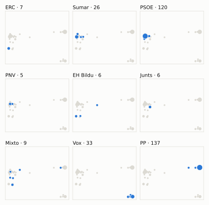
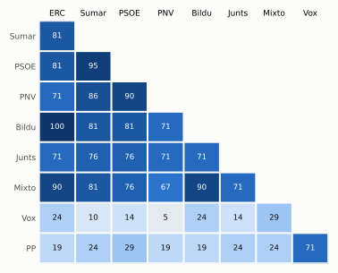

# Análisis detallado: julio de 2025

[← Volver al resumen del mes](2025-07.md)

_Generado automáticamente el 2026-11-11 con datos abiertos del [Congreso de los Diputados](https://www.congreso.es/es/opendata/votaciones). Solo plenos y Diputación Permanente. Método y límites en [docs/DOCUMENTO_FUNCIONAL.md](../docs/DOCUMENTO_FUNCIONAL.md)._

## Resumen

- **21 votaciones** en 2 días de pleno (sesiones 125 y 128).
- **14 aprobadas** y **7 rechazadas**.
- 1 votación se decidió por 5 votos o menos.
- El grupo que más veces votó con el resultado final: **PSOE** (86 % de las votaciones nominales).
- Los grupos del Gobierno (PSOE y Sumar) votaron lo mismo en 18 de 21 votaciones nominales y perdieron una de ellas.
- 9 votos individuales se apartaron de la posición de su grupo (5 diputados).

## Cómo votó cada grupo

| Grupo | Diputados | Cohesión | Votó con el resultado | Decisivo | Posición Sí | Posición No | Posición Abst. |
| --- | ---: | ---: | ---: | ---: | ---: | ---: | ---: |
| PP | 137 | 100 % | 43 % | 3 | 14 | 6 | 1 |
| PSOE | 120 | 100 % | 86 % | 11 | 13 | 6 | 2 |
| Vox | 33 | 100 % | 19 % | 1 | 9 | 12 | 0 |
| Sumar | 26 | 99 % | 81 % | 11 | 12 | 7 | 2 |
| Mixto | 9 | 74 % | 81 % | 9 | 10 | 11 | 0 |
| Junts | 7 | 100 % | 81 % | 3 | 10 | 9 | 2 |
| ERC | 7 | 100 % | 76 % | 8 | 11 | 9 | 1 |
| EH Bildu | 6 | 94 % | 76 % | 0 | 11 | 9 | 1 |
| PNV | 5 | 100 % | 76 % | 0 | 11 | 6 | 4 |

*Cohesión*: índice de acuerdo interno (100 % = todo el grupo votó igual). *Votó con el resultado*: el grupo votó Sí y salió aprobada, o No y salió rechazada. *Decisivo*: votaciones cuyo resultado habría cambiado si el grupo se hubiera abstenido en bloque. El Grupo Mixto reúne partidos distintos: su posición es la de su mayoría.

## Mapa de diputados

<picture>
  <source media="(prefers-color-scheme: dark)" srcset="img/2025-07/mapa-oscuro.svg">
  
</picture>

Cada punto es un diputado; dos diputados están cerca si votaron parecido. Un punto más grande reúne a varios que votaron exactamente igual. En cada panel, el grupo en azul y el resto del Congreso en gris.

*Cómo se calcula*: componentes principales de los votos (Sí, No, abstención) en 21 votaciones con algún desacuerdo. El eje horizontal recoge el 83 % de la variación y el vertical el 12 %. Los ejes no tienen nombre ni sentido político propio; por convención, el PP queda a la derecha. No se sitúa a 2 diputados que votó en menos de la mitad.

## Afinidad entre grupos

<picture>
  <source media="(prefers-color-scheme: dark)" srcset="img/2025-07/afinidad-oscuro.svg">
  
</picture>

Porcentaje de votaciones nominales en que los dos grupos tomaron la misma posición. Los grupos están ordenados según el mapa de diputados.

Ver la tabla

|  | PP | PSOE | Vox | Sumar | Mixto | Junts | ERC | EH Bildu | PNV |
| --- | :---: | :---: | :---: | :---: | :---: | :---: | :---: | :---: | :---: |
| PP | 100 % | 29 % | 71 % | 24 % | 24 % | 24 % | 19 % | 19 % | 19 % |
| PSOE | 29 % | 100 % | 14 % | 95 % | 76 % | 76 % | 81 % | 81 % | 90 % |
| Vox | 71 % | 14 % | 100 % | 10 % | 29 % | 14 % | 24 % | 24 % | 5 % |
| Sumar | 24 % | 95 % | 10 % | 100 % | 81 % | 76 % | 81 % | 81 % | 86 % |
| Mixto | 24 % | 76 % | 29 % | 81 % | 100 % | 71 % | 90 % | 90 % | 67 % |
| Junts | 24 % | 76 % | 14 % | 76 % | 71 % | 100 % | 71 % | 71 % | 71 % |
| ERC | 19 % | 81 % | 24 % | 81 % | 90 % | 71 % | 100 % | 100 % | 71 % |
| EH Bildu | 19 % | 81 % | 24 % | 81 % | 90 % | 71 % | 100 % | 100 % | 71 % |
| PNV | 19 % | 90 % | 5 % | 86 % | 67 % | 71 % | 71 % | 71 % | 100 % |

## Quién sacó adelante las votaciones

| Grupos que votaron Sí | Votaciones | Escaños |
| --- | ---: | ---: |
| PSOE + Sumar + Mixto + Junts + ERC + EH Bildu + PNV | 6 | 180 |
| PP | 1 | 137 |
| PP + PSOE + Sumar + Junts + PNV | 1 | 295 |
| PP + Junts | 1 | 144 |
| PP + PSOE + Vox + PNV | 1 | 295 |
| PP + PSOE + Sumar + Mixto + ERC + EH Bildu + PNV | 1 | 310 |
| PP + PSOE + Vox + Sumar + Mixto + Junts + ERC + EH Bildu | 1 | 345 |
| PP + PSOE + Sumar + Mixto + Junts + ERC + EH Bildu + PNV | 1 | 317 |

De 14 votaciones nominales aprobadas. Otras 1 salieron con combinaciones que se dieron menos veces. La posición de cada grupo es la de la mayoría de sus diputados.

## Votaciones que perdieron los grupos del Gobierno

| Fecha | Asunto | Tipo | PSOE y Sumar votaron | Resultado | Sí | No |
| --- | --- | --- | :---: | --- | ---: | ---: |
| 22 de julio | Real Decreto-ley 7/2025, de 24 de junio, por el que se aprueban medidas urgentes para el refuerzo del sistema eléctrico. | Decretos-ley (convalidación) | Sí | Rechazada | 165 | 183 |

Además, PSOE y Sumar votaron distinto entre sí en 1 votación.

## Votaciones más ajustadas

| Fecha | Asunto | Resultado | Sí | No | Abst. |
| --- | --- | :---: | ---: | ---: | ---: |
| 22 de julio | Proyecto de Ley por la que se crea la Agencia Estatal de Salud Pública y se modifica la Ley 33/2011, de 4 de octubre, General de Salud Pública. *(Votación separada de las enmiendas Enmienda a la disposició…)* | Rechazada | 172 | 177 | 0 |
| 22 de julio | Proposición de reforma del Reglamento del Congreso de los Diputados. *(Enmiendas presentadas por el Grupo Parlamentario Popular en…)* | Rechazada | 169 | 175 | 1 |
| 22 de julio | Proyecto de Ley por la que se crea la Agencia Estatal de Salud Pública y se modifica la Ley 33/2011, de 4 de octubre, General de Salud Pública. *(Votación separada de las enmiendas Enmiendas a la disposici…)* | Rechazada | 171 | 177 | 1 |
| 22 de julio | Proposición de reforma del Reglamento del Congreso de los Diputados. *(Votación de totalidad. Votación final de totalidad, a los e…)* | Aprobada | 177 | 171 | 0 |
| 22 de julio | Proposición de reforma del Reglamento del Congreso de los Diputados. *(Votación de totalidad. Votación final de totalidad, a los e…)* | Aprobada | 177 | 171 | 0 |
| 22 de julio | Proposición de reforma del Reglamento del Congreso de los Diputados. *(Enmiendas presentadas por el Grupo Parlamentario VOX Enmien…)* | Rechazada | 170 | 177 | 0 |
| 22 de julio | Proposición de reforma del Reglamento del Congreso de los Diputados. *(Correcciones técnicas Enmienda de corrección técnica presen…)* | Aprobada | 177 | 170 | 0 |
| 22 de julio | Proposición de reforma del Reglamento del Congreso de los Diputados. *(Votación del dictamen.)* | Aprobada | 178 | 171 | 0 |
| 22 de julio | Proposición de reforma del Reglamento del Congreso de los Diputados. *(Votación del dictamen.)* | Aprobada | 177 | 170 | 0 |
| 8 de julio | Proposición de reforma del Reglamento del Congreso de los Diputados. *(Enmiendas de totalidad de texto alternativo. Enmienda a la…)* | Rechazada | 166 | 174 | 0 |

Votaciones decididas por 10 votos o menos (o a esa distancia de la mayoría que exigían). Las públicas por llamamiento no tienen hemiciclo: el voto de cada diputado solo consta en el Diario de Sesiones.

## Qué se votó, por tipo de asunto

| Tipo de asunto | Votaciones | Aprobadas | No aprobadas |
| --- | ---: | ---: | ---: |
| Leyes: dictamen y votación final | 7 | 5 | 2 |
| Leyes: enmiendas del Senado | 7 | 5 | 2 |
| Decretos-ley (convalidación) | 5 | 4 | 1 |
| Enmiendas a la totalidad | 2 | 0 | 2 |

Las proposiciones no de ley y las mociones expresan la posición del Congreso pero no obligan al Gobierno. Las leyes pasan por varias votaciones (toma en consideración, totalidad, dictamen, Senado), así que una misma ley puede aparecer varias veces.

## Votos distintos de su grupo

| Diputado | Grupo | Votos distintos de su grupo |
| --- | --- | ---: |
| Pozueta Fernández, Isabel | EH Bildu | 5 |
| Badia Casas, Eloi | Sumar | 1 |
| Cercas Mena, Blanca | PSOE | 1 |
| López Tagliafico, Candela | Sumar | 1 |
| Pueyo Sanz, Jorge | Sumar | 1 |

Un voto aislado puede ser un error al pulsar, no una decisión política: el Congreso no publica las correcciones. Se excluye el Grupo Mixto.

## Diputados que más veces no votaron

| Diputado | Grupo | No votó | % de votaciones |
| --- | --- | ---: | ---: |
| Cruset Domènech, Josep Maria | Junts | 19 | 90 % |
| Pozueta Fernández, Isabel | EH Bildu | 10 | 48 % |
| Sémper Pascual, Borja | PP | 5 | 24 % |
| Díaz Pérez, Yolanda | Sumar | 3 | 14 % |
| Aizpurua Arzallus, Mertxe | EH Bildu | 2 | 10 % |
| Catalán Higueras, Alberto | Mixto | 2 | 10 % |
| De Meer Méndez, Rocío | Vox | 2 | 10 % |
| Montero Cuadrado, María Jesús | PSOE | 2 | 10 % |
| Rego Candamil, Néstor | Mixto | 2 | 10 % |
| Rodríguez Almeida, Andrés Alberto | Vox | 2 | 10 % |
| Rodríguez de Millán Parro, María José | Vox | 2 | 10 % |
| Sánchez Pérez-Castejón, Pedro | PSOE | 2 | 10 % |
| Abascal Conde, Santiago | Vox | 1 | 5 % |
| De las Cuevas Cortés, Félix | PP | 1 | 5 % |
| Legarda Uriarte, Mikel | PNV | 1 | 5 % |

«No vota» incluye ausencias justificadas (baja, maternidad o paternidad) y escaños vacantes; el portal no las distingue.

## Todas las votaciones

Posición de cada grupo: la opción que votó la mayoría de sus diputados (*Div.*: empate dentro del grupo). El número enlaza al JSON oficial o, en las votaciones por llamamiento, al Diario de Sesiones.

### 8 de julio (sesión 125)

| Nº | Asunto | Resultado | Sí | No | Abst. | PP | PSOE | Vox | Sumar | Mixto | Junts | ERC | EH Bildu | PNV | Decisivos |
| ---: | --- | --- | ---: | ---: | ---: | :---: | :---: | :---: | :---: | :---: | :---: | :---: | :---: | :---: | --- |
| [1](https://www.congreso.es/webpublica/opendata/votaciones/Leg15/Sesion125/20250708/Votacion001/VOT_20250708193306.json) | Proposición de reforma del Reglamento del Congreso de los Diputados. *(Enmiendas de totalidad de texto alternativo. Enmienda a la…)* | Rechazada | 166 | 174 | 0 | Sí | No | Sí | No | No | No | No | No | No | PSOE, Sumar |
| [2](https://www.congreso.es/webpublica/opendata/votaciones/Leg15/Sesion125/20250708/Votacion002/VOT_20250708193307.json) | Proposición de reforma del Reglamento del Congreso de los Diputados. *(Enmiendas de totalidad de texto alternativo. Enmienda a la…)* | Rechazada | 166 | 174 | 0 | Sí | No | Sí | No | No | No | No | No | No | PSOE, Sumar |

### 22 de julio (sesión 128)

| Nº | Asunto | Resultado | Sí | No | Abst. | PP | PSOE | Vox | Sumar | Mixto | Junts | ERC | EH Bildu | PNV | Decisivos |
| ---: | --- | --- | ---: | ---: | ---: | :---: | :---: | :---: | :---: | :---: | :---: | :---: | :---: | :---: | --- |
| [1](https://www.congreso.es/webpublica/opendata/votaciones/Leg15/Sesion128/20250722/Votacion001/VOT_20250722200812.json) | Proposición de reforma del Reglamento del Congreso de los Diputados. *(Enmiendas presentadas por el Grupo Parlamentario VOX Enmien…)* | Rechazada | 170 | 177 | 0 | Sí | No | Sí | No | No | No | No | No | No | Mixto, PSOE, Sumar |
| [2](https://www.congreso.es/webpublica/opendata/votaciones/Leg15/Sesion128/20250722/Votacion002/VOT_20250722200814.json) | Proposición de reforma del Reglamento del Congreso de los Diputados. *(Enmiendas presentadas por el Grupo Parlamentario Popular en…)* | Rechazada | 169 | 175 | 1 | Sí | No | Sí | No | No | No | No | No | No | Mixto, ERC, PSOE, Sumar |
| [3](https://www.congreso.es/webpublica/opendata/votaciones/Leg15/Sesion128/20250722/Votacion003/VOT_20250722200815.json) | Proposición de reforma del Reglamento del Congreso de los Diputados. *(Correcciones técnicas Enmienda de corrección técnica presen…)* | Aprobada | 177 | 170 | 0 | No | Sí | No | Sí | Sí | Sí | Sí | Sí | Sí | Mixto, ERC, PSOE, Sumar |
| [4](https://www.congreso.es/webpublica/opendata/votaciones/Leg15/Sesion128/20250722/Votacion004/VOT_20250722200816.json) | Proyecto de Ley por la que se modifican el texto refundido de la Ley sobre responsabilidad civil y seguro en la circulación de vehículos a motor, aprobado por… | Aprobada | 178 | 32 | 138 | Abst. | Sí | No | Sí | Sí | Sí | Sí | Sí | Sí |  |
| [5](https://www.congreso.es/webpublica/opendata/votaciones/Leg15/Sesion128/20250722/Votacion005/VOT_20250722200817.json) | Proyecto de Ley por la que se crea la Agencia Estatal de Salud Pública y se modifica la Ley 33/2011, de 4 de octubre, General de Salud Pública. *(Votación separada de las enmiendas Enmienda a la disposició…)* | Aprobada | 142 | 50 | 157 | Sí | Abst. | No | Abst. | No | Abst. | No | No | Abst. | PP |
| [6](https://www.congreso.es/webpublica/opendata/votaciones/Leg15/Sesion128/20250722/Votacion006/VOT_20250722200818.json) | Proyecto de Ley por la que se crea la Agencia Estatal de Salud Pública y se modifica la Ley 33/2011, de 4 de octubre, General de Salud Pública. *(Votación separada de las enmiendas Enmiendas a la disposici…)* | Rechazada | 171 | 177 | 1 | Sí | No | Sí | No | No | No | No | No | No | Mixto, ERC, PSOE, Sumar |
| [7](https://www.congreso.es/webpublica/opendata/votaciones/Leg15/Sesion128/20250722/Votacion007/VOT_20250722200819.json) | Proyecto de Ley por la que se crea la Agencia Estatal de Salud Pública y se modifica la Ley 33/2011, de 4 de octubre, General de Salud Pública. *(Votación separada de las enmiendas Enmienda a la disposició…)* | Aprobada | 298 | 50 | 1 | Sí | Sí | No | Sí | No | Sí | No | No | Sí |  |
| [8](https://www.congreso.es/webpublica/opendata/votaciones/Leg15/Sesion128/20250722/Votacion008/VOT_20250722200820.json) | Proyecto de Ley por la que se crea la Agencia Estatal de Salud Pública y se modifica la Ley 33/2011, de 4 de octubre, General de Salud Pública. *(Votación separada de las enmiendas Enmienda a la disposició…)* | Rechazada | 172 | 177 | 0 | Sí | No | Sí | No | No | No | No | No | No | Junts, Mixto, ERC, PSOE, Sumar |
| [9](https://www.congreso.es/webpublica/opendata/votaciones/Leg15/Sesion128/20250722/Votacion009/VOT_20250722200821.json) | Proyecto de Ley por la que se crea la Agencia Estatal de Salud Pública y se modifica la Ley 33/2011, de 4 de octubre, General de Salud Pública. *(Votación separada de las enmiendas Enmienda a la disposició…)* | Aprobada | 146 | 51 | 152 | Sí | Abst. | No | Abst. | No | Sí | No | No | Abst. | PP |
| [10](https://www.congreso.es/webpublica/opendata/votaciones/Leg15/Sesion128/20250722/Votacion010/VOT_20250722200823.json) | Proposición de Ley de modificación de la Ley 19/1994, de 6 de julio, de modificación del Régimen Económico y Fiscal de Canarias, para la regulación de las inve… | Aprobada | 299 | 31 | 19 | Sí | Sí | Sí | No | No | Abst. | Abst. | Abst. | Sí |  |
| [11](https://www.congreso.es/webpublica/opendata/votaciones/Leg15/Sesion128/20250722/Votacion011/VOT_20250722200824.json) | Proposición de reforma del Reglamento del Congreso de los Diputados. *(Votación del dictamen.)* | Aprobada | 178 | 171 | 0 | No | Sí | No | Sí | Sí | Sí | Sí | Sí | Sí | Mixto, ERC, PSOE, Sumar |
| [12](https://www.congreso.es/webpublica/opendata/votaciones/Leg15/Sesion128/20250722/Votacion012/VOT_20250722200825.json) | Proposición de reforma del Reglamento del Congreso de los Diputados. *(Votación de totalidad. Votación final de totalidad, a los e…)* | Aprobada | 177 | 171 | 0 | No | Sí | No | Sí | Sí | Sí | Sí | Sí | Sí | Junts, Mixto, ERC, PSOE, Sumar |
| [13](https://www.congreso.es/webpublica/opendata/votaciones/Leg15/Sesion128/20250722/Votacion013/VOT_20250722200826.json) | Proposición de reforma del Reglamento del Congreso de los Diputados. *(Votación del dictamen.)* | Aprobada | 177 | 170 | 0 | No | Sí | No | Sí | Sí | Sí | Sí | Sí | Sí | Mixto, ERC, PSOE, Sumar |
| [14](https://www.congreso.es/webpublica/opendata/votaciones/Leg15/Sesion128/20250722/Votacion014/VOT_20250722200827.json) | Proposición de reforma del Reglamento del Congreso de los Diputados. *(Votación de totalidad. Votación final de totalidad, a los e…)* | Aprobada | 177 | 171 | 0 | No | Sí | No | Sí | Sí | Sí | Sí | Sí | Sí | Junts, Mixto, ERC, PSOE, Sumar |
| [15](https://www.congreso.es/webpublica/opendata/votaciones/Leg15/Sesion128/20250722/Votacion015/VOT_20250722200828.json) | Real Decreto-ley 6/2025, de 17 de junio, por el que se adoptan medidas relativas a los recursos de los sistemas de financiación territorial. | Aprobada | 308 | 39 | 1 | Sí | Sí | No | Sí | Sí | No | Sí | Sí | Sí |  |
| [16](https://www.congreso.es/webpublica/opendata/votaciones/Leg15/Sesion128/20250722/Votacion016/VOT_20250722200829.json) | Tramitación como Proyecto de Ley por el procedimiento de urgencia del Real Decreto-ley 6/2025, de 17 de junio, por el que se adoptan medidas relativas a los re… | Aprobada | 343 | 0 | 5 | Sí | Sí | Sí | Sí | Sí | Sí | Sí | Sí | Abst. |  |
| [17](https://www.congreso.es/webpublica/opendata/votaciones/Leg15/Sesion128/20250722/Votacion017/VOT_20250722200830.json) | Real Decreto-ley 7/2025, de 24 de junio, por el que se aprueban medidas urgentes para el refuerzo del sistema eléctrico. | Rechazada | 165 | 183 | 0 | No | Sí | No | Sí | No | No | Sí | Sí | Sí | PP, Vox |
| [18](https://www.congreso.es/webpublica/opendata/votaciones/Leg15/Sesion128/20250722/Votacion018/VOT_20250722200832.json) | Real Decreto-ley 8/2025, de 8 de julio, por el que se declaran diversas iniciativas y programas como acontecimientos de excepcional interés público. | Aprobada | 313 | 33 | 1 | Sí | Sí | No | Sí | Sí | Sí | Sí | Sí | Sí |  |
| [19](https://www.congreso.es/webpublica/opendata/votaciones/Leg15/Sesion128/20250722/Votacion019/VOT_20250722200833.json) | Tramitación como Proyecto de Ley por el procedimiento de urgencia del Real Decreto-ley 8/2025, de 8 de julio, por el que se declaran diversas iniciativas y pro… | Aprobada | 335 | 6 | 5 | Sí | Sí | Sí | Sí | Sí | No | Sí | Sí | Abst. |  |
