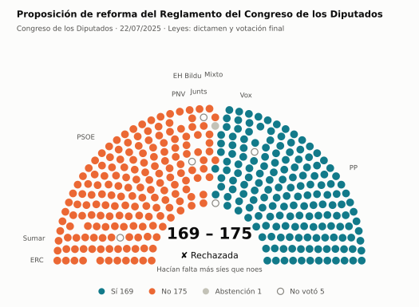
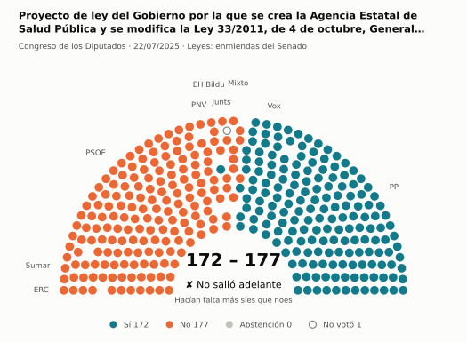
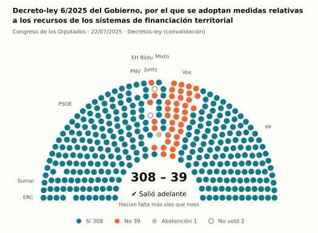
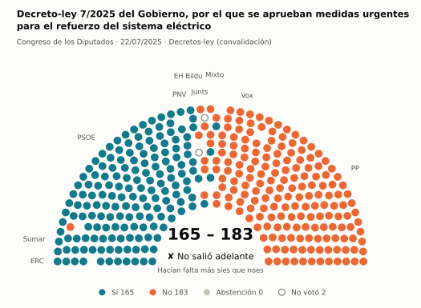
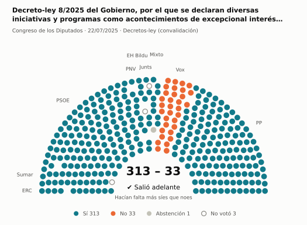
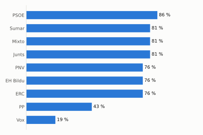
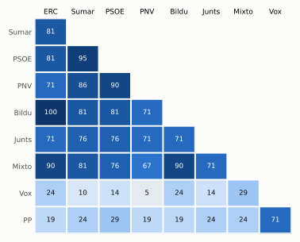

# Qué votó el Congreso en julio de 2025

Las votaciones del Pleno del Congreso de los Diputados, explicadas sin tecnicismos. Datos oficiales del [Congreso](https://www.congreso.es/es/opendata/votaciones); este resumen se actualiza solo cada mes (última vez: 11/11/2026).

## En pocas palabras

- El Congreso votó **21 veces** en 2 días de pleno. **14 propuestas salieron adelante** y 7 no.
- 21 votaciones fueron sobre leyes, decretos o presupuestos.
- El Gobierno (PSOE y Sumar) perdió **1** de las 18 votaciones en las que sus grupos votaron lo mismo.
- La votación más reñida se decidió por 5 votos: Proyecto de ley del Gobierno por la que se crea la Agencia Estatal de Salud Pública y se modifica la Ley 33/2011, de 4….
- Los diputados casi siempre votan lo mismo que su grupo: en todo el mes solo hubo 9 votos distintos (sin contar el Grupo Mixto).

## Las votaciones más importantes del mes

Elegidas por su importancia: pesan más las leyes y los decretos que las peticiones al Gobierno, y suben las que se decidieron por pocos votos o las que perdió el Gobierno. Cada punto del dibujo es un diputado, colocado con su grupo, y el color es lo que votó.

### 1. Proposición de reforma del Reglamento del Congreso de los Diputados

**22 de julio · Leyes: dictamen y votación final.** Votación del texto de una ley después de trabajarla en comisión.

<picture>
  <source media="(prefers-color-scheme: dark)" srcset="img/2025-07/votacion-L15-S128-V002-oscuro.svg">
  
</picture>

**✘ No salió adelante** por 6 votos: 169 a favor, 175 en contra y 1 abstención.

- **A favor:** PP y Vox
- **En contra:** PSOE, Sumar, Junts, ERC, EH Bildu y PNV
- **Repartidos:** Grupo Mixto (Sí 1, No 7, Abstención 1)

Este asunto tuvo 9 votaciones este mes; aquí se muestra la más disputada. [Datos oficiales](https://www.congreso.es/webpublica/opendata/votaciones/Leg15/Sesion128/20250722/Votacion002/VOT_20250722200814.json)

### 2. Proyecto de ley del Gobierno por la que se crea la Agencia Estatal de Salud Pública y se modifica la Ley 33/2011, de 4 de octubre, General de Salud…

**22 de julio · Leyes: enmiendas del Senado.** El Senado propuso cambios a esta ley y el Congreso decide si los acepta. Es uno de los últimos pasos antes de que la ley se publique.

<picture>
  <source media="(prefers-color-scheme: dark)" srcset="img/2025-07/votacion-L15-S128-V008-oscuro.svg">
  
</picture>

**✘ No salió adelante** por 5 votos: 172 a favor, 177 en contra y ninguna abstención.

- **A favor:** PP y Vox
- **En contra:** PSOE, Sumar, Junts, ERC, EH Bildu (5 de 6) y PNV
- **Repartidos:** Grupo Mixto (Sí 1, No 8)

Este asunto tuvo 5 votaciones este mes; aquí se muestra la más disputada. [Datos oficiales](https://www.congreso.es/webpublica/opendata/votaciones/Leg15/Sesion128/20250722/Votacion008/VOT_20250722200820.json)

### 3. Decreto-ley 6/2025 del Gobierno, por el que se adoptan medidas relativas a los recursos de los sistemas de financiación territorial

**22 de julio · Decretos-ley (convalidación).** El Gobierno aprobó esta norma por urgencia. Ya está en vigor, pero el Congreso tiene 30 días para confirmarla o tumbarla.

<picture>
  <source media="(prefers-color-scheme: dark)" srcset="img/2025-07/votacion-L15-S128-V015-oscuro.svg">
  
</picture>

**✔ Salió adelante** por 269 votos: 308 a favor, 39 en contra y 1 abstención.

- **A favor:** PP, PSOE, Sumar, ERC, EH Bildu y PNV
- **En contra:** Vox y Junts
- **Repartidos:** Grupo Mixto (Sí 8, Abstención 1)

[Datos oficiales](https://www.congreso.es/webpublica/opendata/votaciones/Leg15/Sesion128/20250722/Votacion015/VOT_20250722200828.json)

### 4. Decreto-ley 7/2025 del Gobierno, por el que se aprueban medidas urgentes para el refuerzo del sistema eléctrico

**22 de julio · Decretos-ley (convalidación).** El Gobierno aprobó esta norma por urgencia. Ya está en vigor, pero el Congreso tiene 30 días para confirmarla o tumbarla.

<picture>
  <source media="(prefers-color-scheme: dark)" srcset="img/2025-07/votacion-L15-S128-V017-oscuro.svg">
  
</picture>

**✘ No salió adelante** por 18 votos: 165 a favor, 183 en contra y ninguna abstención.

- **A favor:** PSOE, Sumar (25 de 26), ERC, EH Bildu y PNV
- **En contra:** PP, Vox y Junts
- **Repartidos:** Grupo Mixto (Sí 3, No 6)

[Datos oficiales](https://www.congreso.es/webpublica/opendata/votaciones/Leg15/Sesion128/20250722/Votacion017/VOT_20250722200830.json)

### 5. Decreto-ley 8/2025 del Gobierno, por el que se declaran diversas iniciativas y programas como acontecimientos de excepcional interés público

**22 de julio · Decretos-ley (convalidación).** El Gobierno aprobó esta norma por urgencia. Ya está en vigor, pero el Congreso tiene 30 días para confirmarla o tumbarla.

<picture>
  <source media="(prefers-color-scheme: dark)" srcset="img/2025-07/votacion-L15-S128-V018-oscuro.svg">
  
</picture>

**✔ Salió adelante** por 280 votos: 313 a favor, 33 en contra y 1 abstención.

- **A favor:** PP, PSOE, Sumar, Junts, ERC, EH Bildu y PNV
- **En contra:** Vox
- **Repartidos:** Grupo Mixto (Sí 8, Abstención 1)

[Datos oficiales](https://www.congreso.es/webpublica/opendata/votaciones/Leg15/Sesion128/20250722/Votacion018/VOT_20250722200832.json)

## ¿Qué grupos votaron más veces lo que finalmente salió?

<picture>
  <source media="(prefers-color-scheme: dark)" srcset="img/2025-07/ganadora-oscuro.svg">
  
</picture>

Porcentaje de votaciones en que el grupo votó Sí y salió adelante, o votó No y no salió. Abstenerse no cuenta como acertar.

## ¿Quién vota con quién?

<picture>
  <source media="(prefers-color-scheme: dark)" srcset="img/2025-07/afinidad-oscuro.svg">
  
</picture>

Cada casilla dice en qué porcentaje de las votaciones dos grupos votaron lo mismo: 100 es que siempre coincidieron y 0 que nunca.

## ¿Qué tipo de cosas se votaron?

| Tipo | Votaciones | Salieron adelante | Qué es |
| --- | ---: | ---: | --- |
| Leyes: dictamen y votación final | 7 | 5 | Votación del texto de una ley después de trabajarla en comisión. |
| Leyes: enmiendas del Senado | 7 | 5 | El Senado propuso cambios a esta ley y el Congreso decide si los acepta. Es uno de los últimos pasos antes de que la ley se publique. |
| Decretos-ley (convalidación) | 5 | 4 | El Gobierno aprobó esta norma por urgencia. Ya está en vigor, pero el Congreso tiene 30 días para confirmarla o tumbarla. |
| Enmiendas a la totalidad | 2 | 0 | Un grupo intenta devolver la ley a quien la propuso o sustituirla por otra. Si no sale adelante, la ley sigue su camino. |

## Palabras que conviene saber

- **Pleno**: La reunión de los 350 diputados, donde se vota.
- **Grupo parlamentario**: Los diputados de un partido o coalición. Los partidos pequeños van juntos en el Grupo Mixto, aunque no piensen igual.
- **Abstención**: El diputado vota, pero ni a favor ni en contra.
- **No votó**: El diputado no votó: no estaba, estaba de baja o el escaño estaba vacío.
- **Mayoría simple**: Salen adelante las votaciones con más síes que noes. Es lo normal.
- **Mayoría absoluta**: 176 votos a favor, la mitad más uno de 350. La piden las leyes orgánicas (derechos fundamentales, sistema electoral…) y la primera votación de investidura.
- **Votación por llamamiento**: Cada diputado dice su voto en voz alta. Se usa en las investiduras y otras votaciones importantes.

---

**¿Quieres más detalle?** El [análisis detallado](2025-07-detalle.md) tiene la cohesión de cada grupo, un mapa de los diputados según cómo votan, qué diputados votaron distinto de su grupo, las ausencias y la lista completa de votaciones.

_Los resultados están calculados a partir de los votos: el Congreso no publica si cada votación salió adelante. Este proyecto no tiene relación con el Congreso. Método en [docs/DOCUMENTO_FUNCIONAL.md](../docs/DOCUMENTO_FUNCIONAL.md)._
