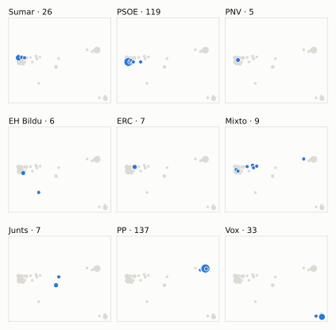
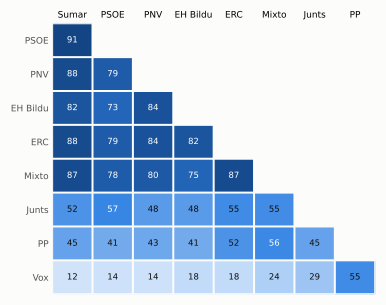
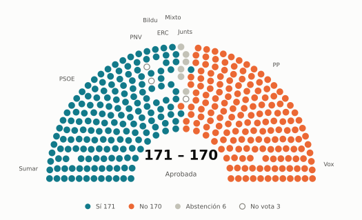
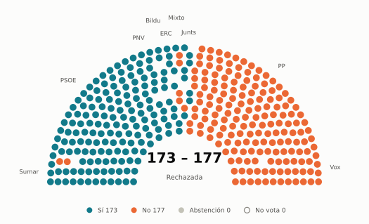
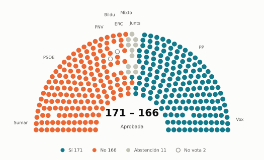

# Votaciones del Congreso: septiembre de 2025

_Generado automáticamente el 2026-11-10 con datos abiertos del [Congreso de los Diputados](https://www.congreso.es/es/opendata/votaciones). Solo plenos y Diputación Permanente. Método y límites en [docs/DOCUMENTO_FUNCIONAL.md](../docs/DOCUMENTO_FUNCIONAL.md)._

## Resumen

- **56 votaciones** en 6 días de pleno (sesiones 129, 130, 131, 132, 133 y 134).
- **40 aprobadas** y **16 rechazadas**.
- 8 votaciones se decidieron por 5 votos o menos.
- El grupo que más veces votó con el resultado final: **Mixto** (82 % de las votaciones nominales).
- Los grupos del Gobierno (PSOE y Sumar) votaron lo mismo en 48 de 56 votaciones nominales y perdieron 12 de ellas.
- 16 votos individuales se apartaron de la posición de su grupo (8 diputados).

## Cómo votó cada grupo

| Grupo | Diputados | Cohesión | Votó con el resultado | Decisivo | Posición Sí | Posición No | Posición Abst. |
| --- | ---: | ---: | ---: | ---: | ---: | ---: | ---: |
| PP | 137 | 100 % | 75 % | 13 | 43 | 9 | 4 |
| PSOE | 120 | 100 % | 66 % | 11 | 26 | 23 | 7 |
| Vox | 33 | 100 % | 43 % | 12 | 31 | 21 | 4 |
| Sumar | 26 | 100 % | 70 % | 8 | 29 | 24 | 3 |
| Mixto | 9 | 80 % | 82 % | 8 | 33 | 20 | 2 |
| Junts | 7 | 100 % | 61 % | 6 | 24 | 15 | 17 |
| ERC | 7 | 100 % | 73 % | 5 | 31 | 21 | 4 |
| Bildu | 6 | 96 % | 61 % | 4 | 25 | 26 | 5 |
| PNV | 5 | 100 % | 68 % | 2 | 28 | 25 | 3 |

*Cohesión*: índice de acuerdo interno (100 % = todo el grupo votó igual). *Votó con el resultado*: el grupo votó Sí y salió aprobada, o No y salió rechazada. *Decisivo*: votaciones cuyo resultado habría cambiado si el grupo se hubiera abstenido en bloque. El Grupo Mixto reúne partidos distintos: su posición es la de su mayoría.

## Mapa de diputados

<picture>
  <source media="(prefers-color-scheme: dark)" srcset="img/2025-09/mapa-oscuro.svg">
  
</picture>

Cada punto es un diputado; dos diputados están cerca si votaron parecido. Un punto más grande reúne a varios que votaron exactamente igual. En cada panel, el grupo en azul y el resto del Congreso en gris.

*Cómo se calcula*: componentes principales de los votos (Sí, No, abstención) en 54 votaciones con algún desacuerdo. El eje horizontal recoge el 74 % de la variación y el vertical el 18 %. Los ejes no tienen nombre ni sentido político propio; por convención, el PP queda a la derecha. No se sitúa a 1 diputado que votó en menos de la mitad.

## Afinidad entre grupos

<picture>
  <source media="(prefers-color-scheme: dark)" srcset="img/2025-09/afinidad-oscuro.svg">
  
</picture>

Porcentaje de votaciones nominales en que los dos grupos tomaron la misma posición. Los grupos están ordenados según el mapa de diputados.

Ver la tabla

|  | PP | PSOE | Vox | Sumar | Mixto | Junts | ERC | Bildu | PNV |
| --- | :---: | :---: | :---: | :---: | :---: | :---: | :---: | :---: | :---: |
| PP | 100 % | 41 % | 55 % | 45 % | 56 % | 45 % | 52 % | 41 % | 43 % |
| PSOE | 41 % | 100 % | 14 % | 91 % | 78 % | 57 % | 79 % | 73 % | 79 % |
| Vox | 55 % | 14 % | 100 % | 12 % | 24 % | 29 % | 18 % | 18 % | 14 % |
| Sumar | 45 % | 91 % | 12 % | 100 % | 87 % | 52 % | 88 % | 82 % | 88 % |
| Mixto | 56 % | 78 % | 24 % | 87 % | 100 % | 55 % | 87 % | 75 % | 80 % |
| Junts | 45 % | 57 % | 29 % | 52 % | 55 % | 100 % | 55 % | 48 % | 48 % |
| ERC | 52 % | 79 % | 18 % | 88 % | 87 % | 55 % | 100 % | 82 % | 84 % |
| Bildu | 41 % | 73 % | 18 % | 82 % | 75 % | 48 % | 82 % | 100 % | 84 % |
| PNV | 43 % | 79 % | 14 % | 88 % | 80 % | 48 % | 84 % | 84 % | 100 % |

## Quién sacó adelante las votaciones

| Grupos que votaron Sí | Votaciones | Escaños |
| --- | ---: | ---: |
| PP + PSOE + Sumar + Mixto + ERC + Bildu + PNV | 5 | 310 |
| PP + PSOE + Sumar + Mixto + Junts + ERC + Bildu + PNV | 4 | 317 |
| PP + Vox + Junts | 4 | 177 |
| Todos los grupos | 3 | 350 |
| PP + Vox | 3 | 170 |
| PP + Sumar + Mixto + ERC + Bildu + PNV | 3 | 190 |
| PP + Vox + Mixto | 2 | 179 |
| PSOE + Sumar + Mixto + ERC + Bildu + PNV | 2 | 173 |

De 40 votaciones nominales aprobadas. Otras 14 salieron con combinaciones que se dieron menos veces. La posición de cada grupo es la de la mayoría de sus diputados.

## Votaciones que perdieron los grupos del Gobierno

| Fecha | Asunto | Tipo | PSOE y Sumar votaron | Resultado | Sí | No |
| --- | --- | --- | :---: | --- | ---: | ---: |
| 10 de septiembre | Proposición no de Ley del Grupo Parlamentario Popular en el Congreso, relativa a garantizar la igualdad de los españoles para afrontar el inicio del curso esco… *(Votación separada por puntos. Punto 1.)* | Proposiciones no de ley | No | Aprobada | 184 | 157 |
| 10 de septiembre | Proposición no de Ley del Grupo Parlamentario Popular en el Congreso, relativa a garantizar la igualdad de los españoles para afrontar el inicio del curso esco… *(Votación separada por puntos. Punto 2.)* | Proposiciones no de ley | No | Aprobada | 176 | 165 |
| 10 de septiembre | Proposición no de Ley del Grupo Parlamentario Popular en el Congreso, relativa a garantizar la igualdad de los españoles para afrontar el inicio del curso esco… *(Votación separada por puntos. Punto 3.)* | Proposiciones no de ley | No | Aprobada | 171 | 166 |
| 10 de septiembre | Proposición no de Ley del Grupo Parlamentario Popular en el Congreso, relativa a garantizar la igualdad de los españoles para afrontar el inicio del curso esco… *(Votación separada por puntos. Punto 4.)* | Proposiciones no de ley | No | Aprobada | 179 | 157 |
| 10 de septiembre | Votación conjunta de las enmiendas a la totalidad de devolución al Proyecto de Ley para la reducción de la duración máxima de la jornada ordinaria de trabajo y… | Enmiendas a la totalidad | No | Aprobada | 178 | 170 |
| 16 de septiembre | Proposición de Ley del Grupo Parlamentario Plurinacional SUMAR, de creación de la Oficina de prevención de la corrupción. | Leyes: toma en consideración | Sí | Rechazada | 170 | 176 |
| 17 de septiembre | Moción consecuencia de interpelación urgente del Grupo Parlamentario Mixto (Sr. Catalán Higueras), sobre los trámites, plazos y presupuestos para la licitación… | Mociones | No | Aprobada | 172 | 163 |
| 17 de septiembre | Moción consecuencia de interpelación urgente del Grupo Parlamentario Popular en el Congreso, sobre la situación de emergencia que atraviesa la vivienda en Espa… *(Votación separada por puntos. Punto 1.)* | Mociones | No | Aprobada | 176 | 170 |
| 17 de septiembre | Proyecto de Ley por la que se modifican la Ley 48/1960, de 21 de julio, sobre Navegación Aérea, y la Ley 21/2003, de 7 de julio, de Seguridad Aérea. *(Votación separada de las enmiendas Enmiendas a la disposici…)* | Leyes: enmiendas del Senado | No | Aprobada | 175 | 170 |
| 23 de septiembre | Proposición de Ley de los Grupos Parlamentarios Socialista y Junts per Catalunya, Orgánica de delegación en la Comunidad Autónoma de Cataluña de competencias e… | Leyes: toma en consideración | Sí | Rechazada | 173 | 177 |
| 24 de septiembre | Proposición no de Ley del Grupo Parlamentario Junts per Catalunya, sobre la modificación del artículo 30.2 del RD 295/2009 referente a la solicitud de la prest… | Proposiciones no de ley | No | Aprobada | 176 | 171 |
| 24 de septiembre | Moción consecuencia de interpelación urgente del Grupo Parlamentario Popular en el Congreso, sobre la defensa de la Ministra de Igualdad de las víctimas de vio… | Mociones | No | Aprobada | 170 | 162 |

Además, PSOE y Sumar votaron distinto entre sí en 5 votaciones.

## Votaciones más ajustadas

**10 de septiembre** · Proposición no de Ley del Grupo Parlamentario Socialista, sobre el impulso de la Agenda 2030.

<picture>
  <source media="(prefers-color-scheme: dark)" srcset="img/2025-09/hemiciclo-L15-S130-V006-oscuro.svg">
  
</picture>

**17 de septiembre** · Proposición no de Ley del Grupo Parlamentario Plurinacional SUMAR, relativa al establecimiento por ley de un despido realmente restaurativo y disuasorio.

<picture>
  <source media="(prefers-color-scheme: dark)" srcset="img/2025-09/hemiciclo-L15-S132-V003-oscuro.svg">
  
</picture>

**23 de septiembre** · Proposición de Ley de los Grupos Parlamentarios Socialista y Junts per Catalunya, Orgánica de delegación en la Comunidad Autónoma de Cataluña de competencias e…

<picture>
  <source media="(prefers-color-scheme: dark)" srcset="img/2025-09/hemiciclo-L15-S133-V001-oscuro.svg">
  
</picture>

**10 de septiembre** · Proposición no de Ley del Grupo Parlamentario Popular en el Congreso, relativa a garantizar la igualdad de los españoles para afrontar el inicio del curso esco… *(Votación separada por puntos. Punto 3.)*

<picture>
  <source media="(prefers-color-scheme: dark)" srcset="img/2025-09/hemiciclo-L15-S130-V003-oscuro.svg">
  
</picture>

Cada punto es un escaño, agrupado por grupo parlamentario; el color es su voto.

| Fecha | Asunto | Resultado | Sí | No | Abst. |
| --- | --- | :---: | ---: | ---: | ---: |
| 10 de septiembre | Proposición no de Ley del Grupo Parlamentario Socialista, sobre el impulso de la Agenda 2030. | Aprobada | 171 | 170 | 7 |
| 17 de septiembre | Proposición no de Ley del Grupo Parlamentario Plurinacional SUMAR, relativa al establecimiento por ley de un despido realmente restaurativo y disuasorio. | Aprobada | 171 | 170 | 6 |
| 23 de septiembre | Proposición de Ley de los Grupos Parlamentarios Socialista y Junts per Catalunya, Orgánica de delegación en la Comunidad Autónoma de Cataluña de competencias e… | Rechazada | 173 | 177 | 0 |
| 10 de septiembre | Proposición no de Ley del Grupo Parlamentario Popular en el Congreso, relativa a garantizar la igualdad de los españoles para afrontar el inicio del curso esco… *(Votación separada por puntos. Punto 3.)* | Aprobada | 171 | 166 | 11 |
| 17 de septiembre | Moción consecuencia de interpelación urgente del Grupo Parlamentario Popular en el Congreso, sobre la situación de emergencia que atraviesa la vivienda en Espa… *(Votación separada por puntos. Punto 3.)* | Rechazada | 171 | 176 | 0 |
| 17 de septiembre | Moción consecuencia de interpelación urgente del Grupo Parlamentario Popular en el Congreso, sobre la situación de emergencia que atraviesa la vivienda en Espa… *(Votación separada por puntos. Punto 4.)* | Rechazada | 171 | 176 | 0 |
| 17 de septiembre | Proyecto de Ley por la que se modifican la Ley 48/1960, de 21 de julio, sobre Navegación Aérea, y la Ley 21/2003, de 7 de julio, de Seguridad Aérea. *(Votación separada de las enmiendas Enmiendas a la disposici…)* | Aprobada | 175 | 170 | 1 |
| 24 de septiembre | Proposición no de Ley del Grupo Parlamentario Junts per Catalunya, sobre la modificación del artículo 30.2 del RD 295/2009 referente a la solicitud de la prest… | Aprobada | 176 | 171 | 0 |
| 10 de septiembre | Moción consecuencia de interpelación urgente del Grupo Parlamentario Popular en el Congreso, sobre las múltiples tramas corruptas que actuaban en el Gobierno y… | Rechazada | 171 | 177 | 0 |
| 16 de septiembre | Proposición de Ley del Grupo Parlamentario Plurinacional SUMAR, de creación de la Oficina de prevención de la corrupción. | Rechazada | 170 | 176 | 1 |

Votaciones decididas por 10 votos o menos (o a esa distancia de la mayoría que exigían). Las públicas por llamamiento no tienen hemiciclo: el voto de cada diputado solo consta en el Diario de Sesiones.

## Qué se votó, por tipo de asunto

| Tipo de asunto | Votaciones | Aprobadas | No aprobadas |
| --- | ---: | ---: | ---: |
| Mociones | 25 | 19 | 6 |
| Proposiciones no de ley | 10 | 7 | 3 |
| Leyes: enmiendas del Senado | 6 | 5 | 1 |
| Leyes: toma en consideración | 6 | 2 | 4 |
| Decretos-ley (convalidación) | 2 | 2 | 0 |
| Leyes: dictamen y votación final | 2 | 2 | 0 |
| Enmiendas a la totalidad | 2 | 1 | 1 |
| Organización de la Cámara | 2 | 1 | 1 |
| Presupuestos y estabilidad | 1 | 1 | 0 |

Las proposiciones no de ley y las mociones expresan la posición del Congreso pero no obligan al Gobierno. Las leyes pasan por varias votaciones (toma en consideración, totalidad, dictamen, Senado), así que una misma ley puede aparecer varias veces.

## Votos distintos de su grupo

| Diputado | Grupo | Votos distintos de su grupo |
| --- | --- | ---: |
| Pozueta Fernández, Isabel | Bildu | 9 |
| Beamonte Mesa, Luis María | PP | 1 |
| Cobo Vega, Manuel | PP | 1 |
| Ibáñez Mezquita, Alberto | Sumar | 1 |
| Mesquida Mayans, Joan | PP | 1 |
| Pueyo Sanz, Jorge | Sumar | 1 |
| Pérez Coronado, Pablo | PP | 1 |
| Ruiz Boix, Juan Carlos | PSOE | 1 |

Un voto aislado puede ser un error al pulsar, no una decisión política: el Congreso no publica las correcciones. Se excluye el Grupo Mixto.

## Diputados que más veces no votaron

| Diputado | Grupo | No votó | % de votaciones |
| --- | --- | ---: | ---: |
| Sánchez Pérez-Castejón, Pedro | PSOE | 44 | 79 % |
| Nogueras i Camero, Míriam | Junts | 27 | 48 % |
| Serrano Martínez, Juan Francisco | PSOE | 27 | 48 % |
| Pozueta Fernández, Isabel | Bildu | 11 | 20 % |
| De Meer Méndez, Rocío | Vox | 10 | 18 % |
| Díaz Pérez, Yolanda | Sumar | 10 | 18 % |
| Montero Cuadrado, María Jesús | PSOE | 7 | 12 % |
| Núñez Feijóo, Alberto | PP | 7 | 12 % |
| Ibáñez Hernando, Ángel | PP | 2 | 4 % |
| Santana Perera, Noemí | Mixto | 2 | 4 % |
| Aceves Galindo, José Luis | PSOE | 1 | 2 % |
| Almirón Ruiz, Oriol | PSOE | 1 | 2 % |
| Carballedo Berlanga, María Eugenia | PP | 1 | 2 % |
| De las Cuevas Cortés, Félix | PP | 1 | 2 % |
| Delgado Arce, Celso Luis | PP | 1 | 2 % |

«No vota» incluye ausencias justificadas (baja, maternidad o paternidad) y escaños vacantes; el portal no las distingue.

## Todas las votaciones

Posición de cada grupo: la opción que votó la mayoría de sus diputados (*Div.*: empate dentro del grupo). El número enlaza al JSON oficial o, en las votaciones por llamamiento, al Diario de Sesiones.

### 9 de septiembre (sesión 129)

| Nº | Asunto | Resultado | Sí | No | Abst. | PP | PSOE | Vox | Sumar | Mixto | Junts | ERC | Bildu | PNV | Decisivos |
| ---: | --- | --- | ---: | ---: | ---: | :---: | :---: | :---: | :---: | :---: | :---: | :---: | :---: | :---: | --- |
| [1](https://www.congreso.es/webpublica/opendata/votaciones/Leg15/Sesion129/20250909/Votacion001/VOT_20250909221758.json) | Proposición de Ley del Grupo Parlamentario Popular en el Congreso, relativa a la escolarización del alumnado con necesidades educativas especiales (Orgánica). | Rechazada | 170 | 177 | 0 | Sí | No | Sí | No | No | No | No | No | No | Mixto, PSOE, Sumar |
| [2](https://www.congreso.es/webpublica/opendata/votaciones/Leg15/Sesion129/20250909/Votacion002/VOT_20250909221800.json) | Proposición de Ley del Grupo Parlamentario Socialista, para el impulso de la inclusión laboral de las personas con discapacidad a través de la cuota de reserva… | Aprobada | 313 | 33 | 0 | Sí | Sí | No | Sí | Sí | Sí | Sí | Sí | Sí |  |
| [3](https://www.congreso.es/webpublica/opendata/votaciones/Leg15/Sesion129/20250909/Votacion003/VOT_20250909221801.json) | Real Decreto-ley 9/2025, de 29 de julio, por el que se amplía el permiso de nacimiento y cuidado, mediante la modificación del texto refundido de la Ley del Es… | Aprobada | 313 | 0 | 33 | Sí | Sí | Abst. | Sí | Sí | Sí | Sí | Sí | Sí |  |
| [4](https://www.congreso.es/webpublica/opendata/votaciones/Leg15/Sesion129/20250909/Votacion004/VOT_20250909221803.json) | Tramitación como Proyecto de Ley por el procedimiento de urgencia del Real Decreto-ley 9/2025, de 29 de julio, por el que se amplía el permiso de nacimiento y… | Aprobada | 347 | 0 | 0 | Sí | Sí | Sí | Sí | Sí | Sí | Sí | Sí | Sí |  |

### 10 de septiembre (sesión 130)

| Nº | Asunto | Resultado | Sí | No | Abst. | PP | PSOE | Vox | Sumar | Mixto | Junts | ERC | Bildu | PNV | Decisivos |
| ---: | --- | --- | ---: | ---: | ---: | :---: | :---: | :---: | :---: | :---: | :---: | :---: | :---: | :---: | --- |
| [1](https://www.congreso.es/webpublica/opendata/votaciones/Leg15/Sesion130/20250910/Votacion001/VOT_20250910213532.json) | Proposición no de Ley del Grupo Parlamentario Popular en el Congreso, relativa a garantizar la igualdad de los españoles para afrontar el inicio del curso esco… *(Votación separada por puntos. Punto 1.)* | Aprobada | 184 | 157 | 7 | Sí | No | Sí | No | Sí | Sí | Abst. | No | No | PP, Vox |
| [2](https://www.congreso.es/webpublica/opendata/votaciones/Leg15/Sesion130/20250910/Votacion002/VOT_20250910213534.json) | Proposición no de Ley del Grupo Parlamentario Popular en el Congreso, relativa a garantizar la igualdad de los españoles para afrontar el inicio del curso esco… *(Votación separada por puntos. Punto 2.)* | Aprobada | 176 | 165 | 7 | Sí | No | Sí | No | Sí | Abst. | No | No | No | PP, Vox |
| [3](https://www.congreso.es/webpublica/opendata/votaciones/Leg15/Sesion130/20250910/Votacion003/VOT_20250910213535.json) | Proposición no de Ley del Grupo Parlamentario Popular en el Congreso, relativa a garantizar la igualdad de los españoles para afrontar el inicio del curso esco… *(Votación separada por puntos. Punto 3.)* | Aprobada | 171 | 166 | 11 | Sí | No | Sí | No | Div. | Abst. | No | No | No | PP, Vox |
| [4](https://www.congreso.es/webpublica/opendata/votaciones/Leg15/Sesion130/20250910/Votacion004/VOT_20250910213536.json) | Proposición no de Ley del Grupo Parlamentario Popular en el Congreso, relativa a garantizar la igualdad de los españoles para afrontar el inicio del curso esco… *(Votación separada por puntos. Punto 4.)* | Aprobada | 179 | 157 | 12 | Sí | No | Sí | No | Abst. | Sí | Abst. | No | No | PP, Vox |
| [5](https://www.congreso.es/webpublica/opendata/votaciones/Leg15/Sesion130/20250910/Votacion005/VOT_20250910213537.json) | Proposición no de Ley del Grupo Parlamentario Popular en el Congreso, relativa a garantizar la igualdad de los españoles para afrontar el inicio del curso esco… *(Votación separada por puntos. Punto 5.)* | Rechazada | 146 | 202 | 0 | Sí | No | No | No | No | Sí | No | No | No | PSOE |
| [6](https://www.congreso.es/webpublica/opendata/votaciones/Leg15/Sesion130/20250910/Votacion006/VOT_20250910213539.json) | Proposición no de Ley del Grupo Parlamentario Socialista, sobre el impulso de la Agenda 2030. | Aprobada | 171 | 170 | 7 | No | Sí | No | Sí | Sí | Abst. | Sí | Sí | Sí | Bildu, Mixto, ERC, PSOE, Sumar, PNV |
| [7](https://www.congreso.es/webpublica/opendata/votaciones/Leg15/Sesion130/20250910/Votacion007/VOT_20250910213540.json) | Moción consecuencia de interpelación urgente del Grupo Parlamentario VOX, sobre las medidas que va a adoptar el Gobierno desde el Ministerio de Hacienda para c… | Rechazada | 33 | 177 | 138 | Abst. | No | Sí | No | No | No | No | No | No |  |
| [8](https://www.congreso.es/webpublica/opendata/votaciones/Leg15/Sesion130/20250910/Votacion008/VOT_20250910213542.json) | Moción consecuencia de interpelación urgente del Grupo Parlamentario Popular en el Congreso, sobre las múltiples tramas corruptas que actuaban en el Gobierno y… | Rechazada | 171 | 177 | 0 | Sí | No | Sí | No | No | No | No | No | No | Junts, Mixto, ERC, PSOE, Sumar |
| [9](https://www.congreso.es/webpublica/opendata/votaciones/Leg15/Sesion130/20250910/Votacion009/VOT_20250910213543.json) | Votación de la enmienda a la totalidad de devolución al Proyecto de Ley Orgánica para la protección de las personas menores de edad en los entornos digitales,… | Rechazada | 33 | 178 | 137 | Abst. | No | Sí | No | No | No | No | No | No |  |
| [10](https://www.congreso.es/webpublica/opendata/votaciones/Leg15/Sesion130/20250910/Votacion010/VOT_20250910213544.json) | Votación conjunta de las enmiendas a la totalidad de devolución al Proyecto de Ley para la reducción de la duración máxima de la jornada ordinaria de trabajo y… | Aprobada | 178 | 170 | 0 | Sí | No | Sí | No | No | Sí | No | No | No | PP, Vox |
| [11](https://www.congreso.es/webpublica/opendata/votaciones/Leg15/Sesion130/20250910/Votacion011/VOT_20250910213545.json) | Dictamen de la Comisión Mixta para las Relaciones con el Tribunal de Cuentas en relación con la Declaración sobre la Cuenta General del Estado del ejercicio 20… | Aprobada | 157 | 40 | 151 | Abst. | Sí | No | Sí | Sí | No | Abst. | Abst. | Sí | PSOE |

### 16 de septiembre (sesión 131)

| Nº | Asunto | Resultado | Sí | No | Abst. | PP | PSOE | Vox | Sumar | Mixto | Junts | ERC | Bildu | PNV | Decisivos |
| ---: | --- | --- | ---: | ---: | ---: | :---: | :---: | :---: | :---: | :---: | :---: | :---: | :---: | :---: | --- |
| [1](https://www.congreso.es/webpublica/opendata/votaciones/Leg15/Sesion131/20250916/Votacion001/VOT_20250916211204.json) | Proposición de Ley del Grupo Parlamentario VOX, Orgánica de modificación de la Ley Orgánica 4/2000, de 11 de enero, sobre derechos y libertades de los extranje… | Rechazada | 169 | 177 | 1 | Sí | No | Sí | No | No | No | No | No | No | PSOE, Sumar |
| [2](https://www.congreso.es/webpublica/opendata/votaciones/Leg15/Sesion131/20250916/Votacion002/VOT_20250916211206.json) | Proposición de Ley del Grupo Parlamentario Plurinacional SUMAR, de creación de la Oficina de prevención de la corrupción. | Rechazada | 170 | 176 | 1 | No | Sí | No | Sí | Sí | No | Sí | Sí | Sí | Junts, PP, Vox |

### 17 de septiembre (sesión 132)

| Nº | Asunto | Resultado | Sí | No | Abst. | PP | PSOE | Vox | Sumar | Mixto | Junts | ERC | Bildu | PNV | Decisivos |
| ---: | --- | --- | ---: | ---: | ---: | :---: | :---: | :---: | :---: | :---: | :---: | :---: | :---: | :---: | --- |
| [1](https://www.congreso.es/webpublica/opendata/votaciones/Leg15/Sesion132/20250917/Votacion001/VOT_20250917194018.json) | Votación del voto particular, presentado por el Grupo Parlamentario VOX, al Informe de la Subcomisión para mejorar la protección, la promoción y la atención in… | Rechazada | 35 | 309 | 0 | No | No | Sí | No | No | No | No | No | No |  |
| [2](https://www.congreso.es/webpublica/opendata/votaciones/Leg15/Sesion132/20250917/Votacion002/VOT_20250917194020.json) | Proposición no de Ley del Grupo Parlamentario VOX, relativa al incremento de la inseguridad en España. | Rechazada | 33 | 313 | 0 | No | No | Sí | No | No | No | No | No | No |  |
| [3](https://www.congreso.es/webpublica/opendata/votaciones/Leg15/Sesion132/20250917/Votacion003/VOT_20250917194022.json) | Proposición no de Ley del Grupo Parlamentario Plurinacional SUMAR, relativa al establecimiento por ley de un despido realmente restaurativo y disuasorio. | Aprobada | 171 | 170 | 6 | No | Sí | No | Sí | Sí | Abst. | Sí | Sí | Sí | Bildu, Mixto, ERC, PSOE, Sumar, PNV |
| [4](https://www.congreso.es/webpublica/opendata/votaciones/Leg15/Sesion132/20250917/Votacion004/VOT_20250917194023.json) | Moción consecuencia de interpelación urgente del Grupo Parlamentario Mixto (Sr. Catalán Higueras), sobre los trámites, plazos y presupuestos para la licitación… | Aprobada | 172 | 163 | 12 | Sí | No | Sí | No | No | Abst. | No | No | Abst. | PP, Vox |
| [5](https://www.congreso.es/webpublica/opendata/votaciones/Leg15/Sesion132/20250917/Votacion005/VOT_20250917194024.json) | Moción consecuencia de interpelación urgente del Grupo Parlamentario Mixto (Sr. Rego Candamil), relativa a las actuaciones necesarias y urgentes que precisa el… *(Votación separada por puntos. Punto 1.)* | Aprobada | 306 | 34 | 6 | Sí | Sí | No | Sí | Sí | Abst. | Sí | Sí | Sí |  |
| [6](https://www.congreso.es/webpublica/opendata/votaciones/Leg15/Sesion132/20250917/Votacion006/VOT_20250917194025.json) | Moción consecuencia de interpelación urgente del Grupo Parlamentario Mixto (Sr. Rego Candamil), relativa a las actuaciones necesarias y urgentes que precisa el… *(Votación separada por puntos. Punto 2.)* | Aprobada | 302 | 33 | 12 | Sí | Sí | No | Sí | Sí | Abst. | Sí | Abst. | Sí |  |
| [7](https://www.congreso.es/webpublica/opendata/votaciones/Leg15/Sesion132/20250917/Votacion007/VOT_20250917194026.json) | Moción consecuencia de interpelación urgente del Grupo Parlamentario Mixto (Sr. Rego Candamil), relativa a las actuaciones necesarias y urgentes que precisa el… *(Votación separada por puntos. Punto 3.)* | Aprobada | 305 | 33 | 6 | Sí | Sí | No | Sí | Sí | Abst. | Sí | Sí | Sí |  |
| [8](https://www.congreso.es/webpublica/opendata/votaciones/Leg15/Sesion132/20250917/Votacion008/VOT_20250917194027.json) | Moción consecuencia de interpelación urgente del Grupo Parlamentario Mixto (Sr. Rego Candamil), relativa a las actuaciones necesarias y urgentes que precisa el… *(Votación separada por puntos. Punto 4.)* | Aprobada | 306 | 34 | 6 | Sí | Sí | No | Sí | Sí | Abst. | Sí | Sí | Sí |  |
| [9](https://www.congreso.es/webpublica/opendata/votaciones/Leg15/Sesion132/20250917/Votacion009/VOT_20250917194029.json) | Moción consecuencia de interpelación urgente del Grupo Parlamentario Mixto (Sr. Rego Candamil), relativa a las actuaciones necesarias y urgentes que precisa el… *(Votación separada por puntos. Punto 5.)* | Aprobada | 307 | 34 | 6 | Sí | Sí | No | Sí | Sí | Abst. | Sí | Sí | Sí |  |
| [10](https://www.congreso.es/webpublica/opendata/votaciones/Leg15/Sesion132/20250917/Votacion010/VOT_20250917194031.json) | Moción consecuencia de interpelación urgente del Grupo Parlamentario Mixto (Sr. Rego Candamil), relativa a las actuaciones necesarias y urgentes que precisa el… *(Votación separada por puntos. Punto 6.)* | Aprobada | 301 | 33 | 12 | Sí | Sí | No | Sí | Sí | Abst. | Sí | Abst. | Sí |  |
| [11](https://www.congreso.es/webpublica/opendata/votaciones/Leg15/Sesion132/20250917/Votacion011/VOT_20250917194032.json) | Moción consecuencia de interpelación urgente del Grupo Parlamentario Mixto (Sr. Rego Candamil), relativa a las actuaciones necesarias y urgentes que precisa el… *(Votación separada por puntos. Punto 7.)* | Aprobada | 187 | 34 | 126 | Sí | Abst. | No | Sí | Sí | Abst. | Sí | Sí | Sí |  |
| [12](https://www.congreso.es/webpublica/opendata/votaciones/Leg15/Sesion132/20250917/Votacion012/VOT_20250917194034.json) | Moción consecuencia de interpelación urgente del Grupo Parlamentario Mixto (Sr. Rego Candamil), relativa a las actuaciones necesarias y urgentes que precisa el… *(Votación separada por puntos. Punto 8.)* | Aprobada | 186 | 34 | 126 | Sí | Abst. | No | Sí | Sí | Abst. | Sí | Sí | Sí |  |
| [13](https://www.congreso.es/webpublica/opendata/votaciones/Leg15/Sesion132/20250917/Votacion013/VOT_20250917194035.json) | Moción consecuencia de interpelación urgente del Grupo Parlamentario Mixto (Sr. Rego Candamil), relativa a las actuaciones necesarias y urgentes que precisa el… *(Votación separada por puntos. Punto 9.)* | Aprobada | 307 | 34 | 6 | Sí | Sí | No | Sí | Sí | Abst. | Sí | Sí | Sí |  |
| [14](https://www.congreso.es/webpublica/opendata/votaciones/Leg15/Sesion132/20250917/Votacion014/VOT_20250917194036.json) | Moción consecuencia de interpelación urgente del Grupo Parlamentario Mixto (Sr. Rego Candamil), relativa a las actuaciones necesarias y urgentes que precisa el… *(Votación separada por puntos. Punto 10.)* | Aprobada | 184 | 34 | 127 | Sí | Abst. | No | Sí | Sí | Abst. | Sí | Sí | Sí |  |
| [15](https://www.congreso.es/webpublica/opendata/votaciones/Leg15/Sesion132/20250917/Votacion015/VOT_20250917194037.json) | Moción consecuencia de interpelación urgente del Grupo Parlamentario VOX, sobre cuál es la política del Gobierno en materia de inmigración. | Rechazada | 33 | 313 | 0 | No | No | Sí | No | No | No | No | No | No |  |
| [16](https://www.congreso.es/webpublica/opendata/votaciones/Leg15/Sesion132/20250917/Votacion016/VOT_20250917194038.json) | Moción consecuencia de interpelación urgente del Grupo Parlamentario Popular en el Congreso, sobre la situación de emergencia que atraviesa la vivienda en Espa… *(Votación separada por puntos. Punto 1.)* | Aprobada | 176 | 170 | 0 | Sí | No | Sí | No | No | Sí | No | No | No | Junts, PP, Vox |
| [17](https://www.congreso.es/webpublica/opendata/votaciones/Leg15/Sesion132/20250917/Votacion017/VOT_20250917194039.json) | Moción consecuencia de interpelación urgente del Grupo Parlamentario Popular en el Congreso, sobre la situación de emergencia que atraviesa la vivienda en Espa… *(Votación separada por puntos. Punto 2.)* | Aprobada | 297 | 50 | 0 | Sí | Sí | Sí | No | No | Sí | No | No | No |  |
| [18](https://www.congreso.es/webpublica/opendata/votaciones/Leg15/Sesion132/20250917/Votacion018/VOT_20250917194041.json) | Moción consecuencia de interpelación urgente del Grupo Parlamentario Popular en el Congreso, sobre la situación de emergencia que atraviesa la vivienda en Espa… *(Votación separada por puntos. Punto 3.)* | Rechazada | 171 | 176 | 0 | Sí | No | Sí | No | No | No | No | No | No | Bildu, Junts, Mixto, ERC, PSOE, Sumar |
| [19](https://www.congreso.es/webpublica/opendata/votaciones/Leg15/Sesion132/20250917/Votacion019/VOT_20250917194043.json) | Moción consecuencia de interpelación urgente del Grupo Parlamentario Popular en el Congreso, sobre la situación de emergencia que atraviesa la vivienda en Espa… *(Votación separada por puntos. Punto 4.)* | Rechazada | 171 | 176 | 0 | Sí | No | Sí | No | No | No | No | No | No | Bildu, Junts, Mixto, ERC, PSOE, Sumar |
| [20](https://www.congreso.es/webpublica/opendata/votaciones/Leg15/Sesion132/20250917/Votacion020/VOT_20250917194045.json) | Proyecto de Ley por la que se modifican la Ley 48/1960, de 21 de julio, sobre Navegación Aérea, y la Ley 21/2003, de 7 de julio, de Seguridad Aérea. *(Votación separada de las enmiendas Enmiendas al preámbulo.)* | Aprobada | 340 | 1 | 6 | Sí | Sí | Sí | Sí | Sí | Sí | Sí | Abst. | Sí |  |
| [21](https://www.congreso.es/webpublica/opendata/votaciones/Leg15/Sesion132/20250917/Votacion021/VOT_20250917194047.json) | Proyecto de Ley por la que se modifican la Ley 48/1960, de 21 de julio, sobre Navegación Aérea, y la Ley 21/2003, de 7 de julio, de Seguridad Aérea. *(Votación separada de las enmiendas Enmiendas a la disposici…)* | Aprobada | 189 | 12 | 146 | Sí | Abst. | Sí | Abst. | Sí | Sí | Sí | No | No |  |
| [22](https://www.congreso.es/webpublica/opendata/votaciones/Leg15/Sesion132/20250917/Votacion022/VOT_20250917194048.json) | Proyecto de Ley por la que se modifican la Ley 48/1960, de 21 de julio, sobre Navegación Aérea, y la Ley 21/2003, de 7 de julio, de Seguridad Aérea. *(Votación separada de las enmiendas Enmiendas a la disposici…)* | Aprobada | 175 | 170 | 1 | Sí | No | Sí | No | Sí | No | No | No | No | Mixto, PP, Vox |
| [23](https://www.congreso.es/webpublica/opendata/votaciones/Leg15/Sesion132/20250917/Votacion023/VOT_20250917194050.json) | Proyecto de Ley por la que se modifican la Ley 48/1960, de 21 de julio, sobre Navegación Aérea, y la Ley 21/2003, de 7 de julio, de Seguridad Aérea. *(Votación separada de las enmiendas Enmiendas a la disposici…)* | Aprobada | 302 | 45 | 0 | Sí | Sí | No | Sí | Sí | Sí | Sí | No | No |  |
| [24](https://www.congreso.es/webpublica/opendata/votaciones/Leg15/Sesion132/20250917/Votacion024/VOT_20250917194051.json) | Proyecto de Ley por la que se modifican la Ley 48/1960, de 21 de julio, sobre Navegación Aérea, y la Ley 21/2003, de 7 de julio, de Seguridad Aérea. *(Votación separada de las enmiendas Enmiendas a la disposici…)* | Aprobada | 308 | 6 | 33 | Sí | Sí | Abst. | Sí | Sí | Sí | Sí | No | Sí |  |
| [25](https://www.congreso.es/webpublica/opendata/votaciones/Leg15/Sesion132/20250917/Votacion025/VOT_20250917194052.json) | Proyecto de Ley por la que se modifican la Ley 48/1960, de 21 de julio, sobre Navegación Aérea, y la Ley 21/2003, de 7 de julio, de Seguridad Aérea. *(Votación separada de las enmiendas Enmiendas a la disposici…)* | Rechazada | 139 | 168 | 40 | Sí | No | Abst. | No | No | No | No | Abst. | No | PSOE |
| [26](https://www.congreso.es/webpublica/opendata/votaciones/Leg15/Sesion132/20250917/Votacion026/VOT_20250917194053.json) | Informe de la Subcomisión para mejorar la protección, la promoción y la atención integral de la salud mental. | Aprobada | 313 | 33 | 0 | Sí | Sí | No | Sí | Sí | Sí | Sí | Sí | Sí |  |
| [27](https://www.congreso.es/webpublica/opendata/votaciones/Leg15/Sesion132/20250917/Votacion027/VOT_20250917194054.json) | Votación de la solicitud de avocación por el Pleno de la Cámara de la deliberación y votación final del Proyecto de Ley de transparencia e integridad de las ac… | Aprobada | 340 | 0 | 6 | Sí | Sí | Sí | Sí | Sí | Sí | Sí | Sí | Abst. |  |

### 23 de septiembre (sesión 133)

| Nº | Asunto | Resultado | Sí | No | Abst. | PP | PSOE | Vox | Sumar | Mixto | Junts | ERC | Bildu | PNV | Decisivos |
| ---: | --- | --- | ---: | ---: | ---: | :---: | :---: | :---: | :---: | :---: | :---: | :---: | :---: | :---: | --- |
| [1](https://www.congreso.es/webpublica/opendata/votaciones/Leg15/Sesion133/20250923/Votacion001/VOT_20250923211048.json) | Proposición de Ley de los Grupos Parlamentarios Socialista y Junts per Catalunya, Orgánica de delegación en la Comunidad Autónoma de Cataluña de competencias e… | Rechazada | 173 | 177 | 0 | No | Sí | No | Sí | No | Sí | Sí | Sí | Sí | Mixto, PP, Vox |
| [2](https://www.congreso.es/webpublica/opendata/votaciones/Leg15/Sesion133/20250923/Votacion002/VOT_20250923211049.json) | Proposición de Ley del Grupo Parlamentario Vasco (EAJ-PNV), Orgánica de reforma de la Ley Orgánica 2/1979, de 3 de octubre, del Tribunal Constitucional. | Aprobada | 179 | 170 | 0 | No | Sí | No | Sí | Sí | Sí | Sí | Sí | Sí | PSOE, Sumar |

### 24 de septiembre (sesión 134)

| Nº | Asunto | Resultado | Sí | No | Abst. | PP | PSOE | Vox | Sumar | Mixto | Junts | ERC | Bildu | PNV | Decisivos |
| ---: | --- | --- | ---: | ---: | ---: | :---: | :---: | :---: | :---: | :---: | :---: | :---: | :---: | :---: | --- |
| [1](https://www.congreso.es/webpublica/opendata/votaciones/Leg15/Sesion134/20250924/Votacion001/VOT_20250924171303.json) | Proposición no de Ley del Grupo Parlamentario Junts per Catalunya, sobre la modificación del artículo 30.2 del RD 295/2009 referente a la solicitud de la prest… | Aprobada | 176 | 171 | 0 | Sí | No | Sí | No | No | Sí | No | No | No | Junts, PP, Vox |
| [2](https://www.congreso.es/webpublica/opendata/votaciones/Leg15/Sesion134/20250924/Votacion002/VOT_20250924171304.json) | Proposición no de Ley Del Grupo Parlamentario Mixto (Sr. Rego Candamil), relativa a la transferencia de activos inmobiliarios de la SAREB a Galicia para su ges… | Rechazada | 57 | 169 | 122 | No | Abst. | No | Sí | Sí | Sí | Sí | Sí | Sí | PP |
| [3](https://www.congreso.es/webpublica/opendata/votaciones/Leg15/Sesion134/20250924/Votacion003/VOT_20250924171306.json) | Moción consecuencia de interpelación urgente del Grupo Parlamentario Mixto (Sra. Valido García), sobre los controles que se realizan actualmente en los puertos… *(Votación separada por puntos. Punto 1.)* | Aprobada | 344 | 0 | 4 | Sí | Sí | Sí | Sí | Sí | Sí | Sí | Sí | Sí |  |
| [4](https://www.congreso.es/webpublica/opendata/votaciones/Leg15/Sesion134/20250924/Votacion004/VOT_20250924171307.json) | Moción consecuencia de interpelación urgente del Grupo Parlamentario Mixto (Sra. Valido García), sobre los controles que se realizan actualmente en los puertos… *(Votación separada por puntos. Punto 2.)* | Aprobada | 203 | 0 | 145 | Sí | Abst. | Sí | Abst. | Sí | Sí | Sí | Sí | Sí |  |
| [5](https://www.congreso.es/webpublica/opendata/votaciones/Leg15/Sesion134/20250924/Votacion005/VOT_20250924171309.json) | Moción consecuencia de interpelación urgente del Grupo Parlamentario Mixto (Sra. Valido García), sobre los controles que se realizan actualmente en los puertos… *(Votación separada por puntos. Punto 3.)* | Aprobada | 191 | 0 | 157 | Sí | Abst. | Sí | Abst. | Abst. | Abst. | Sí | Sí | Sí |  |
| [6](https://www.congreso.es/webpublica/opendata/votaciones/Leg15/Sesion134/20250924/Votacion006/VOT_20250924171310.json) | Moción consecuencia de interpelación urgente del Grupo Parlamentario Mixto (Sra. Valido García), sobre los controles que se realizan actualmente en los puertos… *(Votación separada por puntos. Punto 4.)* | Aprobada | 347 | 0 | 0 | Sí | Sí | Sí | Sí | Sí | Sí | Sí | Sí | Sí |  |
| [7](https://www.congreso.es/webpublica/opendata/votaciones/Leg15/Sesion134/20250924/Votacion007/VOT_20250924171312.json) | Moción consecuencia de interpelación urgente del Grupo Parlamentario Mixto (Sra. Valido García), sobre los controles que se realizan actualmente en los puertos… *(Votación separada por puntos. Punto 5.)* | Aprobada | 316 | 0 | 32 | Sí | Sí | Abst. | Sí | Sí | Sí | Sí | Sí | Sí |  |
| [8](https://www.congreso.es/webpublica/opendata/votaciones/Leg15/Sesion134/20250924/Votacion008/VOT_20250924171313.json) | Moción consecuencia de interpelación urgente del Grupo Parlamentario VOX, sobre cuál es la estrategia que va a adoptar el Gobierno para posibilitar el acceso a… | Rechazada | 33 | 179 | 136 | Abst. | No | Sí | No | No | No | No | No | No |  |
| [9](https://www.congreso.es/webpublica/opendata/votaciones/Leg15/Sesion134/20250924/Votacion009/VOT_20250924171314.json) | Moción consecuencia de interpelación urgente del Grupo Parlamentario Popular en el Congreso, sobre la defensa de la Ministra de Igualdad de las víctimas de vio… | Aprobada | 170 | 162 | 16 | Sí | No | Sí | No | No | Abst. | Abst. | No | No | PP, Vox |
| [10](https://www.congreso.es/webpublica/opendata/votaciones/Leg15/Sesion134/20250924/Votacion010/VOT_20250924171315.json) | Votación de la solicitud de avocación por el Pleno de la Cámara de la deliberación y votación final de la Proposición de Ley de modificación del Real Decreto L… | Aprobada | 343 | 0 | 5 | Sí | Sí | Sí | Sí | Sí | Sí | Sí | Sí | Abst. |  |
