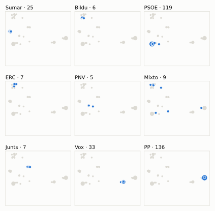
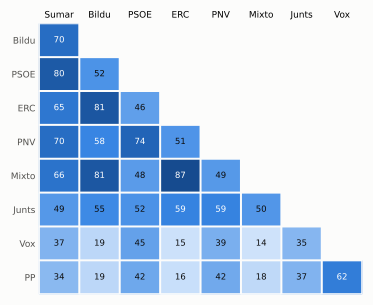

# Análisis detallado: octubre de 2025

[← Volver al resumen del mes](2025-10.md)

_Generado automáticamente el 2026-11-11 con datos abiertos del [Congreso de los Diputados](https://www.congreso.es/es/opendata/votaciones). Solo plenos y Diputación Permanente. Método y límites en [docs/DOCUMENTO_FUNCIONAL.md](../docs/DOCUMENTO_FUNCIONAL.md)._

## Resumen

- **182 votaciones** en 7 días de pleno (sesiones 135, 136, 137, 139, 140, 141 y 142).
- **48 aprobadas** y **134 rechazadas**.
- 18 votaciones se decidieron por 5 votos o menos.
- El grupo que más veces votó con el resultado final: **PSOE** (80 % de las votaciones nominales).
- Los grupos del Gobierno (PSOE y Sumar) votaron lo mismo en 141 de 182 votaciones nominales y perdieron 19 de ellas.
- 50 votos individuales se apartaron de la posición de su grupo (32 diputados).

## Cómo votó cada grupo

| Grupo | Diputados | Cohesión | Votó con el resultado | Decisivo | Posición Sí | Posición No | Posición Abst. |
| --- | ---: | ---: | ---: | ---: | ---: | ---: | ---: |
| PP | 137 | 100 % | 62 % | 28 | 82 | 77 | 23 |
| PSOE | 120 | 100 % | 80 % | 49 | 22 | 145 | 15 |
| Vox | 33 | 100 % | 62 % | 19 | 59 | 94 | 29 |
| Sumar | 26 | 100 % | 70 % | 25 | 54 | 122 | 6 |
| Mixto | 9 | 62 % | 43 % | 15 | 98 | 70 | 5 |
| Junts | 7 | 100 % | 57 % | 17 | 63 | 84 | 35 |
| ERC | 7 | 99 % | 42 % | 14 | 97 | 70 | 15 |
| EH Bildu | 6 | 100 % | 46 % | 12 | 85 | 82 | 15 |
| PNV | 5 | 100 % | 72 % | 12 | 47 | 112 | 23 |

*Cohesión*: índice de acuerdo interno (100 % = todo el grupo votó igual). *Votó con el resultado*: el grupo votó Sí y salió aprobada, o No y salió rechazada. *Decisivo*: votaciones cuyo resultado habría cambiado si el grupo se hubiera abstenido en bloque. El Grupo Mixto reúne partidos distintos: su posición es la de su mayoría.

## Mapa de diputados

<picture>
  <source media="(prefers-color-scheme: dark)" srcset="img/2025-10/mapa-oscuro.svg">
  
</picture>

Cada punto es un diputado; dos diputados están cerca si votaron parecido. Un punto más grande reúne a varios que votaron exactamente igual. En cada panel, el grupo en azul y el resto del Congreso en gris.

*Cómo se calcula*: componentes principales de los votos (Sí, No, abstención) en 181 votaciones con algún desacuerdo. El eje horizontal recoge el 66 % de la variación y el vertical el 15 %. Los ejes no tienen nombre ni sentido político propio; por convención, el PP queda a la derecha. No se sitúa a 3 diputados que votó en menos de la mitad.

## Afinidad entre grupos

<picture>
  <source media="(prefers-color-scheme: dark)" srcset="img/2025-10/afinidad-oscuro.svg">
  
</picture>

Porcentaje de votaciones nominales en que los dos grupos tomaron la misma posición. Los grupos están ordenados según el mapa de diputados.

Ver la tabla

|  | PP | PSOE | Vox | Sumar | Mixto | Junts | ERC | EH Bildu | PNV |
| --- | :---: | :---: | :---: | :---: | :---: | :---: | :---: | :---: | :---: |
| PP | 100 % | 42 % | 62 % | 34 % | 18 % | 37 % | 16 % | 19 % | 42 % |
| PSOE | 42 % | 100 % | 45 % | 80 % | 48 % | 52 % | 46 % | 52 % | 74 % |
| Vox | 62 % | 45 % | 100 % | 37 % | 14 % | 35 % | 15 % | 19 % | 39 % |
| Sumar | 34 % | 80 % | 37 % | 100 % | 66 % | 49 % | 65 % | 70 % | 70 % |
| Mixto | 18 % | 48 % | 14 % | 66 % | 100 % | 50 % | 87 % | 81 % | 49 % |
| Junts | 37 % | 52 % | 35 % | 49 % | 50 % | 100 % | 59 % | 55 % | 59 % |
| ERC | 16 % | 46 % | 15 % | 65 % | 87 % | 59 % | 100 % | 81 % | 51 % |
| EH Bildu | 19 % | 52 % | 19 % | 70 % | 81 % | 55 % | 81 % | 100 % | 58 % |
| PNV | 42 % | 74 % | 39 % | 70 % | 49 % | 59 % | 51 % | 58 % | 100 % |

## Quién sacó adelante las votaciones

| Grupos que votaron Sí | Votaciones | Escaños |
| --- | ---: | ---: |
| PP + Vox | 7 | 170 |
| PP + Vox + Junts | 6 | 177 |
| PSOE + Sumar + Mixto + Junts + ERC + EH Bildu + PNV | 3 | 180 |
| PP + PSOE + Sumar + Mixto + Junts + ERC + EH Bildu + PNV | 3 | 317 |
| Todos los grupos | 3 | 350 |
| PP + Vox + PNV | 3 | 175 |
| PP + Vox + Sumar + Mixto + Junts + ERC + EH Bildu + PNV | 2 | 230 |
| PSOE + Sumar + Mixto + ERC + EH Bildu + PNV | 2 | 173 |

De 48 votaciones nominales aprobadas. Otras 19 salieron con combinaciones que se dieron menos veces. La posición de cada grupo es la de la mayoría de sus diputados.

## Votaciones que perdieron los grupos del Gobierno

| Fecha | Asunto | Tipo | PSOE y Sumar votaron | Resultado | Sí | No |
| --- | --- | --- | :---: | --- | ---: | ---: |
| 8 de octubre | Proyecto de Ley de Movilidad Sostenible. *(Enmiendas presentadas por el Grupo Parlamentario Republican…)* | Leyes: dictamen y votación final | No | Aprobada | 163 | 151 |
| 8 de octubre | Proyecto de Ley de Movilidad Sostenible. *(Enmiendas presentadas por el Grupo Parlamentario Popular en…)* | Leyes: dictamen y votación final | No | Aprobada | 177 | 170 |
| 8 de octubre | Proyecto de Ley de Movilidad Sostenible. *(Voto particular. Voto particular nº 1 presentado por el Gru…)* | Leyes: dictamen y votación final | Sí | Rechazada | 157 | 178 |
| 8 de octubre | Proposición no de Ley del Grupo Parlamentario Popular en el Congreso, para recuperar la calidad y la confianza en el tren en España. | Proposiciones no de ley | No | Aprobada | 186 | 150 |
| 8 de octubre | Moción consecuencia de interpelación urgente del Grupo Parlamentario Popular en el Congreso, sobre las actuaciones que piensa acometer el Gobierno en apoyo al… *(Votación separada por puntos. Punto 1.)* | Mociones | No | Aprobada | 177 | 152 |
| 8 de octubre | Moción consecuencia de interpelación urgente del Grupo Parlamentario Popular en el Congreso, sobre las actuaciones que piensa acometer el Gobierno en apoyo al… *(Votación separada por puntos. Punto 2.)* | Mociones | No | Aprobada | 170 | 169 |
| 8 de octubre | Moción consecuencia de interpelación urgente del Grupo Parlamentario Popular en el Congreso, sobre las actuaciones que piensa acometer el Gobierno en apoyo al… *(Votación separada por puntos. Punto 3.)* | Mociones | No | Aprobada | 176 | 164 |
| 14 de octubre | Proposición de Ley del Grupo Parlamentario Mixto, para la reducción de la duración máxima de la jornada ordinaria de trabajo a 35 horas semanales. | Leyes: toma en consideración | Sí | Rechazada | 162 | 178 |
| 16 de octubre | Moción consecuencia de interpelación urgente del Grupo Parlamentario Popular en el Congreso, sobre el cumplimiento por parte del Gobierno, y en particular del… *(Votación separada por puntos. Punto 3.)* | Mociones | No | Aprobada | 169 | 165 |
| 16 de octubre | Moción consecuencia de interpelación urgente del Grupo Parlamentario Mixto (Sr. Rego Candamil), sobre las medidas necesarias para impulsar el sector pesquero g… *(Votación separada por puntos. Punto 10.)* | Mociones | No | Aprobada | 181 | 143 |
| 22 de octubre | Moción consecuencia de interpelación urgente del Grupo Parlamentario Popular en el Congreso, sobre el impacto al alza de los precios de los alimentos, del cost… *(Votación separada por puntos. Punto 1.)* | Mociones | No | Aprobada | 179 | 156 |
| 22 de octubre | Moción consecuencia de interpelación urgente del Grupo Parlamentario Popular en el Congreso, sobre el impacto al alza de los precios de los alimentos, del cost… *(Votación separada por puntos. Punto 2.)* | Mociones | No | Aprobada | 178 | 168 |
| 22 de octubre | Moción consecuencia de interpelación urgente del Grupo Parlamentario Popular en el Congreso, sobre el impacto al alza de los precios de los alimentos, del cost… *(Votación separada por puntos. Punto 3.)* | Mociones | No | Aprobada | 179 | 163 |
| 22 de octubre | Moción consecuencia de interpelación urgente del Grupo Parlamentario Popular en el Congreso, sobre el impacto al alza de los precios de los alimentos, del cost… *(Votación separada por puntos. Punto 4.)* | Mociones | No | Aprobada | 177 | 166 |
| 28 de octubre | Proposición de Ley del Grupo Parlamentario Popular en el Congreso, relativa a la modificación de la Ley 50/1981, de 30 de diciembre, por la que se regula el Es… | Leyes: toma en consideración | No | Aprobada | 171 | 168 |

Y 4 más (ver «Todas las votaciones»).

Además, PSOE y Sumar votaron distinto entre sí en 37 votaciones.

## Votaciones más ajustadas

| Fecha | Asunto | Resultado | Sí | No | Abst. |
| --- | --- | :---: | ---: | ---: | ---: |
| 8 de octubre | Moción consecuencia de interpelación urgente del Grupo Parlamentario Popular en el Congreso, sobre las actuaciones que piensa acometer el Gobierno en apoyo al… *(Votación separada por puntos. Punto 2.)* | Aprobada | 170 | 169 | 9 |
| 28 de octubre | Proposición no de Ley del Grupo Parlamentario VOX, relativa al rechazo de la integración de la Política Agraria Común (PAC) en un fondo presupuestario único de… *(Votación separada por puntos. Punto 1.)* | Rechazada | 172 | 173 | 0 |
| 28 de octubre | Proposición no de Ley del Grupo Parlamentario VOX, relativa al rechazo de la integración de la Política Agraria Común (PAC) en un fondo presupuestario único de… *(Votación separada por puntos. Punto 2.)* | Rechazada | 172 | 173 | 0 |
| 8 de octubre | Proyecto de Ley de Movilidad Sostenible. *(Enmiendas presentadas por el Grupo Parlamentario Republican…)* | Rechazada | 156 | 158 | 33 |
| 28 de octubre | Proposición no de Ley del Grupo Parlamentario VOX, relativa al rechazo de la integración de la Política Agraria Común (PAC) en un fondo presupuestario único de… *(Votación separada por puntos. Punto 3.)* | Rechazada | 172 | 174 | 0 |
| 28 de octubre | Moción consecuencia de interpelación urgente del Grupo Parlamentario VOX, sobre qué medidas está poniendo en marcha el Gobierno para solucionar los problemas d… *(Votación separada por puntos. Punto 6.)* | Rechazada | 171 | 173 | 1 |
| 28 de octubre | Proposición de Ley del Grupo Parlamentario Popular en el Congreso, relativa a la modificación de la Ley 50/1981, de 30 de diciembre, por la que se regula el Es… | Aprobada | 171 | 168 | 7 |
| 28 de octubre | Moción consecuencia de interpelación urgente del Grupo Parlamentario Popular en el Congreso, sobre las prioridades del Gobierno en materia de cooperación terri… *(Votación separada por puntos. Punto 2.)* | Aprobada | 171 | 168 | 6 |
| 28 de octubre | Moción consecuencia de interpelación urgente del Grupo Parlamentario Popular en el Congreso, sobre las prioridades del Gobierno en materia de cooperación terri… *(Votación separada por puntos. Punto 6.)* | Aprobada | 171 | 168 | 7 |
| 8 de octubre | Proyecto de Ley de Movilidad Sostenible. *(Enmiendas presentadas por el Grupo Parlamentario VOX Enmien…)* | Rechazada | 171 | 175 | 0 |

Votaciones decididas por 10 votos o menos (o a esa distancia de la mayoría que exigían). Las públicas por llamamiento no tienen hemiciclo: el voto de cada diputado solo consta en el Diario de Sesiones.

## Qué se votó, por tipo de asunto

| Tipo de asunto | Votaciones | Aprobadas | No aprobadas |
| --- | ---: | ---: | ---: |
| Leyes: dictamen y votación final | 88 | 4 | 84 |
| Mociones | 55 | 24 | 31 |
| Proposiciones no de ley | 20 | 6 | 14 |
| Leyes: toma en consideración | 8 | 5 | 3 |
| Tratados internacionales | 5 | 5 | 0 |
| Decretos-ley (convalidación) | 2 | 2 | 0 |
| Organización de la Cámara | 2 | 2 | 0 |
| Enmiendas a la totalidad | 2 | 0 | 2 |

Las proposiciones no de ley y las mociones expresan la posición del Congreso pero no obligan al Gobierno. Las leyes pasan por varias votaciones (toma en consideración, totalidad, dictamen, Senado), así que una misma ley puede aparecer varias veces.

## Votos distintos de su grupo

| Diputado | Grupo | Votos distintos de su grupo |
| --- | --- | ---: |
| Rufián Romero, Gabriel | ERC | 5 |
| Boada Danés, Júlia | Sumar | 4 |
| Estrems Fayos, Etna | ERC | 2 |
| Flores Juberías, Carlos | Vox | 2 |
| Guinart Moreno, Lídia | PSOE | 2 |
| Legarda Uriarte, Mikel | PNV | 2 |
| Martínez Barbero, Verónica | Sumar | 2 |
| Ogou i Corbi, Viviane | Sumar | 2 |
| Ros Martínez, Susana | PSOE | 2 |
| Santiago Romero, Enrique Fernando | Sumar | 2 |
| Sánchez García, José María | Vox | 2 |
| Vallugera Balañà, Pilar | ERC | 2 |
| Vidal Sáez, Aina | Sumar | 2 |
| Acedo Reyes, Sofía | PP | 1 |
| Aizpurua Arzallus, Mertxe | EH Bildu | 1 |

Un voto aislado puede ser un error al pulsar, no una decisión política: el Congreso no publica las correcciones. Se excluye el Grupo Mixto.

## Diputados que más veces no votaron

| Diputado | Grupo | No votó | % de votaciones |
| --- | --- | ---: | ---: |
| Sánchez Pérez-Castejón, Pedro | PSOE | 137 | 75 % |
| Díaz Pérez, Yolanda | Sumar | 129 | 71 % |
| Mariscal Anaya, Guillermo | PP | 120 | 66 % |
| Montero Cuadrado, María Jesús | PSOE | 32 | 18 % |
| Legarda Uriarte, Mikel | PNV | 31 | 17 % |
| Calvo Gómez, Pilar | Junts | 25 | 14 % |
| Ábalos Meco, José Luis | Mixto | 22 | 12 % |
| Nogueras i Camero, Míriam | Junts | 20 | 11 % |
| Gavin i Valls, Isidre | Junts | 18 | 10 % |
| Maldonado López, Adriana | PSOE | 18 | 10 % |
| Rodríguez Almeida, Andrés Alberto | Vox | 18 | 10 % |
| De los Santos González, Jaime Miguel | PP | 16 | 9 % |
| Pozueta Fernández, Isabel | EH Bildu | 16 | 9 % |
| Teniente Sánchez, Cristina | PP | 12 | 7 % |
| Rego Candamil, Néstor | Mixto | 9 | 5 % |

«No vota» incluye ausencias justificadas (baja, maternidad o paternidad) y escaños vacantes; el portal no las distingue.

## Todas las votaciones

Posición de cada grupo: la opción que votó la mayoría de sus diputados (*Div.*: empate dentro del grupo). El número enlaza al JSON oficial o, en las votaciones por llamamiento, al Diario de Sesiones.

### 7 de octubre (sesión 135)

| Nº | Asunto | Resultado | Sí | No | Abst. | PP | PSOE | Vox | Sumar | Mixto | Junts | ERC | EH Bildu | PNV | Decisivos |
| ---: | --- | --- | ---: | ---: | ---: | :---: | :---: | :---: | :---: | :---: | :---: | :---: | :---: | :---: | --- |
| [1](https://www.congreso.es/webpublica/opendata/votaciones/Leg15/Sesion135/20251007/Votacion001/VOT_20251007214328.json) | Proposición de Ley para la derogación de la Ley 18/2013, de 12 de noviembre, para la regulación de la Tauromaquia como patrimonio cultural. | Rechazada | 57 | 169 | 118 | No | Abst. | No | Sí | Sí | Sí | Sí | Sí | Sí | PP |
| [2](https://www.congreso.es/webpublica/opendata/votaciones/Leg15/Sesion135/20251007/Votacion002/VOT_20251007214330.json) | Proposición de Ley del Grupo Parlamentario Euskal Herria Bildu, sobre control y regulación de la publicidad y contratación de los pisos turísticos. | Aprobada | 176 | 169 | 0 | No | Sí | No | Sí | Sí | Sí | Sí | Sí | Sí | Junts, Mixto, ERC, PSOE, Sumar |

### 8 de octubre (sesión 136)

| Nº | Asunto | Resultado | Sí | No | Abst. | PP | PSOE | Vox | Sumar | Mixto | Junts | ERC | EH Bildu | PNV | Decisivos |
| ---: | --- | --- | ---: | ---: | ---: | :---: | :---: | :---: | :---: | :---: | :---: | :---: | :---: | :---: | --- |
| [1](https://www.congreso.es/webpublica/opendata/votaciones/Leg15/Sesion136/20251008/Votacion001/VOT_20251008195214.json) | Proyecto de Ley de Movilidad Sostenible. *(Enmiendas presentadas por el Grupo Parlamentario Mixto (Sra…)* | Rechazada | 10 | 327 | 10 | No | No | No | No | Sí | No | Abst. | Sí | No |  |
| [2](https://www.congreso.es/webpublica/opendata/votaciones/Leg15/Sesion136/20251008/Votacion002/VOT_20251008195216.json) | Proyecto de Ley de Movilidad Sostenible. *(Enmiendas presentadas por el Grupo Parlamentario Mixto (Sra…)* | Rechazada | 4 | 341 | 1 | No | No | No | No | Div. | No | No | No | No |  |
| [3](https://www.congreso.es/webpublica/opendata/votaciones/Leg15/Sesion136/20251008/Votacion003/VOT_20251008195217.json) | Proyecto de Ley de Movilidad Sostenible. *(Enmiendas presentadas por el Grupo Parlamentario Mixto (Sra…)* | Rechazada | 4 | 340 | 1 | No | No | No | No | Div. | No | No | No | No |  |
| [4](https://www.congreso.es/webpublica/opendata/votaciones/Leg15/Sesion136/20251008/Votacion004/VOT_20251008195218.json) | Proyecto de Ley de Movilidad Sostenible. *(Enmiendas presentadas por el Grupo Parlamentario Mixto (Sra…)* | Rechazada | 10 | 336 | 1 | No | No | No | No | Div. | No | No | Sí | No |  |
| [5](https://www.congreso.es/webpublica/opendata/votaciones/Leg15/Sesion136/20251008/Votacion005/VOT_20251008195219.json) | Proyecto de Ley de Movilidad Sostenible. *(Enmiendas presentadas por el Grupo Parlamentario Mixto (Sra…)* | Rechazada | 12 | 334 | 1 | No | No | No | No | Sí | No | Sí | No | No |  |
| [6](https://www.congreso.es/webpublica/opendata/votaciones/Leg15/Sesion136/20251008/Votacion006/VOT_20251008195220.json) | Proyecto de Ley de Movilidad Sostenible. *(Enmiendas presentadas por el Grupo Parlamentario Mixto (Sra…)* | Rechazada | 13 | 197 | 137 | Abst. | No | No | No | Sí | No | Sí | No | No |  |
| [7](https://www.congreso.es/webpublica/opendata/votaciones/Leg15/Sesion136/20251008/Votacion007/VOT_20251008195222.json) | Proyecto de Ley de Movilidad Sostenible. *(Enmiendas presentadas por el Grupo Parlamentario Mixto (Sra…)* | Rechazada | 147 | 199 | 1 | Sí | No | No | No | Sí | No | No | Sí | No | PSOE |
| [8](https://www.congreso.es/webpublica/opendata/votaciones/Leg15/Sesion136/20251008/Votacion008/VOT_20251008195223.json) | Proyecto de Ley de Movilidad Sostenible. *(Enmiendas presentadas por el Grupo Parlamentario Mixto (Sra…)* | Rechazada | 12 | 330 | 5 | No | No | No | No | Sí | No | Sí | No | Abst. |  |
| [9](https://www.congreso.es/webpublica/opendata/votaciones/Leg15/Sesion136/20251008/Votacion009/VOT_20251008195224.json) | Proyecto de Ley de Movilidad Sostenible. *(Enmiendas presentadas por el Grupo Parlamentario Mixto (Sra…)* | Rechazada | 20 | 327 | 0 | No | No | No | No | Sí | Sí | Sí | No | No |  |
| [10](https://www.congreso.es/webpublica/opendata/votaciones/Leg15/Sesion136/20251008/Votacion010/VOT_20251008195225.json) | Proyecto de Ley de Movilidad Sostenible. *(Enmiendas presentadas por el Grupo Parlamentario Mixto (Sra…)* | Rechazada | 12 | 326 | 8 | No | No | No | No | Sí | Abst. | Sí | No | No |  |
| [11](https://www.congreso.es/webpublica/opendata/votaciones/Leg15/Sesion136/20251008/Votacion011/VOT_20251008195227.json) | Proyecto de Ley de Movilidad Sostenible. *(Enmiendas presentadas por el Grupo Parlamentario Mixto (Sra…)* | Rechazada | 11 | 328 | 8 | No | No | No | No | Sí | No | Abst. | Sí | No |  |
| [12](https://www.congreso.es/webpublica/opendata/votaciones/Leg15/Sesion136/20251008/Votacion012/VOT_20251008195228.json) | Proyecto de Ley de Movilidad Sostenible. *(Enmiendas presentadas por el Grupo Parlamentario Mixto (Sr.…)* | Rechazada | 19 | 323 | 5 | No | No | No | No | Sí | No | Sí | Sí | Abst. |  |
| [13](https://www.congreso.es/webpublica/opendata/votaciones/Leg15/Sesion136/20251008/Votacion013/VOT_20251008195229.json) | Proyecto de Ley de Movilidad Sostenible. *(Enmiendas presentadas por el Grupo Parlamentario Mixto (Sr.…)* | Rechazada | 26 | 320 | 0 | No | No | No | No | Sí | Sí | Sí | Sí | No |  |
| [14](https://www.congreso.es/webpublica/opendata/votaciones/Leg15/Sesion136/20251008/Votacion014/VOT_20251008195230.json) | Proyecto de Ley de Movilidad Sostenible. *(Enmiendas presentadas por el Grupo Parlamentario Mixto (Sr.…)* | Rechazada | 11 | 331 | 5 | No | No | No | No | Sí | No | No | Sí | Abst. |  |
| [15](https://www.congreso.es/webpublica/opendata/votaciones/Leg15/Sesion136/20251008/Votacion015/VOT_20251008195232.json) | Proyecto de Ley de Movilidad Sostenible. *(Enmiendas presentadas por el Grupo Parlamentario Mixto (Sr.…)* | Rechazada | 31 | 316 | 0 | No | No | No | No | Sí | Sí | Sí | Sí | Sí |  |
| [16](https://www.congreso.es/webpublica/opendata/votaciones/Leg15/Sesion136/20251008/Votacion016/VOT_20251008195233.json) | Proyecto de Ley de Movilidad Sostenible. *(Enmiendas presentadas por el Grupo Parlamentario Mixto (Sr.…)* | Rechazada | 19 | 321 | 7 | No | No | No | No | Sí | Abst. | Sí | Sí | No |  |
| [17](https://www.congreso.es/webpublica/opendata/votaciones/Leg15/Sesion136/20251008/Votacion017/VOT_20251008195234.json) | Proyecto de Ley de Movilidad Sostenible. *(Enmiendas presentadas por el Grupo Parlamentario Mixto (Sr.…)* | Rechazada | 19 | 295 | 33 | No | No | Abst. | No | Sí | No | Sí | Sí | No |  |
| [18](https://www.congreso.es/webpublica/opendata/votaciones/Leg15/Sesion136/20251008/Votacion018/VOT_20251008195236.json) | Proyecto de Ley de Movilidad Sostenible. *(Enmiendas presentadas por el Grupo Parlamentario Mixto (Sr.…)* | Rechazada | 19 | 288 | 40 | No | No | Abst. | No | Sí | Abst. | Sí | Sí | No |  |
| [19](https://www.congreso.es/webpublica/opendata/votaciones/Leg15/Sesion136/20251008/Votacion019/VOT_20251008195238.json) | Proyecto de Ley de Movilidad Sostenible. *(Enmiendas presentadas por el Grupo Parlamentario Mixto (Sr.…)* | Rechazada | 13 | 327 | 7 | No | No | No | No | Sí | Abst. | Sí | No | No |  |
| [20](https://www.congreso.es/webpublica/opendata/votaciones/Leg15/Sesion136/20251008/Votacion020/VOT_20251008195240.json) | Proyecto de Ley de Movilidad Sostenible. *(Enmiendas presentadas por el Grupo Parlamentario Mixto (Sr.…)* | Rechazada | 20 | 327 | 0 | No | No | No | No | Sí | Sí | Sí | No | No |  |
| [21](https://www.congreso.es/webpublica/opendata/votaciones/Leg15/Sesion136/20251008/Votacion021/VOT_20251008195241.json) | Proyecto de Ley de Movilidad Sostenible. *(Enmiendas presentadas por el Grupo Parlamentario Mixto (Sr.…)* | Rechazada | 13 | 334 | 0 | No | No | No | No | Sí | No | Sí | No | No |  |
| [22](https://www.congreso.es/webpublica/opendata/votaciones/Leg15/Sesion136/20251008/Votacion022/VOT_20251008195243.json) | Proyecto de Ley de Movilidad Sostenible. *(Enmiendas presentadas por el Grupo Parlamentario Mixto (Sr.…)* | Rechazada | 18 | 327 | 0 | No | No | No | No | Sí | No | Sí | Sí | No |  |
| [23](https://www.congreso.es/webpublica/opendata/votaciones/Leg15/Sesion136/20251008/Votacion023/VOT_20251008195244.json) | Proyecto de Ley de Movilidad Sostenible. *(Enmiendas presentadas por el Grupo Parlamentario Vasco (EAJ…)* | Rechazada | 150 | 197 | 0 | Sí | No | No | No | No | Sí | No | No | Sí | PSOE |
| [24](https://www.congreso.es/webpublica/opendata/votaciones/Leg15/Sesion136/20251008/Votacion024/VOT_20251008195246.json) | Proyecto de Ley de Movilidad Sostenible. *(Enmiendas presentadas por el Grupo Parlamentario Vasco (EAJ…)* | Rechazada | 27 | 183 | 137 | Abst. | No | No | No | No | Sí | Sí | Sí | Sí |  |
| [25](https://www.congreso.es/webpublica/opendata/votaciones/Leg15/Sesion136/20251008/Votacion025/VOT_20251008195247.json) | Proyecto de Ley de Movilidad Sostenible. *(Enmiendas presentadas por el Grupo Parlamentario Vasco (EAJ…)* | Rechazada | 25 | 185 | 137 | Abst. | No | No | No | Sí | Sí | Sí | No | Sí |  |
| [26](https://www.congreso.es/webpublica/opendata/votaciones/Leg15/Sesion136/20251008/Votacion026/VOT_20251008195248.json) | Proyecto de Ley de Movilidad Sostenible. *(Enmiendas presentadas por el Grupo Parlamentario Vasco (EAJ…)* | Rechazada | 21 | 320 | 6 | No | No | No | No | No | Sí | Sí | Abst. | Sí |  |
| [27](https://www.congreso.es/webpublica/opendata/votaciones/Leg15/Sesion136/20251008/Votacion027/VOT_20251008195249.json) | Proyecto de Ley de Movilidad Sostenible. *(Enmiendas presentadas por el Grupo Parlamentario Vasco (EAJ…)* | Rechazada | 25 | 178 | 144 | Abst. | No | No | No | Sí | Sí | Sí | Abst. | Sí |  |
| [28](https://www.congreso.es/webpublica/opendata/votaciones/Leg15/Sesion136/20251008/Votacion028/VOT_20251008195250.json) | Proyecto de Ley de Movilidad Sostenible. *(Enmiendas presentadas por el Grupo Parlamentario Vasco (EAJ…)* | Rechazada | 30 | 316 | 0 | No | No | No | No | Sí | Sí | Sí | Sí | Sí |  |
| [29](https://www.congreso.es/webpublica/opendata/votaciones/Leg15/Sesion136/20251008/Votacion029/VOT_20251008195251.json) | Proyecto de Ley de Movilidad Sostenible. *(Enmiendas presentadas por el Grupo Parlamentario Vasco (EAJ…)* | Rechazada | 24 | 314 | 8 | No | No | No | No | Sí | Sí | Abst. | Sí | Sí |  |
| [30](https://www.congreso.es/webpublica/opendata/votaciones/Leg15/Sesion136/20251008/Votacion030/VOT_20251008195252.json) | Proyecto de Ley de Movilidad Sostenible. *(Enmienda presentada por el Grupo Parlamentario Euskal Herri…)* | Rechazada | 20 | 327 | 0 | No | No | No | No | Sí | No | Sí | Sí | No |  |
| [31](https://www.congreso.es/webpublica/opendata/votaciones/Leg15/Sesion136/20251008/Votacion031/VOT_20251008195253.json) | Proyecto de Ley de Movilidad Sostenible. *(Enmiendas presentadas por el Grupo Parlamentario Junts per…)* | Rechazada | 19 | 322 | 6 | No | No | No | No | Sí | Sí | Sí | Abst. | No |  |
| [32](https://www.congreso.es/webpublica/opendata/votaciones/Leg15/Sesion136/20251008/Votacion032/VOT_20251008195254.json) | Proyecto de Ley de Movilidad Sostenible. *(Enmiendas presentadas por el Grupo Parlamentario Junts per…)* | Rechazada | 163 | 184 | 0 | Sí | No | No | No | Sí | Sí | Sí | Sí | No | PSOE, Sumar, Vox |
| [33](https://www.congreso.es/webpublica/opendata/votaciones/Leg15/Sesion136/20251008/Votacion033/VOT_20251008195255.json) | Proyecto de Ley de Movilidad Sostenible. *(Enmiendas presentadas por el Grupo Parlamentario Junts per…)* | Rechazada | 16 | 327 | 4 | No | No | No | No | Abst. | Sí | Sí | No | No |  |
| [34](https://www.congreso.es/webpublica/opendata/votaciones/Leg15/Sesion136/20251008/Votacion034/VOT_20251008195256.json) | Proyecto de Ley de Movilidad Sostenible. *(Enmiendas presentadas por el Grupo Parlamentario Junts per…)* | Rechazada | 156 | 191 | 0 | Sí | No | No | No | Sí | Sí | Sí | No | No | PSOE |
| [35](https://www.congreso.es/webpublica/opendata/votaciones/Leg15/Sesion136/20251008/Votacion035/VOT_20251008195257.json) | Proyecto de Ley de Movilidad Sostenible. *(Enmiendas presentadas por el Grupo Parlamentario Junts per…)* | Rechazada | 25 | 185 | 137 | Abst. | No | No | No | Sí | Sí | Sí | Sí | No |  |
| [36](https://www.congreso.es/webpublica/opendata/votaciones/Leg15/Sesion136/20251008/Votacion036/VOT_20251008195259.json) | Proyecto de Ley de Movilidad Sostenible. *(Enmiendas presentadas por el Grupo Parlamentario Junts per…)* | Rechazada | 26 | 321 | 0 | No | No | No | No | No | Sí | Sí | Sí | Sí |  |
| [37](https://www.congreso.es/webpublica/opendata/votaciones/Leg15/Sesion136/20251008/Votacion037/VOT_20251008195300.json) | Proyecto de Ley de Movilidad Sostenible. *(Enmiendas presentadas por el Grupo Parlamentario Junts per…)* | Rechazada | 18 | 317 | 12 | No | No | No | No | Sí | Sí | Sí | Abst. | Abst. |  |
| [38](https://www.congreso.es/webpublica/opendata/votaciones/Leg15/Sesion136/20251008/Votacion038/VOT_20251008195301.json) | Proyecto de Ley de Movilidad Sostenible. *(Enmiendas presentadas por el Grupo Parlamentario Junts per…)* | Rechazada | 13 | 192 | 142 | Abst. | No | No | No | Abst. | Sí | No | Sí | No |  |
| [39](https://www.congreso.es/webpublica/opendata/votaciones/Leg15/Sesion136/20251008/Votacion039/VOT_20251008195302.json) | Proyecto de Ley de Movilidad Sostenible. *(Enmiendas presentadas por el Grupo Parlamentario Junts per…)* | Rechazada | 20 | 326 | 1 | No | No | No | No | No | Sí | Sí | Sí | No |  |
| [40](https://www.congreso.es/webpublica/opendata/votaciones/Leg15/Sesion136/20251008/Votacion040/VOT_20251008195304.json) | Proyecto de Ley de Movilidad Sostenible. *(Enmiendas presentadas por el Grupo Parlamentario Republican…)* | Rechazada | 19 | 328 | 0 | No | No | No | No | Sí | No | Sí | Sí | No |  |
| [41](https://www.congreso.es/webpublica/opendata/votaciones/Leg15/Sesion136/20251008/Votacion041/VOT_20251008195305.json) | Proyecto de Ley de Movilidad Sostenible. *(Enmiendas presentadas por el Grupo Parlamentario Republican…)* | Rechazada | 25 | 316 | 5 | No | No | No | No | Sí | Sí | Sí | Sí | Abst. |  |
| [42](https://www.congreso.es/webpublica/opendata/votaciones/Leg15/Sesion136/20251008/Votacion042/VOT_20251008195306.json) | Proyecto de Ley de Movilidad Sostenible. *(Enmiendas presentadas por el Grupo Parlamentario Republican…)* | Rechazada | 18 | 316 | 12 | No | No | No | No | Sí | Abst. | Sí | Sí | Abst. |  |
| [43](https://www.congreso.es/webpublica/opendata/votaciones/Leg15/Sesion136/20251008/Votacion043/VOT_20251008195307.json) | Proyecto de Ley de Movilidad Sostenible. *(Enmiendas presentadas por el Grupo Parlamentario Republican…)* | Rechazada | 156 | 184 | 7 | Sí | No | No | No | Sí | Abst. | Sí | Sí | No | PSOE, Vox |
| [44](https://www.congreso.es/webpublica/opendata/votaciones/Leg15/Sesion136/20251008/Votacion044/VOT_20251008195309.json) | Proyecto de Ley de Movilidad Sostenible. *(Enmiendas presentadas por el Grupo Parlamentario Republican…)* | Rechazada | 18 | 322 | 7 | No | No | No | No | Sí | Abst. | Sí | Sí | No |  |
| [45](https://www.congreso.es/webpublica/opendata/votaciones/Leg15/Sesion136/20251008/Votacion045/VOT_20251008195310.json) | Proyecto de Ley de Movilidad Sostenible. *(Enmiendas presentadas por el Grupo Parlamentario Republican…)* | Rechazada | 20 | 316 | 11 | No | No | No | No | Sí | Sí | Sí | Abst. | Abst. |  |
| [46](https://www.congreso.es/webpublica/opendata/votaciones/Leg15/Sesion136/20251008/Votacion046/VOT_20251008195311.json) | Proyecto de Ley de Movilidad Sostenible. *(Enmiendas presentadas por el Grupo Parlamentario Republican…)* | Rechazada | 13 | 321 | 13 | No | No | No | No | Sí | Abst. | Sí | Abst. | No |  |
| [47](https://www.congreso.es/webpublica/opendata/votaciones/Leg15/Sesion136/20251008/Votacion047/VOT_20251008195312.json) | Proyecto de Ley de Movilidad Sostenible. *(Enmiendas presentadas por el Grupo Parlamentario Republican…)* | Rechazada | 25 | 320 | 1 | No | No | No | No | Sí | Sí | Sí | Sí | No |  |
| [48](https://www.congreso.es/webpublica/opendata/votaciones/Leg15/Sesion136/20251008/Votacion048/VOT_20251008195313.json) | Proyecto de Ley de Movilidad Sostenible. *(Enmiendas presentadas por el Grupo Parlamentario Republican…)* | Rechazada | 162 | 184 | 0 | Sí | No | No | No | Sí | Sí | Sí | Sí | No | PSOE, Sumar, Vox |
| [49](https://www.congreso.es/webpublica/opendata/votaciones/Leg15/Sesion136/20251008/Votacion049/VOT_20251008195315.json) | Proyecto de Ley de Movilidad Sostenible. *(Enmiendas presentadas por el Grupo Parlamentario Republican…)* | Rechazada | 156 | 158 | 33 | Sí | No | Abst. | No | Sí | No | Sí | Sí | No | Junts, PSOE, Sumar, PNV |
| [50](https://www.congreso.es/webpublica/opendata/votaciones/Leg15/Sesion136/20251008/Votacion050/VOT_20251008195317.json) | Proyecto de Ley de Movilidad Sostenible. *(Enmiendas presentadas por el Grupo Parlamentario Republican…)* | Rechazada | 19 | 287 | 40 | No | No | Abst. | No | Sí | Abst. | Sí | Sí | No |  |
| [51](https://www.congreso.es/webpublica/opendata/votaciones/Leg15/Sesion136/20251008/Votacion051/VOT_20251008195319.json) | Proyecto de Ley de Movilidad Sostenible. *(Enmiendas presentadas por el Grupo Parlamentario Republican…)* | Aprobada | 163 | 151 | 33 | Sí | No | Abst. | No | Sí | Sí | Sí | Sí | No | PP |
| [52](https://www.congreso.es/webpublica/opendata/votaciones/Leg15/Sesion136/20251008/Votacion052/VOT_20251008195320.json) | Proyecto de Ley de Movilidad Sostenible. *(Enmiendas presentadas por el Grupo Parlamentario Republican…)* | Rechazada | 18 | 191 | 138 | Abst. | No | No | No | Sí | No | Sí | Sí | No |  |
| [53](https://www.congreso.es/webpublica/opendata/votaciones/Leg15/Sesion136/20251008/Votacion053/VOT_20251008195322.json) | Proyecto de Ley de Movilidad Sostenible. *(Enmiendas presentadas por el Grupo Parlamentario Republican…)* | Rechazada | 25 | 287 | 34 | No | No | Abst. | No | Sí | Sí | Sí | Sí | No |  |
| [54](https://www.congreso.es/webpublica/opendata/votaciones/Leg15/Sesion136/20251008/Votacion054/VOT_20251008195323.json) | Proyecto de Ley de Movilidad Sostenible. *(Enmiendas presentadas por el Grupo Parlamentario Republican…)* | Rechazada | 25 | 321 | 0 | No | No | No | No | Sí | Sí | Sí | Sí | No |  |
| [55](https://www.congreso.es/webpublica/opendata/votaciones/Leg15/Sesion136/20251008/Votacion055/VOT_20251008195324.json) | Proyecto de Ley de Movilidad Sostenible. *(Enmiendas presentadas por el Grupo Parlamentario Republican…)* | Rechazada | 27 | 320 | 0 | No | No | No | No | Sí | Sí | Sí | Sí | No |  |
| [56](https://www.congreso.es/webpublica/opendata/votaciones/Leg15/Sesion136/20251008/Votacion056/VOT_20251008195325.json) | Proyecto de Ley de Movilidad Sostenible. *(Enmiendas presentadas por el Grupo Parlamentario Republican…)* | Rechazada | 18 | 328 | 1 | No | No | No | No | Sí | No | Sí | Sí | No |  |
| [57](https://www.congreso.es/webpublica/opendata/votaciones/Leg15/Sesion136/20251008/Votacion057/VOT_20251008195327.json) | Proyecto de Ley de Movilidad Sostenible. *(Enmienda presentada por el Grupo Parlamentario Republicano…)* | Rechazada | 41 | 305 | 1 | No | No | No | Sí | Sí | No | Sí | Sí | No |  |
| [58](https://www.congreso.es/webpublica/opendata/votaciones/Leg15/Sesion136/20251008/Votacion058/VOT_20251008195328.json) | Proyecto de Ley de Movilidad Sostenible. *(Enmiendas presentadas por el Grupo Parlamentario Plurinacio…)* | Rechazada | 44 | 302 | 0 | No | No | No | Sí | Sí | No | Sí | Sí | No |  |
| [59](https://www.congreso.es/webpublica/opendata/votaciones/Leg15/Sesion136/20251008/Votacion059/VOT_20251008195329.json) | Proyecto de Ley de Movilidad Sostenible. *(Enmiendas presentadas por el Grupo Parlamentario Plurinacio…)* | Rechazada | 43 | 296 | 7 | No | No | No | Sí | Sí | Abst. | Sí | Sí | No |  |
| [60](https://www.congreso.es/webpublica/opendata/votaciones/Leg15/Sesion136/20251008/Votacion060/VOT_20251008195330.json) | Proyecto de Ley de Movilidad Sostenible. *(Enmiendas presentadas por el Grupo Parlamentario Plurinacio…)* | Rechazada | 43 | 296 | 7 | No | No | No | Sí | Sí | Abst. | Sí | Sí | No |  |
| [61](https://www.congreso.es/webpublica/opendata/votaciones/Leg15/Sesion136/20251008/Votacion061/VOT_20251008195331.json) | Proyecto de Ley de Movilidad Sostenible. *(Enmiendas presentadas por el Grupo Parlamentario Plurinacio…)* | Rechazada | 51 | 296 | 0 | No | No | No | Sí | Sí | Sí | Sí | Sí | No |  |
| [62](https://www.congreso.es/webpublica/opendata/votaciones/Leg15/Sesion136/20251008/Votacion062/VOT_20251008195332.json) | Proyecto de Ley de Movilidad Sostenible. *(Enmiendas presentadas por el Grupo Parlamentario Plurinacio…)* | Rechazada | 44 | 301 | 0 | No | No | No | Sí | Sí | No | Sí | Sí | No |  |
| [63](https://www.congreso.es/webpublica/opendata/votaciones/Leg15/Sesion136/20251008/Votacion063/VOT_20251008195334.json) | Proyecto de Ley de Movilidad Sostenible. *(Enmiendas presentadas por el Grupo Parlamentario Plurinacio…)* | Rechazada | 43 | 304 | 0 | No | No | No | Sí | Sí | No | Sí | Sí | No |  |
| [64](https://www.congreso.es/webpublica/opendata/votaciones/Leg15/Sesion136/20251008/Votacion064/VOT_20251008195334.json) | Proyecto de Ley de Movilidad Sostenible. *(Enmienda presentada por el Grupo Parlamentario Plurinaciona…)* | Rechazada | 44 | 301 | 0 | No | No | No | Sí | Sí | No | Sí | Sí | No |  |
| [65](https://www.congreso.es/webpublica/opendata/votaciones/Leg15/Sesion136/20251008/Votacion065/VOT_20251008195336.json) | Proyecto de Ley de Movilidad Sostenible. *(Enmiendas presentadas por el Grupo Parlamentario VOX Enmien…)* | Rechazada | 171 | 175 | 0 | Sí | No | Sí | No | No | No | No | No | No | EH Bildu, Junts, Mixto, ERC, PSOE, Sumar, PNV |
| [66](https://www.congreso.es/webpublica/opendata/votaciones/Leg15/Sesion136/20251008/Votacion066/VOT_20251008195337.json) | Proyecto de Ley de Movilidad Sostenible. *(Enmiendas presentadas por el Grupo Parlamentario VOX Enmien…)* | Rechazada | 33 | 177 | 137 | Abst. | No | Sí | No | No | No | No | No | No |  |
| [67](https://www.congreso.es/webpublica/opendata/votaciones/Leg15/Sesion136/20251008/Votacion067/VOT_20251008195338.json) | Proyecto de Ley de Movilidad Sostenible. *(Enmiendas presentadas por el Grupo Parlamentario VOX Resto…)* | Rechazada | 33 | 313 | 0 | No | No | Sí | No | No | No | No | No | No |  |
| [68](https://www.congreso.es/webpublica/opendata/votaciones/Leg15/Sesion136/20251008/Votacion068/VOT_20251008195339.json) | Proyecto de Ley de Movilidad Sostenible. *(Enmiendas presentadas por el Grupo Parlamentario Popular en…)* | Rechazada | 137 | 209 | 0 | Sí | No | No | No | No | No | No | No | No | PSOE |
| [69](https://www.congreso.es/webpublica/opendata/votaciones/Leg15/Sesion136/20251008/Votacion069/VOT_20251008195340.json) | Proyecto de Ley de Movilidad Sostenible. *(Enmiendas presentadas por el Grupo Parlamentario Popular en…)* | Rechazada | 137 | 177 | 33 | Sí | No | Abst. | No | No | No | No | No | No | PSOE |
| [70](https://www.congreso.es/webpublica/opendata/votaciones/Leg15/Sesion136/20251008/Votacion070/VOT_20251008195341.json) | Proyecto de Ley de Movilidad Sostenible. *(Enmiendas presentadas por el Grupo Parlamentario Popular en…)* | Rechazada | 150 | 164 | 33 | Sí | No | Abst. | No | No | Sí | Sí | No | No | PSOE, Sumar |
| [71](https://www.congreso.es/webpublica/opendata/votaciones/Leg15/Sesion136/20251008/Votacion071/VOT_20251008195343.json) | Proyecto de Ley de Movilidad Sostenible. *(Enmiendas presentadas por el Grupo Parlamentario Popular en…)* | Rechazada | 137 | 177 | 33 | Sí | No | Abst. | No | No | No | No | No | No | PSOE |
| [72](https://www.congreso.es/webpublica/opendata/votaciones/Leg15/Sesion136/20251008/Votacion072/VOT_20251008195344.json) | Proyecto de Ley de Movilidad Sostenible. *(Enmiendas presentadas por el Grupo Parlamentario Popular en…)* | Rechazada | 170 | 176 | 0 | Sí | No | Sí | No | No | No | No | No | No | Junts, Mixto, ERC, PSOE, Sumar |
| [73](https://www.congreso.es/webpublica/opendata/votaciones/Leg15/Sesion136/20251008/Votacion073/VOT_20251008195345.json) | Proyecto de Ley de Movilidad Sostenible. *(Enmiendas presentadas por el Grupo Parlamentario Popular en…)* | Rechazada | 170 | 177 | 0 | Sí | No | Sí | No | No | No | No | No | No | Mixto, PSOE, Sumar |
| [74](https://www.congreso.es/webpublica/opendata/votaciones/Leg15/Sesion136/20251008/Votacion074/VOT_20251008195346.json) | Proyecto de Ley de Movilidad Sostenible. *(Enmiendas presentadas por el Grupo Parlamentario Popular en…)* | Aprobada | 177 | 170 | 0 | Sí | No | Sí | No | No | Sí | No | No | No | Junts, PP, Vox |
| [75](https://www.congreso.es/webpublica/opendata/votaciones/Leg15/Sesion136/20251008/Votacion075/VOT_20251008195347.json) | Proyecto de Ley de Movilidad Sostenible. *(Enmiendas presentadas por el Grupo Parlamentario Popular en…)* | Rechazada | 141 | 165 | 39 | Sí | No | Abst. | No | Sí | No | Abst. | No | No | PSOE, Sumar |
| [76](https://www.congreso.es/webpublica/opendata/votaciones/Leg15/Sesion136/20251008/Votacion076/VOT_20251008195348.json) | Proyecto de Ley de Movilidad Sostenible. *(Enmiendas presentadas por el Grupo Parlamentario Popular en…)* | Rechazada | 135 | 177 | 33 | Sí | No | Abst. | No | No | No | No | No | No | PSOE |
| [77](https://www.congreso.es/webpublica/opendata/votaciones/Leg15/Sesion136/20251008/Votacion077/VOT_20251008195349.json) | Proyecto de Ley de Movilidad Sostenible. *(Enmiendas presentadas por el Grupo Parlamentario Popular en…)* | Aprobada | 170 | 15 | 162 | Sí | Abst. | Sí | Abst. | Div. | Abst. | Abst. | No | No |  |
| [78](https://www.congreso.es/webpublica/opendata/votaciones/Leg15/Sesion136/20251008/Votacion078/VOT_20251008195350.json) | Proyecto de Ley de Movilidad Sostenible. *(Enmiendas presentadas por el Grupo Parlamentario Popular en…)* | Rechazada | 137 | 209 | 1 | Sí | No | No | No | No | No | No | No | No | PSOE |
| [79](https://www.congreso.es/webpublica/opendata/votaciones/Leg15/Sesion136/20251008/Votacion079/VOT_20251008195351.json) | Proyecto de Ley de Movilidad Sostenible. *(Enmiendas presentadas por el Grupo Parlamentario Popular en…)* | Rechazada | 140 | 172 | 34 | Sí | No | Abst. | No | Sí | No | No | No | No | PSOE |
| [80](https://www.congreso.es/webpublica/opendata/votaciones/Leg15/Sesion136/20251008/Votacion080/VOT_20251008195352.json) | Proyecto de Ley de Movilidad Sostenible. *(Enmiendas presentadas por el Grupo Parlamentario Popular en…)* | Rechazada | 135 | 176 | 35 | Sí | No | Abst. | No | No | No | No | No | No | PSOE |
| [81](https://www.congreso.es/webpublica/opendata/votaciones/Leg15/Sesion136/20251008/Votacion081/VOT_20251008195353.json) | Proyecto de Ley de Movilidad Sostenible. *(Enmiendas presentadas por el Grupo Parlamentario Popular en…)* | Rechazada | 169 | 176 | 2 | Sí | No | Sí | No | No | No | No | No | No | PSOE, Sumar |
| [82](https://www.congreso.es/webpublica/opendata/votaciones/Leg15/Sesion136/20251008/Votacion082/VOT_20251008195354.json) | Proyecto de Ley de Movilidad Sostenible. *(Enmiendas presentadas por el Grupo Parlamentario Popular en…)* | Rechazada | 137 | 207 | 1 | Sí | No | No | No | No | No | No | No | No | PSOE |
| [83](https://www.congreso.es/webpublica/opendata/votaciones/Leg15/Sesion136/20251008/Votacion083/VOT_20251008195355.json) | Proyecto de Ley de Movilidad Sostenible. *(Enmiendas presentadas por el Grupo Parlamentario Popular en…)* | Rechazada | 137 | 175 | 34 | Sí | No | Abst. | No | No | No | No | No | No | PSOE |
| [84](https://www.congreso.es/webpublica/opendata/votaciones/Leg15/Sesion136/20251008/Votacion084/VOT_20251008195356.json) | Proyecto de Ley de Movilidad Sostenible. *(Enmiendas presentadas por el Grupo Parlamentario Popular en…)* | Rechazada | 136 | 210 | 1 | Sí | No | No | No | No | No | No | No | No | PSOE |
| [85](https://www.congreso.es/webpublica/opendata/votaciones/Leg15/Sesion136/20251008/Votacion085/VOT_20251008195357.json) | Proyecto de Ley de Movilidad Sostenible. *(Enmiendas presentadas por el Grupo Parlamentario Popular en…)* | Rechazada | 137 | 210 | 0 | Sí | No | No | No | No | No | No | No | No | PSOE |
| [86](https://www.congreso.es/webpublica/opendata/votaciones/Leg15/Sesion136/20251008/Votacion086/VOT_20251008195358.json) | Proyecto de Ley de Movilidad Sostenible. *(Voto particular. Voto particular nº 1 presentado por el Gru…)* | Rechazada | 157 | 178 | 12 | No | Sí | No | Sí | Abst. | No | Abst. | Sí | Sí | PP, Vox |
| [87](https://www.congreso.es/webpublica/opendata/votaciones/Leg15/Sesion136/20251008/Votacion087/VOT_20251008195359.json) | Real Decreto-ley 10/2025, de 23 de septiembre, por el que se adoptan medidas urgentes contra el genocidio en Gaza y de apoyo a la población palestina. | Aprobada | 178 | 169 | 1 | No | Sí | No | Sí | Sí | Sí | Sí | Sí | Sí | PSOE, Sumar |
| [88](https://www.congreso.es/webpublica/opendata/votaciones/Leg15/Sesion136/20251008/Votacion088/VOT_20251008195400.json) | Tramitación como Proyecto de Ley por el procedimiento de urgencia del Real Decreto-ley 10/2025, de 23 de septiembre, por el que se adoptan medidas urgentes con… | Aprobada | 212 | 135 | 1 | No | Sí | Sí | Sí | Sí | Sí | Sí | Sí | Sí | PSOE |
| [89](https://www.congreso.es/webpublica/opendata/votaciones/Leg15/Sesion136/20251008/Votacion089/VOT_20251008195401.json) | Proposición no de Ley del Grupo Parlamentario Republicano, de medidas fiscales, regulatorias y de adquisición pública para asegurar el derecho a la vivienda. *(Votación separada por puntos. Punto 1.)* | Rechazada | 48 | 177 | 122 | No | Abst. | No | Sí | Sí | No | Sí | Sí | Sí | PP |
| [90](https://www.congreso.es/webpublica/opendata/votaciones/Leg15/Sesion136/20251008/Votacion090/VOT_20251008195402.json) | Proposición no de Ley del Grupo Parlamentario Republicano, de medidas fiscales, regulatorias y de adquisición pública para asegurar el derecho a la vivienda. *(Votación separada por puntos. Punto 2.)* | Rechazada | 45 | 302 | 0 | No | No | No | Sí | Sí | No | Sí | Sí | No |  |
| [91](https://www.congreso.es/webpublica/opendata/votaciones/Leg15/Sesion136/20251008/Votacion091/VOT_20251008195403.json) | Proposición no de Ley del Grupo Parlamentario Republicano, de medidas fiscales, regulatorias y de adquisición pública para asegurar el derecho a la vivienda. *(Votación separada por puntos. Punto 3.)* | Rechazada | 45 | 291 | 11 | No | No | No | Sí | Sí | Abst. | Sí | Sí | Abst. |  |
| [92](https://www.congreso.es/webpublica/opendata/votaciones/Leg15/Sesion136/20251008/Votacion092/VOT_20251008195404.json) | Proposición no de Ley del Grupo Parlamentario Republicano, de medidas fiscales, regulatorias y de adquisición pública para asegurar el derecho a la vivienda. *(Votación separada por puntos. Punto 4.)* | Rechazada | 56 | 291 | 0 | No | No | No | Sí | Sí | Sí | Sí | Sí | Sí |  |
| [93](https://www.congreso.es/webpublica/opendata/votaciones/Leg15/Sesion136/20251008/Votacion093/VOT_20251008195406.json) | Proposición no de Ley del Grupo Parlamentario Republicano, de medidas fiscales, regulatorias y de adquisición pública para asegurar el derecho a la vivienda. *(Votación separada por puntos. Punto 5.)* | Rechazada | 56 | 292 | 0 | No | No | No | Sí | Sí | Sí | Sí | Sí | Sí |  |
| [94](https://www.congreso.es/webpublica/opendata/votaciones/Leg15/Sesion136/20251008/Votacion094/VOT_20251008195407.json) | Proposición no de Ley del Grupo Parlamentario Republicano, de medidas fiscales, regulatorias y de adquisición pública para asegurar el derecho a la vivienda. *(Votación separada por puntos. Punto 6.)* | Rechazada | 49 | 178 | 121 | No | Abst. | No | Sí | Sí | No | Sí | Sí | Sí | PP |
| [95](https://www.congreso.es/webpublica/opendata/votaciones/Leg15/Sesion136/20251008/Votacion095/VOT_20251008195408.json) | Proposición no de Ley del Grupo Parlamentario Republicano, de medidas fiscales, regulatorias y de adquisición pública para asegurar el derecho a la vivienda. *(Votación separada por puntos. Punto 7.)* | Rechazada | 53 | 170 | 125 | No | Abst. | No | Sí | Sí | Sí | Sí | Sí | Abst. | PP |
| [96](https://www.congreso.es/webpublica/opendata/votaciones/Leg15/Sesion136/20251008/Votacion096/VOT_20251008195409.json) | Proposición no de Ley del Grupo Parlamentario Republicano, de medidas fiscales, regulatorias y de adquisición pública para asegurar el derecho a la vivienda. *(Votación separada por puntos. Punto 8.)* | Rechazada | 58 | 169 | 121 | No | Abst. | No | Sí | Sí | Sí | Sí | Sí | Sí | PP |
| [97](https://www.congreso.es/webpublica/opendata/votaciones/Leg15/Sesion136/20251008/Votacion097/VOT_20251008195409.json) | Proposición no de Ley del Grupo Parlamentario Republicano, de medidas fiscales, regulatorias y de adquisición pública para asegurar el derecho a la vivienda. *(Votación separada por puntos. Punto 9.)* | Rechazada | 57 | 170 | 121 | No | Abst. | No | Sí | Sí | Sí | Sí | Sí | Sí | PP |
| [98](https://www.congreso.es/webpublica/opendata/votaciones/Leg15/Sesion136/20251008/Votacion098/VOT_20251008195410.json) | Proposición no de Ley del Grupo Parlamentario Popular en el Congreso, para recuperar la calidad y la confianza en el tren en España. | Aprobada | 186 | 150 | 11 | Sí | No | Sí | No | Sí | Sí | Sí | Abst. | Abst. | PP |
| [99](https://www.congreso.es/webpublica/opendata/votaciones/Leg15/Sesion136/20251008/Votacion099/VOT_20251008195411.json) | Moción consecuencia de interpelación urgente del Grupo Parlamentario VOX, sobre la necesidad de garantizar la enseñanza y presencia del español en todos los ám… | Rechazada | 33 | 177 | 137 | Abst. | No | Sí | No | No | No | No | No | No |  |
| [100](https://www.congreso.es/webpublica/opendata/votaciones/Leg15/Sesion136/20251008/Votacion100/VOT_20251008195412.json) | Moción consecuencia de interpelación urgente del Grupo Parlamentario Mixto (Sra. Belarra Urteaga), relativa a los planes del Ministerio de Hacienda en relación… *(Votación separada por puntos. Punto 1.)* | Rechazada | 45 | 303 | 0 | No | No | No | Sí | Sí | No | Sí | Sí | No |  |
| [101](https://www.congreso.es/webpublica/opendata/votaciones/Leg15/Sesion136/20251008/Votacion101/VOT_20251008195413.json) | Moción consecuencia de interpelación urgente del Grupo Parlamentario Mixto (Sra. Belarra Urteaga), relativa a los planes del Ministerio de Hacienda en relación… *(Votación separada por puntos. Punto 2.)* | Rechazada | 45 | 302 | 0 | No | No | No | Sí | Sí | No | Sí | Sí | No |  |
| [102](https://www.congreso.es/webpublica/opendata/votaciones/Leg15/Sesion136/20251008/Votacion102/VOT_20251008195414.json) | Moción consecuencia de interpelación urgente del Grupo Parlamentario Mixto (Sra. Belarra Urteaga), relativa a los planes del Ministerio de Hacienda en relación… *(Votación separada por puntos. Punto 3.)* | Rechazada | 43 | 305 | 0 | No | No | No | Sí | Sí | No | Sí | Sí | No |  |
| [103](https://www.congreso.es/webpublica/opendata/votaciones/Leg15/Sesion136/20251008/Votacion103/VOT_20251008195415.json) | Moción consecuencia de interpelación urgente del Grupo Parlamentario Mixto (Sra. Belarra Urteaga), relativa a los planes del Ministerio de Hacienda en relación… *(Votación separada por puntos. Punto 4.)* | Rechazada | 44 | 302 | 0 | No | No | No | Sí | Sí | No | Sí | Sí | No |  |
| [104](https://www.congreso.es/webpublica/opendata/votaciones/Leg15/Sesion136/20251008/Votacion104/VOT_20251008195416.json) | Moción consecuencia de interpelación urgente del Grupo Parlamentario Mixto (Sra. Belarra Urteaga), relativa a los planes del Ministerio de Hacienda en relación… *(Votación separada por puntos. Punto 5.)* | Rechazada | 45 | 303 | 0 | No | No | No | Sí | Sí | No | Sí | Sí | No |  |
| [105](https://www.congreso.es/webpublica/opendata/votaciones/Leg15/Sesion136/20251008/Votacion105/VOT_20251008195417.json) | Moción consecuencia de interpelación urgente del Grupo Parlamentario Mixto (Sra. Belarra Urteaga), relativa a los planes del Ministerio de Hacienda en relación… *(Votación separada por puntos. Punto 6.)* | Rechazada | 45 | 302 | 0 | No | No | No | Sí | Sí | No | Sí | Sí | No |  |
| [106](https://www.congreso.es/webpublica/opendata/votaciones/Leg15/Sesion136/20251008/Votacion106/VOT_20251008195418.json) | Moción consecuencia de interpelación urgente del Grupo Parlamentario Mixto (Sra. Belarra Urteaga), relativa a los planes del Ministerio de Hacienda en relación… *(Votación separada por puntos. Punto 7.)* | Rechazada | 45 | 303 | 0 | No | No | No | Sí | Sí | No | Sí | Sí | No |  |
| [107](https://www.congreso.es/webpublica/opendata/votaciones/Leg15/Sesion136/20251008/Votacion107/VOT_20251008195419.json) | Moción consecuencia de interpelación urgente del Grupo Parlamentario Popular en el Congreso, sobre las actuaciones que piensa acometer el Gobierno en apoyo al… *(Votación separada por puntos. Punto 1.)* | Aprobada | 177 | 152 | 19 | Sí | No | Sí | No | No | Sí | Abst. | Abst. | Abst. | PP, Vox |
| [108](https://www.congreso.es/webpublica/opendata/votaciones/Leg15/Sesion136/20251008/Votacion108/VOT_20251008195421.json) | Moción consecuencia de interpelación urgente del Grupo Parlamentario Popular en el Congreso, sobre las actuaciones que piensa acometer el Gobierno en apoyo al… *(Votación separada por puntos. Punto 2.)* | Aprobada | 170 | 169 | 9 | Sí | No | Sí | No | No | Abst. | No | No | No | PP, Vox |
| [109](https://www.congreso.es/webpublica/opendata/votaciones/Leg15/Sesion136/20251008/Votacion109/VOT_20251008195422.json) | Moción consecuencia de interpelación urgente del Grupo Parlamentario Popular en el Congreso, sobre las actuaciones que piensa acometer el Gobierno en apoyo al… *(Votación separada por puntos. Punto 3.)* | Aprobada | 176 | 164 | 5 | Sí | No | Sí | No | No | Sí | No | No | Abst. | PP, Vox |
| [110](https://www.congreso.es/webpublica/opendata/votaciones/Leg15/Sesion136/20251008/Votacion110/VOT_20251008195423.json) | Moción consecuencia de interpelación urgente del Grupo Parlamentario Popular en el Congreso, sobre las actuaciones que piensa acometer el Gobierno en apoyo al… *(Votación separada por puntos. Punto 4.)* | Aprobada | 183 | 20 | 145 | Sí | Abst. | Sí | Abst. | No | Sí | No | No | Sí |  |
| [111](https://www.congreso.es/webpublica/opendata/votaciones/Leg15/Sesion136/20251008/Votacion111/VOT_20251008195424.json) | Moción consecuencia de interpelación urgente del Grupo Parlamentario Popular en el Congreso, sobre las actuaciones que piensa acometer el Gobierno en apoyo al… *(Votación separada por puntos. Punto 5.)* | Aprobada | 142 | 44 | 162 | Sí | Abst. | Abst. | No | No | Abst. | No | No | Sí | PP |
| [112](https://www.congreso.es/webpublica/opendata/votaciones/Leg15/Sesion136/20251008/Votacion112/VOT_20251008195426.json) | Moción consecuencia de interpelación urgente del Grupo Parlamentario Popular en el Congreso, sobre las actuaciones que piensa acometer el Gobierno en apoyo al… *(Votación separada por puntos. Punto 6.)* | Rechazada | 170 | 177 | 1 | Sí | No | Sí | No | No | No | No | No | No | PSOE, Sumar |
| [113](https://www.congreso.es/webpublica/opendata/votaciones/Leg15/Sesion136/20251008/Votacion113/VOT_20251008195427.json) | Moción consecuencia de interpelación urgente del Grupo Parlamentario Popular en el Congreso, sobre las actuaciones que piensa acometer el Gobierno en apoyo al… *(Votación separada por puntos. Punto 7.)* | Rechazada | 136 | 169 | 41 | Sí | No | Abst. | No | No | Abst. | No | No | No | PSOE |
| [114](https://www.congreso.es/webpublica/opendata/votaciones/Leg15/Sesion136/20251008/Votacion114/VOT_20251008195428.json) | Moción consecuencia de interpelación urgente del Grupo Parlamentario Popular en el Congreso, sobre las actuaciones que piensa acometer el Gobierno en apoyo al… *(Votación separada por puntos. Punto 8.)* | Aprobada | 266 | 54 | 28 | Sí | Sí | No | Abst. | No | Sí | No | No | Abst. |  |
| [115](https://www.congreso.es/webpublica/opendata/votaciones/Leg15/Sesion136/20251008/Votacion115/VOT_20251008195429.json) | Moción consecuencia de interpelación urgente del Grupo Parlamentario Popular en el Congreso, sobre las actuaciones que piensa acometer el Gobierno en apoyo al… *(Votación separada por puntos. Punto 9.)* | Rechazada | 142 | 166 | 40 | Sí | No | Abst. | No | No | Abst. | No | No | Sí | PSOE, Sumar |
| [116](https://www.congreso.es/webpublica/opendata/votaciones/Leg15/Sesion136/20251008/Votacion116/VOT_20251008195430.json) | Votación del dictamen del Proyecto de Ley de Movilidad Sostenible. | Aprobada | 174 | 170 | 4 | No | Sí | No | Sí | Div. | Sí | Sí | Sí | Sí | EH Bildu, Junts, ERC, PSOE, Sumar, PNV |
| [117](https://www.congreso.es/webpublica/opendata/votaciones/Leg15/Sesion136/20251008/Votacion117/VOT_20251008195431.json) | Votación de la solicitud de avocación por el Pleno de la Cámara de la deliberación y votación final del Proyecto de Ley por la que se modifica la Ley 1/2000, d… | Rechazada | 170 | 176 | 0 | Sí | No | Sí | No | No | No | No | No | No | Junts, Mixto, PSOE, Sumar |

### 14 de octubre (sesión 137)

| Nº | Asunto | Resultado | Sí | No | Abst. | PP | PSOE | Vox | Sumar | Mixto | Junts | ERC | EH Bildu | PNV | Decisivos |
| ---: | --- | --- | ---: | ---: | ---: | :---: | :---: | :---: | :---: | :---: | :---: | :---: | :---: | :---: | --- |
| [1](https://www.congreso.es/webpublica/opendata/votaciones/Leg15/Sesion137/20251014/Votacion001/VOT_20251014202757.json) | Proposición de Ley del Grupo Parlamentario Mixto, para la reducción de la duración máxima de la jornada ordinaria de trabajo a 35 horas semanales. | Rechazada | 162 | 178 | 6 | No | Sí | No | Sí | Sí | No | Sí | Sí | Abst. | PP, Vox |
| [2](https://www.congreso.es/webpublica/opendata/votaciones/Leg15/Sesion137/20251014/Votacion002/VOT_20251014202758.json) | Proposición de Ley del Grupo Parlamentario Popular en el Congreso, de Conciliación y Corresponsabilidad Familiar. | Rechazada | 171 | 175 | 0 | Sí | No | Sí | No | No | No | No | No | No | EH Bildu, Junts, Mixto, ERC, PSOE, Sumar, PNV |

### 16 de octubre (sesión 139)

| Nº | Asunto | Resultado | Sí | No | Abst. | PP | PSOE | Vox | Sumar | Mixto | Junts | ERC | EH Bildu | PNV | Decisivos |
| ---: | --- | --- | ---: | ---: | ---: | :---: | :---: | :---: | :---: | :---: | :---: | :---: | :---: | :---: | --- |
| [1](https://www.congreso.es/webpublica/opendata/votaciones/Leg15/Sesion139/20251016/Votacion001/VOT_20251016123446.json) | Proposición no de Ley del Grupo Parlamentario Socialista, sobre la aplicación del baremo de valoración de la discapacidad a las personas con cardiopatía congén… | Aprobada | 309 | 0 | 32 | Sí | Sí | Abst. | Sí | Sí | Sí | Sí | Sí | Sí |  |
| [2](https://www.congreso.es/webpublica/opendata/votaciones/Leg15/Sesion139/20251016/Votacion002/VOT_20251016123448.json) | Proposición no de Ley del Grupo Parlamentario Popular en el Congreso, relativa a la urgente necesidad de reactivar los proyectos estatales estratégicos paraliz… | Aprobada | 172 | 19 | 150 | Sí | Abst. | Sí | Abst. | Sí | No | No | No | Abst. |  |
| [3](https://www.congreso.es/webpublica/opendata/votaciones/Leg15/Sesion139/20251016/Votacion003/VOT_20251016123449.json) | Moción consecuencia de interpelación urgente del Grupo Parlamentario Popular en el Congreso, sobre el cumplimiento por parte del Gobierno, y en particular del… *(Votación separada por puntos. Punto 1.)* | Rechazada | 168 | 172 | 1 | Sí | No | Sí | No | No | No | No | No | No | EH Bildu, Junts, Mixto, ERC, PSOE, Sumar, PNV |
| [4](https://www.congreso.es/webpublica/opendata/votaciones/Leg15/Sesion139/20251016/Votacion004/VOT_20251016123451.json) | Moción consecuencia de interpelación urgente del Grupo Parlamentario Popular en el Congreso, sobre el cumplimiento por parte del Gobierno, y en particular del… *(Votación separada por puntos. Punto 2.)* | Rechazada | 168 | 172 | 1 | Sí | No | Sí | No | No | No | No | No | No | EH Bildu, Junts, Mixto, ERC, PSOE, Sumar, PNV |
| [5](https://www.congreso.es/webpublica/opendata/votaciones/Leg15/Sesion139/20251016/Votacion005/VOT_20251016123453.json) | Moción consecuencia de interpelación urgente del Grupo Parlamentario Popular en el Congreso, sobre el cumplimiento por parte del Gobierno, y en particular del… *(Votación separada por puntos. Punto 3.)* | Aprobada | 169 | 165 | 7 | Sí | No | Sí | No | No | No | Abst. | No | No | PP, Vox |
| [6](https://www.congreso.es/webpublica/opendata/votaciones/Leg15/Sesion139/20251016/Votacion006/VOT_20251016123455.json) | Moción consecuencia de interpelación urgente del Grupo Parlamentario VOX, sobre la estrategia que desarrollará el Gobierno para garantizar la supervivencia del… *(Votación separada por puntos. Punto 5.b)* | Aprobada | 192 | 149 | 0 | Sí | No | Sí | Sí | No | No | No | No | No | PP |
| [7](https://www.congreso.es/webpublica/opendata/votaciones/Leg15/Sesion139/20251016/Votacion007/VOT_20251016123456.json) | Moción consecuencia de interpelación urgente del Grupo Parlamentario VOX, sobre la estrategia que desarrollará el Gobierno para garantizar la supervivencia del… *(Votación separada por puntos. Resto de la moción.)* | Rechazada | 33 | 175 | 134 | Abst. | No | Sí | No | No | No | No | No | No |  |
| [8](https://www.congreso.es/webpublica/opendata/votaciones/Leg15/Sesion139/20251016/Votacion008/VOT_20251016123458.json) | Moción consecuencia de interpelación urgente del Grupo Parlamentario Mixto (Sr. Rego Candamil), sobre las medidas necesarias para impulsar el sector pesquero g… *(Votación separada por puntos. Punto 1.)* | Aprobada | 223 | 0 | 119 | Sí | Abst. | Sí | Sí | Sí | Sí | Sí | Sí | Sí |  |
| [9](https://www.congreso.es/webpublica/opendata/votaciones/Leg15/Sesion139/20251016/Votacion009/VOT_20251016123500.json) | Moción consecuencia de interpelación urgente del Grupo Parlamentario Mixto (Sr. Rego Candamil), sobre las medidas necesarias para impulsar el sector pesquero g… *(Votación separada por puntos. Punto 2.)* | Aprobada | 187 | 117 | 37 | Sí | No | Abst. | Sí | Sí | Abst. | Sí | Sí | Sí | PP |
| [10](https://www.congreso.es/webpublica/opendata/votaciones/Leg15/Sesion139/20251016/Votacion010/VOT_20251016123501.json) | Moción consecuencia de interpelación urgente del Grupo Parlamentario Mixto (Sr. Rego Candamil), sobre las medidas necesarias para impulsar el sector pesquero g… *(Votación separada por puntos. Punto 3.)* | Aprobada | 213 | 4 | 124 | Sí | Abst. | Sí | Sí | Div. | Abst. | Sí | Sí | Sí |  |
| [11](https://www.congreso.es/webpublica/opendata/votaciones/Leg15/Sesion139/20251016/Votacion011/VOT_20251016123503.json) | Moción consecuencia de interpelación urgente del Grupo Parlamentario Mixto (Sr. Rego Candamil), sobre las medidas necesarias para impulsar el sector pesquero g… *(Votación separada por puntos. Punto 4.)* | Aprobada | 183 | 4 | 155 | Sí | Abst. | Abst. | Sí | Div. | Sí | Sí | Sí | Abst. |  |
| [12](https://www.congreso.es/webpublica/opendata/votaciones/Leg15/Sesion139/20251016/Votacion012/VOT_20251016123505.json) | Moción consecuencia de interpelación urgente del Grupo Parlamentario Mixto (Sr. Rego Candamil), sobre las medidas necesarias para impulsar el sector pesquero g… *(Votación separada por puntos. Punto 5.)* | Aprobada | 223 | 0 | 119 | Sí | Abst. | Sí | Sí | Sí | Sí | Sí | Sí | Sí |  |
| [13](https://www.congreso.es/webpublica/opendata/votaciones/Leg15/Sesion139/20251016/Votacion013/VOT_20251016123506.json) | Moción consecuencia de interpelación urgente del Grupo Parlamentario Mixto (Sr. Rego Candamil), sobre las medidas necesarias para impulsar el sector pesquero g… *(Votación separada por puntos. Punto 6.)* | Rechazada | 40 | 118 | 184 | Abst. | No | Abst. | Sí | Sí | Abst. | Sí | Abst. | Abst. | PSOE |
| [14](https://www.congreso.es/webpublica/opendata/votaciones/Leg15/Sesion139/20251016/Votacion014/VOT_20251016123507.json) | Moción consecuencia de interpelación urgente del Grupo Parlamentario Mixto (Sr. Rego Candamil), sobre las medidas necesarias para impulsar el sector pesquero g… *(Votación separada por puntos. Punto 7.)* | Rechazada | 77 | 118 | 148 | Abst. | No | Sí | Sí | Sí | Abst. | Sí | Sí | Abst. | PSOE |
| [15](https://www.congreso.es/webpublica/opendata/votaciones/Leg15/Sesion139/20251016/Votacion015/VOT_20251016123509.json) | Moción consecuencia de interpelación urgente del Grupo Parlamentario Mixto (Sr. Rego Candamil), sobre las medidas necesarias para impulsar el sector pesquero g… *(Votación separada por puntos. Punto 8.)* | Aprobada | 343 | 0 | 0 | Sí | Sí | Sí | Sí | Sí | Sí | Sí | Sí | Sí |  |
| [16](https://www.congreso.es/webpublica/opendata/votaciones/Leg15/Sesion139/20251016/Votacion016/VOT_20251016123510.json) | Moción consecuencia de interpelación urgente del Grupo Parlamentario Mixto (Sr. Rego Candamil), sobre las medidas necesarias para impulsar el sector pesquero g… *(Votación separada por puntos. Punto 9.)* | Aprobada | 310 | 0 | 32 | Sí | Sí | Abst. | Sí | Sí | Sí | Sí | Sí | Sí |  |
| [17](https://www.congreso.es/webpublica/opendata/votaciones/Leg15/Sesion139/20251016/Votacion017/VOT_20251016123511.json) | Moción consecuencia de interpelación urgente del Grupo Parlamentario Mixto (Sr. Rego Candamil), sobre las medidas necesarias para impulsar el sector pesquero g… *(Votación separada por puntos. Punto 10.)* | Aprobada | 181 | 143 | 17 | Sí | No | Sí | No | Div. | Abst. | Abst. | Sí | Sí | PP |
| [18](https://www.congreso.es/webpublica/opendata/votaciones/Leg15/Sesion139/20251016/Votacion018/VOT_20251016123512.json) | Votación de la enmienda a la totalidad de devolución al Proyecto de Ley por la que se modifican la Ley 58/2003, de 17 de diciembre, General Tributaria, en mate… | Rechazada | 32 | 176 | 136 | Abst. | No | Sí | No | No | No | No | No | No |  |
| [19](https://www.congreso.es/webpublica/opendata/votaciones/Leg15/Sesion139/20251016/Votacion019/VOT_20251016123514.json) | Votación de la enmienda a la totalidad de texto alternativo a la Proposición de reforma del Reglamento del Congreso para incorporar un nuevo Título XIV para la… | Rechazada | 33 | 176 | 138 | Abst. | No | Sí | No | No | No | No | No | No |  |
| [20](https://www.congreso.es/webpublica/opendata/votaciones/Leg15/Sesion139/20251016/Votacion020/VOT_20251016123515.json) | Dictamen de la Comisión del Estatuto sobre declaración de actividades de los Excmos. Sres. Diputados. | Aprobada | 345 | 1 | 1 | Sí | Sí | Sí | Sí | Sí | Sí | Sí | Sí | Sí |  |

### 21 de octubre (sesión 140)

| Nº | Asunto | Resultado | Sí | No | Abst. | PP | PSOE | Vox | Sumar | Mixto | Junts | ERC | EH Bildu | PNV | Decisivos |
| ---: | --- | --- | ---: | ---: | ---: | :---: | :---: | :---: | :---: | :---: | :---: | :---: | :---: | :---: | --- |
| [1](https://www.congreso.es/webpublica/opendata/votaciones/Leg15/Sesion140/20251021/Votacion001/VOT_20251021205506.json) | Proposición de Ley del Grupo Parlamentario Popular en el Congreso, de compensación económica para las personas celíacas. | Aprobada | 338 | 3 | 4 | Sí | Sí | Sí | Sí | Sí | Sí | Sí | Sí | Sí |  |
| [2](https://www.congreso.es/webpublica/opendata/votaciones/Leg15/Sesion140/20251021/Votacion002/VOT_20251021205507.json) | Proposición de Ley del Grupo Parlamentario Socialista, para la regulación del voto telemático en las sesiones de los órganos de gobierno de las Administracione… | Aprobada | 310 | 34 | 0 | Sí | Sí | No | Sí | Sí | Sí | Sí | Sí | Sí |  |

### 22 de octubre (sesión 141)

| Nº | Asunto | Resultado | Sí | No | Abst. | PP | PSOE | Vox | Sumar | Mixto | Junts | ERC | EH Bildu | PNV | Decisivos |
| ---: | --- | --- | ---: | ---: | ---: | :---: | :---: | :---: | :---: | :---: | :---: | :---: | :---: | :---: | --- |
| [1](https://www.congreso.es/webpublica/opendata/votaciones/Leg15/Sesion141/20251022/Votacion001/VOT_20251022134512.json) | Proposición no de Ley del Grupo Parlamentario Socialista, de desarrollo de medidas que incentiven el teletrabajo para fijar población joven en entornos rurales. | Aprobada | 172 | 33 | 143 | Abst. | Sí | No | Sí | Sí | Abst. | Sí | Sí | Sí |  |
| [2](https://www.congreso.es/webpublica/opendata/votaciones/Leg15/Sesion141/20251022/Votacion002/VOT_20251022134515.json) | Proposición no de Ley del Grupo Parlamentario Popular en el Congreso, para instar al Gobierno a realizar una auditoría integral del sistema de control telemáti… | Aprobada | 174 | 9 | 165 | Sí | Abst. | Sí | Abst. | Div. | Abst. | Abst. | Abst. | Abst. |  |
| [3](https://www.congreso.es/webpublica/opendata/votaciones/Leg15/Sesion141/20251022/Votacion003/VOT_20251022134517.json) | Moción consecuencia de interpelación urgente del Grupo Parlamentario Mixto (Sra. Belarra Urteaga), relativa a la posición del Gobierno sobre la consolidación d… | Rechazada | 49 | 123 | 174 | Abst. | No | Abst. | Sí | Sí | Sí | Sí | Sí | Abst. | PSOE |
| [4](https://www.congreso.es/webpublica/opendata/votaciones/Leg15/Sesion141/20251022/Votacion004/VOT_20251022134519.json) | Moción consecuencia de interpelación urgente del Grupo Parlamentario VOX, para explicar las medidas que ha impulsado el Gobierno para evitar un nuevo apagón. | Rechazada | 33 | 178 | 137 | Abst. | No | Sí | No | No | No | No | No | No |  |
| [5](https://www.congreso.es/webpublica/opendata/votaciones/Leg15/Sesion141/20251022/Votacion005/VOT_20251022134521.json) | Moción consecuencia de interpelación urgente del Grupo Parlamentario Popular en el Congreso, sobre el impacto al alza de los precios de los alimentos, del cost… *(Votación separada por puntos. Punto 1.)* | Aprobada | 179 | 156 | 13 | Sí | No | Sí | No | No | Sí | Abst. | No | Abst. | PP, Vox |
| [6](https://www.congreso.es/webpublica/opendata/votaciones/Leg15/Sesion141/20251022/Votacion006/VOT_20251022134522.json) | Moción consecuencia de interpelación urgente del Grupo Parlamentario Popular en el Congreso, sobre el impacto al alza de los precios de los alimentos, del cost… *(Votación separada por puntos. Punto 2.)* | Aprobada | 178 | 168 | 0 | Sí | No | Sí | No | No | Sí | No | No | No | PP, Vox |
| [7](https://www.congreso.es/webpublica/opendata/votaciones/Leg15/Sesion141/20251022/Votacion007/VOT_20251022134523.json) | Moción consecuencia de interpelación urgente del Grupo Parlamentario Popular en el Congreso, sobre el impacto al alza de los precios de los alimentos, del cost… *(Votación separada por puntos. Punto 3.)* | Aprobada | 179 | 163 | 6 | Sí | No | Sí | No | No | Sí | No | No | Abst. | PP, Vox |
| [8](https://www.congreso.es/webpublica/opendata/votaciones/Leg15/Sesion141/20251022/Votacion008/VOT_20251022134525.json) | Moción consecuencia de interpelación urgente del Grupo Parlamentario Popular en el Congreso, sobre el impacto al alza de los precios de los alimentos, del cost… *(Votación separada por puntos. Punto 4.)* | Aprobada | 177 | 166 | 4 | Sí | No | Sí | No | Abst. | No | No | No | Sí | PP, Vox |
| [9](https://www.congreso.es/webpublica/opendata/votaciones/Leg15/Sesion141/20251022/Votacion009/VOT_20251022134526.json) | Enmienda al Acuerdo de préstamo entre el Reino de España y el Fondo Monetario Internacional, hecha en Madrid y Washington el 27 de noviembre de 2024 y 16 de en… | Aprobada | 290 | 37 | 20 | Sí | Sí | No | Sí | No | Abst. | Abst. | Abst. | Sí |  |
| [10](https://www.congreso.es/webpublica/opendata/votaciones/Leg15/Sesion141/20251022/Votacion010/VOT_20251022134527.json) | Convenio entre el Reino de España y el Estado Plurinacional de Bolivia sobre cooperación en materia de lucha contra la delincuencia y seguridad, hecho en Madri… | Aprobada | 294 | 0 | 53 | Sí | Sí | Abst. | Sí | Sí | Abst. | Abst. | Abst. | Sí |  |
| [11](https://www.congreso.es/webpublica/opendata/votaciones/Leg15/Sesion141/20251022/Votacion011/VOT_20251022134528.json) | Convenio sobre las enmiendas a ciertas normas consiguientes al reconocimiento de un entorno de trabajo seguro y saludable como principio fundamental, hecho en… | Aprobada | 302 | 0 | 45 | Sí | Sí | Abst. | Sí | Sí | Abst. | Sí | Abst. | Sí |  |
| [12](https://www.congreso.es/webpublica/opendata/votaciones/Leg15/Sesion141/20251022/Votacion012/VOT_20251022134530.json) | Acuerdo Internacional entre el Reino de España y la República de Irak en materia de cooperación en el ámbito de la seguridad y la lucha contra la delincuencia,… | Aprobada | 265 | 0 | 82 | Sí | Sí | Abst. | Abst. | Abst. | Abst. | Abst. | Abst. | Sí |  |
| [13](https://www.congreso.es/webpublica/opendata/votaciones/Leg15/Sesion141/20251022/Votacion013/VOT_20251022134531.json) | Acuerdo de Asociación entre la Unión Europea y sus Estados miembros, por una parte, y los miembros de la Organización de Estados de África, el Caribe y el Pací… | Aprobada | 294 | 33 | 20 | Sí | Sí | No | Sí | Sí | Abst. | Abst. | Abst. | Sí |  |
| [14](https://www.congreso.es/webpublica/opendata/votaciones/Leg15/Sesion141/20251022/Votacion014/VOT_20251022134532.json) | Solicitud de prórroga por un año del plazo para la realización del Dictamen de la Comisión de Investigación sobre la denominada "Operación Cataluña" y las actu… | Aprobada | 176 | 171 | 1 | No | Sí | No | Sí | Sí | Sí | Sí | Sí | Sí | EH Bildu, Junts, Mixto, ERC, PSOE, Sumar, PNV |

### 28 de octubre (sesión 142)

| Nº | Asunto | Resultado | Sí | No | Abst. | PP | PSOE | Vox | Sumar | Mixto | Junts | ERC | EH Bildu | PNV | Decisivos |
| ---: | --- | --- | ---: | ---: | ---: | :---: | :---: | :---: | :---: | :---: | :---: | :---: | :---: | :---: | --- |
| [1](https://www.congreso.es/webpublica/opendata/votaciones/Leg15/Sesion142/20251028/Votacion001/VOT_20251028204540.json) | Proposición de Ley del Grupo Parlamentario Popular en el Congreso, relativa a la modificación de la Ley 50/1981, de 30 de diciembre, por la que se regula el Es… | Aprobada | 171 | 168 | 7 | Sí | No | Sí | No | No | Abst. | No | No | No | PP, Vox |
| [2](https://www.congreso.es/webpublica/opendata/votaciones/Leg15/Sesion142/20251028/Votacion002/VOT_20251028204541.json) | Proposición de Ley del Grupo Parlamentario Socialista, sobre el buen uso de las zonas de estacionamiento reservadas a las personas con discapacidad. | Aprobada | 169 | 0 | 177 | Abst. | Sí | Abst. | Sí | Sí | Abst. | Sí | Sí | Sí |  |
| [3](https://www.congreso.es/webpublica/opendata/votaciones/Leg15/Sesion142/20251028/Votacion003/VOT_20251028204543.json) | Proposición no de Ley del Grupo Parlamentario Socialista, para regular el uso de la palabra cáncer. | Aprobada | 307 | 33 | 6 | Sí | Sí | No | Sí | Sí | Abst. | Sí | Sí | Sí |  |
| [4](https://www.congreso.es/webpublica/opendata/votaciones/Leg15/Sesion142/20251028/Votacion004/VOT_20251028204544.json) | Proposición no de Ley del Grupo Parlamentario VOX, relativa al rechazo de la integración de la Política Agraria Común (PAC) en un fondo presupuestario único de… *(Votación separada por puntos. Punto 1.)* | Rechazada | 172 | 173 | 0 | Sí | No | Sí | No | No | No | No | No | No | EH Bildu, Junts, Mixto, ERC, PSOE, Sumar, PNV |
| [5](https://www.congreso.es/webpublica/opendata/votaciones/Leg15/Sesion142/20251028/Votacion005/VOT_20251028204546.json) | Proposición no de Ley del Grupo Parlamentario VOX, relativa al rechazo de la integración de la Política Agraria Común (PAC) en un fondo presupuestario único de… *(Votación separada por puntos. Punto 2.)* | Rechazada | 172 | 173 | 0 | Sí | No | Sí | No | No | No | No | No | No | EH Bildu, Junts, Mixto, ERC, PSOE, Sumar, PNV |
| [6](https://www.congreso.es/webpublica/opendata/votaciones/Leg15/Sesion142/20251028/Votacion006/VOT_20251028204547.json) | Proposición no de Ley del Grupo Parlamentario VOX, relativa al rechazo de la integración de la Política Agraria Común (PAC) en un fondo presupuestario único de… *(Votación separada por puntos. Punto 3.)* | Rechazada | 172 | 174 | 0 | Sí | No | Sí | No | No | No | No | No | No | EH Bildu, Junts, Mixto, ERC, PSOE, Sumar, PNV |
| [7](https://www.congreso.es/webpublica/opendata/votaciones/Leg15/Sesion142/20251028/Votacion007/VOT_20251028204549.json) | Proposición no de Ley del Grupo Parlamentario VOX, relativa al rechazo de la integración de la Política Agraria Común (PAC) en un fondo presupuestario único de… *(Votación separada por puntos. Punto 4.)* | Rechazada | 33 | 176 | 137 | Abst. | No | Sí | No | No | No | No | No | No |  |
| [8](https://www.congreso.es/webpublica/opendata/votaciones/Leg15/Sesion142/20251028/Votacion008/VOT_20251028204551.json) | Proposición no de Ley del Grupo Parlamentario VOX, relativa al rechazo de la integración de la Política Agraria Común (PAC) en un fondo presupuestario único de… *(Votación separada por puntos. Punto 5.)* | Rechazada | 33 | 174 | 139 | Abst. | No | Sí | No | No | No | No | No | No |  |
| [9](https://www.congreso.es/webpublica/opendata/votaciones/Leg15/Sesion142/20251028/Votacion009/VOT_20251028204553.json) | Moción consecuencia de interpelación urgente del Grupo Parlamentario VOX, sobre qué medidas está poniendo en marcha el Gobierno para solucionar los problemas d… *(Votación separada por puntos. Punto 1.)* | Rechazada | 171 | 175 | 0 | Sí | No | Sí | No | No | No | No | No | No | EH Bildu, Junts, Mixto, ERC, PSOE, Sumar, PNV |
| [10](https://www.congreso.es/webpublica/opendata/votaciones/Leg15/Sesion142/20251028/Votacion010/VOT_20251028204555.json) | Moción consecuencia de interpelación urgente del Grupo Parlamentario VOX, sobre qué medidas está poniendo en marcha el Gobierno para solucionar los problemas d… *(Votación separada por puntos. Punto 2.)* | Rechazada | 33 | 312 | 1 | No | No | Sí | No | No | No | No | No | No |  |
| [11](https://www.congreso.es/webpublica/opendata/votaciones/Leg15/Sesion142/20251028/Votacion011/VOT_20251028204557.json) | Moción consecuencia de interpelación urgente del Grupo Parlamentario VOX, sobre qué medidas está poniendo en marcha el Gobierno para solucionar los problemas d… *(Votación separada por puntos. Punto 3.)* | Rechazada | 33 | 176 | 137 | Abst. | No | Sí | No | No | No | No | No | No |  |
| [12](https://www.congreso.es/webpublica/opendata/votaciones/Leg15/Sesion142/20251028/Votacion012/VOT_20251028204558.json) | Moción consecuencia de interpelación urgente del Grupo Parlamentario VOX, sobre qué medidas está poniendo en marcha el Gobierno para solucionar los problemas d… *(Votación separada por puntos. Punto 4.)* | Rechazada | 33 | 312 | 0 | No | No | Sí | No | No | No | No | No | No |  |
| [13](https://www.congreso.es/webpublica/opendata/votaciones/Leg15/Sesion142/20251028/Votacion013/VOT_20251028204559.json) | Moción consecuencia de interpelación urgente del Grupo Parlamentario VOX, sobre qué medidas está poniendo en marcha el Gobierno para solucionar los problemas d… *(Votación separada por puntos. Punto 5.)* | Rechazada | 33 | 175 | 138 | Abst. | No | Sí | No | No | No | No | No | No |  |
| [14](https://www.congreso.es/webpublica/opendata/votaciones/Leg15/Sesion142/20251028/Votacion014/VOT_20251028204600.json) | Moción consecuencia de interpelación urgente del Grupo Parlamentario VOX, sobre qué medidas está poniendo en marcha el Gobierno para solucionar los problemas d… *(Votación separada por puntos. Punto 6.)* | Rechazada | 171 | 173 | 1 | Sí | No | Sí | No | No | No | No | No | No | EH Bildu, Junts, Mixto, ERC, PSOE, Sumar, PNV |
| [15](https://www.congreso.es/webpublica/opendata/votaciones/Leg15/Sesion142/20251028/Votacion015/VOT_20251028204602.json) | Moción consecuencia de interpelación urgente del Grupo Parlamentario VOX, sobre qué medidas está poniendo en marcha el Gobierno para solucionar los problemas d… *(Votación separada por puntos. Punto 7.)* | Rechazada | 33 | 313 | 0 | No | No | Sí | No | No | No | No | No | No |  |
| [16](https://www.congreso.es/webpublica/opendata/votaciones/Leg15/Sesion142/20251028/Votacion016/VOT_20251028204603.json) | Moción consecuencia de interpelación urgente del Grupo Parlamentario VOX, sobre qué medidas está poniendo en marcha el Gobierno para solucionar los problemas d… *(Votación separada por puntos. Punto 8.)* | Rechazada | 33 | 175 | 138 | Abst. | No | Sí | No | No | No | No | No | No |  |
| [17](https://www.congreso.es/webpublica/opendata/votaciones/Leg15/Sesion142/20251028/Votacion017/VOT_20251028204604.json) | Moción consecuencia de interpelación urgente del Grupo Parlamentario Popular en el Congreso, sobre las prioridades del Gobierno en materia de cooperación terri… *(Votación separada por puntos. Punto 1.)* | Rechazada | 144 | 201 | 1 | Sí | No | No | No | No | Sí | No | No | No | PSOE |
| [18](https://www.congreso.es/webpublica/opendata/votaciones/Leg15/Sesion142/20251028/Votacion018/VOT_20251028204605.json) | Moción consecuencia de interpelación urgente del Grupo Parlamentario Popular en el Congreso, sobre las prioridades del Gobierno en materia de cooperación terri… *(Votación separada por puntos. Punto 2.)* | Aprobada | 171 | 168 | 6 | Sí | No | Sí | No | No | Abst. | No | No | No | PP, Vox |
| [19](https://www.congreso.es/webpublica/opendata/votaciones/Leg15/Sesion142/20251028/Votacion019/VOT_20251028204607.json) | Moción consecuencia de interpelación urgente del Grupo Parlamentario Popular en el Congreso, sobre las prioridades del Gobierno en materia de cooperación terri… *(Votación separada por puntos. Punto 3.)* | Rechazada | 144 | 169 | 33 | Sí | No | Abst. | No | No | Sí | No | No | No | PSOE |
| [20](https://www.congreso.es/webpublica/opendata/votaciones/Leg15/Sesion142/20251028/Votacion020/VOT_20251028204608.json) | Moción consecuencia de interpelación urgente del Grupo Parlamentario Popular en el Congreso, sobre las prioridades del Gobierno en materia de cooperación terri… *(Votación separada por puntos. Punto 4.)* | Rechazada | 137 | 175 | 33 | Sí | No | Abst. | No | No | No | No | No | No | PSOE |
| [21](https://www.congreso.es/webpublica/opendata/votaciones/Leg15/Sesion142/20251028/Votacion021/VOT_20251028204609.json) | Moción consecuencia de interpelación urgente del Grupo Parlamentario Popular en el Congreso, sobre las prioridades del Gobierno en materia de cooperación terri… *(Votación separada por puntos. Punto 5.)* | Aprobada | 177 | 162 | 7 | Sí | No | Sí | No | No | Abst. | No | No | Sí | PP, Vox |
| [22](https://www.congreso.es/webpublica/opendata/votaciones/Leg15/Sesion142/20251028/Votacion022/VOT_20251028204611.json) | Moción consecuencia de interpelación urgente del Grupo Parlamentario Popular en el Congreso, sobre las prioridades del Gobierno en materia de cooperación terri… *(Votación separada por puntos. Punto 6.)* | Aprobada | 171 | 168 | 7 | Sí | No | Sí | No | No | Abst. | No | No | No | PP, Vox |
| [23](https://www.congreso.es/webpublica/opendata/votaciones/Leg15/Sesion142/20251028/Votacion023/VOT_20251028204612.json) | Moción consecuencia de interpelación urgente del Grupo Parlamentario Popular en el Congreso, sobre las prioridades del Gobierno en materia de cooperación terri… *(Votación separada por puntos. Punto 7.)* | Rechazada | 144 | 196 | 5 | Sí | No | No | No | No | Sí | No | No | Abst. | PSOE |
| [24](https://www.congreso.es/webpublica/opendata/votaciones/Leg15/Sesion142/20251028/Votacion024/VOT_20251028204614.json) | Moción consecuencia de interpelación urgente del Grupo Parlamentario Popular en el Congreso, sobre las prioridades del Gobierno en materia de cooperación terri… *(Votación separada por puntos. Punto 8.)* | Aprobada | 177 | 168 | 0 | Sí | No | Sí | No | No | No | No | No | Sí | PP, Vox |
| [25](https://www.congreso.es/webpublica/opendata/votaciones/Leg15/Sesion142/20251028/Votacion025/VOT_20251028204615.json) | Moción consecuencia de interpelación urgente del Grupo Parlamentario Popular en el Congreso, sobre las prioridades del Gobierno en materia de cooperación terri… *(Votación separada por puntos. Punto 9.)* | Rechazada | 170 | 175 | 0 | Sí | No | Sí | No | No | No | No | No | No | EH Bildu, Junts, Mixto, ERC, PSOE, Sumar |
