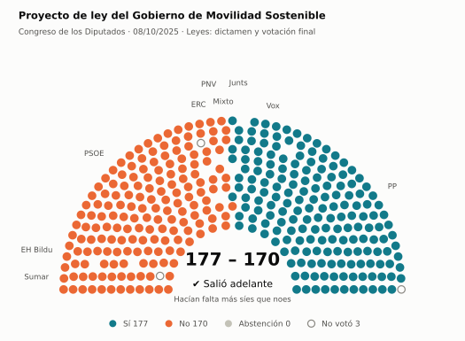
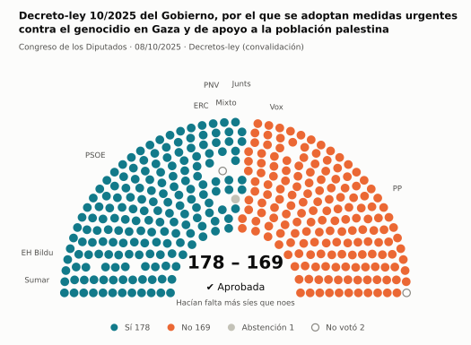
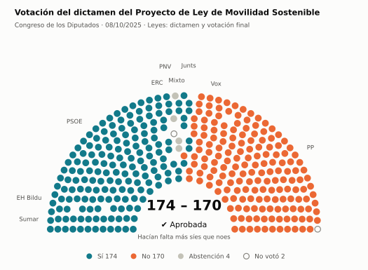
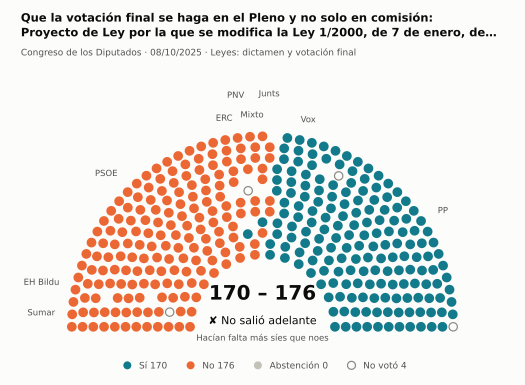
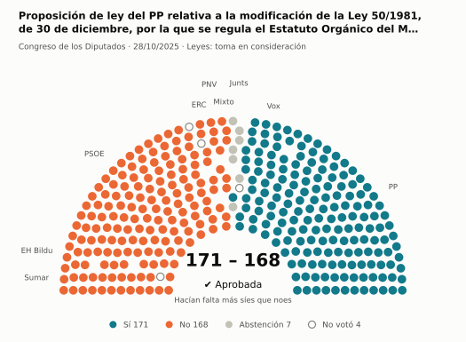
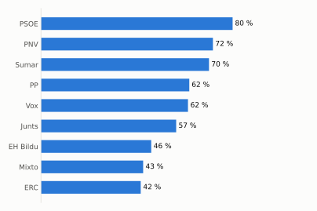
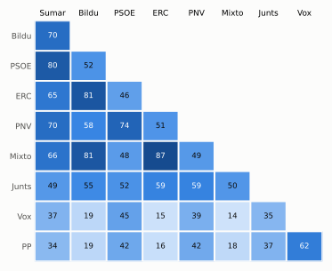

# Qué votó el Congreso en octubre de 2025

Las votaciones del Pleno del Congreso de los Diputados, explicadas sin tecnicismos. Datos oficiales del [Congreso](https://www.congreso.es/es/opendata/votaciones); este resumen se actualiza solo cada mes (última vez: 11/11/2026).

## En pocas palabras

- El Congreso votó **182 veces** en 7 días de pleno. **48 propuestas salieron adelante** y 134 no.
- 100 votaciones fueron sobre leyes, decretos o presupuestos. Otras 75 fueron peticiones al Gobierno que no le obligan (proposiciones no de ley y mociones).
- El Gobierno (PSOE y Sumar) perdió **19** de las 141 votaciones en las que sus grupos votaron lo mismo.
- La votación más reñida se decidió por 1 voto: Moción del PP sobre las actuaciones que piensa acometer el Gobierno en apoyo al medio rural y al sistema….
- Los diputados casi siempre votan lo mismo que su grupo: en todo el mes solo hubo 50 votos distintos (sin contar el Grupo Mixto).

## Las votaciones más importantes del mes

Elegidas por su importancia: pesan más las leyes y los decretos que las peticiones al Gobierno, y suben las que se decidieron por pocos votos o las que perdió el Gobierno. Cada punto del dibujo es un diputado, colocado con su grupo, y el color es lo que votó.

### 1. Proyecto de ley del Gobierno de Movilidad Sostenible

**8 de octubre · Leyes: dictamen y votación final.** Votación del texto de una ley después de trabajarla en comisión.

<picture>
  <source media="(prefers-color-scheme: dark)" srcset="img/2025-10/votacion-L15-S136-V074-oscuro.svg">
  
</picture>

**✔ Salió adelante** por 7 votos: 177 a favor, 170 en contra y ninguna abstención.

- **A favor:** PP, Vox y Junts
- **En contra:** PSOE, Sumar, ERC, EH Bildu y PNV
- **Repartidos:** Grupo Mixto (Sí 1, No 8)

Este asunto tuvo 86 votaciones este mes; aquí se muestra la más disputada. [Datos oficiales](https://www.congreso.es/webpublica/opendata/votaciones/Leg15/Sesion136/20251008/Votacion074/VOT_20251008195346.json)

### 2. Decreto-ley 10/2025 del Gobierno, por el que se adoptan medidas urgentes contra el genocidio en Gaza y de apoyo a la población palestina

**8 de octubre · Decretos-ley (convalidación).** El Gobierno aprobó esta norma por urgencia. Ya está en vigor, pero el Congreso tiene 30 días para confirmarla o tumbarla.

<picture>
  <source media="(prefers-color-scheme: dark)" srcset="img/2025-10/votacion-L15-S136-V087-oscuro.svg">
  
</picture>

**✔ Salió adelante** por 9 votos: 178 a favor, 169 en contra y 1 abstención.

- **A favor:** PSOE, Sumar, Junts, ERC, EH Bildu y PNV
- **En contra:** PP y Vox
- **Repartidos:** Grupo Mixto (Sí 8, Abstención 1)

[Datos oficiales](https://www.congreso.es/webpublica/opendata/votaciones/Leg15/Sesion136/20251008/Votacion087/VOT_20251008195359.json)

### 3. Votación del dictamen del Proyecto de Ley de Movilidad Sostenible

**8 de octubre · Leyes: dictamen y votación final.** Votación del texto de una ley después de trabajarla en comisión.

<picture>
  <source media="(prefers-color-scheme: dark)" srcset="img/2025-10/votacion-L15-S136-V116-oscuro.svg">
  
</picture>

**✔ Salió adelante** por 4 votos: 174 a favor, 170 en contra y 4 abstenciones.

- **A favor:** PSOE, Sumar, Junts, ERC, EH Bildu y PNV
- **En contra:** PP y Vox
- **Repartidos:** Grupo Mixto (Sí 4, No 1, Abstención 4)

[Datos oficiales](https://www.congreso.es/webpublica/opendata/votaciones/Leg15/Sesion136/20251008/Votacion116/VOT_20251008195430.json)

### 4. Que la votación final se haga en el Pleno y no solo en comisión: Proyecto de Ley por la que se modifica la Ley 1/2000, de 7 de enero, de…

**8 de octubre · Leyes: dictamen y votación final.** Votación del texto de una ley después de trabajarla en comisión.

<picture>
  <source media="(prefers-color-scheme: dark)" srcset="img/2025-10/votacion-L15-S136-V117-oscuro.svg">
  
</picture>

**✘ No salió adelante** por 6 votos: 170 a favor, 176 en contra y ninguna abstención.

- **A favor:** PP y Vox
- **En contra:** PSOE, Sumar, Junts, ERC (6 de 7), EH Bildu y PNV
- **Repartidos:** Grupo Mixto (Sí 1, No 8)

[Datos oficiales](https://www.congreso.es/webpublica/opendata/votaciones/Leg15/Sesion136/20251008/Votacion117/VOT_20251008195431.json)

### 5. Proposición de ley del PP relativa a la modificación de la Ley 50/1981, de 30 de diciembre, por la que se regula el Estatuto Orgánico del Ministerio…

**28 de octubre · Leyes: toma en consideración.** Primer paso de una ley propuesta por un grupo o una comunidad autónoma: el Congreso decide si empieza a tramitarla.

<picture>
  <source media="(prefers-color-scheme: dark)" srcset="img/2025-10/votacion-L15-S142-V001-oscuro.svg">
  
</picture>

**✔ Salió adelante** por 3 votos: 171 a favor, 168 en contra y 7 abstenciones.

- **A favor:** PP y Vox
- **En contra:** PSOE, Sumar, ERC, EH Bildu y PNV
- **Se abstuvieron:** Junts
- **Repartidos:** Grupo Mixto (Sí 1, No 7, Abstención 1)

[Datos oficiales](https://www.congreso.es/webpublica/opendata/votaciones/Leg15/Sesion142/20251028/Votacion001/VOT_20251028204540.json)

## ¿Qué grupos votaron más veces lo que finalmente salió?

<picture>
  <source media="(prefers-color-scheme: dark)" srcset="img/2025-10/ganadora-oscuro.svg">
  
</picture>

Porcentaje de votaciones en que el grupo votó Sí y salió adelante, o votó No y no salió. Abstenerse no cuenta como acertar.

## ¿Quién vota con quién?

<picture>
  <source media="(prefers-color-scheme: dark)" srcset="img/2025-10/afinidad-oscuro.svg">
  
</picture>

Cada casilla dice en qué porcentaje de las votaciones dos grupos votaron lo mismo: 100 es que siempre coincidieron y 0 que nunca.

## ¿Qué tipo de cosas se votaron?

| Tipo | Votaciones | Salieron adelante | Qué es |
| --- | ---: | ---: | --- |
| Leyes: dictamen y votación final | 88 | 4 | Votación del texto de una ley después de trabajarla en comisión. |
| Mociones | 55 | 24 | Petición al Gobierno después de pedirle explicaciones en el Pleno. Expresa la opinión del Congreso, pero no obliga. |
| Proposiciones no de ley | 20 | 6 | Petición al Gobierno para que haga algo. Expresa la opinión del Congreso, pero no obliga. |
| Leyes: toma en consideración | 8 | 5 | Primer paso de una ley propuesta por un grupo o una comunidad autónoma: el Congreso decide si empieza a tramitarla. |
| Tratados internacionales | 5 | 5 | El Congreso autoriza a España a comprometerse con un acuerdo con otro país u organismo. |
| Decretos-ley (convalidación) | 2 | 2 | El Gobierno aprobó esta norma por urgencia. Ya está en vigor, pero el Congreso tiene 30 días para confirmarla o tumbarla. |
| Organización de la Cámara | 2 | 2 | Asunto interno del Congreso: comisiones, plazos o el estatuto de los diputados. |
| Enmiendas a la totalidad | 2 | 0 | Un grupo intenta devolver la ley a quien la propuso o sustituirla por otra. Si no sale adelante, la ley sigue su camino. |

## Palabras que conviene saber

- **Pleno**: La reunión de los 350 diputados, donde se vota.
- **Grupo parlamentario**: Los diputados de un partido o coalición. Los partidos pequeños van juntos en el Grupo Mixto, aunque no piensen igual.
- **Abstención**: El diputado vota, pero ni a favor ni en contra.
- **No votó**: El diputado no votó: no estaba, estaba de baja o el escaño estaba vacío.
- **Mayoría simple**: Salen adelante las votaciones con más síes que noes. Es lo normal.
- **Mayoría absoluta**: 176 votos a favor, la mitad más uno de 350. La piden las leyes orgánicas (derechos fundamentales, sistema electoral…) y la primera votación de investidura.
- **Votación por llamamiento**: Cada diputado dice su voto en voz alta. Se usa en las investiduras y otras votaciones importantes.

---

**¿Quieres más detalle?** El [análisis detallado](2025-10-detalle.md) tiene la cohesión de cada grupo, un mapa de los diputados según cómo votan, qué diputados votaron distinto de su grupo, las ausencias y la lista completa de votaciones.

_Los resultados están calculados a partir de los votos: el Congreso no publica si cada votación salió adelante. Este proyecto no tiene relación con el Congreso. Método en [docs/DOCUMENTO_FUNCIONAL.md](../docs/DOCUMENTO_FUNCIONAL.md)._
