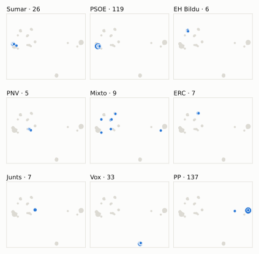
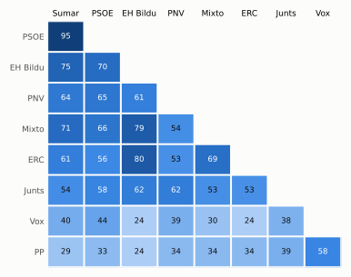

# Análisis detallado: noviembre de 2025

[← Volver al resumen del mes](2025-11.md)

_Generado automáticamente el 2026-11-10 con datos abiertos del [Congreso de los Diputados](https://www.congreso.es/es/opendata/votaciones). Solo plenos y Diputación Permanente. Método y límites en [docs/DOCUMENTO_FUNCIONAL.md](../docs/DOCUMENTO_FUNCIONAL.md)._

## Resumen

- **144 votaciones** en 5 días de pleno (sesiones 144, 146, 147, 148 y 151).
- **52 aprobadas** y **91 rechazadas**, más 1 empate que obligaron a repetir.
- 14 votaciones se decidieron por 5 votos o menos.
- El grupo que más veces votó con el resultado final: **PSOE** (78 % de las votaciones nominales).
- Los grupos del Gobierno (PSOE y Sumar) votaron lo mismo en 128 de 144 votaciones nominales y perdieron 21 de ellas.
- 34 votos individuales se apartaron de la posición de su grupo (27 diputados).

## Cómo votó cada grupo

| Grupo | Diputados | Cohesión | Votó con el resultado | Decisivo | Posición Sí | Posición No | Posición Abst. |
| --- | ---: | ---: | ---: | ---: | ---: | ---: | ---: |
| PP | 137 | 100 % | 55 % | 25 | 107 | 31 | 6 |
| PSOE | 120 | 100 % | 78 % | 59 | 34 | 100 | 10 |
| Vox | 33 | 100 % | 61 % | 26 | 54 | 67 | 23 |
| Sumar | 26 | 100 % | 74 % | 25 | 41 | 94 | 9 |
| Mixto | 9 | 68 % | 62 % | 13 | 67 | 69 | 7 |
| Junts | 7 | 100 % | 61 % | 10 | 55 | 77 | 10 |
| ERC | 7 | 100 % | 53 % | 9 | 73 | 54 | 17 |
| EH Bildu | 6 | 99 % | 56 % | 8 | 61 | 73 | 9 |
| PNV | 5 | 99 % | 65 % | 4 | 51 | 71 | 22 |

*Cohesión*: índice de acuerdo interno (100 % = todo el grupo votó igual). *Votó con el resultado*: el grupo votó Sí y salió aprobada, o No y salió rechazada. *Decisivo*: votaciones cuyo resultado habría cambiado si el grupo se hubiera abstenido en bloque. El Grupo Mixto reúne partidos distintos: su posición es la de su mayoría.

## Mapa de diputados

<picture>
  <source media="(prefers-color-scheme: dark)" srcset="img/2025-11/mapa-oscuro.svg">
  
</picture>

Cada punto es un diputado; dos diputados están cerca si votaron parecido. Un punto más grande reúne a varios que votaron exactamente igual. En cada panel, el grupo en azul y el resto del Congreso en gris.

*Cómo se calcula*: componentes principales de los votos (Sí, No, abstención) en 137 votaciones con algún desacuerdo. El eje horizontal recoge el 75 % de la variación y el vertical el 11 %. Los ejes no tienen nombre ni sentido político propio; por convención, el PP queda a la derecha. No se sitúa a 1 diputado que votó en menos de la mitad.

## Afinidad entre grupos

<picture>
  <source media="(prefers-color-scheme: dark)" srcset="img/2025-11/afinidad-oscuro.svg">
  
</picture>

Porcentaje de votaciones nominales en que los dos grupos tomaron la misma posición. Los grupos están ordenados según el mapa de diputados.

Ver la tabla

|  | PP | PSOE | Vox | Sumar | Mixto | Junts | ERC | EH Bildu | PNV |
| --- | :---: | :---: | :---: | :---: | :---: | :---: | :---: | :---: | :---: |
| PP | 100 % | 33 % | 58 % | 29 % | 34 % | 39 % | 34 % | 24 % | 34 % |
| PSOE | 33 % | 100 % | 44 % | 95 % | 66 % | 58 % | 56 % | 70 % | 65 % |
| Vox | 58 % | 44 % | 100 % | 40 % | 30 % | 38 % | 24 % | 24 % | 39 % |
| Sumar | 29 % | 95 % | 40 % | 100 % | 71 % | 54 % | 61 % | 75 % | 64 % |
| Mixto | 34 % | 66 % | 30 % | 71 % | 100 % | 53 % | 69 % | 79 % | 54 % |
| Junts | 39 % | 58 % | 38 % | 54 % | 53 % | 100 % | 53 % | 62 % | 62 % |
| ERC | 34 % | 56 % | 24 % | 61 % | 69 % | 53 % | 100 % | 80 % | 53 % |
| EH Bildu | 24 % | 70 % | 24 % | 75 % | 79 % | 62 % | 80 % | 100 % | 61 % |
| PNV | 34 % | 65 % | 39 % | 64 % | 54 % | 62 % | 53 % | 61 % | 100 % |

## Quién sacó adelante las votaciones

| Grupos que votaron Sí | Votaciones | Escaños |
| --- | ---: | ---: |
| Todos los grupos | 8 | 350 |
| PP + Vox | 4 | 170 |
| PP + PSOE + Sumar + Mixto + ERC + EH Bildu + PNV | 4 | 310 |
| PP + Vox + Mixto | 3 | 179 |
| PSOE + Sumar + Mixto + Junts + ERC + EH Bildu + PNV | 2 | 180 |
| PP + PSOE + Sumar + Mixto + Junts + ERC + EH Bildu + PNV | 2 | 317 |
| PP + Vox + ERC + PNV | 2 | 182 |
| PP + Vox + Junts + ERC + PNV | 2 | 189 |

De 52 votaciones nominales aprobadas. Otras 25 salieron con combinaciones que se dieron menos veces. La posición de cada grupo es la de la mayoría de sus diputados.

## Votaciones que perdieron los grupos del Gobierno

| Fecha | Asunto | Tipo | PSOE y Sumar votaron | Resultado | Sí | No |
| --- | --- | --- | :---: | --- | ---: | ---: |
| 11 de noviembre | Proposición de Ley del Grupo Parlamentario Republicano, de medidas fiscales para combatir la especulación inmobiliaria. | Leyes: toma en consideración | Sí | Rechazada | 163 | 171 |
| 13 de noviembre | Proyecto de Ley por la que se regulan los servicios de atención a la clientela. *(Enmiendas presentadas por el Grupo Parlamentario Plurinacio…)* | Leyes: dictamen y votación final | Sí | Rechazada | 166 | 182 |
| 13 de noviembre | Proyecto de Ley por la que se regulan los servicios de atención a la clientela. *(Enmiendas presentadas por el Grupo Parlamentario Plurinacio…)* | Leyes: dictamen y votación final | Sí | Rechazada | 166 | 177 |
| 13 de noviembre | Proyecto de Ley por la que se regulan los servicios de atención a la clientela. *(Enmiendas presentadas por el Grupo Parlamentario Plurinacio…)* | Leyes: dictamen y votación final | Sí | Rechazada | 167 | 176 |
| 13 de noviembre | Proyecto de Ley por la que se regulan los servicios de atención a la clientela. *(Enmiendas presentadas por el Grupo Parlamentario Popular en…)* | Leyes: dictamen y votación final | No | Aprobada | 170 | 160 |
| 13 de noviembre | Proyecto de Ley por la que se regulan los servicios de atención a la clientela. *(Enmiendas presentadas por el Grupo Parlamentario Popular en…)* | Leyes: dictamen y votación final | No | Aprobada | 174 | 166 |
| 13 de noviembre | Proyecto de Ley por la que se regulan los servicios de atención a la clientela. *(Enmiendas presentadas por el Grupo Parlamentario Popular en…)* | Leyes: dictamen y votación final | No | Aprobada | 176 | 162 |
| 13 de noviembre | Proyecto de Ley por la que se regulan los servicios de atención a la clientela. *(Enmiendas presentadas por el Grupo Parlamentario Popular en…)* | Leyes: dictamen y votación final | No | Aprobada | 169 | 166 |
| 13 de noviembre | Proyecto de Ley por la que se regulan los servicios de atención a la clientela. *(Enmiendas presentadas por el Grupo Parlamentario Popular en…)* | Leyes: dictamen y votación final | No | Aprobada | 169 | 165 |
| 13 de noviembre | Moción consecuencia de interpelación urgente del Grupo Parlamentario Popular en el Congreso, sobre la política fiscal del Gobierno y su falta de coherencia con… | Mociones | No | Aprobada | 171 | 166 |
| 13 de noviembre | Proyecto de Ley de Movilidad Sostenible. *(Votación separada de las enmiendas Enmiendas al artículo 26…)* | Leyes: enmiendas del Senado | No | Aprobada | 175 | 174 |
| 13 de noviembre | Proyecto de Ley de Movilidad Sostenible. *(Votación separada de las enmiendas Enmienda al artículo 41.)* | Leyes: enmiendas del Senado | No | Aprobada | 175 | 174 |
| 13 de noviembre | Proyecto de Ley de Movilidad Sostenible. *(Votación separada de las enmiendas Enmienda al artículo 48.)* | Leyes: enmiendas del Senado | No | Aprobada | 186 | 162 |
| 13 de noviembre | Proyecto de Ley de Movilidad Sostenible. *(Votación separada de las enmiendas Enmienda a la disposició…)* | Leyes: enmiendas del Senado | No | Aprobada | 179 | 171 |
| 13 de noviembre | Proyecto de Ley de Movilidad Sostenible. *(Votación separada de las enmiendas Enmienda a la disposició…)* | Leyes: enmiendas del Senado | No | Aprobada | 191 | 158 |

Y 6 más (ver «Todas las votaciones»).

Además, PSOE y Sumar votaron distinto entre sí en 7 votaciones.

## Votaciones más ajustadas

| Fecha | Asunto | Resultado | Sí | No | Abst. |
| --- | --- | :---: | ---: | ---: | ---: |
| 13 de noviembre | Proyecto de Ley de Movilidad Sostenible. *(Votación separada de las enmiendas Enmienda al artículo 41.)* | Empate (se repite) | 175 | 175 | 0 |
| 13 de noviembre | Proyecto de Ley por la que se regulan los servicios de atención a la clientela. *(Enmiendas presentadas por el Grupo Parlamentario Popular en…)* | Rechazada | 173 | 174 | 0 |
| 13 de noviembre | Proyecto de Ley por la que se regulan los servicios de atención a la clientela. *(Enmiendas presentadas por el Grupo Parlamentario Popular en…)* | Rechazada | 170 | 171 | 7 |
| 13 de noviembre | Proyecto de Ley de Movilidad Sostenible. *(Votación separada de las enmiendas Enmiendas al artículo 26…)* | Aprobada | 175 | 174 | 0 |
| 13 de noviembre | Proyecto de Ley de Movilidad Sostenible. *(Votación separada de las enmiendas Enmienda al artículo 41.)* | Aprobada | 175 | 174 | 0 |
| 13 de noviembre | Proyecto de Ley de Movilidad Sostenible. *(Votación separada de las enmiendas Enmienda a la disposició…)* | Rechazada | 171 | 172 | 7 |
| 13 de noviembre | Proyecto de Ley por la que se regulan los servicios de atención a la clientela. *(Enmiendas presentadas por el Grupo Parlamentario Popular en…)* | Rechazada | 170 | 172 | 5 |
| 13 de noviembre | Proyecto de Ley por la que se regulan los servicios de atención a la clientela. *(Enmiendas presentadas por el Grupo Parlamentario Popular en…)* | Aprobada | 169 | 166 | 12 |
| 13 de noviembre | Proyecto de Ley por la que se regulan los servicios de atención a la clientela. *(Enmiendas presentadas por el Grupo Parlamentario Popular en…)* | Aprobada | 169 | 165 | 12 |
| 27 de noviembre | Moción consecuencia de interpelación urgente del Grupo Parlamentario Popular en el Congreso, sobre el fracaso en todos los ámbitos de la política de seguridad… | Rechazada | 171 | 175 | 0 |

Votaciones decididas por 10 votos o menos (o a esa distancia de la mayoría que exigían). Las públicas por llamamiento no tienen hemiciclo: el voto de cada diputado solo consta en el Diario de Sesiones.

## Qué se votó, por tipo de asunto

| Tipo de asunto | Votaciones | Aprobadas | No aprobadas |
| --- | ---: | ---: | ---: |
| Leyes: dictamen y votación final | 59 | 12 | 47 |
| Leyes: enmiendas del Senado | 52 | 20 | 32 |
| Proposiciones no de ley | 10 | 8 | 2 |
| Mociones | 10 | 4 | 6 |
| Leyes: toma en consideración | 5 | 1 | 4 |
| Decretos-ley (convalidación) | 4 | 4 | 0 |
| Enmiendas a la totalidad | 1 | 1 | 0 |
| Organización de la Cámara | 1 | 1 | 0 |
| Tratados internacionales | 1 | 1 | 0 |
| Presupuestos y estabilidad | 1 | 0 | 1 |

Las proposiciones no de ley y las mociones expresan la posición del Congreso pero no obligan al Gobierno. Las leyes pasan por varias votaciones (toma en consideración, totalidad, dictamen, Senado), así que una misma ley puede aparecer varias veces.

## Votos distintos de su grupo

| Diputado | Grupo | Votos distintos de su grupo |
| --- | --- | ---: |
| Agirretxea Urresti, Joseba Andoni | PNV | 3 |
| Boada Danés, Júlia | Sumar | 2 |
| Cofiño Fernández, Rafael | Sumar | 2 |
| Hernando Fraile, Rafael Antonio | PP | 2 |
| Pozueta Fernández, Isabel | EH Bildu | 2 |
| Zaragoza Alonso, José | PSOE | 2 |
| Aguirre Gil de Biedma, Rocío | Vox | 1 |
| Aizpurua Arzallus, Mertxe | EH Bildu | 1 |
| Asarta Cuevas, Alberto | Vox | 1 |
| Beamonte Mesa, Luis María | PP | 1 |
| Bermúdez de Castro Fernández, José Antonio | PP | 1 |
| Carballedo Berlanga, María Eugenia | PP | 1 |
| Cercas Mena, Blanca | PSOE | 1 |
| De las Cuevas Cortés, Félix | PP | 1 |
| Delgado-Taramona Hernández, Jimena | PP | 1 |

Un voto aislado puede ser un error al pulsar, no una decisión política: el Congreso no publica las correcciones. Se excluye el Grupo Mixto.

## Diputados que más veces no votaron

| Diputado | Grupo | No votó | % de votaciones |
| --- | --- | ---: | ---: |
| Sánchez Pérez-Castejón, Pedro | PSOE | 85 | 59 % |
| Núñez Feijóo, Alberto | PP | 60 | 42 % |
| Ábalos Meco, José Luis | Mixto | 25 | 17 % |
| Vidal Sáez, Aina | Sumar | 18 | 12 % |
| Bravo Baena, Juan | PP | 9 | 6 % |
| Abascal Conde, Santiago | Vox | 7 | 5 % |
| Fernández Hernández, Pedro | Vox | 7 | 5 % |
| Ibáñez Hernando, Ángel | PP | 6 | 4 % |
| Gavin i Valls, Isidre | Junts | 4 | 3 % |
| Montero Cuadrado, María Jesús | PSOE | 4 | 3 % |
| Ibáñez Mezquita, Alberto | Sumar | 3 | 2 % |
| Iñarritu García, Jon | EH Bildu | 3 | 2 % |
| Legarda Uriarte, Mikel | PNV | 3 | 2 % |
| Acedo Reyes, Sofía | PP | 2 | 1 % |
| Alós López, Ana Isabel | PP | 2 | 1 % |

«No vota» incluye ausencias justificadas (baja, maternidad o paternidad) y escaños vacantes; el portal no las distingue.

## Todas las votaciones

Posición de cada grupo: la opción que votó la mayoría de sus diputados (*Div.*: empate dentro del grupo). El número enlaza al JSON oficial o, en las votaciones por llamamiento, al Diario de Sesiones.

### 11 de noviembre (sesión 144)

| Nº | Asunto | Resultado | Sí | No | Abst. | PP | PSOE | Vox | Sumar | Mixto | Junts | ERC | EH Bildu | PNV | Decisivos |
| ---: | --- | --- | ---: | ---: | ---: | :---: | :---: | :---: | :---: | :---: | :---: | :---: | :---: | :---: | --- |
| [1](https://www.congreso.es/webpublica/opendata/votaciones/Leg15/Sesion144/20251111/Votacion001/VOT_20251111210354.json) | Propuesta de reforma del Estatuto de Autonomía para Castilla-La Mancha. | Aprobada | 288 | 34 | 13 | Sí | Sí | No | Sí | Abst. | — | Abst. | — | Sí |  |
| [2](https://www.congreso.es/webpublica/opendata/votaciones/Leg15/Sesion144/20251111/Votacion002/VOT_20251111210356.json) | Proposición de Ley del Grupo Parlamentario Republicano, de medidas fiscales para combatir la especulación inmobiliaria. | Rechazada | 163 | 171 | 13 | No | Sí | No | Sí | Sí | Abst. | Sí | Sí | Abst. | PP, Vox |

### 13 de noviembre (sesión 146)

| Nº | Asunto | Resultado | Sí | No | Abst. | PP | PSOE | Vox | Sumar | Mixto | Junts | ERC | EH Bildu | PNV | Decisivos |
| ---: | --- | --- | ---: | ---: | ---: | :---: | :---: | :---: | :---: | :---: | :---: | :---: | :---: | :---: | --- |
| [1](https://www.congreso.es/webpublica/opendata/votaciones/Leg15/Sesion146/20251113/Votacion001/VOT_20251113131219.json) | Proyecto de Ley por la que se regulan los servicios de atención a la clientela. *(Enmiendas presentadas por el Grupo Parlamentario Mixto (Sra…)* | Rechazada | 161 | 186 | 0 | Sí | No | No | No | Sí | Sí | Sí | Sí | No | PSOE, Sumar, Vox |
| [2](https://www.congreso.es/webpublica/opendata/votaciones/Leg15/Sesion146/20251113/Votacion002/VOT_20251113131221.json) | Proyecto de Ley por la que se regulan los servicios de atención a la clientela. *(Enmiendas presentadas por el Grupo Parlamentario Mixto (Sra…)* | Rechazada | 26 | 320 | 0 | No | No | No | No | Sí | Sí | Sí | Sí | No |  |
| [3](https://www.congreso.es/webpublica/opendata/votaciones/Leg15/Sesion146/20251113/Votacion003/VOT_20251113131222.json) | Proyecto de Ley por la que se regulan los servicios de atención a la clientela. *(Enmiendas presentadas por el Grupo Parlamentario Mixto (Sra…)* | Rechazada | 19 | 328 | 0 | No | No | No | No | Sí | No | Sí | Sí | No |  |
| [4](https://www.congreso.es/webpublica/opendata/votaciones/Leg15/Sesion146/20251113/Votacion004/VOT_20251113131223.json) | Proyecto de Ley por la que se regulan los servicios de atención a la clientela. *(Enmiendas presentadas por el Grupo Parlamentario Mixto (Sr.…)* | Rechazada | 26 | 316 | 5 | No | No | No | No | Sí | Sí | Sí | Sí | Abst. |  |
| [5](https://www.congreso.es/webpublica/opendata/votaciones/Leg15/Sesion146/20251113/Votacion005/VOT_20251113131224.json) | Proyecto de Ley por la que se regulan los servicios de atención a la clientela. *(Enmiendas presentadas por el Grupo Parlamentario Mixto (Sr.…)* | Rechazada | 31 | 316 | 0 | No | No | No | No | Sí | Sí | Sí | Sí | Sí |  |
| [6](https://www.congreso.es/webpublica/opendata/votaciones/Leg15/Sesion146/20251113/Votacion006/VOT_20251113131225.json) | Proyecto de Ley por la que se regulan los servicios de atención a la clientela. *(Enmiendas presentadas por el Grupo Parlamentario Mixto (Sr.…)* | Rechazada | 19 | 321 | 7 | No | No | No | No | Sí | Abst. | Sí | Sí | No |  |
| [7](https://www.congreso.es/webpublica/opendata/votaciones/Leg15/Sesion146/20251113/Votacion007/VOT_20251113131226.json) | Proyecto de Ley por la que se regulan los servicios de atención a la clientela. *(Enmiendas presentadas por el Grupo Parlamentario Mixto (Sr.…)* | Rechazada | 153 | 186 | 8 | Sí | No | No | No | Sí | Sí | Abst. | Sí | No | PSOE |
| [8](https://www.congreso.es/webpublica/opendata/votaciones/Leg15/Sesion146/20251113/Votacion008/VOT_20251113131228.json) | Proyecto de Ley por la que se regulan los servicios de atención a la clientela. *(Enmiendas presentadas por el Grupo Parlamentario Mixto (Sr.…)* | Rechazada | 154 | 193 | 0 | Sí | No | No | No | Sí | No | Sí | Sí | No | PSOE |
| [9](https://www.congreso.es/webpublica/opendata/votaciones/Leg15/Sesion146/20251113/Votacion009/VOT_20251113131229.json) | Proyecto de Ley por la que se regulan los servicios de atención a la clientela. *(Enmiendas presentadas por el Grupo Parlamentario Mixto (Sr.…)* | Rechazada | 19 | 328 | 0 | No | No | No | No | Sí | No | Sí | Sí | No |  |
| [10](https://www.congreso.es/webpublica/opendata/votaciones/Leg15/Sesion146/20251113/Votacion010/VOT_20251113131231.json) | Proyecto de Ley por la que se regulan los servicios de atención a la clientela. *(Enmiendas presentadas por el Grupo Parlamentario Mixto (Sr.…)* | Rechazada | 19 | 316 | 12 | No | No | No | No | Sí | Abst. | Sí | Sí | Abst. |  |
| [11](https://www.congreso.es/webpublica/opendata/votaciones/Leg15/Sesion146/20251113/Votacion011/VOT_20251113131232.json) | Proyecto de Ley por la que se regulan los servicios de atención a la clientela. *(Enmiendas presentadas por el Grupo Parlamentario Mixto (Sr.…)* | Rechazada | 26 | 322 | 0 | No | No | No | No | Sí | Sí | Sí | Sí | No |  |
| [12](https://www.congreso.es/webpublica/opendata/votaciones/Leg15/Sesion146/20251113/Votacion012/VOT_20251113131233.json) | Proyecto de Ley por la que se regulan los servicios de atención a la clientela. *(Enmiendas presentadas por el Grupo Parlamentario Vasco (EAJ…)* | Rechazada | 13 | 335 | 0 | No | No | No | No | No | Sí | No | No | Sí |  |
| [13](https://www.congreso.es/webpublica/opendata/votaciones/Leg15/Sesion146/20251113/Votacion013/VOT_20251113131235.json) | Proyecto de Ley por la que se regulan los servicios de atención a la clientela. *(Enmiendas presentadas por el Grupo Parlamentario Vasco (EAJ…)* | Rechazada | 27 | 320 | 0 | No | No | No | No | No | Sí | Sí | Sí | Sí |  |
| [14](https://www.congreso.es/webpublica/opendata/votaciones/Leg15/Sesion146/20251113/Votacion014/VOT_20251113131237.json) | Proyecto de Ley por la que se regulan los servicios de atención a la clientela. *(Enmiendas presentadas por el Grupo Parlamentario Junts per…)* | Rechazada | 26 | 321 | 0 | No | No | No | No | No | Sí | Sí | Sí | Sí |  |
| [15](https://www.congreso.es/webpublica/opendata/votaciones/Leg15/Sesion146/20251113/Votacion015/VOT_20251113131238.json) | Proyecto de Ley por la que se regulan los servicios de atención a la clientela. *(Enmiendas presentadas por el Grupo Parlamentario Junts per…)* | Rechazada | 149 | 198 | 1 | Sí | No | No | No | No | Sí | No | No | Sí | PSOE |
| [16](https://www.congreso.es/webpublica/opendata/votaciones/Leg15/Sesion146/20251113/Votacion016/VOT_20251113131240.json) | Proyecto de Ley por la que se regulan los servicios de atención a la clientela. *(Enmiendas presentadas por el Grupo Parlamentario Junts per…)* | Rechazada | 7 | 340 | 0 | No | No | No | No | No | Sí | No | No | No |  |
| [17](https://www.congreso.es/webpublica/opendata/votaciones/Leg15/Sesion146/20251113/Votacion017/VOT_20251113131241.json) | Proyecto de Ley por la que se regulan los servicios de atención a la clientela. *(Enmiendas presentadas por el Grupo Parlamentario Junts per…)* | Rechazada | 21 | 327 | 0 | No | No | No | No | No | Sí | Sí | Sí | No |  |
| [18](https://www.congreso.es/webpublica/opendata/votaciones/Leg15/Sesion146/20251113/Votacion018/VOT_20251113131242.json) | Proyecto de Ley por la que se regulan los servicios de atención a la clientela. *(Enmiendas presentadas por el Grupo Parlamentario Junts per…)* | Rechazada | 155 | 185 | 8 | Sí | No | No | No | No | Sí | Abst. | Sí | Sí | PSOE, Vox |
| [19](https://www.congreso.es/webpublica/opendata/votaciones/Leg15/Sesion146/20251113/Votacion019/VOT_20251113131243.json) | Proyecto de Ley por la que se regulan los servicios de atención a la clientela. *(Enmiendas presentadas por el Grupo Parlamentario Junts per…)* | Rechazada | 7 | 322 | 19 | No | No | No | No | No | Sí | Abst. | Abst. | Abst. |  |
| [20](https://www.congreso.es/webpublica/opendata/votaciones/Leg15/Sesion146/20251113/Votacion020/VOT_20251113131244.json) | Proyecto de Ley por la que se regulan los servicios de atención a la clientela. *(Enmiendas presentadas por el Grupo Parlamentario Junts per…)* | Rechazada | 12 | 334 | 1 | No | No | No | No | No | Sí | No | No | Sí |  |
| [21](https://www.congreso.es/webpublica/opendata/votaciones/Leg15/Sesion146/20251113/Votacion021/VOT_20251113131246.json) | Proyecto de Ley por la que se regulan los servicios de atención a la clientela. *(Enmiendas presentadas por el Grupo Parlamentario Junts per…)* | Rechazada | 156 | 185 | 6 | Sí | No | No | No | No | Sí | Sí | Sí | Abst. | PSOE, Vox |
| [22](https://www.congreso.es/webpublica/opendata/votaciones/Leg15/Sesion146/20251113/Votacion022/VOT_20251113131247.json) | Proyecto de Ley por la que se regulan los servicios de atención a la clientela. *(Enmiendas presentadas por el Grupo Parlamentario Republican…)* | Rechazada | 27 | 320 | 0 | No | No | No | No | Sí | Sí | Sí | Sí | No |  |
| [23](https://www.congreso.es/webpublica/opendata/votaciones/Leg15/Sesion146/20251113/Votacion023/VOT_20251113131248.json) | Proyecto de Ley por la que se regulan los servicios de atención a la clientela. *(Enmiendas presentadas por el Grupo Parlamentario Republican…)* | Rechazada | 154 | 188 | 6 | Sí | No | No | No | Sí | No | Sí | Sí | Abst. | PSOE |
| [24](https://www.congreso.es/webpublica/opendata/votaciones/Leg15/Sesion146/20251113/Votacion024/VOT_20251113131249.json) | Proyecto de Ley por la que se regulan los servicios de atención a la clientela. *(Enmiendas presentadas por el Grupo Parlamentario Republican…)* | Rechazada | 161 | 184 | 2 | Sí | No | No | No | Sí | Sí | Sí | Sí | No | PSOE, Sumar, Vox |
| [25](https://www.congreso.es/webpublica/opendata/votaciones/Leg15/Sesion146/20251113/Votacion025/VOT_20251113131250.json) | Proyecto de Ley por la que se regulan los servicios de atención a la clientela. *(Enmiendas presentadas por el Grupo Parlamentario Republican…)* | Rechazada | 31 | 317 | 0 | No | No | No | No | Sí | Sí | Sí | Sí | Sí |  |
| [26](https://www.congreso.es/webpublica/opendata/votaciones/Leg15/Sesion146/20251113/Votacion026/VOT_20251113131251.json) | Proyecto de Ley por la que se regulan los servicios de atención a la clientela. *(Enmiendas presentadas por el Grupo Parlamentario Plurinacio…)* | Rechazada | 45 | 298 | 5 | No | No | No | Sí | Sí | No | Sí | Sí | Abst. |  |
| [27](https://www.congreso.es/webpublica/opendata/votaciones/Leg15/Sesion146/20251113/Votacion027/VOT_20251113131252.json) | Proyecto de Ley por la que se regulan los servicios de atención a la clientela. *(Enmiendas presentadas por el Grupo Parlamentario Plurinacio…)* | Rechazada | 44 | 298 | 5 | No | No | No | Sí | Sí | No | Sí | Sí | Abst. |  |
| [28](https://www.congreso.es/webpublica/opendata/votaciones/Leg15/Sesion146/20251113/Votacion028/VOT_20251113131253.json) | Proyecto de Ley por la que se regulan los servicios de atención a la clientela. *(Enmiendas presentadas por el Grupo Parlamentario Plurinacio…)* | Rechazada | 166 | 182 | 0 | No | Sí | No | Sí | Sí | No | Sí | Sí | No | PP, Vox |
| [29](https://www.congreso.es/webpublica/opendata/votaciones/Leg15/Sesion146/20251113/Votacion029/VOT_20251113131254.json) | Proyecto de Ley por la que se regulan los servicios de atención a la clientela. *(Enmiendas presentadas por el Grupo Parlamentario Plurinacio…)* | Rechazada | 50 | 298 | 0 | No | No | No | Sí | Sí | No | Sí | Sí | Sí |  |
| [30](https://www.congreso.es/webpublica/opendata/votaciones/Leg15/Sesion146/20251113/Votacion030/VOT_20251113131256.json) | Proyecto de Ley por la que se regulan los servicios de atención a la clientela. *(Enmiendas presentadas por el Grupo Parlamentario Plurinacio…)* | Rechazada | 166 | 177 | 5 | No | Sí | No | Sí | Sí | No | Sí | Sí | Abst. | PP, Vox |
| [31](https://www.congreso.es/webpublica/opendata/votaciones/Leg15/Sesion146/20251113/Votacion031/VOT_20251113131257.json) | Proyecto de Ley por la que se regulan los servicios de atención a la clientela. *(Enmiendas presentadas por el Grupo Parlamentario Plurinacio…)* | Rechazada | 45 | 298 | 5 | No | No | No | Sí | Sí | No | Sí | Sí | Abst. |  |
| [32](https://www.congreso.es/webpublica/opendata/votaciones/Leg15/Sesion146/20251113/Votacion032/VOT_20251113131259.json) | Proyecto de Ley por la que se regulan los servicios de atención a la clientela. *(Enmiendas presentadas por el Grupo Parlamentario Plurinacio…)* | Rechazada | 46 | 302 | 0 | No | No | No | Sí | Sí | No | Sí | Sí | No |  |
| [33](https://www.congreso.es/webpublica/opendata/votaciones/Leg15/Sesion146/20251113/Votacion033/VOT_20251113131300.json) | Proyecto de Ley por la que se regulan los servicios de atención a la clientela. *(Enmiendas presentadas por el Grupo Parlamentario Plurinacio…)* | Rechazada | 167 | 176 | 5 | No | Sí | No | Sí | Sí | No | Sí | Sí | Abst. | PP, Vox |
| [34](https://www.congreso.es/webpublica/opendata/votaciones/Leg15/Sesion146/20251113/Votacion034/VOT_20251113131301.json) | Proyecto de Ley por la que se regulan los servicios de atención a la clientela. *(Enmiendas presentadas por el Grupo Parlamentario Plurinacio…)* | Rechazada | 45 | 298 | 5 | No | No | No | Sí | Sí | No | Sí | Sí | Abst. |  |
| [35](https://www.congreso.es/webpublica/opendata/votaciones/Leg15/Sesion146/20251113/Votacion035/VOT_20251113131303.json) | Proyecto de Ley por la que se regulan los servicios de atención a la clientela. *(Enmiendas presentadas por el Grupo Parlamentario Popular en…)* | Rechazada | 173 | 174 | 0 | Sí | No | Sí | No | No | No | No | No | Sí | EH Bildu, Junts, Mixto, ERC, PSOE, Sumar |
| [36](https://www.congreso.es/webpublica/opendata/votaciones/Leg15/Sesion146/20251113/Votacion036/VOT_20251113131304.json) | Proyecto de Ley por la que se regulan los servicios de atención a la clientela. *(Enmiendas presentadas por el Grupo Parlamentario Popular en…)* | Rechazada | 170 | 171 | 7 | Sí | No | Sí | No | No | No | Abst. | No | No | EH Bildu, Junts, Mixto, PSOE, Sumar, PNV |
| [37](https://www.congreso.es/webpublica/opendata/votaciones/Leg15/Sesion146/20251113/Votacion037/VOT_20251113131305.json) | Proyecto de Ley por la que se regulan los servicios de atención a la clientela. *(Enmiendas presentadas por el Grupo Parlamentario Popular en…)* | Rechazada | 137 | 176 | 33 | Sí | No | Abst. | No | No | No | No | No | No | PSOE |
| [38](https://www.congreso.es/webpublica/opendata/votaciones/Leg15/Sesion146/20251113/Votacion038/VOT_20251113131307.json) | Proyecto de Ley por la que se regulan los servicios de atención a la clientela. *(Enmiendas presentadas por el Grupo Parlamentario Popular en…)* | Aprobada | 170 | 160 | 18 | Sí | No | Sí | No | No | No | Abst. | Abst. | Abst. | PP, Vox |
| [39](https://www.congreso.es/webpublica/opendata/votaciones/Leg15/Sesion146/20251113/Votacion039/VOT_20251113131309.json) | Proyecto de Ley por la que se regulan los servicios de atención a la clientela. *(Enmiendas presentadas por el Grupo Parlamentario Popular en…)* | Aprobada | 174 | 166 | 8 | Sí | No | Sí | No | Sí | No | Abst. | No | No | PP, Vox |
| [40](https://www.congreso.es/webpublica/opendata/votaciones/Leg15/Sesion146/20251113/Votacion040/VOT_20251113131310.json) | Proyecto de Ley por la que se regulan los servicios de atención a la clientela. *(Enmiendas presentadas por el Grupo Parlamentario Popular en…)* | Rechazada | 137 | 173 | 38 | Sí | No | Abst. | No | No | No | No | No | Abst. | PSOE |
| [41](https://www.congreso.es/webpublica/opendata/votaciones/Leg15/Sesion146/20251113/Votacion041/VOT_20251113131311.json) | Proyecto de Ley por la que se regulan los servicios de atención a la clientela. *(Enmiendas presentadas por el Grupo Parlamentario Popular en…)* | Rechazada | 137 | 211 | 0 | Sí | No | No | No | No | No | No | No | No | PSOE |
| [42](https://www.congreso.es/webpublica/opendata/votaciones/Leg15/Sesion146/20251113/Votacion042/VOT_20251113131312.json) | Proyecto de Ley por la que se regulan los servicios de atención a la clientela. *(Enmiendas presentadas por el Grupo Parlamentario Popular en…)* | Rechazada | 170 | 172 | 5 | Sí | No | Sí | No | No | No | No | No | Abst. | EH Bildu, Junts, Mixto, ERC, PSOE, Sumar |
| [43](https://www.congreso.es/webpublica/opendata/votaciones/Leg15/Sesion146/20251113/Votacion043/VOT_20251113131313.json) | Proyecto de Ley por la que se regulan los servicios de atención a la clientela. *(Enmiendas presentadas por el Grupo Parlamentario Popular en…)* | Aprobada | 176 | 162 | 8 | Sí | No | Sí | No | Sí | No | Abst. | No | Sí | PP, Vox |
| [44](https://www.congreso.es/webpublica/opendata/votaciones/Leg15/Sesion146/20251113/Votacion044/VOT_20251113131314.json) | Proyecto de Ley por la que se regulan los servicios de atención a la clientela. *(Enmiendas presentadas por el Grupo Parlamentario Popular en…)* | Aprobada | 169 | 166 | 12 | Sí | No | Sí | No | No | No | Abst. | No | Abst. | PP, Vox |
| [45](https://www.congreso.es/webpublica/opendata/votaciones/Leg15/Sesion146/20251113/Votacion045/VOT_20251113131315.json) | Proyecto de Ley por la que se regulan los servicios de atención a la clientela. *(Enmiendas presentadas por el Grupo Parlamentario Popular en…)* | Aprobada | 169 | 165 | 12 | Sí | No | Sí | No | No | No | Abst. | Abst. | No | PP, Vox |
| [46](https://www.congreso.es/webpublica/opendata/votaciones/Leg15/Sesion146/20251113/Votacion046/VOT_20251113131316.json) | Proyecto de Ley por la que se regulan los servicios de atención a la clientela. *(Enmiendas presentadas por el Grupo Parlamentario Popular en…)* | Rechazada | 148 | 166 | 33 | Sí | No | Abst. | No | No | Sí | No | No | Sí | PSOE, Sumar |
| [47](https://www.congreso.es/webpublica/opendata/votaciones/Leg15/Sesion146/20251113/Votacion047/VOT_20251113131317.json) | Proyecto de Ley por la que se regulan los servicios de atención a la clientela. *(Enmiendas presentadas por el Grupo Parlamentario Popular en…)* | Rechazada | 144 | 171 | 33 | Sí | No | Abst. | No | No | Sí | No | No | No | PSOE |
| [48](https://www.congreso.es/webpublica/opendata/votaciones/Leg15/Sesion146/20251113/Votacion048/VOT_20251113131318.json) | Proyecto de Ley por la que se regulan los servicios de atención a la clientela. *(Enmiendas presentadas por el Grupo Parlamentario Popular en…)* | Rechazada | 142 | 172 | 33 | Sí | No | Abst. | No | No | No | No | No | Sí | PSOE |
| [49](https://www.congreso.es/webpublica/opendata/votaciones/Leg15/Sesion146/20251113/Votacion049/VOT_20251113131319.json) | Proyecto de Ley por la que se regulan los servicios de atención a la clientela. *(Enmiendas presentadas por el Grupo Parlamentario Popular en…)* | Rechazada | 169 | 178 | 0 | Sí | No | Sí | No | No | No | No | No | No | PSOE, Sumar |
| [50](https://www.congreso.es/webpublica/opendata/votaciones/Leg15/Sesion146/20251113/Votacion050/VOT_20251113131321.json) | Proyecto de Ley por la que se regulan los servicios de atención a la clientela. *(Enmiendas presentadas por el Grupo Parlamentario Popular en…)* | Rechazada | 170 | 178 | 0 | Sí | No | Sí | No | No | No | No | No | No | PSOE, Sumar |
| [51](https://www.congreso.es/webpublica/opendata/votaciones/Leg15/Sesion146/20251113/Votacion051/VOT_20251113131322.json) | Proyecto de Ley por la que se regulan los servicios de atención a la clientela. *(Enmiendas presentadas por el Grupo Parlamentario Popular en…)* | Rechazada | 144 | 169 | 33 | Sí | No | Abst. | No | No | Sí | No | No | No | PSOE |
| [52](https://www.congreso.es/webpublica/opendata/votaciones/Leg15/Sesion146/20251113/Votacion052/VOT_20251113131323.json) | Proyecto de Ley por la que se regulan los servicios de atención a la clientela. *(Enmiendas presentadas por el Grupo Parlamentario Popular en…)* | Rechazada | 171 | 176 | 0 | Sí | No | Sí | No | No | No | No | No | No | EH Bildu, Junts, Mixto, ERC, PSOE, Sumar |
| [53](https://www.congreso.es/webpublica/opendata/votaciones/Leg15/Sesion146/20251113/Votacion053/VOT_20251113131324.json) | Proyecto de Ley por la que se regulan los servicios de atención a la clientela. *(Correcciones técnicas. Enmienda de corrección técnica nº 1…)* | Aprobada | 348 | 0 | 0 | Sí | Sí | Sí | Sí | Sí | Sí | Sí | Sí | Sí |  |
| [54](https://www.congreso.es/webpublica/opendata/votaciones/Leg15/Sesion146/20251113/Votacion054/VOT_20251113131325.json) | Proyecto de Ley por la que se regulan los servicios de atención a la clientela. *(Correcciones técnicas. Enmienda de corrección técnica nº 2…)* | Aprobada | 346 | 0 | 0 | Sí | Sí | Sí | Sí | Sí | Sí | Sí | Sí | Sí |  |
| [55](https://www.congreso.es/webpublica/opendata/votaciones/Leg15/Sesion146/20251113/Votacion055/VOT_20251113131326.json) | Proyecto de Ley por la que se regulan los servicios de atención a la clientela. *(Correcciones técnicas. Enmienda de corrección técnica nº 3…)* | Aprobada | 348 | 0 | 0 | Sí | Sí | Sí | Sí | Sí | Sí | Sí | Sí | Sí |  |
| [56](https://www.congreso.es/webpublica/opendata/votaciones/Leg15/Sesion146/20251113/Votacion056/VOT_20251113131327.json) | Proyecto de Ley por la que se regulan los servicios de atención a la clientela. *(Correcciones técnicas. Enmienda de corrección técnica nº 4…)* | Aprobada | 345 | 0 | 0 | Sí | Sí | Sí | Sí | Sí | Sí | Sí | Sí | Sí |  |
| [57](https://www.congreso.es/webpublica/opendata/votaciones/Leg15/Sesion146/20251113/Votacion057/VOT_20251113131328.json) | Proposición no de Ley del Grupo Parlamentario Popular en el Congreso, para la modificación urgente de la regulación de los medios alternativos de solución de c… | Aprobada | 185 | 16 | 149 | Sí | Abst. | Sí | Abst. | No | Sí | No | No | Sí |  |
| [58](https://www.congreso.es/webpublica/opendata/votaciones/Leg15/Sesion146/20251113/Votacion058/VOT_20251113131329.json) | Proposición no de Ley del Grupo Parlamentario Socialista, sobre el 40 aniversario de la aprobación de la Ley General de Sanidad y de reconocimiento a la figura… | Aprobada | 308 | 33 | 7 | Sí | Sí | No | Sí | Sí | Abst. | Sí | Sí | Sí |  |
| [59](https://www.congreso.es/webpublica/opendata/votaciones/Leg15/Sesion146/20251113/Votacion059/VOT_20251113131330.json) | Moción consecuencia de interpelación urgente del Grupo Parlamentario Mixto (Sr. Catalán Higueras), sobre la planificación eléctrica 2030 y su impacto en Navarr… | Aprobada | 149 | 0 | 201 | Sí | Abst. | Abst. | Abst. | Sí | Abst. | Abst. | Abst. | Sí |  |
| [60](https://www.congreso.es/webpublica/opendata/votaciones/Leg15/Sesion146/20251113/Votacion060/VOT_20251113131331.json) | Moción consecuencia de interpelación urgente del Grupo Parlamentario Mixto (Sra. Belarra Urteaga), relativa a los planes del Gobierno para facilitar la jubilac… | Aprobada | 180 | 0 | 170 | Abst. | Sí | Abst. | Sí | Sí | Sí | Sí | Sí | Sí |  |
| [61](https://www.congreso.es/webpublica/opendata/votaciones/Leg15/Sesion146/20251113/Votacion061/VOT_20251113131332.json) | Moción consecuencia de interpelación urgente del Grupo Parlamentario VOX, sobre la estrategia fiscal del Gobierno para evitar que los trabajadores autónomos se… | Rechazada | 33 | 177 | 138 | Abst. | No | Sí | No | No | No | No | No | No |  |
| [62](https://www.congreso.es/webpublica/opendata/votaciones/Leg15/Sesion146/20251113/Votacion062/VOT_20251113131334.json) | Moción consecuencia de interpelación urgente del Grupo Parlamentario Popular en el Congreso, sobre la política fiscal del Gobierno y su falta de coherencia con… | Aprobada | 171 | 166 | 12 | Sí | No | Sí | No | No | Abst. | No | No | Abst. | PP, Vox |
| [63](https://www.congreso.es/webpublica/opendata/votaciones/Leg15/Sesion146/20251113/Votacion063/VOT_20251113131335.json) | Votación del dictamen del Proyecto de Ley por la que se regulan los servicios de atención a la clientela. | Aprobada | 179 | 33 | 138 | Abst. | Sí | No | Sí | Sí | Sí | Sí | Sí | Sí |  |
| [64](https://www.congreso.es/webpublica/opendata/votaciones/Leg15/Sesion146/20251113/Votacion064/VOT_20251113131337.json) | Proyecto de Ley de Movilidad Sostenible. *(Votación separada de las enmiendas Enmiendas al Índice.)* | Aprobada | 337 | 6 | 7 | Sí | Sí | Sí | Sí | No | Sí | Abst. | Sí | Sí |  |
| [65](https://www.congreso.es/webpublica/opendata/votaciones/Leg15/Sesion146/20251113/Votacion065/VOT_20251113131338.json) | Proyecto de Ley de Movilidad Sostenible. *(Votación separada de las enmiendas Enmiendas a los puntos A…)* | Rechazada | 138 | 212 | 0 | Sí | No | No | No | No | No | No | No | No | PSOE |
| [66](https://www.congreso.es/webpublica/opendata/votaciones/Leg15/Sesion146/20251113/Votacion066/VOT_20251113131340.json) | Proyecto de Ley de Movilidad Sostenible. *(Votación separada de las enmiendas Enmiendas al punto E del…)* | Aprobada | 339 | 4 | 7 | Sí | Sí | Sí | Sí | Sí | Sí | Abst. | Sí | Sí |  |
| [67](https://www.congreso.es/webpublica/opendata/votaciones/Leg15/Sesion146/20251113/Votacion067/VOT_20251113131341.json) | Proyecto de Ley de Movilidad Sostenible. *(Votación separada de las enmiendas Enmienda al punto A del…)* | Rechazada | 139 | 211 | 0 | Sí | No | No | No | No | No | No | No | No | PSOE |
| [68](https://www.congreso.es/webpublica/opendata/votaciones/Leg15/Sesion146/20251113/Votacion068/VOT_20251113131343.json) | Proyecto de Ley de Movilidad Sostenible. *(Votación separada de las enmiendas Enmienda al punto B del…)* | Rechazada | 151 | 197 | 0 | Sí | No | No | No | No | Sí | No | No | Sí | PSOE |
| [69](https://www.congreso.es/webpublica/opendata/votaciones/Leg15/Sesion146/20251113/Votacion069/VOT_20251113131344.json) | Proyecto de Ley de Movilidad Sostenible. *(Votación separada de las enmiendas Enmiendas al artículo 4,…)* | Rechazada | 139 | 178 | 33 | Sí | No | Abst. | No | No | No | No | No | No | PSOE |
| [70](https://www.congreso.es/webpublica/opendata/votaciones/Leg15/Sesion146/20251113/Votacion070/VOT_20251113131345.json) | Proyecto de Ley de Movilidad Sostenible. *(Votación separada de las enmiendas Enmiendas al artículo 7,…)* | Rechazada | 139 | 178 | 33 | Sí | No | Abst. | No | No | No | No | No | No | PSOE |
| [71](https://www.congreso.es/webpublica/opendata/votaciones/Leg15/Sesion146/20251113/Votacion071/VOT_20251113131346.json) | Proyecto de Ley de Movilidad Sostenible. *(Votación separada de las enmiendas Enmiendas a los puntos A…)* | Rechazada | 164 | 181 | 5 | Sí | No | No | No | Sí | Sí | Sí | Sí | Abst. | PSOE, Sumar, Vox |
| [72](https://www.congreso.es/webpublica/opendata/votaciones/Leg15/Sesion146/20251113/Votacion072/VOT_20251113131347.json) | Proyecto de Ley de Movilidad Sostenible. *(Votación separada de las enmiendas Enmienda al punto B del…)* | Rechazada | 144 | 205 | 0 | Sí | No | No | No | No | Sí | No | No | No | PSOE |
| [73](https://www.congreso.es/webpublica/opendata/votaciones/Leg15/Sesion146/20251113/Votacion073/VOT_20251113131348.json) | Proyecto de Ley de Movilidad Sostenible. *(Votación separada de las enmiendas Enmienda al punto C del…)* | Aprobada | 305 | 44 | 0 | Sí | Sí | No | Sí | Sí | Sí | No | Sí | Sí |  |
| [74](https://www.congreso.es/webpublica/opendata/votaciones/Leg15/Sesion146/20251113/Votacion074/VOT_20251113131350.json) | Proyecto de Ley de Movilidad Sostenible. *(Votación separada de las enmiendas Enmiendas al artículo 15…)* | Rechazada | 146 | 203 | 1 | Sí | No | No | No | No | No | Sí | No | No | PSOE |
| [75](https://www.congreso.es/webpublica/opendata/votaciones/Leg15/Sesion146/20251113/Votacion075/VOT_20251113131351.json) | Proyecto de Ley de Movilidad Sostenible. *(Votación separada de las enmiendas Enmienda al artículo 22.)* | Rechazada | 137 | 208 | 4 | Sí | No | No | No | Div. | No | No | No | No | PSOE |
| [76](https://www.congreso.es/webpublica/opendata/votaciones/Leg15/Sesion146/20251113/Votacion076/VOT_20251113131352.json) | Proyecto de Ley de Movilidad Sostenible. *(Votación separada de las enmiendas Enmiendas al artículo 23…)* | Rechazada | 146 | 171 | 33 | Sí | No | Abst. | No | No | No | Sí | No | No | PSOE, Sumar |
| [77](https://www.congreso.es/webpublica/opendata/votaciones/Leg15/Sesion146/20251113/Votacion077/VOT_20251113131353.json) | Proyecto de Ley de Movilidad Sostenible. *(Votación separada de las enmiendas Enmiendas al artículo 26…)* | Aprobada | 175 | 174 | 0 | Sí | No | Sí | No | Sí | No | No | No | No | Mixto, PP, Vox |
| [78](https://www.congreso.es/webpublica/opendata/votaciones/Leg15/Sesion146/20251113/Votacion078/VOT_20251113131354.json) | Proyecto de Ley de Movilidad Sostenible. *(Votación separada de las enmiendas Enmiendas al artículo 33…)* | Rechazada | 138 | 211 | 1 | Sí | No | No | No | No | No | No | No | No | PSOE |
| [79](https://www.congreso.es/webpublica/opendata/votaciones/Leg15/Sesion146/20251113/Votacion079/VOT_20251113131355.json) | Proyecto de Ley de Movilidad Sostenible. *(Votación separada de las enmiendas Enmienda al artículo 40.)* | Aprobada | 182 | 21 | 146 | Sí | Abst. | Sí | Abst. | Sí | Sí | No | No | No |  |
| [80](https://www.congreso.es/webpublica/opendata/votaciones/Leg15/Sesion146/20251113/Votacion080/VOT_20251113131356.json) | Proyecto de Ley de Movilidad Sostenible. *(Votación separada de las enmiendas Enmienda al artículo 41.)* | Empate (se repite) | 175 | 175 | 0 | Sí | No | Sí | No | Sí | No | No | No | No | EH Bildu, Junts, ERC, PSOE, Sumar, PNV |
| [81](https://www.congreso.es/webpublica/opendata/votaciones/Leg15/Sesion146/20251113/Votacion081/VOT_20251113131357.json) | Proyecto de Ley de Movilidad Sostenible. *(Votación separada de las enmiendas Enmienda al artículo 41.)* | Aprobada | 175 | 174 | 0 | Sí | No | Sí | No | Sí | No | No | No | No | Mixto, PP, Vox |
| [82](https://www.congreso.es/webpublica/opendata/votaciones/Leg15/Sesion146/20251113/Votacion082/VOT_20251113131358.json) | Proyecto de Ley de Movilidad Sostenible. *(Votación separada de las enmiendas Enmiendas al artículo 45…)* | Rechazada | 171 | 178 | 0 | Sí | No | Sí | No | No | No | No | No | No | Mixto, PSOE, Sumar |
| [83](https://www.congreso.es/webpublica/opendata/votaciones/Leg15/Sesion146/20251113/Votacion083/VOT_20251113131359.json) | Proyecto de Ley de Movilidad Sostenible. *(Votación separada de las enmiendas Enmiendas al artículo 47…)* | Rechazada | 138 | 179 | 33 | Sí | No | Abst. | No | No | No | No | No | No | PSOE |
| [84](https://www.congreso.es/webpublica/opendata/votaciones/Leg15/Sesion146/20251113/Votacion084/VOT_20251113131400.json) | Proyecto de Ley de Movilidad Sostenible. *(Votación separada de las enmiendas Enmienda al artículo 48.)* | Aprobada | 186 | 162 | 1 | Sí | No | Sí | No | Sí | Sí | No | No | Sí | PP, Vox |
| [85](https://www.congreso.es/webpublica/opendata/votaciones/Leg15/Sesion146/20251113/Votacion085/VOT_20251113131402.json) | Proyecto de Ley de Movilidad Sostenible. *(Votación separada de las enmiendas Enmiendas al artículo 49…)* | Rechazada | 166 | 181 | 1 | Sí | No | No | No | Sí | Sí | Sí | Sí | Sí | PSOE, Sumar, Vox |
| [86](https://www.congreso.es/webpublica/opendata/votaciones/Leg15/Sesion146/20251113/Votacion086/VOT_20251113131403.json) | Proyecto de Ley de Movilidad Sostenible. *(Votación separada de las enmiendas Enmienda al artículo 50.)* | Aprobada | 146 | 17 | 186 | Sí | Abst. | Abst. | Abst. | No | No | Sí | Abst. | No | PP |
| [87](https://www.congreso.es/webpublica/opendata/votaciones/Leg15/Sesion146/20251113/Votacion087/VOT_20251113131405.json) | Proyecto de Ley de Movilidad Sostenible. *(Votación separada de las enmiendas Enmiendas al punto A del…)* | Aprobada | 305 | 45 | 0 | Sí | Sí | No | Sí | Sí | No | Sí | Sí | No |  |
| [88](https://www.congreso.es/webpublica/opendata/votaciones/Leg15/Sesion146/20251113/Votacion088/VOT_20251113131407.json) | Proyecto de Ley de Movilidad Sostenible. *(Votación separada de las enmiendas Enmienda al artículo 59.)* | Rechazada | 171 | 179 | 0 | Sí | No | Sí | No | No | No | No | No | No | PSOE, Sumar |
| [89](https://www.congreso.es/webpublica/opendata/votaciones/Leg15/Sesion146/20251113/Votacion089/VOT_20251113131410.json) | Proyecto de Ley de Movilidad Sostenible. *(Votación separada de las enmiendas Enmienda al punto B del…)* | Rechazada | 157 | 193 | 0 | Sí | No | No | No | Sí | No | Sí | Sí | No | PSOE |
| [90](https://www.congreso.es/webpublica/opendata/votaciones/Leg15/Sesion146/20251113/Votacion090/VOT_20251113131411.json) | Proyecto de Ley de Movilidad Sostenible. *(Votación separada de las enmiendas Enmienda al punto B del…)* | Rechazada | 138 | 212 | 0 | Sí | No | No | No | No | No | No | No | No | PSOE |
| [91](https://www.congreso.es/webpublica/opendata/votaciones/Leg15/Sesion146/20251113/Votacion091/VOT_20251113131412.json) | Proyecto de Ley de Movilidad Sostenible. *(Votación separada de las enmiendas Enmienda al artículo 95…)* | Aprobada | 180 | 24 | 146 | Sí | Abst. | Sí | Abst. | No | No | Sí | No | No |  |
| [92](https://www.congreso.es/webpublica/opendata/votaciones/Leg15/Sesion146/20251113/Votacion092/VOT_20251113131413.json) | Proyecto de Ley de Movilidad Sostenible. *(Votación separada de las enmiendas Enmienda al artículo 110…)* | Rechazada | 155 | 186 | 0 | Sí | No | No | No | Sí | Sí | Sí | No | No | PSOE, Vox |
| [93](https://www.congreso.es/webpublica/opendata/votaciones/Leg15/Sesion146/20251113/Votacion093/VOT_20251113131415.json) | Proyecto de Ley de Movilidad Sostenible. *(Votación separada de las enmiendas Enmienda a la disposició…)* | Aprobada | 179 | 171 | 0 | Sí | No | Sí | No | No | Sí | No | No | No | PP, Vox |
| [94](https://www.congreso.es/webpublica/opendata/votaciones/Leg15/Sesion146/20251113/Votacion094/VOT_20251113131416.json) | Proyecto de Ley de Movilidad Sostenible. *(Votación separada de las enmiendas Enmienda a la disposició…)* | Aprobada | 317 | 33 | 0 | Sí | Sí | No | Sí | Sí | Sí | Sí | Sí | Sí |  |
| [95](https://www.congreso.es/webpublica/opendata/votaciones/Leg15/Sesion146/20251113/Votacion095/VOT_20251113131418.json) | Proyecto de Ley de Movilidad Sostenible. *(Votación separada de las enmiendas Enmienda a la disposició…)* | Rechazada | 172 | 178 | 0 | Sí | No | Sí | No | No | No | No | No | No | Junts, Mixto, ERC, PSOE, Sumar |
| [96](https://www.congreso.es/webpublica/opendata/votaciones/Leg15/Sesion146/20251113/Votacion096/VOT_20251113131419.json) | Proyecto de Ley de Movilidad Sostenible. *(Votación separada de las enmiendas Enmienda a la disposició…)* | Rechazada | 171 | 179 | 0 | Sí | No | Sí | No | No | No | No | No | No | PSOE, Sumar |
| [97](https://www.congreso.es/webpublica/opendata/votaciones/Leg15/Sesion146/20251113/Votacion097/VOT_20251113131421.json) | Proyecto de Ley de Movilidad Sostenible. *(Votación separada de las enmiendas Enmienda a la disposició…)* | Rechazada | 145 | 171 | 34 | Sí | No | Abst. | No | No | No | Sí | No | No | PSOE |
| [98](https://www.congreso.es/webpublica/opendata/votaciones/Leg15/Sesion146/20251113/Votacion098/VOT_20251113131422.json) | Proyecto de Ley de Movilidad Sostenible. *(Votación separada de las enmiendas Enmienda a la disposició…)* | Rechazada | 146 | 203 | 0 | Sí | No | No | No | No | No | Sí | No | No | PSOE |
| [99](https://www.congreso.es/webpublica/opendata/votaciones/Leg15/Sesion146/20251113/Votacion099/VOT_20251113131423.json) | Proyecto de Ley de Movilidad Sostenible. *(Votación separada de las enmiendas Enmienda a la disposició…)* | Rechazada | 143 | 173 | 34 | Sí | No | Abst. | No | Sí | No | No | No | No | PSOE |
| [100](https://www.congreso.es/webpublica/opendata/votaciones/Leg15/Sesion146/20251113/Votacion100/VOT_20251113131425.json) | Proyecto de Ley de Movilidad Sostenible. *(Votación separada de las enmiendas Enmienda a la disposició…)* | Aprobada | 191 | 158 | 0 | Sí | No | Sí | No | Sí | Sí | Sí | No | No | PP, Vox |
| [101](https://www.congreso.es/webpublica/opendata/votaciones/Leg15/Sesion146/20251113/Votacion101/VOT_20251113131426.json) | Proyecto de Ley de Movilidad Sostenible. *(Votación separada de las enmiendas Enmienda a la disposició…)* | Aprobada | 155 | 48 | 147 | Sí | Abst. | No | Abst. | No | Sí | Sí | No | No | PP |
| [102](https://www.congreso.es/webpublica/opendata/votaciones/Leg15/Sesion146/20251113/Votacion102/VOT_20251113131427.json) | Proyecto de Ley de Movilidad Sostenible. *(Votación separada de las enmiendas Enmienda a la disposició…)* | Rechazada | 169 | 178 | 2 | Sí | No | Sí | No | No | No | No | No | No | PSOE, Sumar |
| [103](https://www.congreso.es/webpublica/opendata/votaciones/Leg15/Sesion146/20251113/Votacion103/VOT_20251113131429.json) | Proyecto de Ley de Movilidad Sostenible. *(Votación separada de las enmiendas Enmienda a la disposició…)* | Aprobada | 184 | 165 | 0 | Sí | No | Sí | No | No | No | Sí | No | Sí | PP, Vox |
| [104](https://www.congreso.es/webpublica/opendata/votaciones/Leg15/Sesion146/20251113/Votacion104/VOT_20251113131430.json) | Proyecto de Ley de Movilidad Sostenible. *(Votación separada de las enmiendas Enmienda a la disposició…)* | Rechazada | 137 | 179 | 33 | Sí | No | Abst. | No | No | No | No | No | No | PSOE |
| [105](https://www.congreso.es/webpublica/opendata/votaciones/Leg15/Sesion146/20251113/Votacion105/VOT_20251113131431.json) | Proyecto de Ley de Movilidad Sostenible. *(Votación separada de las enmiendas Enmienda a la disposició…)* | Aprobada | 337 | 6 | 6 | Sí | Sí | Sí | Sí | Sí | No | Sí | Sí | Abst. |  |
| [106](https://www.congreso.es/webpublica/opendata/votaciones/Leg15/Sesion146/20251113/Votacion106/VOT_20251113131433.json) | Proyecto de Ley de Movilidad Sostenible. *(Votación separada de las enmiendas Enmiendas a la disposici…)* | Aprobada | 311 | 38 | 0 | Sí | Sí | No | Sí | Sí | Sí | Sí | Sí | No |  |
| [107](https://www.congreso.es/webpublica/opendata/votaciones/Leg15/Sesion146/20251113/Votacion107/VOT_20251113131434.json) | Proyecto de Ley de Movilidad Sostenible. *(Votación separada de las enmiendas Enmienda a la disposició…)* | Aprobada | 346 | 4 | 0 | Sí | Sí | Sí | Sí | Sí | Sí | Sí | Sí | Sí |  |
| [108](https://www.congreso.es/webpublica/opendata/votaciones/Leg15/Sesion146/20251113/Votacion108/VOT_20251113131435.json) | Proyecto de Ley de Movilidad Sostenible. *(Votación separada de las enmiendas Enmienda a la disposició…)* | Rechazada | 171 | 179 | 0 | Sí | No | Sí | No | No | No | No | No | No | PSOE, Sumar |
| [109](https://www.congreso.es/webpublica/opendata/votaciones/Leg15/Sesion146/20251113/Votacion109/VOT_20251113131436.json) | Proyecto de Ley de Movilidad Sostenible. *(Votación separada de las enmiendas Enmienda al punto A de l…)* | Aprobada | 310 | 40 | 0 | Sí | Sí | No | Sí | Sí | No | Sí | Sí | Sí |  |
| [110](https://www.congreso.es/webpublica/opendata/votaciones/Leg15/Sesion146/20251113/Votacion110/VOT_20251113131438.json) | Proyecto de Ley de Movilidad Sostenible. *(Votación separada de las enmiendas Enmienda a la disposició…)* | Aprobada | 197 | 151 | 1 | Sí | No | Sí | No | No | Sí | Sí | Sí | Sí | PP |
| [111](https://www.congreso.es/webpublica/opendata/votaciones/Leg15/Sesion146/20251113/Votacion111/VOT_20251113131439.json) | Proyecto de Ley de Movilidad Sostenible. *(Votación separada de las enmiendas Enmienda al punto A de l…)* | Rechazada | 146 | 204 | 0 | Sí | No | No | No | No | No | Sí | No | No | PSOE |
| [112](https://www.congreso.es/webpublica/opendata/votaciones/Leg15/Sesion146/20251113/Votacion112/VOT_20251113131440.json) | Proyecto de Ley de Movilidad Sostenible. *(Votación separada de las enmiendas Enmienda a la disposició…)* | Rechazada | 142 | 173 | 34 | Sí | No | Abst. | No | Sí | No | No | No | No | PSOE |
| [113](https://www.congreso.es/webpublica/opendata/votaciones/Leg15/Sesion146/20251113/Votacion113/VOT_20251113131441.json) | Proyecto de Ley de Movilidad Sostenible. *(Votación separada de las enmiendas Enmienda a la disposició…)* | Rechazada | 171 | 172 | 7 | Sí | No | Sí | No | No | Abst. | No | No | No | EH Bildu, Mixto, ERC, PSOE, Sumar, PNV |
| [114](https://www.congreso.es/webpublica/opendata/votaciones/Leg15/Sesion146/20251113/Votacion114/VOT_20251113131442.json) | Proyecto de Ley de Movilidad Sostenible. *(Votación separada de las enmiendas Enmienda a la disposició…)* | Rechazada | 145 | 204 | 1 | Sí | No | No | No | No | No | Sí | No | No | PSOE |
| [115](https://www.congreso.es/webpublica/opendata/votaciones/Leg15/Sesion146/20251113/Votacion115/VOT_20251113131443.json) | Proyecto de Ley de Movilidad Sostenible. *(Votación separada de las enmiendas Enmienda a la disposició…)* | Rechazada | 146 | 203 | 1 | Sí | No | No | No | No | No | Sí | No | No | PSOE |

### 18 de noviembre (sesión 147)

| Nº | Asunto | Resultado | Sí | No | Abst. | PP | PSOE | Vox | Sumar | Mixto | Junts | ERC | EH Bildu | PNV | Decisivos |
| ---: | --- | --- | ---: | ---: | ---: | :---: | :---: | :---: | :---: | :---: | :---: | :---: | :---: | :---: | --- |
| [1](https://www.congreso.es/webpublica/opendata/votaciones/Leg15/Sesion147/20251118/Votacion001/VOT_20251118204739.json) | Proposición de Ley del Grupo Parlamentario VOX, Orgánica por la que se modifica la Ley Orgánica 5/2000, de 12 de enero, reguladora de la responsabilidad penal… | Rechazada | 33 | 178 | 136 | Abst. | No | Sí | No | No | No | No | No | No |  |
| [2](https://www.congreso.es/webpublica/opendata/votaciones/Leg15/Sesion147/20251118/Votacion002/VOT_20251118204741.json) | Proposición de Ley del Grupo Parlamentario Popular en el Congreso, para garantizar la prestación de los servicios públicos esenciales a los municipios rurales… | Rechazada | 170 | 177 | 0 | Sí | No | Sí | No | No | No | No | No | No | Mixto, PSOE, Sumar |

### 19 de noviembre (sesión 148)

| Nº | Asunto | Resultado | Sí | No | Abst. | PP | PSOE | Vox | Sumar | Mixto | Junts | ERC | EH Bildu | PNV | Decisivos |
| ---: | --- | --- | ---: | ---: | ---: | :---: | :---: | :---: | :---: | :---: | :---: | :---: | :---: | :---: | --- |
| [1](https://www.congreso.es/webpublica/opendata/votaciones/Leg15/Sesion148/20251119/Votacion001/VOT_20251119145815.json) | Proposición no de Ley del Grupo Parlamentario Plurinacional SUMAR, sobre el uso responsable de algoritmos en portales inmobiliarios. Se vota en los términos de… | Rechazada | 170 | 175 | 1 | No | Sí | No | Sí | Sí | No | Sí | Sí | Sí | Junts, PP, Vox |
| [2](https://www.congreso.es/webpublica/opendata/votaciones/Leg15/Sesion148/20251119/Votacion002/VOT_20251119145816.json) | Proposición no de Ley del Grupo Parlamentario Popular en el Congreso, para defender en el Consejo de la Unión Europea una financiación adecuada para la Polític… | Aprobada | 140 | 5 | 201 | Sí | Abst. | Abst. | Abst. | No | Abst. | Abst. | Abst. | Abst. | PP |
| [3](https://www.congreso.es/webpublica/opendata/votaciones/Leg15/Sesion148/20251119/Votacion003/VOT_20251119145817.json) | Moción consecuencia de interpelación urgente del Grupo Parlamentario Mixto (Sra. Belarra Urteaga), relativa a los planes del Gobierno sobre la situación del tr… | Aprobada | 162 | 1 | 176 | Abst. | Sí | Abst. | Sí | Sí | — | Abst. | Sí | Sí |  |
| [4](https://www.congreso.es/webpublica/opendata/votaciones/Leg15/Sesion148/20251119/Votacion004/VOT_20251119145819.json) | Moción consecuencia de interpelación urgente del Grupo Parlamentario VOX, sobre cuál es la política del Gobierno para garantizar la seguridad de las mujeres en… | Rechazada | 31 | 314 | 1 | No | No | Sí | No | No | No | No | No | No |  |
| [5](https://www.congreso.es/webpublica/opendata/votaciones/Leg15/Sesion148/20251119/Votacion005/VOT_20251119145820.json) | Moción consecuencia de interpelación urgente del Grupo Parlamentario Popular en el Congreso, sobre los principios democráticos, éticos y de transparencia que r… | Rechazada | 145 | 168 | 33 | Sí | No | Abst. | No | No | Sí | No | No | No | PSOE, Sumar |
| [6](https://www.congreso.es/webpublica/opendata/votaciones/Leg15/Sesion148/20251119/Votacion006/VOT_20251119145821.json) | Real Decreto-ley 11/2025, de 21 de octubre, por el que se establecen medidas para el fortalecimiento del Sistema para la Autonomía y Atención a la Dependencia… | Aprobada | 346 | 0 | 0 | Sí | Sí | Sí | Sí | Sí | Sí | Sí | Sí | Sí |  |
| [7](https://www.congreso.es/webpublica/opendata/votaciones/Leg15/Sesion148/20251119/Votacion007/VOT_20251119145822.json) | Tramitación como Proyecto de Ley por el procedimiento de urgencia del Real Decreto-ley 11/2025, de 21 de octubre, por el que se establecen medidas para el fort… | Aprobada | 345 | 0 | 0 | Sí | Sí | Sí | Sí | Sí | Sí | Sí | Sí | Sí |  |

### 27 de noviembre (sesión 151)

| Nº | Asunto | Resultado | Sí | No | Abst. | PP | PSOE | Vox | Sumar | Mixto | Junts | ERC | EH Bildu | PNV | Decisivos |
| ---: | --- | --- | ---: | ---: | ---: | :---: | :---: | :---: | :---: | :---: | :---: | :---: | :---: | :---: | --- |
| [1](https://www.congreso.es/webpublica/opendata/votaciones/Leg15/Sesion151/20251127/Votacion001/VOT_20251127124047.json) | Proposición de Ley del Grupo Parlamentario Socialista sobre programa de cribado neonatal del Sistema Nacional de Salud. | Aprobada | 307 | 7 | 33 | Sí | Sí | Abst. | Sí | Sí | No | Sí | Sí | Sí |  |
| [2](https://www.congreso.es/webpublica/opendata/votaciones/Leg15/Sesion151/20251127/Votacion002/VOT_20251127124049.json) | Proposición de Ley del Grupo Parlamentario Plurinacional SUMAR para la modificación de la Ley 12/2023, de 24 de mayo, por el derecho a la vivienda. | Rechazada | 44 | 179 | 124 | No | Abst. | No | Sí | Sí | No | Sí | Sí | Abst. | PP |
| [3](https://www.congreso.es/webpublica/opendata/votaciones/Leg15/Sesion151/20251127/Votacion003/VOT_20251127124050.json) | Proposición no de Ley del Grupo Parlamentario Socialista, para proteger a las víctimas contra los efectos del negacionismo de la violencia de género. | Aprobada | 170 | 40 | 137 | Abst. | Sí | No | Sí | Sí | No | Sí | Sí | Sí |  |
| [4](https://www.congreso.es/webpublica/opendata/votaciones/Leg15/Sesion151/20251127/Votacion004/VOT_20251127124051.json) | Proposición no de Ley del Grupo Parlamentario Popular en el Congreso, relativa a la digitalización y el mantenimiento de los centros de examen desplazados para… *(Votación separada por puntos. Punto 1.)* | Aprobada | 191 | 3 | 152 | Sí | Abst. | Sí | Abst. | Abst. | Sí | Sí | Abst. | Sí |  |
| [5](https://www.congreso.es/webpublica/opendata/votaciones/Leg15/Sesion151/20251127/Votacion005/VOT_20251127124053.json) | Proposición no de Ley del Grupo Parlamentario Popular en el Congreso, relativa a la digitalización y el mantenimiento de los centros de examen desplazados para… *(Votación separada por puntos. Punto 2.)* | Aprobada | 178 | 156 | 12 | Sí | No | Sí | No | Abst. | No | Abst. | No | Sí | PP, Vox |
| [6](https://www.congreso.es/webpublica/opendata/votaciones/Leg15/Sesion151/20251127/Votacion006/VOT_20251127124054.json) | Proposición no de Ley del Grupo Parlamentario Popular en el Congreso, relativa a la digitalización y el mantenimiento de los centros de examen desplazados para… *(Votación separada por puntos. Punto 3.)* | Aprobada | 192 | 144 | 11 | Sí | No | Sí | No | Abst. | Sí | Sí | Abst. | Sí | PP |
| [7](https://www.congreso.es/webpublica/opendata/votaciones/Leg15/Sesion151/20251127/Votacion007/VOT_20251127124055.json) | Proposición no de Ley del Grupo Parlamentario Popular en el Congreso, relativa a la digitalización y el mantenimiento de los centros de examen desplazados para… *(Votación separada por puntos. Punto 4.)* | Rechazada | 139 | 164 | 44 | Sí | No | Abst. | No | Abst. | No | No | No | Abst. | PSOE |
| [8](https://www.congreso.es/webpublica/opendata/votaciones/Leg15/Sesion151/20251127/Votacion008/VOT_20251127124057.json) | Proposición no de Ley del Grupo Parlamentario Popular en el Congreso, relativa a la digitalización y el mantenimiento de los centros de examen desplazados para… *(Votación separada por puntos. Punto 5.)* | Aprobada | 185 | 15 | 147 | Sí | Abst. | Sí | Abst. | Abst. | No | Sí | No | Sí |  |
| [9](https://www.congreso.es/webpublica/opendata/votaciones/Leg15/Sesion151/20251127/Votacion009/VOT_20251127124058.json) | Moción consecuencia de interpelación urgente del Grupo Parlamentario VOX, sobre la estrategia del Gobierno para garantizar el buen funcionamiento de las Fuerza… *(Votación separada por puntos. Punto 8.)* | Rechazada | 170 | 176 | 0 | Sí | No | Sí | No | No | No | No | No | No | Junts, Mixto, ERC, PSOE, Sumar |
| [10](https://www.congreso.es/webpublica/opendata/votaciones/Leg15/Sesion151/20251127/Votacion010/VOT_20251127124059.json) | Moción consecuencia de interpelación urgente del Grupo Parlamentario VOX, sobre la estrategia del Gobierno para garantizar el buen funcionamiento de las Fuerza… *(Votación separada por puntos. Resto de la moción.)* | Rechazada | 171 | 176 | 0 | Sí | No | Sí | No | No | No | No | No | No | EH Bildu, Junts, Mixto, ERC, PSOE, Sumar |
| [11](https://www.congreso.es/webpublica/opendata/votaciones/Leg15/Sesion151/20251127/Votacion011/VOT_20251127124100.json) | Moción consecuencia de interpelación urgente del Grupo Parlamentario Popular en el Congreso, sobre el fracaso en todos los ámbitos de la política de seguridad… | Rechazada | 171 | 175 | 0 | Sí | No | Sí | No | No | No | No | No | No | EH Bildu, Junts, Mixto, ERC, PSOE, Sumar, PNV |
| [12](https://www.congreso.es/webpublica/opendata/votaciones/Leg15/Sesion151/20251127/Votacion012/VOT_20251127124102.json) | Acuerdo de extradición entre el Reino de España y el Reino Hachemí de Jordania, hecho en Madrid el 5 de junio de 2025. | Aprobada | 293 | 0 | 53 | Sí | Sí | Abst. | Sí | Sí | Abst. | Abst. | Abst. | Sí |  |
| [13](https://www.congreso.es/webpublica/opendata/votaciones/Leg15/Sesion151/20251127/Votacion013/VOT_20251127124104.json) | Votación de la solicitud de avocación por el Pleno de la Cámara de la deliberación y votación final del Proyecto de Ley por la que se modifican la Ley 58/2003,… | Aprobada | 341 | 6 | 0 | Sí | Sí | Sí | Sí | Sí | Sí | Sí | No | Sí |  |
| [14](https://www.congreso.es/webpublica/opendata/votaciones/Leg15/Sesion151/20251127/Votacion014/VOT_20251127124105.json) | Votación de la solicitud de avocación por el Pleno de la Cámara de la deliberación y votación final de la Proposición de Ley para la regulación de los contrato… | Aprobada | 335 | 11 | 0 | Sí | Sí | Sí | Sí | No | Sí | Sí | No | Sí |  |
| [15](https://www.congreso.es/webpublica/opendata/votaciones/Leg15/Sesion151/20251127/Votacion015/VOT_20251127124107.json) | Propuesta de la Comisión de Sanidad, de creación de una Subcomisión relativa al estudio de la situación del sector veterinario en el Estado español. | Aprobada | 313 | 33 | 0 | Sí | Sí | No | Sí | Sí | Sí | Sí | Sí | Sí |  |
| [16](https://www.congreso.es/webpublica/opendata/votaciones/Leg15/Sesion151/20251127/Votacion016/VOT_20251127124109.json) | Real Decreto-ley 12/2025, de 28 de octubre, por el que se adoptan medidas urgentes de reactivación, refuerzo y prevención en el marco del Plan de respuesta inm… | Aprobada | 307 | 33 | 7 | Sí | Sí | No | Sí | Sí | Abst. | Sí | Sí | Sí |  |
| [17](https://www.congreso.es/webpublica/opendata/votaciones/Leg15/Sesion151/20251127/Votacion017/VOT_20251127124110.json) | Tramitación como Proyecto de Ley por el procedimiento de urgencia del Real Decreto-ley 12/2025, de 28 de octubre, por el que se adoptan medidas urgentes de rea… | Aprobada | 347 | 0 | 0 | Sí | Sí | Sí | Sí | Sí | Sí | Sí | Sí | Sí |  |
| [18](https://www.congreso.es/webpublica/opendata/votaciones/Leg15/Sesion151/20251127/Votacion018/VOT_20251127124111.json) | Acuerdo del Gobierno por el que se fijan los objetivos de estabilidad presupuestaria y de deuda pública para el conjunto de Administraciones Públicas y de cada… | Rechazada | 164 | 178 | 5 | No | Sí | No | Sí | Abst. | No | Sí | Sí | Sí | PP, Vox |
