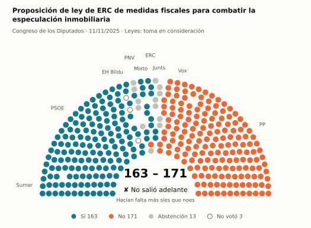
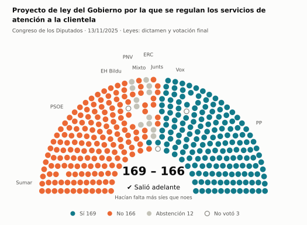
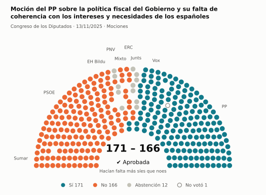
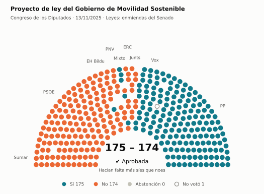
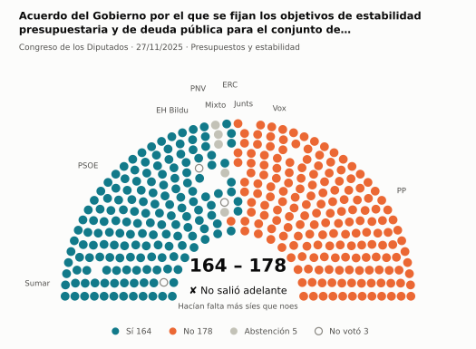
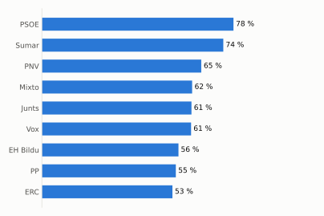
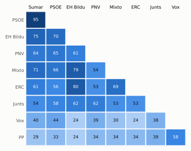

# Qué votó el Congreso en noviembre de 2025

Las votaciones del Pleno del Congreso de los Diputados, explicadas sin tecnicismos. Datos oficiales del [Congreso](https://www.congreso.es/es/opendata/votaciones); este resumen se actualiza solo cada mes (última vez: 11/11/2026).

## En pocas palabras

- El Congreso votó **144 veces** en 5 días de pleno. **52 propuestas salieron adelante** y 91 no; hubo además 1 empate, que se repiten.
- 122 votaciones fueron sobre leyes, decretos o presupuestos. Otras 20 fueron peticiones al Gobierno que no le obligan (proposiciones no de ley y mociones).
- El Gobierno (PSOE y Sumar) perdió **21** de las 128 votaciones en las que sus grupos votaron lo mismo.
- La votación más reñida se decidió por 1 voto: Proyecto de ley del Gobierno por la que se regulan los servicios de atención a la clientela.
- Los diputados casi siempre votan lo mismo que su grupo: en todo el mes solo hubo 34 votos distintos (sin contar el Grupo Mixto).

## Las votaciones más importantes del mes

Elegidas por su importancia: pesan más las leyes y los decretos que las peticiones al Gobierno, y suben las que se decidieron por pocos votos o las que perdió el Gobierno. Cada punto del dibujo es un diputado, colocado con su grupo, y el color es lo que votó.

### 1. Proposición de ley de ERC de medidas fiscales para combatir la especulación inmobiliaria

**11 de noviembre · Leyes: toma en consideración.** Primer paso de una ley propuesta por un grupo o una comunidad autónoma: el Congreso decide si empieza a tramitarla.

<picture>
  <source media="(prefers-color-scheme: dark)" srcset="img/2025-11/votacion-L15-S144-V002-oscuro.svg">
  
</picture>

**✘ No salió adelante** por 8 votos: 163 a favor, 171 en contra y 13 abstenciones.

- **A favor:** PSOE, Sumar, ERC y EH Bildu
- **En contra:** PP y Vox
- **Se abstuvieron:** Junts y PNV
- **Repartidos:** Grupo Mixto (Sí 7, No 1, Abstención 1)

[Datos oficiales](https://www.congreso.es/webpublica/opendata/votaciones/Leg15/Sesion144/20251111/Votacion002/VOT_20251111210356.json)

### 2. Proyecto de ley del Gobierno por la que se regulan los servicios de atención a la clientela

**13 de noviembre · Leyes: dictamen y votación final.** Votación del texto de una ley después de trabajarla en comisión.

<picture>
  <source media="(prefers-color-scheme: dark)" srcset="img/2025-11/votacion-L15-S146-V044-oscuro.svg">
  
</picture>

**✔ Salió adelante** por 3 votos: 169 a favor, 166 en contra y 12 abstenciones.

- **A favor:** PP y Vox
- **En contra:** PSOE, Sumar, Junts y EH Bildu
- **Se abstuvieron:** ERC y PNV
- **Repartidos:** Grupo Mixto (Sí 1, No 8)

Este asunto tuvo 56 votaciones este mes; aquí se muestra la más disputada. [Datos oficiales](https://www.congreso.es/webpublica/opendata/votaciones/Leg15/Sesion146/20251113/Votacion044/VOT_20251113131314.json)

### 3. Moción del PP sobre la política fiscal del Gobierno y su falta de coherencia con los intereses y necesidades de los españoles

**13 de noviembre · Mociones.** Petición al Gobierno después de pedirle explicaciones en el Pleno. Expresa la opinión del Congreso, pero no obliga.

<picture>
  <source media="(prefers-color-scheme: dark)" srcset="img/2025-11/votacion-L15-S146-V062-oscuro.svg">
  
</picture>

**✔ Salió adelante** por 5 votos: 171 a favor, 166 en contra y 12 abstenciones.

- **A favor:** PP y Vox
- **En contra:** PSOE, Sumar, ERC y EH Bildu
- **Se abstuvieron:** Junts y PNV
- **Repartidos:** Grupo Mixto (Sí 2, No 7)

[Datos oficiales](https://www.congreso.es/webpublica/opendata/votaciones/Leg15/Sesion146/20251113/Votacion062/VOT_20251113131334.json)

### 4. Proyecto de ley del Gobierno de Movilidad Sostenible

**13 de noviembre · Leyes: enmiendas del Senado.** El Senado propuso cambios a esta ley y el Congreso decide si los acepta. Es uno de los últimos pasos antes de que la ley se publique.

<picture>
  <source media="(prefers-color-scheme: dark)" srcset="img/2025-11/votacion-L15-S146-V077-oscuro.svg">
  
</picture>

**✔ Salió adelante** por 1 voto: 175 a favor, 174 en contra y ninguna abstención.

- **A favor:** PP y Vox
- **En contra:** PSOE (119 de 120), Sumar, Junts, ERC, EH Bildu y PNV
- **Repartidos:** Grupo Mixto (Sí 5, No 4)

Este asunto tuvo 51 votaciones este mes; aquí se muestra la más disputada. [Datos oficiales](https://www.congreso.es/webpublica/opendata/votaciones/Leg15/Sesion146/20251113/Votacion077/VOT_20251113131353.json)

### 5. Acuerdo del Gobierno por el que se fijan los objetivos de estabilidad presupuestaria y de deuda pública para el conjunto de Administraciones…

**27 de noviembre · Presupuestos y estabilidad.** Cuentas públicas: límites de déficit y deuda o cuentas del Estado.

<picture>
  <source media="(prefers-color-scheme: dark)" srcset="img/2025-11/votacion-L15-S151-V018-oscuro.svg">
  
</picture>

**✘ No salió adelante** por 14 votos: 164 a favor, 178 en contra y 5 abstenciones.

- **A favor:** PSOE, Sumar, ERC, EH Bildu y PNV
- **En contra:** PP, Vox y Junts
- **Repartidos:** Grupo Mixto (Sí 2, No 1, Abstención 5)

[Datos oficiales](https://www.congreso.es/webpublica/opendata/votaciones/Leg15/Sesion151/20251127/Votacion018/VOT_20251127124111.json)

## ¿Qué grupos votaron más veces lo que finalmente salió?

<picture>
  <source media="(prefers-color-scheme: dark)" srcset="img/2025-11/ganadora-oscuro.svg">
  
</picture>

Porcentaje de votaciones en que el grupo votó Sí y salió adelante, o votó No y no salió. Abstenerse no cuenta como acertar.

## ¿Quién vota con quién?

<picture>
  <source media="(prefers-color-scheme: dark)" srcset="img/2025-11/afinidad-oscuro.svg">
  
</picture>

Cada casilla dice en qué porcentaje de las votaciones dos grupos votaron lo mismo: 100 es que siempre coincidieron y 0 que nunca.

## ¿Qué tipo de cosas se votaron?

| Tipo | Votaciones | Salieron adelante | Qué es |
| --- | ---: | ---: | --- |
| Leyes: dictamen y votación final | 59 | 12 | Votación del texto de una ley después de trabajarla en comisión. |
| Leyes: enmiendas del Senado | 52 | 20 | El Senado propuso cambios a esta ley y el Congreso decide si los acepta. Es uno de los últimos pasos antes de que la ley se publique. |
| Proposiciones no de ley | 10 | 8 | Petición al Gobierno para que haga algo. Expresa la opinión del Congreso, pero no obliga. |
| Mociones | 10 | 4 | Petición al Gobierno después de pedirle explicaciones en el Pleno. Expresa la opinión del Congreso, pero no obliga. |
| Leyes: toma en consideración | 5 | 1 | Primer paso de una ley propuesta por un grupo o una comunidad autónoma: el Congreso decide si empieza a tramitarla. |
| Decretos-ley (convalidación) | 4 | 4 | El Gobierno aprobó esta norma por urgencia. Ya está en vigor, pero el Congreso tiene 30 días para confirmarla o tumbarla. |
| Enmiendas a la totalidad | 1 | 1 | Un grupo intenta devolver la ley a quien la propuso o sustituirla por otra. Si no sale adelante, la ley sigue su camino. |
| Organización de la Cámara | 1 | 1 | Asunto interno del Congreso: comisiones, plazos o el estatuto de los diputados. |
| Tratados internacionales | 1 | 1 | El Congreso autoriza a España a comprometerse con un acuerdo con otro país u organismo. |
| Presupuestos y estabilidad | 1 | 0 | Cuentas públicas: límites de déficit y deuda o cuentas del Estado. |

## Palabras que conviene saber

- **Pleno**: La reunión de los 350 diputados, donde se vota.
- **Grupo parlamentario**: Los diputados de un partido o coalición. Los partidos pequeños van juntos en el Grupo Mixto, aunque no piensen igual.
- **Abstención**: El diputado vota, pero ni a favor ni en contra.
- **No votó**: El diputado no votó: no estaba, estaba de baja o el escaño estaba vacío.
- **Mayoría simple**: Salen adelante las votaciones con más síes que noes. Es lo normal.
- **Mayoría absoluta**: 176 votos a favor, la mitad más uno de 350. La piden las leyes orgánicas (derechos fundamentales, sistema electoral…) y la primera votación de investidura.
- **Votación por llamamiento**: Cada diputado dice su voto en voz alta. Se usa en las investiduras y otras votaciones importantes.

---

**¿Quieres más detalle?** El [análisis detallado](2025-11-detalle.md) tiene la cohesión de cada grupo, un mapa de los diputados según cómo votan, qué diputados votaron distinto de su grupo, las ausencias y la lista completa de votaciones.

_Los resultados están calculados a partir de los votos: el Congreso no publica si cada votación salió adelante. Este proyecto no tiene relación con el Congreso. Método en [docs/DOCUMENTO_FUNCIONAL.md](../docs/DOCUMENTO_FUNCIONAL.md)._
