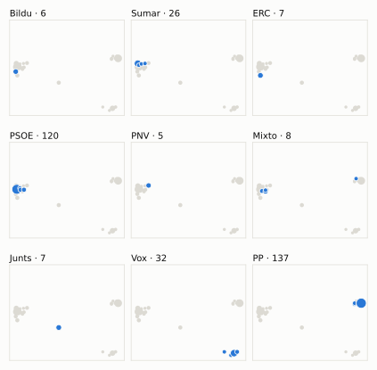
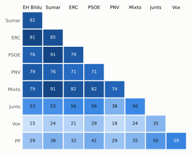

# Análisis detallado: diciembre de 2025

[← Volver al resumen del mes](2025-12.md)

_Generado automáticamente el 2026-11-11 con datos abiertos del [Congreso de los Diputados](https://www.congreso.es/es/opendata/votaciones). Solo plenos y Diputación Permanente. Método y límites en [docs/DOCUMENTO_FUNCIONAL.md](../docs/DOCUMENTO_FUNCIONAL.md)._

## Resumen

- **34 votaciones** en 2 días de pleno (sesiones 152 y 154).
- **22 aprobadas** y **12 rechazadas**.
- 4 votaciones se decidieron por 5 votos o menos.
- El grupo que más veces votó con el resultado final: **Sumar** (88 % de las votaciones nominales).
- Los grupos del Gobierno (PSOE y Sumar) votaron lo mismo en 31 de 34 votaciones nominales y perdieron 3 de ellas.
- 9 votos individuales se apartaron de la posición de su grupo (7 diputados).

## Cómo votó cada grupo

| Grupo | Diputados | Cohesión | Votó con el resultado | Decisivo | Posición Sí | Posición No | Posición Abst. |
| --- | ---: | ---: | ---: | ---: | ---: | ---: | ---: |
| PP | 137 | 100 % | 50 % | 3 | 24 | 5 | 5 |
| PSOE | 120 | 100 % | 85 % | 12 | 19 | 13 | 2 |
| Vox | 33 | 99 % | 35 % | 3 | 14 | 13 | 7 |
| Sumar | 26 | 100 % | 88 % | 10 | 21 | 12 | 1 |
| Mixto | 9 | 83 % | 85 % | 5 | 19 | 12 | 3 |
| Junts | 7 | 100 % | 59 % | 5 | 15 | 10 | 9 |
| ERC | 7 | 100 % | 76 % | 5 | 18 | 14 | 2 |
| EH Bildu | 6 | 100 % | 74 % | 4 | 17 | 16 | 1 |
| PNV | 5 | 100 % | 71 % | 2 | 19 | 10 | 5 |

*Cohesión*: índice de acuerdo interno (100 % = todo el grupo votó igual). *Votó con el resultado*: el grupo votó Sí y salió aprobada, o No y salió rechazada. *Decisivo*: votaciones cuyo resultado habría cambiado si el grupo se hubiera abstenido en bloque. El Grupo Mixto reúne partidos distintos: su posición es la de su mayoría.

## Mapa de diputados

<picture>
  <source media="(prefers-color-scheme: dark)" srcset="img/2025-12/mapa-oscuro.svg">
  
</picture>

Cada punto es un diputado; dos diputados están cerca si votaron parecido. Un punto más grande reúne a varios que votaron exactamente igual. En cada panel, el grupo en azul y el resto del Congreso en gris.

*Cómo se calcula*: componentes principales de los votos (Sí, No, abstención) en 30 votaciones con algún desacuerdo. El eje horizontal recoge el 80 % de la variación y el vertical el 11 %. Los ejes no tienen nombre ni sentido político propio; por convención, el PP queda a la derecha. No se sitúa a 3 diputados que votó en menos de la mitad.

## Afinidad entre grupos

<picture>
  <source media="(prefers-color-scheme: dark)" srcset="img/2025-12/afinidad-oscuro.svg">
  
</picture>

Porcentaje de votaciones nominales en que los dos grupos tomaron la misma posición. Los grupos están ordenados según el mapa de diputados.

Ver la tabla

|  | PP | PSOE | Vox | Sumar | Mixto | Junts | ERC | EH Bildu | PNV |
| --- | :---: | :---: | :---: | :---: | :---: | :---: | :---: | :---: | :---: |
| PP | 100 % | 41 % | 59 % | 38 % | 35 % | 50 % | 32 % | 29 % | 29 % |
| PSOE | 41 % | 100 % | 29 % | 91 % | 82 % | 56 % | 79 % | 76 % | 71 % |
| Vox | 59 % | 29 % | 100 % | 24 % | 24 % | 35 % | 21 % | 15 % | 18 % |
| Sumar | 38 % | 91 % | 24 % | 100 % | 91 % | 53 % | 85 % | 82 % | 76 % |
| Mixto | 35 % | 82 % | 24 % | 91 % | 100 % | 56 % | 82 % | 79 % | 74 % |
| Junts | 50 % | 56 % | 35 % | 53 % | 56 % | 100 % | 56 % | 53 % | 38 % |
| ERC | 32 % | 79 % | 21 % | 85 % | 82 % | 56 % | 100 % | 91 % | 71 % |
| EH Bildu | 29 % | 76 % | 15 % | 82 % | 79 % | 53 % | 91 % | 100 % | 79 % |
| PNV | 29 % | 71 % | 18 % | 76 % | 74 % | 38 % | 71 % | 79 % | 100 % |

## Quién sacó adelante las votaciones

| Grupos que votaron Sí | Votaciones | Escaños |
| --- | ---: | ---: |
| Todos los grupos | 4 | 350 |
| PSOE + Sumar + Mixto + ERC + EH Bildu + PNV | 3 | 173 |
| PSOE + Sumar + Mixto + Junts + ERC + EH Bildu + PNV | 2 | 180 |
| PP + Vox + Junts | 2 | 177 |
| PP + PSOE + Sumar + Mixto + ERC + EH Bildu + PNV | 2 | 310 |
| PP + PSOE + Vox + Sumar + Mixto + Junts + ERC | 2 | 339 |
| PSOE + Sumar + Mixto + PNV | 1 | 160 |
| Sumar + Mixto + ERC + EH Bildu + PNV | 1 | 53 |

De 22 votaciones nominales aprobadas. Otras 5 salieron con combinaciones que se dieron menos veces. La posición de cada grupo es la de la mayoría de sus diputados.

## Votaciones que perdieron los grupos del Gobierno

| Fecha | Asunto | Tipo | PSOE y Sumar votaron | Resultado | Sí | No |
| --- | --- | --- | :---: | --- | ---: | ---: |
| 11 de diciembre | Proposición no de Ley del Grupo Parlamentario Popular en el Congreso, para ayudar a las familias ante la escalada del precio de los alimentos básicos. | Proposiciones no de ley | No | Aprobada | 178 | 159 |
| 11 de diciembre | Proyecto de Ley por la que se regulan los servicios de atención al cliente (antes denominado Proyecto de Ley por la que se regulan los servicios de atención a… *(Votación separada de las enmiendas Enmienda a la disposició…)* | Leyes: enmiendas del Senado | No | Aprobada | 177 | 171 |
| 11 de diciembre | Acuerdo del Gobierno por el que se fijan los objetivos de estabilidad presupuestaria y de deuda pública para el conjunto de Administraciones Públicas y de cada… | Presupuestos y estabilidad | Sí | Rechazada | 166 | 177 |

Además, PSOE y Sumar votaron distinto entre sí en 3 votaciones.

## Votaciones más ajustadas

| Fecha | Asunto | Resultado | Sí | No | Abst. |
| --- | --- | :---: | ---: | ---: | ---: |
| 11 de diciembre | Moción consecuencia de interpelación urgente del Grupo Parlamentario Mixto (Sr. Rego Candamil), relativa a la mejora de la financiación en Galicia. *(Votación separada por puntos. Punto 5.)* | Aprobada | 172 | 169 | 7 |
| 11 de diciembre | Proyecto de Ley por la que se regulan los servicios de atención al cliente (antes denominado Proyecto de Ley por la que se regulan los servicios de atención a… *(Votación separada de las enmiendas Enmiendas al artículo 3.…)* | Rechazada | 170 | 173 | 5 |
| 9 de diciembre | Proposición de Ley del Sr. Rufián Romero y otros 23 Diputados, Orgánica de garantía del plurilingüismo y de los derechos lingüísticos de la ciudadanía ante las… | Aprobada | 174 | 170 | 0 |
| 11 de diciembre | Proyecto de Ley por la que se regulan los servicios de atención al cliente (antes denominado Proyecto de Ley por la que se regulan los servicios de atención a… *(Votación separada de las enmiendas Enmiendas al apartado II…)* | Rechazada | 169 | 173 | 5 |
| 11 de diciembre | Proyecto de Ley por la que se regulan los servicios de atención al cliente (antes denominado Proyecto de Ley por la que se regulan los servicios de atención a… *(Votación separada de las enmiendas Enmienda a la disposició…)* | Aprobada | 177 | 171 | 0 |
| 11 de diciembre | Proyecto de Ley por la que se regulan los servicios de atención al cliente (antes denominado Proyecto de Ley por la que se regulan los servicios de atención a… *(Votación separada de las enmiendas Resto de enmiendas.)* | Rechazada | 170 | 176 | 0 |
| 11 de diciembre | Moción consecuencia de interpelación urgente del Grupo Parlamentario VOX, sobre las medidas que va a tomar el Gobierno después de conocer la condena del Fiscal… | Rechazada | 170 | 178 | 0 |
| 11 de diciembre | Moción consecuencia de interpelación urgente del Grupo Parlamentario Popular en el Congreso, para que el Ministro de la Presidencia, Justicia y Relaciones con… | Rechazada | 169 | 179 | 0 |

Votaciones decididas por 10 votos o menos (o a esa distancia de la mayoría que exigían). Las públicas por llamamiento no tienen hemiciclo: el voto de cada diputado solo consta en el Diario de Sesiones.

## Qué se votó, por tipo de asunto

| Tipo de asunto | Votaciones | Aprobadas | No aprobadas |
| --- | ---: | ---: | ---: |
| Leyes: enmiendas del Senado | 9 | 3 | 6 |
| Mociones | 7 | 4 | 3 |
| Decretos-ley (convalidación) | 6 | 6 | 0 |
| Leyes: dictamen y votación final | 3 | 3 | 0 |
| Leyes: toma en consideración | 3 | 2 | 1 |
| Organización de la Cámara | 2 | 2 | 0 |
| Proposiciones no de ley | 2 | 2 | 0 |
| Enmiendas a la totalidad | 1 | 0 | 1 |
| Presupuestos y estabilidad | 1 | 0 | 1 |

Las proposiciones no de ley y las mociones expresan la posición del Congreso pero no obligan al Gobierno. Las leyes pasan por varias votaciones (toma en consideración, totalidad, dictamen, Senado), así que una misma ley puede aparecer varias veces.

## Votos distintos de su grupo

| Diputado | Grupo | Votos distintos de su grupo |
| --- | --- | ---: |
| Sánchez García, José María | Vox | 3 |
| Boada Danés, Júlia | Sumar | 1 |
| Chamorro Delmo, Ricardo | Vox | 1 |
| Del Valle Rodríguez, Emilio Jesús | Vox | 1 |
| Figaredo Álvarez-Sala, José María | Vox | 1 |
| Floriano Corrales, Carlos Javier | PP | 1 |
| Tarno Blanco, Ricardo | PP | 1 |

Un voto aislado puede ser un error al pulsar, no una decisión política: el Congreso no publica las correcciones. Se excluye el Grupo Mixto.

## Diputados que más veces no votaron

| Diputado | Grupo | No votó | % de votaciones |
| --- | --- | ---: | ---: |
| Ábalos Meco, José Luis | Mixto | 34 | 100 % |
| Hernández Quero, Carlos | Vox | 31 | 91 % |
| Díaz Pérez, Yolanda | Sumar | 3 | 9 % |
| Montero Cuadrado, María Jesús | PSOE | 3 | 9 % |
| Núñez Feijóo, Alberto | PP | 3 | 9 % |
| Puente Santiago, Óscar | PSOE | 3 | 9 % |
| Sánchez Pérez-Castejón, Pedro | PSOE | 3 | 9 % |
| Delgado Arce, Celso Luis | PP | 2 | 6 % |
| Rojas Manrique, Juan Antonio | PP | 2 | 6 % |
| Alonso Cantorné, Fèlix | Sumar | 1 | 3 % |
| Chamorro Delmo, Ricardo | Vox | 1 | 3 % |
| Fernández Ríos, Tomás | Vox | 1 | 3 % |
| García Adanero, Carlos | PP | 1 | 3 % |
| Gracia Blanco, Marta | PSOE | 1 | 3 % |
| Lamuà Estañol, Marc | PSOE | 1 | 3 % |

«No vota» incluye ausencias justificadas (baja, maternidad o paternidad) y escaños vacantes; el portal no las distingue.

## Todas las votaciones

Posición de cada grupo: la opción que votó la mayoría de sus diputados (*Div.*: empate dentro del grupo). El número enlaza al JSON oficial o, en las votaciones por llamamiento, al Diario de Sesiones.

### 9 de diciembre (sesión 152)

| Nº | Asunto | Resultado | Sí | No | Abst. | PP | PSOE | Vox | Sumar | Mixto | Junts | ERC | EH Bildu | PNV | Decisivos |
| ---: | --- | --- | ---: | ---: | ---: | :---: | :---: | :---: | :---: | :---: | :---: | :---: | :---: | :---: | --- |
| [1](https://www.congreso.es/webpublica/opendata/votaciones/Leg15/Sesion152/20251209/Votacion001/VOT_20251209205650.json) | Proposición de Ley del Parlamento de Cantabria, de modificación del Real Decreto Legislativo 5/2015, de 30 de octubre, por el que se aprueba el texto refundido… | Aprobada | 155 | 33 | 156 | Abst. | Sí | No | Sí | Sí | Abst. | Abst. | Abst. | Sí |  |
| [2](https://www.congreso.es/webpublica/opendata/votaciones/Leg15/Sesion152/20251209/Votacion002/VOT_20251209205652.json) | Proposición de Ley del Grupo Parlamentario Popular en el Congreso, en apoyo del sistema alimentario español como sector estratégico esencial de la economía. | Rechazada | 147 | 162 | 35 | Sí | No | Abst. | No | No | Sí | No | No | Abst. | PSOE, Sumar |
| [3](https://www.congreso.es/webpublica/opendata/votaciones/Leg15/Sesion152/20251209/Votacion003/VOT_20251209205653.json) | Proposición de Ley del Sr. Rufián Romero y otros 23 Diputados, Orgánica de garantía del plurilingüismo y de los derechos lingüísticos de la ciudadanía ante las… | Aprobada | 174 | 170 | 0 | No | Sí | No | Sí | Sí | Sí | Sí | Sí | Sí | EH Bildu, Junts, Mixto, ERC, PSOE, Sumar, PNV |

### 11 de diciembre (sesión 154)

| Nº | Asunto | Resultado | Sí | No | Abst. | PP | PSOE | Vox | Sumar | Mixto | Junts | ERC | EH Bildu | PNV | Decisivos |
| ---: | --- | --- | ---: | ---: | ---: | :---: | :---: | :---: | :---: | :---: | :---: | :---: | :---: | :---: | --- |
| [1](https://www.congreso.es/webpublica/opendata/votaciones/Leg15/Sesion154/20251211/Votacion001/VOT_20251211175043.json) | Proposición no de Ley del Grupo Parlamentario Popular en el Congreso, para ayudar a las familias ante la escalada del precio de los alimentos básicos. | Aprobada | 178 | 159 | 10 | Sí | No | Sí | No | Abst. | Sí | No | No | Abst. | PP, Vox |
| [2](https://www.congreso.es/webpublica/opendata/votaciones/Leg15/Sesion154/20251211/Votacion002/VOT_20251211175044.json) | Proposición no de Ley del Grupo Parlamentario Socialista, relativa a garantizar la igualdad de oportunidades y no discriminación de las personas con discapacid… | Aprobada | 172 | 32 | 144 | Abst. | Sí | No | Sí | Sí | Abst. | Sí | Sí | Sí |  |
| [3](https://www.congreso.es/webpublica/opendata/votaciones/Leg15/Sesion154/20251211/Votacion003/VOT_20251211175045.json) | Moción consecuencia de interpelación urgente del Grupo Parlamentario VOX, sobre las medidas que va a tomar el Gobierno después de conocer la condena del Fiscal… | Rechazada | 170 | 178 | 0 | Sí | No | Sí | No | No | No | No | No | No | PSOE, Sumar |
| [4](https://www.congreso.es/webpublica/opendata/votaciones/Leg15/Sesion154/20251211/Votacion004/VOT_20251211175046.json) | Moción consecuencia de interpelación urgente del Grupo Parlamentario Popular en el Congreso, para que el Ministro de la Presidencia, Justicia y Relaciones con… | Rechazada | 169 | 179 | 0 | Sí | No | Sí | No | No | No | No | No | No | PSOE, Sumar |
| [5](https://www.congreso.es/webpublica/opendata/votaciones/Leg15/Sesion154/20251211/Votacion005/VOT_20251211175047.json) | Moción consecuencia de interpelación urgente del Grupo Parlamentario Mixto (Sr. Rego Candamil), relativa a la mejora de la financiación en Galicia. *(Votación separada por puntos. Punto 1.)* | Aprobada | 49 | 32 | 267 | Abst. | Abst. | No | Sí | Sí | Abst. | Sí | Sí | Sí | Sumar |
| [6](https://www.congreso.es/webpublica/opendata/votaciones/Leg15/Sesion154/20251211/Votacion006/VOT_20251211175048.json) | Moción consecuencia de interpelación urgente del Grupo Parlamentario Mixto (Sr. Rego Candamil), relativa a la mejora de la financiación en Galicia. *(Votación separada por puntos. Punto 2.)* | Rechazada | 20 | 289 | 38 | No | No | No | Abst. | Abst. | Abst. | Sí | Sí | Sí |  |
| [7](https://www.congreso.es/webpublica/opendata/votaciones/Leg15/Sesion154/20251211/Votacion007/VOT_20251211175049.json) | Moción consecuencia de interpelación urgente del Grupo Parlamentario Mixto (Sr. Rego Candamil), relativa a la mejora de la financiación en Galicia. *(Votación separada por puntos. Punto 3.)* | Aprobada | 171 | 32 | 145 | Abst. | Sí | No | Sí | Sí | Abst. | Sí | Sí | Sí |  |
| [8](https://www.congreso.es/webpublica/opendata/votaciones/Leg15/Sesion154/20251211/Votacion008/VOT_20251211175051.json) | Moción consecuencia de interpelación urgente del Grupo Parlamentario Mixto (Sr. Rego Candamil), relativa a la mejora de la financiación en Galicia. *(Votación separada por puntos. Punto 4.)* | Aprobada | 188 | 0 | 160 | Sí | Abst. | Abst. | Sí | Sí | Abst. | Sí | Sí | Sí |  |
| [9](https://www.congreso.es/webpublica/opendata/votaciones/Leg15/Sesion154/20251211/Votacion009/VOT_20251211175052.json) | Moción consecuencia de interpelación urgente del Grupo Parlamentario Mixto (Sr. Rego Candamil), relativa a la mejora de la financiación en Galicia. *(Votación separada por puntos. Punto 5.)* | Aprobada | 172 | 169 | 7 | No | Sí | No | Sí | Sí | Abst. | Sí | Sí | Sí | EH Bildu, Mixto, ERC, PSOE, Sumar, PNV |
| [10](https://www.congreso.es/webpublica/opendata/votaciones/Leg15/Sesion154/20251211/Votacion010/VOT_20251211175053.json) | Real Decreto-ley 13/2025, de 25 de noviembre, por el que se adoptan medidas complementarias urgentes para la recuperación económica y social de la isla de La P… | Aprobada | 309 | 0 | 39 | Sí | Sí | Abst. | Sí | Sí | Abst. | Sí | Sí | Sí |  |
| [11](https://www.congreso.es/webpublica/opendata/votaciones/Leg15/Sesion154/20251211/Votacion011/VOT_20251211175054.json) | Tramitación como Proyecto de Ley por el procedimiento de urgencia del Real Decreto-ley 13/2025, de 25 de noviembre, por el que se adoptan medidas complementari… | Aprobada | 348 | 0 | 0 | Sí | Sí | Sí | Sí | Sí | Sí | Sí | Sí | Sí |  |
| [12](https://www.congreso.es/webpublica/opendata/votaciones/Leg15/Sesion154/20251211/Votacion012/VOT_20251211175055.json) | Real Decreto-ley 14/2025, de 2 de diciembre, por el que se aprueban medidas urgentes en materia de retribuciones en el ámbito del sector público. | Aprobada | 309 | 32 | 7 | Sí | Sí | No | Sí | Sí | Abst. | Sí | Sí | Sí |  |
| [13](https://www.congreso.es/webpublica/opendata/votaciones/Leg15/Sesion154/20251211/Votacion013/VOT_20251211175056.json) | Tramitación como Proyecto de Ley por el procedimiento de urgencia del Real Decreto-ley 14/2025, de 2 de diciembre, por el que se aprueban medidas urgentes en m… | Aprobada | 347 | 0 | 0 | Sí | Sí | Sí | Sí | Sí | Sí | Sí | Sí | Sí |  |
| [14](https://www.congreso.es/webpublica/opendata/votaciones/Leg15/Sesion154/20251211/Votacion014/VOT_20251211175058.json) | Real Decreto-ley 15/2025, de 2 de diciembre, por el que se adoptan medidas urgentes para favorecer la actividad inversora de las entidades locales y de las com… | Aprobada | 179 | 168 | 1 | No | Sí | No | Sí | Sí | Sí | Sí | Sí | Sí | PSOE, Sumar |
| [15](https://www.congreso.es/webpublica/opendata/votaciones/Leg15/Sesion154/20251211/Votacion015/VOT_20251211175059.json) | Tramitación como Proyecto de Ley por el procedimiento de urgencia del Real Decreto-ley 15/2025, de 2 de diciembre, por el que se adoptan medidas urgentes para… | Aprobada | 347 | 0 | 0 | Sí | Sí | Sí | Sí | Sí | Sí | Sí | Sí | Sí |  |
| [16](https://www.congreso.es/webpublica/opendata/votaciones/Leg15/Sesion154/20251211/Votacion016/VOT_20251211175100.json) | Proyecto de Ley por la que se regulan los servicios de atención al cliente (antes denominado Proyecto de Ley por la que se regulan los servicios de atención a… *(Votación separada de las enmiendas Enmiendas al apartado II…)* | Rechazada | 138 | 178 | 31 | Sí | No | Abst. | No | No | No | No | No | No | PSOE |
| [17](https://www.congreso.es/webpublica/opendata/votaciones/Leg15/Sesion154/20251211/Votacion017/VOT_20251211175101.json) | Proyecto de Ley por la que se regulan los servicios de atención al cliente (antes denominado Proyecto de Ley por la que se regulan los servicios de atención a… *(Votación separada de las enmiendas Enmiendas al apartado II…)* | Rechazada | 169 | 173 | 5 | Sí | No | Sí | No | No | No | No | No | Abst. | EH Bildu, Junts, Mixto, ERC, PSOE, Sumar |
| [18](https://www.congreso.es/webpublica/opendata/votaciones/Leg15/Sesion154/20251211/Votacion018/VOT_20251211175103.json) | Proyecto de Ley por la que se regulan los servicios de atención al cliente (antes denominado Proyecto de Ley por la que se regulan los servicios de atención a… *(Votación separada de las enmiendas Enmiendas al artículo 3.…)* | Rechazada | 170 | 173 | 5 | Sí | No | Sí | No | No | No | No | No | Abst. | EH Bildu, Junts, Mixto, ERC, PSOE, Sumar |
| [19](https://www.congreso.es/webpublica/opendata/votaciones/Leg15/Sesion154/20251211/Votacion019/VOT_20251211175104.json) | Proyecto de Ley por la que se regulan los servicios de atención al cliente (antes denominado Proyecto de Ley por la que se regulan los servicios de atención a… *(Votación separada de las enmiendas Enmiendas al artículo 3,…)* | Rechazada | 138 | 210 | 0 | Sí | No | No | No | No | No | No | No | No | PSOE |
| [20](https://www.congreso.es/webpublica/opendata/votaciones/Leg15/Sesion154/20251211/Votacion020/VOT_20251211175105.json) | Proyecto de Ley por la que se regulan los servicios de atención al cliente (antes denominado Proyecto de Ley por la que se regulan los servicios de atención a… *(Votación separada de las enmiendas Enmienda al primer párra…)* | Aprobada | 323 | 20 | 5 | Sí | Sí | Sí | Sí | Sí | No | No | No | Abst. |  |
| [21](https://www.congreso.es/webpublica/opendata/votaciones/Leg15/Sesion154/20251211/Votacion021/VOT_20251211175106.json) | Proyecto de Ley por la que se regulan los servicios de atención al cliente (antes denominado Proyecto de Ley por la que se regulan los servicios de atención a… *(Votación separada de las enmiendas Enmienda al artículo 22.)* | Rechazada | 145 | 171 | 31 | Sí | No | Abst. | No | No | Sí | No | No | No | PSOE |
| [22](https://www.congreso.es/webpublica/opendata/votaciones/Leg15/Sesion154/20251211/Votacion022/VOT_20251211175108.json) | Proyecto de Ley por la que se regulan los servicios de atención al cliente (antes denominado Proyecto de Ley por la que se regulan los servicios de atención a… *(Votación separada de las enmiendas Enmienda a la disposició…)* | Aprobada | 177 | 171 | 0 | Sí | No | Sí | No | No | Sí | No | No | No | Junts, PP, Vox |
| [23](https://www.congreso.es/webpublica/opendata/votaciones/Leg15/Sesion154/20251211/Votacion023/VOT_20251211175109.json) | Proyecto de Ley por la que se regulan los servicios de atención al cliente (antes denominado Proyecto de Ley por la que se regulan los servicios de atención a… *(Votación separada de las enmiendas Enmienda al apartado 4 d…)* | Aprobada | 290 | 26 | 32 | Sí | Sí | Abst. | Sí | No | No | No | No | Sí |  |
| [24](https://www.congreso.es/webpublica/opendata/votaciones/Leg15/Sesion154/20251211/Votacion024/VOT_20251211175110.json) | Proyecto de Ley por la que se regulan los servicios de atención al cliente (antes denominado Proyecto de Ley por la que se regulan los servicios de atención a… *(Votación separada de las enmiendas Resto de enmiendas.)* | Rechazada | 170 | 176 | 0 | Sí | No | Sí | No | No | No | No | No | No | Junts, Mixto, ERC, PSOE, Sumar |
| [25](https://www.congreso.es/webpublica/opendata/votaciones/Leg15/Sesion154/20251211/Votacion025/VOT_20251211175112.json) | Votación de la enmienda a la totalidad de devolución al Proyecto de Ley por la que se modifican el Texto Refundido de la Ley General de derechos de las persona… | Rechazada | 7 | 171 | 169 | Abst. | No | Abst. | No | No | Sí | No | No | No |  |
| [26](https://www.congreso.es/webpublica/opendata/votaciones/Leg15/Sesion154/20251211/Votacion026/VOT_20251211175113.json) | Votación de la solicitud de avocación por el Pleno de la Cámara de la deliberación y votación final de la Proposición de Ley sobre concesión de nacionalidad es… | Aprobada | 347 | 0 | 0 | Sí | Sí | Sí | Sí | Sí | Sí | Sí | Sí | Sí |  |
| [27](https://www.congreso.es/webpublica/opendata/votaciones/Leg15/Sesion154/20251211/Votacion027/VOT_20251211175114.json) | Votación de la solicitud de avocación por el Pleno de la Cámara de la deliberación y votación final de la Proposición de Ley relativa a la regulación de las cl… | Aprobada | 337 | 11 | 0 | Sí | Sí | Sí | Sí | Sí | Sí | Sí | No | No |  |
| [28](https://www.congreso.es/webpublica/opendata/votaciones/Leg15/Sesion154/20251211/Votacion028/VOT_20251211175115.json) | Votación de la solicitud de avocación por el Pleno de la Cámara de la deliberación y votación final de la Proposición de Ley sobre control y regulación de la p… | Aprobada | 336 | 11 | 0 | Sí | Sí | Sí | Sí | Sí | Sí | Sí | No | No |  |
| [29](https://www.congreso.es/webpublica/opendata/votaciones/Leg15/Sesion154/20251211/Votacion029/VOT_20251211175116.json) | Acuerdo del Gobierno por el que se fijan los objetivos de estabilidad presupuestaria y de deuda pública para el conjunto de Administraciones Públicas y de cada… | Rechazada | 166 | 177 | 5 | No | Sí | No | Sí | Abst. | No | Sí | Sí | Sí | PP, Vox |
| [30](https://www.congreso.es/webpublica/opendata/votaciones/Leg15/Sesion154/20251211/Votacion030/VOT_20251211175118.json) | Solicitud de la Comisión de Juventud e Infancia, de prórroga del plazo para la conclusión de los trabajos de la Subcomisión sobre el estudio de un Pacto de Est… | Aprobada | 316 | 32 | 0 | Sí | Sí | No | Sí | Sí | Sí | Sí | Sí | Sí |  |
| [31](https://www.congreso.es/webpublica/opendata/votaciones/Leg15/Sesion154/20251211/Votacion031/VOT_20251211175119.json) | Solicitud de la Comisión de Igualdad, de prórroga de seis meses del plazo para la conclusión de los trabajos de la Subcomisión relativa a la lucha contra los d… | Aprobada | 309 | 32 | 7 | Sí | Sí | No | Sí | Sí | Sí | Abst. | Sí | Sí |  |
