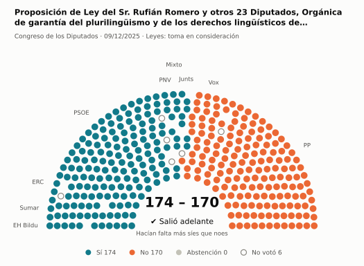
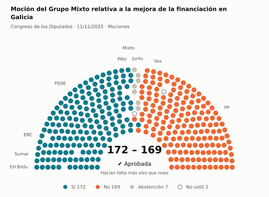
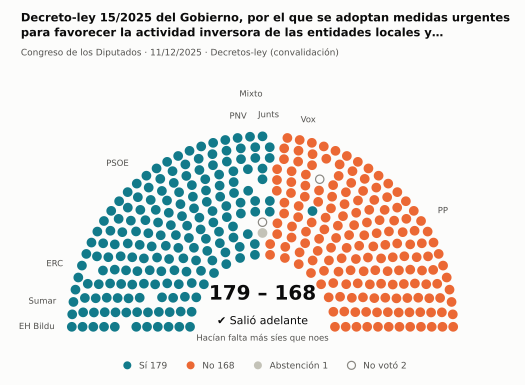
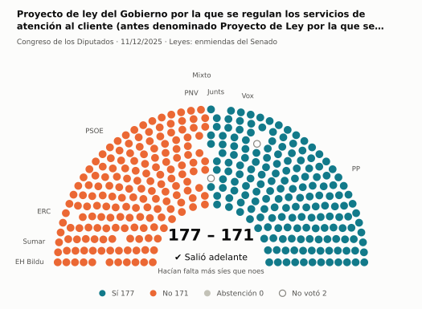
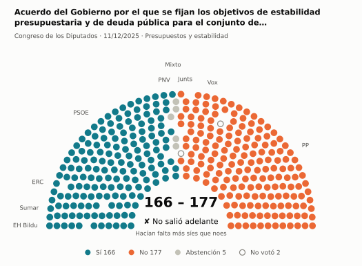
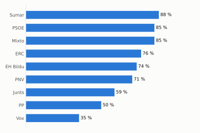
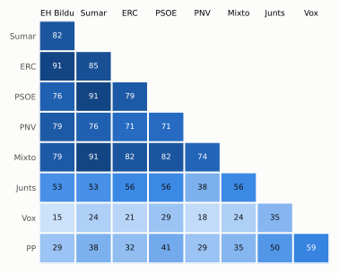

# Qué votó el Congreso en diciembre de 2025

Las votaciones del Pleno del Congreso de los Diputados, explicadas sin tecnicismos. Datos oficiales del [Congreso](https://www.congreso.es/es/opendata/votaciones); este resumen se actualiza solo cada mes (última vez: 10/11/2026).

## En pocas palabras

- El Congreso votó **34 veces** en 2 días de pleno. **22 propuestas salieron adelante** y 12 no.
- 23 votaciones fueron sobre leyes, decretos o presupuestos. Otras 9 fueron peticiones al Gobierno que no le obligan (proposiciones no de ley y mociones).
- El Gobierno (PSOE y Sumar) perdió **3** de las 31 votaciones en las que sus grupos votaron lo mismo.
- La votación más reñida se decidió por 3 votos: Moción del Grupo Mixto relativa a la mejora de la financiación en Galicia.
- Los diputados casi siempre votan lo mismo que su grupo: en todo el mes solo hubo 9 votos distintos (sin contar el Grupo Mixto).

## Las votaciones más importantes del mes

Elegidas por su importancia: pesan más las leyes y los decretos que las peticiones al Gobierno, y suben las que se decidieron por pocos votos o las que perdió el Gobierno. Cada punto del dibujo es un diputado, colocado con su grupo, y el color es lo que votó.

### 1. Proposición de Ley del Sr. Rufián Romero y otros 23 Diputados, Orgánica de garantía del plurilingüismo y de los derechos lingüísticos de la ciudadaní…

**9 de diciembre · Leyes: toma en consideración.** Primer paso de una ley propuesta por un grupo o una comunidad autónoma: el Congreso decide si empieza a tramitarla.

<picture>
  <source media="(prefers-color-scheme: dark)" srcset="img/2025-12/votacion-L15-S152-V003-oscuro.svg">
  
</picture>

**✔ Salió adelante** por 4 votos: 174 a favor, 170 en contra y ninguna abstención.

- **A favor:** PSOE, Sumar, Junts, ERC, EH Bildu y PNV
- **En contra:** PP y Vox
- **Repartidos:** Grupo Mixto (Sí 7, No 1)

[Datos oficiales](https://www.congreso.es/webpublica/opendata/votaciones/Leg15/Sesion152/20251209/Votacion003/VOT_20251209205653.json)

### 2. Moción del Grupo Mixto relativa a la mejora de la financiación en Galicia

**11 de diciembre · Mociones.** Petición al Gobierno después de pedirle explicaciones en el Pleno. Expresa la opinión del Congreso, pero no obliga.

<picture>
  <source media="(prefers-color-scheme: dark)" srcset="img/2025-12/votacion-L15-S154-V009-oscuro.svg">
  
</picture>

**✔ Salió adelante** por 3 votos: 172 a favor, 169 en contra y 7 abstenciones.

- **A favor:** PSOE, Sumar, ERC, EH Bildu y PNV
- **En contra:** PP y Vox (31 de 32)
- **Se abstuvieron:** Junts
- **Repartidos:** Grupo Mixto (Sí 7, No 1)

Este asunto tuvo 5 votaciones este mes; aquí se muestra la más disputada. [Datos oficiales](https://www.congreso.es/webpublica/opendata/votaciones/Leg15/Sesion154/20251211/Votacion009/VOT_20251211175052.json)

### 3. Decreto-ley 15/2025 del Gobierno, por el que se adoptan medidas urgentes para favorecer la actividad inversora de las entidades locales y de las comu…

**11 de diciembre · Decretos-ley (convalidación).** El Gobierno aprobó esta norma por urgencia. Ya está en vigor, pero el Congreso tiene 30 días para confirmarla o tumbarla.

<picture>
  <source media="(prefers-color-scheme: dark)" srcset="img/2025-12/votacion-L15-S154-V014-oscuro.svg">
  
</picture>

**✔ Salió adelante** por 11 votos: 179 a favor, 168 en contra y 1 abstención.

- **A favor:** PSOE, Sumar, Junts, ERC, EH Bildu y PNV
- **En contra:** PP (136 de 137) y Vox
- **Repartidos:** Grupo Mixto (Sí 7, Abstención 1)

[Datos oficiales](https://www.congreso.es/webpublica/opendata/votaciones/Leg15/Sesion154/20251211/Votacion014/VOT_20251211175058.json)

### 4. Proyecto de ley del Gobierno por la que se regulan los servicios de atención al cliente (antes denominado Proyecto de Ley por la que se regulan los s…

**11 de diciembre · Leyes: enmiendas del Senado.** El Senado propuso cambios a esta ley y el Congreso decide si los acepta. Es uno de los últimos pasos antes de que la ley se publique.

<picture>
  <source media="(prefers-color-scheme: dark)" srcset="img/2025-12/votacion-L15-S154-V022-oscuro.svg">
  
</picture>

**✔ Salió adelante** por 6 votos: 177 a favor, 171 en contra y ninguna abstención.

- **A favor:** PP, Vox y Junts
- **En contra:** PSOE, Sumar, ERC, EH Bildu y PNV
- **Repartidos:** Grupo Mixto (Sí 1, No 7)

Este asunto tuvo 9 votaciones este mes; aquí se muestra la más disputada. [Datos oficiales](https://www.congreso.es/webpublica/opendata/votaciones/Leg15/Sesion154/20251211/Votacion022/VOT_20251211175108.json)

### 5. Acuerdo del Gobierno por el que se fijan los objetivos de estabilidad presupuestaria y de deuda pública para el conjunto de Administraciones Públicas…

**11 de diciembre · Presupuestos y estabilidad.** Cuentas públicas: límites de déficit y deuda o cuentas del Estado.

<picture>
  <source media="(prefers-color-scheme: dark)" srcset="img/2025-12/votacion-L15-S154-V029-oscuro.svg">
  
</picture>

**✘ No salió adelante** por 11 votos: 166 a favor, 177 en contra y 5 abstenciones.

- **A favor:** PSOE, Sumar, ERC, EH Bildu y PNV
- **En contra:** PP, Vox y Junts
- **Repartidos:** Grupo Mixto (Sí 2, No 1, Abstención 5)

[Datos oficiales](https://www.congreso.es/webpublica/opendata/votaciones/Leg15/Sesion154/20251211/Votacion029/VOT_20251211175116.json)

## ¿Qué grupos votaron más veces lo que finalmente salió?

<picture>
  <source media="(prefers-color-scheme: dark)" srcset="img/2025-12/ganadora-oscuro.svg">
  
</picture>

Porcentaje de votaciones en que el grupo votó Sí y salió adelante, o votó No y no salió. Abstenerse no cuenta como acertar.

## ¿Quién vota con quién?

<picture>
  <source media="(prefers-color-scheme: dark)" srcset="img/2025-12/afinidad-oscuro.svg">
  
</picture>

Cada casilla dice en qué porcentaje de las votaciones dos grupos votaron lo mismo: 100 es que siempre coincidieron y 0 que nunca.

## ¿Qué tipo de cosas se votaron?

| Tipo | Votaciones | Salieron adelante | Qué es |
| --- | ---: | ---: | --- |
| Leyes: enmiendas del Senado | 9 | 3 | El Senado propuso cambios a esta ley y el Congreso decide si los acepta. Es uno de los últimos pasos antes de que la ley se publique. |
| Mociones | 7 | 4 | Petición al Gobierno después de pedirle explicaciones en el Pleno. Expresa la opinión del Congreso, pero no obliga. |
| Decretos-ley (convalidación) | 6 | 6 | El Gobierno aprobó esta norma por urgencia. Ya está en vigor, pero el Congreso tiene 30 días para confirmarla o tumbarla. |
| Leyes: dictamen y votación final | 3 | 3 | Votación del texto de una ley después de trabajarla en comisión. |
| Leyes: toma en consideración | 3 | 2 | Primer paso de una ley propuesta por un grupo o una comunidad autónoma: el Congreso decide si empieza a tramitarla. |
| Organización de la Cámara | 2 | 2 | Asunto interno del Congreso: comisiones, plazos o el estatuto de los diputados. |
| Proposiciones no de ley | 2 | 2 | Petición al Gobierno para que haga algo. Expresa la opinión del Congreso, pero no obliga. |
| Enmiendas a la totalidad | 1 | 0 | Un grupo intenta devolver la ley a quien la propuso o sustituirla por otra. Si no sale adelante, la ley sigue su camino. |
| Presupuestos y estabilidad | 1 | 0 | Cuentas públicas: límites de déficit y deuda o cuentas del Estado. |

## Palabras que conviene saber

- **Pleno**: La reunión de los 350 diputados, donde se vota.
- **Grupo parlamentario**: Los diputados de un partido o coalición. Los partidos pequeños van juntos en el Grupo Mixto, aunque no piensen igual.
- **Abstención**: El diputado vota, pero ni a favor ni en contra.
- **No votó**: El diputado no votó: no estaba, estaba de baja o el escaño estaba vacío.
- **Mayoría simple**: Salen adelante las votaciones con más síes que noes. Es lo normal.
- **Mayoría absoluta**: 176 votos a favor, la mitad más uno de 350. La piden las leyes orgánicas (derechos fundamentales, sistema electoral…) y la primera votación de investidura.
- **Votación por llamamiento**: Cada diputado dice su voto en voz alta. Se usa en las investiduras y otras votaciones importantes.

---

**¿Quieres más detalle?** El [análisis detallado](2025-12-detalle.md) tiene la cohesión de cada grupo, un mapa de los diputados según cómo votan, qué diputados votaron distinto de su grupo, las ausencias y la lista completa de votaciones.

_Los resultados están calculados a partir de los votos: el Congreso no publica si cada votación salió adelante. Este proyecto no tiene relación con el Congreso. Método en [docs/DOCUMENTO_FUNCIONAL.md](../docs/DOCUMENTO_FUNCIONAL.md)._
