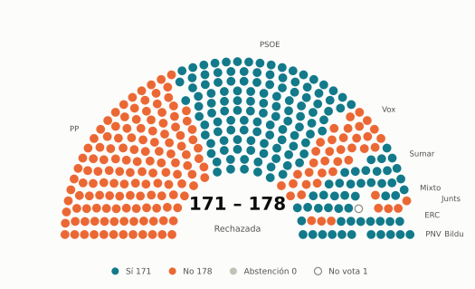

# Votaciones del Congreso: enero de 2026

_Generado automáticamente el 2026-11-10 con datos abiertos del [Congreso de los Diputados](https://www.congreso.es/es/opendata/votaciones). Solo plenos y Diputación Permanente. Método y límites en [docs/DOCUMENTO_FUNCIONAL.md](../docs/DOCUMENTO_FUNCIONAL.md)._

## Resumen

- **3 votaciones** en 1 día de pleno (sesión 156).
- **2 aprobadas** y **1 rechazada**.
- 0 votaciones se decidieron por 5 votos o menos.
- El grupo que más veces votó con el resultado final: **Junts** (100 % de las votaciones nominales).
- Los grupos del Gobierno (PSOE y Sumar) votaron lo mismo en 3 de 3 votaciones nominales y perdieron una de ellas.

## Cómo votó cada grupo

| Grupo | Diputados | Cohesión | Votó con el resultado | Decisivo | Posición Sí | Posición No | Posición Abst. |
| --- | ---: | ---: | ---: | ---: | ---: | ---: | ---: |
| PP | 137 | 100 % | 67 % | 1 | 1 | 1 | 1 |
| PSOE | 120 | 100 % | 67 % | 0 | 3 | 0 | 0 |
| Vox | 33 | 100 % | 33 % | 1 | 0 | 3 | 0 |
| Sumar | 26 | 100 % | 67 % | 0 | 3 | 0 | 0 |
| Mixto | 9 | 94 % | 67 % | 0 | 3 | 0 | 0 |
| Junts | 7 | 100 % | 100 % | 0 | 2 | 1 | 0 |
| ERC | 7 | 100 % | 67 % | 0 | 3 | 0 | 0 |
| Bildu | 6 | 100 % | 67 % | 0 | 3 | 0 | 0 |
| PNV | 5 | 100 % | 67 % | 0 | 3 | 0 | 0 |

*Cohesión*: índice de acuerdo interno (100 % = todo el grupo votó igual). *Votó con el resultado*: el grupo votó Sí y salió aprobada, o No y salió rechazada. *Decisivo*: votaciones cuyo resultado habría cambiado si el grupo se hubiera abstenido en bloque. El Grupo Mixto reúne partidos distintos: su posición es la de su mayoría.

## Afinidad entre grupos

<picture>
  <source media="(prefers-color-scheme: dark)" srcset="img/2026-01/afinidad-oscuro.svg">
  
</picture>

Porcentaje de votaciones nominales en que los dos grupos tomaron la misma posición. Los grupos están ordenados según el mapa de diputados.

Ver la tabla

|  | PP | PSOE | Vox | Sumar | Mixto | Junts | ERC | Bildu | PNV |
| --- | :---: | :---: | :---: | :---: | :---: | :---: | :---: | :---: | :---: |
| PP | 100 % | 33 % | 33 % | 33 % | 33 % | 67 % | 33 % | 33 % | 33 % |
| PSOE | 33 % | 100 % | 0 % | 100 % | 100 % | 67 % | 100 % | 100 % | 100 % |
| Vox | 33 % | 0 % | 100 % | 0 % | 0 % | 33 % | 0 % | 0 % | 0 % |
| Sumar | 33 % | 100 % | 0 % | 100 % | 100 % | 67 % | 100 % | 100 % | 100 % |
| Mixto | 33 % | 100 % | 0 % | 100 % | 100 % | 67 % | 100 % | 100 % | 100 % |
| Junts | 67 % | 67 % | 33 % | 67 % | 67 % | 100 % | 67 % | 67 % | 67 % |
| ERC | 33 % | 100 % | 0 % | 100 % | 100 % | 67 % | 100 % | 100 % | 100 % |
| Bildu | 33 % | 100 % | 0 % | 100 % | 100 % | 67 % | 100 % | 100 % | 100 % |
| PNV | 33 % | 100 % | 0 % | 100 % | 100 % | 67 % | 100 % | 100 % | 100 % |

## Quién sacó adelante las votaciones

| Grupos que votaron Sí | Votaciones | Escaños |
| --- | ---: | ---: |
| PSOE + Sumar + Mixto + Junts + ERC + Bildu + PNV | 1 | 180 |
| PP + PSOE + Sumar + Mixto + Junts + ERC + Bildu + PNV | 1 | 317 |

De 2 votaciones nominales aprobadas. La posición de cada grupo es la de la mayoría de sus diputados.

## Votaciones que perdieron los grupos del Gobierno

| Fecha | Asunto | Tipo | PSOE y Sumar votaron | Resultado | Sí | No |
| --- | --- | --- | :---: | --- | ---: | ---: |
| 27 de enero | Real Decreto-ley 16/2025, de 23 de diciembre, por el que se prorrogan determinadas medidas para hacer frente a situaciones de vulnerabilidad social, y se adopt… | Decretos-ley (convalidación) | Sí | Rechazada | 171 | 178 |

## Votaciones más ajustadas

**27 de enero** · Real Decreto-ley 16/2025, de 23 de diciembre, por el que se prorrogan determinadas medidas para hacer frente a situaciones de vulnerabilidad social, y se adopt…

<picture>
  <source media="(prefers-color-scheme: dark)" srcset="img/2026-01/hemiciclo-L15-S156-V001-oscuro.svg">
  
</picture>

Cada punto es un escaño, agrupado por grupo parlamentario; el color es su voto.

| Fecha | Asunto | Resultado | Sí | No | Abst. |
| --- | --- | :---: | ---: | ---: | ---: |
| 27 de enero | Real Decreto-ley 16/2025, de 23 de diciembre, por el que se prorrogan determinadas medidas para hacer frente a situaciones de vulnerabilidad social, y se adopt… | Rechazada | 171 | 178 | 0 |

Votaciones decididas por 10 votos o menos (o a esa distancia de la mayoría que exigían). Las públicas por llamamiento no tienen hemiciclo: el voto de cada diputado solo consta en el Diario de Sesiones.

## Qué se votó, por tipo de asunto

| Tipo de asunto | Votaciones | Aprobadas | No aprobadas |
| --- | ---: | ---: | ---: |
| Decretos-ley (convalidación) | 3 | 2 | 1 |

Las proposiciones no de ley y las mociones expresan la posición del Congreso pero no obligan al Gobierno. Las leyes pasan por varias votaciones (toma en consideración, totalidad, dictamen, Senado), así que una misma ley puede aparecer varias veces.

## Votos distintos de su grupo

Ningún diputado votó distinto de su grupo este mes (sin contar el Mixto).

## Diputados que más veces no votaron

| Diputado | Grupo | No votó | % de votaciones |
| --- | --- | ---: | ---: |
| Ábalos Meco, José Luis | Mixto | 3 | 100 % |
| González-Robatto Perote, Jacobo | Vox | 1 | 33 % |

«No vota» incluye ausencias justificadas (baja, maternidad o paternidad) y escaños vacantes; el portal no las distingue.

## Todas las votaciones

Posición de cada grupo: la opción que votó la mayoría de sus diputados (*Div.*: empate dentro del grupo). El número enlaza al JSON oficial o, en las votaciones por llamamiento, al Diario de Sesiones.

### 27 de enero (sesión 156)

| Nº | Asunto | Resultado | Sí | No | Abst. | PP | PSOE | Vox | Sumar | Mixto | Junts | ERC | Bildu | PNV | Decisivos |
| ---: | --- | --- | ---: | ---: | ---: | :---: | :---: | :---: | :---: | :---: | :---: | :---: | :---: | :---: | --- |
| [1](https://www.congreso.es/webpublica/opendata/votaciones/Leg15/Sesion156/20260127/Votacion001/VOT_20260127153134.json) | Real Decreto-ley 16/2025, de 23 de diciembre, por el que se prorrogan determinadas medidas para hacer frente a situaciones de vulnerabilidad social, y se adopt… | Rechazada | 171 | 178 | 0 | No | Sí | No | Sí | Sí | No | Sí | Sí | Sí | PP, Vox |
| [2](https://www.congreso.es/webpublica/opendata/votaciones/Leg15/Sesion156/20260127/Votacion002/VOT_20260127153137.json) | Real Decreto-ley 17/2025, de 23 de diciembre, de medidas de promoción del uso del transporte público mediante la bonificación de abonos y títulos multiviaje. | Aprobada | 179 | 32 | 137 | Abst. | Sí | No | Sí | Sí | Sí | Sí | Sí | Sí |  |
| [3](https://www.congreso.es/webpublica/opendata/votaciones/Leg15/Sesion156/20260127/Votacion003/VOT_20260127153139.json) | Tramitación como Proyecto de Ley por el procedimiento de urgencia del Real Decreto-ley 17/2025, de 23 de diciembre, de medidas de promoción del uso del transpo… | Aprobada | 316 | 33 | 0 | Sí | Sí | No | Sí | Sí | Sí | Sí | Sí | Sí |  |
