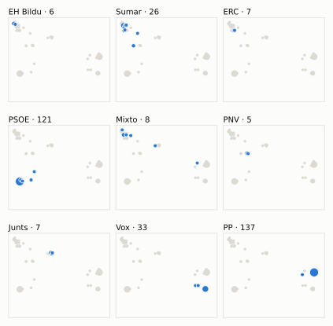
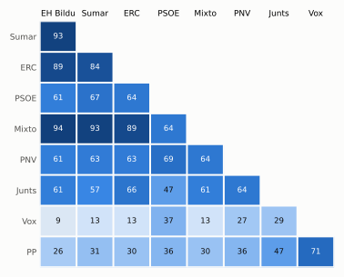

# Análisis detallado: febrero de 2026

[← Volver al resumen del mes](2026-02.md)

_Generado automáticamente el 2026-11-10 con datos abiertos del [Congreso de los Diputados](https://www.congreso.es/es/opendata/votaciones). Solo plenos y Diputación Permanente. Método y límites en [docs/DOCUMENTO_FUNCIONAL.md](../docs/DOCUMENTO_FUNCIONAL.md)._

## Resumen

- **70 votaciones** en 6 días de pleno (sesiones 157, 159, 160, 161, 162 y 164).
- **41 aprobadas** y **26 rechazadas**, más 3 empates que obligaron a repetir.
- 12 votaciones se decidieron por 5 votos o menos.
- El grupo que más veces votó con el resultado final: **PP** (71 % de las votaciones nominales).
- Los grupos del Gobierno (PSOE y Sumar) votaron lo mismo en 46 de 70 votaciones nominales y perdieron 12 de ellas.
- 17 votos individuales se apartaron de la posición de su grupo (15 diputados).

## Cómo votó cada grupo

| Grupo | Diputados | Cohesión | Votó con el resultado | Decisivo | Posición Sí | Posición No | Posición Abst. |
| --- | ---: | ---: | ---: | ---: | ---: | ---: | ---: |
| PP | 137 | 100 % | 71 % | 19 | 45 | 17 | 8 |
| PSOE | 121 | 100 % | 64 % | 14 | 30 | 31 | 9 |
| Vox | 33 | 100 % | 56 % | 13 | 34 | 23 | 13 |
| Sumar | 26 | 100 % | 57 % | 12 | 41 | 28 | 1 |
| Mixto | 8 | 75 % | 56 % | 7 | 40 | 28 | 2 |
| Junts | 7 | 100 % | 67 % | 8 | 40 | 16 | 14 |
| ERC | 7 | 100 % | 56 % | 8 | 44 | 20 | 6 |
| EH Bildu | 6 | 100 % | 51 % | 6 | 41 | 27 | 2 |
| PNV | 5 | 100 % | 59 % | 4 | 37 | 16 | 17 |

*Cohesión*: índice de acuerdo interno (100 % = todo el grupo votó igual). *Votó con el resultado*: el grupo votó Sí y salió aprobada, o No y salió rechazada. *Decisivo*: votaciones cuyo resultado habría cambiado si el grupo se hubiera abstenido en bloque. El Grupo Mixto reúne partidos distintos: su posición es la de su mayoría.

## Mapa de diputados

<picture>
  <source media="(prefers-color-scheme: dark)" srcset="img/2026-02/mapa-oscuro.svg">
  
</picture>

Cada punto es un diputado; dos diputados están cerca si votaron parecido. Un punto más grande reúne a varios que votaron exactamente igual. En cada panel, el grupo en azul y el resto del Congreso en gris.

*Cómo se calcula*: componentes principales de los votos (Sí, No, abstención) en 66 votaciones con algún desacuerdo. El eje horizontal recoge el 74 % de la variación y el vertical el 16 %. Los ejes no tienen nombre ni sentido político propio; por convención, el PP queda a la derecha.

## Afinidad entre grupos

<picture>
  <source media="(prefers-color-scheme: dark)" srcset="img/2026-02/afinidad-oscuro.svg">
  
</picture>

Porcentaje de votaciones nominales en que los dos grupos tomaron la misma posición. Los grupos están ordenados según el mapa de diputados.

Ver la tabla

|  | PP | PSOE | Vox | Sumar | Mixto | Junts | ERC | EH Bildu | PNV |
| --- | :---: | :---: | :---: | :---: | :---: | :---: | :---: | :---: | :---: |
| PP | 100 % | 36 % | 71 % | 31 % | 30 % | 47 % | 30 % | 26 % | 36 % |
| PSOE | 36 % | 100 % | 37 % | 67 % | 64 % | 47 % | 64 % | 61 % | 69 % |
| Vox | 71 % | 37 % | 100 % | 13 % | 13 % | 29 % | 13 % | 9 % | 27 % |
| Sumar | 31 % | 67 % | 13 % | 100 % | 93 % | 57 % | 84 % | 93 % | 63 % |
| Mixto | 30 % | 64 % | 13 % | 93 % | 100 % | 61 % | 89 % | 94 % | 64 % |
| Junts | 47 % | 47 % | 29 % | 57 % | 61 % | 100 % | 66 % | 61 % | 64 % |
| ERC | 30 % | 64 % | 13 % | 84 % | 89 % | 66 % | 100 % | 89 % | 63 % |
| EH Bildu | 26 % | 61 % | 9 % | 93 % | 94 % | 61 % | 89 % | 100 % | 61 % |
| PNV | 36 % | 69 % | 27 % | 63 % | 64 % | 64 % | 63 % | 61 % | 100 % |

## Quién sacó adelante las votaciones

| Grupos que votaron Sí | Votaciones | Escaños |
| --- | ---: | ---: |
| PSOE + Sumar + Mixto + Junts + ERC + EH Bildu + PNV | 6 | 180 |
| PP + Vox | 6 | 170 |
| Todos los grupos | 6 | 350 |
| PP + PSOE + Sumar + Mixto + Junts + ERC + EH Bildu + PNV | 5 | 317 |
| PP + Sumar + Mixto + Junts + ERC + EH Bildu + PNV | 3 | 196 |
| PP + PSOE + Vox + Junts + PNV | 3 | 303 |
| PP + Vox + Junts | 3 | 177 |
| PP + Sumar + Mixto + Junts + ERC + EH Bildu | 3 | 191 |

De 41 votaciones nominales aprobadas. Otras 6 salieron con combinaciones que se dieron menos veces. La posición de cada grupo es la de la mayoría de sus diputados.

## Votaciones que perdieron los grupos del Gobierno

| Fecha | Asunto | Tipo | PSOE y Sumar votaron | Resultado | Sí | No |
| --- | --- | --- | :---: | --- | ---: | ---: |
| 10 de febrero | Proposición de Ley del Grupo Parlamentario Popular en el Congreso, para garantizar el cumplimiento de la Ley 47/2003, de 26 de noviembre, General Presupuestari… | Leyes: toma en consideración | No | Aprobada | 172 | 162 |
| 12 de febrero | Proposición no de Ley del Grupo Parlamentario Popular en el Congreso, sobre actuaciones urgentes para corregir el caos ferroviario. Se vota en los términos res… | Proposiciones no de ley | No | Aprobada | 170 | 156 |
| 12 de febrero | Proposición no de Ley del Grupo Parlamentario Socialista, para la defensa de la legalidad internacional. | Proposiciones no de ley | Sí | Rechazada | 168 | 171 |
| 17 de febrero | Proposición de Ley del Grupo Parlamentario Socialista, sobre la evaluación del impacto en el ámbito de la juventud de las políticas públicas. | Leyes: toma en consideración | Sí | Rechazada | 172 | 174 |
| 18 de febrero | Moción consecuencia de interpelación urgente del Grupo Parlamentario Popular en el Congreso, sobre el evidente fracaso de las políticas en materia de vivienda… *(Votación separada por puntos. Punto 6.)* | Mociones | No | Aprobada | 176 | 162 |
| 18 de febrero | Moción consecuencia de interpelación urgente del Grupo Parlamentario Popular en el Congreso, sobre el evidente fracaso de las políticas en materia de vivienda… *(Votación separada por puntos. Punto 7.)* | Mociones | No | Aprobada | 170 | 163 |
| 24 de febrero | Proposición de Ley del Grupo Parlamentario Plurinacional SUMAR, para la garantía de los derechos de las personas trabajadoras en procesos de deslocalización y… | Leyes: toma en consideración | Sí | Rechazada | 168 | 178 |
| 26 de febrero | Proposición no de Ley del Grupo Parlamentario Mixto (Sra. Belarra Urteaga), para la garantía efectiva del derecho a la educación sexual integral en cumplimient… | Proposiciones no de ley | Sí | Rechazada | 167 | 183 |
| 26 de febrero | Proposición no de Ley del Grupo Parlamentario Popular en el Congreso, para la ejecución efectiva de las órdenes de expulsión de extranjeros nacionales de terce… *(Votación separada por puntos. Punto 1.)* | Proposiciones no de ley | No | Aprobada | 178 | 166 |
| 26 de febrero | Proposición no de Ley del Grupo Parlamentario Popular en el Congreso, para la ejecución efectiva de las órdenes de expulsión de extranjeros nacionales de terce… *(Votación separada por puntos. Punto 4.)* | Proposiciones no de ley | No | Aprobada | 171 | 166 |
| 26 de febrero | Real Decreto-ley 2/2026, de 3 de febrero, por el que se adoptan medidas urgentes para hacer frente a situaciones de vulnerabilidad social, en materia tributari… | Decretos-ley (convalidación) | Sí | Rechazada | 172 | 177 |
| 26 de febrero | Real Decreto-ley 4/2026, de 10 de febrero, por el que se garantiza la accesibilidad equitativa a bienes y servicios en situaciones de emergencia. | Decretos-ley (convalidación) | Sí | Rechazada | 172 | 177 |

Además, PSOE y Sumar votaron distinto entre sí en 23 votaciones.

## Votaciones más ajustadas

| Fecha | Asunto | Resultado | Sí | No | Abst. |
| --- | --- | :---: | ---: | ---: | ---: |
| 12 de febrero | Proposición no de Ley del Grupo Parlamentario Socialista, para la defensa de la legalidad internacional. | Empate (se repite) | 169 | 169 | 7 |
| 26 de febrero | Proposición no de Ley del Grupo Parlamentario Popular en el Congreso, para la ejecución efectiva de las órdenes de expulsión de extranjeros nacionales de terce… *(Votación separada por puntos. Punto 2.)* | Empate (se repite) | 171 | 171 | 8 |
| 26 de febrero | Proposición no de Ley del Grupo Parlamentario Popular en el Congreso, para la ejecución efectiva de las órdenes de expulsión de extranjeros nacionales de terce… *(Votación separada por puntos. Punto 2.)* | Empate (se repite) | 171 | 171 | 8 |
| 26 de febrero | Proposición no de Ley del Grupo Parlamentario Popular en el Congreso, para la ejecución efectiva de las órdenes de expulsión de extranjeros nacionales de terce… *(Votación separada por puntos. Punto 2.)* | Rechazada | 170 | 171 | 8 |
| 26 de febrero | Proposición no de Ley del Grupo Parlamentario Popular en el Congreso, para la ejecución efectiva de las órdenes de expulsión de extranjeros nacionales de terce… *(Votación separada por puntos. Punto 3.)* | Rechazada | 172 | 173 | 5 |
| 17 de febrero | Proposición de Ley del Grupo Parlamentario Socialista, sobre la evaluación del impacto en el ámbito de la juventud de las políticas públicas. | Rechazada | 172 | 174 | 0 |
| 12 de febrero | Proposición no de Ley del Grupo Parlamentario Socialista, para la defensa de la legalidad internacional. | Rechazada | 168 | 171 | 7 |
| 24 de febrero | Proposición de Ley del Grupo Parlamentario Vasco (EAJ-PNV), Orgánica de reforma de la Ley Orgánica 2/1979, de 3 de octubre, del Tribunal Constitucional. | Aprobada | 175 | 171 | 0 |
| 12 de febrero | Moción consecuencia de interpelación urgente del Grupo Parlamentario Popular en el Congreso, para dar cuenta de la corrupción económica, política e institucion… | Rechazada | 170 | 175 | 1 |
| 26 de febrero | Proposición no de Ley del Grupo Parlamentario Popular en el Congreso, para la ejecución efectiva de las órdenes de expulsión de extranjeros nacionales de terce… *(Votación separada por puntos. Punto 4.)* | Aprobada | 171 | 166 | 13 |

Votaciones decididas por 10 votos o menos (o a esa distancia de la mayoría que exigían). Las públicas por llamamiento no tienen hemiciclo: el voto de cada diputado solo consta en el Diario de Sesiones.

## Qué se votó, por tipo de asunto

| Tipo de asunto | Votaciones | Aprobadas | No aprobadas |
| --- | ---: | ---: | ---: |
| Mociones | 36 | 24 | 12 |
| Proposiciones no de ley | 13 | 4 | 9 |
| Decretos-ley (convalidación) | 6 | 4 | 2 |
| Leyes: dictamen y votación final | 6 | 3 | 3 |
| Leyes: toma en consideración | 6 | 3 | 3 |
| Organización de la Cámara | 3 | 3 | 0 |

Las proposiciones no de ley y las mociones expresan la posición del Congreso pero no obligan al Gobierno. Las leyes pasan por varias votaciones (toma en consideración, totalidad, dictamen, Senado), así que una misma ley puede aparecer varias veces.

## Votos distintos de su grupo

| Diputado | Grupo | Votos distintos de su grupo |
| --- | --- | ---: |
| Boada Danés, Júlia | Sumar | 3 |
| Conde López, Francisco José | PP | 1 |
| Delgado Arce, Celso Luis | PP | 1 |
| Floriano Corrales, Carlos Javier | PP | 1 |
| Martín Blanco, Nacho | PP | 1 |
| Montero Cuadrado, María Jesús | PSOE | 1 |
| Ogou i Corbi, Viviane | Sumar | 1 |
| Pagès i Massó, Josep | Junts | 1 |
| Román Jasanada, Antonio | PP | 1 |
| Sagastizabal Unzetabarrenetxea, Idoia | PNV | 1 |
| Sahuquillo García, Luis Carlos | PSOE | 1 |
| Sayas López, Sergio | PP | 1 |
| Sánchez Díaz, María Carmen | PSOE | 1 |
| Sémper Pascual, Borja | PP | 1 |
| Álvarez de Toledo Peralta-Ramos, Cayetana | PP | 1 |

Un voto aislado puede ser un error al pulsar, no una decisión política: el Congreso no publica las correcciones. Se excluye el Grupo Mixto.

## Diputados que más veces no votaron

| Diputado | Grupo | No votó | % de votaciones |
| --- | --- | ---: | ---: |
| Sánchez Pérez-Castejón, Pedro | PSOE | 29 | 41 % |
| Núñez Feijóo, Alberto | PP | 26 | 37 % |
| Badia Casas, Eloi | Sumar | 25 | 36 % |
| Pisarello Prados, Gerardo | Sumar | 25 | 36 % |
| Díaz Pérez, Yolanda | Sumar | 16 | 23 % |
| Montero Cuadrado, María Jesús | PSOE | 16 | 23 % |
| Fernández Hernández, Pedro | Vox | 14 | 20 % |
| Nogueras i Camero, Míriam | Junts | 12 | 17 % |
| Rodríguez Almeida, Andrés Alberto | Vox | 12 | 17 % |
| Delgado Arce, Celso Luis | PP | 3 | 4 % |
| López Tagliafico, Candela | Sumar | 3 | 4 % |
| Montesinos de Miguel, Macarena | PP | 2 | 3 % |
| Otero Gabirondo, Mikel | EH Bildu | 2 | 3 % |
| Rufián Romero, Gabriel | ERC | 2 | 3 % |
| Vidal Sáez, Aina | Sumar | 2 | 3 % |

«No vota» incluye ausencias justificadas (baja, maternidad o paternidad) y escaños vacantes; el portal no las distingue.

## Todas las votaciones

Posición de cada grupo: la opción que votó la mayoría de sus diputados (*Div.*: empate dentro del grupo). El número enlaza al JSON oficial o, en las votaciones por llamamiento, al Diario de Sesiones.

### 10 de febrero (sesión 157)

| Nº | Asunto | Resultado | Sí | No | Abst. | PP | PSOE | Vox | Sumar | Mixto | Junts | ERC | EH Bildu | PNV | Decisivos |
| ---: | --- | --- | ---: | ---: | ---: | :---: | :---: | :---: | :---: | :---: | :---: | :---: | :---: | :---: | --- |
| [1](https://www.congreso.es/webpublica/opendata/votaciones/Leg15/Sesion157/20260210/Votacion001/VOT_20260210205703.json) | Proposición del Parlamento de las Illes Balears, de Ley para la reforma del artículo 69.3 de la Constitución española a los efectos de que la isla de Formenter… | Aprobada | 176 | 33 | 138 | Abst. | Sí | No | Sí | Sí | Sí | Sí | Sí | Sí |  |
| [2](https://www.congreso.es/webpublica/opendata/votaciones/Leg15/Sesion157/20260210/Votacion002/VOT_20260210205704.json) | Proposición de Ley del Grupo Parlamentario Popular en el Congreso, para garantizar el cumplimiento de la Ley 47/2003, de 26 de noviembre, General Presupuestari… | Aprobada | 172 | 162 | 13 | Sí | No | Sí | No | No | Abst. | No | No | Abst. | PP, Vox |

### 12 de febrero (sesión 159)

| Nº | Asunto | Resultado | Sí | No | Abst. | PP | PSOE | Vox | Sumar | Mixto | Junts | ERC | EH Bildu | PNV | Decisivos |
| ---: | --- | --- | ---: | ---: | ---: | :---: | :---: | :---: | :---: | :---: | :---: | :---: | :---: | :---: | --- |
| [1](https://www.congreso.es/webpublica/opendata/votaciones/Leg15/Sesion159/20260212/Votacion001/VOT_20260212114304.json) | Proposición de Ley Orgánica en materia de multirreincidencia, por la que se modifica la Ley Orgánica 10/1995, de 23 de noviembre, del Código Penal y la Ley de… *(Enmienda presentada por el Grupo Parlamentario Mixto (Sra.…)* | Rechazada | 49 | 289 | 7 | No | No | No | Sí | Sí | Abst. | Sí | Sí | Sí |  |
| [2](https://www.congreso.es/webpublica/opendata/votaciones/Leg15/Sesion159/20260212/Votacion002/VOT_20260212114307.json) | Proposición de Ley Orgánica en materia de multirreincidencia, por la que se modifica la Ley Orgánica 10/1995, de 23 de noviembre, del Código Penal y la Ley de… *(Enmiendas presentadas por el Grupo Parlamentario Republican…)* | Rechazada | 22 | 322 | 1 | No | No | No | No | No | Sí | Sí | Sí | No |  |
| [3](https://www.congreso.es/webpublica/opendata/votaciones/Leg15/Sesion159/20260212/Votacion003/VOT_20260212114308.json) | Proposición de Ley Orgánica en materia de multirreincidencia, por la que se modifica la Ley Orgánica 10/1995, de 23 de noviembre, del Código Penal y la Ley de… *(Enmiendas presentadas por el Grupo Parlamentario Republican…)* | Rechazada | 44 | 300 | 1 | No | No | No | Sí | No | Sí | Sí | Sí | No |  |
| [4](https://www.congreso.es/webpublica/opendata/votaciones/Leg15/Sesion159/20260212/Votacion004/VOT_20260212114310.json) | Proposición no de Ley del Grupo Parlamentario Popular en el Congreso, sobre actuaciones urgentes para corregir el caos ferroviario. Se vota en los términos res… | Aprobada | 170 | 156 | 20 | Sí | No | Sí | No | Abst. | Abst. | Abst. | No | No | PP, Vox |
| [5](https://www.congreso.es/webpublica/opendata/votaciones/Leg15/Sesion159/20260212/Votacion005/VOT_20260212114312.json) | Proposición no de Ley del Grupo Parlamentario Socialista, para la defensa de la legalidad internacional. | Empate (se repite) | 169 | 169 | 7 | No | Sí | No | Sí | Sí | Abst. | Sí | Sí | Sí | PP, Vox |
| [6](https://www.congreso.es/webpublica/opendata/votaciones/Leg15/Sesion159/20260212/Votacion006/VOT_20260212114313.json) | Proposición no de Ley del Grupo Parlamentario Socialista, para la defensa de la legalidad internacional. | Rechazada | 168 | 171 | 7 | No | Sí | No | Sí | Sí | Abst. | Sí | Sí | Sí | PP, Vox |
| [7](https://www.congreso.es/webpublica/opendata/votaciones/Leg15/Sesion159/20260212/Votacion007/VOT_20260212114315.json) | Moción consecuencia de interpelación urgente del Grupo Parlamentario VOX, sobre cuáles van a ser las medidas del Gobierno para garantizar la protección de nues… | Rechazada | 170 | 176 | 0 | Sí | No | Sí | No | No | No | No | No | No | Junts, Mixto, ERC, PSOE, Sumar |
| [8](https://www.congreso.es/webpublica/opendata/votaciones/Leg15/Sesion159/20260212/Votacion008/VOT_20260212114317.json) | Moción consecuencia de interpelación urgente del Grupo Parlamentario Popular en el Congreso, para dar cuenta de la corrupción económica, política e institucion… | Rechazada | 170 | 175 | 1 | Sí | No | Sí | No | No | No | No | No | No | EH Bildu, Junts, Mixto, ERC, PSOE, Sumar |
| [9](https://www.congreso.es/webpublica/opendata/votaciones/Leg15/Sesion159/20260212/Votacion009/VOT_20260212114319.json) | Moción consecuencia de interpelación urgente del Grupo Parlamentario Republicano, sobre la mejora de la protección social de los trabajadores autónomos. *(Votación separada por puntos. Punto 1.)* | Aprobada | 312 | 33 | 0 | Sí | Sí | No | Sí | Sí | Sí | Sí | Sí | Sí |  |
| [10](https://www.congreso.es/webpublica/opendata/votaciones/Leg15/Sesion159/20260212/Votacion010/VOT_20260212114321.json) | Moción consecuencia de interpelación urgente del Grupo Parlamentario Republicano, sobre la mejora de la protección social de los trabajadores autónomos. *(Votación separada por puntos. Punto 2.)* | Rechazada | 43 | 156 | 147 | Abst. | No | No | Sí | Sí | Abst. | Sí | Sí | Abst. | PSOE |
| [11](https://www.congreso.es/webpublica/opendata/votaciones/Leg15/Sesion159/20260212/Votacion011/VOT_20260212114323.json) | Moción consecuencia de interpelación urgente del Grupo Parlamentario Republicano, sobre la mejora de la protección social de los trabajadores autónomos. *(Votación separada por puntos. Punto 3.)* | Rechazada | 57 | 153 | 136 | Abst. | No | No | Sí | Sí | Sí | Sí | Sí | Sí | PSOE |
| [12](https://www.congreso.es/webpublica/opendata/votaciones/Leg15/Sesion159/20260212/Votacion012/VOT_20260212114325.json) | Moción consecuencia de interpelación urgente del Grupo Parlamentario Republicano, sobre la mejora de la protección social de los trabajadores autónomos. *(Votación separada por puntos. Punto 4.)* | Aprobada | 313 | 0 | 33 | Sí | Sí | Abst. | Sí | Sí | Sí | Sí | Sí | Sí |  |
| [13](https://www.congreso.es/webpublica/opendata/votaciones/Leg15/Sesion159/20260212/Votacion013/VOT_20260212114327.json) | Moción consecuencia de interpelación urgente del Grupo Parlamentario Republicano, sobre la mejora de la protección social de los trabajadores autónomos. *(Votación separada por puntos. Punto 5.)* | Aprobada | 177 | 0 | 169 | Abst. | Sí | Abst. | Sí | Sí | Sí | Sí | Sí | Sí |  |
| [14](https://www.congreso.es/webpublica/opendata/votaciones/Leg15/Sesion159/20260212/Votacion014/VOT_20260212114329.json) | Moción consecuencia de interpelación urgente del Grupo Parlamentario Republicano, sobre la mejora de la protección social de los trabajadores autónomos. *(Votación separada por puntos. Punto 6.)* | Aprobada | 192 | 0 | 154 | Sí | Abst. | Abst. | Sí | Sí | Sí | Sí | Sí | Sí |  |
| [15](https://www.congreso.es/webpublica/opendata/votaciones/Leg15/Sesion159/20260212/Votacion015/VOT_20260212114331.json) | Moción consecuencia de interpelación urgente del Grupo Parlamentario Republicano, sobre la mejora de la protección social de los trabajadores autónomos. *(Votación separada por puntos. Punto 7.)* | Aprobada | 192 | 120 | 33 | Sí | No | Abst. | Sí | Sí | Sí | Sí | Sí | Sí | PP |
| [16](https://www.congreso.es/webpublica/opendata/votaciones/Leg15/Sesion159/20260212/Votacion016/VOT_20260212114333.json) | Moción consecuencia de interpelación urgente del Grupo Parlamentario Republicano, sobre la mejora de la protección social de los trabajadores autónomos. *(Votación separada por puntos. Punto 8.)* | Rechazada | 33 | 313 | 0 | No | No | No | No | Sí | Sí | Sí | Sí | Sí |  |
| [17](https://www.congreso.es/webpublica/opendata/votaciones/Leg15/Sesion159/20260212/Votacion017/VOT_20260212114334.json) | Moción consecuencia de interpelación urgente del Grupo Parlamentario Republicano, sobre la mejora de la protección social de los trabajadores autónomos. *(Votación separada por puntos. Punto 9.)* | Aprobada | 178 | 0 | 166 | Abst. | Sí | Abst. | Sí | Sí | Sí | Sí | Sí | Sí |  |
| [18](https://www.congreso.es/webpublica/opendata/votaciones/Leg15/Sesion159/20260212/Votacion018/VOT_20260212114336.json) | Moción consecuencia de interpelación urgente del Grupo Parlamentario Republicano, sobre la mejora de la protección social de los trabajadores autónomos. *(Votación separada por puntos. Punto 10.)* | Rechazada | 55 | 290 | 0 | No | No | No | Sí | Sí | Sí | Sí | Sí | Sí |  |
| [19](https://www.congreso.es/webpublica/opendata/votaciones/Leg15/Sesion159/20260212/Votacion019/VOT_20260212114338.json) | Moción consecuencia de interpelación urgente del Grupo Parlamentario Republicano, sobre la mejora de la protección social de los trabajadores autónomos. *(Votación separada por puntos. Punto 11.)* | Aprobada | 193 | 120 | 33 | Sí | No | Abst. | Sí | Sí | Sí | Sí | Sí | Sí | PP |
| [20](https://www.congreso.es/webpublica/opendata/votaciones/Leg15/Sesion159/20260212/Votacion020/VOT_20260212114339.json) | Moción consecuencia de interpelación urgente del Grupo Parlamentario Republicano, sobre la mejora de la protección social de los trabajadores autónomos. *(Votación separada por puntos. Punto 12.)* | Rechazada | 44 | 289 | 13 | No | No | No | Sí | Sí | Abst. | Sí | Sí | Abst. |  |
| [21](https://www.congreso.es/webpublica/opendata/votaciones/Leg15/Sesion159/20260212/Votacion021/VOT_20260212114340.json) | Moción consecuencia de interpelación urgente del Grupo Parlamentario Republicano, sobre la mejora de la protección social de los trabajadores autónomos. *(Votación separada por puntos. Punto 13.)* | Aprobada | 176 | 137 | 33 | No | Sí | Abst. | Sí | Sí | Sí | Sí | Sí | Sí | PSOE |
| [22](https://www.congreso.es/webpublica/opendata/votaciones/Leg15/Sesion159/20260212/Votacion022/VOT_20260212114342.json) | Proposición de Ley Orgánica en materia de multirreincidencia, por la que se modifica la Ley Orgánica 10/1995, de 23 de noviembre, del Código Penal y la Ley de… *(Votación del dictamen.)* | Aprobada | 302 | 35 | 8 | Sí | Sí | Sí | No | No | Sí | Abst. | No | Sí |  |
| [23](https://www.congreso.es/webpublica/opendata/votaciones/Leg15/Sesion159/20260212/Votacion023/VOT_20260212114343.json) | Proposición de Ley Orgánica en materia de multirreincidencia, por la que se modifica la Ley Orgánica 10/1995, de 23 de noviembre, del Código Penal y la Ley de… *(Votación de conjunto. Votación de conjunto de la Proposició…)* | Aprobada (necesita 176) | 302 | 36 | 8 | Sí | Sí | Sí | No | No | Sí | Abst. | No | Sí | PP |
| [24](https://www.congreso.es/webpublica/opendata/votaciones/Leg15/Sesion159/20260212/Votacion024/VOT_20260212114345.json) | Modificación de los acuerdos de creación de Comisiones de Investigación como consecuencia de su unificación bajo el nombre de Comisión de Investigación de la i… | Aprobada | 346 | 0 | 0 | Sí | Sí | Sí | Sí | Sí | Sí | Sí | Sí | Sí |  |
| [25](https://www.congreso.es/webpublica/opendata/votaciones/Leg15/Sesion159/20260212/Votacion025/VOT_20260212114346.json) | Votación de la solicitud de avocación por el Pleno de la Cámara de la deliberación y votación final del Proyecto de Ley por la que se modifican el Texto Refund… | Aprobada | 338 | 0 | 6 | Sí | Sí | Sí | Sí | Sí | Sí | Sí | Abst. | Sí |  |

### 17 de febrero (sesión 160)

| Nº | Asunto | Resultado | Sí | No | Abst. | PP | PSOE | Vox | Sumar | Mixto | Junts | ERC | EH Bildu | PNV | Decisivos |
| ---: | --- | --- | ---: | ---: | ---: | :---: | :---: | :---: | :---: | :---: | :---: | :---: | :---: | :---: | --- |
| [1](https://www.congreso.es/webpublica/opendata/votaciones/Leg15/Sesion160/20260217/Votacion001/VOT_20260217203202.json) | Proposición de Ley del Grupo Parlamentario Socialista, sobre la evaluación del impacto en el ámbito de la juventud de las políticas públicas. | Rechazada | 172 | 174 | 0 | No | Sí | No | Sí | Sí | No | Sí | Sí | Sí | Junts, PP, Vox |
| [2](https://www.congreso.es/webpublica/opendata/votaciones/Leg15/Sesion160/20260217/Votacion002/VOT_20260217203204.json) | Proposición de Ley del Grupo Parlamentario VOX, Orgánica para la protección de la dignidad de las mujeres y la seguridad ciudadana en el espacio público. | Rechazada | 170 | 177 | 1 | Sí | No | Sí | No | No | No | No | No | No | PSOE, Sumar |

### 18 de febrero (sesión 161)

| Nº | Asunto | Resultado | Sí | No | Abst. | PP | PSOE | Vox | Sumar | Mixto | Junts | ERC | EH Bildu | PNV | Decisivos |
| ---: | --- | --- | ---: | ---: | ---: | :---: | :---: | :---: | :---: | :---: | :---: | :---: | :---: | :---: | --- |
| [1](https://www.congreso.es/webpublica/opendata/votaciones/Leg15/Sesion161/20260218/Votacion001/VOT_20260218141918.json) | Proposición no de Ley del Grupo Parlamentario VOX, relativa a la defensa de nuestro campo y del sector primario que garantiza nuestra soberanía alimentaria. | Rechazada | 31 | 174 | 139 | Abst. | No | Sí | No | No | No | No | No | No |  |
| [2](https://www.congreso.es/webpublica/opendata/votaciones/Leg15/Sesion161/20260218/Votacion002/VOT_20260218141919.json) | Proposición no de Ley del Grupo Parlamentario Plurinacional SUMAR, sobre una nueva regulación para los créditos rápidos en defensa del consumidor. Se vota en l… | Aprobada | 176 | 31 | 137 | Abst. | Sí | No | Sí | Sí | Sí | Sí | Sí | Sí |  |
| [3](https://www.congreso.es/webpublica/opendata/votaciones/Leg15/Sesion161/20260218/Votacion003/VOT_20260218141921.json) | Moción consecuencia de interpelación urgente del Grupo Parlamentario Mixto (Sra. Valido García), sobre el impacto en la economía canaria de la falta de aplicac… | Aprobada | 169 | 150 | 24 | Sí | No | No | Sí | Abst. | Abst. | Abst. | Abst. | Sí | PP, Sumar |
| [4](https://www.congreso.es/webpublica/opendata/votaciones/Leg15/Sesion161/20260218/Votacion004/VOT_20260218141923.json) | Moción consecuencia de interpelación urgente del Grupo Parlamentario VOX, sobre cuáles van a ser las medidas del Gobierno para garantizar la seguridad de las i… | Rechazada | 168 | 176 | 0 | Sí | No | Sí | No | No | No | No | No | No | PSOE, Sumar |
| [5](https://www.congreso.es/webpublica/opendata/votaciones/Leg15/Sesion161/20260218/Votacion005/VOT_20260218141924.json) | Moción consecuencia de interpelación urgente del Grupo Parlamentario Popular en el Congreso, sobre el evidente fracaso de las políticas en materia de vivienda… *(Votación separada por puntos. Punto 1.)* | Aprobada | 176 | 44 | 125 | Sí | Abst. | Sí | No | No | Sí | No | No | Abst. | PP |
| [6](https://www.congreso.es/webpublica/opendata/votaciones/Leg15/Sesion161/20260218/Votacion006/VOT_20260218141925.json) | Moción consecuencia de interpelación urgente del Grupo Parlamentario Popular en el Congreso, sobre el evidente fracaso de las políticas en materia de vivienda… *(Votación separada por puntos. Punto 2.)* | Aprobada | 301 | 37 | 7 | Sí | Sí | Sí | No | No | Sí | Abst. | No | Sí |  |
| [7](https://www.congreso.es/webpublica/opendata/votaciones/Leg15/Sesion161/20260218/Votacion007/VOT_20260218141927.json) | Moción consecuencia de interpelación urgente del Grupo Parlamentario Popular en el Congreso, sobre el evidente fracaso de las políticas en materia de vivienda… *(Votación separada por puntos. Punto 3.)* | Aprobada | 177 | 36 | 132 | Sí | Abst. | Sí | No | No | Abst. | Sí | No | Abst. |  |
| [8](https://www.congreso.es/webpublica/opendata/votaciones/Leg15/Sesion161/20260218/Votacion008/VOT_20260218141929.json) | Moción consecuencia de interpelación urgente del Grupo Parlamentario Popular en el Congreso, sobre el evidente fracaso de las políticas en materia de vivienda… *(Votación separada por puntos. Punto 4.)* | Aprobada | 309 | 36 | 0 | Sí | Sí | Sí | No | No | Sí | Sí | No | Sí |  |
| [9](https://www.congreso.es/webpublica/opendata/votaciones/Leg15/Sesion161/20260218/Votacion009/VOT_20260218141931.json) | Moción consecuencia de interpelación urgente del Grupo Parlamentario Popular en el Congreso, sobre el evidente fracaso de las políticas en materia de vivienda… *(Votación separada por puntos. Punto 5.)* | Aprobada | 170 | 49 | 126 | Sí | Abst. | Sí | No | No | No | No | No | Abst. | PP |
| [10](https://www.congreso.es/webpublica/opendata/votaciones/Leg15/Sesion161/20260218/Votacion010/VOT_20260218141933.json) | Moción consecuencia de interpelación urgente del Grupo Parlamentario Popular en el Congreso, sobre el evidente fracaso de las políticas en materia de vivienda… *(Votación separada por puntos. Punto 6.)* | Aprobada | 176 | 162 | 7 | Sí | No | Sí | No | No | Sí | No | No | Abst. | PP, Vox |
| [11](https://www.congreso.es/webpublica/opendata/votaciones/Leg15/Sesion161/20260218/Votacion011/VOT_20260218141935.json) | Moción consecuencia de interpelación urgente del Grupo Parlamentario Popular en el Congreso, sobre el evidente fracaso de las políticas en materia de vivienda… *(Votación separada por puntos. Punto 7.)* | Aprobada | 170 | 163 | 12 | Sí | No | Sí | No | No | Abst. | No | No | Abst. | PP, Vox |
| [12](https://www.congreso.es/webpublica/opendata/votaciones/Leg15/Sesion161/20260218/Votacion012/VOT_20260218141936.json) | Moción consecuencia de interpelación urgente del Grupo Parlamentario Popular en el Congreso, sobre el evidente fracaso de las políticas en materia de vivienda… *(Votación separada por puntos. Punto 8.)* | Aprobada | 180 | 35 | 128 | Sí | Abst. | Sí | No | No | Sí | Abst. | No | Sí |  |

### 24 de febrero (sesión 162)

| Nº | Asunto | Resultado | Sí | No | Abst. | PP | PSOE | Vox | Sumar | Mixto | Junts | ERC | EH Bildu | PNV | Decisivos |
| ---: | --- | --- | ---: | ---: | ---: | :---: | :---: | :---: | :---: | :---: | :---: | :---: | :---: | :---: | --- |
| [1](https://www.congreso.es/webpublica/opendata/votaciones/Leg15/Sesion162/20260224/Votacion001/VOT_20260224201927.json) | Proposición de Ley del Grupo Parlamentario Plurinacional SUMAR, para la garantía de los derechos de las personas trabajadoras en procesos de deslocalización y… | Rechazada | 168 | 178 | 1 | No | Sí | No | Sí | Sí | No | Sí | Sí | Sí | PP, Vox |
| [2](https://www.congreso.es/webpublica/opendata/votaciones/Leg15/Sesion162/20260224/Votacion002/VOT_20260224201928.json) | Proposición de Ley del Grupo Parlamentario Vasco (EAJ-PNV), Orgánica de reforma de la Ley Orgánica 2/1979, de 3 de octubre, del Tribunal Constitucional. | Aprobada | 175 | 171 | 0 | No | Sí | No | Sí | Sí | Sí | Sí | Sí | Sí | EH Bildu, Junts, Mixto, ERC, PSOE, Sumar, PNV |

### 26 de febrero (sesión 164)

| Nº | Asunto | Resultado | Sí | No | Abst. | PP | PSOE | Vox | Sumar | Mixto | Junts | ERC | EH Bildu | PNV | Decisivos |
| ---: | --- | --- | ---: | ---: | ---: | :---: | :---: | :---: | :---: | :---: | :---: | :---: | :---: | :---: | --- |
| [1](https://www.congreso.es/webpublica/opendata/votaciones/Leg15/Sesion164/20260226/Votacion001/VOT_20260226153357.json) | Proposición no de Ley del Grupo Parlamentario Mixto (Sra. Belarra Urteaga), para la garantía efectiva del derecho a la educación sexual integral en cumplimient… | Rechazada | 167 | 183 | 0 | No | Sí | No | Sí | Sí | No | Sí | Sí | No | PP, Vox |
| [2](https://www.congreso.es/webpublica/opendata/votaciones/Leg15/Sesion164/20260226/Votacion002/VOT_20260226153358.json) | Proposición no de Ley del Grupo Parlamentario Popular en el Congreso, para la ejecución efectiva de las órdenes de expulsión de extranjeros nacionales de terce… *(Votación separada por puntos. Punto 1.)* | Aprobada | 178 | 166 | 6 | Sí | No | Sí | No | No | Sí | No | No | Abst. | PP, Vox |
| [3](https://www.congreso.es/webpublica/opendata/votaciones/Leg15/Sesion164/20260226/Votacion003/VOT_20260226153400.json) | Proposición no de Ley del Grupo Parlamentario Popular en el Congreso, para la ejecución efectiva de las órdenes de expulsión de extranjeros nacionales de terce… *(Votación separada por puntos. Punto 2.)* | Empate (se repite) | 171 | 171 | 8 | Sí | No | Sí | No | No | Abst. | No | No | No | EH Bildu, Mixto, ERC, PSOE, Sumar, PNV |
| [4](https://www.congreso.es/webpublica/opendata/votaciones/Leg15/Sesion164/20260226/Votacion004/VOT_20260226153401.json) | Proposición no de Ley del Grupo Parlamentario Popular en el Congreso, para la ejecución efectiva de las órdenes de expulsión de extranjeros nacionales de terce… *(Votación separada por puntos. Punto 2.)* | Empate (se repite) | 171 | 171 | 8 | Sí | No | Sí | No | No | Abst. | No | No | No | EH Bildu, Mixto, ERC, PSOE, Sumar, PNV |
| [5](https://www.congreso.es/webpublica/opendata/votaciones/Leg15/Sesion164/20260226/Votacion005/VOT_20260226153403.json) | Proposición no de Ley del Grupo Parlamentario Popular en el Congreso, para la ejecución efectiva de las órdenes de expulsión de extranjeros nacionales de terce… *(Votación separada por puntos. Punto 2.)* | Rechazada | 170 | 171 | 8 | Sí | No | Sí | No | No | Abst. | No | No | No | EH Bildu, Mixto, ERC, PSOE, Sumar, PNV |
| [6](https://www.congreso.es/webpublica/opendata/votaciones/Leg15/Sesion164/20260226/Votacion006/VOT_20260226153404.json) | Proposición no de Ley del Grupo Parlamentario Popular en el Congreso, para la ejecución efectiva de las órdenes de expulsión de extranjeros nacionales de terce… *(Votación separada por puntos. Punto 3.)* | Rechazada | 172 | 173 | 5 | Sí | No | Sí | No | No | No | No | No | Abst. | EH Bildu, Junts, Mixto, ERC, PSOE, Sumar |
| [7](https://www.congreso.es/webpublica/opendata/votaciones/Leg15/Sesion164/20260226/Votacion007/VOT_20260226153405.json) | Proposición no de Ley del Grupo Parlamentario Popular en el Congreso, para la ejecución efectiva de las órdenes de expulsión de extranjeros nacionales de terce… *(Votación separada por puntos. Punto 4.)* | Aprobada | 171 | 166 | 13 | Sí | No | Sí | No | No | Abst. | No | No | Abst. | PP, Vox |
| [8](https://www.congreso.es/webpublica/opendata/votaciones/Leg15/Sesion164/20260226/Votacion008/VOT_20260226153407.json) | Proposición no de Ley del Grupo Parlamentario Popular en el Congreso, para la ejecución efectiva de las órdenes de expulsión de extranjeros nacionales de terce… *(Votación separada por puntos. Punto 5.)* | Rechazada | 172 | 178 | 0 | Sí | No | Sí | No | No | No | No | No | No | Junts, ERC, PSOE, Sumar |
| [9](https://www.congreso.es/webpublica/opendata/votaciones/Leg15/Sesion164/20260226/Votacion009/VOT_20260226153409.json) | Moción consecuencia de interpelación urgente del Grupo Parlamentario Popular en el Congreso, sobre el impacto de la falta de Presupuestos Generales del Estado… *(Votación separada por puntos. Puntos 1 y 2.)* | Rechazada | 170 | 178 | 1 | Sí | No | Sí | No | No | No | No | No | No | PSOE, Sumar |
| [10](https://www.congreso.es/webpublica/opendata/votaciones/Leg15/Sesion164/20260226/Votacion010/VOT_20260226153411.json) | Moción consecuencia de interpelación urgente del Grupo Parlamentario Popular en el Congreso, sobre el impacto de la falta de Presupuestos Generales del Estado… *(Votación separada por puntos. Punto 3.)* | Aprobada | 171 | 31 | 148 | Sí | Abst. | Sí | Abst. | No | No | No | No | No |  |
| [11](https://www.congreso.es/webpublica/opendata/votaciones/Leg15/Sesion164/20260226/Votacion011/VOT_20260226153412.json) | Moción consecuencia de interpelación urgente del Grupo Parlamentario Mixto (Sra. Micó Micó), relativa al deterioro y a la insuficiencia estructural del servici… *(Votación separada por puntos. Punto 1.)* | Rechazada | 53 | 290 | 7 | No | No | No | Sí | Sí | Sí | Sí | Sí | Abst. |  |
| [12](https://www.congreso.es/webpublica/opendata/votaciones/Leg15/Sesion164/20260226/Votacion012/VOT_20260226153414.json) | Moción consecuencia de interpelación urgente del Grupo Parlamentario Mixto (Sra. Micó Micó), relativa al deterioro y a la insuficiencia estructural del servici… *(Votación separada por puntos. Punto 2.)* | Aprobada | 188 | 0 | 161 | Sí | Abst. | Abst. | Sí | Sí | Sí | Sí | Sí | Abst. |  |
| [13](https://www.congreso.es/webpublica/opendata/votaciones/Leg15/Sesion164/20260226/Votacion013/VOT_20260226153416.json) | Moción consecuencia de interpelación urgente del Grupo Parlamentario Mixto (Sra. Micó Micó), relativa al deterioro y a la insuficiencia estructural del servici… *(Votación separada por puntos. Punto 3.)* | Aprobada | 316 | 0 | 33 | Sí | Sí | Abst. | Sí | Sí | Sí | Sí | Sí | Sí |  |
| [14](https://www.congreso.es/webpublica/opendata/votaciones/Leg15/Sesion164/20260226/Votacion014/VOT_20260226153417.json) | Moción consecuencia de interpelación urgente del Grupo Parlamentario Mixto (Sra. Micó Micó), relativa al deterioro y a la insuficiencia estructural del servici… *(Votación separada por puntos. Punto 4.)* | Aprobada | 316 | 0 | 33 | Sí | Sí | Abst. | Sí | Sí | Sí | Sí | Sí | Sí |  |
| [15](https://www.congreso.es/webpublica/opendata/votaciones/Leg15/Sesion164/20260226/Votacion015/VOT_20260226153419.json) | Moción consecuencia de interpelación urgente del Grupo Parlamentario Mixto (Sra. Micó Micó), relativa al deterioro y a la insuficiencia estructural del servici… *(Votación separada por puntos. Punto 5.)* | Aprobada | 188 | 0 | 162 | Sí | Abst. | Abst. | Sí | Sí | Sí | Sí | Sí | Abst. |  |
| [16](https://www.congreso.es/webpublica/opendata/votaciones/Leg15/Sesion164/20260226/Votacion016/VOT_20260226153420.json) | Moción consecuencia de interpelación urgente del Grupo Parlamentario Mixto (Sra. Micó Micó), relativa al deterioro y a la insuficiencia estructural del servici… *(Votación separada por puntos. Punto 6.)* | Aprobada | 189 | 0 | 161 | Sí | Abst. | Abst. | Sí | Sí | Sí | Sí | Sí | Abst. |  |
| [17](https://www.congreso.es/webpublica/opendata/votaciones/Leg15/Sesion164/20260226/Votacion017/VOT_20260226153421.json) | Moción consecuencia de interpelación urgente del Grupo Parlamentario Mixto (Sra. Micó Micó), relativa al deterioro y a la insuficiencia estructural del servici… *(Votación separada por puntos. Punto 7.)* | Rechazada | 54 | 291 | 5 | No | No | No | Sí | Sí | Sí | Sí | Sí | Abst. |  |
| [18](https://www.congreso.es/webpublica/opendata/votaciones/Leg15/Sesion164/20260226/Votacion018/VOT_20260226153422.json) | Moción consecuencia de interpelación urgente del Grupo Parlamentario Mixto (Sra. Micó Micó), relativa al deterioro y a la insuficiencia estructural del servici… *(Votación separada por puntos. Punto 8.)* | Aprobada | 312 | 0 | 38 | Sí | Sí | Abst. | Sí | Sí | Sí | Sí | Sí | Abst. |  |
| [19](https://www.congreso.es/webpublica/opendata/votaciones/Leg15/Sesion164/20260226/Votacion019/VOT_20260226153424.json) | Moción consecuencia de interpelación urgente del Grupo Parlamentario VOX, sobre la política migratoria del Gobierno de España. | Rechazada | 33 | 179 | 137 | Abst. | No | Sí | No | No | No | No | No | No |  |
| [20](https://www.congreso.es/webpublica/opendata/votaciones/Leg15/Sesion164/20260226/Votacion020/VOT_20260226153425.json) | Real Decreto-ley 1/2026, de 27 de enero, de ayudas a las víctimas de los accidentes ferroviarios de Adamuz (Córdoba) y Gélida (Barcelona). | Aprobada | 349 | 1 | 0 | Sí | Sí | Sí | Sí | Sí | Sí | Sí | Sí | Sí |  |
| [21](https://www.congreso.es/webpublica/opendata/votaciones/Leg15/Sesion164/20260226/Votacion021/VOT_20260226153427.json) | Tramitación como Proyecto de Ley por el procedimiento de urgencia del Real Decreto-ley 1/2026, de 27 de enero, de ayudas a las víctimas de los accidentes ferro… | Aprobada | 350 | 0 | 0 | Sí | Sí | Sí | Sí | Sí | Sí | Sí | Sí | Sí |  |
| [22](https://www.congreso.es/webpublica/opendata/votaciones/Leg15/Sesion164/20260226/Votacion022/VOT_20260226153428.json) | Real Decreto-ley 2/2026, de 3 de febrero, por el que se adoptan medidas urgentes para hacer frente a situaciones de vulnerabilidad social, en materia tributari… | Rechazada | 172 | 177 | 1 | No | Sí | No | Sí | Sí | No | Sí | Sí | Sí | Junts, PP, Vox |
| [23](https://www.congreso.es/webpublica/opendata/votaciones/Leg15/Sesion164/20260226/Votacion023/VOT_20260226153430.json) | Real Decreto-ley 3/2026, de 3 de febrero, para la revalorización de las pensiones públicas y otras medidas urgentes en materia de Seguridad Social. | Aprobada | 317 | 33 | 0 | Sí | Sí | No | Sí | Sí | Sí | Sí | Sí | Sí |  |
| [24](https://www.congreso.es/webpublica/opendata/votaciones/Leg15/Sesion164/20260226/Votacion024/VOT_20260226153431.json) | Tramitación como Proyecto de Ley por el procedimiento de urgencia del Real Decreto-ley 3/2026, de 3 de febrero, para la revalorización de las pensiones pública… | Aprobada | 349 | 0 | 0 | Sí | Sí | Sí | Sí | Sí | Sí | Sí | Sí | Sí |  |
| [25](https://www.congreso.es/webpublica/opendata/votaciones/Leg15/Sesion164/20260226/Votacion025/VOT_20260226153432.json) | Real Decreto-ley 4/2026, de 10 de febrero, por el que se garantiza la accesibilidad equitativa a bienes y servicios en situaciones de emergencia. | Rechazada | 172 | 177 | 1 | No | Sí | No | Sí | Sí | No | Sí | Sí | Sí | Junts, PP, Vox |
| [26](https://www.congreso.es/webpublica/opendata/votaciones/Leg15/Sesion164/20260226/Votacion026/VOT_20260226153433.json) | Dictamen de la Comisión del Estatuto sobre declaración de actividades de los Excmos. Sres. Diputados. | Aprobada | 345 | 0 | 2 | Sí | Sí | Sí | Sí | Sí | Sí | Sí | Sí | Sí |  |
| [27](https://www.congreso.es/webpublica/opendata/votaciones/Leg15/Sesion164/20260226/Votacion027/VOT_20260226153435.json) | Solicitud de la Comisión de Educación, Formación Profesional y Deportes, de nueva prórroga de seis meses del plazo para la conclusión de los trabajos de la Sub… | Aprobada | 348 | 0 | 0 | Sí | Sí | Sí | Sí | Sí | Sí | Sí | Sí | Sí |  |
