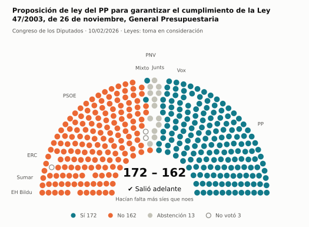
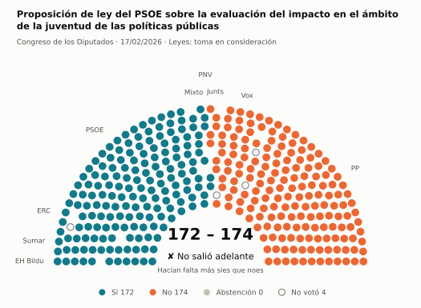
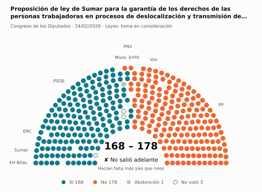
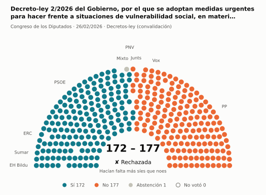
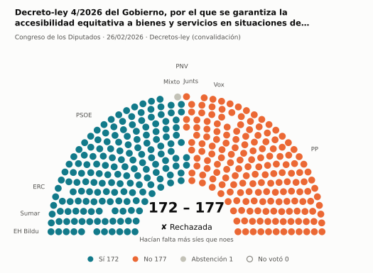
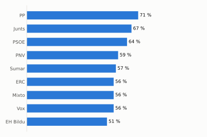
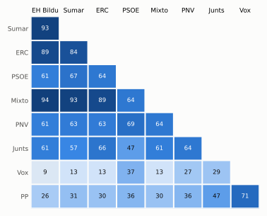

# Qué votó el Congreso en febrero de 2026

Las votaciones del Pleno del Congreso de los Diputados, explicadas sin tecnicismos. Datos oficiales del [Congreso](https://www.congreso.es/es/opendata/votaciones); este resumen se actualiza solo cada mes (última vez: 11/11/2026).

## En pocas palabras

- El Congreso votó **70 veces** en 6 días de pleno. **41 propuestas salieron adelante** y 26 no; hubo además 3 empates, que se repiten.
- 18 votaciones fueron sobre leyes, decretos o presupuestos. Otras 49 fueron peticiones al Gobierno que no le obligan (proposiciones no de ley y mociones).
- El Gobierno (PSOE y Sumar) perdió **12** de las 46 votaciones en las que sus grupos votaron lo mismo.
- La votación más reñida se decidió por 1 voto: Propuesta del PP para la ejecución efectiva de las órdenes de expulsión de extranjeros nacionales de terceros países….
- Los diputados casi siempre votan lo mismo que su grupo: en todo el mes solo hubo 17 votos distintos (sin contar el Grupo Mixto).

## Las votaciones más importantes del mes

Elegidas por su importancia: pesan más las leyes y los decretos que las peticiones al Gobierno, y suben las que se decidieron por pocos votos o las que perdió el Gobierno. Cada punto del dibujo es un diputado, colocado con su grupo, y el color es lo que votó.

### 1. Proposición de ley del PP para garantizar el cumplimiento de la Ley 47/2003, de 26 de noviembre, General Presupuestaria

**10 de febrero · Leyes: toma en consideración.** Primer paso de una ley propuesta por un grupo o una comunidad autónoma: el Congreso decide si empieza a tramitarla.

<picture>
  <source media="(prefers-color-scheme: dark)" srcset="img/2026-02/votacion-L15-S157-V002-oscuro.svg">
  
</picture>

**✔ Salió adelante** por 10 votos: 172 a favor, 162 en contra y 13 abstenciones.

- **A favor:** PP y Vox
- **En contra:** PSOE, Sumar, ERC y EH Bildu
- **Se abstuvieron:** Junts y PNV
- **Repartidos:** Grupo Mixto (Sí 2, No 5, Abstención 1)

[Datos oficiales](https://www.congreso.es/webpublica/opendata/votaciones/Leg15/Sesion157/20260210/Votacion002/VOT_20260210205704.json)

### 2. Proposición de ley del PSOE sobre la evaluación del impacto en el ámbito de la juventud de las políticas públicas

**17 de febrero · Leyes: toma en consideración.** Primer paso de una ley propuesta por un grupo o una comunidad autónoma: el Congreso decide si empieza a tramitarla.

<picture>
  <source media="(prefers-color-scheme: dark)" srcset="img/2026-02/votacion-L15-S160-V001-oscuro.svg">
  
</picture>

**✘ No salió adelante** por 2 votos: 172 a favor, 174 en contra y ninguna abstención.

- **A favor:** PSOE, Sumar, Grupo Mixto, ERC, EH Bildu y PNV
- **En contra:** PP, Vox y Junts

[Datos oficiales](https://www.congreso.es/webpublica/opendata/votaciones/Leg15/Sesion160/20260217/Votacion001/VOT_20260217203202.json)

### 3. Proposición de ley de Sumar para la garantía de los derechos de las personas trabajadoras en procesos de deslocalización y transmisión de unidades…

**24 de febrero · Leyes: toma en consideración.** Primer paso de una ley propuesta por un grupo o una comunidad autónoma: el Congreso decide si empieza a tramitarla.

<picture>
  <source media="(prefers-color-scheme: dark)" srcset="img/2026-02/votacion-L15-S162-V001-oscuro.svg">
  
</picture>

**✘ No salió adelante** por 10 votos: 168 a favor, 178 en contra y 1 abstención.

- **A favor:** PSOE, Sumar, ERC, EH Bildu y PNV
- **En contra:** PP, Vox y Junts
- **Repartidos:** Grupo Mixto (Sí 6, No 1, Abstención 1)

[Datos oficiales](https://www.congreso.es/webpublica/opendata/votaciones/Leg15/Sesion162/20260224/Votacion001/VOT_20260224201927.json)

### 4. Decreto-ley 2/2026 del Gobierno, por el que se adoptan medidas urgentes para hacer frente a situaciones de vulnerabilidad social, en materia…

**26 de febrero · Decretos-ley (convalidación).** El Gobierno aprobó esta norma por urgencia. Ya está en vigor, pero el Congreso tiene 30 días para confirmarla o tumbarla.

<picture>
  <source media="(prefers-color-scheme: dark)" srcset="img/2026-02/votacion-L15-S164-V022-oscuro.svg">
  
</picture>

**✘ No salió adelante** por 5 votos: 172 a favor, 177 en contra y 1 abstención.

- **A favor:** PSOE, Sumar, ERC, EH Bildu y PNV
- **En contra:** PP, Vox y Junts
- **Repartidos:** Grupo Mixto (Sí 7, Abstención 1)

[Datos oficiales](https://www.congreso.es/webpublica/opendata/votaciones/Leg15/Sesion164/20260226/Votacion022/VOT_20260226153428.json)

### 5. Decreto-ley 4/2026 del Gobierno, por el que se garantiza la accesibilidad equitativa a bienes y servicios en situaciones de emergencia

**26 de febrero · Decretos-ley (convalidación).** El Gobierno aprobó esta norma por urgencia. Ya está en vigor, pero el Congreso tiene 30 días para confirmarla o tumbarla.

<picture>
  <source media="(prefers-color-scheme: dark)" srcset="img/2026-02/votacion-L15-S164-V025-oscuro.svg">
  
</picture>

**✘ No salió adelante** por 5 votos: 172 a favor, 177 en contra y 1 abstención.

- **A favor:** PSOE, Sumar, ERC, EH Bildu y PNV
- **En contra:** PP, Vox y Junts
- **Repartidos:** Grupo Mixto (Sí 7, Abstención 1)

[Datos oficiales](https://www.congreso.es/webpublica/opendata/votaciones/Leg15/Sesion164/20260226/Votacion025/VOT_20260226153432.json)

## ¿Qué grupos votaron más veces lo que finalmente salió?

<picture>
  <source media="(prefers-color-scheme: dark)" srcset="img/2026-02/ganadora-oscuro.svg">
  
</picture>

Porcentaje de votaciones en que el grupo votó Sí y salió adelante, o votó No y no salió. Abstenerse no cuenta como acertar.

## ¿Quién vota con quién?

<picture>
  <source media="(prefers-color-scheme: dark)" srcset="img/2026-02/afinidad-oscuro.svg">
  
</picture>

Cada casilla dice en qué porcentaje de las votaciones dos grupos votaron lo mismo: 100 es que siempre coincidieron y 0 que nunca.

## ¿Qué tipo de cosas se votaron?

| Tipo | Votaciones | Salieron adelante | Qué es |
| --- | ---: | ---: | --- |
| Mociones | 36 | 24 | Petición al Gobierno después de pedirle explicaciones en el Pleno. Expresa la opinión del Congreso, pero no obliga. |
| Proposiciones no de ley | 13 | 4 | Petición al Gobierno para que haga algo. Expresa la opinión del Congreso, pero no obliga. |
| Decretos-ley (convalidación) | 6 | 4 | El Gobierno aprobó esta norma por urgencia. Ya está en vigor, pero el Congreso tiene 30 días para confirmarla o tumbarla. |
| Leyes: dictamen y votación final | 6 | 3 | Votación del texto de una ley después de trabajarla en comisión. |
| Leyes: toma en consideración | 6 | 3 | Primer paso de una ley propuesta por un grupo o una comunidad autónoma: el Congreso decide si empieza a tramitarla. |
| Organización de la Cámara | 3 | 3 | Asunto interno del Congreso: comisiones, plazos o el estatuto de los diputados. |

## Palabras que conviene saber

- **Pleno**: La reunión de los 350 diputados, donde se vota.
- **Grupo parlamentario**: Los diputados de un partido o coalición. Los partidos pequeños van juntos en el Grupo Mixto, aunque no piensen igual.
- **Abstención**: El diputado vota, pero ni a favor ni en contra.
- **No votó**: El diputado no votó: no estaba, estaba de baja o el escaño estaba vacío.
- **Mayoría simple**: Salen adelante las votaciones con más síes que noes. Es lo normal.
- **Mayoría absoluta**: 176 votos a favor, la mitad más uno de 350. La piden las leyes orgánicas (derechos fundamentales, sistema electoral…) y la primera votación de investidura.
- **Votación por llamamiento**: Cada diputado dice su voto en voz alta. Se usa en las investiduras y otras votaciones importantes.

---

**¿Quieres más detalle?** El [análisis detallado](2026-02-detalle.md) tiene la cohesión de cada grupo, un mapa de los diputados según cómo votan, qué diputados votaron distinto de su grupo, las ausencias y la lista completa de votaciones.

_Los resultados están calculados a partir de los votos: el Congreso no publica si cada votación salió adelante. Este proyecto no tiene relación con el Congreso. Método en [docs/DOCUMENTO_FUNCIONAL.md](../docs/DOCUMENTO_FUNCIONAL.md)._
