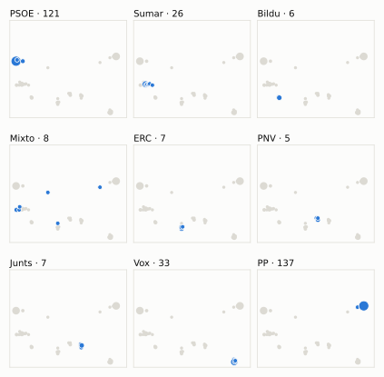
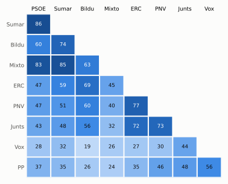

# Análisis detallado: marzo de 2026

[← Volver al resumen del mes](2026-03.md)

_Generado automáticamente el 2026-11-11 con datos abiertos del [Congreso de los Diputados](https://www.congreso.es/es/opendata/votaciones). Solo plenos y Diputación Permanente. Método y límites en [docs/DOCUMENTO_FUNCIONAL.md](../docs/DOCUMENTO_FUNCIONAL.md)._

## Resumen

- **81 votaciones** en 4 días de pleno (sesiones 165, 166, 167, 169 y 170).
- **45 aprobadas** y **36 rechazadas**.
- 4 votaciones se decidieron por 5 votos o menos.
- El grupo que más veces votó con el resultado final: **PSOE** (72 % de las votaciones nominales).
- Los grupos del Gobierno (PSOE y Sumar) votaron lo mismo en 68 de 81 votaciones nominales y perdieron 17 de ellas.
- 19 votos individuales se apartaron de la posición de su grupo (19 diputados).

## Cómo votó cada grupo

| Grupo | Diputados | Cohesión | Votó con el resultado | Decisivo | Posición Sí | Posición No | Posición Abst. |
| --- | ---: | ---: | ---: | ---: | ---: | ---: | ---: |
| PP | 137 | 100 % | 65 % | 24 | 51 | 17 | 13 |
| PSOE | 121 | 100 % | 72 % | 23 | 24 | 54 | 3 |
| Vox | 33 | 100 % | 53 % | 14 | 40 | 30 | 11 |
| Sumar | 26 | 100 % | 67 % | 8 | 26 | 52 | 3 |
| Mixto | 8 | 69 % | 59 % | 4 | 14 | 61 | 3 |
| Junts | 7 | 100 % | 65 % | 4 | 60 | 15 | 6 |
| ERC | 7 | 99 % | 53 % | 4 | 43 | 23 | 15 |
| EH Bildu | 6 | 100 % | 48 % | 3 | 30 | 36 | 15 |
| PNV | 5 | 100 % | 62 % | 3 | 51 | 18 | 12 |

*Cohesión*: índice de acuerdo interno (100 % = todo el grupo votó igual). *Votó con el resultado*: el grupo votó Sí y salió aprobada, o No y salió rechazada. *Decisivo*: votaciones cuyo resultado habría cambiado si el grupo se hubiera abstenido en bloque. El Grupo Mixto reúne partidos distintos: su posición es la de su mayoría.

## Mapa de diputados

<picture>
  <source media="(prefers-color-scheme: dark)" srcset="img/2026-03/mapa-oscuro.svg">
  
</picture>

Cada punto es un diputado; dos diputados están cerca si votaron parecido. Un punto más grande reúne a varios que votaron exactamente igual. En cada panel, el grupo en azul y el resto del Congreso en gris.

*Cómo se calcula*: componentes principales de los votos (Sí, No, abstención) en 79 votaciones con algún desacuerdo. El eje horizontal recoge el 71 % de la variación y el vertical el 12 %. Los ejes no tienen nombre ni sentido político propio; por convención, el PP queda a la derecha.

## Afinidad entre grupos

<picture>
  <source media="(prefers-color-scheme: dark)" srcset="img/2026-03/afinidad-oscuro.svg">
  
</picture>

Porcentaje de votaciones nominales en que los dos grupos tomaron la misma posición. Los grupos están ordenados según el mapa de diputados.

Ver la tabla

|  | PP | PSOE | Vox | Sumar | Mixto | Junts | ERC | EH Bildu | PNV |
| --- | :---: | :---: | :---: | :---: | :---: | :---: | :---: | :---: | :---: |
| PP | 100 % | 37 % | 56 % | 35 % | 24 % | 48 % | 35 % | 26 % | 46 % |
| PSOE | 37 % | 100 % | 28 % | 86 % | 83 % | 43 % | 47 % | 60 % | 47 % |
| Vox | 56 % | 28 % | 100 % | 32 % | 26 % | 44 % | 27 % | 19 % | 30 % |
| Sumar | 35 % | 86 % | 32 % | 100 % | 85 % | 48 % | 59 % | 74 % | 51 % |
| Mixto | 24 % | 83 % | 26 % | 85 % | 100 % | 32 % | 45 % | 63 % | 40 % |
| Junts | 48 % | 43 % | 44 % | 48 % | 32 % | 100 % | 72 % | 56 % | 73 % |
| ERC | 35 % | 47 % | 27 % | 59 % | 45 % | 72 % | 100 % | 69 % | 77 % |
| EH Bildu | 26 % | 60 % | 19 % | 74 % | 63 % | 56 % | 69 % | 100 % | 60 % |
| PNV | 46 % | 47 % | 30 % | 51 % | 40 % | 73 % | 77 % | 60 % | 100 % |

## Quién sacó adelante las votaciones

| Grupos que votaron Sí | Votaciones | Escaños |
| --- | ---: | ---: |
| PP + Vox + Junts + ERC + PNV | 7 | 189 |
| PP + Vox + Junts + PNV | 5 | 182 |
| PSOE + Sumar + Mixto + Junts + ERC + EH Bildu + PNV | 4 | 180 |
| PP + Vox + Junts | 4 | 177 |
| PP + PSOE + Sumar + Junts + ERC + EH Bildu + PNV | 4 | 309 |
| Todos los grupos | 2 | 350 |
| PP + PSOE + Vox + Sumar + Junts + ERC + EH Bildu + PNV | 2 | 342 |
| PP + Vox + Sumar + Junts + ERC + EH Bildu + PNV | 2 | 221 |

De 45 votaciones nominales aprobadas. Otras 15 salieron con combinaciones que se dieron menos veces. La posición de cada grupo es la de la mayoría de sus diputados.

## Votaciones que perdieron los grupos del Gobierno

| Fecha | Asunto | Tipo | PSOE y Sumar votaron | Resultado | Sí | No |
| --- | --- | --- | :---: | --- | ---: | ---: |
| 18 de marzo | Moción consecuencia de interpelación urgente del Grupo Parlamentario Popular en el Congreso, sobre la política en materia de migración del Gobierno. | Mociones | No | Aprobada | 176 | 172 |
| 18 de marzo | Acuerdo entre el Reino de España y la Organización de las Naciones Unidas para la Educación, la Ciencia y la Cultura relativo al IV Foro Global contra el Racis… | Tratados internacionales | Sí | Rechazada | 163 | 170 |
| 24 de marzo | Proposición de Ley del Grupo Parlamentario Popular en el Congreso, relativa a la modificación de la Ley 87/1978, de 28 de diciembre, de Seguros Agrarios Combin… | Leyes: toma en consideración | No | Aprobada | 192 | 154 |
| 26 de marzo | Proposición no de Ley del Grupo Parlamentario Junts per Catalunya, de medidas fiscales urgentes para hacer frente a la fatiga tributaria que padecen la clase m… *(Votación separada por puntos. Punto 1.)* | Proposiciones no de ley | No | Aprobada | 184 | 159 |
| 26 de marzo | Proposición no de Ley del Grupo Parlamentario Junts per Catalunya, de medidas fiscales urgentes para hacer frente a la fatiga tributaria que padecen la clase m… *(Votación separada por puntos. Punto 2.)* | Proposiciones no de ley | No | Aprobada | 177 | 164 |
| 26 de marzo | Proposición no de Ley del Grupo Parlamentario Junts per Catalunya, de medidas fiscales urgentes para hacer frente a la fatiga tributaria que padecen la clase m… *(Votación separada por puntos. Punto 3.)* | Proposiciones no de ley | No | Aprobada | 177 | 152 |
| 26 de marzo | Proposición no de Ley del Grupo Parlamentario Junts per Catalunya, de medidas fiscales urgentes para hacer frente a la fatiga tributaria que padecen la clase m… *(Votación separada por puntos. Punto 8.)* | Proposiciones no de ley | No | Aprobada | 191 | 158 |
| 26 de marzo | Proposición no de Ley del Grupo Parlamentario Junts per Catalunya, de medidas fiscales urgentes para hacer frente a la fatiga tributaria que padecen la clase m… *(Votación separada por puntos. Punto 11.)* | Proposiciones no de ley | No | Aprobada | 191 | 153 |
| 26 de marzo | Proposición no de Ley del Grupo Parlamentario Junts per Catalunya, de medidas fiscales urgentes para hacer frente a la fatiga tributaria que padecen la clase m… *(Votación separada por puntos. Punto 14.)* | Proposiciones no de ley | No | Aprobada | 184 | 158 |
| 26 de marzo | Proposición no de Ley del Grupo Parlamentario Junts per Catalunya, de medidas fiscales urgentes para hacer frente a la fatiga tributaria que padecen la clase m… *(Votación separada por puntos. Punto 15.)* | Proposiciones no de ley | No | Aprobada | 183 | 167 |
| 26 de marzo | Proposición no de Ley del Grupo Parlamentario Junts per Catalunya, de medidas fiscales urgentes para hacer frente a la fatiga tributaria que padecen la clase m… *(Votación separada por puntos. Punto 22.)* | Proposiciones no de ley | No | Aprobada | 190 | 153 |
| 26 de marzo | Proposición no de Ley del Grupo Parlamentario Vasco (EAJ-PNV), para reforzar la competitividad y la resiliencia de la industria siderúrgica y electrointensiva. *(Votación separada por puntos. Punto 3.)* | Proposiciones no de ley | No | Aprobada | 190 | 158 |
| 26 de marzo | Moción consecuencia de interpelación urgente del Grupo Parlamentario Junts per Catalunya, sobre las dificultades fiscales y económicas de la clase media y trab… *(Votación separada por puntos. Punto 4.)* | Mociones | No | Aprobada | 191 | 152 |
| 26 de marzo | Moción consecuencia de interpelación urgente del Grupo Parlamentario Popular en el Congreso, para dar cuenta de las medidas que está poniendo en marcha el Gobi… *(Votación separada por puntos. Punto 1.)* | Mociones | No | Aprobada | 182 | 166 |
| 26 de marzo | Moción consecuencia de interpelación urgente del Grupo Parlamentario Popular en el Congreso, para dar cuenta de las medidas que está poniendo en marcha el Gobi… *(Votación separada por puntos. Punto 2.)* | Mociones | No | Aprobada | 191 | 158 |

Y 2 más (ver «Todas las votaciones»).

Además, PSOE y Sumar votaron distinto entre sí en 11 votaciones.

## Votaciones más ajustadas

| Fecha | Asunto | Resultado | Sí | No | Abst. |
| --- | --- | :---: | ---: | ---: | ---: |
| 17 de marzo | Proposición de Ley del Grupo Parlamentario Popular en el Congreso, Orgánica de modificación de la Ley Orgánica 10/1995, de 23 de noviembre, del Código Penal, p… | Rechazada | 172 | 174 | 0 |
| 17 de marzo | Proposición de Ley del Grupo Parlamentario Mixto, para la modificación del Real Decreto Legislativo 5/2015, de 30 de octubre, por el que se aprueba el texto re… | Rechazada | 171 | 174 | 1 |
| 26 de marzo | Real Decreto-ley 6/2026, de 3 de marzo, por el que se modifica la Ley 20/2022, de 19 de octubre, de Memoria Democrática, sobre reconocimiento a favor de person… | Aprobada | 173 | 170 | 7 |
| 18 de marzo | Moción consecuencia de interpelación urgente del Grupo Parlamentario Popular en el Congreso, sobre la política en materia de migración del Gobierno. | Aprobada | 176 | 172 | 0 |
| 26 de marzo | Proposición de Ley Orgánica en materia de multirreincidencia, por la que se modifica la Ley Orgánica 10/1995, de 23 de noviembre, del Código Penal, la Ley de E… *(Votación separada de las enmiendas. Resto de las enmiendas.)* | Rechazada | 171 | 177 | 0 |
| 18 de marzo | Acuerdo entre el Reino de España y la Organización de las Naciones Unidas para la Educación, la Ciencia y la Cultura relativo al IV Foro Global contra el Racis… | Rechazada | 163 | 170 | 15 |
| 18 de marzo | Proposición no de Ley del Grupo Parlamentario Socialista, para la defensa de la libertad de información y expresión. Se vota en los términos de la enmienda tra… | Aprobada | 178 | 170 | 0 |
| 26 de marzo | Tramitación como Proyecto de Ley por el procedimiento de urgencia del Real Decreto-ley 6/2026, de 3 de marzo, por el que se modifica la Ley 20/2022, de 19 de o… | Aprobada | 179 | 171 | 0 |
| 26 de marzo | Proyecto de Ley integral de impulso de la economía social. *(Votación separada de las enmiendas. Resto de las enmiendas.)* | Rechazada | 170 | 179 | 0 |

Votaciones decididas por 10 votos o menos (o a esa distancia de la mayoría que exigían). Las públicas por llamamiento no tienen hemiciclo: el voto de cada diputado solo consta en el Diario de Sesiones.

## Qué se votó, por tipo de asunto

| Tipo de asunto | Votaciones | Aprobadas | No aprobadas |
| --- | ---: | ---: | ---: |
| Proposiciones no de ley | 31 | 18 | 13 |
| Mociones | 18 | 8 | 10 |
| Leyes: enmiendas del Senado | 15 | 6 | 9 |
| Decretos-ley (convalidación) | 6 | 6 | 0 |
| Leyes: dictamen y votación final | 4 | 3 | 1 |
| Leyes: toma en consideración | 4 | 2 | 2 |
| Tratados internacionales | 3 | 2 | 1 |

Las proposiciones no de ley y las mociones expresan la posición del Congreso pero no obligan al Gobierno. Las leyes pasan por varias votaciones (toma en consideración, totalidad, dictamen, Senado), así que una misma ley puede aparecer varias veces.

## Votos distintos de su grupo

| Diputado | Grupo | Votos distintos de su grupo |
| --- | --- | ---: |
| Beamonte Mesa, Luis María | PP | 1 |
| Boada Danés, Júlia | Sumar | 1 |
| Cantalapiedra Álvarez, María de las Mercedes | PP | 1 |
| Conde López, Francisco José | PP | 1 |
| De Meer Méndez, Rocío | Vox | 1 |
| Del Valle Rodríguez, Emilio Jesús | Vox | 1 |
| Díaz Pérez, Yolanda | Sumar | 1 |
| Floriano Corrales, Carlos Javier | PP | 1 |
| Granollers Cunillera, Inés | ERC | 1 |
| Mariscal Zabala, Manuel | Vox | 1 |
| Matute García de Jalón, Oskar | EH Bildu | 1 |
| Montesinos de Miguel, Macarena | PP | 1 |
| Pagès i Massó, Josep | Junts | 1 |
| Renteria Lasanta, Nerea | PNV | 1 |
| Rodríguez Serra, Santi | PP | 1 |

Un voto aislado puede ser un error al pulsar, no una decisión política: el Congreso no publica las correcciones. Se excluye el Grupo Mixto.

## Diputados que más veces no votaron

| Diputado | Grupo | No votó | % de votaciones |
| --- | --- | ---: | ---: |
| Montero Cuadrado, María Jesús | PSOE | 11 | 14 % |
| Núñez Feijóo, Alberto | PP | 11 | 14 % |
| Sánchez Pérez-Castejón, Pedro | PSOE | 11 | 14 % |
| Díaz Pérez, Yolanda | Sumar | 7 | 9 % |
| Pisarello Prados, Gerardo | Sumar | 3 | 4 % |
| Rego Candamil, Néstor | Mixto | 3 | 4 % |
| Santana Perera, Noemí | Mixto | 3 | 4 % |
| Santiago Romero, Enrique Fernando | Sumar | 3 | 4 % |
| Legarda Uriarte, Mikel | PNV | 2 | 2 % |
| Muñoz de la Iglesia, Ester | PP | 2 | 2 % |
| Velasco Morillo, Elvira | PP | 2 | 2 % |
| Aceves Galindo, José Luis | PSOE | 1 | 1 % |
| Aizcorbe Torra, Juan José | Vox | 1 | 1 % |
| Alonso Cantorné, Fèlix | Sumar | 1 | 1 % |
| Beamonte Mesa, Luis María | PP | 1 | 1 % |

«No vota» incluye ausencias justificadas (baja, maternidad o paternidad) y escaños vacantes; el portal no las distingue.

## Todas las votaciones

Posición de cada grupo: la opción que votó la mayoría de sus diputados (*Div.*: empate dentro del grupo). El número enlaza al JSON oficial o, en las votaciones por llamamiento, al Diario de Sesiones.

### 17 de marzo (sesión 165)

| Nº | Asunto | Resultado | Sí | No | Abst. | PP | PSOE | Vox | Sumar | Mixto | Junts | ERC | EH Bildu | PNV | Decisivos |
| ---: | --- | --- | ---: | ---: | ---: | :---: | :---: | :---: | :---: | :---: | :---: | :---: | :---: | :---: | --- |
| [1](https://www.congreso.es/webpublica/opendata/votaciones/Leg15/Sesion165/20260317/Votacion001/VOT_20260317205747.json) | Proposición de Ley del Grupo Parlamentario Mixto, para la modificación del Real Decreto Legislativo 5/2015, de 30 de octubre, por el que se aprueba el texto re… | Rechazada | 171 | 174 | 1 | Sí | No | Sí | No | No | No | No | No | No | EH Bildu, Junts, Mixto, ERC, PSOE, Sumar, PNV |
| [2](https://www.congreso.es/webpublica/opendata/votaciones/Leg15/Sesion165/20260317/Votacion002/VOT_20260317205749.json) | Proposición de Ley del Grupo Parlamentario Popular en el Congreso, Orgánica de modificación de la Ley Orgánica 10/1995, de 23 de noviembre, del Código Penal, p… | Rechazada | 172 | 174 | 0 | Sí | No | Sí | No | No | No | No | No | No | EH Bildu, Junts, Mixto, ERC, PSOE, Sumar, PNV |

### 18 de marzo (sesión 166)

| Nº | Asunto | Resultado | Sí | No | Abst. | PP | PSOE | Vox | Sumar | Mixto | Junts | ERC | EH Bildu | PNV | Decisivos |
| ---: | --- | --- | ---: | ---: | ---: | :---: | :---: | :---: | :---: | :---: | :---: | :---: | :---: | :---: | --- |
| [1](https://www.congreso.es/webpublica/opendata/votaciones/Leg15/Sesion166/20260318/Votacion001/VOT_20260318175323.json) | Proposición no de Ley del Grupo Parlamentario Socialista, para la defensa de la libertad de información y expresión. Se vota en los términos de la enmienda tra… | Aprobada | 178 | 170 | 0 | No | Sí | No | Sí | Sí | Sí | Sí | Sí | Sí | PSOE, Sumar |
| [2](https://www.congreso.es/webpublica/opendata/votaciones/Leg15/Sesion166/20260318/Votacion002/VOT_20260318175325.json) | Proposición no de Ley del Grupo Parlamentario Popular en el Congreso, relativa a la defensa de los cristianos perseguidos en el mundo y la acción internacional… | Aprobada | 169 | 3 | 176 | Sí | Abst. | Sí | Abst. | Abst. | Abst. | Abst. | Abst. | Abst. |  |
| [3](https://www.congreso.es/webpublica/opendata/votaciones/Leg15/Sesion166/20260318/Votacion003/VOT_20260318175327.json) | Moción consecuencia de interpelación urgente del Grupo Parlamentario Popular en el Congreso, sobre la política en materia de migración del Gobierno. | Aprobada | 176 | 172 | 0 | Sí | No | Sí | No | No | Sí | No | No | No | Junts, PP, Vox |
| [4](https://www.congreso.es/webpublica/opendata/votaciones/Leg15/Sesion166/20260318/Votacion004/VOT_20260318175329.json) | Moción consecuencia de interpelación urgente del Grupo Parlamentario Euskal Herria Bildu, relativa a las diferentes alternativas de infraestructuras ferroviari… | Rechazada | 51 | 298 | 0 | No | No | No | Sí | Sí | Sí | Sí | Sí | No |  |
| [5](https://www.congreso.es/webpublica/opendata/votaciones/Leg15/Sesion166/20260318/Votacion005/VOT_20260318175331.json) | Real Decreto-ley 5/2026, de 17 de febrero, por el que se adoptan medidas urgentes en respuesta a los daños causados por diversos fenómenos meteorológicos adver… | Aprobada | 316 | 32 | 0 | Sí | Sí | No | Sí | Sí | Sí | Sí | Sí | Sí |  |
| [6](https://www.congreso.es/webpublica/opendata/votaciones/Leg15/Sesion166/20260318/Votacion006/VOT_20260318175333.json) | Tramitación como Proyecto de Ley por el procedimiento de urgencia del Real Decreto-ley 5/2026, de 17 de febrero, por el que se adoptan medidas urgentes en resp… | Aprobada | 348 | 0 | 0 | Sí | Sí | Sí | Sí | Sí | Sí | Sí | Sí | Sí |  |
| [7](https://www.congreso.es/webpublica/opendata/votaciones/Leg15/Sesion166/20260318/Votacion007/VOT_20260318175335.json) | Acuerdo entre el Reino de España y la Organización de las Naciones Unidas para la Educación, la Ciencia y la Cultura relativo al IV Foro Global contra el Racis… | Rechazada | 163 | 170 | 15 | No | Sí | No | Sí | Sí | Abst. | Abst. | Sí | Sí | PP, Vox |
| [8](https://www.congreso.es/webpublica/opendata/votaciones/Leg15/Sesion166/20260318/Votacion008/VOT_20260318175337.json) | Acuerdo entre la Unión Europea y la Comunidad Europea de la Energía Atómica, por una parte, y el Reino de España, por otra, relativo al establecimiento del Cen… | Aprobada | 301 | 0 | 47 | Sí | Sí | Abst. | Sí | Sí | Abst. | Sí | Abst. | Sí |  |
| [9](https://www.congreso.es/webpublica/opendata/votaciones/Leg15/Sesion166/20260318/Votacion009/VOT_20260318175338.json) | Acuerdo por el que se modifica el Acuerdo entre el Reino de España y la República de Honduras sobre Transporte Aéreo y Anejo, firmado en Tegucigalpa el 30 de o… | Aprobada | 268 | 0 | 80 | Sí | Sí | Abst. | Abst. | Sí | Abst. | Abst. | Abst. | Sí |  |
| [10](https://www.congreso.es/webpublica/opendata/votaciones/Leg15/Sesion166/20260318/Votacion010/VOT_20260318175340.json) | Acuerdo de tramitación directa y en lectura única de la Proposición de reforma del artículo 69.3 de la Constitución española a los efectos de que la isla de Fo… | Aprobada | 178 | 33 | 137 | Abst. | Sí | No | Sí | Sí | Sí | Sí | Sí | Sí |  |

### 24 de marzo (sesión 167)

| Nº | Asunto | Resultado | Sí | No | Abst. | PP | PSOE | Vox | Sumar | Mixto | Junts | ERC | EH Bildu | PNV | Decisivos |
| ---: | --- | --- | ---: | ---: | ---: | :---: | :---: | :---: | :---: | :---: | :---: | :---: | :---: | :---: | --- |
| [1](https://www.congreso.es/webpublica/opendata/votaciones/Leg15/Sesion167/20260324/Votacion001/VOT_20260324205012.json) | Proposición de Ley del Grupo Parlamentario Socialista, Orgánica de modificación del artículo 379.1 del Código Penal, sobre conducción a velocidad superior a la… | Aprobada | 176 | 33 | 138 | Abst. | Sí | No | Sí | Sí | Sí | Sí | Sí | Sí |  |
| [2](https://www.congreso.es/webpublica/opendata/votaciones/Leg15/Sesion167/20260324/Votacion002/VOT_20260324205013.json) | Proposición de Ley del Grupo Parlamentario Popular en el Congreso, relativa a la modificación de la Ley 87/1978, de 28 de diciembre, de Seguros Agrarios Combin… | Aprobada | 192 | 154 | 1 | Sí | No | Sí | No | No | Sí | Sí | No | Sí | PP |

### 26 de marzo (sesión 169)

| Nº | Asunto | Resultado | Sí | No | Abst. | PP | PSOE | Vox | Sumar | Mixto | Junts | ERC | EH Bildu | PNV | Decisivos |
| ---: | --- | --- | ---: | ---: | ---: | :---: | :---: | :---: | :---: | :---: | :---: | :---: | :---: | :---: | --- |
| [1](https://www.congreso.es/webpublica/opendata/votaciones/Leg15/Sesion169/20260326/Votacion001/VOT_20260326165021.json) | Proposición de reforma del artículo 69.3 de la Constitución española a los efectos de que la isla de Formentera elija un senador propio, con independencia del… *(Enmiendas al articulado del Grupo Parlamentario VOX. Votaci…)* | Rechazada | 33 | 315 | 0 | No | No | Sí | No | No | No | No | No | No |  |
| [2](https://www.congreso.es/webpublica/opendata/votaciones/Leg15/Sesion169/20260326/Votacion002/VOT_20260326165023.json) | Proposición de reforma del artículo 69.3 de la Constitución española a los efectos de que la isla de Formentera elija un senador propio, con independencia del… *(Enmiendas al articulado del Grupo Parlamentario Popular en…)* | Aprobada | 138 | 86 | 124 | Sí | Abst. | No | No | No | No | No | No | Abst. | PP |
| [3](https://www.congreso.es/webpublica/opendata/votaciones/Leg15/Sesion169/20260326/Votacion003/VOT_20260326165025.json) | Proposición de Ley Orgánica en materia de multirreincidencia, por la que se modifica la Ley Orgánica 10/1995, de 23 de noviembre, del Código Penal, la Ley de E… *(Votación separada de las enmiendas. Enmiendas al Título de…)* | Rechazada | 138 | 177 | 33 | Sí | No | Abst. | No | No | No | No | No | No | PSOE |
| [4](https://www.congreso.es/webpublica/opendata/votaciones/Leg15/Sesion169/20260326/Votacion004/VOT_20260326165027.json) | Proposición de Ley Orgánica en materia de multirreincidencia, por la que se modifica la Ley Orgánica 10/1995, de 23 de noviembre, del Código Penal, la Ley de E… *(Votación separada de las enmiendas. Enmiendas al Artículo S…)* | Aprobada | 265 | 50 | 33 | Sí | Sí | Abst. | No | No | Sí | No | No | No |  |
| [5](https://www.congreso.es/webpublica/opendata/votaciones/Leg15/Sesion169/20260326/Votacion005/VOT_20260326165029.json) | Proposición de Ley Orgánica en materia de multirreincidencia, por la que se modifica la Ley Orgánica 10/1995, de 23 de noviembre, del Código Penal, la Ley de E… *(Votación separada de las enmiendas. Enmiendas al Artículo S…)* | Aprobada | 324 | 16 | 8 | Sí | Sí | Sí | Sí | No | Sí | Abst. | No | No |  |
| [6](https://www.congreso.es/webpublica/opendata/votaciones/Leg15/Sesion169/20260326/Votacion006/VOT_20260326165031.json) | Proposición de Ley Orgánica en materia de multirreincidencia, por la que se modifica la Ley Orgánica 10/1995, de 23 de noviembre, del Código Penal, la Ley de E… *(Votación separada de las enmiendas. Enmiendas a la disposic…)* | Aprobada | 297 | 51 | 0 | Sí | Sí | Sí | No | No | Sí | No | No | No |  |
| [7](https://www.congreso.es/webpublica/opendata/votaciones/Leg15/Sesion169/20260326/Votacion007/VOT_20260326165032.json) | Proposición de Ley Orgánica en materia de multirreincidencia, por la que se modifica la Ley Orgánica 10/1995, de 23 de noviembre, del Código Penal, la Ley de E… *(Votación separada de las enmiendas. Resto de las enmiendas.)* | Rechazada | 171 | 177 | 0 | Sí | No | Sí | No | No | No | No | No | No | Junts, Mixto, ERC, PSOE, Sumar |
| [8](https://www.congreso.es/webpublica/opendata/votaciones/Leg15/Sesion169/20260326/Votacion008/VOT_20260326165034.json) | Proposición no de Ley del Grupo Parlamentario Junts per Catalunya, de medidas fiscales urgentes para hacer frente a la fatiga tributaria que padecen la clase m… *(Votación separada por puntos. Punto 1.)* | Aprobada | 184 | 159 | 7 | Sí | No | Sí | No | No | Sí | Abst. | No | Sí | PP, Vox |
| [9](https://www.congreso.es/webpublica/opendata/votaciones/Leg15/Sesion169/20260326/Votacion009/VOT_20260326165035.json) | Proposición no de Ley del Grupo Parlamentario Junts per Catalunya, de medidas fiscales urgentes para hacer frente a la fatiga tributaria que padecen la clase m… *(Votación separada por puntos. Punto 2.)* | Aprobada | 177 | 164 | 5 | Sí | No | Sí | No | No | Sí | No | No | Abst. | PP, Vox |
| [10](https://www.congreso.es/webpublica/opendata/votaciones/Leg15/Sesion169/20260326/Votacion010/VOT_20260326165037.json) | Proposición no de Ley del Grupo Parlamentario Junts per Catalunya, de medidas fiscales urgentes para hacer frente a la fatiga tributaria que padecen la clase m… *(Votación separada por puntos. Punto 3.)* | Aprobada | 177 | 152 | 18 | Sí | No | Sí | No | No | Sí | Abst. | Abst. | Abst. | PP, Vox |
| [11](https://www.congreso.es/webpublica/opendata/votaciones/Leg15/Sesion169/20260326/Votacion011/VOT_20260326165039.json) | Proposición no de Ley del Grupo Parlamentario Junts per Catalunya, de medidas fiscales urgentes para hacer frente a la fatiga tributaria que padecen la clase m… *(Votación separada por puntos. Punto 4.)* | Rechazada | 52 | 161 | 137 | Abst. | No | No | Sí | No | Sí | Sí | Sí | Sí | PSOE |
| [12](https://www.congreso.es/webpublica/opendata/votaciones/Leg15/Sesion169/20260326/Votacion012/VOT_20260326165040.json) | Proposición no de Ley del Grupo Parlamentario Junts per Catalunya, de medidas fiscales urgentes para hacer frente a la fatiga tributaria que padecen la clase m… *(Votación separada por puntos. Punto 5.)* | Rechazada | 12 | 324 | 14 | No | No | No | No | No | Sí | Abst. | Abst. | Sí |  |
| [13](https://www.congreso.es/webpublica/opendata/votaciones/Leg15/Sesion169/20260326/Votacion013/VOT_20260326165041.json) | Proposición no de Ley del Grupo Parlamentario Junts per Catalunya, de medidas fiscales urgentes para hacer frente a la fatiga tributaria que padecen la clase m… *(Votación separada por puntos. Punto 6.)* | Rechazada | 40 | 162 | 148 | Abst. | No | Sí | No | No | Sí | Abst. | No | Abst. |  |
| [14](https://www.congreso.es/webpublica/opendata/votaciones/Leg15/Sesion169/20260326/Votacion014/VOT_20260326165042.json) | Proposición no de Ley del Grupo Parlamentario Junts per Catalunya, de medidas fiscales urgentes para hacer frente a la fatiga tributaria que padecen la clase m… *(Votación separada por puntos. Punto 7.)* | Aprobada | 339 | 5 | 6 | Sí | Sí | Sí | Sí | No | Sí | Sí | Abst. | Sí |  |
| [15](https://www.congreso.es/webpublica/opendata/votaciones/Leg15/Sesion169/20260326/Votacion015/VOT_20260326165044.json) | Proposición no de Ley del Grupo Parlamentario Junts per Catalunya, de medidas fiscales urgentes para hacer frente a la fatiga tributaria que padecen la clase m… *(Votación separada por puntos. Punto 8.)* | Aprobada | 191 | 158 | 1 | Sí | No | Sí | No | No | Sí | Sí | No | Sí | PP, Vox |
| [16](https://www.congreso.es/webpublica/opendata/votaciones/Leg15/Sesion169/20260326/Votacion016/VOT_20260326165045.json) | Proposición no de Ley del Grupo Parlamentario Junts per Catalunya, de medidas fiscales urgentes para hacer frente a la fatiga tributaria que padecen la clase m… *(Votación separada por puntos. Punto 9.)* | Rechazada | 52 | 154 | 143 | Abst. | No | Sí | No | No | Sí | Sí | Abst. | Sí | PSOE |
| [17](https://www.congreso.es/webpublica/opendata/votaciones/Leg15/Sesion169/20260326/Votacion017/VOT_20260326165046.json) | Proposición no de Ley del Grupo Parlamentario Junts per Catalunya, de medidas fiscales urgentes para hacer frente a la fatiga tributaria que padecen la clase m… *(Votación separada por puntos. Punto 10.)* | Rechazada | 39 | 159 | 150 | Abst. | No | Sí | No | No | Sí | Abst. | No | Abst. | PSOE |
| [18](https://www.congreso.es/webpublica/opendata/votaciones/Leg15/Sesion169/20260326/Votacion018/VOT_20260326165047.json) | Proposición no de Ley del Grupo Parlamentario Junts per Catalunya, de medidas fiscales urgentes para hacer frente a la fatiga tributaria que padecen la clase m… *(Votación separada por puntos. Punto 11.)* | Aprobada | 191 | 153 | 6 | Sí | No | Sí | No | No | Sí | Sí | Abst. | Sí | PP |
| [19](https://www.congreso.es/webpublica/opendata/votaciones/Leg15/Sesion169/20260326/Votacion019/VOT_20260326165049.json) | Proposición no de Ley del Grupo Parlamentario Junts per Catalunya, de medidas fiscales urgentes para hacer frente a la fatiga tributaria que padecen la clase m… *(Votación separada por puntos. Punto 12.)* | Rechazada | 26 | 323 | 0 | No | No | No | No | No | Sí | Sí | Sí | Sí |  |
| [20](https://www.congreso.es/webpublica/opendata/votaciones/Leg15/Sesion169/20260326/Votacion020/VOT_20260326165049.json) | Proposición no de Ley del Grupo Parlamentario Junts per Catalunya, de medidas fiscales urgentes para hacer frente a la fatiga tributaria que padecen la clase m… *(Votación separada por puntos. Punto 13.)* | Rechazada | 26 | 324 | 0 | No | No | No | No | No | Sí | Sí | Sí | Sí |  |
| [21](https://www.congreso.es/webpublica/opendata/votaciones/Leg15/Sesion169/20260326/Votacion021/VOT_20260326165051.json) | Proposición no de Ley del Grupo Parlamentario Junts per Catalunya, de medidas fiscales urgentes para hacer frente a la fatiga tributaria que padecen la clase m… *(Votación separada por puntos. Punto 14.)* | Aprobada | 184 | 158 | 8 | Sí | No | Sí | No | No | Sí | Abst. | No | Sí | PP, Vox |
| [22](https://www.congreso.es/webpublica/opendata/votaciones/Leg15/Sesion169/20260326/Votacion022/VOT_20260326165053.json) | Proposición no de Ley del Grupo Parlamentario Junts per Catalunya, de medidas fiscales urgentes para hacer frente a la fatiga tributaria que padecen la clase m… *(Votación separada por puntos. Punto 15.)* | Aprobada | 183 | 167 | 0 | Sí | No | Sí | No | No | Sí | No | No | Sí | PP, Vox |
| [23](https://www.congreso.es/webpublica/opendata/votaciones/Leg15/Sesion169/20260326/Votacion023/VOT_20260326165055.json) | Proposición no de Ley del Grupo Parlamentario Junts per Catalunya, de medidas fiscales urgentes para hacer frente a la fatiga tributaria que padecen la clase m… *(Votación separada por puntos. Punto 16.)* | Rechazada | 26 | 186 | 138 | Abst. | No | No | No | No | Sí | Sí | Sí | Sí |  |
| [24](https://www.congreso.es/webpublica/opendata/votaciones/Leg15/Sesion169/20260326/Votacion024/VOT_20260326165056.json) | Proposición no de Ley del Grupo Parlamentario Junts per Catalunya, de medidas fiscales urgentes para hacer frente a la fatiga tributaria que padecen la clase m… *(Votación separada por puntos. Punto 17.)* | Rechazada | 25 | 323 | 1 | No | No | No | No | No | Sí | Sí | Sí | Sí |  |
| [25](https://www.congreso.es/webpublica/opendata/votaciones/Leg15/Sesion169/20260326/Votacion025/VOT_20260326165058.json) | Proposición no de Ley del Grupo Parlamentario Junts per Catalunya, de medidas fiscales urgentes para hacer frente a la fatiga tributaria que padecen la clase m… *(Votación separada por puntos. Punto 18.)* | Rechazada | 25 | 323 | 1 | No | No | No | No | No | Sí | Sí | Sí | Sí |  |
| [26](https://www.congreso.es/webpublica/opendata/votaciones/Leg15/Sesion169/20260326/Votacion026/VOT_20260326165100.json) | Proposición no de Ley del Grupo Parlamentario Junts per Catalunya, de medidas fiscales urgentes para hacer frente a la fatiga tributaria que padecen la clase m… *(Votación separada por puntos. Punto 19.)* | Rechazada | 20 | 323 | 6 | No | No | No | No | No | Sí | Sí | Sí | Abst. |  |
| [27](https://www.congreso.es/webpublica/opendata/votaciones/Leg15/Sesion169/20260326/Votacion027/VOT_20260326165102.json) | Proposición no de Ley del Grupo Parlamentario Junts per Catalunya, de medidas fiscales urgentes para hacer frente a la fatiga tributaria que padecen la clase m… *(Votación separada por puntos. Punto 20.)* | Rechazada | 53 | 153 | 143 | Abst. | No | Sí | No | No | Sí | Sí | Abst. | Sí | PSOE |
| [28](https://www.congreso.es/webpublica/opendata/votaciones/Leg15/Sesion169/20260326/Votacion028/VOT_20260326165103.json) | Proposición no de Ley del Grupo Parlamentario Junts per Catalunya, de medidas fiscales urgentes para hacer frente a la fatiga tributaria que padecen la clase m… *(Votación separada por puntos. Punto 21.)* | Rechazada | 48 | 153 | 149 | Abst. | No | Sí | No | No | Sí | Sí | Abst. | Abst. | PSOE |
| [29](https://www.congreso.es/webpublica/opendata/votaciones/Leg15/Sesion169/20260326/Votacion029/VOT_20260326165105.json) | Proposición no de Ley del Grupo Parlamentario Junts per Catalunya, de medidas fiscales urgentes para hacer frente a la fatiga tributaria que padecen la clase m… *(Votación separada por puntos. Punto 22.)* | Aprobada | 190 | 153 | 6 | Sí | No | Sí | No | No | Sí | Sí | Abst. | Sí | PP |
| [30](https://www.congreso.es/webpublica/opendata/votaciones/Leg15/Sesion169/20260326/Votacion030/VOT_20260326165106.json) | Proposición no de Ley del Grupo Parlamentario Vasco (EAJ-PNV), para reforzar la competitividad y la resiliencia de la industria siderúrgica y electrointensiva. *(Votación separada por puntos. Punto 1.)* | Aprobada | 165 | 37 | 148 | Sí | Abst. | No | Abst. | No | Sí | Sí | Sí | Sí | PP |
| [31](https://www.congreso.es/webpublica/opendata/votaciones/Leg15/Sesion169/20260326/Votacion031/VOT_20260326165107.json) | Proposición no de Ley del Grupo Parlamentario Vasco (EAJ-PNV), para reforzar la competitividad y la resiliencia de la industria siderúrgica y electrointensiva. *(Votación separada por puntos. Punto 2.)* | Aprobada | 345 | 4 | 1 | Sí | Sí | Sí | Sí | No | Sí | Sí | Sí | Sí |  |
| [32](https://www.congreso.es/webpublica/opendata/votaciones/Leg15/Sesion169/20260326/Votacion032/VOT_20260326165108.json) | Proposición no de Ley del Grupo Parlamentario Vasco (EAJ-PNV), para reforzar la competitividad y la resiliencia de la industria siderúrgica y electrointensiva. *(Votación separada por puntos. Punto 3.)* | Aprobada | 190 | 158 | 1 | Sí | No | Sí | No | No | Sí | Sí | No | Sí | PP, Vox |
| [33](https://www.congreso.es/webpublica/opendata/votaciones/Leg15/Sesion169/20260326/Votacion033/VOT_20260326165110.json) | Proposición no de Ley del Grupo Parlamentario Vasco (EAJ-PNV), para reforzar la competitividad y la resiliencia de la industria siderúrgica y electrointensiva. *(Votación separada por puntos. Punto 4.)* | Aprobada | 311 | 4 | 34 | Sí | Sí | Abst. | Sí | No | Sí | Sí | Sí | Sí |  |
| [34](https://www.congreso.es/webpublica/opendata/votaciones/Leg15/Sesion169/20260326/Votacion034/VOT_20260326165111.json) | Proposición no de Ley del Grupo Parlamentario Vasco (EAJ-PNV), para reforzar la competitividad y la resiliencia de la industria siderúrgica y electrointensiva. *(Votación separada por puntos. Punto 5.)* | Aprobada | 311 | 33 | 5 | Sí | Sí | No | Sí | Abst. | Sí | Sí | Sí | Sí |  |
| [35](https://www.congreso.es/webpublica/opendata/votaciones/Leg15/Sesion169/20260326/Votacion035/VOT_20260326165113.json) | Proposición no de Ley del Grupo Parlamentario Vasco (EAJ-PNV), para reforzar la competitividad y la resiliencia de la industria siderúrgica y electrointensiva. *(Votación separada por puntos. Punto 6.)* | Aprobada | 312 | 33 | 5 | Sí | Sí | No | Sí | Abst. | Sí | Sí | Sí | Sí |  |
| [36](https://www.congreso.es/webpublica/opendata/votaciones/Leg15/Sesion169/20260326/Votacion036/VOT_20260326165114.json) | Proposición no de Ley del Grupo Parlamentario Vasco (EAJ-PNV), para reforzar la competitividad y la resiliencia de la industria siderúrgica y electrointensiva. *(Votación separada por puntos. Punto 7.)* | Aprobada | 187 | 121 | 42 | Sí | No | Abst. | Sí | Sí | Abst. | Sí | Sí | Sí | PP |
| [37](https://www.congreso.es/webpublica/opendata/votaciones/Leg15/Sesion169/20260326/Votacion037/VOT_20260326165116.json) | Moción consecuencia de interpelación urgente del Grupo Parlamentario Junts per Catalunya, sobre las dificultades fiscales y económicas de la clase media y trab… *(Votación separada por puntos. Punto 1.)* | Rechazada | 158 | 185 | 7 | Sí | No | No | No | No | Sí | Sí | Abst. | Sí | PSOE, Vox |
| [38](https://www.congreso.es/webpublica/opendata/votaciones/Leg15/Sesion169/20260326/Votacion038/VOT_20260326165118.json) | Moción consecuencia de interpelación urgente del Grupo Parlamentario Junts per Catalunya, sobre las dificultades fiscales y económicas de la clase media y trab… *(Votación separada por puntos. Punto 2.)* | Rechazada | 20 | 323 | 7 | No | No | No | No | No | Sí | Sí | Abst. | Sí |  |
| [39](https://www.congreso.es/webpublica/opendata/votaciones/Leg15/Sesion169/20260326/Votacion039/VOT_20260326165120.json) | Moción consecuencia de interpelación urgente del Grupo Parlamentario Junts per Catalunya, sobre las dificultades fiscales y económicas de la clase media y trab… *(Votación separada por puntos. Punto 3.)* | Rechazada | 7 | 324 | 19 | No | No | No | No | No | Sí | Abst. | Abst. | Abst. |  |
| [40](https://www.congreso.es/webpublica/opendata/votaciones/Leg15/Sesion169/20260326/Votacion040/VOT_20260326165122.json) | Moción consecuencia de interpelación urgente del Grupo Parlamentario Junts per Catalunya, sobre las dificultades fiscales y económicas de la clase media y trab… *(Votación separada por puntos. Punto 4.)* | Aprobada | 191 | 152 | 7 | Sí | No | Sí | No | No | Sí | Sí | Abst. | Sí | PP |
| [41](https://www.congreso.es/webpublica/opendata/votaciones/Leg15/Sesion169/20260326/Votacion041/VOT_20260326165124.json) | Moción consecuencia de interpelación urgente del Grupo Parlamentario Junts per Catalunya, sobre las dificultades fiscales y económicas de la clase media y trab… *(Votación separada por puntos. Punto 5.)* | Rechazada | 145 | 198 | 6 | Sí | No | No | No | No | Sí | No | No | Abst. | PSOE |
| [42](https://www.congreso.es/webpublica/opendata/votaciones/Leg15/Sesion169/20260326/Votacion042/VOT_20260326165125.json) | Moción consecuencia de interpelación urgente del Grupo Parlamentario Junts per Catalunya, sobre las dificultades fiscales y económicas de la clase media y trab… *(Votación separada por puntos. Punto 6.)* | Rechazada | 20 | 191 | 138 | Abst. | No | No | No | No | Sí | Sí | No | Sí |  |
| [43](https://www.congreso.es/webpublica/opendata/votaciones/Leg15/Sesion169/20260326/Votacion043/VOT_20260326165127.json) | Moción consecuencia de interpelación urgente del Grupo Parlamentario Junts per Catalunya, sobre las dificultades fiscales y económicas de la clase media y trab… *(Votación separada por puntos. Punto 7.13.)* | Aprobada | 223 | 126 | 1 | Sí | No | Sí | Sí | No | Sí | Sí | Sí | Sí | PP |
| [44](https://www.congreso.es/webpublica/opendata/votaciones/Leg15/Sesion169/20260326/Votacion044/VOT_20260326165128.json) | Moción consecuencia de interpelación urgente del Grupo Parlamentario Junts per Catalunya, sobre las dificultades fiscales y económicas de la clase media y trab… *(Votación separada por puntos. Punto 7.14.)* | Aprobada | 223 | 126 | 1 | Sí | No | Sí | Sí | No | Sí | Sí | Sí | Sí | PP |
| [45](https://www.congreso.es/webpublica/opendata/votaciones/Leg15/Sesion169/20260326/Votacion045/VOT_20260326165129.json) | Moción consecuencia de interpelación urgente del Grupo Parlamentario Junts per Catalunya, sobre las dificultades fiscales y económicas de la clase media y trab… *(Votación separada por puntos. Punto 7.15.)* | Rechazada | 85 | 127 | 138 | Abst. | No | Sí | Sí | No | Sí | Sí | Sí | Sí | PSOE |
| [46](https://www.congreso.es/webpublica/opendata/votaciones/Leg15/Sesion169/20260326/Votacion046/VOT_20260326165131.json) | Moción consecuencia de interpelación urgente del Grupo Parlamentario Junts per Catalunya, sobre las dificultades fiscales y económicas de la clase media y trab… *(Votación separada por puntos. Resto del punto 7 de la moció…)* | Rechazada | 7 | 330 | 12 | No | No | No | No | No | Sí | Abst. | No | Abst. |  |
| [47](https://www.congreso.es/webpublica/opendata/votaciones/Leg15/Sesion169/20260326/Votacion047/VOT_20260326165132.json) | Moción consecuencia de interpelación urgente del Grupo Parlamentario Popular en el Congreso, para dar cuenta de las medidas que está poniendo en marcha el Gobi… *(Votación separada por puntos. Punto 1.)* | Aprobada | 182 | 166 | 1 | Sí | No | Sí | No | No | Sí | No | No | Sí | PP, Vox |
| [48](https://www.congreso.es/webpublica/opendata/votaciones/Leg15/Sesion169/20260326/Votacion048/VOT_20260326165133.json) | Moción consecuencia de interpelación urgente del Grupo Parlamentario Popular en el Congreso, para dar cuenta de las medidas que está poniendo en marcha el Gobi… *(Votación separada por puntos. Punto 2.)* | Aprobada | 191 | 158 | 1 | Sí | No | Sí | No | No | Sí | Sí | No | Sí | PP, Vox |
| [49](https://www.congreso.es/webpublica/opendata/votaciones/Leg15/Sesion169/20260326/Votacion049/VOT_20260326165134.json) | Moción consecuencia de interpelación urgente del Grupo Parlamentario Popular en el Congreso, para dar cuenta de las medidas que está poniendo en marcha el Gobi… *(Votación separada por puntos. Punto 3.)* | Aprobada | 177 | 164 | 5 | Sí | No | Sí | No | No | Sí | No | No | Abst. | PP, Vox |
| [50](https://www.congreso.es/webpublica/opendata/votaciones/Leg15/Sesion169/20260326/Votacion050/VOT_20260326165136.json) | Moción consecuencia de interpelación urgente del Grupo Parlamentario Popular en el Congreso, para dar cuenta de las medidas que está poniendo en marcha el Gobi… *(Votación separada por puntos. Punto 4.)* | Aprobada | 178 | 157 | 12 | Sí | No | Sí | No | No | Sí | Abst. | No | Sí | PP, Vox |
| [51](https://www.congreso.es/webpublica/opendata/votaciones/Leg15/Sesion169/20260326/Votacion051/VOT_20260326165137.json) | Moción consecuencia de interpelación urgente del Grupo Parlamentario VOX, sobre las medidas que va a adoptar el Gobierno para garantizar la asistencia sanitari… | Rechazada | 33 | 179 | 138 | Abst. | No | Sí | No | No | No | No | No | No |  |
| [52](https://www.congreso.es/webpublica/opendata/votaciones/Leg15/Sesion169/20260326/Votacion052/VOT_20260326165138.json) | Moción consecuencia de interpelación urgente del Grupo Parlamentario VOX, sobre la estrategia energética del Gobierno para garantizar la supervivencia de la in… | Rechazada | 33 | 317 | 0 | No | No | Sí | No | No | No | No | No | No |  |
| [53](https://www.congreso.es/webpublica/opendata/votaciones/Leg15/Sesion169/20260326/Votacion053/VOT_20260326165140.json) | Real Decreto-ley 6/2026, de 3 de marzo, por el que se modifica la Ley 20/2022, de 19 de octubre, de Memoria Democrática, sobre reconocimiento a favor de person… | Aprobada | 173 | 170 | 7 | No | Sí | No | Sí | Sí | Abst. | Sí | Sí | Sí | EH Bildu, Mixto, ERC, PSOE, Sumar, PNV |
| [54](https://www.congreso.es/webpublica/opendata/votaciones/Leg15/Sesion169/20260326/Votacion054/VOT_20260326165141.json) | Tramitación como Proyecto de Ley por el procedimiento de urgencia del Real Decreto-ley 6/2026, de 3 de marzo, por el que se modifica la Ley 20/2022, de 19 de o… | Aprobada | 179 | 171 | 0 | No | Sí | No | Sí | Sí | Sí | Sí | Sí | Sí | PSOE, Sumar |
| [55](https://www.congreso.es/webpublica/opendata/votaciones/Leg15/Sesion169/20260326/Votacion055/VOT_20260326165142.json) | Votación de conjunto de la Proposición de reforma del artículo 69.3 de la Constitución española a los efectos de que la isla de Formentera elija un senador pro… | Aprobada (necesita 210) | 312 | 33 | 5 | Sí | Sí | No | Sí | Sí | Sí | Abst. | Sí | Sí | PP, PSOE |
| [56](https://www.congreso.es/webpublica/opendata/votaciones/Leg15/Sesion169/20260326/Votacion056/VOT_20260326165143.json) | Votación de conjunto de la Proposición de Ley Orgánica en materia de multirreincidencia, por la que se modifica la Ley Orgánica 10/1995, de 23 de noviembre, de… | Aprobada (necesita 176) | 272 | 71 | 7 | Sí | Sí | No | No | No | Sí | Abst. | No | Sí | PP, PSOE |
| [57](https://www.congreso.es/webpublica/opendata/votaciones/Leg15/Sesion169/20260326/Votacion057/VOT_20260326165144.json) | Proyecto de Ley integral de impulso de la economía social. *(Votación separada de las enmiendas. Enmiendas al preámbulo;…)* | Rechazada | 137 | 180 | 33 | Sí | No | Abst. | No | No | No | No | No | No | PSOE |
| [58](https://www.congreso.es/webpublica/opendata/votaciones/Leg15/Sesion169/20260326/Votacion058/VOT_20260326165145.json) | Proyecto de Ley integral de impulso de la economía social. *(Votación separada de las enmiendas. Enmiendas al artículo P…)* | Rechazada | 137 | 212 | 0 | Sí | No | No | No | No | No | No | No | No | PSOE |
| [59](https://www.congreso.es/webpublica/opendata/votaciones/Leg15/Sesion169/20260326/Votacion059/VOT_20260326165146.json) | Proyecto de Ley integral de impulso de la economía social. *(Votación separada de las enmiendas. Enmiendas al artículo P…)* | Aprobada | 346 | 4 | 0 | Sí | Sí | Sí | Sí | Div. | Sí | Sí | Sí | Sí |  |
| [60](https://www.congreso.es/webpublica/opendata/votaciones/Leg15/Sesion169/20260326/Votacion060/VOT_20260326165148.json) | Proyecto de Ley integral de impulso de la economía social. *(Votación separada de las enmiendas. Enmiendas al artículo S…)* | Aprobada | 313 | 4 | 33 | Sí | Sí | Abst. | Sí | Div. | Sí | Sí | Sí | Sí |  |
| [61](https://www.congreso.es/webpublica/opendata/votaciones/Leg15/Sesion169/20260326/Votacion061/VOT_20260326165150.json) | Proyecto de Ley integral de impulso de la economía social. *(Votación separada de las enmiendas. Enmiendas al artículo S…)* | Rechazada | 169 | 180 | 0 | Sí | No | Sí | No | No | No | No | No | No | PSOE, Sumar |
| [62](https://www.congreso.es/webpublica/opendata/votaciones/Leg15/Sesion169/20260326/Votacion062/VOT_20260326165151.json) | Proyecto de Ley integral de impulso de la economía social. *(Votación separada de las enmiendas. Enmiendas al artículo S…)* | Rechazada | 136 | 180 | 33 | Sí | No | Abst. | No | No | No | No | No | No | PSOE |
| [63](https://www.congreso.es/webpublica/opendata/votaciones/Leg15/Sesion169/20260326/Votacion063/VOT_20260326165153.json) | Proyecto de Ley integral de impulso de la economía social. *(Votación separada de las enmiendas. Enmiendas al artículo S…)* | Rechazada | 3 | 313 | 33 | No | No | Abst. | No | No | No | No | No | Sí |  |
| [64](https://www.congreso.es/webpublica/opendata/votaciones/Leg15/Sesion169/20260326/Votacion064/VOT_20260326165155.json) | Proyecto de Ley integral de impulso de la economía social. *(Votación separada de las enmiendas. Enmiendas de adición de…)* | Rechazada | 138 | 179 | 33 | Sí | No | Abst. | No | No | No | No | No | No | PSOE |
| [65](https://www.congreso.es/webpublica/opendata/votaciones/Leg15/Sesion169/20260326/Votacion065/VOT_20260326165156.json) | Proyecto de Ley integral de impulso de la economía social. *(Votación separada de las enmiendas. Resto de las enmiendas.)* | Rechazada | 170 | 179 | 0 | Sí | No | Sí | No | No | No | No | No | No | PSOE, Sumar |

### 26 de marzo (sesión 170)

| Nº | Asunto | Resultado | Sí | No | Abst. | PP | PSOE | Vox | Sumar | Mixto | Junts | ERC | EH Bildu | PNV | Decisivos |
| ---: | --- | --- | ---: | ---: | ---: | :---: | :---: | :---: | :---: | :---: | :---: | :---: | :---: | :---: | --- |
| [1](https://www.congreso.es/webpublica/opendata/votaciones/Leg15/Sesion170/20260326/Votacion001/VOT_20260326165354.json) | Real Decreto-ley 7/2026, de 20 de marzo, por el que se aprueba el Plan Integral de Respuesta a la Crisis en Oriente Medio. | Aprobada | 175 | 33 | 141 | Abst. | Sí | No | Sí | Div. | Sí | Sí | Sí | Sí |  |
| [2](https://www.congreso.es/webpublica/opendata/votaciones/Leg15/Sesion170/20260326/Votacion002/VOT_20260326165356.json) | Tramitación como Proyecto de Ley por el procedimiento de urgencia del Real Decreto-ley 7/2026, de 20 de marzo, por el que se aprueba el Plan Integral de Respue… | Aprobada | 346 | 0 | 0 | Sí | Sí | Sí | Sí | Sí | Sí | Sí | Sí | Sí |  |
